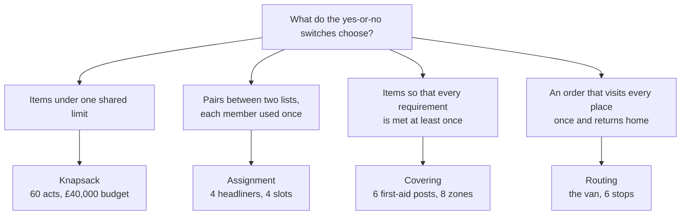
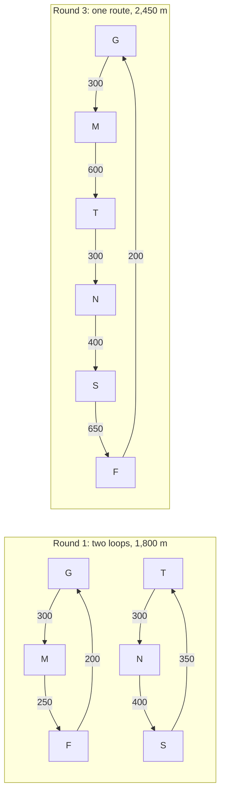

# Four classic models: knapsack, assignment, covering and routing

[Syllabus](../../../SYLLABUS.md) → [Optimization](../README.md) → [Integer and Combinatorial Optimisation](../README.md#s05) → Four classic models

---

## General Overview

A summer festival has £40,000 left for its line-up and 60 acts who have said yes. Each act has a fee and an expected draw: the extra tickets it would sell. Booking is all or nothing, since half a band cannot be booked. The question is which acts to book for the most tickets without going over budget.

The same office has three more decisions that week: which of four Saturday slots each of four headliners plays, where to put first-aid posts so every zone has one nearby, and the shortest drive for the supply van from the gate round five stops and back.

Each story is a list of yes-or-no choices bound by rules, and four rule shapes recur so often that they have names: **knapsack**, **assignment**, **covering** and **routing**. Match a problem to its shape and you know how to write it down, what solves it and which shortcuts fail. The line-up's answer is 16 acts, exactly £40,000, 7,100 tickets. A quick bound shows no booking sells more than 7,127, and a complete table proves 7,100 is best.

**Each model is a set of yes-or-no switches with one signature rule: one shared limit (knapsack), exactly one per row and per column (assignment), at least one per requirement (covering), or an assignment with closed loops banned (routing). To tell which model a new problem is, read its rules, not its story.**

**What kind of fact this is:** four standard models, each proved in Why it works to accept exactly the valid plans; the festival answers are certified by complete search.

### The picture: which model is it?



Schematic. Real problems often mix two shapes, as Step 5 shows.

---

## The formula

Here a **program** means a decision written as rules: something to make largest or smallest, plus the limits on it. It does not mean computer code. A **switch** $x_j$ is a variable that can only be 0 (no) or 1 (yes). Knapsack, the line-up, **maximises** tickets:

$$\max \sum_{j=1}^{60} v_j\,x_j \quad\text{subject to}\quad \sum_{j=1}^{60} w_j\,x_j \le B, \qquad x_j \in \{0, 1\}$$

**Read it aloud:** switch on the acts with the most tickets in total, keeping the sum of their fees within the budget.

Assignment, the headliners, **maximises** crowd. The switch $x_{ij}$ is 1 if act $i$ plays slot $j$:

$$\max \sum_{i}\sum_{j} c_{ij}\,x_{ij} \quad\text{subject to}\quad \sum_{j} x_{ij} = 1 \text{ for each act } i, \qquad \sum_{i} x_{ij} = 1 \text{ for each slot } j, \qquad x_{ij} \in \{0, 1\}$$

**Read it aloud:** each act plays exactly one slot and each slot gets exactly one act, and the crowds of the chosen pairs add up to as much as possible.

Covering, the first-aid posts, **minimises** cost:

$$\min \sum_{j=1}^{6} q_j\,x_j \quad\text{subject to}\quad \sum_{j=1}^{6} a_{zj}\,x_j \ge 1 \text{ for each zone } z, \qquad x_j \in \{0, 1\}$$

**Read it aloud:** open the cheapest set of posts such that every zone has at least one open post that covers it.

Routing, the van, **minimises** metres. The switch $x_{ij}$ is 1 if the van drives straight from stop $i$ to stop $j$:

$$\min \sum_{i \ne j} d_{ij}\,x_{ij} \quad\text{subject to}\quad \sum_{j} x_{ij} = 1, \quad \sum_{i} x_{ij} = 1, \quad \sum_{i, j \in S} x_{ij} \le \lvert S\rvert - 1 \text{ for every group } S \text{ of 2 to } n-1 \text{ stops}, \quad x_{ij} \in \{0, 1\}$$

**Read it aloud:** every stop has one leg out and one leg in, and no group of stops smaller than the whole site may hold a closed loop of its own.

The routing rules are the assignment rules plus one family of loop bans.

| Symbol | Plain meaning | In our example | Push it up and the answer… |
| --- | --- | --- | --- |
| $x_j$, $x_{ij}$ | a switch: 1 for yes, 0 for no; one item $j$, or one pair from $i$ to $j$ | book act 46: $x_{46} = 1$ | — |
| $v_j$ | act $j$'s draw, in tickets | act 46: 637 | the best total rises or stays |
| $w_j$ | act $j$'s fee, in pounds | act 46: £4,500 | the best total falls or stays |
| $B$ | the budget | £40,000 | rises: 5,704 tickets at £30,000, 8,456 at £50,000 |
| $c_{ij}$ | crowd if act $i$ plays slot $j$, in hundreds of people | Lumen at Main 21:00: 88 | the best total rises or stays |
| $q_j$ | the cost of first-aid post $j$ | P5: £5,700 | the best cost rises or stays |
| $a_{zj}$, $z$ | 1 if post $j$ covers zone $z$, else 0; $z$ numbers the eight zones | P1 covers zones 3, 4 and 5 | more posts per zone: cheaper, or the same |
| $d_{ij}$ | metres from stop $i$ to stop $j$ | gate to food court: 200 | the shortest route rises or stays |
| $S$, $\lvert S\rvert$ | a group of stops, and how many it holds | gate, main stage, food court: 3 | — |
| $n$ | how many stops | 6 | the number of routes grows as a factorial |
| $p^*$ | the best value a whole-number plan reaches | 7,100 tickets | — |
| $p_{\text{LP}}$ | the fractional bound: the best value when switches may take any value from 0 to 1 | 7,127 tickets | — |

### When it holds

- **The choices are whole.** If a decision can be split, like advertising bought by the pound, the fractional version is the model, and it is far easier.
- **Values add up.** If two acts share fans, their joint draw is less than the sum and knapsack overstates it; a switch for the pair fixes this ([Yes-or-no variables](02-modelling-with-binary-variables-big-m-and-indicators.md)).
- **Knapsack has one limit.** Add stage hours as a second limit and ranking by tickets per pound no longer gives the bound.
- **Covering asks for at least one.** "Exactly one" is a different problem, a partition, and on this site no partition exists.
- **Routing uses one vehicle and fixed distances.** Several vans, or opening times, make it a vehicle routing problem: the same parts plus more rules.

---

## Why it works

### Step 0: a model is right when its rules accept exactly the valid plans

A model is correct when two checks pass: every valid plan satisfies the rules, and every switch setting that satisfies the rules is a valid plan. Then the best switch setting is the best plan.

A second fact comes from [Integer programs](01-integer-programs-and-relaxations.md): letting switches take any value from 0 to 1 only widens the choice, so the best fractional value bounds the best whole value. Every certificate below is a complete search or such a bound.

### Step 1: knapsack, one shared limit

A booking is valid exactly when its fees fit the budget, which is what the single rule says.

**The bound.** Rank the acts by tickets per pound. Book them in that order until one does not fit. The best 16 by this ranking, listed in rank order in the output, use 75 of the 80 units of £500 and draw 6,782 tickets.

The next act, number 43, costs £3,500 (7 units) and draws 483 tickets. Only 5 units are left, so the fractional plan books 5/7 of it, worth 345 tickets. That gives $p_{\text{LP}} = 7{,}127$.

[Branch and bound](03-branch-and-bound.md) proves that this fill, from the 1957 paper in Sources, is the best fractional plan, so by Step 0 no booking of whole acts can beat it.

**The exact answer.** The [Dynamic programming](../../14-Applied%20and%20computational/01-Algorithms%20and%20Growth/07-dynamic-programming.md) card solves a 15 kg rucksack with a table. Here the table has one row per act and one column per £500 of budget from 0 to 80: 4,860 cells. It gives $p^* = 7{,}100$ tickets from 16 acts, spending the whole £40,000, and since it covers every state it is a proof as well as an answer. A full list of bookings would need $2^{60}$, about $1.15 \times 10^{18}$, entries.

[Branch and bound](03-branch-and-bound.md), using the fractional bound to discard branches, visits 108 nodes and reaches the same 7,100. The bound sits only 27 tickets, 0.38 percent, above the best, which is why so much of the tree can be discarded.

### Step 2: assignment, exactly one per row and column

Put the switches in a grid, one row per act and one column per slot. A grid with exactly one 1 in every row and every column is a pairing, and every pairing gives such a grid. Of the $2^{16} = 65{,}536$ possible grids of zeros and ones, 24 obey the rules, one for each of the 4! orderings.

| Crowd, hundreds | Main 21:00 | Main 19:00 | Tent 21:00 | Tent 19:00 |
| --- | ---: | ---: | ---: | ---: |
| Kestrel | 92 | 70 | 55 | 40 |
| Lumen | 88 | 60 | 64 | 45 |
| Marrow | 75 | 66 | 50 | 48 |
| Nettle | 70 | 52 | 58 | 30 |

The best timetable puts Lumen on Main 21:00, Kestrel on Main 19:00, Nettle on Tent 21:00 and Marrow on Tent 19:00. That is 264 hundred people; the worst timetable gets 220 hundred. For big tables the Hungarian method of [The assignment problem](../../14-Applied%20and%20computational/05-Operations%20Research/05-assignment-and-the-hungarian-algorithm.md) finds the best pairing without listing them. Alone among the four, assignment's fractional version already lands on whole numbers ([Total unimodularity](05-total-unimodularity.md)), so its bound is exact.

### Step 3: covering, at least one per requirement

The site has eight zones: 1 main stage, 2 tent stage, 3 food court, 4 entrance, 5 car park, 6 north campsite, 7 south campsite, 8 family field. Six spots could hold a post:

| Post | Zones it reaches quickly | Cost |
| --- | --- | ---: |
| P1 gate | 3, 4, 5 | £3,000 |
| P2 arena | 1, 2, 3, 8 | £4,500 |
| P3 north | 1, 6, 8 | £3,200 |
| P4 south | 2, 5, 7 | £3,200 |
| P5 hub | 1, 2, 3, 4, 6, 7 | £5,700 |
| P6 family | 8 | £1,500 |

Each zone gets one rule: its covering switches must add to at least 1. A choice of posts obeys every rule exactly when no zone is left uncovered. Of the 64 choices, 25 cover every zone, and the cheapest is P1 + P3 + P4 at £9,400. A table of the cheapest cost for each set of covered zones agrees.

The sign of the rule matters. The best plan covers zone 5, the car park, twice, from P1 and P4. Under "exactly once" no plan on this site is allowed at all. A zone covered twice is still safe, so covering allows it.

### Step 4: routing, assignment with closed loops banned

Give each stop a switch for each possible next stop. "One leg out and one leg in" is exactly the assignment rule, pairing each stop with the stop that follows it. But an assignment may split into several closed loops.

The stops are the gate G, main stage M and food court F near the entrance, and the tent T, north campsite N and south campsite S across the site. Solving the plan round by round shows the loops being removed:

| Round | Rules in force | Best assignment | Loops |
| --- | --- | ---: | --- |
| 1 | one out, one in | 1,800 m | G-M-F and T-N-S: two separate rounds |
| 2 | plus: no loop inside {G, M, F} or {T, N, S} | 2,400 m | G-F, M-T, N-S: three back-and-forth trips |
| 3 | plus: no loop inside those three pairs | 2,450 m | G-M-T-N-S-F-G: one round |

Each round has fewer rules than the real problem, so its best value is a lower bound. Round 3 returns a genuine route that meets its bound, so it is the shortest. A list of all 120 directed tours, each route counted once in each direction, gives the same 2,450 m. Brute force and the tree bound are on [The travelling salesman](../../04-Combinatorics%20and%20graphs/11-Tours%20-%20Euler%20and%20Hamilton/04-travelling-salesman-in-outline.md).



Schematic: the legs and their metres, not the map.

<details>
<summary>Detailed proof: assignment plus every loop ban accepts exactly the routes</summary>

Under "one out, one in" each stop has one successor and one predecessor, so following successors splits the stops into closed loops. If there are two or more, let $S$ be the stops of one of them: it has $\lvert S\rvert$ legs, all inside $S$, breaking the rule $\le \lvert S\rvert - 1$. So a setting obeying every rule is one loop through all $n$ stops: a route.

Conversely, a route through all stops must leave any group $S$ of 2 to $n - 1$ stops, so at least one of the $\lvert S\rvert$ legs out of $S$ goes outside, and at most $\lvert S\rvert - 1$ stay inside. Every route obeys every rule. The bans come from the 1954 paper in Sources. Adding them only as loops appear, as in the table above, is still how large routing problems are solved.

</details>

### Step 5: recognising a new problem

Write the rules in words before writing any formula, then look for the rule shape, not the story.

| The story | The rule that decides | The model |
| --- | --- | --- |
| Sponsors' banners along a fixed length of fence, most revenue | one shared limit | knapsack |
| Stewards to gates, one each, least total travel | one per steward, one per gate | assignment |
| Bands chosen so that every genre appears | at least one per genre | covering |
| The litter crew's walk past every bin and back | one loop through all | routing |
| Flight cases into the fewest lorries | each case in one lorry; each lorry's load within its limit | assignment rows plus a knapsack row per lorry: bin packing |
| Which depots to open, and which stage each supplies | each stage served once; only open depots serve | covering-style opening plus assignment: facility location |

The last two rows mix shapes, as most real models do. Knapsack, covering and routing are NP-hard in general: no known method stays fast on every instance (Karp's list, planned). Assignment is the easy exception. In practice the gap between the fractional bound and the best whole answer goes a long way to deciding how hard a model is to solve.

---

## Worked numbers, by hand

The line-up: 60 acts, a budget of 80 units of £500, maximise tickets.

| Step | Arithmetic | Value |
| --- | --- | --- |
| Rank by tickets per pound, book the best 16 | fees of the 16 listed in rank order in the output add to 75 units | 6,782 tickets |
| Room left | 80 − 75 | 5 units |
| Next act, number 43: 7 units, 483 tickets | 5/7 × 483 | 345 tickets |
| Fractional bound $p_{\text{LP}}$ | 6,782 + 345 | 7,127 tickets |
| Table, 60 acts by budget columns 0 to 80 | 4,860 cells | 7,100 tickets |
| Branch and bound, as a check | 108 nodes | 7,100 tickets |
| Gap | 7,127 − 7,100 | 27 tickets, 0.38 percent |
| **The booking** | **16 acts, £40,000** | **7,100 tickets** |

Book the 16 acts listed under "acts booked" in the output: they sell 7,100 extra tickets, and the table proves no booking within £40,000 sells more.

### What breaks if you drop a piece

| Mistake | Comes out at | What went wrong |
| --- | --- | --- |
| Book by tickets per pound, skipping acts that don't fit | 7,065 tickets | Greedy never undoes an early choice |
| Book by tickets per pound, stop at the first misfit | 6,782 tickets | 5 units of budget left unspent |
| Book the biggest draws first | 5,145 tickets | Big draws carry big fees |
| Report the fractional plan | 7,127 tickets | It books 5/7 of act 43 |
| Timetable: each act grabs its best free slot | 252 hundred, not 264 | Kestrel grabs Main 21:00 first; the best plan gives that slot to Lumen and moves Kestrel to Main 19:00 |
| Posts: cheapest per newly covered zone | £10,200, not £9,400 | The hub is cheapest per zone, then two zones need posts of their own |
| Posts: "exactly once" instead of "at least once" | no plan exists | Only P1 and P4 reach zone 5, and each overlaps every way to finish the cover |
| Route: assignment without loop bans | 1,800 m in two loops | The van never crosses the site |

The code prints every row.

---

## Code, from first principles, and it actually runs

The 60 acts come from a small fixed random-number generator (SplitMix64, seed 7), so both languages see the same acts. Each model is solved by two independent roads: knapsack by the table and by branch and bound; assignment by the 24 pairings and by all 65,536 grids; covering by all 64 choices and by a table over sets of zones; routing by all 120 directed tours and by assignment with loop bans added round by round. The only import, `Fraction`, does exact division.

### Python

```python
# Four classic integer models -- the check behind the card.  Standard library only.
# A festival books acts (knapsack), slots headliners (assignment), places first-aid
# posts (covering) and routes its van (routing); every answer is reached two ways.
from fractions import Fraction
def splitmix(s):                          # SplitMix64, a small fixed random-number generator
    s = (s + 0x9E3779B97F4A7C15) % 2**64
    z = ((s ^ (s >> 30)) * 0xBF58476D1CE4E5B9) % 2**64
    z = ((z ^ (z >> 27)) * 0x94D049BB133111EB) % 2**64
    return s, z ^ (z >> 31)
def make_acts(seed):                      # 60 acts: fee in units of 500 pounds, draw in tickets
    acts, s = [], seed
    for _ in range(60):
        s, a = splitmix(s); s, b = splitmix(s)
        acts.append((1 + a % 12, 40 * (1 + a % 12) + b % 300))
    return acts
def table(acts, W):                       # road 1: K[i][w] = most tickets from acts 1..i in w units
    K = [[0] * (W + 1)]
    for fee, draw in acts:
        K.append([max(K[-1][w], K[-1][w - fee] + draw) if fee <= w else K[-1][w] for w in range(W + 1)])
    pick, w = [], W
    for i in range(len(acts), 0, -1):     # walk back up the table to read off the acts
        if K[i][w] != K[i - 1][w]: pick, w = [i] + pick, w - acts[i - 1][0]
    return K[-1][W], pick
def fill(acts, order, k, room, skip, total=0):   # take acts in order while they fit
    for i in order[k:]:
        if acts[i][0] <= room:
            room, total = room - acts[i][0], total + acts[i][1]
        elif not skip:
            return total, i, room         # the act that does not fit, and the room left
    return total, None, room
def branch_and_bound(acts, W):            # road 2: a search tree, cut by the fractional bound
    order = sorted(range(60), key=lambda i: (-Fraction(acts[i][1], acts[i][0]), i))
    best, nodes = [0], [0]
    def visit(k, room, value):
        nodes[0] += 1
        base, cut, left = fill(acts, order, k, room, False)
        if cut is None:                   # everything left fits: this branch is settled
            best[0] = max(best[0], value + base); return
        if (value + base) * acts[cut][0] + acts[cut][1] * left <= best[0] * acts[cut][0]:
            return                        # even the fractional bound cannot beat the best
        best[0] = max(best[0], value)
        if acts[order[k]][0] <= room:
            visit(k + 1, room - acts[order[k]][0], value + acts[order[k]][1])
        visit(k + 1, room, value)
    visit(0, W, 0)
    return best[0], nodes[0], order
def perms(items):                         # every ordering, written out
    return [list(items)] if len(items) <= 1 else [[x] + p for k, x in enumerate(items) for p in perms(items[:k] + items[k + 1:])]

acts, W = make_acts(7), 80
best, pick = table(acts, W)
bb, nodes, order = branch_and_bound(acts, W)
base, cut, left = fill(acts, order, 0, W, False)
lp = base + Fraction(acts[cut][1] * left, acts[cut][0])
greedy = fill(acts, order, 0, W, True)[0]
big = fill(acts, sorted(range(60), key=lambda i: (-acts[i][1], i)), 0, W, True)[0]
print(f"knapsack: 60 acts, budget 40000 pounds = {W} units of 500; maximise tickets; a full list has {2**60} subsets")
print(f"road 1, table of {60 * (W + 1)} cells: {best} tickets, {len(pick)} acts, fees {500 * sum(acts[i - 1][0] for i in pick)} pounds")
ids = lambda v: "\n".join(" ".join(f"{i}:{500 * acts[i - 1][0]}:{acts[i - 1][1]}" for i in row) for row in (v[:8], v[8:]))
print("acts booked (number:fee in pounds:tickets):\n" + ids(pick))
print(f"road 2, branch and bound: {bb} tickets, {nodes} nodes visited")
print(f"fractional bound: best {order.index(cut)} acts by tickets per pound = {base} tickets, {W - left} units, in rank order:\n"
      + ids([i + 1 for i in order[:order.index(cut)]]))
print(f"  then act {cut + 1} (fee {500 * acts[cut][0]}, {acts[cut][1]} tickets) fits {left}/{acts[cut][0]}, worth {lp - base}: bound {lp}")
print(f"gap between bound and best: {lp - best} tickets, {float((lp - best) * 100 / best):.2f} percent")
print(f"greedy by tickets per pound, skipping misfits: {greedy}; stopping at the first misfit: {base}; by biggest draw: {big}")
assert best == bb and best <= lp < best + 30                   # table, tree and bound agree
assert big < base < greedy < best                              # every shortcut falls short

# assignment: four headliners, four Saturday slots, crowd in hundreds; maximise
names, slots = ["Kestrel", "Lumen", "Marrow", "Nettle"], ["Main 21:00", "Main 19:00", "Tent 21:00", "Tent 19:00"]
crowd = [[92, 70, 55, 40], [88, 60, 64, 45], [75, 66, 50, 48], [70, 52, 58, 30]]
total = lambda p: sum(crowd[i][p[i]] for i in range(4))
plan = max(plans := perms([0, 1, 2, 3]), key=total)            # road 1: the 24 pairings
on = lambda m, i, j: m >> (4 * i + j) & 1
grids = [m for m in range(2**16) if all(sum(on(m, i, j) for j in range(4)) == 1 for i in range(4))
         and all(sum(on(m, i, j) for i in range(4)) == 1 for j in range(4))]
grid_best = max(sum(crowd[i][j] * on(m, i, j) for i in range(4) for j in range(4)) for m in grids)
free, grab = [0, 1, 2, 3], 0                                   # road 2 above: all 65536 0-1 grids
for i in range(4):                                             # each act grabs its best free slot
    j = max(free, key=lambda j: crowd[i][j]); free.remove(j); grab += crowd[i][j]
print("assignment, crowd in hundreds: " + "; ".join(f"{names[i]} {crowd[i]}" for i in range(4)))
print("  best: " + ", ".join(f"{names[i]} -> {slots[plan[i]]}" for i in range(4)))
print(f"  crowd {total(plan)} hundred; 0-1 grids obeying the rules {len(grids)} of {2**16}, best {grid_best}; "
      f"worst plan {min(map(total, plans))}; grab {grab}")
assert len(grids) == len(plans) == 24 and grid_best == total(plan) and grab < total(plan)

# covering: eight zones, six possible first-aid posts; every zone covered; minimise cost
posts = {"P1": ({3, 4, 5}, 3000), "P2": ({1, 2, 3, 8}, 4500), "P3": ({1, 6, 8}, 3200),
         "P4": ({2, 5, 7}, 3200), "P5": ({1, 2, 3, 4, 6, 7}, 5700), "P6": ({8}, 1500)}
print("covering, zones and pounds: " + "; ".join(f"{p} {sorted(posts[p][0])} {posts[p][1]}" for p in posts))
picks = lambda m: [f"P{k + 1}" for k in range(6) if m >> k & 1]
count = lambda ch, z: sum(1 for p in ch if z in posts[p][0])
cost = lambda ch: sum(posts[p][1] for p in ch)
covers = [picks(m) for m in range(64) if all(count(picks(m), z) >= 1 for z in range(1, 9))]
exact = [picks(m) for m in range(64) if all(count(picks(m), z) == 1 for z in range(1, 9))]
cover = min(covers, key=cost)                                  # road 1: all 64 choices
dp = [0] + [10**9] * 255                                       # road 2: cheapest cost per zone set
for p in posts:
    mask = sum(1 << (z - 1) for z in posts[p][0])
    for s in range(255, -1, -1): dp[s | mask] = min(dp[s | mask], dp[s] + posts[p][1])
left, gcost, gpicks = set(range(1, 9)), 0, []
while left:                                                    # greedy: cheapest per new zone
    p = min((p for p in posts if posts[p][0] & left), key=lambda p: Fraction(posts[p][1], len(posts[p][0] & left)))
    left, gcost, gpicks = left - posts[p][0], gcost + posts[p][1], gpicks + [p]
print(f"  best {'+'.join(cover)} = {cost(cover)} pounds; zone-set table {dp[255]}; {len(covers)} of 64 choices cover")
print(f"  greedy {'+'.join(gpicks)} = {gcost} pounds; 'exactly once' plans: {len(exact)}")
assert cost(cover) == dp[255] == 9400 and gcost > cost(cover) and not exact
# routing: van from the gate G round five stops and back; metres; minimise
stops, edge = "GMFTNS", {"GM": 300, "GF": 200, "MF": 250, "TN": 300, "TS": 350, "NS": 400, "GT": 900, "GN": 1100,
              "GS": 800, "MT": 600, "MN": 800, "MS": 900, "FT": 700, "FN": 1000, "FS": 650}
print("routing, metres: " + " ".join(f"{k}={v}" for k, v in edge.items()))
def routing(edge, show):
    d = [[0 if a == b else edge.get(a + b, edge.get(b + a)) for b in stops] for a in stops]
    tours = [[0] + p for p in perms([1, 2, 3, 4, 5])]          # road 1: all 120 directed tours
    length = lambda t: sum(d[t[k]][t[(k + 1) % 6]] for k in range(6))
    tour = min(tours, key=length)
    moves = [p for p in perms(list(range(6))) if all(p[i] != i for i in range(6))]
    cuts, rounds = [], []                                      # road 2: assignment, then cut loops
    while True:
        ok = [p for p in moves if all(sum(1 for i in S if p[i] in S) <= len(S) - 1 for S in cuts)]
        nxt = min(ok, key=lambda p: sum(d[i][p[i]] for i in range(6)))
        found, seen = [], set()
        for i in range(6):                                     # split the next-stop list into loops
            loop = []
            while i not in seen: seen.add(i); loop.append(i); i = nxt[i]
            found += [loop] if loop else []
        rounds.append(sum(d[i][nxt[i]] for i in range(6)))
        if show:
            print(f"routing round {len(rounds)}: {len(ok)} allowed, best {rounds[-1]} m, loops " + " ".join("".join(stops[k] for k in L) for L in found))
        if len(found) == 1:
            return "".join(stops[k] for k in tour) + "G", length(tour), rounds, len(tours)
        cuts += [set(L) for L in found]
tour, tlen, rounds, ntours = routing(edge, True)
print(f"routing: all {ntours} directed tours, best {tour} = {tlen} m")
assert rounds == sorted(rounds) and rounds[-1] == tlen and rounds[0] < tlen   # cut loop meets brute force
print(f"try: budget 30000 -> {table(acts, 60)[0]} tickets; budget 50000 -> {table(acts, 100)[0]}")
t2, _, r2, _ = routing({**edge, "GT": 500}, False)
print(f"try: track G-T cut to 500 m -> {t2} = {r2[-1]} m after {len(r2)} rounds")
print("ALL CHECKS PASS")
```

**Ran 2026-11-11 on macOS, Python 3.14.10, standard library only. All checks passed. Output, pasted from the run:**

```
knapsack: 60 acts, budget 40000 pounds = 80 units of 500; maximise tickets; a full list has 1152921504606846976 subsets
road 1, table of 4860 cells: 7100 tickets, 16 acts, fees 40000 pounds
acts booked (number:fee in pounds:tickets):
1:2000:364 7:3500:524 21:1000:285 23:3500:530 25:3500:576 26:3500:510 27:1500:362 30:1500:354
33:5000:667 37:2500:457 38:500:237 40:2500:491 46:4500:637 49:500:274 51:4000:575 52:500:257
road 2, branch and bound: 7100 tickets, 108 nodes visited
fractional bound: best 16 acts by tickets per pound = 6782 tickets, 75 units, in rank order:
49:500:274 52:500:257 38:500:237 21:1000:285 27:1500:362 30:1500:354 40:2500:491 37:2500:457
1:2000:364 25:3500:576 23:3500:530 7:3500:524 26:3500:510 51:4000:575 46:4500:637 54:2500:349
  then act 43 (fee 3500, 483 tickets) fits 5/7, worth 345: bound 7127
gap between bound and best: 27 tickets, 0.38 percent
greedy by tickets per pound, skipping misfits: 7065; stopping at the first misfit: 6782; by biggest draw: 5145
assignment, crowd in hundreds: Kestrel [92, 70, 55, 40]; Lumen [88, 60, 64, 45]; Marrow [75, 66, 50, 48]; Nettle [70, 52, 58, 30]
  best: Kestrel -> Main 19:00, Lumen -> Main 21:00, Marrow -> Tent 19:00, Nettle -> Tent 21:00
  crowd 264 hundred; 0-1 grids obeying the rules 24 of 65536, best 264; worst plan 220; grab 252
covering, zones and pounds: P1 [3, 4, 5] 3000; P2 [1, 2, 3, 8] 4500; P3 [1, 6, 8] 3200; P4 [2, 5, 7] 3200; P5 [1, 2, 3, 4, 6, 7] 5700; P6 [8] 1500
  best P1+P3+P4 = 9400 pounds; zone-set table 9400; 25 of 64 choices cover
  greedy P5+P6+P1 = 10200 pounds; 'exactly once' plans: 0
routing, metres: GM=300 GF=200 MF=250 TN=300 TS=350 NS=400 GT=900 GN=1100 GS=800 MT=600 MN=800 MS=900 FT=700 FN=1000 FS=650
routing round 1: 265 allowed, best 1800 m, loops GMF TNS
routing round 2: 261 allowed, best 2400 m, loops GF MT NS
routing round 3: 236 allowed, best 2450 m, loops GMTNSF
routing: all 120 directed tours, best GMTNSFG = 2450 m
try: budget 30000 -> 5704 tickets; budget 50000 -> 8456
try: track G-T cut to 500 m -> GMFSNTG = 2400 m after 3 rounds
ALL CHECKS PASS
```

### Rust

The same output, with the same labels, built with `rustc --edition 2021 -O`.

```rust
// Four classic integer models -- the same check as the Python, in Rust.  No crates.
// A festival books acts (knapsack), slots headliners (assignment), places first-aid
// posts (covering) and routes its van (routing); every answer is reached two ways.
fn splitmix(s: u64) -> (u64, u64) {       // SplitMix64, a small fixed random-number generator
    let s = s.wrapping_add(0x9E3779B97F4A7C15);
    let z = (s ^ (s >> 30)).wrapping_mul(0xBF58476D1CE4E5B9);
    let z = (z ^ (z >> 27)).wrapping_mul(0x94D049BB133111EB);
    (s, z ^ (z >> 31))
}
fn make_acts(seed: u64) -> Vec<(i64, i64)> { // 60 acts: fee in units of 500 pounds, draw in tickets
    let (mut acts, mut s) = (Vec::new(), seed);
    for _ in 0..60 {
        let (s1, a) = splitmix(s); let (s2, b) = splitmix(s1);
        let fee = 1 + (a % 12) as i64;
        (s, acts) = (s2, [acts, vec![(fee, 40 * fee + (b % 300) as i64)]].concat());
    }
    acts
}
fn table(acts: &[(i64, i64)], w_max: usize) -> (i64, Vec<usize>) { // road 1: the table
    let mut k = vec![vec![0i64; w_max + 1]];
    for &(fee, draw) in acts {
        let prev = k.last().unwrap().clone();
        k.push((0..=w_max).map(|w| if fee as usize <= w { prev[w].max(prev[w - fee as usize] + draw) } else { prev[w] }).collect());
    }
    let (mut pick, mut w) = (Vec::new(), w_max);
    for i in (1..=acts.len()).rev() {      // walk back up the table to read off the acts
        if k[i][w] != k[i - 1][w] { pick.insert(0, i); w -= acts[i - 1].0 as usize; }
    }
    (k[acts.len()][w_max], pick)
}
// take acts in order while they fit; returns total, the act that does not fit, room left
fn fill(acts: &[(i64, i64)], order: &[usize], k: usize, mut room: i64, skip: bool) -> (i64, Option<usize>, i64) {
    let mut total = 0;
    for &i in &order[k..] {
        if acts[i].0 <= room { room -= acts[i].0; total += acts[i].1; }
        else if !skip { return (total, Some(i), room); }
    }
    (total, None, room)
}
fn visit(acts: &[(i64, i64)], order: &[usize], k: usize, room: i64, value: i64, best: &mut i64, nodes: &mut u64) {
    *nodes += 1;
    let (base, cut, left) = fill(acts, order, k, room, false);
    let Some(c) = cut else { *best = (*best).max(value + base); return; }; // everything left fits
    if (value + base) * acts[c].0 + acts[c].1 * left <= *best * acts[c].0 { return; } // bound cannot win
    *best = (*best).max(value);
    let (fee, draw) = acts[order[k]];
    if fee <= room { visit(acts, order, k + 1, room - fee, value + draw, best, nodes); }
    visit(acts, order, k + 1, room, value, best, nodes);
}
fn perms(items: &[usize]) -> Vec<Vec<usize>> { // every ordering, written out
    if items.len() <= 1 { return vec![items.to_vec()]; }
    (0..items.len()).flat_map(|k| { let rest = [&items[..k], &items[k + 1..]].concat();
        perms(&rest).into_iter().map(move |p| [vec![items[k]], p].concat()) }).collect()
}
fn gcd(a: i64, b: i64) -> i64 { if b == 0 { a } else { gcd(b, a % b) } }
fn frac(n: i64, d: i64) -> String { let g = gcd(n, d); if d / g == 1 { format!("{}", n / g) } else { format!("{}/{}", n / g, d / g) } }
const STOPS: [char; 6] = ['G', 'M', 'F', 'T', 'N', 'S'];
fn routing(edge: &[(&str, i64)], show: bool) -> (String, i64, Vec<i64>, usize) {
    let d: Vec<Vec<i64>> = STOPS.iter().map(|&a| STOPS.iter().map(|&b| edge.iter().filter(|e| e.0 == format!("{}{}", a, b)
        || e.0 == format!("{}{}", b, a)).map(|e| e.1).sum()).collect()).collect(); // a stop to itself: 0
    let tours: Vec<Vec<usize>> = perms(&[1, 2, 3, 4, 5]).into_iter().map(|p| [vec![0], p].concat()).collect();
    let length = |t: &Vec<usize>| -> i64 { (0..6).map(|k| d[t[k]][t[(k + 1) % 6]]).sum() };
    let tour = tours.iter().fold(&tours[0], |b, t| if length(t) < length(b) { t } else { b }); // road 1: 120 tours
    let moves: Vec<Vec<usize>> = perms(&[0, 1, 2, 3, 4, 5]).into_iter().filter(|p| (0..6).all(|i| p[i] != i)).collect();
    let (mut cuts, mut rounds): (Vec<Vec<usize>>, Vec<i64>) = (Vec::new(), Vec::new()); // road 2: assignment, then cut loops
    loop {
        let ok: Vec<&Vec<usize>> = moves.iter().filter(|p| cuts.iter().all(|s| s.iter().filter(|&&i| s.contains(&p[i])).count() <= s.len() - 1)).collect();
        let cost = |p: &Vec<usize>| -> i64 { (0..6).map(|i| d[i][p[i]]).sum() };
        let nxt = ok.iter().fold(ok[0], |b, &p| if cost(p) < cost(b) { p } else { b });
        let (mut found, mut seen): (Vec<Vec<usize>>, Vec<bool>) = (Vec::new(), vec![false; 6]);
        for i0 in 0..6 {                    // split the next-stop list into loops
            let (mut lp, mut i) = (Vec::new(), i0);
            while !seen[i] { seen[i] = true; lp.push(i); i = nxt[i]; }
            if !lp.is_empty() { found.push(lp); }
        }
        rounds.push(cost(nxt));
        let name = |l: &Vec<usize>| -> String { l.iter().map(|&k| STOPS[k]).collect() };
        if show { println!("routing round {}: {} allowed, best {} m, loops {}", rounds.len(), ok.len(), rounds.last().unwrap(),
                           found.iter().map(|l| name(l)).collect::<Vec<_>>().join(" ")); }
        if found.len() == 1 { return (name(tour) + "G", length(tour), rounds, tours.len()); }
        cuts.extend(found);
    }
}
fn main() {
    let (acts, w) = (make_acts(7), 80usize);
    let (best, pick) = table(&acts, w);
    let mut order: Vec<usize> = (0..60).collect(); // best tickets per pound first, ties by number
    order.sort_by(|&i, &j| (acts[j].1 * acts[i].0).cmp(&(acts[i].1 * acts[j].0)).then(i.cmp(&j)));
    let (mut bb, mut nodes) = (0i64, 0u64);       // road 2: branch and bound
    visit(&acts, &order, 0, w as i64, 0, &mut bb, &mut nodes);
    let (base, cut, left) = fill(&acts, &order, 0, w as i64, false);
    let c = cut.unwrap(); let k = order.iter().position(|&i| i == c).unwrap(); // the act the fractional bound cuts, and its rank
    let (lp_num, lp_den) = (base * acts[c].0 + acts[c].1 * left, acts[c].0);
    let greedy = fill(&acts, &order, 0, w as i64, true).0;
    let mut by_draw: Vec<usize> = (0..60).collect(); by_draw.sort_by(|&i, &j| acts[j].1.cmp(&acts[i].1).then(i.cmp(&j)));
    let big = fill(&acts, &by_draw, 0, w as i64, true).0;
    println!("knapsack: 60 acts, budget 40000 pounds = {} units of 500; maximise tickets; a full list has {} subsets", w, 1u64 << 60);
    println!("road 1, table of {} cells: {} tickets, {} acts, fees {} pounds", 60 * (w + 1), best, pick.len(), 500 * pick.iter().map(|&i| acts[i - 1].0).sum::<i64>());
    let ids = |v: &[usize]| [&v[..8], &v[8..]].iter().map(|row| row.iter().map(|&i| format!("{}:{}:{}", i, 500 * acts[i - 1].0, acts[i - 1].1))
        .collect::<Vec<_>>().join(" ")).collect::<Vec<_>>().join("\n");
    println!("acts booked (number:fee in pounds:tickets):\n{}", ids(&pick));
    println!("road 2, branch and bound: {} tickets, {} nodes visited", bb, nodes);
    println!("fractional bound: best {} acts by tickets per pound = {} tickets, {} units, in rank order:\n{}", k, base, w as i64 - left,
             ids(&order[..k].iter().map(|&i| i + 1).collect::<Vec<_>>()));
    println!("  then act {} (fee {}, {} tickets) fits {}, worth {}: bound {}", c + 1, 500 * acts[c].0, acts[c].1, frac(left, acts[c].0),
             frac(acts[c].1 * left, lp_den), frac(lp_num, lp_den));
    let gap = lp_num - best * lp_den;
    println!("gap between bound and best: {} tickets, {:.2} percent", frac(gap, lp_den), (gap * 100) as f64 / (lp_den * best) as f64);
    println!("greedy by tickets per pound, skipping misfits: {}; stopping at the first misfit: {}; by biggest draw: {}", greedy, base, big);
    assert!(best == bb && best * lp_den <= lp_num && lp_num < (best + 30) * lp_den); // table, tree and bound agree
    assert!(big < base && base < greedy && greedy < best);                       // every shortcut falls short
    // assignment: four headliners, four Saturday slots, crowd in hundreds; maximise
    let (names, slots) = (["Kestrel", "Lumen", "Marrow", "Nettle"], ["Main 21:00", "Main 19:00", "Tent 21:00", "Tent 19:00"]);
    let crowd = [[92, 70, 55, 40], [88, 60, 64, 45], [75, 66, 50, 48], [70, 52, 58, 30]];
    let total = |p: &Vec<usize>| -> i64 { (0..4).map(|i| crowd[i][p[i]]).sum() };
    let plans = perms(&[0, 1, 2, 3]);
    let plan = plans.iter().fold(&plans[0], |b, p| if total(p) > total(b) { p } else { b }); // road 1: 24 pairings
    let on = |m: u32, i: usize, j: usize| -> i64 { ((m >> (4 * i + j)) & 1) as i64 };
    let grids: Vec<u32> = (0..1u32 << 16).filter(|&m| (0..4).all(|i| (0..4).map(|j| on(m, i, j)).sum::<i64>() == 1)
        && (0..4).all(|j| (0..4).map(|i| on(m, i, j)).sum::<i64>() == 1)).collect(); // road 2: all 0-1 grids
    let grid_best = grids.iter().map(|&m| (0..16).map(|c| crowd[c / 4][c % 4] * on(m, c / 4, c % 4)).sum::<i64>()).max().unwrap();
    let (mut free, mut grab) = (vec![0usize, 1, 2, 3], 0i64);
    for i in 0..4 {                         // each act grabs its best free slot
        let j = free.iter().fold(free[0], |j, &f| if crowd[i][f] > crowd[i][j] { f } else { j });
        free.retain(|&f| f != j); grab += crowd[i][j];
    }
    println!("assignment, crowd in hundreds: {}", (0..4).map(|i| format!("{} {:?}", names[i], crowd[i])).collect::<Vec<_>>().join("; "));
    println!("  best: {}", (0..4).map(|i| format!("{} -> {}", names[i], slots[plan[i]])).collect::<Vec<_>>().join(", "));
    println!("  crowd {} hundred; 0-1 grids obeying the rules {} of {}, best {}; worst plan {}; grab {}", total(plan), grids.len(), 1 << 16,
             grid_best, plans.iter().map(|p| total(p)).min().unwrap(), grab);
    assert!(grids.len() == 24 && plans.len() == 24 && grid_best == total(plan) && grab < total(plan));
    // covering: eight zones, six possible first-aid posts; every zone covered; minimise cost
    let posts: [(&[usize], i64); 6] = [(&[3, 4, 5], 3000), (&[1, 2, 3, 8], 4500), (&[1, 6, 8], 3200),
                                       (&[2, 5, 7], 3200), (&[1, 2, 3, 4, 6, 7], 5700), (&[8], 1500)];
    println!("covering, zones and pounds: {}", (0..6).map(|k| format!("P{} {:?} {}", k + 1, posts[k].0, posts[k].1)).collect::<Vec<_>>().join("; "));
    let count = |m: usize, z: usize| (0..6).filter(|&k| m >> k & 1 == 1 && posts[k].0.contains(&z)).count();
    let cost = |m: usize| -> i64 { (0..6).filter(|&k| m >> k & 1 == 1).map(|k| posts[k].1).sum() };
    let covers: Vec<usize> = (0..64).filter(|&m| (1..=8).all(|z| count(m, z) >= 1)).collect();
    let exact = (0..64).filter(|&m| (1..=8).all(|z| count(m, z) == 1)).count();
    let cover = covers.iter().fold(covers[0], |b, &m| if cost(m) < cost(b) { m } else { b }); // road 1: 64 choices
    let mut dp: Vec<i64> = (0..256).map(|s| if s == 0 { 0 } else { 1_000_000_000 }).collect(); // road 2: cost per zone set
    for p in &posts {
        let mask: usize = p.0.iter().map(|z| 1 << (z - 1)).sum();
        for s in (0..256).rev() { dp[s | mask] = dp[s | mask].min(dp[s] + p.1); }
    }
    let (mut left, mut gcost, mut gpicks): (Vec<usize>, i64, Vec<String>) = ((1..=8).collect(), 0, Vec::new());
    while !left.is_empty() {                // greedy: cheapest per new zone
        let new = |k: usize| posts[k].0.iter().filter(|z| left.contains(z)).count() as i64;
        let pk = (0..6).filter(|&k| new(k) > 0).fold(usize::MAX, |pk, k|
            if pk == usize::MAX || posts[k].1 * new(pk) < posts[pk].1 * new(k) { k } else { pk });
        left.retain(|z| !posts[pk].0.contains(z));
        (gcost, gpicks) = (gcost + posts[pk].1, [gpicks, vec![format!("P{}", pk + 1)]].concat());
    }
    let label = |m: usize| (0..6).filter(|&k| m >> k & 1 == 1).map(|k| format!("P{}", k + 1)).collect::<Vec<_>>().join("+");
    println!("  best {} = {} pounds; zone-set table {}; {} of 64 choices cover", label(cover), cost(cover), dp[255], covers.len());
    println!("  greedy {} = {} pounds; 'exactly once' plans: {}", gpicks.join("+"), gcost, exact);
    assert!(cost(cover) == dp[255] && dp[255] == 9400 && gcost > cost(cover) && exact == 0);
    // routing: van from the gate G round five stops and back; metres; minimise
    let mut edge = [("GM", 300), ("GF", 200), ("MF", 250), ("TN", 300), ("TS", 350), ("NS", 400), ("GT", 900), ("GN", 1100),
                    ("GS", 800), ("MT", 600), ("MN", 800), ("MS", 900), ("FT", 700), ("FN", 1000), ("FS", 650)];
    println!("routing, metres: {}", edge.iter().map(|e| format!("{}={}", e.0, e.1)).collect::<Vec<_>>().join(" "));
    let (tour, tlen, rounds, ntours) = routing(&edge, true);
    println!("routing: all {} directed tours, best {} = {} m", ntours, tour, tlen);
    assert!(rounds.windows(2).all(|p| p[0] <= p[1]) && *rounds.last().unwrap() == tlen && rounds[0] < tlen); // cut loop meets brute force
    println!("try: budget 30000 -> {} tickets; budget 50000 -> {}", table(&acts, 60).0, table(&acts, 100).0);
    edge[6].1 = 500;                        // the track from G to T
    let (t2, _, r2, _) = routing(&edge, false);
    println!("try: track G-T cut to 500 m -> {} = {} m after {} rounds", t2, r2.last().unwrap(), r2.len());
    println!("ALL CHECKS PASS");
}
```

**Ran 2026-11-11 on macOS, rustc 1.98.1, no crates. All checks passed. Output, pasted from the run:**

```
knapsack: 60 acts, budget 40000 pounds = 80 units of 500; maximise tickets; a full list has 1152921504606846976 subsets
road 1, table of 4860 cells: 7100 tickets, 16 acts, fees 40000 pounds
acts booked (number:fee in pounds:tickets):
1:2000:364 7:3500:524 21:1000:285 23:3500:530 25:3500:576 26:3500:510 27:1500:362 30:1500:354
33:5000:667 37:2500:457 38:500:237 40:2500:491 46:4500:637 49:500:274 51:4000:575 52:500:257
road 2, branch and bound: 7100 tickets, 108 nodes visited
fractional bound: best 16 acts by tickets per pound = 6782 tickets, 75 units, in rank order:
49:500:274 52:500:257 38:500:237 21:1000:285 27:1500:362 30:1500:354 40:2500:491 37:2500:457
1:2000:364 25:3500:576 23:3500:530 7:3500:524 26:3500:510 51:4000:575 46:4500:637 54:2500:349
  then act 43 (fee 3500, 483 tickets) fits 5/7, worth 345: bound 7127
gap between bound and best: 27 tickets, 0.38 percent
greedy by tickets per pound, skipping misfits: 7065; stopping at the first misfit: 6782; by biggest draw: 5145
assignment, crowd in hundreds: Kestrel [92, 70, 55, 40]; Lumen [88, 60, 64, 45]; Marrow [75, 66, 50, 48]; Nettle [70, 52, 58, 30]
  best: Kestrel -> Main 19:00, Lumen -> Main 21:00, Marrow -> Tent 19:00, Nettle -> Tent 21:00
  crowd 264 hundred; 0-1 grids obeying the rules 24 of 65536, best 264; worst plan 220; grab 252
covering, zones and pounds: P1 [3, 4, 5] 3000; P2 [1, 2, 3, 8] 4500; P3 [1, 6, 8] 3200; P4 [2, 5, 7] 3200; P5 [1, 2, 3, 4, 6, 7] 5700; P6 [8] 1500
  best P1+P3+P4 = 9400 pounds; zone-set table 9400; 25 of 64 choices cover
  greedy P5+P6+P1 = 10200 pounds; 'exactly once' plans: 0
routing, metres: GM=300 GF=200 MF=250 TN=300 TS=350 NS=400 GT=900 GN=1100 GS=800 MT=600 MN=800 MS=900 FT=700 FN=1000 FS=650
routing round 1: 265 allowed, best 1800 m, loops GMF TNS
routing round 2: 261 allowed, best 2400 m, loops GF MT NS
routing round 3: 236 allowed, best 2450 m, loops GMTNSF
routing: all 120 directed tours, best GMTNSFG = 2450 m
try: budget 30000 -> 5704 tickets; budget 50000 -> 8456
try: track G-T cut to 500 m -> GMFSNTG = 2400 m after 3 rounds
ALL CHECKS PASS
```

The two outputs match line for line.

### Lean

Lean proves the assignment and routing rules accept exactly the valid plans, at any size, and checks the festival's numbers.

- A 0-1 grid with exactly one 1 in every row and every column is a pairing, and every pairing gives such a grid.
- Of all the 0-1 grids with $n$ rows and $n$ columns, exactly $n!$ obey the assignment rules: 24 of 65,536 when $n = 4$.
- Give every stop one next stop, never itself. The plan is one route through all $n$ stops exactly when it obeys every loop ban.
- The 16 booked acts cost £40,000 and draw 7,100 tickets. The best 16 by tickets per pound use 75 units and draw 6,782.
- 5/7 of act 43 is worth 345 tickets, so the fractional bound is 7,127, which is 27 above 7,100.
- The best timetable draws 264 hundred, no timetable beats it, and none falls below 220. Each act grabbing its best free slot gets 252.
- P1 + P3 + P4 covers every zone for £9,400, and no cover is cheaper. Of the 64 choices, 25 cover every zone.
- Under "exactly once" no choice of posts works. The greedy P5 + P6 + P1 costs £10,200.
- Round 1's loops G-M-F and T-N-S total 1,800 m, and round 2's trips G-F, M-T and N-S total 2,400 m.
- The route G-M-T-N-S-F-G is 2,450 m, and none of the 120 directed tours is shorter.

That 7,100 is the best booking, the shortcut bookings and each round's best value are left to the Python and Rust checks.

```lean
-- Four classic models: the assignment rules accept exactly the pairings, adding every loop ban accepts exactly the single routes, and the festival's whole-number answers check out.
import Mathlib.GroupTheory.Perm.Cycle.Basic
import Mathlib.Algebra.BigOperators.Fin
import Mathlib.Data.Fintype.Perm
import Mathlib.Data.Fintype.Pi
import Mathlib.Data.Nat.Factorial.Basic

open Finset

theorem helper_val_fin_two (a : Fin 2) : (a : ℕ) = if a = 1 then 1 else 0 := by
  revert a; decide

theorem helper_sum_fin_two {ι : Type*} (s : Finset ι) (g : ι → Fin 2) :
    ∑ j ∈ s, (g j : ℕ) = (s.filter (fun j => g j = 1)).card := by
  rw [Finset.card_filter]
  exact Finset.sum_congr rfl (fun j _ => helper_val_fin_two (g j))

#print axioms helper_val_fin_two
#print axioms helper_sum_fin_two

/-- Routing (Step 4 and its detailed proof): give every stop exactly one next stop, never itself
(one leg out and one leg in at every stop). Then the van's plan is one closed loop through all
`n` stops exactly when every group `S` of 2 to `n - 1` stops holds at most `|S| - 1` legs that
start and end inside `S` (the loop bans). -/
theorem loop_bans_accept_exactly_the_routes {n : ℕ} (σ : Equiv.Perm (Fin n))
    (hσ : ∀ i, σ i ≠ i) :
    σ.IsCycleOn Set.univ ↔
      ∀ S : Finset (Fin n), 2 ≤ S.card → S.card ≤ n - 1 →
        (S.filter (fun i => σ i ∈ S)).card ≤ S.card - 1 := by
  constructor
  · intro hc S h2 hS
    have hlt : (S.filter (fun i => σ i ∈ S)).card < S.card := by
      apply Finset.card_lt_card
      refine ⟨Finset.filter_subset _ _, fun hsub => ?_⟩
      have hinv : ∀ i ∈ S, σ i ∈ S := fun i hi => (Finset.mem_filter.mp (hsub hi)).2
      have hpow : ∀ (k : ℕ), ∀ i ∈ S, (σ ^ k) i ∈ S := by
        intro k
        induction k with
        | zero => intro i hi; simpa using hi
        | succ k ih =>
          intro i hi
          rw [pow_succ', Equiv.Perm.mul_apply]
          exact hinv _ (ih i hi)
      obtain ⟨a, ha⟩ : S.Nonempty := card_pos.mp (by omega : 0 < S.card)
      obtain ⟨b, hb⟩ : ∃ b, b ∉ S := by
        by_contra hall
        push Not at hall
        have : S = univ := eq_univ_of_forall hall
        rw [this, card_univ, Fintype.card_fin] at hS h2
        omega
      obtain ⟨k, -, hk⟩ := (hc.2 (Set.mem_univ a) (Set.mem_univ b)).exists_pow_eq'
      exact hb (hk ▸ hpow k a ha)
    omega
  · intro h
    classical
    by_contra hnc
    obtain ⟨a, b, hab⟩ : ∃ a b, ¬ σ.SameCycle a b := by
      by_contra hall
      push Not at hall
      exact hnc ⟨⟨fun x _ => Set.mem_univ _, σ.injective.injOn,
        fun y _ => ⟨σ.symm y, Set.mem_univ _, by simp⟩⟩, fun x _ y _ => hall x y⟩
    set S := univ.filter (fun i => σ.SameCycle a i) with hSdef
    have hsub2 : ({a, σ a} : Finset (Fin n)) ⊆ S := by
      intro i hi
      simp only [Finset.mem_insert, Finset.mem_singleton] at hi
      rcases hi with rfl | rfl
      · simpa [hSdef] using Equiv.Perm.SameCycle.refl σ i
      · simpa [hSdef, Equiv.Perm.sameCycle_apply_right] using Equiv.Perm.SameCycle.refl σ a
    have hcard2 : 2 ≤ S.card := by
      have : ({a, σ a} : Finset (Fin n)).card = 2 := by
        rw [Finset.card_pair (Ne.symm (hσ a))]
      rw [← this]
      exact Finset.card_le_card hsub2
    have hcardn : S.card ≤ n - 1 := by
      have hsub : S ⊆ univ.erase b := by
        intro i hi
        simp only [hSdef, Finset.mem_filter, Finset.mem_univ, true_and] at hi
        simp only [Finset.mem_erase, Finset.mem_univ, and_true]
        rintro rfl
        exact hab hi
      have := Finset.card_le_card hsub
      rw [Finset.card_erase_of_mem (Finset.mem_univ _), card_univ, Fintype.card_fin] at this
      exact this
    have hfilt : S.filter (fun i => σ i ∈ S) = S := by
      apply Finset.filter_true_of_mem
      intro i hi
      simp only [hSdef, Finset.mem_filter, Finset.mem_univ, true_and] at hi ⊢
      exact Equiv.Perm.sameCycle_apply_right.mpr hi
    have := h S hcard2 hcardn
    rw [hfilt] at this
    omega

/-- Assignment (Step 2): a grid of 0-1 switches with exactly one 1 in every row and exactly one 1
in every column is a pairing of rows with columns, and every pairing gives such a grid. -/
theorem assignment_rules_accept_exactly_the_pairings {n : ℕ} (x : Fin n → Fin n → Fin 2) :
    ((∀ i, ∑ j, (x i j : ℕ) = 1) ∧ ∀ j, ∑ i, (x i j : ℕ) = 1) ↔
      ∃ σ : Equiv.Perm (Fin n), ∀ i j, x i j = if σ i = j then 1 else 0 := by
  constructor
  · rintro ⟨hr, hc⟩
    have hr' : ∀ i, ∃ j, univ.filter (fun j => x i j = 1) = {j} := fun i => by
      rw [← Finset.card_eq_one, ← helper_sum_fin_two]
      exact hr i
    have hc' : ∀ j, ∃ i, univ.filter (fun i => x i j = 1) = {i} := fun j => by
      rw [← Finset.card_eq_one, ← helper_sum_fin_two]
      exact hc j
    choose f hf using hr'
    have hf1 : ∀ i j, x i j = 1 ↔ f i = j := by
      intro i j
      have := Finset.ext_iff.mp (hf i) j
      simp only [Finset.mem_filter, Finset.mem_univ, true_and, Finset.mem_singleton] at this
      rw [this, eq_comm]
    have hinj : Function.Injective f := by
      intro a b hab
      obtain ⟨i, hi⟩ := hc' (f a)
      have ha : a ∈ univ.filter (fun i => x i (f a) = 1) := by simp [hf1]
      have hb : b ∈ univ.filter (fun i => x i (f a) = 1) := by simp [hf1, hab]
      rw [hi, Finset.mem_singleton] at ha hb
      rw [ha, hb]
    refine ⟨Equiv.ofBijective f (Finite.injective_iff_bijective.mp hinj), fun i j => ?_⟩
    simp only [Equiv.ofBijective_apply]
    split_ifs with h
    · exact (hf1 i j).mpr h
    · have := (hf1 i j).not.mpr h
      revert this
      generalize x i j = a
      revert a
      decide
  · rintro ⟨σ, hσ⟩
    refine ⟨fun i => ?_, fun j => ?_⟩
    · rw [helper_sum_fin_two, Finset.card_eq_one]
      refine ⟨σ i, ?_⟩
      ext j
      simp only [Finset.mem_filter, Finset.mem_univ, true_and, Finset.mem_singleton, hσ]
      split_ifs with h
      · simp [h]
      · constructor
        · intro h'; exact absurd h' (by decide)
        · intro h'; exact absurd h'.symm h
    · rw [helper_sum_fin_two, Finset.card_eq_one]
      refine ⟨σ.symm j, ?_⟩
      ext i
      simp only [Finset.mem_filter, Finset.mem_univ, true_and, Finset.mem_singleton, hσ]
      split_ifs with h
      · simp [← h]
      · constructor
        · intro h'; exact absurd h' (by decide)
        · intro h'; subst h'; exact absurd (by simp) h

/-- Assignment (Step 2): of all the 0-1 grids with `n` rows and `n` columns, exactly `n!` obey the
assignment rules, one for each ordering (24 of 65,536 when `n = 4`). -/
theorem assignment_grid_count (n : ℕ) :
    (univ.filter (fun x : Fin n → Fin n → Fin 2 =>
      (∀ i, ∑ j, (x i j : ℕ) = 1) ∧ ∀ j, ∑ i, (x i j : ℕ) = 1)).card = n.factorial := by
  have hset : univ.filter (fun x : Fin n → Fin n → Fin 2 =>
      (∀ i, ∑ j, (x i j : ℕ) = 1) ∧ ∀ j, ∑ i, (x i j : ℕ) = 1) =
      univ.image (fun σ : Equiv.Perm (Fin n) => fun i j => if σ i = j then (1 : Fin 2) else 0) := by
    ext x
    simp only [Finset.mem_filter, Finset.mem_univ, true_and, Finset.mem_image]
    rw [assignment_rules_accept_exactly_the_pairings]
    constructor
    · rintro ⟨σ, h⟩
      exact ⟨σ, funext fun i => funext fun j => (h i j).symm⟩
    · rintro ⟨σ, rfl⟩
      exact ⟨σ, fun i j => rfl⟩
  rw [hset, Finset.card_image_of_injective, Finset.card_univ, Fintype.card_perm, Fintype.card_fin]
  intro σ τ h
  refine Equiv.ext fun i => ?_
  have hx : (if σ i = σ i then (1 : Fin 2) else 0) = (if τ i = σ i then 1 else 0) :=
    congrFun (congrFun h i) (σ i)
  by_contra hne
  have h1 : (if σ i = σ i then (1 : Fin 2) else 0) = 1 := by simp
  have h0 : (if τ i = σ i then (1 : Fin 2) else 0) = 0 := by simp [Ne.symm hne]
  have : (1 : Fin 2) = 0 := by rw [h1, h0] at hx; exact hx
  exact absurd this (by decide)

/-! ### The card's worked examples -/

-- Knapsack: the 16 booked acts (fee in pounds, tickets) spend exactly 40,000 pounds for 7,100 tickets.
example : ([2000, 3500, 1000, 3500, 3500, 3500, 1500, 1500, 5000, 2500, 500, 2500, 4500, 500, 4000, 500] : List ℕ).sum = 40000 := by decide
example : ([364, 524, 285, 530, 576, 510, 362, 354, 667, 457, 237, 491, 637, 274, 575, 257] : List ℕ).sum = 7100 := by decide
-- Knapsack: the best 16 acts by tickets per pound use 75 units of 500 pounds and draw 6,782 tickets.
example : ([1, 1, 1, 2, 3, 3, 5, 5, 4, 7, 7, 7, 7, 8, 9, 5] : List ℕ).sum = 75 := by decide
example : ([274, 257, 237, 285, 362, 354, 491, 457, 364, 576, 530, 524, 510, 575, 637, 349] : List ℕ).sum = 6782 := by decide
-- Knapsack: 5/7 of act 43 (483 tickets) is worth 345, so the fractional bound is 7,127, 27 above 7,100.
example : (5 : ℚ) / 7 * 483 = 345 ∧ (6782 : ℚ) + 345 = 7127 ∧ (7127 : ℚ) - 7100 = 27 := by norm_num
example : 2 ^ 60 = 1152921504606846976 ∧ 60 * 81 = 4860 := by norm_num

-- Assignment: crowd in hundreds; rows Kestrel, Lumen, Marrow, Nettle; columns Main 21:00,
-- Main 19:00, Tent 21:00, Tent 19:00.
def crowd : Fin 4 → Fin 4 → ℕ := ![![92, 70, 55, 40], ![88, 60, 64, 45], ![75, 66, 50, 48], ![70, 52, 58, 30]]

-- 2^16 grids, 4! pairings.
example : 2 ^ 16 = 65536 ∧ Nat.factorial 4 = 24 := by decide
-- The best timetable (Kestrel Main 19:00, Lumen Main 21:00, Marrow Tent 19:00, Nettle Tent 21:00) draws 264.
example : crowd 0 1 + crowd 1 0 + crowd 2 3 + crowd 3 2 = 264 := by decide
-- No timetable beats 264 hundred, and none falls below 220 hundred.
example : ∀ σ : Equiv.Perm (Fin 4), ∑ i, crowd i (σ i) ≤ 264 := by decide
example : ∀ σ : Equiv.Perm (Fin 4), 220 ≤ ∑ i, crowd i (σ i) := by decide
-- Each act grabbing its best free slot in turn: Kestrel Main 21:00, Lumen Tent 21:00, Marrow Main 19:00, Nettle Tent 19:00.
example : crowd 0 0 + crowd 1 2 + crowd 2 1 + crowd 3 3 = 252 := by decide

-- Covering: post p (P1..P6 as 0..5) reaches these zones and costs this many pounds.
def zones : Fin 6 → Finset ℕ := ![{3, 4, 5}, {1, 2, 3, 8}, {1, 6, 8}, {2, 5, 7}, {1, 2, 3, 4, 6, 7}, {8}]
def postCost : Fin 6 → ℕ := ![3000, 4500, 3200, 3200, 5700, 1500]
def Covers (C : Finset (Fin 6)) : Prop := ∀ z ∈ Finset.Icc 1 8, ∃ p ∈ C, z ∈ zones p
instance : DecidablePred Covers := fun C => by unfold Covers; infer_instance

-- P1 + P3 + P4 covers every zone for 9,400 pounds, and no cover is cheaper.
example : Covers {0, 2, 3} ∧ ∑ p ∈ ({0, 2, 3} : Finset (Fin 6)), postCost p = 9400 := by decide
example : ∀ C : Finset (Fin 6), Covers C → 9400 ≤ ∑ p ∈ C, postCost p := by decide
-- 25 of the 64 choices cover every zone.
example : (univ.filter Covers).card = 25 := by decide
-- Under "exactly once" no choice of posts works.
example : ¬ ∃ C : Finset (Fin 6), ∀ z ∈ Finset.Icc 1 8, (C.filter (fun p => z ∈ zones p)).card = 1 := by decide
-- Greedy P5 + P6 + P1 costs 10,200 pounds.
example : Covers {4, 5, 0} ∧ ∑ p ∈ ({4, 5, 0} : Finset (Fin 6)), postCost p = 10200 := by decide

-- Routing: metres between stops G, M, F, T, N, S (0..5).
def dist : Fin 6 → Fin 6 → ℕ :=
  ![![0, 300, 200, 900, 1100, 800], ![300, 0, 250, 600, 800, 900], ![200, 250, 0, 700, 1000, 650],
    ![900, 600, 700, 0, 300, 350], ![1100, 800, 1000, 300, 0, 400], ![800, 900, 650, 350, 400, 0]]
def tourLength (t : List (Fin 6)) : ℕ := ((t.zip (t.tail ++ t.take 1)).map (fun e => dist e.1 e.2)).sum

-- Round 1: the loops G-M-F and T-N-S total 1,800 m.
example : tourLength [0, 1, 2] + tourLength [3, 4, 5] = 1800 := by decide
-- Round 2: back-and-forth trips G-F, M-T, N-S total 2,400 m.
example : tourLength [0, 2] + tourLength [1, 3] + tourLength [4, 5] = 2400 := by decide
-- The route G-M-T-N-S-F-G is 2,450 m, and none of the 120 directed tours from G is shorter.
example : tourLength [0, 1, 3, 4, 5, 2] = 2450 := by decide
set_option maxRecDepth 20000 in
example : (([1, 2, 3, 4, 5] : List (Fin 6)).permutations').length = 120 := by decide
set_option maxRecDepth 20000 in
example : ∀ p ∈ ([1, 2, 3, 4, 5] : List (Fin 6)).permutations', 2450 ≤ tourLength (0 :: p) := by decide

#print axioms loop_bans_accept_exactly_the_routes
#print axioms assignment_rules_accept_exactly_the_pairings
#print axioms assignment_grid_count
```

**Checked 2026-11-12 on macOS, Lean 4.36.0-rc2, Mathlib v4.36.0-rc2. Every proof is complete and uses only Lean's standard axioms. Output, pasted from the run:**

```
'helper_val_fin_two' depends on axioms: [propext]
'helper_sum_fin_two' depends on axioms: [propext, Classical.choice, Quot.sound]
'loop_bans_accept_exactly_the_routes' depends on axioms: [propext, Classical.choice, Quot.sound]
'assignment_rules_accept_exactly_the_pairings' depends on axioms: [propext, Classical.choice, Quot.sound]
'assignment_grid_count' depends on axioms: [propext, Classical.choice, Quot.sound]
```

> [!TIP]
> **Try changing**
> Guess first, then run it. The asserts are pinned to the £40,000 run and may stop an edited one; the `try:` lines print every answer below without any edit.
> - **Cut the budget.** With £30,000, a quarter less money, do tickets fall by a quarter? Set `W` to 60: 5,704 tickets, about a fifth fewer, since the best-value acts stay.
> - **Raise the budget.** Does £50,000 add back as many tickets as £30,000 lost? Set `W` to 100: 8,456. The extra £10,000 gains less, since each new pound buys a weaker act.
> - **Build a new track.** If the drive from G to T falls from 900 m to 500 m, does the route change? Set `"GT": 500`: G-M-F-S-N-T-G at 2,400 m, still after 3 rounds.

---

## The usual mistake

> [!warning]
> **Writing routing as an assignment and trusting the answer.** "One way in and one way out of every stop" sounds like a route, but its best plan is 1,800 m in two loops: the van circles the entrance while an imaginary second van circles the campsites. Without the loop bans the model accepts plans that are not routes, so its best is only a bound.
>
> - **Greedy as the answer.** Booking by tickets per pound gives 7,065 tickets, not 7,100, and without a bound no one can tell.
> - **The fractional answer as a booking.** 7,127 tickets needs 5/7 of an act: a bound, not a plan.
> - **"Exactly once" where "at least once" is meant.** The posts then have no valid plan at all.
> - **Cheapest per unit first.** The hub covers six zones for £5,700, the best rate, yet starting with it costs £10,200 against £9,400.

---

## Where you meet it in real life

- **Capital budgets.** Projects funded whole or not at all from a fixed sum: a knapsack, often with one limit per year.
- **Airline crew scheduling.** Every flight must sit on at least one crew's costed sequence of duties: covering, with a row per flight.
- **Ambulance and fire stations.** Every district within a target response time of an open station: covering, with the target time setting each $a_{zj}$.
- **Junior doctors to posts, students to projects.** One person per post, scored by preference: assignment.
- **Delivery rounds and school buses.** Each vehicle visits its stops once and returns: routing with loop bans, plus capacity and time limits.

> **Say it back**
> Four rule shapes cover most yes-or-no decisions: one shared limit (knapsack), exactly one per row and column (assignment), at least one per requirement (covering), and assignment with closed loops banned (routing). A model is right when its rules accept exactly the valid plans. Fractional switches give a bound; a complete search, or a plan that meets the bound, proves the answer. The festival books 16 acts for 7,100 tickets against a bound of 7,127, and its van needs three rounds of loop bans to find the 2,450 m route.

---

## What this builds on

- [Yes-or-no variables](02-modelling-with-binary-variables-big-m-and-indicators.md): switches, and how to tie a rule to one, which every model here uses.
- [The travelling salesman](../../04-Combinatorics%20and%20graphs/11-Tours%20-%20Euler%20and%20Hamilton/04-travelling-salesman-in-outline.md): routes, their count, brute force and the tree bound; this card adds the loop bans.
- [The assignment problem](../../14-Applied%20and%20computational/05-Operations%20Research/05-assignment-and-the-hungarian-algorithm.md): the Hungarian method and its receipt, which solve the second model exactly.
- [Dynamic programming](../../14-Applied%20and%20computational/01-Algorithms%20and%20Growth/07-dynamic-programming.md): the rucksack table that solves the line-up here.

## Where this goes next

- [Heuristics with a promise](08-heuristics-and-approximation-guarantees.md): how far greedy can fall short, proved; for covering, within a factor that grows slowly with the largest post.
- [Lagrangian relaxation](07-lagrangian-relaxation-and-decomposition.md): put a price on the awkward rule, such as the budget or the loop bans, and solve what is left.
- Pseudo-polynomial time (planned): why the knapsack table is fast while the budget counts few units, and slow when it counts millions.

This card leaves one question open: given a new model, how close will its fractional bound sit to the best whole answer, and which extra rules can close the gap before the search starts?

---

## Sources

Verified 2026-11-11: every link below resolves to the publisher's page.

- Dantzig, George B. "Discrete-Variable Extremum Problems." *Operations Research* 5(2), 1957. [doi:10.1287/opre.5.2.266](https://doi.org/10.1287/opre.5.2.266). The fractional knapsack bound by ranking value per unit of weight.
- Kuhn, Harold W. "The Hungarian method for the assignment problem." *Naval Research Logistics Quarterly* 2, 1955. [doi:10.1002/nav.3800020109](https://doi.org/10.1002/nav.3800020109). The assignment model and its exact method.
- Chvátal, Vašek. "A Greedy Heuristic for the Set-Covering Problem." *Mathematics of Operations Research* 4(3), 1979. [doi:10.1287/moor.4.3.233](https://doi.org/10.1287/moor.4.3.233). The covering model and how far cheapest-per-item greedy can fall short.
- Dantzig, G., R. Fulkerson and S. Johnson. "Solution of a Large-Scale Traveling-Salesman Problem." *Journal of the Operations Research Society of America* 2(4), 1954. [doi:10.1287/opre.2.4.393](https://doi.org/10.1287/opre.2.4.393). Routing as assignment plus loop bans, added as loops appear.
- Wolsey, Laurence A. *Integer Programming*, 2nd ed. Wiley, 2020. [Publisher page](https://www.wiley.com/en-us/Integer+Programming%2C+2nd+Edition-p-9781119606536). All four models formulated side by side, with their relaxations.
