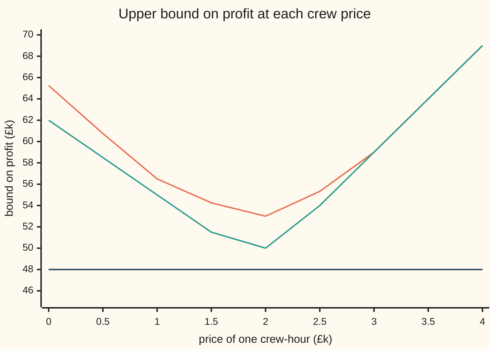

# Lagrangian relaxation: price the awkward constraint and solve what is left

[Syllabus](../../../SYLLABUS.md) → [Optimization](../README.md) → [Integer and Combinatorial Optimisation](../README.md#s05) → Lagrangian relaxation

---

## General Overview

A festival has three stages, Main, Tent and Acoustic, and nine acts on offer, three per stage. Each stage has a 6-hour evening, and acts run 2, 3 or 4 hours. Every act brings a profit, from £5k to £12k. The organisers choose which acts to book, and they want the total profit as large as possible: this card **maximises**.

One rule ties the stages together. A single sound crew rigs every stage in the afternoon, and it has **16 crew-hours** in all. A big band needs 6 of them; a solo act needs 2. Without that rule each stage could plan its own evening alone. With it, a choice on the Main stage takes crew from the Tent. It is the **awkward constraint**: the one rule that stops the problem falling apart into small pieces.

Lagrangian relaxation removes the rule and charges for it instead. Put a price on a crew-hour, say £2k, and pay the stages the full 16 hours' worth, £32k, up front. Each stage now books whatever is best for it after paying for its own crew, and the three stages never need to talk.

Whatever the price, the total that comes out can never be beaten by a booking that obeys the crew rule. So every price gives an **upper bound**: a number no real booking can exceed.

Searching for the price that gives the lowest bound finds £2k a crew-hour and a bound of **£50k**. The search used here, subgradient steps, raises the price when the stages use too much crew and lowers it when crew sits idle. The best real booking makes **£48k**.

The usual bound from fractional bookings, the LP (linear program) relaxation, says only **£53k**. It is the same problem with "book it or not" loosened to "book any fraction from 0 to 1" (see [Integer programs](01-integer-programs-and-relaxations.md)).

**Charge a price for the one constraint that couples the pieces, let each piece optimise alone at that price, and the priced total is a bound on the true best; tuning the price by subgradient steps gives a bound that can be tighter than the LP relaxation's.**

**What kind of fact this is:** a theorem (weak duality, proved on this card in Why it works), a second theorem saying exactly how tight the bound is (Geoffrion's, stated with its source, proved in a fold and checked by the code), and a method (subgradient steps), whose convergence rule is stated with its source and shown in the printed iterations.

### The picture: the bound at every price



Orange, top: the LP relaxation priced the same way, lowest at £53k. Green, middle: the Lagrangian bound $q(\lambda)$, lowest at £50k when a crew-hour costs £2k. Dark, flat: the best real booking, £48k. Every price gives a valid ceiling; the best ceiling sits at the bottom of the green V.

---

## The formula

The acts, with $h_i$ the act's stage hours, $c_i$ its crew-hours and $p_i$ its profit:

| Stage | Act: hours, crew-hours, £k | Act | Act |
| --- | --- | --- | --- |
| Main | M1: 3, 2, 12 | M2: 2, 6, 12 | M3: 4, 6, 5 |
| Tent | T1: 4, 5, 8 | T2: 3, 3, 7 | T3: 3, 2, 9 |
| Acoustic | A1: 2, 6, 10 | A2: 3, 4, 12 | A3: 4, 2, 8 |

The integer program: choose $x_i = 1$ (book act $i$) or $0$ (do not) to

$$\text{maximise } \sum_i p_i x_i \quad\text{subject to}\quad x_s \in X_s \text{ for each stage } s, \qquad \sum_i c_i x_i \le C = 16.$$

Here $x_s$ is stage $s$'s part of the booking, and $X_s$ is the list of whole bookings for stage $s$ that fit its 6-hour evening. Price the crew rule at $\lambda \ge 0$, in £k (thousands of pounds) per crew-hour, and add the priced slack to the profit:

$$q(\lambda) = \max_{x_s \in X_s} \Big[\sum_i p_i x_i + \lambda\Big(C - \sum_i c_i x_i\Big)\Big] = \lambda C + \sum_{s} \max_{x_s \in X_s} \sum_{i \in s} (p_i - \lambda c_i)\, x_i \;\ge\; z_{IP}.$$

**Read it aloud:** give the stages the whole crew budget at price $\lambda$, let each stage book the acts whose profit beats their crew bill, and the total is at least the best real profit.

The best such bound is the Lagrangian dual, found by subgradient steps from $\lambda_0 = 0$:

$$z_{LD} = \min_{\lambda \ge 0} q(\lambda), \qquad \lambda_{k+1} = \max\big(0,\; \lambda_k - \alpha_k\, g_k\big), \qquad g_k = C - \sum_i c_i x_i(\lambda_k),$$

and the three numbers stand in a fixed order: $z_{IP} \le z_{LD} \le z_{LP}$. Here, £48k ≤ £50k ≤ £53k.

| Symbol | Plain meaning | In our example | Push it up and the answer… |
| --- | --- | --- | --- |
| $x_i$ | book act $i$ (1) or not (0) | M1, M2, T2, T3, A3 booked | — |
| $p_i$ | act $i$'s profit, £k | M1: 12 | bound and best booking rise or stay |
| $c_i$ | crew-hours act $i$ needs; here $c$ is a weight in the crew limit, not the LP shelf's objective $c$, which is $p$ on this card | M2: 6 | the act gets dropped sooner as the price rises |
| $h_i$ | stage hours act $i$ fills, of the 6 a stage has | A3: 4 | fewer whole plans fit |
| $C$ | the shared crew budget, crew-hours | 16 | the price falls; at 23 it reaches 0 |
| $X_s$, $\operatorname{conv} X_s$ | stage $s$'s whole plans that fit 6 hours; their blends | Main: 6 plans | — |
| $\lambda$ | the price of one crew-hour, £k; the Lagrange multiplier | best: 2 | bound falls, then rises (the V) |
| $q(\lambda)$ | the dual function: the priced total, an upper bound | $q(2) = 50$ | — |
| $z_{IP}$, $z_{LD}$, $z_{LP}$ | best real booking; best Lagrangian bound; LP bound | 48, 50, 53 | — |
| $g_k$ | crew budget minus crew the priced plans use: the slope of $q$ | $16 - 23 = -7$ at $k = 0$ | a negative slope pushes the price up |
| $k$, $\lambda_k$, $\alpha_k$ | step number from 0; the price at step $k$; the step size | $\lambda_1 = 3.5$; $\alpha_k = 0.5/(k+1)$ | a constant step too large and the price cycles |
| $w_{sj}$, $P_{sj}$, $K_{sj}$, $\mu_s$ | in the proof fold: weight on plan $j$ of stage $s$, its profit, its crew; stage $s$'s price | A2 and A3 at weight 1/2 each | — |

### When it holds

- **The price must be zero or positive.** The crew rule is "at most 16", and a booking that obeys it leaves slack $C - \sum c_i x_i \ge 0$; only a non-negative price turns that slack into a non-negative bonus. A negative price can make the priced score of a legal booking fall below its profit, and the bound proof breaks.
- **Each stage must be solved exactly.** The bound is the true maximum of the priced problem. A stage solved by a quick guess can report less than its true best, and then $q(\lambda)$ can fall below £48k, which is no bound at all.
- **The pieces must be harder than their LP, or there is no gain.** If the stage rule were "at most two acts" instead of "at most 6 hours", each stage's LP would already have whole-number corners, and the Lagrangian bound would equal the LP bound: £54k and £54k, against a best booking of £53k.
- **The steps must shrink, but not too fast.** With $\alpha_k \to 0$ and $\sum_k \alpha_k = \infty$ the best bound found tends to $z_{LD}$. A constant step of 0.5 makes the price jump between 0 and 3.5 for ever, and the best bound stays at £62k.
- **The bound need not be reached.** Even at the best price, $z_{LD}$ can sit above every real booking: a duality gap, here £2k. The priced plans may also break the crew rule, so they are not an answer on their own.

---

## Why it works

### Step 0: a price turns a hard rule into a refund

A booking that obeys the crew rule uses at most 16 crew-hours. Pay it $\lambda$ for every crew-hour it leaves unused, and its priced score is its profit plus a refund that cannot be negative. So, for every legal booking, priced score ≥ profit.

Now drop the crew rule and let the stages book anything that fits their evenings. The priced maximum over this bigger list is at least the priced score of the best legal booking, which is at least £48k. That is the whole bound.

### Step 1: the bound, as two lines of algebra

For any $\lambda \ge 0$ and any booking $x$ that obeys both rules,

$$\sum_i p_i x_i \;\le\; \sum_i p_i x_i + \lambda\Big(C - \sum_i c_i x_i\Big) \;\le\; q(\lambda).$$

The first inequality holds because $\lambda \ge 0$ and the slack is $\ge 0$; the second because $q(\lambda)$ maximises the same expression over a list that contains $x$. Take the best legal $x$ on the left: $z_{IP} \le q(\lambda)$ for every $\lambda \ge 0$. This is weak duality, the same fact [Lagrangian duality](../03-Constrained%20Optimisation/04-lagrangian-duality-weak-and-strong.md) proves for continuous problems, here with a list of bookings in place of a smooth set.

### Step 2: the priced problem falls apart by stage

Once the crew rule is a price, nothing links the stages. The priced profit is a sum of one term per stage, and each stage's evening rule mentions only its own acts. So the maximum of the sum is the sum of three maxima, plus the constant $\lambda C$.

That is the decomposition. Main has 6 plans that fit, Tent 5, Acoustic 6, so one value of $q$ costs 6 + 5 + 6 plan scores, added. The joint problem multiplies them instead: every Main plan with every Tent plan with every Acoustic plan, 122 of them within the crew budget. Adding grows slowly with more stages; multiplying explodes.

### Step 3: $q$ is a V with corners, and its slope says which way to move

Each whole booking $x$ draws a straight line in $\lambda$: profit $+ \lambda \times$ (unused crew). The function $q(\lambda)$ is the highest of those lines at each price, so it is convex (no dents) and piecewise straight, with corners where the best booking changes. Its lowest point sits at a corner or at $\lambda = 0$.

Where the priced bookings use crew $\sum c_i x_i(\lambda)$, the line they draw touches $q$ there and lies under it everywhere else. Its slope, $g = C - \sum c_i x_i(\lambda)$, is a **subgradient** of $q$: a slope that stays under the graph even at a corner (see [Subgradients](../01-Convexity/07-subgradients.md)). If the stages overuse crew, $g < 0$: the bound falls as the price rises, so raise the price. If they leave crew idle, $g > 0$: lower it.

At $\lambda = 2$ the stages have tied choices that use anything from 9 to 17 crew-hours. The slopes run from $16 - 17 = -1$ to $16 - 9 = +7$. A slope of zero lies between, so nothing to either side is lower: £2k is the best price and £50k the best bound. The code confirms it by scoring $q$ at every corner.

### Step 4: subgradient steps find the bottom without drawing the V

On a real problem nobody lists every corner. The subgradient method only needs one priced solve per step: solve the stages at $\lambda_k$, read the crew they use, step the price against the slope, $\lambda_{k+1} = \max(0, \lambda_k - \alpha_k g_k)$, and keep the lowest $q$ seen.

The classical rule, tested on integer programs by Held, Wolfe and Crowder: if the slopes stay bounded, $\alpha_k \to 0$ and $\sum_k \alpha_k = \infty$, the best bound found tends to $z_{LD}$. The steps must shrink so the price settles, and their sum must be endless so the price can travel any distance. The method makes no promise that any single step lowers $q$; that is why the best so far is kept. The card states this rule with its source and does not prove it.

From $\lambda_0 = 0$ with $\alpha_k = 0.5/(k+1)$:

| $k$ | price $\lambda_k$ | crew used | $q(\lambda_k)$ | best bound so far |
| --- | --- | --- | --- | --- |
| 0 | 0.0000 | 23 | 62.0000 | 62.0000 |
| 1 | 3.5000 | 6 | 64.0000 | 62.0000 |
| 2 | 1.0000 | 23 | 55.0000 | 55.0000 |
| 3 | 2.1667 | 9 | 51.1667 | 51.1667 |
| 4 | 1.2917 | 23 | 52.9583 | 51.1667 |
| 5 | 1.9917 | 17 | 50.0083 | 50.0083 |
| 6 | 2.0750 | 9 | 50.5250 | 50.0083 |
| 29 | 1.9827 | 17 | 50.0173 | 50.0015 |

The price overshoots, swings back and closes in on 2. After 30 steps the best bound is £50.0015k, just above the exact £50k. The stopping test here is a fixed 30 steps; the exact corner search supplies the certificate that £50k is the bottom.

### Step 5: how good the bound is

The LP relaxation lets every act be fractional: seven-twelfths of a band. The Lagrangian dual is stricter. Geoffrion's theorem says it equals the best profit when each stage may blend **whole plans**, but not slice single acts:

$$z_{LD} = \max\Big\{ \sum_i p_i x_i \;:\; x_s \in \operatorname{conv} X_s \text{ for each } s,\; \sum_i c_i x_i \le C \Big\}.$$

Here $\operatorname{conv} X_s$ is the convex hull of stage $s$'s plans: every weighted average of them. Each stage's hull lies inside its LP region, so $z_{LD} \le z_{LP}$. The two match when every stage's LP region already has whole-number corners, the integrality property; then pricing gains nothing over the LP (see [Total unimodularity](05-total-unimodularity.md)).

In the festival, one blend that reaches £50k (the code prints it; there are others) books M1 and M2 on Main, T2 and T3 in the Tent, and on the Acoustic stage half of plan A2 and half of plan A3: crew $8 + 5 + 3 = 16$, profit $24 + 16 + 10 = 50$. The LP goes further. It books seven-twelfths of M2 and three-quarters of A3, a slice of each act, and reaches £53k with exactly 16 crew-hours.

<details>
<summary>Detailed proof: the dual equals the best blend of whole plans</summary>

Write the blend problem as a linear program over weights. For each stage $s$ and each plan $j$ in $X_s$, let $w_{sj} \ge 0$ be the weight on that plan, with $\sum_j w_{sj} = 1$ for each stage. Plan $j$ of stage $s$ has profit $P_{sj}$ and crew $K_{sj}$. The problem is

$$\max \sum_{s,j} P_{sj} w_{sj} \quad\text{subject to}\quad \sum_{s,j} K_{sj} w_{sj} \le C,\quad \sum_j w_{sj} = 1 \text{ for each } s,\quad w \ge 0.$$

This is the master program of Dantzig–Wolfe decomposition. Its LP dual has a price $\lambda \ge 0$ on the crew row and a free price $\mu_s$ on each stage's "weights sum to 1" row:

$$\min\; \lambda C + \sum_s \mu_s \quad\text{subject to}\quad \mu_s \ge P_{sj} - \lambda K_{sj} \text{ for every stage } s \text{ and plan } j,\quad \lambda \ge 0.$$

For a fixed $\lambda$ the best $\mu_s$ is the smallest allowed, $\mu_s = \max_j (P_{sj} - \lambda K_{sj})$, which is stage $s$'s priced best. The dual objective becomes exactly $q(\lambda)$, and minimising over $\lambda$ gives $z_{LD}$. LP strong duality (the master is feasible, since booking nothing is legal, and bounded) says the two optimal values are equal; [LP duality](../04-Linear%20Programming/04-lp-duality-and-complementary-slackness.md) proves it. A blend of plans is the same as a point of $\operatorname{conv} X_s$, which gives the displayed formula.

</details>

---

## Worked numbers, by hand

At the price $\lambda = 2$, each act's net value is $p_i - 2c_i$.

| Step | Arithmetic | Value |
| --- | --- | --- |
| Main: net of M1, M2, M3 | $12 - 4$, $12 - 12$, $5 - 12$ | 8, 0, −7 |
| Main: best plan fitting 6 hours | M1, or M1 + M2 (3 + 2 hours) | 8 |
| Tent: net of T1, T2, T3 | $8 - 10$, $7 - 6$, $9 - 4$ | −2, 1, 5 |
| Tent: best plan | T2 + T3 (6 hours) | 6 |
| Acoustic: net of A1, A2, A3 | $10 - 12$, $12 - 8$, $8 - 4$ | −2, 4, 4 |
| Acoustic: best plan | A2 alone or A3 alone (A2 + A3 needs 7 hours) | 4 |
| crew budget at the price | $2 \times 16$ | 32 |
| $q(2)$ | $32 + 8 + 6 + 4$ | 50 |
| crew used by tied plans | low: $2 + 5 + 2$; high: $8 + 5 + 4$ | 9 to 17 |
| slopes either side | $16 - 17$ and $16 - 9$ | −1 and +7 |
| best real booking | M1 + M2, T2 + T3, A3: crew $8 + 5 + 2$ | 15 crew, £48k |
| LP bound at the same price | best fractional plan per stage: $32 + 8 + 6 + 7$, Acoustic filling its 6 hours with A2 and 3/4 of A3 | 53 |
| an LP booking that meets it, with no price | M1, 7/12 of M2, T2, T3, A2, 3/4 of A3: crew exactly 16 | 53 |
| **gaps** | $50 - 48$; $53 - 48$ | **£2k (4.2%); £5k (10.4%)** |

The price says no booking can make more than £50k, and a real booking makes £48k, so that booking is within £2k of the best before any search. Listing all 122 legal bookings closes the last £2k: £48k is optimal.

### What breaks if you drop a piece

| Mistake | Comes out at | What went wrong |
| --- | --- | --- |
| Book what the priced stages chose at £2k, ties to more crew | £52k, needing 17 crew-hours | Breaks the 16-hour rule. A price certifies a bound, not a plan |
| Drop the $\lambda C$ term | £18k | Below the £48k booking, so it bounds nothing: the refund was left out |
| Constant step $\alpha_k = 0.5$ | best bound £62k after 30 steps | The price cycles 0, 3.5, 0, 3.5 and never nears 2 |
| Stage rule "at most two acts" | Lagrangian £54k = LP £54k; best £53k | Each stage's LP is already whole, so pricing adds nothing over the LP |

---

## Code, from first principles, and it actually runs

The script lists every whole plan for each stage and prices them in exact fractions. It reaches £48k and £50k by independent roads. Road 1 enumerates the bookings, twice: through the stage plans, and again through all 512 raw yes-or-no patterns. Road 2 scores $q$ at every corner of the V. Road 3 solves the blend problem of Step 5 corner by corner, with no price at all, prints one best blend, and must meet road 2. Road 4 runs the subgradient method in ordinary decimals. The LP bound comes from fractional knapsacks (a stage's best fractional booking, filled in order of net value per stage hour), and is certified by a fractional booking that meets every rule and earns exactly £53k. At the nine chart prices it is checked again against every corner of each stage's LP region. Then the repair, the gaps, the mistakes, the two-acts variant and the chart's points are printed.

### Python

```python
# Lagrangian relaxation of a festival's shared sound crew.  Standard library only.
# Maximise profit (£k).  Each stage has a 6-hour evening; all acts share 16 crew-hours of rigging.
from fractions import Fraction as Fr
from itertools import product

C = 16
STAGES = [  # (act, stage hours, crew-hours, profit in £k)
    [("M1", 3, 2, 12), ("M2", 2, 6, 12), ("M3", 4, 6, 5)],
    [("T1", 4, 5, 8), ("T2", 3, 3, 7), ("T3", 3, 2, 9)],
    [("A1", 2, 6, 10), ("A2", 3, 4, 12), ("A3", 4, 2, 8)]]

def size(a, by_count): return 1 if by_count else a[1]
def cap(by_count): return 2 if by_count else 6   # variant: "at most two acts a stage"

def plans(acts, bc):                    # every booking of one stage that fits its evening
    out = []
    for m in range(8):
        pick = [a for i, a in enumerate(acts) if m >> i & 1]
        if sum(size(a, bc) for a in pick) <= cap(bc):
            out.append(("+".join(a[0] for a in pick) or "none", sum(a[3] for a in pick), sum(a[2] for a in pick)))
    return out

def choice(ps, lam, low=True):          # a stage's best plan at crew price lam; ties go to less crew
    return max(ps, key=lambda p: (p[1] - lam * p[2], -p[2] if low else p[2]))

def q(P, lam):                          # the dual function: an upper bound for every lam >= 0
    return lam * C + sum(choice(ps, lam)[1] - lam * choice(ps, lam)[2] for ps in P)

def q_lp(st, bc, lam):                  # the same price on the LP relaxation: fractional knapsacks
    v = lam * C
    for s in st:
        room = Fr(cap(bc))
        for a in sorted(s, key=lambda a: -(a[3] - lam * a[2]) / size(a, bc)):
            if a[3] - lam * a[2] > 0 and room > 0:
                t = min(Fr(1), room / size(a, bc)); v += t * (a[3] - lam * a[2]); room -= t * size(a, bc)
    return v

def stage_corners(s, lam):              # check road: the best corner of one stage's LP region (hours rule)
    hrs = lambda p: sum(a[1] * x for a, x in zip(s, p))
    pts = [[Fr(m >> i & 1) for i in range(3)] for m in range(8)]
    pts += [p[:j] + [(6 - hrs(p[:j] + [0] + p[j + 1:])) / s[j][1]] + p[j + 1:] for p in pts for j in range(3)]
    return max(sum((a[3] - lam * a[2]) * x for a, x in zip(s, p)) for p in pts if all(0 <= x <= 1 for x in p) and hrs(p) <= 6)

def kinks(st, P, bc):                   # every price where a ranking or a sign can change
    out = {Fr(0)}
    for ps in P:
        out |= {Fr(a[1] - b[1], a[2] - b[2]) for a, b in product(ps, ps) if a[2] != b[2]}
    for a, b in product([a for s in st for a in s], repeat=2):
        d = a[2] * size(b, bc) - b[2] * size(a, bc)
        out |= {Fr(a[3], a[2])} | ({Fr(a[3] * size(b, bc) - b[3] * size(a, bc), d)} if d else set())
    return sorted(l for l in out if l >= 0)

def bounds(st, bc):
    P = [plans(s, bc) for s in st]
    feas = [t for t in product(*P) if sum(p[2] for p in t) <= C]
    lam_d = min(kinks(st, P, bc), key=lambda l: (q(P, l), l))
    lam_lp = min(kinks(st, P, bc), key=lambda l: (q_lp(st, bc, l), l))
    return P, feas, max(sum(p[1] for p in t) for t in feas), lam_d, q(P, lam_d), lam_lp, q_lp(st, bc, lam_lp)

P, feas, z_ip, lam_d, z_ld, lam_lp, z_lp = bounds(STAGES, False)
print("plans per stage", [len(ps) for ps in P], "; whole bookings within crew", len(feas))
for ps in P: print("  ", " ".join(f"{n}:{p}/{c}" for n, p, c in ps))
best = max(feas, key=lambda t: sum(p[1] for p in t))
print("road 1, enumeration: best", [p[0] for p in best], "profit", z_ip, "crew", sum(p[2] for p in best))
print("road 2, kinks of q: price", lam_d, "bound", z_ld)
dw, mix = Fr(z_ip), ""                  # road 3: master LP over whole plans, corner by corner
for t in product(*P):
    for s in range(3):
        for alt in P[s]:
            if alt[2] != t[s][2]:
                th = Fr(C - sum(p[2] for p in t), alt[2] - t[s][2])   # weight on alt using crew exactly
                v = sum(p[1] for p in t) + th * (alt[1] - t[s][1])      # ties: the last one found is kept
                if 0 < th < 1 and v >= dw: dw, mix = v, f"{[p[0] for p in t]} with {th} of {t[s][0]} swapped for {alt[0]}"
print("road 3, master LP over whole plans:", dw, "; one best blend", mix)

def subgradient(step, n=30):            # road 4: price steps from lam_0 = 0
    lam, top, rows = 0.0, float("inf"), []
    for k in range(n):
        x = [choice(ps, lam) for ps in P]
        crew = sum(p[2] for p in x); val = lam * C + sum(p[1] - lam * p[2] for p in x)
        top = min(top, val); rows.append((k, lam, crew, val, top))
        lam = max(0.0, lam - step(k) * (C - crew))
    return rows
rows = subgradient(lambda k: 0.5 / (k + 1))
for k, lam, crew, val, top in rows[:7] + rows[-1:]:
    print(f"road 4, k={k:2d} price {lam:.4f} crew {crew:2d} q {val:.4f} best bound {top:.4f}")
print("LP bound: price", lam_lp, "bound", z_lp)
qs, ls = [choice(ps, lam_d)[1] - lam_d * choice(ps, lam_d)[2] for ps in P], [stage_corners(s, lam_d) for s in STAGES]
print(f"at price {lam_d}, stage by stage: q {lam_d * C} + {' + '.join(map(str, qs))} = {lam_d * C + sum(qs)};",
      f"LP corners {lam_d * C} + {' + '.join(map(str, ls))} = {lam_d * C + sum(ls)}")
x_lp = {"M1": 1, "M2": Fr(7, 12), "T2": 1, "T3": 1, "A2": 1, "A3": Fr(3, 4)}   # a fractional booking
acts = {a[0]: a for s in STAGES for a in s}
lp_val = sum(t * acts[n][3] for n, t in x_lp.items()); lp_crew = sum(t * acts[n][2] for n, t in x_lp.items())
lp_hours = [sum(t * acts[n][1] for n, t in x_lp.items() if n[0] == s[0][0][0]) for s in STAGES]
print("LP certificate: profit", lp_val, "crew", lp_crew, "stage hours", " ".join(str(h) for h in lp_hours))
hi = [choice(ps, lam_d, False) for ps in P]
lo = [choice(ps, lam_d) for ps in P]
print("priced choice at", lam_d, ": high-crew ties", [p[0] for p in hi], sum(p[1] for p in hi), "crew",
      sum(p[2] for p in hi), "; low-crew ties", sum(p[1] for p in lo), "crew", sum(p[2] for p in lo))
fixes = [hi[:s] + [p] + hi[s + 1:] for s in range(3) for p in P[s]]
fix = max((t for t in fixes if sum(p[2] for p in t) <= C), key=lambda t: sum(p[1] for p in t))
print("repair, change one stage:", [p[0] for p in fix], "profit", sum(p[1] for p in fix), "crew", sum(p[2] for p in fix))
print(f"gaps over {z_ip}: Lagrangian {z_ld - z_ip} = {100.0 * float(z_ld - z_ip) / z_ip:.1f}%,",
      f"LP {z_lp - z_ip} = {100.0 * float(z_lp - z_ip) / z_ip:.1f}%")
print("drop the lam*C term:", z_ld - lam_d * C, "; constant step 0.5, bound after 30:", f"{subgradient(lambda k: 0.5)[-1][4]:.4f}")
_, _, ip1, l1, ld1, ll1, lp1 = bounds(STAGES, True)
print("variant, at most two acts a stage: best", ip1, "Lagrangian", ld1, "at", l1, "LP", lp1, "at", ll1)
for i in range(9):
    print(f"chart, price {i / 2:.1f}: q {float(q(P, Fr(i, 2))):.2f} LP {float(q_lp(STAGES, False, Fr(i, 2))):.2f}")
brute = [(sum(a[3] for s, m in zip(STAGES, ms) for i, a in enumerate(s) if m >> i & 1), ms) for ms in product(range(8), repeat=3)
         if sum(a[2] for s, m in zip(STAGES, ms) for i, a in enumerate(s) if m >> i & 1) <= C
         and all(sum(a[1] for i, a in enumerate(s) if m >> i & 1) <= 6 for s, m in zip(STAGES, ms))]
assert z_ip == max(brute)[0] and len(brute) == len(feas)     # 512 raw bit patterns agree
assert dw == z_ld                       # the dual meets the master LP over whole plans
assert lp_val == z_lp and lp_crew <= C and max(lp_hours) <= 6   # LP bound met by a feasible point
assert float(z_ld) <= rows[-1][4] < float(z_ld) + 0.01
assert z_ip < z_ld < z_lp and ld1 == lp1 and sum(p[1] for p in fix) == z_ip
assert all(q(P, l) >= z_ld for l in [Fr(k, 7) for k in range(50)])
assert all(q_lp(STAGES, False, Fr(i, 2)) == Fr(i, 2) * C + sum(stage_corners(s, Fr(i, 2)) for s in STAGES) for i in range(9))
print("try step 1/(k+1): best bound after 30", f"{subgradient(lambda k: 1.0 / (k + 1))[-1][4]:.4f}")
r3 = subgradient(lambda k: 0.3)
print(f"try constant step 0.3: prices visited {' '.join(sorted({f'{x[1]:.4f}' for x in r3}))}; best bound {r3[-1][4]:.4f}")
rf = subgradient(lambda k: -0.5 / (k + 1))   # the sign flipped: lam + step * (C - crew)
print(f"try flipped sign: highest price in 30 steps {max(x[1] for x in rf):.4f}; best bound {rf[-1][4]:.4f}")
a9 = [s if s[0][0] != "A1" else s[:2] + [("A3", 4, 2, 9)] for s in STAGES]   # A3 pays 9
_, _, ip2, l2, ld2, _, lp2 = bounds(a9, False)
print(f"try A3 pays 9: best {ip2}, price {l2}, Lagrangian {ld2} = {float(ld2):.2f}, LP {lp2} = {float(lp2):.2f}")
print("ALL CHECKS PASS")
```

**Ran 2026-11-11 on macOS, Python 3.14.10, standard library only. All checks passed. Output, pasted from the run:**

```
plans per stage [6, 5, 6] ; whole bookings within crew 122
   none:0/0 M1:12/2 M2:12/6 M1+M2:24/8 M3:5/6 M2+M3:17/12
   none:0/0 T1:8/5 T2:7/3 T3:9/2 T2+T3:16/5
   none:0/0 A1:10/6 A2:12/4 A1+A2:22/10 A3:8/2 A1+A3:18/8
road 1, enumeration: best ['M1+M2', 'T2+T3', 'A3'] profit 48 crew 15
road 2, kinks of q: price 2 bound 50
road 3, master LP over whole plans: 50 ; one best blend ['M1+M2', 'T2+T3', 'A3'] with 1/2 of A3 swapped for A2
road 4, k= 0 price 0.0000 crew 23 q 62.0000 best bound 62.0000
road 4, k= 1 price 3.5000 crew  6 q 64.0000 best bound 62.0000
road 4, k= 2 price 1.0000 crew 23 q 55.0000 best bound 55.0000
road 4, k= 3 price 2.1667 crew  9 q 51.1667 best bound 51.1667
road 4, k= 4 price 1.2917 crew 23 q 52.9583 best bound 51.1667
road 4, k= 5 price 1.9917 crew 17 q 50.0083 best bound 50.0083
road 4, k= 6 price 2.0750 crew  9 q 50.5250 best bound 50.0083
road 4, k=29 price 1.9827 crew 17 q 50.0173 best bound 50.0015
LP bound: price 2 bound 53
at price 2, stage by stage: q 32 + 8 + 6 + 4 = 50; LP corners 32 + 8 + 6 + 7 = 53
LP certificate: profit 53 crew 16 stage hours 25/6 6 6
priced choice at 2 : high-crew ties ['M1+M2', 'T2+T3', 'A2'] 52 crew 17 ; low-crew ties 36 crew 9
repair, change one stage: ['M1+M2', 'T2+T3', 'A3'] profit 48 crew 15
gaps over 48: Lagrangian 2 = 4.2%, LP 5 = 10.4%
drop the lam*C term: 18 ; constant step 0.5, bound after 30: 62.0000
variant, at most two acts a stage: best 53 Lagrangian 54 at 2 LP 54 at 2
chart, price 0.0: q 62.00 LP 65.25
chart, price 0.5: q 58.50 LP 60.75
chart, price 1.0: q 55.00 LP 56.50
chart, price 1.5: q 51.50 LP 54.25
chart, price 2.0: q 50.00 LP 53.00
chart, price 2.5: q 54.00 LP 55.33
chart, price 3.0: q 59.00 LP 59.00
chart, price 3.5: q 64.00 LP 64.00
chart, price 4.0: q 69.00 LP 69.00
try step 1/(k+1): best bound after 30 50.0055
try constant step 0.3: prices visited 0.0000 2.1000; best bound 50.7000
try flipped sign: highest price in 30 steps 0.0000; best bound 62.0000
try A3 pays 9: best 49, price 5/3, Lagrangian 152/3 = 50.67, LP 215/4 = 53.75
ALL CHECKS PASS
```

### Rust

```rust
// Lagrangian relaxation of a festival's shared sound crew.  std only, exact fractions where it matters.
// Maximise profit (£k).  Each stage has a 6-hour evening; all acts share 16 crew-hours of rigging.
use std::cmp::Ordering;
#[derive(Clone, Copy, Debug)]
struct Q(i64, i64); // numerator, denominator > 0, in lowest terms
fn gcd(a: i64, b: i64) -> i64 { if b == 0 { a.abs() } else { gcd(b, a % b) } }
fn r(n: i64, d: i64) -> Q { let g = gcd(n, d) * d.signum(); Q(n / g, d / g) }
fn z(n: i64) -> Q { Q(n, 1) } fn fl(x: Q) -> f64 { x.0 as f64 / x.1 as f64 }
impl std::ops::Add for Q { type Output = Q; fn add(self, o: Q) -> Q { r(self.0 * o.1 + o.0 * self.1, self.1 * o.1) } }
impl std::ops::Sub for Q { type Output = Q; fn sub(self, o: Q) -> Q { r(self.0 * o.1 - o.0 * self.1, self.1 * o.1) } }
impl std::ops::Mul for Q { type Output = Q; fn mul(self, o: Q) -> Q { r(self.0 * o.0, self.1 * o.1) } }
impl std::ops::Div for Q { type Output = Q; fn div(self, o: Q) -> Q { r(self.0 * o.1, self.1 * o.0) } }
impl PartialEq for Q { fn eq(&self, o: &Q) -> bool { self.cmp(o) == Ordering::Equal } } impl Eq for Q {}
impl PartialOrd for Q { fn partial_cmp(&self, o: &Q) -> Option<Ordering> { Some(self.cmp(o)) } }
impl Ord for Q { fn cmp(&self, o: &Q) -> Ordering { (self.0 as i128 * o.1 as i128).cmp(&(o.0 as i128 * self.1 as i128)) } }
impl std::fmt::Display for Q { fn fmt(&self, f: &mut std::fmt::Formatter) -> std::fmt::Result {
    if self.1 == 1 { write!(f, "{}", self.0) } else { write!(f, "{}/{}", self.0, self.1) } } }

const C: i64 = 16;
type Act = (&'static str, i64, i64, i64); // (act, stage hours, crew-hours, profit in £k)
const STAGES: [[Act; 3]; 3] = [
    [("M1", 3, 2, 12), ("M2", 2, 6, 12), ("M3", 4, 6, 5)],
    [("T1", 4, 5, 8), ("T2", 3, 3, 7), ("T3", 3, 2, 9)],
    [("A1", 2, 6, 10), ("A2", 3, 4, 12), ("A3", 4, 2, 8)]];
type Plan = (String, i64, i64); // name, profit, crew
fn size(a: &Act, bc: bool) -> i64 { if bc { 1 } else { a.1 } }
fn cap(bc: bool) -> i64 { if bc { 2 } else { 6 } } // variant: "at most two acts a stage"

fn plans(acts: &[Act; 3], bc: bool) -> Vec<Plan> { // every booking of one stage that fits its evening
    (0..8).map(|m: usize| (0..3).filter(|i| m >> i & 1 == 1).map(|i| &acts[i]).collect::<Vec<&Act>>())
        .filter(|pick| pick.iter().map(|a| size(a, bc)).sum::<i64>() <= cap(bc))
        .map(|pick| { let n = pick.iter().map(|a| a.0).collect::<Vec<_>>().join("+");
            (if n.is_empty() { "none".to_string() } else { n }, pick.iter().map(|a| a.3).sum(), pick.iter().map(|a| a.2).sum()) }).collect()
}
fn choice(ps: &[Plan], lam: Q, low: bool) -> Plan { // a stage's best plan at crew price lam; ties go to less crew
    ps.iter().fold(ps[0].clone(), |b, p| { let (v, w) = (z(p.1) - lam * z(p.2), z(b.1) - lam * z(b.2));
        if v > w || (v == w && (if low { p.2 < b.2 } else { p.2 > b.2 })) { p.clone() } else { b } })
}
fn choice_f(ps: &[Plan], lam: f64) -> Plan {
    ps.iter().fold(ps[0].clone(), |b, p| { let (v, w) = (p.1 as f64 - lam * p.2 as f64, b.1 as f64 - lam * b.2 as f64);
        if v > w || (v == w && p.2 < b.2) { p.clone() } else { b } })
}
fn q(pp: &[Vec<Plan>], lam: Q) -> Q { // the dual function: an upper bound for every lam >= 0
    pp.iter().fold(lam * z(C), |s, ps| { let c = choice(ps, lam, true); s + z(c.1) - lam * z(c.2) })
}
fn q_lp(st: &[[Act; 3]; 3], bc: bool, lam: Q) -> Q { // the same price on the LP relaxation: fractional knapsacks
    let mut v = lam * z(C);
    for s in st.iter() {
        let mut room = z(cap(bc));
        let mut order: Vec<&Act> = s.iter().collect();
        order.sort_by(|a, b| ((z(b.3) - lam * z(b.2)) / z(size(b, bc))).cmp(&((z(a.3) - lam * z(a.2)) / z(size(a, bc)))));
        for a in order {
            let w = z(a.3) - lam * z(a.2);
            if w > z(0) && room > z(0) { let t = std::cmp::min(z(1), room / z(size(a, bc))); v = v + t * w; room = room - t * z(size(a, bc)); }
        }
    }
    v
}
fn stage_corners(s: &[Act; 3], lam: Q) -> Q { // check road: the best corner of one stage's LP region (hours rule)
    let hrs = |p: &[Q; 3]| (0..3).fold(z(0), |h, i| h + p[i] * z(s[i].1));
    let mut pts: Vec<[Q; 3]> = (0..8).map(|m: i64| [0i64, 1, 2].map(|i| z(m >> i & 1))).collect();
    for m in 0..8 { for j in 0..3 { let mut p = pts[m]; p[j] = z(0); p[j] = (z(6) - hrs(&p)) / z(s[j].1); pts.push(p); } }
    pts.iter().filter(|p| p.iter().all(|x| *x >= z(0) && *x <= z(1)) && hrs(p) <= z(6))
        .map(|p| (0..3).fold(z(0), |w, i| w + p[i] * (z(s[i].3) - lam * z(s[i].2)))).max().unwrap()
}
fn kinks(st: &[[Act; 3]; 3], pp: &[Vec<Plan>], bc: bool) -> Vec<Q> { // every price where a ranking or a sign can change
    let mut out = vec![z(0)];
    for ps in pp { for a in ps { for b in ps { if a.2 != b.2 { out.push(r(a.1 - b.1, a.2 - b.2)); } } } }
    let all: Vec<&Act> = st.iter().flatten().collect();
    for a in &all { for b in &all {
        out.push(r(a.3, a.2));
        let d = a.2 * size(b, bc) - b.2 * size(a, bc);
        if d != 0 { out.push(r(a.3 * size(b, bc) - b.3 * size(a, bc), d)); }
    } }
    out.retain(|l| *l >= z(0)); out.sort(); out.dedup(); out
}
fn argmin(ks: &[Q], f: impl Fn(Q) -> Q) -> Q { *ks.iter().min_by(|a, b| f(**a).cmp(&f(**b)).then(a.cmp(b))).unwrap() }
fn triples(pp: &[Vec<Plan>]) -> Vec<[Plan; 3]> {
    pp[0].iter().flat_map(|a| pp[1].iter().flat_map(move |b| pp[2].iter().map(move |c| [a.clone(), b.clone(), c.clone()]))).collect()
}
fn tot(t: &[Plan], i: usize) -> i64 { t.iter().map(|p| if i == 1 { p.1 } else { p.2 }).sum() }
fn names(t: &[Plan]) -> String { format!("[{}]", t.iter().map(|p| format!("'{}'", p.0)).collect::<Vec<_>>().join(", ")) }
fn bounds(st: &[[Act; 3]; 3], bc: bool) -> (Vec<Vec<Plan>>, Vec<[Plan; 3]>, i64, Q, Q, Q, Q) {
    let pp: Vec<Vec<Plan>> = st.iter().map(|s| plans(s, bc)).collect();
    let feas: Vec<[Plan; 3]> = triples(&pp).into_iter().filter(|t| tot(t, 2) <= C).collect();
    let zip = feas.iter().map(|t| tot(t, 1)).max().unwrap();
    let ks = kinks(st, &pp, bc);
    let (ld, ll) = (argmin(&ks, |l| q(&pp, l)), argmin(&ks, |l| q_lp(st, bc, l)));
    let qd = q(&pp, ld);
    (pp, feas, zip, ld, qd, ll, q_lp(st, bc, ll))
}
fn subgradient(pp: &[Vec<Plan>], step: impl Fn(usize) -> f64) -> Vec<(usize, f64, i64, f64, f64)> { // road 4
    let (mut lam, mut top, mut rows) = (0.0f64, f64::INFINITY, vec![]);
    for k in 0..30 {
        let x: Vec<Plan> = pp.iter().map(|ps| choice_f(ps, lam)).collect();
        let crew = tot(&x, 2);
        let val = x.iter().fold(lam * C as f64, |s, p| s + (p.1 as f64 - lam * p.2 as f64));
        top = top.min(val); rows.push((k, lam, crew, val, top));
        lam = (lam - step(k) * (C - crew) as f64).max(0.0);
    }
    rows
}
fn main() {
    let (pp, feas, z_ip, lam_d, z_ld, lam_lp, z_lp) = bounds(&STAGES, false);
    println!("plans per stage [{}, {}, {}] ; whole bookings within crew {}", pp[0].len(), pp[1].len(), pp[2].len(), feas.len());
    for ps in &pp { println!("   {}", ps.iter().map(|p| format!("{}:{}/{}", p.0, p.1, p.2)).collect::<Vec<_>>().join(" ")); }
    let best = feas.iter().max_by_key(|t| tot(*t, 1)).unwrap();
    println!("road 1, enumeration: best {} profit {} crew {}", names(best), z_ip, tot(best, 2));
    println!("road 2, kinks of q: price {} bound {}", lam_d, z_ld);
    let (mut dw, mut mix) = (z(z_ip), String::new()); // road 3: master LP over whole plans, corner by corner
    for t in triples(&pp) { for s in 0..3 { for alt in &pp[s] { if alt.2 != t[s].2 {
        let th = r(C - tot(&t, 2), alt.2 - t[s].2); // weight on alt using crew exactly
        let v = z(tot(&t, 1)) + th * z(alt.1 - t[s].1); // ties: the last one found is kept
        if th > z(0) && th < z(1) && v >= dw { dw = v; mix = format!("{} with {} of {} swapped for {}", names(&t), th, t[s].0, alt.0); }
    } } } }
    println!("road 3, master LP over whole plans: {} ; one best blend {}", dw, mix);
    let rows = subgradient(&pp, |k| 0.5 / (k + 1) as f64);
    for &(k, lam, crew, val, top) in rows[..7].iter().chain(rows[29..].iter()) {
        println!("road 4, k={:2} price {:.4} crew {:2} q {:.4} best bound {:.4}", k, lam, crew, val, top);
    }
    println!("LP bound: price {} bound {}", lam_lp, z_lp);
    let qs: Vec<Q> = pp.iter().map(|ps| { let c = choice(ps, lam_d, true); z(c.1) - lam_d * z(c.2) }).collect();
    let ls: Vec<Q> = STAGES.iter().map(|s| stage_corners(s, lam_d)).collect();
    let jq = |v: &[Q]| format!("{} + {} = {}", lam_d * z(C), v.iter().map(|x| x.to_string()).collect::<Vec<_>>().join(" + "), v.iter().fold(lam_d * z(C), |a, &b| a + b));
    println!("at price {}, stage by stage: q {}; LP corners {}", lam_d, jq(&qs), jq(&ls));
    let x_lp = [("M1", z(1)), ("M2", r(7, 12)), ("T2", z(1)), ("T3", z(1)), ("A2", z(1)), ("A3", r(3, 4))]; // a fractional booking
    let act = |n: &str| *STAGES.iter().flatten().find(|a| a.0 == n).unwrap();
    let lp_val = x_lp.iter().fold(z(0), |s, (n, t)| s + *t * z(act(n).3));
    let lp_crew = x_lp.iter().fold(z(0), |s, (n, t)| s + *t * z(act(n).2));
    let lp_hours: Vec<Q> = STAGES.iter().map(|s| x_lp.iter().filter(|(n, _)| n.as_bytes()[0] == s[0].0.as_bytes()[0])
        .fold(z(0), |a, (n, t)| a + *t * z(act(n).1))).collect();
    println!("LP certificate: profit {} crew {} stage hours {} {} {}", lp_val, lp_crew, lp_hours[0], lp_hours[1], lp_hours[2]);
    let (hi, lo): (Vec<Plan>, Vec<Plan>) = (pp.iter().map(|ps| choice(ps, lam_d, false)).collect(), pp.iter().map(|ps| choice(ps, lam_d, true)).collect());
    println!("priced choice at {} : high-crew ties {} {} crew {} ; low-crew ties {} crew {}", lam_d, names(&hi), tot(&hi, 1), tot(&hi, 2), tot(&lo, 1), tot(&lo, 2));
    let mut fix: Vec<Plan> = vec![];
    for s in 0..3 { for p in &pp[s] {
        let mut t = hi.clone(); t[s] = p.clone();
        if tot(&t, 2) <= C && (fix.is_empty() || tot(&t, 1) > tot(&fix, 1)) { fix = t; }
    } }
    println!("repair, change one stage: {} profit {} crew {}", names(&fix), tot(&fix, 1), tot(&fix, 2));
    println!("gaps over {}: Lagrangian {} = {:.1}%, LP {} = {:.1}%", z_ip, z_ld - z(z_ip), 100.0 * fl(z_ld - z(z_ip)) / z_ip as f64,
        z_lp - z(z_ip), 100.0 * fl(z_lp - z(z_ip)) / z_ip as f64);
    println!("drop the lam*C term: {} ; constant step 0.5, bound after 30: {:.4}", z_ld - lam_d * z(C), subgradient(&pp, |_| 0.5)[29].4);
    let (_, _, ip1, l1, ld1, ll1, lp1) = bounds(&STAGES, true);
    println!("variant, at most two acts a stage: best {} Lagrangian {} at {} LP {} at {}", ip1, ld1, l1, lp1, ll1);
    for i in 0..9 { println!("chart, price {:.1}: q {:.2} LP {:.2}", i as f64 / 2.0, fl(q(&pp, r(i, 2))), fl(q_lp(&STAGES, false, r(i, 2)))); }
    let mut brute = (0, 0); // 512 raw bit patterns
    for m in 0..512usize {
        let on = |s: usize, i: usize| m >> (3 * s + i) & 1 == 1;
        let sum = |f: &dyn Fn(&Act) -> i64| -> i64 { (0..9).filter(|j| on(j / 3, j % 3)).map(|j| f(&STAGES[j / 3][j % 3])).sum() };
        let ok = (0..3).all(|s| (0..3).filter(|&i| on(s, i)).map(|i| STAGES[s][i].1).sum::<i64>() <= 6);
        if ok && sum(&|a| a.2) <= C { brute = (std::cmp::max(brute.0, sum(&|a| a.3)), brute.1 + 1); }
    }
    assert!(brute.0 == z_ip && brute.1 == feas.len());
    assert!(dw == z_ld); // the dual meets the master LP over whole plans
    assert!(lp_val == z_lp && lp_crew <= z(C) && lp_hours.iter().all(|h| *h <= z(6))); // LP bound met by a feasible point
    assert!(fl(z_ld) <= rows[29].4 && rows[29].4 < fl(z_ld) + 0.01);
    assert!(z(z_ip) < z_ld && z_ld < z_lp && ld1 == lp1 && tot(&fix, 1) == z_ip);
    assert!((0..50).all(|k| q(&pp, r(k, 7)) >= z_ld));
    assert!((0..9).all(|i| q_lp(&STAGES, false, r(i, 2)) == STAGES.iter().fold(r(i, 2) * z(C), |v, s| v + stage_corners(s, r(i, 2)))));
    println!("try step 1/(k+1): best bound after 30 {:.4}", subgradient(&pp, |k| 1.0 / (k + 1) as f64)[29].4);
    let r3 = subgradient(&pp, |_| 0.3); let seen: std::collections::BTreeSet<String> = r3.iter().map(|x| format!("{:.4}", x.1)).collect();
    println!("try constant step 0.3: prices visited {}; best bound {:.4}", seen.into_iter().collect::<Vec<_>>().join(" "), r3[29].4);
    let rf = subgradient(&pp, |k| -0.5 / (k + 1) as f64); // the sign flipped: lam + step * (C - crew)
    println!("try flipped sign: highest price in 30 steps {:.4}; best bound {:.4}", rf.iter().map(|x| x.1).fold(0.0, f64::max), rf[29].4);
    let mut a9 = STAGES; a9[2][2].3 = 9; // A3 pays 9
    let (_, _, ip2, l2, ld2, _, lp2) = bounds(&a9, false);
    println!("try A3 pays 9: best {}, price {}, Lagrangian {} = {:.2}, LP {} = {:.2}", ip2, l2, ld2, fl(ld2), lp2, fl(lp2));
    println!("ALL CHECKS PASS");
}
```

**Ran 2026-11-11 on macOS, rustc 1.98.1, no crates. All checks passed. Output, pasted from the run:**

```
plans per stage [6, 5, 6] ; whole bookings within crew 122
   none:0/0 M1:12/2 M2:12/6 M1+M2:24/8 M3:5/6 M2+M3:17/12
   none:0/0 T1:8/5 T2:7/3 T3:9/2 T2+T3:16/5
   none:0/0 A1:10/6 A2:12/4 A1+A2:22/10 A3:8/2 A1+A3:18/8
road 1, enumeration: best ['M1+M2', 'T2+T3', 'A3'] profit 48 crew 15
road 2, kinks of q: price 2 bound 50
road 3, master LP over whole plans: 50 ; one best blend ['M1+M2', 'T2+T3', 'A3'] with 1/2 of A3 swapped for A2
road 4, k= 0 price 0.0000 crew 23 q 62.0000 best bound 62.0000
road 4, k= 1 price 3.5000 crew  6 q 64.0000 best bound 62.0000
road 4, k= 2 price 1.0000 crew 23 q 55.0000 best bound 55.0000
road 4, k= 3 price 2.1667 crew  9 q 51.1667 best bound 51.1667
road 4, k= 4 price 1.2917 crew 23 q 52.9583 best bound 51.1667
road 4, k= 5 price 1.9917 crew 17 q 50.0083 best bound 50.0083
road 4, k= 6 price 2.0750 crew  9 q 50.5250 best bound 50.0083
road 4, k=29 price 1.9827 crew 17 q 50.0173 best bound 50.0015
LP bound: price 2 bound 53
at price 2, stage by stage: q 32 + 8 + 6 + 4 = 50; LP corners 32 + 8 + 6 + 7 = 53
LP certificate: profit 53 crew 16 stage hours 25/6 6 6
priced choice at 2 : high-crew ties ['M1+M2', 'T2+T3', 'A2'] 52 crew 17 ; low-crew ties 36 crew 9
repair, change one stage: ['M1+M2', 'T2+T3', 'A3'] profit 48 crew 15
gaps over 48: Lagrangian 2 = 4.2%, LP 5 = 10.4%
drop the lam*C term: 18 ; constant step 0.5, bound after 30: 62.0000
variant, at most two acts a stage: best 53 Lagrangian 54 at 2 LP 54 at 2
chart, price 0.0: q 62.00 LP 65.25
chart, price 0.5: q 58.50 LP 60.75
chart, price 1.0: q 55.00 LP 56.50
chart, price 1.5: q 51.50 LP 54.25
chart, price 2.0: q 50.00 LP 53.00
chart, price 2.5: q 54.00 LP 55.33
chart, price 3.0: q 59.00 LP 59.00
chart, price 3.5: q 64.00 LP 64.00
chart, price 4.0: q 69.00 LP 69.00
try step 1/(k+1): best bound after 30 50.0055
try constant step 0.3: prices visited 0.0000 2.1000; best bound 50.7000
try flipped sign: highest price in 30 steps 0.0000; best bound 62.0000
try A3 pays 9: best 49, price 5/3, Lagrangian 152/3 = 50.67, LP 215/4 = 53.75
ALL CHECKS PASS
```

### Lean

Lean proves the bound, the split by stage and Geoffrion's theorem for any stages, plans, profits, crew-hours and budget, and the festival's key numbers.

- Weak duality: for every price $\lambda \ge 0$, no booking that obeys the stage rules and the crew rule makes more profit than $q(\lambda)$.
- When every stage has at least one plan that fits, $q(\lambda)$ equals $\lambda C$ plus each stage's best plan, scored by net value $p_i - \lambda c_i$.
- Geoffrion's theorem, when at least one booking obeys every rule: the lowest bound $z_{LD}$ is reached at some price $\lambda \ge 0$.
- That lowest bound equals the best profit from blends of whole plans that fit the crew budget, with no single act sliced.
- In the festival, Main has 6 plans that fit, Tent 5 and Acoustic 6, and 122 bookings fit the crew budget.
- M1 + M2, T2 + T3, A3 makes £48k with 15 crew-hours, and no legal booking makes more.
- At £2k a crew-hour, no plan beats a net value of 8 on Main, 6 in the Tent or 4 on Acoustic.
- $q(2) = 50$: no booking that fits the evenings scores more, and M1 + M2, T2 + T3, A2 scores exactly 50.
- The sums for the £50k blend and the £53k LP booking each come to exactly 16 crew-hours.

The best price of £2k, the subgradient steps, the £53k LP bound and the "try" variants are left to the Python and Rust checks.

```lean
-- Lagrangian relaxation: pricing a shared budget gives an upper bound on every legal booking at every price λ ≥ 0, the priced problem splits stage by stage, and the best bound equals the best blend of whole stage plans.
import Mathlib.Data.Fintype.Pi
import Mathlib.Basic.Real.Basic
import Mathlib.Algebra.Order.BigOperators.Group.Finset
import Mathlib.Algebra.BigOperators.Fin
import Mathlib.Data.Fin.VecNotation
import Mathlib.Data.Finset.Lattice.Fold
import Mathlib.Order.Bounds.Basic
import Mathlib.Tactic.NormNum
import Mathlib.Topology.Order.Lattice
import Mathlib.Topology.Order.IntermediateValue
import Mathlib.Topology.Instances.Real.Lemmas
import Mathlib.Tactic.LinearCombination

open Finset

namespace LagrangianRelaxation

/-! ## The model

There is a finite set of stages `σ`. Stage `s` has acts of type `ι s`. A plan for stage `s`
is the set of its acts it books (a `Finset (ι s)`), and `X s` is the list of plans that fit
stage `s`'s own rule. A booking `t` picks one set of acts for every stage; it obeys the stage
rules when `t ∈ Fintype.piFinset X`. Act `i` of stage `s` has profit `p s i` and needs
`c s i` crew-hours; `C` is the shared crew budget, the awkward constraint. -/

variable {σ : Type*} [Fintype σ] [DecidableEq σ] {ι : σ → Type*} [∀ s, DecidableEq (ι s)]

/-- Total profit of a booking. -/
def profit (p : ∀ s, ι s → ℝ) (t : ∀ s, Finset (ι s)) : ℝ := ∑ s, ∑ i ∈ t s, p s i

/-- Total crew-hours a booking uses. -/
def crew (c : ∀ s, ι s → ℝ) (t : ∀ s, Finset (ι s)) : ℝ := ∑ s, ∑ i ∈ t s, c s i

/-- The priced score at crew price `lam`: profit plus `lam` times the unused crew budget. -/
def pricedScore (p c : ∀ s, ι s → ℝ) (C lam : ℝ) (t : ∀ s, Finset (ι s)) : ℝ :=
  profit p t + lam * (C - crew c t)

/-- The dual function `q(λ)`: the true maximum of the priced score over every booking that
obeys the stage rules, with the crew rule dropped. -/
noncomputable def q (X : ∀ s, Finset (Finset (ι s))) (hX : (Fintype.piFinset X).Nonempty)
    (p c : ∀ s, ι s → ℝ) (C lam : ℝ) : ℝ :=
  (Fintype.piFinset X).sup' hX (pricedScore p c C lam)

/-- Helper: one-dimensional crossing point for the price. -/
lemma key_crossing {α : Type*} (T : Finset α) (a b : α → ℝ) (t0 : α) (ht0 : t0 ∈ T)
    (hb0 : 0 ≤ b t0) :
    ∃ lam : ℝ, 0 ≤ lam ∧ ∃ t1 ∈ T, ∃ t2 ∈ T, ∃ θ : ℝ, 0 ≤ θ ∧ θ ≤ 1 ∧
      0 ≤ θ * b t1 + (1 - θ) * b t2 ∧ lam * (θ * b t1 + (1 - θ) * b t2) = 0 ∧
      (∀ u ∈ T, a u + lam * b u ≤ a t1 + lam * b t1) ∧
      a t2 + lam * b t2 = a t1 + lam * b t1 := by
  classical
  by_cases h0 : ∃ t ∈ T, 0 ≤ b t ∧ ∀ u ∈ T, a u ≤ a t
  · obtain ⟨t, ht, hbt, hmax⟩ := h0
    refine ⟨0, le_rfl, t, ht, t, ht, 1, zero_le_one, le_rfl, by simpa using hbt, by simp, ?_, rfl⟩
    intro u hu; simpa using hmax u hu
  push Not at h0
  set A := T.filter (fun u => 0 ≤ b u) with hAdef
  set B := T.filter (fun u => b u < 0) with hBdef
  have ht0A : t0 ∈ A := by simp [hAdef, ht0, hb0]
  have hA : A.Nonempty := ⟨t0, ht0A⟩
  obtain ⟨m, hm, hmmax⟩ := T.exists_max_image a ⟨t0, ht0⟩
  have hbm : b m < 0 := by
    by_contra hcon; push Not at hcon
    obtain ⟨u, hu, hlt⟩ := h0 m hm hcon
    exact absurd (hmmax u hu) (not_le.2 hlt)
  have hmB : m ∈ B := by simp [hBdef, hm, hbm]
  have hB : B.Nonempty := ⟨m, hmB⟩
  set FA : ℝ → ℝ := fun l => A.sup' hA (fun u => a u + l * b u) with hFA
  set FB : ℝ → ℝ := fun l => B.sup' hB (fun u => a u + l * b u) with hFB
  have hcont : Continuous (fun l => FA l - FB l) := by
    apply Continuous.sub
    · exact Continuous.finset_sup'_apply hA (fun i _ => by fun_prop)
    · exact Continuous.finset_sup'_apply hB (fun i _ => by fun_prop)
  have hg0 : FA 0 - FB 0 < 0 := by
    obtain ⟨u, hu, hu_eq⟩ := A.exists_mem_eq_sup' hA (fun u => a u + 0 * b u)
    have huT : u ∈ T := (Finset.mem_filter.1 hu).1
    have hbu : 0 ≤ b u := (Finset.mem_filter.1 hu).2
    obtain ⟨v, hv, hlt⟩ := h0 u huT hbu
    have h1 : a m + 0 * b m ≤ FB 0 := Finset.le_sup' (fun u => a u + 0 * b u) hmB
    have h2 := hmmax v hv
    have h3 : FA 0 = a u + 0 * b u := hu_eq
    rw [h3]; simp at h1 ⊢; linarith
  set L := max 0 (B.sup' hB (fun u => (a u - a t0) / (- b u))) with hL
  have hL0 : 0 ≤ L := le_max_left _ _
  have hgL : 0 ≤ FA L - FB L := by
    have h1 : FB L ≤ a t0 := by
      apply Finset.sup'_le
      intro u hu
      have hbu : b u < 0 := (Finset.mem_filter.1 hu).2
      have h4 : (a u - a t0) / (- b u) ≤ L :=
        le_trans (Finset.le_sup' (fun u => (a u - a t0) / (- b u)) hu) (le_max_right _ _)
      rw [div_le_iff₀ (by linarith)] at h4
      linarith
    have h2 : a t0 + L * b t0 ≤ FA L := Finset.le_sup' (fun u => a u + L * b u) ht0A
    have h3 : 0 ≤ L * b t0 := mul_nonneg hL0 hb0
    linarith
  obtain ⟨lam, ⟨hl0, -⟩, hgl⟩ :=
    intermediate_value_Icc hL0 hcont.continuousOn ⟨hg0.le, hgL⟩
  have hEq : FA lam = FB lam := by simp only at hgl; linarith
  obtain ⟨t1, ht1, ht1eq⟩ := A.exists_mem_eq_sup' hA (fun u => a u + lam * b u)
  obtain ⟨t2, ht2, ht2eq⟩ := B.exists_mem_eq_sup' hB (fun u => a u + lam * b u)
  have hFA1 : FA lam = a t1 + lam * b t1 := ht1eq
  have hFB2 : FB lam = a t2 + lam * b t2 := ht2eq
  have ht1T : t1 ∈ T := (Finset.mem_filter.1 ht1).1
  have hb1 : 0 ≤ b t1 := (Finset.mem_filter.1 ht1).2
  have ht2T : t2 ∈ T := (Finset.mem_filter.1 ht2).1
  have hb2 : b t2 < 0 := (Finset.mem_filter.1 ht2).2
  have hden : 0 < b t1 - b t2 := by linarith
  have hθ : (- b t2 / (b t1 - b t2)) * b t1 + (1 - (- b t2 / (b t1 - b t2))) * b t2 = 0 := by
    field_simp; ring
  refine ⟨lam, hl0, t1, ht1T, t2, ht2T, - b t2 / (b t1 - b t2), ?_, ?_, ?_, ?_, ?_, ?_⟩
  · exact div_nonneg (by linarith) hden.le
  · rw [div_le_one hden]; linarith
  · rw [hθ]
  · rw [hθ, mul_zero]
  · intro u hu
    by_cases hbu : 0 ≤ b u
    · have : u ∈ A := by simp [hAdef, hu, hbu]
      have := Finset.le_sup' (fun u => a u + lam * b u) this
      rw [← hFA1]; exact this
    · have : u ∈ B := by simp [hBdef, hu, not_le.1 hbu]
      have := Finset.le_sup' (fun u => a u + lam * b u) this
      rw [← hFA1, hEq]; exact this
  · rw [← hFA1, ← hFB2, hEq]

/-- Helper: the priced score split by stage. -/
lemma pricedScore_eq (p c : ∀ s, ι s → ℝ) (C lam : ℝ) (t : ∀ s, Finset (ι s)) :
    pricedScore p c C lam t = lam * C + ∑ s, ∑ i ∈ t s, (p s i - lam * c s i) := by
  simp only [pricedScore, profit, crew, Finset.sum_sub_distrib, ← Finset.mul_sum]
  ring

/-- Helper: the dual function is attained by any booking that beats all others. -/
lemma q_eq_of_max (X : ∀ s, Finset (Finset (ι s))) (hX : (Fintype.piFinset X).Nonempty)
    (p c : ∀ s, ι s → ℝ) (C lam : ℝ) (t1 : ∀ s, Finset (ι s)) (ht1 : t1 ∈ Fintype.piFinset X)
    (hmax : ∀ u ∈ Fintype.piFinset X, pricedScore p c C lam u ≤ pricedScore p c C lam t1) :
    q X hX p c C lam = pricedScore p c C lam t1 :=
  le_antisymm (Finset.sup'_le _ _ hmax) (Finset.le_sup' _ ht1)

/-- Weak duality (the card's main claim): for every price `lam ≥ 0`, the priced maximum
`q(lam)` is an upper bound on the profit of every booking that obeys both the stage rules
and the shared crew budget. So no legal booking can beat `q(lam)`. -/
theorem profit_le_lagrangian_bound (X : ∀ s, Finset (Finset (ι s))) (p c : ∀ s, ι s → ℝ)
    (C lam : ℝ) (hlam : 0 ≤ lam) (t : ∀ s, Finset (ι s)) (ht : t ∈ Fintype.piFinset X)
    (hcrew : crew c t ≤ C) :
    profit p t ≤ q X ⟨t, ht⟩ p c C lam := by
  have h1 : profit p t ≤ pricedScore p c C lam t := by
    unfold pricedScore
    nlinarith [mul_nonneg hlam (sub_nonneg.2 hcrew)]
  exact h1.trans (Finset.le_sup' _ ht)

/-- Decomposition: once the crew rule is a price, the priced maximum falls apart by stage.
`q(lam)` equals `lam * C` plus, for each stage, that stage's best plan scored by net value
`p - lam * c`. -/
theorem lagrangian_bound_decomposes (X : ∀ s, Finset (Finset (ι s))) (hX : ∀ s, (X s).Nonempty)
    (p c : ∀ s, ι s → ℝ) (C lam : ℝ) :
    q X (Fintype.piFinset_nonempty.2 hX) p c C lam =
      lam * C + ∑ s, (X s).sup' (hX s) (fun P => ∑ i ∈ P, (p s i - lam * c s i)) := by
  classical
  apply le_antisymm
  · apply Finset.sup'_le
    intro t ht
    rw [pricedScore_eq]
    gcongr with s hs
    exact Finset.le_sup' (fun P => ∑ i ∈ P, (p s i - lam * c s i)) (Fintype.mem_piFinset.1 ht s)
  · choose P hP hPeq using fun s =>
      (X s).exists_mem_eq_sup' (hX s) (fun P => ∑ i ∈ P, (p s i - lam * c s i))
    have hPmem : P ∈ Fintype.piFinset X := Fintype.mem_piFinset.2 hP
    calc _ = pricedScore p c C lam P := by
          rw [pricedScore_eq]
          congr 1
          exact Finset.sum_congr rfl (fun s _ => hPeq s)
      _ ≤ _ := Finset.le_sup' _ hPmem

/-- Geoffrion's theorem: when some booking obeys every rule (so the master program is
feasible), the best Lagrangian bound `z_LD = min over lam ≥ 0 of q(lam)` is attained, and it
equals the best profit when each stage may blend its whole plans with weights
`w s P ≥ 0` summing to 1, subject to the crew budget, but may not slice single acts. -/
theorem lagrangian_dual_eq_best_blend (X : ∀ s, Finset (Finset (ι s))) (p c : ∀ s, ι s → ℝ)
    (C : ℝ) (t : ∀ s, Finset (ι s)) (ht : t ∈ Fintype.piFinset X) (hcrew : crew c t ≤ C) :
    ∃ z : ℝ,
      IsLeast {v | ∃ lam : ℝ, 0 ≤ lam ∧ v = q X ⟨t, ht⟩ p c C lam} z ∧
      IsGreatest {v | ∃ w : ∀ s, Finset (ι s) → ℝ,
          (∀ s P, 0 ≤ w s P) ∧ (∀ s, ∑ P ∈ X s, w s P = 1) ∧
          ∑ s, ∑ P ∈ X s, w s P * (∑ i ∈ P, c s i) ≤ C ∧
          v = ∑ s, ∑ P ∈ X s, w s P * (∑ i ∈ P, p s i)} z := by
  classical
  have hXs : ∀ s, (X s).Nonempty := fun s => ⟨t s, Fintype.mem_piFinset.1 ht s⟩
  -- every blend that fits the crew budget is at most q(lam), for every lam ≥ 0
  have hub : ∀ lam : ℝ, 0 ≤ lam → ∀ w : ∀ s, Finset (ι s) → ℝ, (∀ s P, 0 ≤ w s P) →
      (∀ s, ∑ P ∈ X s, w s P = 1) →
      ∑ s, ∑ P ∈ X s, w s P * (∑ i ∈ P, c s i) ≤ C →
      ∑ s, ∑ P ∈ X s, w s P * (∑ i ∈ P, p s i) ≤ q X ⟨t, ht⟩ p c C lam := by
    intro lam hlam w hw0 hw1 hwc
    have hq : q X ⟨t, ht⟩ p c C lam = lam * C +
        ∑ s, (X s).sup' (hXs s) (fun P => ∑ i ∈ P, (p s i - lam * c s i)) :=
      lagrangian_bound_decomposes X hXs p c C lam
    rw [hq]
    have hs : ∀ s, ∑ P ∈ X s, w s P * (∑ i ∈ P, p s i) ≤
        (X s).sup' (hXs s) (fun P => ∑ i ∈ P, (p s i - lam * c s i)) +
          lam * ∑ P ∈ X s, w s P * (∑ i ∈ P, c s i) := by
      intro s
      set M := (X s).sup' (hXs s) (fun P => ∑ i ∈ P, (p s i - lam * c s i)) with hM
      have hP : ∀ P ∈ X s, w s P * (∑ i ∈ P, p s i) ≤
          w s P * M + lam * (w s P * (∑ i ∈ P, c s i)) := by
        intro P hP
        have hle : ∑ i ∈ P, (p s i - lam * c s i) ≤ M :=
          Finset.le_sup' (fun P => ∑ i ∈ P, (p s i - lam * c s i)) hP
        rw [Finset.sum_sub_distrib, ← Finset.mul_sum] at hle
        nlinarith [mul_le_mul_of_nonneg_left hle (hw0 s P)]
      calc _ ≤ ∑ P ∈ X s, (w s P * M + lam * (w s P * (∑ i ∈ P, c s i))) :=
            Finset.sum_le_sum hP
        _ = _ := by
          rw [Finset.sum_add_distrib, ← Finset.sum_mul, hw1 s, one_mul, ← Finset.mul_sum]
    have hsum := Finset.sum_le_sum (fun s (_ : s ∈ (Finset.univ : Finset σ)) => hs s)
    rw [Finset.sum_add_distrib, ← Finset.mul_sum] at hsum
    nlinarith [mul_le_mul_of_nonneg_left hwc hlam]
  -- find a price and two bookings that meet at it
  obtain ⟨lam, hlam, t1, ht1, t2, ht2, θ, hθ0, hθ1, hslack0, hslack, hmax, heq⟩ :=
    key_crossing (Fintype.piFinset X) (profit p) (fun u => C - crew c u) t ht (sub_nonneg.2 hcrew)
  have hq1 : q X ⟨t, ht⟩ p c C lam = pricedScore p c C lam t1 :=
    q_eq_of_max X ⟨t, ht⟩ p c C lam t1 ht1 (fun u hu => hmax u hu)
  let w : ∀ s, Finset (ι s) → ℝ := fun s P =>
    θ * (if P = t1 s then 1 else 0) + (1 - θ) * (if P = t2 s then 1 else 0)
  have hstage : ∀ s (g : Finset (ι s) → ℝ),
      ∑ P ∈ X s, w s P * g P = θ * g (t1 s) + (1 - θ) * g (t2 s) := by
    intro s g
    simp only [w, add_mul, Finset.sum_add_distrib, mul_assoc, ← Finset.mul_sum, ite_mul, one_mul,
      zero_mul, Finset.sum_ite_eq', Fintype.mem_piFinset.1 ht1 s, Fintype.mem_piFinset.1 ht2 s,
      ite_true]
  have hsum : ∀ g : ∀ s, Finset (ι s) → ℝ, ∑ s, ∑ P ∈ X s, w s P * g s P =
      θ * ∑ s, g s (t1 s) + (1 - θ) * ∑ s, g s (t2 s) := by
    intro g
    rw [Finset.sum_congr rfl (fun s _ => hstage s (g s)), Finset.sum_add_distrib,
      Finset.mul_sum, Finset.mul_sum]
  have hw0 : ∀ s P, 0 ≤ w s P := by
    intro s P
    exact add_nonneg (mul_nonneg hθ0 (by split_ifs <;> norm_num))
      (mul_nonneg (by linarith) (by split_ifs <;> norm_num))
  have hw1 : ∀ s, ∑ P ∈ X s, w s P = 1 := by
    intro s
    have h := hstage s (fun _ => 1)
    simp only [mul_one] at h
    rw [h]; ring
  have hcb : ∑ s, ∑ P ∈ X s, w s P * (∑ i ∈ P, c s i) = θ * crew c t1 + (1 - θ) * crew c t2 :=
    hsum (fun s P => ∑ i ∈ P, c s i)
  have hpb : ∑ s, ∑ P ∈ X s, w s P * (∑ i ∈ P, p s i) = θ * profit p t1 + (1 - θ) * profit p t2 :=
    hsum (fun s P => ∑ i ∈ P, p s i)
  have hval : ∑ s, ∑ P ∈ X s, w s P * (∑ i ∈ P, p s i) = q X ⟨t, ht⟩ p c C lam := by
    rw [hpb, hq1]
    simp only [pricedScore] at *
    linear_combination (1 - θ) * heq - hslack
  refine ⟨q X ⟨t, ht⟩ p c C lam, ⟨⟨lam, hlam, rfl⟩, ?_⟩, ⟨⟨w, hw0, hw1, ?_, hval.symm⟩, ?_⟩⟩
  · rintro v ⟨l, hl, rfl⟩
    rw [← hval]
    exact hub l hl w hw0 hw1 (by rw [hcb]; linarith)
  · rw [hcb]; linarith
  · rintro v ⟨w', h0', h1', hc', rfl⟩
    exact hub lam hlam w' h0' h1' hc' 

/-! ## The festival, checked exactly

Stages 0, 1, 2 are Main, Tent and Acoustic; acts 0, 1, 2 on each are M1 M2 M3, T1 T2 T3,
A1 A2 A3. Each stage has a 6-hour evening and the crew budget is 16 crew-hours. -/

/-- Stage hours of each act. -/
def hrs : Fin 3 → Fin 3 → ℕ := ![![3, 2, 4], ![4, 3, 3], ![2, 3, 4]]
/-- Crew-hours of each act. -/
def crw : Fin 3 → Fin 3 → ℤ := ![![2, 6, 6], ![5, 3, 2], ![6, 4, 2]]
/-- Profit of each act, in £k. -/
def prf : Fin 3 → Fin 3 → ℤ := ![![12, 12, 5], ![8, 7, 9], ![10, 12, 8]]
/-- The plans of each stage that fit its 6-hour evening. -/
def plans (s : Fin 3) : Finset (Finset (Fin 3)) :=
  (univ : Finset (Finset (Fin 3))).filter (fun P => ∑ i ∈ P, hrs s i ≤ 6)
/-- The bookings that also fit the 16 crew-hours. -/
def legal : Finset (Fin 3 → Finset (Fin 3)) :=
  (Fintype.piFinset plans).filter (fun t => ∑ s, ∑ i ∈ t s, crw s i ≤ 16)

-- Main has 6 plans that fit, Tent 5, Acoustic 6; 122 bookings fit the crew budget.
example : (plans 0).card = 6 ∧ (plans 1).card = 5 ∧ (plans 2).card = 6 := by decide
example : legal.card = 122 := by decide +kernel

-- The best real booking makes £48k: M1 + M2, T2 + T3, A3, using 15 crew-hours.
example : (∑ s, ∑ i ∈ (![{0, 1}, {1, 2}, {2}] : Fin 3 → Finset (Fin 3)) s, prf s i) = 48 ∧
    (∑ s, ∑ i ∈ (![{0, 1}, {1, 2}, {2}] : Fin 3 → Finset (Fin 3)) s, crw s i) = 15 := by decide
example : ∀ t ∈ legal, ∑ s, ∑ i ∈ t s, prf s i ≤ 48 := by decide +kernel

-- At a price of £2k per crew-hour, the stage maxima of net value are 8, 6 and 4.
example : (∀ P ∈ plans 0, ∑ i ∈ P, (prf 0 i - 2 * crw 0 i) ≤ 8) ∧
    (∀ P ∈ plans 1, ∑ i ∈ P, (prf 1 i - 2 * crw 1 i) ≤ 6) ∧
    (∀ P ∈ plans 2, ∑ i ∈ P, (prf 2 i - 2 * crw 2 i) ≤ 4) := by decide

-- So q(2) = 2 * 16 + 8 + 6 + 4 = 50, and it is reached by M1 + M2, T2 + T3, A2.
example : ∀ t ∈ Fintype.piFinset plans,
    ∑ s, ∑ i ∈ t s, prf s i + 2 * (16 - ∑ s, ∑ i ∈ t s, crw s i) ≤ 50 := by decide +kernel
example : (∑ s, ∑ i ∈ (![{0, 1}, {1, 2}, {1}] : Fin 3 → Finset (Fin 3)) s, prf s i) +
    2 * (16 - ∑ s, ∑ i ∈ (![{0, 1}, {1, 2}, {1}] : Fin 3 → Finset (Fin 3)) s, crw s i) = 50 := by
  decide

-- The blend that reaches £50k: M1 + M2, T2 + T3, and half of A2 with half of A3.
example : (24 : ℚ) + 16 + (1 / 2) * 12 + (1 / 2) * 8 = 50 ∧
    (8 : ℚ) + 5 + (1 / 2) * 4 + (1 / 2) * 2 = 16 := by norm_num

-- The LP booking: M1, 7/12 of M2, T2, T3, A2, 3/4 of A3 earns £53k with exactly 16 crew-hours.
example : (12 : ℚ) + 7 / 12 * 12 + 7 + 9 + 12 + 3 / 4 * 8 = 53 ∧
    (2 : ℚ) + 7 / 12 * 6 + 3 + 2 + 4 + 3 / 4 * 2 = 16 := by norm_num

end LagrangianRelaxation

open LagrangianRelaxation

#print axioms profit_le_lagrangian_bound
#print axioms lagrangian_bound_decomposes
#print axioms lagrangian_dual_eq_best_blend
#print axioms key_crossing
#print axioms pricedScore_eq
#print axioms q_eq_of_max
```

**Checked 2026-11-12 on macOS, Lean 4.36.0-rc2, Mathlib v4.36.0-rc2. Every proof is complete and uses only Lean's standard axioms. Output, pasted from the run:**

```
'LagrangianRelaxation.profit_le_lagrangian_bound' depends on axioms: [propext, Classical.choice, Quot.sound]
'LagrangianRelaxation.lagrangian_bound_decomposes' depends on axioms: [propext, Classical.choice, Quot.sound]
'LagrangianRelaxation.lagrangian_dual_eq_best_blend' depends on axioms: [propext, Classical.choice, Quot.sound]
'LagrangianRelaxation.key_crossing' depends on axioms: [propext, Classical.choice, Quot.sound]
'LagrangianRelaxation.pricedScore_eq' depends on axioms: [propext, Classical.choice, Quot.sound]
'LagrangianRelaxation.q_eq_of_max' depends on axioms: [propext, Classical.choice, Quot.sound]
```

> [!TIP]
> **Try changing**
> The "try" lines at the end of the output give each answer.
> - Guess first: does a bigger first step help? Set the step to `1.0 / (k + 1)`. The best bound after 30 steps is 50.0055, a little worse than 50.0015: the early swings are wider.
> - Guess first: does a smaller constant step cure the cycling? In the "constant step" line, use `0.3`. The price now cycles between 0 and 2.1, and the best bound stalls at 50.7000. Closer, never exact.
> - Guess first: what if the price moves the wrong way? Flip the step to `lam + step(k) * (C - crew)`. The price stays at 0, the bound stays at £62k, and an assert stops the run.
> - Guess first: is the gap fixed by the data? Make A3 pay £9k. The best booking becomes £49k, the best price 5/3, the Lagrangian bound 152/3 (about £50.67k) and the LP bound 215/4 (£53.75k).

---

## The usual mistake

> [!warning]
> **Treating the priced plans as the answer.** At the best price, £2k, the stages' choices are tied, and the tie decides everything: one tie-break books £52k and needs 17 crew-hours, one too many; the other books £36k with 9 crew-hours, legal but poor. The price proves a bound. A real booking still has to be built, here by changing one stage's choice: swap A2 for A3 and the plan makes £48k with 15 crew-hours.
>
> - **Dropping the $\lambda C$ term.** The stages are charged for crew but never paid the budget, and the "bound" comes out at £18k, below a booking that really makes £48k.
> - **A step that never shrinks.** A constant step of 0.5 swings the price between 0 and 3.5 for ever; the best bound stays at £62k.
> - **Expecting every step to lower $q$.** At $k = 1$ the priced total rises to £64k from £62k. Subgradient steps are not descent steps; keep the best so far.
> - **Pricing when the pieces are easy.** If each stage's LP already has whole-number answers, the Lagrangian bound equals the LP bound (£54k and £54k in the two-acts variant), and solving the LP once is cheaper.

---

## Where you meet it in real life

- **Power-station scheduling.** Deciding which generators run each hour is coupled only by meeting demand; pricing demand lets each generator plan its own on-off schedule, and for many years this was the standard method.
- **Airline crew rosters.** Each pairing of flights for one crew is a whole plan; the master problem blends plans so every flight is covered, which is the Dantzig–Wolfe form of Step 5, solved by generating plans as prices change.
- **Travelling salesman bounds.** Pricing the "every city has two road ends" rule leaves a spanning-tree problem that is easy to solve; the Held–Karp bound found this way is the classic lower bound for tours (a minimisation, so the signs flip).
- **Delivery fleets.** Each vehicle's route is a piece, linked only by "each customer is served once"; pricing that rule lets each route be planned alone.
- **Planning under uncertain demand.** Benders decomposition splits the other way: it fixes the hard decisions, solves the rest as an LP, and sends back its prices as new constraints.

> **Say it back**
> One rule, the shared 16 crew-hours, ties three stages' bookings together. Charging £$\lambda$k per crew-hour, and paying the stages the whole budget, removes the rule; each stage then books alone, and the priced total is a ceiling on any legal booking. The ceiling as a function of the price is a V, and subgradient steps walk to its bottom: £50k at £2k a crew-hour. That beats the LP relaxation's £53k because stages may blend whole plans but not slice acts. The best real booking, £48k, still has to be built and proved best, here by listing all 122 legal bookings.

---

## What this builds on

- [Branch and bound](03-branch-and-bound.md): searches a tree of cases and throws away any branch whose bound cannot beat the best booking found; this card supplies a tighter bound to throw away more.
- [Subgradients](../01-Convexity/07-subgradients.md): the slope at a corner, and why stepping against it moves towards the bottom of a convex function.
- [Total unimodularity](05-total-unimodularity.md): names the pieces whose LP is already whole, the case where Step 5 says pricing gains nothing.
- [Four classic models](06-classic-integer-models-knapsack-assignment-and-covering.md): each stage here is a small knapsack, one of the four models.

## Where this goes next

- [Heuristics with a promise](08-heuristics-and-approximation-guarantees.md): the next card. It builds bookings fast and proves how far from the best they can be, as the one-stage repair here did with the £50k bound as its yardstick.

The question this card leaves open: when the best price still leaves a gap, how should the price, the repair and the branching work together to close it on a problem too large to list?

---

## Sources

Verified 2026-11-11: every link below resolves to the publisher's page.

- Geoffrion, A. M. (1974), "Lagrangean relaxation for integer programming", *Mathematical Programming Study* 2, 82–114. [doi:10.1007/BFb0120690](https://doi.org/10.1007/BFb0120690). The theorem of Step 5: the dual equals the best blend of whole plans, and the integrality property.
- Held, M., Wolfe, P. and Crowder, H. P. (1974), "Validation of subgradient optimization", *Mathematical Programming* 6, 62–88. [doi:10.1007/BF01580223](https://doi.org/10.1007/BF01580223). The step-size rule of Step 4 and its tests on real problems.
- Fisher, M. L. (1981), "The Lagrangian relaxation method for solving integer programming problems", *Management Science* 27(1), 1–18. [doi:10.1287/mnsc.27.1.1](https://doi.org/10.1287/mnsc.27.1.1). The method as a whole: relaxation, subgradient steps, repair heuristics and use inside branch and bound.
- Dantzig, G. B. and Wolfe, P. (1960), "Decomposition principle for linear programs", *Operations Research* 8(1), 101–111. [doi:10.1287/opre.8.1.101](https://doi.org/10.1287/opre.8.1.101). The master program over whole plans used in the proof fold.
