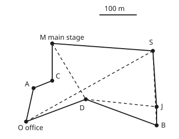

# Heuristics with a promise: greedy bounds and approximation ratios

[Syllabus](../../../SYLLABUS.md) → [Optimization](../README.md) → [Integer and Combinatorial Optimisation](../README.md#s05) → Heuristics with a promise

---

## General Overview

A music festival promised its ticket holders ten genres: rock, pop, folk, jazz, soul, indie, techno, hip-hop, reggae and metal. Seven acts are available. Each plays some of the genres and charges a fee, from £28,000 to £54,000:

| Act | Fee | Genres |
| --- | ---: | --- |
| P | £50,000 | rock, pop, folk, jazz, soul |
| Q | £50,000 | indie, techno, hip-hop, reggae, metal |
| R | £54,000 | rock, pop, folk, indie, techno, hip-hop |
| S | £30,000 | jazz, soul |
| T | £36,000 | reggae, metal |
| U | £40,000 | folk, jazz, reggae |
| V | £28,000 | pop, metal |

The festival must choose which acts to book so that every genre is played, and it wants the total fee as **small** as possible. This is a covering problem: each act covers some genres, and every genre must be covered at least once.

The quick method is **greedy**: book the act that is cheapest per genre not yet covered, and repeat. Here it books act R (six genres at £9,000 each), then the jazz-soul duo S, then the reggae-metal act T. The bill is £120,000. Trying all 128 lineups shows the cheapest is £100,000 (acts P and Q). Greedy is 20% over.

That gap is allowed. Greedy comes with a proved promise: on any covering problem, its bill is at most H(s) times the cheapest. H(s) = 1 + 1/2 + … + 1/s, where s is the most genres any one act covers. Here s = 6 and H(6) = 2.450. In general H(s) is at most 1 + ln n, where n is the number of genres. The promise is proved by **LP duality** (LP stands for linear programming): from greedy's own run, the proof builds per-genre prices that no lineup can beat.

There is a second kind of heuristic, which improves an answer and makes no promise about the result. A stage manager drives a buggy from the production office to all seven stages and back. The nearest-stage-first round is 1,251.8 m. **Two-opt** cuts two legs of the round and rejoins the ends the other way round. Two such moves shorten it to 1,090.5 m. Listing all 2,520 rounds proves no round is shorter. Two-opt itself promises much less: from 842 of the 2,520 starting rounds it stops above the shortest, at up to 1,193.5 m.

**A heuristic earns trust only through a proof: greedy covering always lands within H(s) ≤ 1 + ln n of the cheapest, because its own prices, divided by H(s), are a floor no lineup can beat; two-opt only promises a round that no single swap of two legs can shorten.**

**What kind of fact this is:** a theorem, the greedy bound, proved on this card in Why it works; and a method, two-opt, whose answer is a local optimum. Here that answer is certified as the shortest only by listing every round. The worst-case ratios known for two-opt are stated with a source, not proved here.

### The picture: the buggy round before and after two-opt

<p align="center"></p>

The map is to scale, 0.75 units per metre. Solid lines: the round two-opt stops at, O-A-C-M-S-J-B-D-O, 1,090.5 m. Dashed lines: the four legs of the nearest-stage-first round that two-opt removed (M-D, D-J, B-S and S-O). Two dashed pairs cross, and the solid round crosses nowhere. B-S runs almost on top of S-J.

---

## The formula

Notation first, in words. Number the genres e = 1 to n. Act j covers the genres in its list $E_j$ and charges the fee $c_j$. A lineup books act j when $x_j = 1$. OPT is the cheapest lineup's bill, and $C_{\text{greedy}}$ is greedy's bill. The covering problem **minimises** $\sum_j c_j x_j$, subject to every genre being covered by at least one booked act.

The greedy promise:

$$C_{\text{greedy}} \;\le\; H(s)\cdot \text{OPT} \;\le\; (1 + \ln n)\cdot\text{OPT}, \qquad H(s) = 1 + \tfrac12 + \tfrac13 + \dots + \tfrac1s$$

**Read it aloud:** greedy's bill is at most the harmonic number of the biggest act's genre count times the cheapest bill, and that is at most one plus the natural log of the number of genres, times the cheapest bill.

The floor behind it is the dual of the covering LP, the version where an act may be booked fractionally. In the formula below, LP is the cheapest bill of that fractional version. LP duality and the dual prices y come from [Integer programs](01-integer-programs-and-relaxations.md) and the linear-programming shelf. Give every genre a price $y_e \ge 0$ such that no act's genres are priced above its fee:

$$\sum_{e \in E_j} y_e \;\le\; c_j \ \text{ for every act } j \quad\Longrightarrow\quad \sum_e y_e \;\le\; \text{LP} \;\le\; \text{OPT}$$

**Read it aloud:** if no act's genres are priced above that act's fee, the total of the prices is a floor under every lineup's bill.

For a round t of the site, ℓ(t) is its length and L the shortest. A two-opt move removes legs u–u′ and v–v′ and adds u–v and u′–v′. The stretch between them is driven backwards. The move changes the length by

$$\Delta = d(u, v) + d(u', v') - d(u, u') - d(v, v')$$

**Read it aloud:** the change is the two new legs minus the two old ones; take the move only when that is negative.

| Symbol | Plain meaning | In our example | Push it up and the answer… |
| --- | --- | --- | --- |
| $n$, $e$, $e_i$ | number of genres; one genre; in the fold, act j's i-th genre in the order greedy covers them | 10; jazz; for P, rock, pop and folk come first | 1 + ln n grows slowly |
| $j$, $E_j$, $c_j$ | an act; its genres; its fee, £ thousand | R; six genres; 54 | a dear act drops out of greedy's picks |
| $x_j$ | 1 if act j is booked, else 0 | P and Q booked in the cheapest | — |
| OPT, $C_{\text{greedy}}$ | cheapest bill; greedy's bill | 100; 120 | — |
| $p_e$, $j_k$, $N_k$ | price genre e paid in greedy's run: the act's fee shared among the genres it newly covered; in the fold, greedy's k-th act and the genres it newly covers | 9 for rock; 18 for metal; $j_1$ is R | prices add up to $C_{\text{greedy}}$ |
| $y_e$ | a dual price per genre, no act overpriced | 9 or 11.5; sum 100 | a higher floor, until an act is overpriced |
| $s$, $H(s)$ | most genres one act covers; the harmonic number | 6; 2.450 | a weaker promise |
| $r$, $m$ | genres of one act still uncovered when greedy takes a step; in the fold, $m = \lvert E_j \rvert$, the number of act j's genres | 5, then 2, for act P; m = 5 for P | that act's allowance $c_j / r$ shrinks |
| $d(u, v)$ | straight-line distance on the site, metres | eight legs make the 1,251.8 m round | — |
| $t$, ℓ(t), $L$ | a round from the office; its length; the shortest | 1,251.8 m nearest-first; L = 1,090.5 m | — |
| $u, u', v, v'$, X | the ends of the two legs a move removes; X, the point where two legs cross | M, D and S, O in move 1 | — |
| $\Delta$ | the length change of one two-opt move | −122.8 m, then −38.5 m | a worse move, refused |

### When it holds

- **Greedy must rank acts by fee per new genre.** Rank by genres alone and the promise is gone. Here the most-genres rule, ties going to the act listed first, books R, P and Q for £154,000, worse but still inside H(6). In general it has no ratio at all: against ten solo acts at £10,000 each, one act playing all ten genres for £1,000,000 is booked first, 10 times the cheapest bill and above H(10) = 2.929.
- **The prices must be divided by H(s) before they count as a floor.** Greedy's raw prices add to 120, more than the cheapest bill of 100. They overcharge act P: 57 against its fee of 50.
- **The bound is worst case.** It allows up to 2.450 times the cheapest bill, and greedy came in at 1.20 times. A run usually lands well inside it, so a floor computed on the problem itself says more.
- **The no-crossing argument for two-opt needs straight-line distances.** On road distances a short cut need not exist, and the lemma in Step 5 fails.
- **Two-opt stops because each accepted move shortens the round by a set amount.** The code accepts only Δ below −10⁻⁹ m. With ties accepted, the walk could cycle among equal rounds forever.

---

## Why it works

### Step 0: compare with prices, because the cheapest bill is unknown

No fast method is known for OPT on large problems: covering is NP-hard, like integer programming in general. So the proof compares greedy with a floor. Here the floor is a set of genre prices that overprices no act.

The floor works by a two-line argument. Take any lineup that covers every genre. Its bill is the sum of its fees, and each fee is at least the prices of that act's genres. Every genre is covered at least once, so the bill is at least the sum of all the prices. The same argument with fractional bookings gives the LP bound; that is weak duality.

On the festival, set rock, pop, folk, indie, techno and hip-hop at £9,000. R's six genres then use up R's £54,000 exactly. P's fee, less its three £9,000 genres, leaves jazz and soul £11,500 each; reggae and metal get the same. All seven acts pass the check, and the prices add to £100,000. That is a dual certificate: no lineup costs less than £100,000. P with Q costs exactly £100,000, so that lineup is the cheapest, and the LP floor equals it. The 128-lineup enumeration agrees.

### Step 1: greedy hands each genre a price

When greedy books an act, it splits the fee equally among the genres that act newly covers. Rock, pop, folk, indie, techno and hip-hop each pay 54/6 = 9. Jazz and soul pay 30/2 = 15. Reggae and metal pay 36/2 = 18. Every pound of the bill is charged to exactly one genre, so the prices $p_e$ add to $C_{\text{greedy}}$ = 120.

These prices are not a floor yet. Act P covers rock, pop, folk, jazz and soul, and greedy charged those 9 + 9 + 9 + 15 + 15 = 57, above P's fee of 50. If they were a floor, no lineup could cost less than 120, and P with Q costs 100.

### Step 2: greedy overcharges any act by at most H of its size

Watch act P during greedy's run. At step 1, all five of P's genres are open. Booking P would cost 50/5 = 10 per genre. Greedy chose the cheapest rate available, 9, so each genre covered then paid at most 10. At step 2, two of P's genres are open. P's rate is 50/2 = 25, and greedy paid 15.

The same holds for every act and every step. When r of act j's genres are still open, greedy's rate is at most $c_j / r$. Take act j's genres in the order they get covered. The first is covered while all |E_j| of them are open, the next while at least |E_j| − 1 are, and so on down to the last, which is covered while at least 1 is open. So the prices on act j's genres add to at most

$$c_j\left(\frac{1}{|E_j|} + \frac{1}{|E_j| - 1} + \dots + 1\right) = H(|E_j|)\, c_j \le H(s)\, c_j .$$

The run checks all 17 such allowances (act by act, step by step) and all hold. The worst overcharge on the festival is act Q, priced at 1.260 times its fee. The proof allows up to H(6) = 2.450.

### Step 3: shrink the prices and they become a floor

Divide every $p_e$ by H(s). Step 2 says that no act is now overpriced, so by Step 0 the shrunk prices total at most OPT:

$$\frac{C_{\text{greedy}}}{H(s)} = \sum_e \frac{p_e}{H(s)} \;\le\; \text{OPT}.$$

Multiply through by H(s) and the promise is proved. This is **dual fitting**: the algorithm's own bookkeeping, scaled to fit, is a dual solution. On the festival the fitted floor is 120/2.450 = 48.98. That is weak but certain, and it needs no enumeration. Dividing by the run's actual worst overcharge, 1.260, already fits and gives a floor of 95.24.

The last step compares sums. H(s) ≤ H(n), because no act covers more than all n genres. And H(n) ≤ 1 + ln n by the area argument proved in [Approximation](../../14-Applied%20and%20computational/02-Randomised%20and%20Approximate%20Algorithms/06-approximation-algorithms.md): here H(10) = 2.929 and 1 + ln 10 = 3.303.

<details>
<summary>Detailed proof: greedy covering is within H(s) of the cheapest</summary>

Let greedy book acts in the order $j_1, j_2, \dots$. At the step where it books $j_k$, let $N_k$ be the genres it newly covers, and set $p_e = c_{j_k} / |N_k|$ for each e in $N_k$. Each genre is covered once, so $\sum_e p_e = \sum_k c_{j_k} = C_{\text{greedy}}$.

Fix any act j and list its genres $e_1, \dots, e_m$ in the order greedy covers them, breaking ties at random, with m = |E_j|. Just before $e_i$ is covered, the genres $e_i, \dots, e_m$ are all open, so act j would cover at least m − i + 1 new genres at rate at most $c_j/(m-i+1)$. Greedy books an act of least rate, so $p_{e_i} \le c_j/(m - i + 1)$. Summing over i, $\sum_{e \in E_j} p_e \le c_j H(m) \le c_j H(s)$.

So $y_e = p_e / H(s)$ satisfies $\sum_{e\in E_j} y_e \le c_j$ for every j, with $y \ge 0$. For any covering lineup x, $\sum_j c_j x_j \ge \sum_j x_j \sum_{e \in E_j} y_e = \sum_e y_e \sum_{j : e \in E_j} x_j \ge \sum_e y_e$, since each genre's inner sum is at least 1. Taking x as the cheapest lineup, OPT ≥ $\sum_e y_e = C_{\text{greedy}}/H(s)$. ∎

</details>

The computing wing proves the unit-cost version, every post costing the same, by charging each new item its share, and also gives the factor 2 for vertex cover ([Approximation](../../14-Applied%20and%20computational/02-Randomised%20and%20Approximate%20Algorithms/06-approximation-algorithms.md)). What is new here is reading the charges as dual prices. That gives a certificate printed from the run itself.

### Step 4: the promise is nearly reached

The bound cannot be much improved for greedy. Take ten solo acts, act i covering genre i alone for £60,000/i, and one big act covering all ten for £61,000. With k genres open, the big act costs 61/k per genre and solo act k costs 60/k, so greedy always takes a solo act. It pays 60 × H(10) = 175.74 against the best 61: a ratio of 2.881, against the promise of H(10) = 2.929.

### Step 5: two-opt removes crossings, and stops

Nearest-neighbour rounds and the cheapest-tree floor come from [The travelling salesman](../../04-Combinatorics%20and%20graphs/11-Tours%20-%20Euler%20and%20Hamilton/04-travelling-salesman-in-outline.md). Neighbourhoods, moves and local optima come from [Local search](../../14-Applied%20and%20computational/02-Randomised%20and%20Approximate%20Algorithms/07-local-search-and-metaheuristics.md). Two-opt is one such neighbourhood. Each scan prices every swap of two legs that do not touch, and the method takes the swap with the most negative Δ until none is negative.

The buggy round starts O-A-C-M-D-J-B-S-O, 1,251.8 m, with 2 pairs of crossing legs. Move 1 drops M-D and S-O, changing the length by −122.8 m. Move 2 drops S-B and J-D, for −38.5 m. The result, O-A-C-M-S-J-B-D-O, is 1,090.5 m after 60 looks, where a look prices one swap, and no two of its legs cross. The code re-adds the whole round after each move and gets the same change as Δ.

Why crossings go: suppose legs u–u′ and v–v′ cross at a point X. The triangle inequality gives d(u, v) ≤ d(u, X) + d(X, v) and d(u′, v′) ≤ d(u′, X) + d(X, v′). Add the two. The right side is d(u, u′) + d(v, v′), since X lies on both old legs. So Δ ≤ 0, and Δ < 0 unless all four points are on one line. A round that two-opt cannot improve therefore has no crossings.

Why it stops: each move shortens the round by more than 10⁻⁹ m, and there are only 2,520 rounds, so no round repeats. The method must halt. That bound on steps is all that is proved. In the plane there are site layouts where two-opt can take a number of moves that grows exponentially with the number of points (Englert, Röglin and Vöcking).

### Step 6: what two-opt does not promise

No crossings does not mean shortest. Run two-opt from every one of the 2,520 rounds. 1,678 runs end at the shortest round and 842 stop above it; the runs stop at 3 different lengths in all. The worst stop is O-B-J-S-D-M-C-A-O, 1,193.5 m, 9.4% above the shortest, with 0 crossings. Every single swap makes it longer, yet it is not the best.

The worst-case ratio of a two-opt stop to the shortest round grows with the number of points. Chandra, Karloff and Tovey show it can grow like the square root of the number of points under general distances that obey the triangle inequality. In the plane it grows at most like the logarithm of the number of points, and they give layouts that come close to that. So two-opt is a heuristic with no fixed ratio. On this site, the shortest round is certified only by enumeration, with the cheapest connecting tree, 740.4 m, as a floor that needs no enumeration.

---

## Worked numbers, by hand

| Step | Arithmetic | Value |
| --- | --- | --- |
| greedy step 1, act R | 54 / 6 new genres | 9.00 each |
| greedy step 2, act S | 30 / 2 | 15.00 each |
| greedy step 3, act T | 36 / 2 | 18.00 each |
| greedy bill | 54 + 30 + 36 | £120,000 |
| cheapest, all 128 lineups | P + Q = 50 + 50 | £100,000 |
| dual certificate | 6 × 9 + 4 × 11.5 | 100.00 |
| ratio | 120 / 100 | 1.20 |
| promise | H(6); 1 + ln 10 | 2.450; 3.303 |
| fitted floor | 120 / 2.450 | 48.98 |
| nearest-first round | O-A-C-M-D-J-B-S-O | 1,251.8 m |
| two-opt, two moves | −122.8, then −38.5 | **1,090.5 m** |
| shortest of 2,520 rounds | enumeration | 1,090.5 m |

Book acts P and Q for £100,000: the genre prices prove no lineup is cheaper, and greedy's £120,000 sits inside its promise. Drive O-A-C-M-S-J-B-D-O, 1,090.5 m: two-opt found it, and the full list of rounds certifies it.

```
Buggy round, metres, one block per 50 m

cheapest tree floor        ███████████████            740.4
shortest round             ██████████████████████     1090.5
worst two-opt stop         ████████████████████████   1193.5
nearest-first round        █████████████████████████  1251.8
```

### What breaks if you drop a piece

| Mistake | Comes out at | What went wrong |
| --- | --- | --- |
| Greedy prices taken as a floor, undivided | 120.00 floor, above the true 100 | Act P's genres are charged 57.00 against its fee of 50 |
| Greedy by most genres, ignoring fees | £154,000 (R, P, Q, ties to the act listed first); 10 times the cheapest when one £1,000,000 act plays all ten genres against ten £10,000 solo acts | The proof needs the cheapest rate per new genre; without it no ratio holds, and 10 is above H(10) = 2.929 |
| Two-opt's stop taken as the shortest | 1,193.5 m, 9.4% above | A stop is a local optimum; 842 of 2,520 starts end above the shortest |
| A crossing-free round taken as the shortest | 1,193.5 m with 0 crossings | No crossings is necessary for the shortest, not sufficient |

---

## Code, from first principles, and it actually runs

The scripts run greedy covering and record the price each genre pays. They check that answer three independent ways. They try all 128 lineups, check a hand-made dual certificate act by act, and test every one of greedy's 17 step allowances. They also run the near-tight family, and a family where ranking by genres alone breaks the promise. For the buggy, they build the nearest-first round, apply two-opt, and check the result two ways: against all 2,520 rounds, and with a crossing test that uses whole-number orientation signs and no lengths. Prim's cheapest connecting tree gives the floor. Nothing is imported that knows any answer.

### Python

```python
# Heuristics with a promise -- the check behind the card.  Standard library only.  Fees in £ thousand, distances in metres.
# Part 1: greedy covering of ten genres, each genre's price, the dual-fitting bound, against every lineup and a dual certificate.
# Part 2: the nearest-neighbour buggy round, improved by two-opt, checked against every one of the 2,520 rounds.
from itertools import permutations
from math import sqrt, log

GENRES = ["rock", "pop", "folk", "jazz", "soul", "indie", "techno", "hip-hop", "reggae", "metal"]
ACTS = [("P", 50, [0, 1, 2, 3, 4]), ("Q", 50, [5, 6, 7, 8, 9]), ("R", 54, [0, 1, 2, 5, 6, 7]),
        ("S", 30, [3, 4]), ("T", 36, [8, 9]), ("U", 40, [2, 3, 8]), ("V", 28, [1, 9])]
def H(k): return sum(1 / j for j in range(1, k + 1))          # the harmonic sum
def greedy(acts, n, by_fee=True):          # cheapest fee per new genre, or most new genres
    left, steps, price = set(range(n)), [], [0.0] * n
    while left:
        best = None
        for name, fee, gs in acts:
            new = [g for g in gs if g in left]
            key = (fee / len(new) if by_fee else -len(new)) if new else None
            if key is not None and (best is None or key < best[0]): best = (key, name, fee, new)
        _, name, fee, new = best
        steps.append((name, fee, new, [len([g for g in gs if g in left]) for _, _, gs in acts]))
        for g in new: price[g] = fee / len(new)
        left -= set(new)
    return steps, price

def bill(acts, by_fee=True):                # greedy's picks and its bill
    st = greedy(acts, 10, by_fee)[0]
    return " ".join(s[0] for s in st), sum(s[1] for s in st)

def cheapest(acts, n):                      # every lineup tried
    best = (float("inf"), "")
    for mask in range(1 << len(acts)):
        chosen = [a for i, a in enumerate(acts) if mask >> i & 1]
        if len({g for a in chosen for g in a[2]}) == n:
            best = min(best, (sum(a[1] for a in chosen), " ".join(a[0] for a in chosen)))
    return best

for name, fee, gs in ACTS: print(f"act {name}, fee {fee}: {' '.join(GENRES[g] for g in gs)}")
steps, price = greedy(ACTS, 10)
G = sum(s[1] for s in steps)
for k, (name, fee, new, _) in enumerate(steps, 1):
    print(f"greedy step {k}: act {name}, fee {fee}, {len(new)} new genres at {fee / len(new):.2f} each")
opt, opt_names = cheapest(ACTS, 10)
print(f"greedy lineup costs {G}; cheapest of all 128 lineups: {opt_names} at {opt}; ratio {G / opt:.2f}")
y = [9, 9, 9, 11.5, 11.5, 9, 9, 9, 11.5, 11.5]                 # dual prices, one per genre
dual_ok = all(sum(y[g] for g in gs) <= fee for _, fee, gs in ACTS)
print(f"dual prices {' '.join(f'{v:g}' for v in y)} sum to {sum(y):.2f}; every act's genres within its fee: {'yes' if dual_ok else 'no'}")
d = max(len(gs) for _, _, gs in ACTS)
print(f"promise: H({d}) = {H(d):.3f}, H(10) = {H(10):.3f}, 1 + ln 10 = {1 + log(10):.3f}")
ratios = [sum(price[g] for g in gs) / fee for _, fee, gs in ACTS]
print("greedy prices on each act / its fee: " + " ".join(f"{a[0]} {r:.3f}" for a, r in zip(ACTS, ratios)))
print(f"fitted floor {G} / H({d}) = {G / H(d):.2f}; shrinking by {max(ratios):.3f} instead gives {G / max(ratios):.2f}")
checks = held = 0                           # each price against fee / (act's genres still open)
for name, fee, new, open_counts in steps:
    for (_, f, _), k in zip(ACTS, open_counts):
        if k: checks += 1; held += fee / len(new) <= f / k
p_lines = [f"{fee / len(new):.2f} <= 50/{oc[0]} = {50 / oc[0]:.2f}" for _, fee, new, oc in steps if oc[0]]
print(f"act P's allowances: {', '.join(p_lines)}; all {held} of {checks} step checks hold")
TIGHT = [(f"solo{i}", 60 / i, [i - 1]) for i in range(1, 11)] + [("big", 61, list(range(10)))]
(_, tG), topt = bill(TIGHT), cheapest(TIGHT, 10)[0]
print(f"near-tight case, solo act i at 60/i and big act at 61: greedy {tG:.2f}, best {topt}, ratio {tG / topt:.3f} against H(10) {H(10):.3f}")
mnames, mG = bill(ACTS, by_fee=False)       # ties go to the act listed first
print(f"mistakes: raw prices as a floor {sum(price):.2f} > {opt}; act P's raw prices {sum(price[g] for g in ACTS[0][2]):.2f} > 50; most-genres greedy {mnames} costs {mG}")
BAD = [(f"solo{i}", 10, [i - 1]) for i in range(1, 11)] + [("big", 1000, list(range(10)))]
(bnames, bG), bopt = bill(BAD, by_fee=False), cheapest(BAD, 10)[0]
print(f"most-genres case, ten solo acts at 10 and a big act at 1000: most-genres greedy {bnames} {bG}, best {bopt}, ratio {bG / bopt:.3f} > H(10) {H(10):.3f}")

SITE = [("O", 30, 20), ("A", 50, 110), ("M", 100, 230), ("D", 190, 80), ("J", 380, 60),
        ("B", 380, 10), ("S", 370, 210), ("C", 100, 130)]
def dist(i, j): return sqrt((SITE[i][1] - SITE[j][1]) ** 2 + (SITE[i][2] - SITE[j][2]) ** 2)
def length(t):                              # added leg by leg, in order, as the Rust does
    total = 0.0
    for i in range(len(t)): total += dist(t[i], t[(i + 1) % len(t)])
    return total
def word(t): return "-".join(SITE[i][0] for i in t + [t[0]])
def two_opt(t, log_moves=False):            # best improving swap of two legs, until none
    t, n, moves, looks = list(t), len(t), 0, 0
    while True:
        best, at = -1e-9, None
        for i in range(n - 1):
            for j in range(i + 2, n if i else n - 1):
                a, b, c, e = t[i], t[i + 1], t[j], t[(j + 1) % n]
                looks += 1
                delta = dist(a, c) + dist(b, e) - dist(a, b) - dist(c, e)
                if delta < best: best, at = delta, (i, j)
        if at is None: return t, moves, looks
        i, j = at
        new = t[:i + 1] + t[i + 1:j + 1][::-1] + t[j + 1:]
        if log_moves:
            print(f"two-opt move {moves + 1}: drop {word([t[i], t[i + 1]])[:3]} and {word([t[j], t[(j + 1) % n]])[:3]}, "
                  f"change {best:.1f}, recount {length(new) - length(t):.1f}")
        t, moves = new, moves + 1

def crossings(t):                           # pairs of legs that cross, by orientation signs
    def o(p, q, r): return (q[1] - p[1]) * (r[2] - p[2]) - (q[2] - p[2]) * (r[1] - p[1])
    legs, count = [(SITE[t[i]], SITE[t[(i + 1) % len(t)]]) for i in range(len(t))], 0
    for x in range(len(t)):
        for z in range(x + 2, len(t) if x else len(t) - 1):
            (p, q), (r, s) = legs[x], legs[z]
            count += o(p, q, r) * o(p, q, s) < 0 and o(r, s, p) * o(r, s, q) < 0
    return count
def nearest():                              # from the office, always to the nearest stage not yet visited
    t, left = [0], set(range(1, 8))
    while left: k = min(left, key=lambda v: (dist(t[-1], v), v)); t.append(k); left.remove(k)
    return t

nn = nearest()
print(f"nearest-neighbour round {word(nn)}: {length(nn):.1f} m, {crossings(nn)} crossing pair(s)")
best_t, moves, looks = two_opt(nn, True)
print(f"two-opt round {word(best_t)}: {length(best_t):.1f} m after {moves} moves and {looks} looks, {crossings(best_t)} crossings")
rounds = [[0] + list(p) for p in permutations(range(1, 8)) if p[0] < p[-1]]
L = min(length(t) for t in rounds)
in_tree, tree = {0}, 0.0                    # Prim's cheapest connecting tree, the floor
while len(in_tree) < 8: w, v = min((dist(u, v), v) for u in in_tree for v in range(8) if v not in in_tree); tree += w; in_tree.add(v)
print(f"shortest of all {len(rounds)} rounds: {L:.1f} m; cheapest tree floor {tree:.1f} m; nearest-neighbour {100 * (length(nn) / L - 1):.1f}% above")
ends = [length(two_opt(t)[0]) for t in rounds]
hit = sum(abs(e - L) < 1e-6 for e in ends)
worst = max(range(len(rounds)), key=lambda k: ends[k])
print(f"two-opt from every round: {hit} of {len(rounds)} end at the shortest, {len(rounds) - hit} above; distinct stopping lengths {len({round(e, 6) for e in ends})}")
print(f"worst stop {word(two_opt(rounds[worst])[0])}: {ends[worst]:.1f} m, {100 * (ends[worst] / L - 1):.1f}% above, {crossings(two_opt(rounds[worst])[0])} crossings")
print("figure, scale 0.75 per m, " + " ".join(f"{p[0]}({p[1]},{p[2]})" for p in SITE))

assert opt == 100 and abs(sum(y) - opt) < 1e-9 and dual_ok          # certificate meets enumeration
assert G <= H(d) * opt and max(ratios) <= H(d) and held == checks   # the theorem, act by act
assert abs(sum(price) - G) < 1e-9                                   # every pound charged once
assert topt == 61 and tG / topt <= H(10) and tG / topt > 2.8         # nearly tight, never over
assert abs(length(best_t) - L) < 1e-6 and tree <= L                 # two-opt against enumeration
assert crossings(best_t) == 0 and crossings(nn) == 2 and all(e >= L - 1e-6 for e in ends)
assert bG / bopt > H(10) and bopt == 100                            # most genres first: no promise
R60 = [(a, 60 if a == "R" else f, gs) for a, f, gs in ACTS]
print(f"try R at 60: greedy {' costs '.join(map(str, bill(R60)))}, cheapest {cheapest(R60, 10)[0]};",
      f"dual certificate fits: {'yes' if all(sum(y[g] for g in gs) <= f for _, f, gs in R60) else 'no'}")
T59 = TIGHT[:-1] + [("big", 59, list(range(10)))]
print(f"try big act at 59: greedy {bill(T59)[0]} {bill(T59)[1]:.2f}, best {cheapest(T59, 10)[0]}, ratio {bill(T59)[1] / cheapest(T59, 10)[0]:.3f}")
y10 = y[:2] + [10] + y[3:]                  # folk's price raised to 10
print(f"try folk at 10: prices sum to {sum(y10):.2f}; overpriced acts: {' '.join(a for a, f, gs in ACTS if sum(y10[g] for g in gs) > f)}")
SITE[7] = ("C", 150, 130)                   # move the comedy tent
nn2, L2 = nearest(), min(length(t) for t in rounds); t2, m2, _ = two_opt(nn2)
print(f"try C at (150, 130): nearest-neighbour {word(nn2)} {length(nn2):.1f} m, {crossings(nn2)} crossings, {100 * (length(nn2) / L2 - 1):.1f}% above "
      f"the shortest {L2:.1f} m; two-opt reaches {length(t2):.1f} m in {m2} moves")
print("ALL CHECKS PASS")
```

**Ran 2026-11-11 on macOS, Python 3.14.10, standard library only. All checks passed. Output, pasted from the run:**

```
act P, fee 50: rock pop folk jazz soul
act Q, fee 50: indie techno hip-hop reggae metal
act R, fee 54: rock pop folk indie techno hip-hop
act S, fee 30: jazz soul
act T, fee 36: reggae metal
act U, fee 40: folk jazz reggae
act V, fee 28: pop metal
greedy step 1: act R, fee 54, 6 new genres at 9.00 each
greedy step 2: act S, fee 30, 2 new genres at 15.00 each
greedy step 3: act T, fee 36, 2 new genres at 18.00 each
greedy lineup costs 120; cheapest of all 128 lineups: P Q at 100; ratio 1.20
dual prices 9 9 9 11.5 11.5 9 9 9 11.5 11.5 sum to 100.00; every act's genres within its fee: yes
promise: H(6) = 2.450, H(10) = 2.929, 1 + ln 10 = 3.303
greedy prices on each act / its fee: P 1.140 Q 1.260 R 1.000 S 1.000 T 1.000 U 1.050 V 0.964
fitted floor 120 / H(6) = 48.98; shrinking by 1.260 instead gives 95.24
act P's allowances: 9.00 <= 50/5 = 10.00, 15.00 <= 50/2 = 25.00; all 17 of 17 step checks hold
near-tight case, solo act i at 60/i and big act at 61: greedy 175.74, best 61, ratio 2.881 against H(10) 2.929
mistakes: raw prices as a floor 120.00 > 100; act P's raw prices 57.00 > 50; most-genres greedy R P Q costs 154
most-genres case, ten solo acts at 10 and a big act at 1000: most-genres greedy big 1000, best 100, ratio 10.000 > H(10) 2.929
nearest-neighbour round O-A-C-M-D-J-B-S-O: 1251.8 m, 2 crossing pair(s)
two-opt move 1: drop M-D and S-O, change -122.8, recount -122.8
two-opt move 2: drop S-B and J-D, change -38.5, recount -38.5
two-opt round O-A-C-M-S-J-B-D-O: 1090.5 m after 2 moves and 60 looks, 0 crossings
shortest of all 2520 rounds: 1090.5 m; cheapest tree floor 740.4 m; nearest-neighbour 14.8% above
two-opt from every round: 1678 of 2520 end at the shortest, 842 above; distinct stopping lengths 3
worst stop O-B-J-S-D-M-C-A-O: 1193.5 m, 9.4% above, 0 crossings
figure, scale 0.75 per m, O(30,20) A(50,110) M(100,230) D(190,80) J(380,60) B(380,10) S(370,210) C(100,130)
try R at 60: greedy P Q costs 100, cheapest 100; dual certificate fits: yes
try big act at 59: greedy big 59.00, best 59, ratio 1.000
try folk at 10: prices sum to 101.00; overpriced acts: P R
try C at (150, 130): nearest-neighbour O-A-C-D-M-S-J-B-O 1254.4 m, 0 crossings, 11.7% above the shortest 1122.6 m; two-opt reaches 1122.6 m in 2 moves
ALL CHECKS PASS
```

### Rust

```rust
// Heuristics with a promise -- the same check as the Python, in Rust.  No crates.  Fees in £ thousand, distances in metres.
// Part 1: greedy covering of ten genres, each genre's price, the dual-fitting bound, against every lineup and a dual certificate.
// Part 2: the nearest-neighbour buggy round, improved by two-opt, checked against every one of the 2,520 rounds.
use std::collections::HashSet;
use std::sync::Mutex;
type Act = (String, f64, Vec<usize>);
struct Step { name: String, fee: f64, new: Vec<usize>, open: Vec<usize> }
fn h(k: usize) -> f64 { (1..=k).map(|j| 1.0 / j as f64).sum() }          // the harmonic sum
fn greedy(acts: &[Act], n: usize, by_fee: bool) -> (Vec<Step>, Vec<f64>) {
    let (mut left, mut steps, mut price) = (vec![true; n], Vec::new(), vec![0.0; n]);
    while left.iter().any(|&l| l) {
        let mut best: Option<(f64, usize, Vec<usize>)> = None;
        for (i, (_, fee, gs)) in acts.iter().enumerate() {
            let new: Vec<usize> = gs.iter().copied().filter(|&g| left[g]).collect();
            if new.is_empty() { continue }
            let key = if by_fee { fee / new.len() as f64 } else { -(new.len() as f64) };
            if best.as_ref().map_or(true, |b| key < b.0) { best = Some((key, i, new)) }
        }
        let (_, i, new) = best.unwrap();
        let open = acts.iter().map(|a| a.2.iter().filter(|&&g| left[g]).count()).collect();
        for &g in &new { price[g] = acts[i].1 / new.len() as f64; left[g] = false }
        steps.push(Step { name: acts[i].0.clone(), fee: acts[i].1, new, open });
    }
    (steps, price)
}
fn bill(acts: &[Act], by_fee: bool) -> (String, f64) {                    // greedy's picks and its bill
    let st = greedy(acts, 10, by_fee).0;
    (st.iter().map(|s| s.name.as_str()).collect::<Vec<_>>().join(" "), st.iter().map(|s| s.fee).sum())
}

fn cheapest(acts: &[Act], n: usize) -> (f64, String) {                   // every lineup tried
    let mut best = (f64::INFINITY, String::new());
    for mask in 0..(1usize << acts.len()) {
        let chosen: Vec<&Act> = acts.iter().enumerate().filter(|(i, _)| mask >> i & 1 == 1).map(|(_, a)| a).collect();
        if chosen.iter().flat_map(|a| a.2.iter().copied()).collect::<HashSet<usize>>().len() != n { continue }
        let c = (chosen.iter().map(|a| a.1).sum::<f64>(), chosen.iter().map(|a| a.0.as_str()).collect::<Vec<_>>().join(" "));
        if c.0 < best.0 || (c.0 == best.0 && c.1 < best.1) { best = c }
    }
    best
}

static SITE: Mutex<[(&str, i64, i64); 8]> = Mutex::new([("O", 30, 20), ("A", 50, 110), ("M", 100, 230), ("D", 190, 80),
    ("J", 380, 60), ("B", 380, 10), ("S", 370, 210), ("C", 100, 130)]);          // a "try" line moves C
fn site() -> [(&'static str, i64, i64); 8] { *SITE.lock().unwrap() }
fn dist(i: usize, j: usize) -> f64 { let w = site(); let (dx, dy) = ((w[i].1 - w[j].1) as f64, (w[i].2 - w[j].2) as f64); (dx * dx + dy * dy).sqrt() }
fn length(t: &[usize]) -> f64 { (0..t.len()).map(|i| dist(t[i], t[(i + 1) % t.len()])).sum() }
fn word(t: &[usize]) -> String { let w = site(); t.iter().chain([t[0]].iter()).map(|&i| w[i].0).collect::<Vec<_>>().join("-") }

fn two_opt(t0: &[usize], log_moves: bool) -> (Vec<usize>, usize, usize) {   // best improving swap, until none
    let (mut t, n, mut moves, mut looks) = (t0.to_vec(), t0.len(), 0, 0);
    loop {
        let (mut best, mut at) = (-1e-9, None);
        for i in 0..n - 1 {
            for j in i + 2..(if i > 0 { n } else { n - 1 }) {
                let (a, b, c, e) = (t[i], t[i + 1], t[j], t[(j + 1) % n]);
                looks += 1; let delta = dist(a, c) + dist(b, e) - dist(a, b) - dist(c, e);
                if delta < best { best = delta; at = Some((i, j)) }
            }
        }
        let Some((i, j)) = at else { return (t, moves, looks) };
        let mut new = t.clone(); new[i + 1..j + 1].reverse();
        if log_moves {
            println!("two-opt move {}: drop {} and {}, change {:.1}, recount {:.1}", moves + 1,
                     &word(&[t[i], t[i + 1]])[..3], &word(&[t[j], t[(j + 1) % n]])[..3], best, length(&new) - length(&t));
        }
        t = new; moves += 1;
    }
}

fn crossings(t: &[usize]) -> usize {                     // pairs of legs that cross, by orientation signs
    let w = site(); let o = |p: usize, q: usize, r: usize| (w[q].1 - w[p].1) * (w[r].2 - w[p].2) - (w[q].2 - w[p].2) * (w[r].1 - w[p].1);
    let (n, mut count) = (t.len(), 0);
    for x in 0..n { for z in x + 2..(if x > 0 { n } else { n - 1 }) {
        let (p, q, r, s) = (t[x], t[(x + 1) % n], t[z], t[(z + 1) % n]);
        if o(p, q, r) * o(p, q, s) < 0 && o(r, s, p) * o(r, s, q) < 0 { count += 1 } } }
    count
}
fn nearest() -> Vec<usize> {                             // from the office, always to the nearest stage not yet visited
    let (mut t, mut left) = (vec![0usize], (1..8).collect::<Vec<usize>>());
    while let Some(&k) = left.iter().min_by(|&&a, &&b| { let l = *t.last().unwrap(); dist(l, a).partial_cmp(&dist(l, b)).unwrap().then(a.cmp(&b)) }) {
        t.push(k); left.retain(|&v| v != k);
    }
    t
}

fn next_perm(p: &mut [usize]) -> bool {                  // lexicographic order, as the Python lists them
    let Some(i) = (0..p.len() - 1).rev().find(|&i| p[i] < p[i + 1]) else { return false };
    let j = (i + 1..p.len()).rev().find(|&j| p[j] > p[i]).unwrap();
    p.swap(i, j); p[i + 1..].reverse(); true
}

fn main() {
    let act = |n: &str, f: f64, g: &[usize]| (n.to_string(), f, g.to_vec());
    let acts: Vec<Act> = vec![act("P", 50.0, &[0, 1, 2, 3, 4]), act("Q", 50.0, &[5, 6, 7, 8, 9]),
        act("R", 54.0, &[0, 1, 2, 5, 6, 7]), act("S", 30.0, &[3, 4]), act("T", 36.0, &[8, 9]),
        act("U", 40.0, &[2, 3, 8]), act("V", 28.0, &[1, 9])];
    const GENRES: [&str; 10] = ["rock", "pop", "folk", "jazz", "soul", "indie", "techno", "hip-hop", "reggae", "metal"];
    for a in &acts { println!("act {}, fee {}: {}", a.0, a.1, a.2.iter().map(|&k| GENRES[k]).collect::<Vec<_>>().join(" ")) }
    let (steps, price) = greedy(&acts, 10, true);
    let g: f64 = steps.iter().map(|s| s.fee).sum();
    for (k, s) in steps.iter().enumerate() { println!("greedy step {}: act {}, fee {}, {} new genres at {:.2} each", k + 1, s.name, s.fee, s.new.len(), s.fee / s.new.len() as f64) }
    let (opt, opt_names) = cheapest(&acts, 10);
    println!("greedy lineup costs {}; cheapest of all 128 lineups: {} at {}; ratio {:.2}", g, opt_names, opt, g / opt);
    let y = [9.0, 9.0, 9.0, 11.5, 11.5, 9.0, 9.0, 9.0, 11.5, 11.5]; let ysum: f64 = y.iter().sum(); // dual prices, one per genre
    let dual_ok = acts.iter().all(|a| a.2.iter().map(|&k| y[k]).sum::<f64>() <= a.1);
    println!("dual prices {} sum to {:.2}; every act's genres within its fee: {}", y.map(|v| v.to_string()).join(" "), ysum, if dual_ok { "yes" } else { "no" });
    let d = acts.iter().map(|a| a.2.len()).max().unwrap();
    println!("promise: H({}) = {:.3}, H(10) = {:.3}, 1 + ln 10 = {:.3}", d, h(d), h(10), 1.0 + 10f64.ln());
    let ratios: Vec<f64> = acts.iter().map(|a| a.2.iter().map(|&k| price[k]).sum::<f64>() / a.1).collect(); let rmax = ratios.iter().cloned().fold(0.0, f64::max);
    println!("greedy prices on each act / its fee: {}", acts.iter().zip(&ratios).map(|(a, r)| format!("{} {:.3}", a.0, r)).collect::<Vec<_>>().join(" "));
    println!("fitted floor {} / H({}) = {:.2}; shrinking by {:.3} instead gives {:.2}", g, d, g / h(d), rmax, g / rmax);
    let (mut checks, mut held) = (0, 0);
    for s in &steps { for (a, &k) in acts.iter().zip(&s.open) {
        if k > 0 { checks += 1; if s.fee / s.new.len() as f64 <= a.1 / k as f64 { held += 1 } } } }
    let p_lines: Vec<String> = steps.iter().filter(|s| s.open[0] > 0)
        .map(|s| format!("{:.2} <= 50/{} = {:.2}", s.fee / s.new.len() as f64, s.open[0], 50.0 / s.open[0] as f64)).collect();
    println!("act P's allowances: {}; all {} of {} step checks hold", p_lines.join(", "), held, checks);
    let mut tight: Vec<Act> = (1..=10).map(|i| (format!("solo{}", i), 60.0 / i as f64, vec![i - 1])).collect();
    tight.push(act("big", 61.0, &(0..10).collect::<Vec<_>>()));
    let (tg, topt) = (bill(&tight, true).1, cheapest(&tight, 10).0);
    println!("near-tight case, solo act i at 60/i and big act at 61: greedy {:.2}, best {}, ratio {:.3} against H(10) {:.3}", tg, topt, tg / topt, h(10));
    let ((mnames, mg), praw) = (bill(&acts, false), acts[0].2.iter().map(|&k| price[k]).sum::<f64>()); // ties go to the act listed first
    println!("mistakes: raw prices as a floor {:.2} > {}; act P's raw prices {:.2} > 50; most-genres greedy {} costs {}", price.iter().sum::<f64>(), opt, praw, mnames, mg);
    let mut bad: Vec<Act> = (1..=10).map(|i| (format!("solo{}", i), 10.0, vec![i - 1])).collect();
    bad.push(act("big", 1000.0, &(0..10).collect::<Vec<_>>()));
    let ((bnames, bg), bopt) = (bill(&bad, false), cheapest(&bad, 10).0);
    println!("most-genres case, ten solo acts at 10 and a big act at 1000: most-genres greedy {} {}, best {}, ratio {:.3} > H(10) {:.3}", bnames, bg, bopt, bg / bopt, h(10));

    let nn = nearest();
    println!("nearest-neighbour round {}: {:.1} m, {} crossing pair(s)", word(&nn), length(&nn), crossings(&nn));
    let (best_t, moves, looks) = two_opt(&nn, true);
    println!("two-opt round {}: {:.1} m after {} moves and {} looks, {} crossings", word(&best_t), length(&best_t), moves, looks, crossings(&best_t));
    let (mut rounds, mut p) = (Vec::new(), vec![1usize, 2, 3, 4, 5, 6, 7]);
    loop { if p[0] < p[6] { rounds.push([vec![0], p.clone()].concat()) } if !next_perm(&mut p) { break } }
    let l = rounds.iter().map(|t| length(t)).fold(f64::INFINITY, f64::min);
    let (mut in_tree, mut tree) = (vec![0usize], 0.0);      // Prim's cheapest connecting tree, the floor
    while in_tree.len() < 8 { let mut b = (f64::INFINITY, 0);
        for &u in &in_tree { for v in 0..8 { if !in_tree.contains(&v) && (dist(u, v), v) < b { b = (dist(u, v), v) } } }
        tree += b.0; in_tree.push(b.1) }
    println!("shortest of all {} rounds: {:.1} m; cheapest tree floor {:.1} m; nearest-neighbour {:.1}% above", rounds.len(), l, tree, 100.0 * (length(&nn) / l - 1.0));
    let ends: Vec<f64> = rounds.iter().map(|t| length(&two_opt(t, false).0)).collect();
    let hit = ends.iter().filter(|e| (*e - l).abs() < 1e-6).count();
    let (distinct, mut worst): (HashSet<String>, usize) = (ends.iter().map(|e| format!("{:.6}", e)).collect(), 0); for k in 0..ends.len() { if ends[k] > ends[worst] { worst = k } }
    println!("two-opt from every round: {} of {} end at the shortest, {} above; distinct stopping lengths {}", hit, rounds.len(), rounds.len() - hit, distinct.len());
    let wt = two_opt(&rounds[worst], false).0;
    println!("worst stop {}: {:.1} m, {:.1}% above, {} crossings", word(&wt), ends[worst], 100.0 * (ends[worst] / l - 1.0), crossings(&wt));
    println!("figure, scale 0.75 per m, {}", site().iter().map(|p| format!("{}({},{})", p.0, p.1, p.2)).collect::<Vec<_>>().join(" "));

    assert!(opt == 100.0 && (ysum - opt).abs() < 1e-9 && dual_ok);          // certificate meets enumeration
    assert!(g <= h(d) * opt && rmax <= h(d) && held == checks);              // the theorem, act by act
    assert!((price.iter().sum::<f64>() - g).abs() < 1e-9);                   // every pound charged once
    assert!(topt == 61.0 && tg / topt <= h(10) && tg / topt > 2.8);          // nearly tight, never over
    assert!((length(&best_t) - l).abs() < 1e-6 && tree <= l);                // two-opt against enumeration
    assert!(crossings(&best_t) == 0 && crossings(&nn) == 2 && ends.iter().all(|&e| e >= l - 1e-6));
    assert!(bg / bopt > h(10) && bopt == 100.0);                            // most genres first: no promise
    let r60: Vec<Act> = acts.iter().map(|a| (a.0.clone(), if a.0 == "R" { 60.0 } else { a.1 }, a.2.clone())).collect();
    let ((rn, rg), fits) = (bill(&r60, true), r60.iter().all(|a| a.2.iter().map(|&k| y[k]).sum::<f64>() <= a.1));
    println!("try R at 60: greedy {} costs {}, cheapest {}; dual certificate fits: {}", rn, rg, cheapest(&r60, 10).0, if fits { "yes" } else { "no" });
    let mut t59 = tight.clone(); t59[10].1 = 59.0;
    let ((n59, g59), b59) = (bill(&t59, true), cheapest(&t59, 10).0);
    println!("try big act at 59: greedy {} {:.2}, best {}, ratio {:.3}", n59, g59, b59, g59 / b59);
    let mut y10 = y; y10[2] = 10.0;                                         // folk's price raised to 10
    println!("try folk at 10: prices sum to {:.2}; overpriced acts: {}", y10.iter().sum::<f64>(),
             acts.iter().filter(|a| a.2.iter().map(|&k| y10[k]).sum::<f64>() > a.1).map(|a| a.0.as_str()).collect::<Vec<_>>().join(" "));
    SITE.lock().unwrap()[7] = ("C", 150, 130);                               // move the comedy tent
    let (nn2, l2) = (nearest(), rounds.iter().map(|t| length(t)).fold(f64::INFINITY, f64::min)); let (t2, m2, _) = two_opt(&nn2, false);
    println!("try C at (150, 130): nearest-neighbour {} {:.1} m, {} crossings, {:.1}% above the shortest {:.1} m; two-opt reaches {:.1} m in {} moves",
             word(&nn2), length(&nn2), crossings(&nn2), 100.0 * (length(&nn2) / l2 - 1.0), l2, length(&t2), m2);
    println!("ALL CHECKS PASS");
}
```

**Ran 2026-11-11 on macOS, rustc 1.98.1, no crates. All checks passed. Output, pasted from the run:**

```
act P, fee 50: rock pop folk jazz soul
act Q, fee 50: indie techno hip-hop reggae metal
act R, fee 54: rock pop folk indie techno hip-hop
act S, fee 30: jazz soul
act T, fee 36: reggae metal
act U, fee 40: folk jazz reggae
act V, fee 28: pop metal
greedy step 1: act R, fee 54, 6 new genres at 9.00 each
greedy step 2: act S, fee 30, 2 new genres at 15.00 each
greedy step 3: act T, fee 36, 2 new genres at 18.00 each
greedy lineup costs 120; cheapest of all 128 lineups: P Q at 100; ratio 1.20
dual prices 9 9 9 11.5 11.5 9 9 9 11.5 11.5 sum to 100.00; every act's genres within its fee: yes
promise: H(6) = 2.450, H(10) = 2.929, 1 + ln 10 = 3.303
greedy prices on each act / its fee: P 1.140 Q 1.260 R 1.000 S 1.000 T 1.000 U 1.050 V 0.964
fitted floor 120 / H(6) = 48.98; shrinking by 1.260 instead gives 95.24
act P's allowances: 9.00 <= 50/5 = 10.00, 15.00 <= 50/2 = 25.00; all 17 of 17 step checks hold
near-tight case, solo act i at 60/i and big act at 61: greedy 175.74, best 61, ratio 2.881 against H(10) 2.929
mistakes: raw prices as a floor 120.00 > 100; act P's raw prices 57.00 > 50; most-genres greedy R P Q costs 154
most-genres case, ten solo acts at 10 and a big act at 1000: most-genres greedy big 1000, best 100, ratio 10.000 > H(10) 2.929
nearest-neighbour round O-A-C-M-D-J-B-S-O: 1251.8 m, 2 crossing pair(s)
two-opt move 1: drop M-D and S-O, change -122.8, recount -122.8
two-opt move 2: drop S-B and J-D, change -38.5, recount -38.5
two-opt round O-A-C-M-S-J-B-D-O: 1090.5 m after 2 moves and 60 looks, 0 crossings
shortest of all 2520 rounds: 1090.5 m; cheapest tree floor 740.4 m; nearest-neighbour 14.8% above
two-opt from every round: 1678 of 2520 end at the shortest, 842 above; distinct stopping lengths 3
worst stop O-B-J-S-D-M-C-A-O: 1193.5 m, 9.4% above, 0 crossings
figure, scale 0.75 per m, O(30,20) A(50,110) M(100,230) D(190,80) J(380,60) B(380,10) S(370,210) C(100,130)
try R at 60: greedy P Q costs 100, cheapest 100; dual certificate fits: yes
try big act at 59: greedy big 59.00, best 59, ratio 1.000
try folk at 10: prices sum to 101.00; overpriced acts: P R
try C at (150, 130): nearest-neighbour O-A-C-D-M-S-J-B-O 1254.4 m, 0 crossings, 11.7% above the shortest 1122.6 m; two-opt reaches 1122.6 m in 2 moves
ALL CHECKS PASS
```

The two outputs match line for line.

### Lean

Lean proves the greedy promise and the price floor for every covering problem, the crossing step behind two-opt, and the festival's numbers.

- Take any covering problem with fees of zero or more. Let greedy book an act cheapest per new genre at each step, with ties going any way.
- Greedy's bill is then at most H(s) times the bill of any lineup that covers every genre. And H(s) is at most 1 + ln n.
- Give every genre a price of zero or more, with no act's genres priced above its fee. The prices add to at most the bill of any lineup.
- That floor holds even for a lineup that books acts fractionally, as long as every genre is covered at least once in total.
- With straight-line distances in the plane, if legs u–u′ and v–v′ cross at a point X, the two-opt move gives Δ ≤ 0.
- On the festival, greedy books R, then S, then T, for 120. P with Q covers every genre for 100, and every covering lineup costs at least 100.
- The dual certificate overprices no act and adds to 100. Also s = 6, H(6) = 2.450, and greedy's raw prices charge act P 57 against its fee of 50.
- In the near-tight family, greedy books the ten solo acts for 60 × H(10), while the big act alone covers every genre for 61.

The buggy rounds, two-opt's stopping, the most-genres rule and the "try" lines are left to the Python and Rust checks.

```lean
-- Heuristics with a promise: greedy covering by cheapest fee per new genre costs at most H(s) ≤ 1 + ln n times any covering lineup, genre prices that overprice no act are a floor under every (even fractional) lineup, and a two-opt move that uncrosses two crossing legs never lengthens a round in the plane.
import Mathlib.NumberTheory.Harmonic.Bounds
import Mathlib.Analysis.InnerProductSpace.PiL2
import Mathlib.Analysis.Normed.Affine.Convex
import Mathlib.Tactic.NormNum

namespace GreedyCover

variable {α ι K : Type*} [DecidableEq α] [DecidableEq ι]

/-- The genres of act `j` still open after the acts in `booked` have been booked. -/
def openGenres (E : ι → Finset α) (booked : List ι) (j : ι) : Finset α :=
  E j \ booked.toFinset.biUnion E

/-- A lineup `T` covers every genre: each genre is played by at least one booked act. -/
def IsCover [Fintype α] (E : ι → Finset α) (T : Finset ι) : Prop :=
  ∀ e : α, ∃ j ∈ T, e ∈ E j

/-- `picks` is a run of greedy covering: at every step the booked act covers at least one
open genre, and its fee per newly covered genre is the least among all acts that still
cover an open genre (ties may go any way); when the run ends, every genre is covered. -/
def IsGreedyRun [Fintype α] [Fintype ι] [Field K] [LinearOrder K]
    (E : ι → Finset α) (c : ι → K) (picks : List ι) : Prop :=
  (∀ k (hk : k < picks.length),
    (openGenres E (picks.take k) picks[k]).Nonempty ∧
    ∀ j, (openGenres E (picks.take k) j).Nonempty →
      c picks[k] / ((openGenres E (picks.take k) picks[k]).card : K) ≤
        c j / ((openGenres E (picks.take k) j).card : K)) ∧
  ∀ e : α, ∃ j ∈ picks, e ∈ E j

/-- The harmonic numbers, cast to the reals, never decrease. -/
theorem harmonic_real_mono {a b : ℕ} (h : a ≤ b) : (harmonic a : ℝ) ≤ harmonic b := by
  have : harmonic a ≤ harmonic b := by
    unfold harmonic
    apply Finset.sum_le_sum_of_subset_of_nonneg (Finset.range_subset_range.mpr h)
    intro i _ _
    positivity
  exact_mod_cast this

#print axioms harmonic_real_mono

/-- Charging step: if `r * a ≤ q` with `r ≥ 0` and `b ≤ a`, then
`r * (a - b) ≤ q * (H a - H b)`. -/
theorem harmonic_charge (r q : ℝ) (hr : 0 ≤ r) (b : ℕ) :
    ∀ a, b ≤ a → r * a ≤ q → r * ((a : ℝ) - b) ≤ q * ((harmonic a : ℝ) - harmonic b) := by
  intro a hab
  induction a, hab using Nat.le_induction with
  | base => intro _; simp
  | succ n hbn ih =>
    intro hq
    push_cast at hq
    have hq' : r * n ≤ q := by nlinarith
    have h1 := ih hq'
    have hn : (0 : ℝ) < n + 1 := by positivity
    have h2 : r ≤ q * ((n : ℝ) + 1)⁻¹ := by
      rw [← div_eq_mul_inv, le_div_iff₀ hn]; linarith
    rw [harmonic_succ]
    push_cast
    nlinarith

#print axioms harmonic_charge

/-- A greedy run can be checked in whole numbers when every fee is a whole number over a
common positive denominator `D`. -/
theorem isGreedyRun_of_nat [Fintype α] [Fintype ι] (E : ι → Finset α) (a : ι → ℕ)
    (D : ℚ) (hD : 0 < D) (picks : List ι)
    (h1 : ∀ k (hk : k < picks.length),
      (openGenres E (picks.take k) picks[k]).Nonempty ∧
      ∀ j, (openGenres E (picks.take k) j).Nonempty →
        a picks[k] * (openGenres E (picks.take k) j).card ≤
          a j * (openGenres E (picks.take k) picks[k]).card)
    (h2 : ∀ e : α, ∃ j ∈ picks, e ∈ E j) :
    IsGreedyRun E (fun j => (a j : ℚ) / D) picks := by
  refine ⟨fun k hk => ⟨(h1 k hk).1, fun j hj => ?_⟩, h2⟩
  have hp := Finset.card_pos.mpr (h1 k hk).1
  have hjp := Finset.card_pos.mpr hj
  have hn := (h1 k hk).2 j hj
  have hm : (0 : ℚ) < (openGenres E (picks.take k) picks[k]).card := by exact_mod_cast hp
  have hj' : (0 : ℚ) < (openGenres E (picks.take k) j).card := by exact_mod_cast hjp
  have hnq : (a picks[k] : ℚ) * (openGenres E (picks.take k) j).card ≤
      (a j : ℚ) * (openGenres E (picks.take k) picks[k]).card := by exact_mod_cast hn
  simp only
  rw [div_div, div_div, div_le_div_iff₀ (by positivity) (by positivity)]
  nlinarith

#print axioms isGreedyRun_of_nat

/-- **The greedy promise.** Take any covering problem: genres `α` (there are `n` of them),
acts `ι`, act `j` playing the genres `E j` for a fee `c j ≥ 0`. Let greedy book, step by
step, an act of least fee per newly covered genre, until every genre is covered. Then
greedy's bill is at most `H(s)` times the bill of every lineup that covers every genre
(so at most `H(s) · OPT`), where `s` is the most genres any one act plays and
`H(s) = 1 + 1/2 + … + 1/s`; and `H(s) · OPT ≤ (1 + ln n) · OPT`. -/
theorem greedy_cover_within_harmonic_of_cheapest [Fintype α] [Fintype ι]
    (E : ι → Finset α) (c : ι → ℝ) (hc : ∀ j, 0 ≤ c j)
    (picks : List ι) (hgreedy : IsGreedyRun E c picks)
    (T : Finset ι) (hT : IsCover E T) :
    (picks.map c).sum ≤
        (harmonic (Finset.univ.sup fun j => (E j).card) : ℝ) * ∑ j ∈ T, c j ∧
      (harmonic (Finset.univ.sup fun j => (E j).card) : ℝ) * ∑ j ∈ T, c j ≤
        (1 + Real.log (Fintype.card α)) * ∑ j ∈ T, c j := by
  have hTnonneg : 0 ≤ ∑ j ∈ T, c j := Finset.sum_nonneg fun j _ => hc j
  refine ⟨?_, ?_⟩
  · obtain ⟨hstep, -⟩ := hgreedy
    let C : ℕ → Finset α := fun k => (picks.take k).toFinset.biUnion E
    let Φ : ℕ → ℝ := fun k => ∑ j ∈ T, c j * (harmonic (E j \ C k).card : ℝ)
    have key : ∀ k ≤ picks.length, ((picks.take k).map c).sum ≤ Φ 0 - Φ k := by
      intro k
      induction k with
      | zero => intro _; simp
      | succ k ih =>
        intro hk
        have hk' : k < picks.length := hk
        have ih := ih (by omega)
        rw [List.take_succ_eq_append_getElem hk', List.map_append, List.sum_append]
        simp only [List.map_cons, List.map_nil, List.sum_cons, List.sum_nil, add_zero]
        suffices h : c picks[k] ≤ Φ k - Φ (k + 1) by linarith
        obtain ⟨hne, hmin⟩ := hstep k hk'
        have hC : C (k + 1) = C k ∪ E picks[k] := by
          simp only [C]
          rw [List.take_succ_eq_append_getElem hk', List.toFinset_append]
          simp [Finset.union_comm]
        change (E picks[k] \ C k).Nonempty at hne
        set p := picks[k]
        set m := (E p \ C k).card with hm
        have hmpos : (0 : ℝ) < m := by exact_mod_cast Finset.card_pos.mpr hne
        set r := c p / m with hr
        have hr0 : 0 ≤ r := div_nonneg (hc p) hmpos.le
        have hrm : r * m = c p := by rw [hr]; field_simp
        have hjr : ∀ j ∈ T, r * ((E j \ C k).card : ℝ) ≤ c j := by
          intro j _
          by_cases hj : (E j \ C k).Nonempty
          · have hjpos : (0 : ℝ) < (E j \ C k).card := by exact_mod_cast Finset.card_pos.mpr hj
            have := hmin j hj
            exact (le_div_iff₀ hjpos).mp this
          · rw [Finset.not_nonempty_iff_eq_empty.mp hj]; simp [hc j]
        have hcard : ∀ j, (E j \ (C k ∪ E p)).card + ((E j \ C k) ∩ E p).card
            = (E j \ C k).card := by
          intro j
          have hset : E j \ (C k ∪ E p) = (E j \ C k) \ E p := by
            ext e; simp only [Finset.mem_sdiff, Finset.mem_union]; tauto
          rw [hset]
          exact Finset.card_sdiff_add_card_inter _ _
        have hcov : m ≤ ∑ j ∈ T, ((E j \ C k) ∩ E p).card := by
          refine le_trans (Finset.card_le_card ?_) Finset.card_biUnion_le
          intro e he
          obtain ⟨j, hjT, hej⟩ := hT e
          rw [Finset.mem_sdiff] at he
          rw [Finset.mem_biUnion]
          exact ⟨j, hjT, by simp [hej, he.1, he.2]⟩
        have hcovR : (m : ℝ) ≤ ∑ j ∈ T, (((E j \ C k).card : ℝ) - (E j \ (C k ∪ E p)).card) := by
          have : (m : ℝ) ≤ ∑ j ∈ T, (((E j \ C k) ∩ E p).card : ℝ) := by exact_mod_cast hcov
          refine this.trans (le_of_eq (Finset.sum_congr rfl fun j _ => ?_))
          have := hcard j
          rw [← this]; push_cast; ring
        calc c p = r * m := hrm.symm
          _ ≤ r * ∑ j ∈ T, (((E j \ C k).card : ℝ) - (E j \ (C k ∪ E p)).card) :=
            mul_le_mul_of_nonneg_left hcovR hr0
          _ = ∑ j ∈ T, r * (((E j \ C k).card : ℝ) - (E j \ (C k ∪ E p)).card) :=
            Finset.mul_sum _ _ _
          _ ≤ ∑ j ∈ T, c j * ((harmonic (E j \ C k).card : ℝ) -
                harmonic (E j \ (C k ∪ E p)).card) := by
            apply Finset.sum_le_sum
            intro j hj
            exact harmonic_charge r (c j) hr0 _ _ (by have := hcard j; omega) (hjr j hj)
          _ = Φ k - Φ (k + 1) := by
            simp only [Φ, hC, ← Finset.sum_sub_distrib, mul_sub]
    have h1 := key picks.length le_rfl
    rw [List.take_length] at h1
    have hΦn : 0 ≤ Φ picks.length := by
      apply Finset.sum_nonneg
      intro j _
      have := harmonic_real_mono (Nat.zero_le (E j \ C picks.length).card)
      simp only [harmonic_zero, Rat.cast_zero] at this
      exact mul_nonneg (hc j) this
    have hΦ0 : Φ 0 ≤ (harmonic (Finset.univ.sup fun j => (E j).card) : ℝ) * ∑ j ∈ T, c j := by
      simp only [Φ, C, List.take_zero, List.toFinset_nil, Finset.biUnion_empty,
        Finset.sdiff_empty]
      rw [Finset.mul_sum]
      apply Finset.sum_le_sum
      intro j _
      rw [mul_comm (c j)]
      apply mul_le_mul_of_nonneg_right _ (hc j)
      exact harmonic_real_mono (Finset.le_sup (f := fun j => (E j).card) (Finset.mem_univ j))
    linarith
  · apply mul_le_mul_of_nonneg_right _ hTnonneg
    have hs : (Finset.univ.sup fun j => (E j).card) ≤ Fintype.card α :=
      Finset.sup_le fun j _ => Finset.card_le_univ (E j)
    exact (harmonic_real_mono hs).trans (harmonic_le_one_add_log _)

/-- **Prices that overprice no act are a floor (weak LP duality).** Give every genre a price
`y e ≥ 0` so that no act's genres are priced above its fee: `∑_{e ∈ E j} y e ≤ c j`.
Then the prices add up to at most the bill of every lineup, even a fractional one that
books act `j` to the extent `x j ≥ 0` with every genre booked at least once in total. -/
theorem dual_prices_floor_every_lineup [Fintype α] [Fintype ι]
    (E : ι → Finset α) (c : ι → ℝ) (y : α → ℝ) (hy : ∀ e, 0 ≤ y e)
    (hfit : ∀ j, ∑ e ∈ E j, y e ≤ c j)
    (x : ι → ℝ) (hx : ∀ j, 0 ≤ x j)
    (hcover : ∀ e, 1 ≤ ∑ j ∈ Finset.univ.filter (fun j => e ∈ E j), x j) :
    ∑ e, y e ≤ ∑ j, c j * x j := by
  calc ∑ e, y e ≤ ∑ e, y e * ∑ j ∈ Finset.univ.filter (fun j => e ∈ E j), x j := by
        apply Finset.sum_le_sum
        intro e _
        nlinarith [hy e, hcover e]
    _ = ∑ j, x j * ∑ e ∈ E j, y e := by
        simp only [Finset.mul_sum, Finset.sum_filter]
        rw [Finset.sum_comm]
        apply Finset.sum_congr rfl
        intro j _
        simp only [mul_ite, mul_zero]
        rw [← Finset.sum_filter, Finset.filter_mem_eq_inter, Finset.univ_inter]
        simp [mul_comm]
    _ ≤ ∑ j, c j * x j := by
        apply Finset.sum_le_sum
        intro j _
        rw [mul_comm (c j)]
        exact mul_le_mul_of_nonneg_left (hfit j) (hx j)

/-- **Uncrossing two legs never lengthens the round.** With straight-line distances in the
plane, if leg `u–u'` and leg `v–v'` cross at a point `X`, then the two-opt move that
replaces them by `u–v` and `u'–v'` changes the length by
`Δ = d(u,v) + d(u',v') - d(u,u') - d(v,v') ≤ 0`. -/
theorem two_opt_uncrossing_does_not_lengthen (u u' v v' X : EuclideanSpace ℝ (Fin 2))
    (hX₁ : X ∈ segment ℝ u u') (hX₂ : X ∈ segment ℝ v v') :
    dist u v + dist u' v' - dist u u' - dist v v' ≤ 0 := by
  have h1 := dist_add_dist_of_mem_segment hX₁
  have h2 := dist_add_dist_of_mem_segment hX₂
  have h3 := dist_triangle u X v
  have h4 := dist_triangle u' X v'
  rw [dist_comm X u'] at h1
  rw [dist_comm v X] at h2
  linarith

/-! ### The festival: genres rock, pop, folk, jazz, soul, indie, techno, hip-hop, reggae,
metal are `0, …, 9`; acts P, Q, R, S, T, U, V are `0, …, 6`; fees in £ thousand. -/

/-- The genres each act plays. -/
def festE : Fin 7 → Finset (Fin 10) :=
  ![{0, 1, 2, 3, 4}, {5, 6, 7, 8, 9}, {0, 1, 2, 5, 6, 7}, {3, 4}, {8, 9}, {2, 3, 8}, {1, 9}]

/-- The fees: P 50, Q 50, R 54, S 30, T 36, U 40, V 28. -/
def festC : Fin 7 → ℚ := ![50, 50, 54, 30, 36, 40, 28]

/-- Greedy books R, then S, then T. -/
example : IsGreedyRun festE festC [2, 3, 4] := by
  have h : festC = fun j => ((![50, 50, 54, 30, 36, 40, 28] : Fin 7 → ℕ) j : ℚ) / 1 := by
    funext j; fin_cases j <;> simp [festC]
  rw [h]
  exact isGreedyRun_of_nat _ _ 1 one_pos _ (by decide) (by decide)

/-- Greedy's bill: 54 + 30 + 36 = 120. -/
example : ([2, 3, 4].map festC).sum = 120 := by
  simp [festC]; norm_num

/-- P with Q covers every genre for 100. -/
example : IsCover festE {0, 1} ∧ ∑ j ∈ ({0, 1} : Finset (Fin 7)), festC j = 100 := by
  refine ⟨by unfold IsCover; decide, ?_⟩
  simp [festC]; norm_num

/-- Every one of the 128 lineups that covers every genre costs at least 100. -/
example : ∀ T : Finset (Fin 7), IsCover festE T → 100 ≤ ∑ j ∈ T, festC j := by
  have h : festC = fun j => ((![50, 50, 54, 30, 36, 40, 28] : Fin 7 → ℕ) j : ℚ) := by
    funext j; fin_cases j <;> simp [festC]
  have hn : ∀ T : Finset (Fin 7), IsCover festE T →
      100 ≤ ∑ j ∈ T, (![50, 50, 54, 30, 36, 40, 28] : Fin 7 → ℕ) j := by
    unfold IsCover
    set_option maxRecDepth 100000 in decide
  intro T hT
  rw [h]
  have := hn T hT
  rw [← Nat.cast_sum]
  exact_mod_cast this

/-- The dual certificate: rock, pop, folk, indie, techno, hip-hop at 9, the rest at 23/2;
no act is overpriced and the prices add to 100. -/
example :
    (∀ j, ∑ e ∈ festE j, (![9, 9, 9, 23/2, 23/2, 9, 9, 9, 23/2, 23/2] : Fin 10 → ℚ) e ≤ festC j) ∧
      ∑ e, (![9, 9, 9, 23/2, 23/2, 9, 9, 9, 23/2, 23/2] : Fin 10 → ℚ) e = 100 := by
  refine ⟨fun j => ?_, ?_⟩
  · fin_cases j <;> simp [festE, festC, Finset.sum_insert] <;> norm_num
  · simp [Fin.sum_univ_succ]; norm_num

/-- The most genres one act plays is s = 6, and H(6) = 49/20 (2.450), H(10) = 7381/2520. -/
example : (Finset.univ.sup fun j => (festE j).card) = 6 ∧
    harmonic 6 = 49 / 20 ∧ harmonic 10 = 7381 / 2520 := by
  refine ⟨by decide, ?_, ?_⟩ <;> simp [harmonic, Finset.sum_range_succ] <;> norm_num

/-- Greedy's raw prices overcharge act P: 9 + 9 + 9 + 15 + 15 = 57 > 50. -/
example : (54 / 6 + 54 / 6 + 54 / 6 + 30 / 2 + 30 / 2 : ℚ) = 57 ∧ (57 : ℚ) > festC 0 := by
  simp [festC]; norm_num

/-! ### The near-tight family: solo act `i` (`i = 1, …, 10`, index `i - 1`) plays genre `i`
alone for `60 / i`; the big act (index 10) plays all ten genres for 61. -/

/-- The genres of the near-tight family. -/
def tightE (j : Fin 11) : Finset (Fin 10) :=
  if h : j.val < 10 then {⟨j.val, h⟩} else Finset.univ

/-- The fees of the near-tight family. -/
def tightC (j : Fin 11) : ℚ :=
  if j.val < 10 then 60 / (j.val + 1 : ℚ) else 61

/-- Greedy books the solo acts from genre 10 down to genre 1, for 60 · H(10) = 7381/42,
against the best bill of 61 (the big act alone). -/
example : IsGreedyRun tightE tightC [9, 8, 7, 6, 5, 4, 3, 2, 1, 0] ∧
    ([9, 8, 7, 6, 5, 4, 3, 2, 1, 0].map tightC).sum = 7381 / 42 ∧
    (7381 / 42 : ℚ) = 60 * harmonic 10 ∧ IsCover tightE {10} ∧ tightC 10 = 61 := by
  refine ⟨?_, ?_, ?_, ?_, ?_⟩
  · have h : tightC = fun j => ((fun j : Fin 11 =>
        if j.val < 10 then 151200 / (j.val + 1) else 153720) j : ℚ) / 2520 := by
      funext j; fin_cases j <;> simp [tightC] <;> norm_num
    rw [h]
    exact isGreedyRun_of_nat _ _ 2520 (by norm_num) _ (by decide) (by decide)
  · simp [tightC]; norm_num
  · simp [harmonic, Finset.sum_range_succ]; norm_num
  · unfold IsCover; decide
  · simp [tightC]

#print axioms greedy_cover_within_harmonic_of_cheapest
#print axioms dual_prices_floor_every_lineup
#print axioms two_opt_uncrossing_does_not_lengthen

end GreedyCover
```

**Checked 2026-11-12 on macOS, Lean 4.36.0-rc2, Mathlib v4.36.0-rc2. Every proof is complete and uses only Lean's standard axioms. Output, pasted from the run:**

```
'GreedyCover.harmonic_real_mono' depends on axioms: [propext, Classical.choice, Quot.sound]
'GreedyCover.harmonic_charge' depends on axioms: [propext, Classical.choice, Quot.sound]
'GreedyCover.isGreedyRun_of_nat' depends on axioms: [propext, Classical.choice, Quot.sound]
'GreedyCover.greedy_cover_within_harmonic_of_cheapest' depends on axioms: [propext, Classical.choice, Quot.sound]
'GreedyCover.dual_prices_floor_every_lineup' depends on axioms: [propext, Classical.choice, Quot.sound]
'GreedyCover.two_opt_uncrossing_does_not_lengthen' depends on axioms: [propext, Classical.choice, Quot.sound]
```

> [!TIP]
> **Try changing**
> The "try" lines at the end of the output give each answer.
> - Guess first: if act R's fee rises from 54 to 60, is greedy still 20% over? Set `("R", 60,`. P, Q and R now tie on fee per new genre, and ties go to the act listed first, so greedy books P and Q for 100, the cheapest; the dual certificate still fits and every check passes.
> - Guess first: what does the near-tight family do when the big act costs 59 instead of 61? Set `("big", 59,`. Greedy books it first, at 59 = best, ratio 1.000; the assert expecting a best of 61 stops the run.
> - Guess first: raise folk's dual price from 9 to 10. The prices then add to 101.00, but acts P and R are overpriced and the check prints "no"; the first assert stops it, because a floor above 100 would be false.
> - Guess first: move the comedy tent C to (150, 130). The nearest-first round O-A-C-D-M-S-J-B-O is 1,254.4 m with 0 crossings, yet 11.7% above the new shortest, 1,122.6 m, which two-opt reaches in 2 moves.

---

## The usual mistake

> [!warning]
> **Quoting a heuristic's answer as the best, or quoting the promise as the gap.** Greedy's £120,000 is not the cheapest; the promise only says it is within 2.450 times the cheapest. The true gap, 20%, came from an enumeration and a dual certificate. Two-opt has no ratio at all to quote: its answer is "the best found", unless something like the 2,520-round list certifies it.
>
> - **Undivided greedy prices as a floor.** They total 120.00, above the true 100, because act P's genres are charged 57.00 against its fee of 50.
> - **Ranking acts by genres covered.** The most-genres rule books R, P and Q for £154,000, and against ten £10,000 solo acts it books a £1,000,000 act that plays all ten genres, 10 times the cheapest; the proof needs fee per new genre.
> - **"No crossings, so shortest."** The worst two-opt stop has 0 crossings and is 1,193.5 m, 9.4% above the shortest.
> - **Trusting one start.** Two-opt from the nearest-first round happened to reach the shortest; from 842 of the 2,520 starting rounds it does not.

---

## Where you meet it in real life

- **Festival and venue booking.** Covering a programme of genres, time slots or audiences with the fewest fees is set cover. Greedy by cost per new requirement is the standard first answer, and its prices give a floor for free.
- **Crew rostering.** Airlines cover every flight with paid crew trips. A greedy or LP-based plan comes with the LP floor beside it, so the planner knows the most a better plan could save.
- **Delivery and service rounds.** Vans, drills on circuit boards and festival buggies run rounds polished by two-opt and its relatives, such as Lin–Kernighan. These are reported as the best found, with a tree or LP floor beside them.
- **Branch and bound.** A heuristic round or lineup is the first incumbent that lets [Branch and bound](03-branch-and-bound.md) prune, and a dual floor is what it prunes against.

> **Say it back**
> A heuristic is trusted only as far as its proof. Greedy covering books the act cheapest per new genre and charges each genre its share of the fee. Those charges overprice any act by at most H(s), so divided by H(s) they are LP dual prices, a floor under every lineup. That proves greedy's bill is at most H(s) ≤ 1 + ln n times the cheapest: £120,000 against £100,000 here. Two-opt swaps two legs while that shortens the round. It removes every crossing and must stop, but it promises no ratio, and from 842 of the 2,520 starts it stops above the shortest.

---

## What this builds on

- [Four classic models](06-classic-integer-models-knapsack-assignment-and-covering.md): the covering model and the travelling-salesman model, written as integer programs.
- [The travelling salesman](../../04-Combinatorics%20and%20graphs/11-Tours%20-%20Euler%20and%20Hamilton/04-travelling-salesman-in-outline.md): the nearest-neighbour round, and the cheapest connecting tree as a floor.
- [Approximation](../../14-Applied%20and%20computational/02-Randomised%20and%20Approximate%20Algorithms/06-approximation-algorithms.md): approximation ratios, the factor 2 for vertex cover, and the charging proof of greedy's log factor.
- [Local search](../../14-Applied%20and%20computational/02-Randomised%20and%20Approximate%20Algorithms/07-local-search-and-metaheuristics.md): neighbourhoods, moves, local optima and honest reporting of runs.

## Where this goes next

- [Search without derivatives](../07-Dynamic%20Programming%20and%20Learning/09-derivative-free-and-metaheuristic-search.md): annealing and population methods, searches that report the best found with no proved ratio, as two-opt does here.

Earlier cards on this shelf take a heuristic's answer further:

- [Lagrangian relaxation](07-lagrangian-relaxation-and-decomposition.md): prices on awkward constraints, giving floors like the dual certificate here on much larger problems.
- [Branch and bound](03-branch-and-bound.md): a heuristic's answer as the incumbent, and floors to close the search tree and certify the best.
- [Integer programs](01-integer-programs-and-relaxations.md): the LP relaxation in general, and the gap between a fractional floor and the whole-number best.

The question this card leaves open is how to certify a two-opt round as the shortest when the rounds are far too many to list.

---

## Sources

Verified 2026-11-11: every link below resolves to the publisher's page.

- Chvátal, V. "A Greedy Heuristic for the Set-Covering Problem." *Mathematics of Operations Research* 4, no. 3 (1979): 233–235. [doi:10.1287/moor.4.3.233](https://doi.org/10.1287/moor.4.3.233). The H(s) bound for greedy covering with fees.
- Williamson, David P., and David B. Shmoys. *The Design of Approximation Algorithms*. Cambridge University Press, 2011. [doi:10.1017/CBO9780511921735](https://doi.org/10.1017/CBO9780511921735). Dual fitting for greedy set cover, the argument of Steps 1 to 3.
- Croes, G. A. "A Method for Solving Traveling-Salesman Problems." *Operations Research* 6, no. 6 (1958): 791–812. [doi:10.1287/opre.6.6.791](https://doi.org/10.1287/opre.6.6.791). The leg-reversing improvement now called two-opt.
- Chandra, Barun, Howard Karloff, and Craig Tovey. "New Results on the Old k-opt Algorithm for the Traveling Salesman Problem." *SIAM Journal on Computing* 28, no. 6 (1999): 1998–2029. [doi:10.1137/S0097539793251244](https://doi.org/10.1137/S0097539793251244). Worst-case ratios of two-opt stops that grow with the number of points.
- Englert, Matthias, Heiko Röglin, and Berthold Vöcking. "Worst Case and Probabilistic Analysis of the 2-Opt Algorithm for the TSP." *Algorithmica* 68 (2014): 190–264. [doi:10.1007/s00453-013-9801-4](https://doi.org/10.1007/s00453-013-9801-4). Plane layouts where two-opt takes exponentially many moves.
