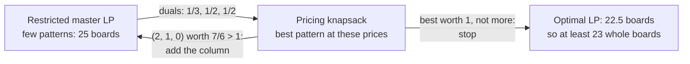
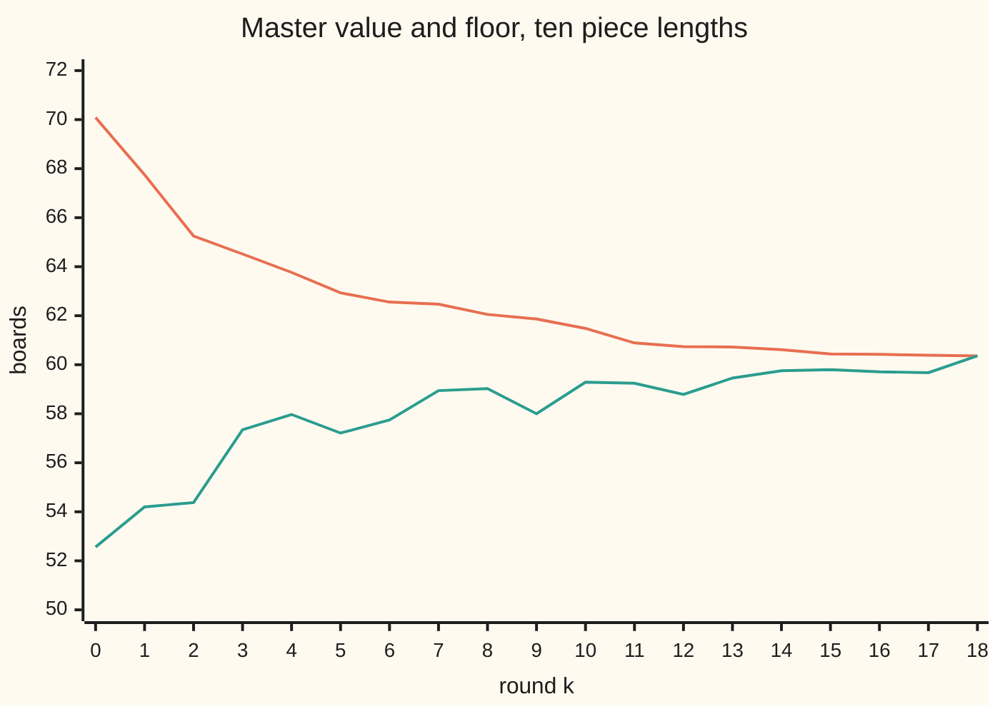

# Column generation: let a small pricing problem write the columns the master program needs

[Syllabus](../../../SYLLABUS.md) → [Optimization](../README.md) → [Integer and Combinatorial Optimisation](../README.md#s05) → Column generation

---

## General Overview

A festival crew builds stage decking from timber boards that come 10 m long. The order is 30 pieces of 3 m, 20 pieces of 4 m and 10 pieces of 5 m. Each board is sawn into a few pieces, and the rest is offcut. The crew **chooses** how to saw each board, wants to use **as few boards as possible** (this card **minimises**), and must **cover the order**.

The way one board is sawn is a **pattern**: how many 3 m, 4 m and 5 m pieces it gives. The pattern (2, 1, 0) means two 3 m pieces and one 4 m piece, 10 m exactly. A plan says how many boards to cut to each pattern. This small order has 11 patterns. With dozens of piece lengths the count grows explosively, and nobody can write them all down.

**Column generation** never lists them. It starts with three plain patterns, (3, 0, 0), (0, 2, 0) and (0, 0, 2), which need 25 boards. Solving that small linear program (LP) gives a **price** on each piece: 1/3 of a board for a 3 m piece, 1/2 for a 4 m piece, 1/2 for a 5 m piece. Then a small puzzle asks: which pattern is worth the most at those prices? The answer, (2, 1, 0), is worth 2/3 + 1/2 = 7/6 of a board, yet costs only one board. So it goes in. After one more round no pattern is worth more than one board, and that is the proof that the fractional plan, 22.5 boards, is the best fractional plan.

The total length of the order is 220 m, so at least 22 boards are needed. The pattern program says more: at least 22.5, so at least **23**. A plan with 23 boards exists, so 23 is the answer.

**Keep only a few patterns in the main program, read a price for every piece from its solution, and let a small knapsack find the pattern whose pieces are worth more than a board; when none is, the prices prove the current plan is the best over all patterns, listed or not.**

**What kind of fact this is:** a method (column generation), and a theorem, proved on this card in Why it works: when no pattern is worth more than its cost, the small program's answer solves the full one. The bound available at every round is a second theorem, also proved here.

### The picture: the loop



Schematic. Each pass round the loop is one **round**, counted from $`k = 0`$.

---

## The formula

A **column** is one variable of an LP together with its entries in every constraint. Here each column is a pattern. The full **master program**, from Gilmore and Gomory's 1961 paper, lists every pattern $`p`$ that fits:

```math
z_{LP} = \min \sum_{p} x_p \quad\text{subject to}\quad \sum_p a_{ip}\, x_p \ge d_i \ \text{ for each piece length } i, \qquad x_p \ge 0 .
```

Its dual, from [LP duality](../04-Linear%20Programming/04-lp-duality-and-complementary-slackness.md), puts a price $`y_i`$ on each piece:

```math
\max \sum_i d_i\, y_i \quad\text{subject to}\quad \sum_i a_{ip}\, y_i \le 1 \ \text{ for every pattern } p, \qquad y \ge 0 .
```

The **restricted master** keeps only a list $`\mathcal{P}'`$ of patterns. Its dual prices $`y`$ feed the **pricing problem**, a knapsack ([Four classic models](06-classic-integer-models-knapsack-assignment-and-covering.md)):

```math
v^* = \max \Big\{ \sum_i y_i\, a_i \;:\; \sum_i l_i\, a_i \le L,\ a_i \in \{0, 1, 2, \dots\} \Big\}, \qquad \bar c_p = 1 - \sum_i y_i\, a_{ip}, \qquad \frac{z_{RMP}}{v^*} \le z_{LP} \le z_{RMP} .
```

**Read it aloud:** find the pattern whose pieces, at the current prices, are worth the most; if it is worth more than one board, its **reduced cost** $`\bar c_p`$ (the change in boards per board cut to it) is negative and it joins the master; if not, stop; at every round the master's value divided by the best pattern's worth is a floor under the true LP value.

| Symbol | Plain meaning | In our example | Push it up and the answer… |
| --- | --- | --- | --- |
| $`L`$; $`l_i`$, $`n`$ | board length, m; length of piece $`i`$, m; how many lengths | 10; 3, 4, 5; 3 | longer boards: fewer, 20 at 11 m |
| $`d_i`$ | pieces of length $`i`$ wanted | 30, 20, 10 | more boards: 31 short pieces give 22.75 |
| $`p`$, $`a_{ip}`$, $`a`$ | a pattern; how many pieces of length $`i`$ it gives; a pattern written as the list $`(a_1, a_2, a_3)`$ | (2, 1, 0) | — |
| $`x_p`$ | boards cut to pattern $`p`$: one column of the master | 15 boards of (2, 1, 0) | — |
| $`\mathcal{P}`$, $`\mathcal{P}'`$ | all patterns that fit; the ones the restricted master holds | 11; 3 at the start, 4 at the end | more held: the master's value falls or stays |
| $`y_i`$ | **dual price** of piece $`i`$, boards per piece | 1/3, 1/2, 1/2 at round 0 | — |
| $`v^*`$ | the pricing value: the best pattern's worth at the prices | 7/6 at round 0, then 1 | above 1: a column enters |
| $`c_p`$, $`\bar c_p`$ | cost of pattern $`p`$, 1 board here; its reduced cost: its cost minus its worth | 1; −1/6 for (2, 1, 0) at round 0 | negative: worth adding |
| $`z_{RMP}`$, $`k`$ | the restricted master's value; the round number from 0 | 25 at $`k = 0`$, 22.5 at $`k = 1`$ | — |
| $`z_{LP}`$, $`z_{IP}`$ | the full master's LP value; the fewest whole boards | 22.5; 23 | — |
| $`\kappa`$ | any upper bound on the boards an optimal LP plan uses | 25 | larger: a weaker bound |
| $`x_{ij}`$, $`u_j`$; $`X`$, $`x^q`$, $`\lambda_q`$, $`\mu`$; $`A`$, $`b`$, $`c`$ | Step 4 only: pieces of length $`i`$ on board $`j`$, board $`j`$ used; a block's allowed points, one of them, its weight, the price on "weights sum to 1"; the linking rows and the costs | 22 boards holding 15/11, 10/11, 5/11 | — |

Here $`L`$, $`\kappa`$ and $`\mu`$ are this card's own names. They are not the smoothness constant, the condition number $`\kappa = L/\mu`$ and the strong-convexity constant that measure rates elsewhere in this wing.

### When it holds

- **The pricing problem must be solved exactly.** The stopping test reads "no pattern is worth more than 1". A quick guess that misses the best pattern can say "none" falsely: the greedy fill below stops at 25 boards when 22.5 is right.
- **The master must be an LP.** Prices exist and bound the optimum only for the LP. The whole-board answer needs rounding or branching, and the LP value is then a bound on it, not the answer.
- **Columns must share one structure a small problem can search.** Here every column is "any pattern that fits a 10 m board". If each column had to be written by hand, there would be nothing to price.
- **The floor $`z_{RMP}/v^*`$, as written, assumes every pattern costs one board.** It shrinks the prices until no pattern is worth more than 1. With other positive costs $`c_p`$, scale them by the smallest cost-to-worth ratio instead: $`z_{LP} \ge z_{RMP} \cdot \min_p c_p / \sum_i y_i\, a_{ip}`$. Dividing by $`v^*`$ alone can leave a cheap pattern worth more than its cost, and the floor can be false. The Lagrangian form $`z_{RMP} + \kappa \min_p \bar c_p`$ of Step 3 works for any costs.
- **The prices must come from an optimal restricted master.** Prices from a plan that is not optimal for its own patterns prove nothing about the rest.

---

## Why it works

### Step 0: prices tell you what an unlisted column would be worth

The dual of an LP prices each constraint. A column helps the minimisation exactly when its cost is less than the value, at those prices, of what it supplies. So one does not need to have a column in the program to know whether it would help. One needs only its entries and the prices. The pricing problem searches all possible entries at once, by solving a small optimisation instead of listing.

### Step 1: one round on the decking order

Round 0 starts with $`\mathcal{P}' = \{(3,0,0), (0,2,0), (0,0,2)\}`$. Covering the order needs 10, 10 and 5 boards: 25. Each of the three patterns is cut, so each breaks even at the prices (complementary slackness): $`3y_1 = 1`$, $`2y_2 = 1`$, $`2y_3 = 1`$. The prices are $`y = (1/3, 1/2, 1/2)`$.

The table values the six patterns that leave no room for another piece; the knapsack finds the best of them without listing any:

| Pattern | Worth at round 0 | Worth at round 1 |
| --- | --- | --- |
| (3, 0, 0) | 1 | 3/4 |
| (2, 1, 0) | **7/6** | 1 |
| (0, 2, 0) | 1 | 1 |
| (1, 0, 1) | 5/6 | 3/4 |
| (0, 1, 1) | 1 | 1 |
| (0, 0, 2) | 1 | 1 |

(2, 1, 0) is worth 7/6 board but costs 1, so its reduced cost is −1/6 and it enters. Round 1 re-solves the master with four patterns: 15 boards of (2, 1, 0), 2.5 of (0, 2, 0), 5 of (0, 0, 2), for 22.5. The new prices are $`(1/4, 1/2, 1/2)`$. No pattern is now worth more than 1, so the loop stops.

### Step 2: the stopping test proves optimality

At the end, the restricted master has a plan $`x`$ worth 22.5 and prices $`y`$ worth $`30/4 + 20/2 + 10/2 = 22.5`$. Two facts finish the proof.

1. **The plan is feasible for the full master.** Give every unlisted pattern zero boards. The order is still covered.
2. **The prices are feasible for the full dual.** Every pattern, listed or not, is worth at most 1 at these prices. That is exactly what "the pricing value is at most 1" says, and the knapsack searched every pattern.

By weak duality ([LP duality](../04-Linear%20Programming/04-lp-duality-and-complementary-slackness.md)), any feasible plan uses at least as many boards as any feasible price list is worth. Here the two values meet at 22.5, so both are optimal. The patterns never listed cannot help.

<details>
<summary>Detailed proof: zero reduced costs everywhere means the restricted answer is the full answer, and the loop ends</summary>

Let $`\mathcal{P}`$ be all patterns and $`\mathcal{P}' \subseteq \mathcal{P}`$ the listed ones. Let $`x'`$ and $`y`$ be optimal for the restricted master and its dual. By LP strong duality on the restricted master,

$`\displaystyle \sum_{p \in \mathcal{P}'} x'_p = \sum_i d_i\, y_i .`$

Extend $`x'`$ by $`x_p = 0`$ for $`p \notin \mathcal{P}'`$. The constraints $`\sum_p a_{ip} x_p \ge d_i`$ are unchanged, so $`x`$ is feasible for the full master with the same value.

Suppose the pricing problem returns $`v^* \le 1`$. Then $`\sum_i a_{ip}\, y_i \le 1`$ for every $`p \in \mathcal{P}`$, since every pattern is a feasible point of the knapsack. With $`y \ge 0`$, this is every constraint of the full dual. For any feasible $`x`$ of the full master,

$`\displaystyle \sum_p x_p \;\ge\; \sum_p x_p \sum_i a_{ip}\, y_i \;=\; \sum_i y_i \sum_p a_{ip}\, x_p \;\ge\; \sum_i d_i\, y_i ,`$

using $`x \ge 0`$ in the first step and $`y \ge 0`$ in the last. So no plan beats $`\sum_i d_i y_i`$, and the extended $`x'`$ reaches it: it is optimal.

The loop ends. If $`v^* > 1`$, the returned pattern has negative reduced cost. Every listed pattern has reduced cost at least 0 at an optimal restricted dual (its dual constraint holds). So the new pattern is not yet listed. Each round adds a new pattern, and there are finitely many, so after at most $`|\mathcal{P}|`$ rounds the test passes. In the worst case that is all of them; in practice it is a small fraction.

</details>

### Step 3: a floor at every round, so one can stop early

Before the end, the master's value is only a ceiling on $`z_{LP}`$: more patterns can only lower it. A floor comes from the same prices. Divide them by $`v^*`$. Now every pattern is worth at most $`v^*/v^* = 1`$, so $`y/v^*`$ is a feasible price list, and weak duality gives

```math
z_{LP} \;\ge\; \sum_i d_i \frac{y_i}{v^*} \;=\; \frac{z_{RMP}}{v^*} .
```

At round 0 that is $`25 / (7/6) = 150/7 \approx 21.4286`$. At round 1 both ends meet at 22.5.

This is **Farley's bound** (1990): the Lagrangian bound taken at the scaled prices $`y/v^*`$. The usual **Lagrangian bound** takes the prices $`y`$ as they are and works for any costs: $`z_{LP} \ge z_{RMP} + \kappa\, \min_p \bar c_p`$, where $`\kappa`$ bounds the total of the $`x_p`$ in an optimal plan. Here the start plan's 25 boards give $`\kappa = 25`$ and the floor $`25 - 25/6 = 125/6`$, weaker than 150/7.

One more price list is always at hand. Price each piece at its share of a board, $`y_i = l_i/L`$. Every pattern fits on one board, so no pattern is worth more than 1, and weak duality gives the **length floor**: the total length over $`L`$, here 220/10 = 22. That already beats 150/7. So after one master solve and one knapsack, the LP value lies between 22 and 25.

No floor need rise every round, so keep the best of all of them. For a whole-number answer the usual stop rule follows: stop when the best floor and $`z_{RMP}`$ round up to the same whole number. The LP value lies between them, so it rounds up to that number too, and more rounds cannot change the bound on whole boards.

### Step 4: where the master comes from: Dantzig–Wolfe decomposition

The patterns come from a reformulation. Start from the obvious model, with 25 boards on hand (enough, by the start plan). Each board $`j`$ gets its own whole-number piece counts $`x_{ij}`$ and a switch $`u_j`$, 1 if the board is used:

```math
\min \sum_j u_j \quad\text{subject to}\quad \sum_j x_{ij} \ge d_i \ \text{(linking rows)}, \qquad \sum_i l_i\, x_{ij} \le L\, u_j \ \text{ for each board } j \ \text{(one block per board)}, \qquad x_{ij} \in \{0, 1, 2, \dots\},\ u_j \in \{0, 1\} .
```

The demand rows link the boards; each knapsack row touches one board only. **Dantzig–Wolfe decomposition** keeps the linking rows in a master and replaces each block by a blend of its whole solutions, the patterns. Because the boards are identical, the blends for all boards add up to one count $`x_p`$ per pattern: the Gilmore–Gomory master.

This is the same master program as Step 5 of [Lagrangian relaxation](07-lagrangian-relaxation-and-decomposition.md), with boards in place of festival stages. That card proves its value equals the best Lagrangian bound (Geoffrion's theorem); this card uses that fact and does not prove it again. The pricing knapsack is the same as solving one block at the current prices.

What the reformulation buys is a stronger bound. The LP of the board-by-board model lets every board hold fractions of pieces. Then 22 boards each holding 15/11, 10/11 and 5/11 pieces fill exactly 10 m each, so its LP bound is only 22. The pattern master forbids fractional pieces inside a board and lifts the bound to 22.5, which rounds to 23, the true answer.

In general, take the problem $`\min c^T x`$ subject to linking rows $`Ax \ge b`$ and $`x`$ in a block $`X`$ of whole-number points. Dantzig–Wolfe writes $`x`$ as a blend of the points $`x^q`$ of $`X`$, with weights $`\lambda_q`$:

```math
\min \sum_q (c^T x^q)\, \lambda_q \quad\text{subject to}\quad \sum_q (A x^q)\, \lambda_q \ge b, \qquad \sum_q \lambda_q = 1, \qquad \lambda \ge 0 .
```

With prices $`y`$ on the linking rows and $`\mu`$ on the row "weights sum to 1", column $`q`$ has reduced cost $`c^T x^q - y^T A x^q - \mu`$. So the pricing problem is $`\min_{x \in X} (c - A^T y)^T x`$, and a column enters when that minimum is below $`\mu`$. With several blocks, each block gets its own row "weights sum to 1" and its own pricing problem.

### Step 5: whole boards, and branch-and-price in outline

The LP plan has 2.5 boards of (0, 2, 0). Rounding up gives 23 boards and covers the order with one spare 4 m piece. Since the LP bound is 22.5 and boards come whole, 23 is optimal; a table over every order up to this one, 7,161 of them, confirms it independently.

When rounding leaves a gap, the method goes inside [Branch and bound](03-branch-and-bound.md). Each node of the tree is solved by column generation: this is **branch-and-price**. Branching on a single $`x_p`$ works badly. Forcing "at most 2 boards of (0, 2, 0)" leaves the knapsack free to write (0, 2, 0) again, and the pricing problem must be changed to avoid it. Practical codes branch on the original variables instead. Count the pieces of the order one by one, as in bin packing, and branch on whether two individual pieces go on the same board or not; the pricing problem can obey that directly.

### How fast

Each round costs one LP solve and one knapsack: here a table of $`L + 1`$ cells per piece length, so $`O(nL)`$ operations for $`n`$ lengths. There is no useful bound on the number of rounds. In practice the first rounds cut the value fast and the last ones crawl. That slow end is called **tailing off**, and the section after the worked numbers traces it.

---

## Worked numbers, by hand

| Step | Arithmetic | Value |
| --- | --- | --- |
| Start: boards per pattern | 30/3, 20/2, 10/2 | 10, 10, 5 |
| Master value, round 0 | 10 + 10 + 5 | 25 boards |
| Prices from break-even | 1/3, 1/2, 1/2 | $`y`$ |
| Worth of (2, 1, 0) | 2 × 1/3 + 1 × 1/2 | 7/6 |
| Reduced cost | 1 − 7/6 | −1/6: enters |
| Floor at round 0 | 25 ÷ 7/6 | 150/7 ≈ 21.4286 |
| Round 1 plan | 15 of (2, 1, 0) gives 30 short pieces and 15 middle; 2.5 of (0, 2, 0) gives 5 middle; 5 of (0, 0, 2) | 15 + 2.5 + 5 = 22.5 |
| Round 1 prices | (2, 1, 0) and (0, 2, 0) break even: $`2y_1 + y_2 = 1`$, $`2y_2 = 1`$ | 1/4, 1/2, 1/2 |
| Dual value | 30 × 1/4 + 20 × 1/2 + 10 × 1/2 | 22.5 |
| Best worth at round 1 | four patterns tie | 1: stop |
| Length floor | 220 m ÷ 10 m | 22 |
| Whole boards | 22.5 rounded up; 15 + 3 + 5 | **23 boards; 10 m unused: 6 m offcut plus one spare 4 m piece** |

The crew saws 15 boards into two 3 m and one 4 m piece, 3 boards into two 4 m pieces, and 5 boards into two 5 m pieces. The prices prove no plan with fewer boards exists.

### What breaks if you drop a piece

| Mistake | Comes out at | What went wrong |
| --- | --- | --- |
| Greedy pricing: fill by price per metre | (0, 2, 0) worth 1, so "stop" at 25 boards | 4 m pieces score best per metre (1/8 board), but two of them waste 2 m; the exact knapsack finds 7/6 |
| Treat the round-0 master value as a floor | "at least 25" | 25 is a ceiling; the LP is 22.5. The floor is 150/7 |
| Round the LP plan down | 22 boards, 19 middle pieces | One 4 m piece short |
| Use the board-by-board model's LP bound | 22 | Fractional pieces inside a board; the pattern master proves 23 |

---

## How the bounds move: tailing off on the full stage order

The decking order is small. The full build needs ten piece lengths, from 120 cm to 470 cm, cut from 10 m (1,000 cm) boards. Start again with one plain pattern per length and run the same loop.

The master falls by whole boards in the first rounds and by hundredths in the last. The floor climbs unevenly, and at round 9 it drops back. That slow end is tailing off.

| Round $`k`$ | Master $`z_{RMP}`$ | Floor $`z_{RMP}/v^*`$ | Gap |
| --- | --- | --- | --- |
| 0 | 70.0833 | 52.5625 | 17.5208 |
| 1 | 67.7500 | 54.2000 | 13.5500 |
| 3 | 64.5167 | 57.3481 | 7.1685 |
| 9 | 61.8667 | 58.0000 | 3.8667 |
| 11 | 60.8889 | 59.2432 | 1.6456 |
| 15 | 60.4409 | 59.7979 | 0.6430 |
| 18 | 60.3600 | 60.3600 | 0.0000 |

The gap, one round at a time:

```
k= 0  ##################  17.5208
k= 3  #######              7.1685
k= 9  ####                 3.8667
k=11  ##                   1.6456
k=15  #                    0.6430
k=18                       0.0000
```



Orange, top: the restricted master's value, a ceiling that only falls. Green, below: the floor $`z_{RMP}/v^*`$, which wobbles. They meet at 60.36 boards after 18 new patterns.

The LP value is 1509/25 = 60.36, so at least 61 whole boards. On this order the LP value equals the length floor of Step 3: the final prices begin 3/25, 3/20 and 9/50, which are 120, 150 and 180 cm out of 1,000 cm. So the length floor proves 61 at round 0, and the per-round floor $`z_{RMP}/v^*`$, whose best before the last round is 59.7979, adds nothing on this instance. The stop rule still saves work. From round 11 the master, 60.8889, and the best floor, 60.36, both round up to 61, so the bound on whole boards is settled 7 rounds before the end. The master is within 1% of the LP value from round 11 too. Rounding the final LP plan up uses 67 boards, 6 above the floor: here a better repair or branch-and-price must close the gap, and this card does not claim 61 is reachable.

---

## Code, from first principles, and it actually runs

The script solves each restricted master by the simplex method on its dual, in exact fractions with Bland's rule, and reads the board counts from the final table. The pricing problem is an unbounded knapsack solved by a table over board length. Three roads reach the decking answer. Road 1 is column generation, with its certificate: the final plan covers the order, and every one of the 11 patterns that fit is worth at most 1 at the final prices. Road 2 solves the master with all 11 patterns listed and must reach the same 22.5. Road 3 finds the fewest whole boards by a table over every smaller order, 7,161 of them, and must equal 22.5 rounded up. Then the mistakes, the ten-length run and the "try" lines are printed. The ten-length run's final prices are checked against all 659 patterns that fit, listed by brute force.

### Python

```python
# Column generation on a cutting-stock problem.  Standard library only, exact fractions.
# Minimise the number of 10 m boards cut to cover an order of pieces.  The master LP picks how many
# boards to cut to each pattern; a knapsack (the pricing problem) writes each new pattern from the duals.
from fractions import Fraction as F
from math import ceil

def solve_master(P, d):        # max d.y s.t. a.y <= 1 for each pattern a, y >= 0: the master's dual
    m, n = len(d), len(P)      # simplex on the dual, Bland's rule; the boards x_p are read from the last row
    T = [[F(a[i]) for i in range(m)] + [F(int(j == r)) for j in range(n)] + [F(1)] for r, a in enumerate(P)]
    obj, basis = [F(-v) for v in d] + [F(0)] * (n + 1), [m + r for r in range(n)]
    while True:
        e = next((j for j in range(m + n) if obj[j] < 0), None)
        if e is None: break
        r = min((r for r in range(n) if T[r][e] > 0), key=lambda r: (T[r][-1] / T[r][e], basis[r]))
        T[r] = [v / T[r][e] for v in T[r]]
        for k in range(n):
            if k != r and T[k][e]: f = T[k][e]; T[k] = [a - f * b for a, b in zip(T[k], T[r])]
        f = obj[e]; obj = [a - f * b for a, b in zip(obj, T[r])]; basis[r] = e
    y = [F(0)] * m
    for r, b in enumerate(basis):
        if b < m: y[b] = T[r][-1]
    return obj[-1], y, obj[m:m + n]

def price(y, l, L):            # exact pricing: unbounded knapsack by a table over board length 0..L
    best = [(F(0), ())] * (L + 1)
    for c in range(1, L + 1):
        best[c] = best[c - 1]
        for i in range(len(l)):
            if l[i] <= c and best[c - l[i]][0] + y[i] > best[c][0]:
                best[c] = (best[c - l[i]][0] + y[i], best[c - l[i]][1] + (i,))
    v, items = best[L]
    return v, tuple(items.count(i) for i in range(len(l)))

def greedy(y, l, L):           # a quick pricing guess: fill by price per metre, best first
    a, room = [0] * len(l), L
    for i in sorted(range(len(l)), key=lambda i: (-y[i] / l[i], i)):
        a[i] = room // l[i]; room -= a[i] * l[i]
    return sum(y[i] * a[i] for i in range(len(l))), tuple(a)

def colgen(l, d, L, P, pricer=price, show=None):
    P, hist = [tuple(p) for p in P], []
    while True:
        z, y, x = solve_master(P, d)
        v, a = pricer(y, l, L)
        hist.append((z, y, v, a, z / v))
        if show: show(len(hist) - 1, z, y, v, a)
        if v <= 1: return z, y, x, P, hist
        P.append(a)

fs = lambda v: " ".join(str(t) for t in v)
def show(k, z, y, v, a):
    print(f"round {k}: master {z} boards, duals {fs(y)}; best pattern {a} worth {v},",
          f"reduced cost {1 - v}; bound {z / v} = {float(z / v):.4f}")

l, d, L = [3, 4, 5], [30, 20, 10], 10          # piece lengths (m), pieces wanted, board length (m)
start = [(3, 0, 0), (0, 2, 0), (0, 0, 2)]
z, y, x, P, hist = colgen(l, d, L, start, show=show)
print("round 0, bound from kappa = 25 boards:", hist[0][0] + 25 * (1 - hist[0][2]))
print("master plan:", ", ".join(f"{xp} x {p}" for xp, p in zip(x, P) if xp))
allp = [(a, b, c) for a in range(4) for b in range(3) for c in range(3) if 3 * a + 4 * b + 5 * c <= L and a + b + c]
maxp = [p for p in allp if 10 - (3 * p[0] + 4 * p[1] + 5 * p[2]) < 3]
vals = [sum(yi * ai for yi, ai in zip(y, p)) for p in allp]
print(f"patterns that fit: {len(allp)}, with no room for another piece: {len(maxp)};",
      f"highest value at the final duals {max(vals)}, on {sum(v == 1 for v in vals)} patterns")
print("round 0 master plan:", fs(solve_master(start, d)[2]), "boards for", ", ".join(map(str, start)))
for k in range(2):
    print(f"round {k} values:", ", ".join(f"{p} {sum(yi * ai for yi, ai in zip(hist[k][1], p))}" for p in maxp))
covered = [sum(xp * p[i] for xp, p in zip(x, P)) for i in range(3)]
print("certificate: pieces covered", fs(covered), "; boards", sum(x), "; dual value", sum(a * b for a, b in zip(d, y)))
z_all = solve_master(allp, d)[0]
print("road 2, master with all", len(allp), "patterns listed:", z_all)
length = sum(a * b for a, b in zip(l, d))
k_pt = [F(di, 22) for di in d]
print(f"compact LP: total length {length} m, so at least {F(length, L)} boards;",
      f"22 boards each holding {fs(k_pt)} pieces fill {sum(a * b for a, b in zip(l, k_pt))} m")
f = {}                                          # road 3: fewest whole boards for every smaller order
for a in range(31):
    for b in range(21):
        for c in range(11):
            nxt = [(max(a - p[0], 0), max(b - p[1], 0), max(c - p[2], 0)) for p in maxp]
            f[a, b, c] = 0 if a + b + c == 0 else 1 + min(f[s] for s in nxt if s != (a, b, c))
plan = [ceil(xp) for xp in x]
cover = [sum(n * p[i] for n, p in zip(plan, P)) for i in range(3)]
print(f"road 3, whole boards by table over {len(f)} orders: {f[30, 20, 10]};",
      f"rounding the master up: {sum(plan)} boards covering {fs(cover)}")
down = [int(xp) for xp in x]
print("round down:", sum(down), "boards covering", fs(sum(n * p[i] for n, p in zip(down, P)) for i in range(3)))
zg, _, _, _, hg = colgen(l, d, L, start, pricer=greedy)
print(f"greedy pricing: pattern {hg[0][3]} worth {hg[0][2]}; stops at {zg} boards")
waste = sum(n * (L - sum(a * b for a, b in zip(l, p))) for n, p in zip(plan, P))   # sawn offcut, board by board
print(f"unused: {sum(plan) * L - length} m over {sum(plan)} boards: offcut {waste} m, spare pieces {fs(c - di for c, di in zip(cover, d))}")

lb, db, Lb = [120, 150, 180, 230, 270, 310, 340, 380, 430, 470], [30, 25, 40, 22, 18, 35, 14, 20, 12, 16], 1000
zb, yb, xb, Pb, hb = colgen(lb, db, Lb, [[Lb // lb[i] * (i == j) for j in range(10)] for i in range(10)])
for k, (zk, _, vk, _, bk) in enumerate(hb):
    print(f"tail k={k:2d}: master {float(zk):8.4f} bound {float(bk):8.4f} gap {float(zk - bk):7.4f}")
print(f"tail: LP {zb} = {float(zb):.2f} after {len(hb) - 1} new patterns; at least {ceil(zb)} boards;",
      f"rounding up uses {sum(ceil(v) for v in xb)}; final duals {fs(yb[:3])} ...")
kb = max(range(len(hb) - 1), key=lambda k: (hb[k][4], -k))
lenb = F(sum(a * b for a, b in zip(lb, db)), Lb)               # length floor: price every piece at l_i / L
ks = next(k for k, h in enumerate(hb) if ceil(h[0]) == ceil(max([lenb] + [g[4] for g in hb[:k + 1]])))
print(f"tail: length floor {float(lenb):.2f} from k=0, proving {ceil(lenb)} boards;",
      f"best bound z/v* before the last round {float(hb[kb][4]):.4f} at k={kb}, proving {ceil(hb[kb][4])}")
print(f"tail: stop rule, master and best floor both round up to {ceil(hb[ks][0])} from k={ks}, {len(hb) - 1 - ks} rounds early;",
      f"master within 1% from k={next(k for k, h in enumerate(hb) if h[0] <= F(101, 100) * zb)}")
def fits(l, L, i=0):           # every pattern that fits one board, listed by brute force
    return [()] if i == len(l) else [(a,) + p for a in range(L // l[i] + 1) for p in fits(l, L - a * l[i], i + 1)]
allb = [p for p in fits(lb, Lb) if any(p)]
vb = max(sum(a * b for a, b in zip(yb, p)) for p in allb)
print(f"tail: all {len(allb)} patterns that fit, listed: highest value at the final duals {vb}")

assert z == z_all == F(45, 2) == sum(a * b for a, b in zip(d, y))     # column generation = full master = dual
assert max(vals) == 1 and all(c >= di for c, di in zip(covered, d))   # duals feasible for every pattern
assert f[30, 20, 10] == sum(plan) == ceil(z) and all(c >= di for c, di in zip(cover, d))
assert all(h[4] <= z for h in hist) and all(h[4] <= zb for h in hb)    # every round's bound is below the LP
assert zg == 25 > z and covered[1] > sum(n * p[1] for n, p in zip(down, P))
assert vb == 1                                                     # the final duals price every pattern at most 1
assert zb == lenb and ceil(hb[ks][0]) == ceil(zb) and all(v >= 0 for v in xb)   # LP = length floor; the stop rule's bound is final
for nd, nl, lab in [([31, 20, 10], 10, "31 short pieces"), ([30, 20, 10], 11, "11 m boards")]:
    zt = colgen(l, nd, nl, start)[0]
    print(f"try {lab}: LP {zt} = {float(zt):.2f}, so at least {ceil(zt)} boards")
zt, _, _, _, ht = colgen(l, d, L, [(1, 0, 0), (0, 1, 0), (0, 0, 1)])
print(f"try one piece per board to start: {ht[0][0]} boards, {len(ht) - 1} new patterns, LP {zt}")
print("ALL CHECKS PASS")
```

**Ran 2026-11-24 on macOS, Python 3.14.10, standard library only. All checks passed. Output, pasted from the run:**

```
round 0: master 25 boards, duals 1/3 1/2 1/2; best pattern (2, 1, 0) worth 7/6, reduced cost -1/6; bound 150/7 = 21.4286
round 1: master 45/2 boards, duals 1/4 1/2 1/2; best pattern (0, 2, 0) worth 1, reduced cost 0; bound 45/2 = 22.5000
round 0, bound from kappa = 25 boards: 125/6
master plan: 5/2 x (0, 2, 0), 5 x (0, 0, 2), 15 x (2, 1, 0)
patterns that fit: 11, with no room for another piece: 6; highest value at the final duals 1, on 4 patterns
round 0 master plan: 10 10 5 boards for (3, 0, 0), (0, 2, 0), (0, 0, 2)
round 0 values: (0, 0, 2) 1, (0, 1, 1) 1, (0, 2, 0) 1, (1, 0, 1) 5/6, (2, 1, 0) 7/6, (3, 0, 0) 1
round 1 values: (0, 0, 2) 1, (0, 1, 1) 1, (0, 2, 0) 1, (1, 0, 1) 3/4, (2, 1, 0) 1, (3, 0, 0) 3/4
certificate: pieces covered 30 20 10 ; boards 45/2 ; dual value 45/2
road 2, master with all 11 patterns listed: 45/2
compact LP: total length 220 m, so at least 22 boards; 22 boards each holding 15/11 10/11 5/11 pieces fill 10 m
road 3, whole boards by table over 7161 orders: 23; rounding the master up: 23 boards covering 30 21 10
round down: 22 boards covering 30 19 10
greedy pricing: pattern (0, 2, 0) worth 1; stops at 25 boards
unused: 10 m over 23 boards: offcut 6 m, spare pieces 0 1 0
tail k= 0: master  70.0833 bound  52.5625 gap 17.5208
tail k= 1: master  67.7500 bound  54.2000 gap 13.5500
tail k= 2: master  65.2500 bound  54.3750 gap 10.8750
tail k= 3: master  64.5167 bound  57.3481 gap  7.1685
tail k= 4: master  63.7667 bound  57.9697 gap  5.7970
tail k= 5: master  62.9333 bound  57.2121 gap  5.7212
tail k= 6: master  62.5556 bound  57.7436 gap  4.8120
tail k= 7: master  62.4701 bound  58.9435 gap  3.5265
tail k= 8: master  62.0513 bound  59.0244 gap  3.0269
tail k= 9: master  61.8667 bound  58.0000 gap  3.8667
tail k=10: master  61.4815 bound  59.2857 gap  2.1958
tail k=11: master  60.8889 bound  59.2432 gap  1.6456
tail k=12: master  60.7353 bound  58.7900 gap  1.9453
tail k=13: master  60.7256 bound  59.4567 gap  1.2689
tail k=14: master  60.6129 bound  59.7562 gap  0.8567
tail k=15: master  60.4409 bound  59.7979 gap  0.6430
tail k=16: master  60.4226 bound  59.7118 gap  0.7109
tail k=17: master  60.3869 bound  59.6765 gap  0.7104
tail k=18: master  60.3600 bound  60.3600 gap  0.0000
tail: LP 1509/25 = 60.36 after 18 new patterns; at least 61 boards; rounding up uses 67; final duals 3/25 3/20 9/50 ...
tail: length floor 60.36 from k=0, proving 61 boards; best bound z/v* before the last round 59.7979 at k=15, proving 60
tail: stop rule, master and best floor both round up to 61 from k=11, 7 rounds early; master within 1% from k=11
tail: all 659 patterns that fit, listed: highest value at the final duals 1
try 31 short pieces: LP 91/4 = 22.75, so at least 23 boards
try 11 m boards: LP 20 = 20.00, so at least 20 boards
try one piece per board to start: 60 boards, 4 new patterns, LP 45/2
ALL CHECKS PASS
```

### Rust

```rust
// Column generation on a cutting-stock problem.  std only, exact fractions.
// Minimise the number of 10 m boards cut to cover an order of pieces.  The master LP picks how many
// boards to cut to each pattern; a knapsack (the pricing problem) writes each new pattern from the duals.
use std::cmp::Ordering;
#[derive(Clone, Copy, Debug)]
struct Q(i128, i128); // numerator, denominator > 0, in lowest terms
fn gcd(a: i128, b: i128) -> i128 { if b == 0 { a.abs() } else { gcd(b, a % b) } }
fn r(n: i128, d: i128) -> Q { let g = gcd(n, d) * d.signum(); Q(n / g, d / g) }
fn z(n: i64) -> Q { Q(n as i128, 1) }
fn fl(x: Q) -> f64 { x.0 as f64 / x.1 as f64 }
fn ceil(x: Q) -> i64 { (x.0.div_euclid(x.1) + if x.0.rem_euclid(x.1) != 0 { 1 } else { 0 }) as i64 }
impl std::ops::Add for Q { type Output = Q; fn add(self, o: Q) -> Q { r(self.0 * o.1 + o.0 * self.1, self.1 * o.1) } }
impl std::ops::Sub for Q { type Output = Q; fn sub(self, o: Q) -> Q { r(self.0 * o.1 - o.0 * self.1, self.1 * o.1) } }
impl std::ops::Mul for Q { type Output = Q; fn mul(self, o: Q) -> Q { r(self.0 * o.0, self.1 * o.1) } }
impl std::ops::Div for Q { type Output = Q; fn div(self, o: Q) -> Q { r(self.0 * o.1, self.1 * o.0) } }
impl PartialEq for Q { fn eq(&self, o: &Q) -> bool { self.cmp(o) == Ordering::Equal } }
impl Eq for Q {}
impl PartialOrd for Q { fn partial_cmp(&self, o: &Q) -> Option<Ordering> { Some(self.cmp(o)) } }
impl Ord for Q { fn cmp(&self, o: &Q) -> Ordering { (self.0 * o.1).cmp(&(o.0 * self.1)) } }
impl std::fmt::Display for Q { fn fmt(&self, f: &mut std::fmt::Formatter) -> std::fmt::Result {
    if self.1 == 1 { write!(f, "{}", self.0) } else { write!(f, "{}/{}", self.0, self.1) } } }

type Pat = Vec<i64>;
fn pt(a: &[i64]) -> String { format!("({})", a.iter().map(|v| v.to_string()).collect::<Vec<_>>().join(", ")) }
fn fs(v: &[Q]) -> String { v.iter().map(|t| t.to_string()).collect::<Vec<_>>().join(" ") }
fn dot(y: &[Q], a: &[i64]) -> Q { y.iter().zip(a).fold(z(0), |s, (yi, ai)| s + *yi * z(*ai)) }

fn solve_master(p: &[Pat], d: &[i64]) -> (Q, Vec<Q>, Vec<Q>) { // simplex on the master's dual, Bland's rule
    let (m, n) = (d.len(), p.len());
    let mut t: Vec<Vec<Q>> = (0..n).map(|row| { let mut v: Vec<Q> = (0..m).map(|i| z(p[row][i])).collect();
        v.extend((0..n).map(|j| z((j == row) as i64))); v.push(z(1)); v }).collect();
    let mut obj: Vec<Q> = d.iter().map(|v| z(-v)).chain((0..=n).map(|_| z(0))).collect();
    let mut basis: Vec<usize> = (0..n).map(|row| m + row).collect();
    while let Some(e) = (0..m + n).find(|&j| obj[j] < z(0)) {
        let row = (0..n).filter(|&k| t[k][e] > z(0))
            .min_by(|&a, &b| (t[a][n + m] / t[a][e]).cmp(&(t[b][n + m] / t[b][e])).then(basis[a].cmp(&basis[b]))).unwrap();
        let pv = t[row][e]; t[row] = t[row].iter().map(|v| *v / pv).collect();
        for k in 0..n { if k != row && t[k][e] != z(0) { let f = t[k][e]; let tr = t[row].clone();
            t[k] = t[k].iter().zip(&tr).map(|(a, b)| *a - f * *b).collect(); } }
        let f = obj[e]; obj = obj.iter().zip(&t[row]).map(|(a, b)| *a - f * *b).collect(); basis[row] = e;
    }
    let mut y = vec![z(0); m];
    for (row, b) in basis.iter().enumerate() { if *b < m { y[*b] = t[row][n + m]; } }
    (obj[m + n], y, obj[m..m + n].to_vec())
}
fn price(y: &[Q], l: &[i64], cap: i64) -> (Q, Pat) { // exact pricing: unbounded knapsack table over length
    let mut best: Vec<(Q, Pat)> = vec![(z(0), vec![0; l.len()]); cap as usize + 1];
    for c in 1..=cap as usize {
        best[c] = best[c - 1].clone();
        for i in 0..l.len() { let li = l[i] as usize;
            if li <= c && best[c - li].0 + y[i] > best[c].0 { let mut a = best[c - li].1.clone(); a[i] += 1; best[c] = (best[c - li].0 + y[i], a); } }
    }
    best[cap as usize].clone()
}
fn greedy(y: &[Q], l: &[i64], cap: i64) -> (Q, Pat) { // a quick pricing guess: fill by price per metre
    let mut ord: Vec<usize> = (0..l.len()).collect();
    ord.sort_by(|&a, &b| (y[b] / z(l[b])).cmp(&(y[a] / z(l[a]))).then(a.cmp(&b)));
    let (mut a, mut room) = (vec![0; l.len()], cap);
    for i in ord { a[i] = room / l[i]; room -= a[i] * l[i]; }
    (dot(y, &a), a)
}
type Hist = Vec<(Q, Vec<Q>, Q, Pat, Q)>;
fn colgen(l: &[i64], d: &[i64], cap: i64, start: &[Pat], pricer: fn(&[Q], &[i64], i64) -> (Q, Pat), show: bool)
    -> (Q, Vec<Q>, Vec<Q>, Vec<Pat>, Hist) {
    let (mut p, mut hist): (Vec<Pat>, Hist) = (start.to_vec(), vec![]);
    loop {
        let (zz, y, x) = solve_master(&p, d);
        let (v, a) = pricer(&y, l, cap);
        hist.push((zz, y.clone(), v, a.clone(), zz / v));
        if show { println!("round {}: master {} boards, duals {}; best pattern {} worth {}, reduced cost {}; bound {} = {:.4}",
            hist.len() - 1, zz, fs(&y), pt(&a), v, z(1) - v, zz / v, fl(zz / v)); }
        if v <= z(1) { return (zz, y, x, p, hist); }
        p.push(a);
    }
}
fn fits(l: &[i64], cap: i64) -> Vec<Pat> { // every pattern that fits one board, listed by brute force
    if l.is_empty() { return vec![vec![]]; }
    (0..=cap / l[0]).flat_map(|a| fits(&l[1..], cap - a * l[0]).into_iter().map(move |mut q| { q.insert(0, a); q })).collect()
}
fn cover(x: &[Q], p: &[Pat]) -> Vec<Q> { (0..3).map(|i| x.iter().zip(p).fold(z(0), |s, (xp, a)| s + *xp * z(a[i]))).collect() }

fn main() {
    let (l, d, cap) = ([3i64, 4, 5], [30i64, 20, 10], 10i64);
    let start: Vec<Pat> = vec![vec![3, 0, 0], vec![0, 2, 0], vec![0, 0, 2]];
    let (zz, y, x, p, hist) = colgen(&l, &d, cap, &start, price, true);
    println!("round 0, bound from kappa = 25 boards: {}", hist[0].0 + z(25) * (z(1) - hist[0].2));
    println!("master plan: {}", x.iter().zip(&p).filter(|(xp, _)| **xp != z(0)).map(|(xp, a)| format!("{} x {}", xp, pt(a))).collect::<Vec<_>>().join(", "));
    let mut allp: Vec<Pat> = vec![];
    for a in 0..4 { for b in 0..3 { for c in 0..3 { if 3 * a + 4 * b + 5 * c <= cap && a + b + c > 0 { allp.push(vec![a, b, c]); } } } }
    let maxp: Vec<Pat> = allp.iter().filter(|q| 10 - (3 * q[0] + 4 * q[1] + 5 * q[2]) < 3).cloned().collect();
    let vals: Vec<Q> = allp.iter().map(|q| dot(&y, q)).collect();
    let top = *vals.iter().max().unwrap();
    println!("patterns that fit: {}, with no room for another piece: {}; highest value at the final duals {}, on {} patterns",
        allp.len(), maxp.len(), top, vals.iter().filter(|v| **v == z(1)).count());
    println!("round 0 master plan: {} boards for {}", fs(&solve_master(&start, &d).2), start.iter().map(|a| pt(a)).collect::<Vec<_>>().join(", "));
    for k in 0..2 { println!("round {} values: {}", k, maxp.iter().map(|q| format!("{} {}", pt(q), dot(&hist[k].1, q))).collect::<Vec<_>>().join(", ")); }
    let covered = cover(&x, &p);
    let dual = dot(&y, &d);
    println!("certificate: pieces covered {} ; boards {} ; dual value {}", fs(&covered), x.iter().fold(z(0), |s, v| s + *v), dual);
    let z_all = solve_master(&allp, &d).0;
    println!("road 2, master with all {} patterns listed: {}", allp.len(), z_all);
    let length: i64 = l.iter().zip(&d).map(|(a, b)| a * b).sum();
    let k_pt: Vec<Q> = d.iter().map(|di| r(*di as i128, 22)).collect();
    println!("compact LP: total length {} m, so at least {} boards; 22 boards each holding {} pieces fill {} m",
        length, r(length as i128, cap as i128), fs(&k_pt), dot(&k_pt, &l));
    let mut f = vec![0i64; 31 * 21 * 11]; // road 3: fewest whole boards for every smaller order
    let ix = |a: i64, b: i64, c: i64| (a * 231 + b * 11 + c) as usize;
    for a in 0..31 { for b in 0..21 { for c in 0..11 { if a + b + c > 0 {
        f[ix(a, b, c)] = 1 + maxp.iter().map(|q| ((a - q[0]).max(0), (b - q[1]).max(0), (c - q[2]).max(0)))
            .filter(|s| *s != (a, b, c)).map(|s| f[ix(s.0, s.1, s.2)]).min().unwrap();
    } } } }
    let plan: Vec<Q> = x.iter().map(|v| z(ceil(*v))).collect();
    let pc = cover(&plan, &p);
    let nplan: i64 = plan.iter().map(|v| v.0 as i64).sum();
    println!("road 3, whole boards by table over {} orders: {}; rounding the master up: {} boards covering {}", f.len(), f[ix(30, 20, 10)], nplan, fs(&pc));
    let down: Vec<Q> = x.iter().map(|v| z(v.0.div_euclid(v.1) as i64)).collect();
    let dc = cover(&down, &p);
    println!("round down: {} boards covering {}", down.iter().map(|v| v.0 as i64).sum::<i64>(), fs(&dc));
    let (zg, _, _, _, hg) = colgen(&l, &d, cap, &start, greedy, false);
    println!("greedy pricing: pattern {} worth {}; stops at {} boards", pt(&hg[0].3), hg[0].2, zg);
    let waste: i64 = plan.iter().zip(&p).map(|(n, a)| n.0 as i64 * (cap - l.iter().zip(a).map(|(li, ai)| li * ai).sum::<i64>())).sum(); // sawn offcut
    println!("unused: {} m over {} boards: offcut {} m, spare pieces {}", nplan * cap - length, nplan, waste,
        fs(&pc.iter().zip(&d).map(|(c, di)| *c - z(*di)).collect::<Vec<_>>()));

    let (lb, db, cb) = ([120i64, 150, 180, 230, 270, 310, 340, 380, 430, 470], [30i64, 25, 40, 22, 18, 35, 14, 20, 12, 16], 1000i64);
    let sb: Vec<Pat> = (0..10).map(|i| (0..10).map(|j| if i == j { cb / lb[i] } else { 0 }).collect()).collect();
    let (zb, yb, xb, _pb, hb) = colgen(&lb, &db, cb, &sb, price, false);
    for (k, h) in hb.iter().enumerate() {
        println!("tail k={:2}: master {:8.4} bound {:8.4} gap {:7.4}", k, fl(h.0), fl(h.4), fl(h.0 - h.4));
    }
    println!("tail: LP {} = {:.2} after {} new patterns; at least {} boards; rounding up uses {}; final duals {} ...",
        zb, fl(zb), hb.len() - 1, ceil(zb), xb.iter().map(|v| ceil(*v)).sum::<i64>(), fs(&yb[..3]));
    let kb = (0..hb.len() - 1).fold(0, |b, k| if hb[k].4 > hb[b].4 { k } else { b });
    let within = hb.iter().position(|h| h.0 <= r(101, 100) * zb).unwrap();
    let lenb = r(lb.iter().zip(&db).map(|(a, b)| a * b).sum::<i64>() as i128, cb as i128); // length floor: every piece at l_i / L
    let ks = (0..hb.len()).find(|&k| ceil(hb[k].0) == ceil(hb[..=k].iter().fold(lenb, |m, h| m.max(h.4)))).unwrap();
    println!("tail: length floor {:.2} from k=0, proving {} boards; best bound z/v* before the last round {:.4} at k={}, proving {}",
        fl(lenb), ceil(lenb), fl(hb[kb].4), kb, ceil(hb[kb].4));
    println!("tail: stop rule, master and best floor both round up to {} from k={}, {} rounds early; master within 1% from k={}",
        ceil(hb[ks].0), ks, hb.len() - 1 - ks, within);
    let allb: Vec<Pat> = fits(&lb, cb).into_iter().filter(|q| q.iter().any(|&a| a > 0)).collect();
    let vb = allb.iter().map(|q| dot(&yb, q)).max().unwrap();
    println!("tail: all {} patterns that fit, listed: highest value at the final duals {}", allb.len(), vb);

    assert!(zz == z_all && z_all == r(45, 2) && dual == zz); // column generation = full master = dual
    assert!(top == z(1) && covered.iter().zip(&d).all(|(c, di)| *c >= z(*di))); // duals feasible for every pattern
    assert!(f[ix(30, 20, 10)] == nplan && nplan == ceil(zz) && pc.iter().zip(&d).all(|(c, di)| *c >= z(*di)));
    assert!(hist.iter().all(|h| h.4 <= zz) && hb.iter().all(|h| h.4 <= zb)); // every round's bound is below the LP
    assert!(zg == z(25) && zg > zz && covered[1] > dc[1]);
    assert!(vb == z(1)); // the final duals price every pattern at most 1
    assert!(zb == lenb && ceil(hb[ks].0) == ceil(zb) && xb.iter().all(|v| *v >= z(0))); // LP = length floor; the stop rule's bound is final
    for (nd, nl, lab) in [([31i64, 20, 10], 10i64, "31 short pieces"), ([30, 20, 10], 11, "11 m boards")] {
        let zt = colgen(&l, &nd, nl, &start, price, false).0;
        println!("try {}: LP {} = {:.2}, so at least {} boards", lab, zt, fl(zt), ceil(zt));
    }
    let one: Vec<Pat> = vec![vec![1, 0, 0], vec![0, 1, 0], vec![0, 0, 1]];
    let (zt, _, _, _, ht) = colgen(&l, &d, cap, &one, price, false);
    println!("try one piece per board to start: {} boards, {} new patterns, LP {}", ht[0].0, ht.len() - 1, zt);
    println!("ALL CHECKS PASS");
}
```

**Ran 2026-11-24 on macOS, rustc 1.98.1, no crates. All checks passed. Output, pasted from the run:**

```
round 0: master 25 boards, duals 1/3 1/2 1/2; best pattern (2, 1, 0) worth 7/6, reduced cost -1/6; bound 150/7 = 21.4286
round 1: master 45/2 boards, duals 1/4 1/2 1/2; best pattern (0, 2, 0) worth 1, reduced cost 0; bound 45/2 = 22.5000
round 0, bound from kappa = 25 boards: 125/6
master plan: 5/2 x (0, 2, 0), 5 x (0, 0, 2), 15 x (2, 1, 0)
patterns that fit: 11, with no room for another piece: 6; highest value at the final duals 1, on 4 patterns
round 0 master plan: 10 10 5 boards for (3, 0, 0), (0, 2, 0), (0, 0, 2)
round 0 values: (0, 0, 2) 1, (0, 1, 1) 1, (0, 2, 0) 1, (1, 0, 1) 5/6, (2, 1, 0) 7/6, (3, 0, 0) 1
round 1 values: (0, 0, 2) 1, (0, 1, 1) 1, (0, 2, 0) 1, (1, 0, 1) 3/4, (2, 1, 0) 1, (3, 0, 0) 3/4
certificate: pieces covered 30 20 10 ; boards 45/2 ; dual value 45/2
road 2, master with all 11 patterns listed: 45/2
compact LP: total length 220 m, so at least 22 boards; 22 boards each holding 15/11 10/11 5/11 pieces fill 10 m
road 3, whole boards by table over 7161 orders: 23; rounding the master up: 23 boards covering 30 21 10
round down: 22 boards covering 30 19 10
greedy pricing: pattern (0, 2, 0) worth 1; stops at 25 boards
unused: 10 m over 23 boards: offcut 6 m, spare pieces 0 1 0
tail k= 0: master  70.0833 bound  52.5625 gap 17.5208
tail k= 1: master  67.7500 bound  54.2000 gap 13.5500
tail k= 2: master  65.2500 bound  54.3750 gap 10.8750
tail k= 3: master  64.5167 bound  57.3481 gap  7.1685
tail k= 4: master  63.7667 bound  57.9697 gap  5.7970
tail k= 5: master  62.9333 bound  57.2121 gap  5.7212
tail k= 6: master  62.5556 bound  57.7436 gap  4.8120
tail k= 7: master  62.4701 bound  58.9435 gap  3.5265
tail k= 8: master  62.0513 bound  59.0244 gap  3.0269
tail k= 9: master  61.8667 bound  58.0000 gap  3.8667
tail k=10: master  61.4815 bound  59.2857 gap  2.1958
tail k=11: master  60.8889 bound  59.2432 gap  1.6456
tail k=12: master  60.7353 bound  58.7900 gap  1.9453
tail k=13: master  60.7256 bound  59.4567 gap  1.2689
tail k=14: master  60.6129 bound  59.7562 gap  0.8567
tail k=15: master  60.4409 bound  59.7979 gap  0.6430
tail k=16: master  60.4226 bound  59.7118 gap  0.7109
tail k=17: master  60.3869 bound  59.6765 gap  0.7104
tail k=18: master  60.3600 bound  60.3600 gap  0.0000
tail: LP 1509/25 = 60.36 after 18 new patterns; at least 61 boards; rounding up uses 67; final duals 3/25 3/20 9/50 ...
tail: length floor 60.36 from k=0, proving 61 boards; best bound z/v* before the last round 59.7979 at k=15, proving 60
tail: stop rule, master and best floor both round up to 61 from k=11, 7 rounds early; master within 1% from k=11
tail: all 659 patterns that fit, listed: highest value at the final duals 1
try 31 short pieces: LP 91/4 = 22.75, so at least 23 boards
try 11 m boards: LP 20 = 20.00, so at least 20 boards
try one piece per board to start: 60 boards, 4 new patterns, LP 45/2
ALL CHECKS PASS
```

### Lean

Lean proves the stopping test and both floors for any order, board length and finite list of patterns, and checks the hand arithmetic.

- Take a restricted master's plan that covers the order, prices $`y \ge 0`$ worth as many boards, and $`v^* \le 1`$. Then that plan, with zero boards on every unlisted pattern, is optimal for the full master.
- Farley's floor. Take prices $`y \ge 0`$ worth $`z_{RMP}`$, and any $`v^* > 0`$ at least the worth of every pattern that fits. Then every plan that covers the order uses at least $`z_{RMP}/v^*`$ boards.
- The length floor. Take any board length $`L > 0`$. Then every plan that covers the order uses at least $`\sum_i l_i d_i / L`$ boards.
- At round 1's prices, no pattern that fits a 10 m board is worth more than 1. Exactly 11 patterns fit.
- The hand numbers hold exactly. They include both rounds' plans and prices, the worth 7/6, the floors 150/7, 125/6 and 22, and the 23-board plan.

The loop, its finite end, the knapsack, the ten-length run and the table over 7,161 orders are left to the Python and Rust checks.

```lean
-- Column generation: when no pattern that fits a board is worth more than one board at the restricted master's dual prices, the restricted plan, padded with zeros, is a best plan of the full pattern master, and at every round the master's value divided by the best pattern's worth, and the total length over the board length, are floors under every plan.
import Mathlib.Algebra.BigOperators.Field
import Mathlib.Algebra.Order.BigOperators.Group.Finset
import Mathlib.Data.Real.Basic
import Mathlib.Tactic

open Finset

/-! The card's notation.
* `ι` indexes the piece lengths; `l i` is the length of piece `i` and `L` the board length,
  both in whole metres (or centimetres); `d i` is the number of pieces of length `i` wanted.
* A pattern is `a : ι → ℕ`, how many pieces of each length one board gives. It fits a board
  when `∑ i, l i * a i ≤ L`.
* `P` is a finite list of patterns that fit, the columns of the full master;
  `P' ⊆ P` is the restricted master's list.
* A plan `x` gives `x p` boards (a real number, as in the LP) to each pattern `p`. It is
  feasible for the full master when `x p ≥ 0` on `P` and `∑ p ∈ P, p i * x p ≥ d i` for every `i`.
  Every pattern costs one board, so the plan's value is `∑ p ∈ P, x p`, to be minimised.
* `y i` is the dual price of piece `i`; the worth of pattern `a` at the prices is
  `∑ i, y i * a i`; the pricing problem asks for the largest worth over all patterns that fit. -/

/-- Weak duality for the pattern master: if the prices `y ≥ 0` value no pattern of `P` above
`v`, every plan covering the order uses at least `∑ d i y i / v` boards, written here without
the division. -/
theorem weak_duality_patterns
    {ι : Type*} [Fintype ι] (d : ι → ℝ) (P : Finset (ι → ℕ))
    (y : ι → ℝ) (hy : ∀ i, 0 ≤ y i) (v : ℝ)
    (hP : ∀ a ∈ P, ∑ i, y i * (a i : ℝ) ≤ v)
    (z : (ι → ℕ) → ℝ) (hz_nonneg : ∀ p ∈ P, 0 ≤ z p)
    (hz_cover : ∀ i, d i ≤ ∑ p ∈ P, (p i : ℝ) * z p) :
    ∑ i, d i * y i ≤ v * ∑ p ∈ P, z p := by
  calc ∑ i, d i * y i ≤ ∑ i, (∑ p ∈ P, (p i : ℝ) * z p) * y i :=
        Finset.sum_le_sum fun i _ => mul_le_mul_of_nonneg_right (hz_cover i) (hy i)
    _ = ∑ p ∈ P, z p * ∑ i, y i * (p i : ℝ) := by
        simp_rw [Finset.sum_mul, Finset.mul_sum]
        rw [Finset.sum_comm]
        refine Finset.sum_congr rfl fun p _ => Finset.sum_congr rfl fun i _ => ?_
        ring
    _ ≤ ∑ p ∈ P, z p * v :=
        Finset.sum_le_sum fun p hp => mul_le_mul_of_nonneg_left (hP p hp) (hz_nonneg p hp)
    _ = v * ∑ p ∈ P, z p := by rw [← Finset.sum_mul, mul_comm]

/-- The stopping test proves optimality. Let the restricted master's plan `x'` cover the order
using only the listed patterns `P'`, let the prices `y ≥ 0` come from an optimal restricted master,
so that the plan and the prices meet (`∑ x' = ∑ d i y i`, LP strong duality on the restricted
master), and let the pricing problem, solved exactly, find no pattern that fits a board worth more
than one board. Then the plan padded with zero boards on every unlisted pattern is feasible for
the full master, has the same value, and no feasible plan of the full master uses fewer boards:
the patterns never listed cannot help. -/
theorem restricted_master_optimal_of_no_pattern_worth_more_than_one
    {ι : Type*} [Fintype ι] [DecidableEq (ι → ℕ)]
    (l : ι → ℕ) (L : ℕ) (d : ι → ℝ) (P P' : Finset (ι → ℕ))
    (hP : ∀ a ∈ P, ∑ i, l i * a i ≤ L) (hP' : P' ⊆ P)
    (x' : (ι → ℕ) → ℝ) (hx'_nonneg : ∀ p ∈ P', 0 ≤ x' p)
    (hx'_cover : ∀ i, d i ≤ ∑ p ∈ P', (p i : ℝ) * x' p)
    (y : ι → ℝ) (hy : ∀ i, 0 ≤ y i)
    (hmeet : ∑ p ∈ P', x' p = ∑ i, d i * y i)
    (hprice : ∀ a : ι → ℕ, ∑ i, l i * a i ≤ L → ∑ i, y i * (a i : ℝ) ≤ 1) :
    let x : (ι → ℕ) → ℝ := fun p => if p ∈ P' then x' p else 0
    (∀ p ∈ P, 0 ≤ x p) ∧ (∀ i, d i ≤ ∑ p ∈ P, (p i : ℝ) * x p) ∧
      ∑ p ∈ P, x p = ∑ p ∈ P', x' p ∧
      ∀ z : (ι → ℕ) → ℝ, (∀ p ∈ P, 0 ≤ z p) → (∀ i, d i ≤ ∑ p ∈ P, (p i : ℝ) * z p) →
        ∑ p ∈ P', x' p ≤ ∑ p ∈ P, z p := by
  intro x
  have hsum : ∀ f : (ι → ℕ) → ℝ, ∑ p ∈ P, (if p ∈ P' then f p else 0) = ∑ p ∈ P', f p := by
    intro f
    rw [Finset.sum_ite_mem, Finset.inter_eq_right.mpr hP']
  refine ⟨?_, ?_, ?_, ?_⟩
  · intro p _
    show 0 ≤ (if p ∈ P' then x' p else 0)
    split_ifs with h
    · exact hx'_nonneg p h
    · exact le_refl 0
  · intro i
    have : ∑ p ∈ P, (p i : ℝ) * x p = ∑ p ∈ P', (p i : ℝ) * x' p := by
      rw [← hsum (fun p => (p i : ℝ) * x' p)]
      refine Finset.sum_congr rfl fun p _ => ?_
      show (p i : ℝ) * (if p ∈ P' then x' p else 0) = _
      split_ifs <;> simp
    rw [this]
    exact hx'_cover i
  · exact hsum x'
  · intro z hz_nonneg hz_cover
    have h := weak_duality_patterns d P y hy 1 (fun a ha => hprice a (hP a ha)) z hz_nonneg
      hz_cover
    rw [hmeet]
    linarith

/-- Farley's floor at every round. Let the restricted master's value be `z_RMP = ∑ d i y i` at
prices `y ≥ 0`, and let `v* > 0` be at least the worth of every pattern that fits a board (the
pricing value). Then every feasible plan of the full master uses at least `z_RMP / v*` boards:
the prices `y / v*` value no pattern above one board, and weak duality does the rest. -/
theorem master_value_div_pricing_value_le_lp
    {ι : Type*} [Fintype ι]
    (l : ι → ℕ) (L : ℕ) (d : ι → ℝ) (P : Finset (ι → ℕ))
    (hP : ∀ a ∈ P, ∑ i, l i * a i ≤ L)
    (y : ι → ℝ) (hy : ∀ i, 0 ≤ y i) (zRMP v : ℝ) (hz : zRMP = ∑ i, d i * y i) (hv : 0 < v)
    (hprice : ∀ a : ι → ℕ, ∑ i, l i * a i ≤ L → ∑ i, y i * (a i : ℝ) ≤ v)
    (z : (ι → ℕ) → ℝ) (hz_nonneg : ∀ p ∈ P, 0 ≤ z p)
    (hz_cover : ∀ i, d i ≤ ∑ p ∈ P, (p i : ℝ) * z p) :
    zRMP / v ≤ ∑ p ∈ P, z p := by
  have h := weak_duality_patterns d P y hy v (fun a ha => hprice a (hP a ha)) z hz_nonneg
    hz_cover
  rw [hz, div_le_iff₀ hv]
  linarith

/-- The length floor. Price each piece at its share of a board, `y i = l i / L`. Every pattern
fits on one board, so no pattern is worth more than one board, and every feasible plan of the full
master uses at least the total length of the order divided by the board length. -/
theorem total_length_div_board_length_le_lp
    {ι : Type*} [Fintype ι]
    (l : ι → ℕ) (L : ℕ) (hL : 0 < L) (d : ι → ℝ) (P : Finset (ι → ℕ))
    (hP : ∀ a ∈ P, ∑ i, l i * a i ≤ L)
    (z : (ι → ℕ) → ℝ) (hz_nonneg : ∀ p ∈ P, 0 ≤ z p)
    (hz_cover : ∀ i, d i ≤ ∑ p ∈ P, (p i : ℝ) * z p) :
    (∑ i, (l i : ℝ) * d i) / L ≤ ∑ p ∈ P, z p := by
  have hLpos : (0 : ℝ) < L := by exact_mod_cast hL
  have hprice : ∀ a ∈ P, ∑ i, ((l i : ℝ) / L) * (a i : ℝ) ≤ 1 := by
    intro a ha
    have h1 : (∑ i, ((l i * a i : ℕ) : ℝ)) ≤ (L : ℝ) := by
      rw [← Nat.cast_sum]; exact_mod_cast hP a ha
    calc ∑ i, ((l i : ℝ) / L) * (a i : ℝ) = (∑ i, ((l i * a i : ℕ) : ℝ)) / L := by
          rw [Finset.sum_div]
          refine Finset.sum_congr rfl fun i _ => ?_
          push_cast; ring
      _ ≤ 1 := by rw [div_le_one hLpos]; exact h1
  have h := weak_duality_patterns d P (fun i => (l i : ℝ) / L)
    (fun i => div_nonneg (Nat.cast_nonneg _) hLpos.le) 1 hprice z hz_nonneg hz_cover
  have heq : (∑ i, (l i : ℝ) * d i) / L = ∑ i, d i * ((l i : ℝ) / L) := by
    rw [Finset.sum_div]
    refine Finset.sum_congr rfl fun i _ => ?_
    ring
  rw [heq]
  linarith

-- Round 0: the plain patterns (3, 0, 0), (0, 2, 0), (0, 0, 2) need 10, 10 and 5 boards, 25 in all,
-- and break even at the prices 1/3, 1/2, 1/2.
example : (3 : ℚ) * 10 = 30 ∧ (2 : ℚ) * 10 = 20 ∧ (2 : ℚ) * 5 = 10 ∧ (10 + 10 + 5 : ℚ) = 25 ∧
    (3 : ℚ) * (1 / 3) = 1 ∧ (2 : ℚ) * (1 / 2) = 1 ∧ (30 : ℚ) / 3 + 20 / 2 + 10 / 2 = 25 := by
  norm_num

-- Round 0 pricing: (2, 1, 0) is worth 2/3 + 1/2 = 7/6 of a board, so its reduced cost is -1/6.
example : (2 : ℚ) * (1 / 3) + 1 * (1 / 2) + 0 * (1 / 2) = 7 / 6 ∧ (1 : ℚ) - 7 / 6 = -1 / 6 := by
  norm_num

-- Round 0 pricing, in sixths: (2, 1, 0) fits a 10 m board yet is worth 7 sixths, more than 6.
example : 3 * 2 + 4 * 1 + 5 * 0 ≤ 10 ∧ 6 < 2 * 2 + 3 * 1 + 3 * 0 := by decide

-- Round 0 floors: Farley's 25 / (7/6) = 150/7, and the Lagrangian floor with κ = 25,
-- 25 + 25 × (1 - 7/6) = 125/6, which is weaker.
example : (25 : ℚ) / (7 / 6) = 150 / 7 ∧ (25 : ℚ) + 25 * (1 - 7 / 6) = 125 / 6 ∧
    (125 / 6 : ℚ) < 150 / 7 := by
  norm_num

-- Round 1: 15 boards of (2, 1, 0), 5/2 of (0, 2, 0) and 5 of (0, 0, 2) cover 30, 20 and 10 pieces
-- with 45/2 boards; the prices 1/4, 1/2, 1/2 break even on the patterns in use and are worth 45/2.
example : (15 : ℚ) * 2 = 30 ∧ (15 : ℚ) * 1 + 5 / 2 * 2 = 20 ∧ (5 : ℚ) * 2 = 10 ∧
    (15 + 5 / 2 + 5 : ℚ) = 45 / 2 ∧
    (2 : ℚ) * (1 / 4) + 1 / 2 = 1 ∧ (2 : ℚ) * (1 / 2) = 1 ∧
    (30 : ℚ) * (1 / 4) + 20 * (1 / 2) + 10 * (1 / 2) = 45 / 2 := by
  norm_num

-- Round 1 pricing, in quarters: every pattern (a, b, c) that fits a 10 m board is worth at most
-- one board at the prices 1/4, 1/2, 1/2, so the loop stops.
example : ∀ a < 4, ∀ b < 3, ∀ c < 3, 3 * a + 4 * b + 5 * c ≤ 10 → a + 2 * b + 2 * c ≤ 4 := by
  decide

-- The decking order has 11 patterns that fit a 10 m board, not counting the empty one.
example : ((range 4 ×ˢ range 3 ×ˢ range 3).filter
    (fun t : ℕ × ℕ × ℕ => 3 * t.1 + 4 * t.2.1 + 5 * t.2.2 ≤ 10 ∧ t ≠ (0, 0, 0))).card = 11 := by
  decide

-- The length floor: 3 × 30 + 4 × 20 + 5 × 10 = 220 m of pieces, so at least 220 / 10 = 22 boards.
example : 3 * 30 + 4 * 20 + 5 * 10 = 220 ∧ (220 : ℚ) / 10 = 22 := by norm_num

-- The board-by-board LP: 22 boards each holding 15/11, 10/11 and 5/11 pieces fill 10 m exactly
-- and cover the order.
example : (3 : ℚ) * (15 / 11) + 4 * (10 / 11) + 5 * (5 / 11) = 10 ∧
    (22 : ℚ) * (15 / 11) = 30 ∧ (22 : ℚ) * (10 / 11) = 20 ∧ (22 : ℚ) * (5 / 11) = 10 := by
  norm_num

-- Whole boards: 15 of (2, 1, 0), 3 of (0, 2, 0) and 5 of (0, 0, 2) are 23 boards covering
-- 30, 21 and 10 pieces, with 10 m unused: 6 m of offcut and one spare 4 m piece.
example : 15 + 3 + 5 = 23 ∧ 15 * 2 = 30 ∧ 15 * 1 + 3 * 2 = 21 ∧ 5 * 2 = 10 ∧
    23 * 10 - 220 = 10 ∧ 3 * 2 + 5 * 0 = 6 ∧ 10 - 6 = 4 := by
  norm_num

-- Rounding the LP plan down: 15 + 2 + 5 = 22 boards give only 15 + 4 = 19 of the 20 middle pieces.
example : 15 + 2 + 5 = 22 ∧ 15 * 1 + 2 * 2 = 19 ∧ 19 < 20 := by norm_num

-- Greedy pricing at round 0: per metre the 4 m piece scores 1/8, above 1/9 and 1/10, and two 4 m
-- pieces are worth exactly 1, so greedy reports no improving pattern.
example : (1 / 3 : ℚ) / 3 = 1 / 9 ∧ (1 / 2 : ℚ) / 4 = 1 / 8 ∧ (1 / 2 : ℚ) / 5 = 1 / 10 ∧
    (1 / 10 : ℚ) < 1 / 9 ∧ (1 / 9 : ℚ) < 1 / 8 ∧ (2 : ℚ) * (1 / 2) = 1 := by
  norm_num

-- The ten-length run: the order's total length over a 1,000 cm board is 1509/25 = 60.36 boards,
-- equal to the LP value, and the final prices 3/25, 3/20, 9/50 are 120, 150, 180 cm over 1,000 cm.
example : (120 * 30 + 150 * 25 + 180 * 40 + 230 * 22 + 270 * 18 + 310 * 35 + 340 * 14 +
      380 * 20 + 430 * 12 + 470 * 16 : ℚ) / 1000 = 1509 / 25 ∧
    (120 : ℚ) / 1000 = 3 / 25 ∧ (150 : ℚ) / 1000 = 3 / 20 ∧ (180 : ℚ) / 1000 = 9 / 50 := by
  norm_num

-- Try changing: 11 m boards give the length floor 220 / 11 = 20.
example : (220 : ℚ) / 11 = 20 := by norm_num

#print axioms weak_duality_patterns
#print axioms restricted_master_optimal_of_no_pattern_worth_more_than_one
#print axioms master_value_div_pricing_value_le_lp
#print axioms total_length_div_board_length_le_lp
```

**Checked 2026-11-24 on macOS, Lean 4.36.0-rc2, Mathlib v4.36.0-rc2. Every proof is complete and uses only Lean's standard axioms. Output, pasted from the run:**

```
'weak_duality_patterns' depends on axioms: [propext, Classical.choice, Quot.sound]
'restricted_master_optimal_of_no_pattern_worth_more_than_one' depends on axioms: [propext, Classical.choice, Quot.sound]
'master_value_div_pricing_value_le_lp' depends on axioms: [propext, Classical.choice, Quot.sound]
'total_length_div_board_length_le_lp' depends on axioms: [propext, Classical.choice, Quot.sound]
```

> [!TIP]
> **Try changing**
> The "try" lines at the end of the output give each answer.
> - Guess first: one more 3 m piece, 31 in all. Change the order to `[31, 20, 10]`. The LP rises to 91/4 = 22.75, so still at least 23 boards.
> - Guess first: 11 m boards. Set the board length to 11. The LP falls to 20, and 220 m fits 20 boards of 11 m exactly at the LP level.
> - Guess first: start from the worst patterns, one piece per board. Use `(1, 0, 0), (0, 1, 0), (0, 0, 1)`. The first master needs 60 boards; 4 new patterns later the LP is 22.5 again. The start changes the path, not the answer.
> - Guess first: make the pricing greedy. Pass `pricer=greedy` to the main run. The loop stops at round 0 with 25 boards (the "greedy pricing" line). The run then stops with an error at the round-1 value table, because there is no round 1.

---

## The usual mistake

> [!warning]
> **Trusting a pricing problem that was not solved exactly.** The stopping test is a statement about every pattern, so it is only as good as the search behind it. Greedy pricing fills a board with the best price per metre: two 4 m pieces, worth 1. It reports no improving pattern and stops at 25 boards. The exact knapsack finds (2, 1, 0), worth 7/6, and the LP is 22.5. A fast heuristic may suggest columns, but the final round must be exact.
>
> - **Reading the master's value as a floor.** At round 0 it says 25, but the LP is 22.5. The master gives a ceiling; the floor is 150/7.
> - **Rounding the LP plan down.** 22 boards cover only 19 of the 20 middle pieces.
> - **Expecting the floor to rise every round.** In the ten-length run it falls from 59.0244 at round 8 to 58.0000 at round 9. Keep the best floor seen.
> - **Branching on a pattern count.** "At most 2 boards of (0, 2, 0)" lets pricing write the same pattern again; branch on the pieces instead.

---

## Where you meet it in real life

- **Paper, steel and timber mills.** Cutting large rolls or bars into ordered widths is the original use. Gilmore and Gomory wrote the method for it, and the pattern master is still the standard model.
- **Airline crew pairing.** A column is one legal sequence of flights for one crew, from base and back. Rules on duty hours make the list astronomically long; pricing is a shortest-path search over the timetable.
- **Vehicle routing.** A column is one van's route; the master makes sure every customer is visited once. Pricing finds a cheap route under time windows, a shortest path with limits.
- **School and hospital rostering.** A column is one nurse's or teacher's full schedule for the period, built by pricing against cover rules.
- **Festival bookings.** The stage plans of [Lagrangian relaxation](07-lagrangian-relaxation-and-decomposition.md) are columns of the same master; with many stages, pricing writes each stage's plan instead of listing them.

> **Say it back**
> An LP with too many columns to list keeps only a few in a restricted master. Its dual prices value every piece, and a knapsack finds the pattern worth most at those prices. If that pattern is worth more than its cost, it joins the master; if not, the prices are feasible for the full problem and prove the plan optimal. At every round the master's value divided by the best worth is a floor. For the decking order the LP is 22.5 boards, so 23 whole boards, and 23 are enough.

---

## What this builds on

- [Lagrangian relaxation](07-lagrangian-relaxation-and-decomposition.md): its Step 5 builds the same master over whole plans and proves it equals the best Lagrangian bound; this card generates the plans instead of listing them.
- [Four classic models](06-classic-integer-models-knapsack-assignment-and-covering.md): the knapsack, which is the pricing problem here, and covering, which is the master's shape.
- [The simplex method](../04-Linear%20Programming/03-simplex-method.md): adds an entering column when its profit-row entry has the right sign; column generation runs that test over columns that are not in the table.
- [LP duality](../04-Linear%20Programming/04-lp-duality-and-complementary-slackness.md): dual prices, weak duality and complementary slackness, which give the stopping test and the floor.
- [Branch and bound](03-branch-and-bound.md): the search tree that branch-and-price fills with column generation at every node.

## Where this goes next

- [Submodular functions](10-submodular-functions-and-the-greedy-bound.md): the next card. It shows when a greedy choice, which fails as pricing here, comes with a proved guarantee.
- [Benders decomposition](../07-Dynamic%20Programming%20and%20Learning/10-benders-decomposition-and-the-l-shaped-method.md): the mirror image. Dantzig–Wolfe adds columns to a master; Benders adds rows (cuts) built from a subproblem's prices.

The question this card leaves open: when the pricing problem is itself hard, as in crew pairing, how much exactness can be traded for speed before the proof is lost?

---

## Sources

Verified 2026-11-24: every link below resolves to the publisher's page.

- Gilmore, P. C. and Gomory, R. E. (1961), "A linear programming approach to the cutting-stock problem", *Operations Research* 9(6), 849–859. [doi:10.1287/opre.9.6.849](https://doi.org/10.1287/opre.9.6.849). The pattern master and the knapsack pricing problem.
- Dantzig, G. B. and Wolfe, P. (1960), "Decomposition principle for linear programs", *Operations Research* 8(1), 101–111. [doi:10.1287/opre.8.1.101](https://doi.org/10.1287/opre.8.1.101). The decomposition of Step 4: linking rows in a master, blocks as blends of their solutions.
- Farley, A. A. (1990), "A note on bounding a class of linear programming problems, including cutting stock problems", *Operations Research* 38(5), 922–923. [doi:10.1287/opre.38.5.922](https://doi.org/10.1287/opre.38.5.922). The floor $`z_{RMP}/v^*`$ of Step 3.
- Barnhart, C., Johnson, E. L., Nemhauser, G. L., Savelsbergh, M. W. P. and Vance, P. H. (1998), "Branch-and-price: column generation for solving huge integer programs", *Operations Research* 46(3), 316–329. [doi:10.1287/opre.46.3.316](https://doi.org/10.1287/opre.46.3.316). Branch-and-price, and why branching on pattern counts fails.
- Bertsimas, D. and Tsitsiklis, J. N. (1997), *Introduction to Linear Optimization*, Athena Scientific, chapter 6 on large-scale optimisation. [Publisher's page](http://www.athenasc.com/linoptbook.html). Delayed column generation, the cutting-stock example and Dantzig–Wolfe decomposition at textbook level.
