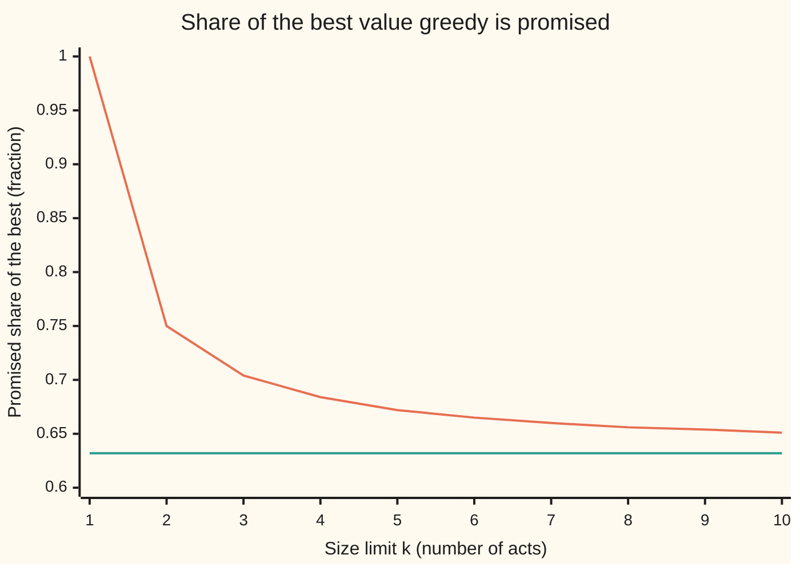

# Submodular functions: diminishing returns, the greedy 1 - 1/e promise, and the Lovasz extension

[Syllabus](../../../SYLLABUS.md) → [Optimization](../README.md) → [Integer and Combinatorial Optimisation](../README.md#s05) → Submodular functions

---

## General Overview

A festival can book 2 of 3 acts, and it wants to reach as many fan groups as possible. A fan group is a group of ticket buyers who follow one style, numbered 1 to 6. Each act reaches some of them:

| Act | Fan groups it reaches | Count |
| --- | --- | ---: |
| A | 1, 2, 3, 4 | 4 |
| B | 1, 2, 5 | 3 |
| C | 3, 4, 6 | 3 |

The festival **maximises** the number of groups reached, and the limit is 2 acts. A group reached by two acts still counts once.

The quick method is **greedy**: book the act that adds the most new groups, then repeat. It books A (4 new groups). After A, B adds only group 5 and C adds only group 6, so either one gives 5 groups. The best pair is B and C, which reaches all 6. Greedy gets 5 of 6, a ratio of 0.833.

Greedy comes with a proved promise here. The count of groups reached has **diminishing returns**: an act adds fewer new groups to a bigger lineup. C adds 3 groups to an empty lineup and only 1 after A. The count also never falls when an act is added: it is **monotone**. For any function with both properties, greedy with a limit of k picks reaches at least $`1 - (1 - 1/k)^k`$ of the best value. For k = 2 that is 0.750. For every k it is above $`1 - 1/e = 0.632`$, where e = 2.718 is Euler's number.

The same property helps in the other direction. The festival also decides which acts move from the main stage to a smaller tent, and wants the running cost as small as possible. That cost has diminishing returns too. A device called the **Lovász extension** turns "pick the cheapest set" into a convex problem: a problem with one valley and no false bottoms.

**A set function has diminishing returns when adding an item helps a small set at least as much as a bigger set that contains it; if adding an item also never lowers the value, greedy picks reach at least 1 − 1/e of the best value under a size limit, and with diminishing returns alone the cheapest set can be found by minimising a convex function.**

**What kind of fact this is:** three theorems, proved on this card in Why it works: the two forms of diminishing returns are equivalent, greedy keeps its promise, and the Lovász extension is convex exactly for these functions. Two results are stated with sources and not proved: no fast method beats 1 − 1/e on every coverage problem unless P = NP, and the cheapest set can be found in polynomial time.

### The picture: the greedy promise for each size limit



The upper line is the promise $`1 - (1 - 1/k)^k`$ for each size limit k. The flat lower line is its floor, 1 − 1/e = 0.632. The festival, at k = 2, is promised 0.750 and gets 0.833.

---

## The formula

Notation first, in words. V is the **ground set**, the items one may choose: here the n = 3 acts. A **set function** f gives a number f(S) to every set S of items, with f(∅) = 0 for the empty set. The **gain** of item j on top of S is

```math
f(j \mid S) = f(S \cup \{j\}) - f(S).
```

**Read it aloud:** the gain of j given S is the value with j added, minus the value without it.

f is **submodular** when gains shrink as the set grows. Two equivalent tests:

```math
f(j \mid S) \;\ge\; f(j \mid T) \ \text{ whenever } S \subseteq T,\ j \notin T \qquad\Longleftrightarrow\qquad f(S) + f(T) \;\ge\; f(S \cup T) + f(S \cap T) \ \text{ for all } S, T.
```

**Read it aloud:** an item helps a smaller set at least as much as a larger one, if and only if two sets together are worth at least their union and their overlap together.

f is **monotone** when adding items never lowers it: f(S) ≤ f(T) whenever S ⊆ T. Write $`S_k`$ for greedy's set after k picks and OPT for the best value any k items reach. The greedy promise, for monotone submodular f and a limit of k items:

```math
f(S_k) \;\ge\; \Bigl(1 - \bigl(1 - \tfrac{1}{k}\bigr)^{k}\Bigr)\,\mathrm{OPT} \;\ge\; \bigl(1 - \tfrac{1}{e}\bigr)\,\mathrm{OPT}.
```

**Read it aloud:** greedy's k picks are worth at least one minus (one minus one over k) to the power k of the best, and that is at least one minus one over e of the best.

For minimising, sort the entries of a vector x with entries in [0, 1] from largest to smallest, $`x_{\sigma(1)} \ge \dots \ge x_{\sigma(n)}`$, and let $`U_i`$ hold the first i items in that order, with $`U_0 = \varnothing`$. The **Lovász extension** is

```math
f_L(x) = \sum_{i=1}^{n} x_{\sigma(i)}\,\bigl(f(U_i) - f(U_{i-1})\bigr) = \int_0^1 f\bigl(\{\, j : x_j \ge t \,\}\bigr)\,dt .
```

**Read it aloud:** walk down the entries from largest to smallest, and weight each set's increase by the entry that let its new item in; this equals the average of f over the sets you get by keeping every item whose entry clears a threshold t.

| Symbol | Plain meaning | In our example | Push it up and the answer… |
| --- | --- | --- | --- |
| $`V`$, $`n`$ | the ground set of items; how many | acts A, B, C; 3 | enumeration doubles per item |
| $`S`$, $`T`$, $`j`$, $`b_r`$ | sets of items; one item; in a fold, the items of T outside S | S = {A}, T = {A, B}; j = C | — |
| $`f(S)`$ | the set function | groups reached: f({A, B}) = 5 | — |
| $`f(j \mid S)`$ | gain of item j on top of S | C on top of {A}: 1 | shrinks as S grows |
| $`k`$ | most items allowed; in Step 7 only, the descent step, counted from 0 | 2; steps 0 to 59 | the promise falls toward 0.632 |
| $`S_i`$, $`g_i`$ | greedy's set after i picks; the gap OPT − f(S_i) | $`S_1`$ = {A}, $`S_2`$ = {A, B}; gaps 6, 2, 1 | — |
| $`O`$, OPT, $`o_r`$, $`m`$ | a best set of k items; its value; in a fold, its m items outside $`S_i`$ | {B, C}; 6 | — |
| $`e`$, $`u`$ | Euler's number, 2.718; any number, in a fold | 1 − 1/e = 0.632 | — |
| $`c_j`$, $`w_{ij}`$ | act j's fixed cost change on moving to the tent, before split groups, £ thousand; fan groups acts i and j share | $`c_A`$ = −3; $`w_{AB}`$ = 2 | — |
| $`x`$, $`z`$, $`t`$, $`\sigma`$, $`U_i`$, $`\lambda_i`$, $`\mathbf{1}_S`$ | points with entries in [0, 1]; a threshold; the order of x from largest down; its first i items; in a fold, the weight on $`U_i`$, and the 0/1 vector of S | x = (0.2, 0.9, 0.5); order B, C, A | — |
| $`f_L(x)`$ | the Lovász extension | 2.000 at (0.2, 0.9, 0.5) | — |
| $`y`$, $`y(S)`$ | a price per item, also the slope (subgradient) of $`f_L`$; the prices of S added up | (−1, −1, 1); y({A, B}) = −2 | a price too high breaks the certificate |

### When it holds

- **Gains must shrink.** If B and C reunite and draw 4 extra groups only together, C adds 3 to an empty lineup but 7 after B. Greedy then gets 5 against a best of 10, a ratio of 0.500, below the 0.750 promise.
- **The promise needs monotone f and f(∅) = 0.** A stage cost can go down as acts are added. For such functions plain greedy has no ratio, and the card minimises them instead.
- **The limit must be a count.** With fees and a budget, greedy by gain alone can fill the budget with poor picks.
- **The Lovász extension is convex only for submodular f.** For the reunion function, the value at a midpoint rises 1.233 above the chord in a random test. A descent on it can stop at a false bottom.
- **"Polynomial" counts evaluations of f.** Each evaluation must be cheap. If f(S) takes a simulation to compute, the guarantee holds but the run can still be slow.

---

## Why it works

### Step 0: diminishing returns lets one look ahead stand in for many

Greedy never sees the best set, only the gains on offer now. Diminishing returns ties the two. The best set's items, added to greedy's set one at a time, gain no more than each would gain alone on top of it. So the best set is worth at most greedy's value plus k of today's gains.

### Step 1: the two tests say the same thing

Coverage passes both tests on the festival: the overlap test holds for all 64 pairs of sets, and the gain test for all 27 cases with S ⊆ T and j outside T. Take S = {A, B} and T = {B, C}: 5 + 6 ≥ 6 + 3, since their union is all three acts (6 groups) and their overlap is B alone (3).

<details>
<summary>Detailed proof: the gain test and the overlap test are equivalent</summary>

Overlap gives gains. Take S ⊆ T and j outside T. Apply the overlap test to the sets S ∪ {j} and T. Their union is T ∪ {j}, and their overlap is S, because j is not in T. So f(S ∪ {j}) + f(T) ≥ f(T ∪ {j}) + f(S). Rearranged, that is f(j | S) ≥ f(j | T).

Gains give overlap. Take any S and T, and list the items of T outside S as $`b_1, \dots, b_m`$. Add them one at a time to S ∩ T, and also to S. At each step the first set is inside the second, so each gain onto the first is at least the gain onto the second. Adding the m gains:

$`\displaystyle f(T) - f(S \cap T) \;\ge\; f(S \cup T) - f(S),`$

which rearranges to the overlap test. ∎

</details>

### Step 2: the standard examples

- **Coverage.** f(S) counts the groups reached by S. A new act's gain is the groups it reaches that S does not. A bigger S already reaches more of them, so the gain shrinks.
- **Cut.** For two stages, count the fan groups shared by an act in the tent and an act on the main stage. Each pair of acts contributes its shared groups when they are split. This is submodular but not monotone: moving all acts to the tent splits no one.
- **Matroid rank.** The rank of a set is the size of its largest allowed subset, as in [Greedy](../../14-Applied%20and%20computational/01-Algorithms%20and%20Growth/08-greedy-algorithms-and-matroids.md). The exchange property makes rank submodular. It is the model case: for the rank itself, or for a sum of item weights over the allowed sets, greedy is exactly right, not just within 1 − 1/e.
- **Entropy.** The uncertainty, in bits, of a set of measurements is submodular: a new sensor tells less once many sensors are already read. This is why sensor placement uses greedy.

### Step 3: greedy keeps the promise

Let O be a best set of k items, worth OPT. Look at greedy's set $`S_i`$ after i picks.

1. Adding O to $`S_i`$ cannot lower the value, since f is monotone. So OPT ≤ f(O ∪ S_i).
2. Add O's items to $`S_i`$ one at a time. By diminishing returns, each gain is at most that item's gain on top of $`S_i`$ alone.
3. Greedy's next pick has the largest gain on top of $`S_i`$. O has at most k items. So OPT ≤ f(S_i) + k × (greedy's next gain).

On the festival: at the start, 6 ≤ 0 + 2 × 4 = 8. After A, 6 ≤ 4 + 2 × 1 = 6, which holds with equality.

Rearranged, step 3 says each pick closes at least a 1/k share of the gap left to OPT. After k picks the gap is at most $`(1 - 1/k)^k`$ of OPT. For the festival, with k = 2, the gap may halve at each pick: from 6 to 3 to 1.5. Greedy's real gaps are 6, 2 and 1.

<details>
<summary>Detailed proof: greedy reaches 1 − (1 − 1/k)^k of the best</summary>

Let f be monotone and submodular with f(∅) = 0, and let O be a best set with |O| ≤ k. Write the items of O outside $`S_i`$ as $`o_1, \dots, o_m`$, with m ≤ k. By monotonicity and then by telescoping:

$`\displaystyle \mathrm{OPT} \le f(S_i \cup O) = f(S_i) + \sum_{r=1}^{m} f\bigl(o_r \mid S_i \cup \{o_1, \dots, o_{r-1}\}\bigr).`$

Each term is at most $`f(o_r \mid S_i)`$ by diminishing returns, and that is at most greedy's gain $`f(S_{i+1}) - f(S_i)`$. So

$`\displaystyle \mathrm{OPT} - f(S_i) \le k\,\bigl(f(S_{i+1}) - f(S_i)\bigr).`$

Write $`g_i = \mathrm{OPT} - f(S_i)`$ for the gap. The line above says $`g_i \le k(g_i - g_{i+1})`$, so $`g_{i+1} \le (1 - 1/k)\,g_i`$. Starting from $`g_0 = \mathrm{OPT}`$, after k picks $`g_k \le (1 - 1/k)^k\,\mathrm{OPT}`$. Finally $`1 - u \le e^{-u}`$ for every u, so $`(1 - 1/k)^k \le e^{-1}`$, and $`f(S_k) \ge (1 - 1/e)\,\mathrm{OPT}`$. ∎

</details>

### Step 4: the run prints its own upper bound

Step 3 also gives a certificate from the run itself. At any greedy step, OPT is at most f(S_i) plus the k largest gains on offer. On the festival that is 0 + 4 + 3 = 7 at the start, then 4 + 1 + 1 = 6 after A. So no pair reaches more than 6 groups. B and C reach 6, which proves them best without listing every pair. The listing of all 3 pairs agrees.

Greedy costs little: 3 gains at the first pick and 2 at the second. In general it needs about n × k evaluations of f, where listing every set of k items needs a number that grows like $`n^k`$.

### Step 5: the promise cannot be raised

The number 0.750 is reached exactly. Take four acts: G reaches groups 1 and 3, H reaches group 2, P reaches 1 and 2, and Q reaches 3 and 4. With ties broken against greedy, it books G, then H, for 3 groups. P and Q reach 4. The ratio is 0.750, the promise for k = 2. Nemhauser, Wolsey and Fisher show that it is reached for every k, so the worst case falls toward 1 − 1/e.

No other fast method does better in general. Feige proved that no polynomial-time method reaches more than 1 − 1/e of the best on every coverage problem, unless P = NP. (P = NP is the open question of whether every problem whose answers can be checked fast can also be solved fast.) This card states that result and does not prove it.

### Step 6: minimising, and the Lovász extension

Now the festival **minimises**. Some acts may move from the main stage to the tent. Let S be the acts that move, and f(S) the change in running cost, in £ thousand:

- Each act has a fixed cost change $`c_j`$ when it moves. A's move saves £3,000 ($`c_A`$ = −3), and B's saves £1,000 ($`c_B`$ = −1). C's crowd needs extra tent cover, which costs £3,000 ($`c_C`$ = +3).
- Every fan group shared by two acts on different stages costs £1,000 in shuttle buses and stewards. A and B share 2 groups, A and C share 2, and B and C share none.

So f(S) is the sum of $`c_j`$ over the acts that move, plus the shared groups of every split pair. A sum of fixed costs is submodular, and so is a cut, so f is submodular. Both tests pass on all 64 pairs and 27 cases. The eight values are:

| Moved to the tent | none | A | B | C | A, B | A, C | B, C | A, B, C |
| --- | ---: | ---: | ---: | ---: | ---: | ---: | ---: | ---: |
| f, £ thousand | 0 | 1 | 1 | 5 | −2 | 2 | 6 | −1 |

Moving any one act alone costs more. Moving A and B together saves £2,000.

The Lovász extension fills in the cube between the corners. A corner is a 0/1 vector, a set, and there $`f_L`$ equals f. At x = (0.2, 0.9, 0.5) for (A, B, C), the order is B, C, A. The sets are {B}, then {B, C}, then all three, with values 1, 6 and −1. So the increases are 1, 5 and −7, and

```math
f_L(0.2, 0.9, 0.5) = 0.9 \times 1 + 0.5 \times 5 + 0.2 \times (-7) = 2.000 .
```

The threshold form gives the same 2.000. For t up to 0.2 the set is all three acts, worth −1. Up to 0.5 it is {B, C}, worth 6. Up to 0.9 it is {B}, worth 1. Above 0.9 it is empty, worth 0. The average is 0.2 × (−1) + 0.3 × 6 + 0.4 × 1 = 2.000.

### Step 7: why the extension is convex, and why that solves the problem

Two facts make minimising easy.

- **The minimum over the cube is the minimum over sets.** By the threshold form, $`f_L(x)`$ is an average of f over some sets. An average is never below the smallest value. So no point of the cube beats the best set, and the best set's corner reaches it.
- **$`f_L`$ is convex exactly when f is submodular.** For submodular f, the increases along any order form a price vector y that overprices no set: y(S) ≤ f(S) for every S. Then $`f_L`$ is the largest of these linear functions, and the largest of linear functions is convex ([Convex functions](../01-Convexity/03-convex-functions-and-their-tests.md)).

<details>
<summary>Detailed proof: the Lovász extension is convex exactly when f is submodular</summary>

Fix an order σ and let $`y_{\sigma(i)} = f(U_i) - f(U_{i-1})`$, the greedy vector. Take any set T. Its items, in the order σ, are added one at a time. Item $`\sigma(i)`$ in T gains $`y_{\sigma(i)}`$ on top of $`U_{i-1}`$, and that is at most its gain on top of the smaller set $`U_{i-1} \cap T`$, by diminishing returns. Adding over T's items gives y(T) ≤ f(T), with equality when T is some $`U_i`$.

Now take x with entries in [0, 1] and write it as a sum of its level sets: $`x = \sum_i \lambda_i \mathbf{1}_{U_i}`$ with weights $`\lambda_i = x_{\sigma(i)} - x_{\sigma(i+1)} \ge 0`$ (and $`x_{\sigma(n+1)} = 0`$). For any y with y(S) ≤ f(S) for every S,

$`\displaystyle y^{\top} x = \sum_i \lambda_i\, y(U_i) \le \sum_i \lambda_i\, f(U_i) = f_L(x),`$

with equality for the greedy vector of x's own order. So $`f_L(x)`$ is the largest value of $`y^{\top}x`$ over a fixed family of y. A largest value of linear functions is convex.

For the converse, use the sorted sum for any entries ≥ 0. Then $`f_L`$ is convex and doubles when x doubles, so $`f_L(a + b) \le f_L(a) + f_L(b)`$. Take $`a = \mathbf{1}_S`$ and $`b = \mathbf{1}_T`$. The vector a + b is 2 on S ∩ T and 1 on the rest of S ∪ T, so the sorted sum gives $`f_L(a + b) = f(S \cap T) + f(S \cup T)`$. That is the overlap test. ∎

</details>

The greedy vector also points downhill. It is a **subgradient** of $`f_L`$ at x (the g of [Subgradients](../01-Convexity/07-subgradients.md)): a slope y with $`f_L(z) \ge f_L(x) + y^{\top}(z - x)`$ for every point z of the cube. So projected subgradient descent applies: step against y, then clip each entry back into [0, 1]. With steps $`0.5/\sqrt{k+1}`$, as in the code, [The subgradient method](../02-Unconstrained%20Methods/11-subgradient-method-and-polyak-steps.md) puts the best value after k steps within $`O(\log k/\sqrt{k})`$ of the minimum, and clipping does not spoil that: a slow rate.

The code starts at x = (0.5, 0.5, 0.5), counting k from 0. At each step it tries every level set of x as an answer. At k = 2 the level set {A, B} appears, at −2. At k = 59, after 59 steps, x is (0.935, 1.000, 0.000) and $`f_L`$ is −1.805, still closing slowly on −2.

A certificate proves −2 is the least. Average the greedy vectors for the orders A, B, C and B, A, C: (1, −3, 1) and (−3, 1, 1) give y = (−1, −1, 1). Each greedy vector overprices no set, so their average does not either. Then every S has f(S) ≥ y(S) ≥ (the negative prices added up) = −1 − 1 = −2. Listing all 8 sets agrees.

Grötschel, Lovász and Schrijver used this convexity, with [The ellipsoid method](../04-Linear%20Programming/09-ellipsoid-method.md), to show that submodular functions can be minimised in polynomial time. In outline: $`f_L`$ and a subgradient cost one sort and n evaluations of f; the ellipsoid method needs polynomially many such calls; and for whole-number values, a point within less than 1 of the minimum has a minimising level set. This card states that result and does not prove it.

---

## Worked numbers, by hand

| Step | Arithmetic | Value |
| --- | --- | --- |
| greedy pick 1 | gains A 4, B 3, C 3 | take A: 4 groups |
| greedy pick 2 | gains B 1, C 1; tie to B, listed first | A, B: 5 groups |
| run bound | least of 0 + 4 + 3 and 4 + 1 + 1 | 6 |
| best pair, all 3 listed | A, B 5; A, C 5; B, C 6 | B, C: 6 |
| ratio | 5 / 6 | 0.833 |
| promise, k = 2 | 1 − (1 − 1/2)² | 0.750 |
| stage cost of moving A, B | −3 − 1 + 2 (A and C split) | −2 |
| Lovász extension at (0.2, 0.9, 0.5) | 0.9 × 1 + 0.5 × 5 + 0.2 × (−7) | 2.000 |
| certificate floor | y = (−1, −1, 1); −1 − 1 | −2 |
| best tent move, all 8 sets listed | f(A, B) | **−2: save £2,000** |

Book B and C: they reach all 6 fan groups, and the run bound proves no pair does better. Move A and B to the tent: the running cost falls by £2,000, and the price certificate proves no other move saves more.

### What breaks if you drop a piece

| Mistake | Comes out at | What went wrong |
| --- | --- | --- |
| Greedy on a function with a bonus: B and C reunite for 4 extra groups | 5 against a best of 10, ratio 0.500, below 0.750 | C adds 3 to none but 7 after B: gains grow, so Step 3 fails |
| Lovász extension of that reunion function | a midpoint 1.233 above the chord | not submodular, so not convex: descent can stop at a false bottom |
| Minimising by moving one act at a time from none | stuck at 0; each single move costs 1, 1 or 5 | the saving needs A and B together; a local search from none cannot find it; the convex route, a minimum cut or a listing does |
| Expecting greedy to always beat its promise | 3 against 4, ratio 0.750 exactly | the promise is tight; 0.833 on the festival was luck of the data |

---

## Code, from first principles, and it actually runs

The scripts take five roads. They run greedy and check it against a listing of every pair and against the run's own upper bound. They test both forms of submodularity on every pair of sets. They compute the Lovász extension by the sorted sum and by an average over 100,000 thresholds. They run projected subgradient descent, then check its answer against all 8 sets and against a price certificate. A convexity test on 2,000 random pairs uses a SplitMix64 generator with seed 2026, written out in both languages. Nothing imported knows any answer.

### Python

```python
# Submodular functions -- the check behind the card.  Standard library only.
# Part 1 maximises: book k = 2 of 3 acts to reach the most fan groups; greedy against every pair and the 1 - (1 - 1/k)^k promise.
# Part 2 minimises: which acts move to the tent (costs in £ thousand), by the Lovasz extension, against all 8 sets and a dual certificate.
from math import e, sqrt

ACTS = {"A": {1, 2, 3, 4}, "B": {1, 2, 5}, "C": {3, 4, 6}}
NAMES = "ABC"
SETS = [frozenset(n for i, n in enumerate(NAMES) if m >> i & 1) for m in range(8)]
def word(S): return "".join(sorted(S)) or "none"
def cover(S, acts=ACTS): return len(set().union(*(acts[a] for a in S)))
def reunion(S): return cover(S) + (4 if {"B", "C"} <= S else 0)   # B and C draw 4 more groups only together

def lattice_and_dr(f):                      # both definitions of submodular, over every pair of sets
    lat = sum(f(S) + f(T) >= f(S | T) + f(S & T) for S in SETS for T in SETS)
    dr = sum(f(S | {x}) - f(S) >= f(T | {x}) - f(T) for S in SETS for T in SETS if S <= T for x in NAMES if x not in T)
    return lat, dr

def greedy(f, k, names=NAMES, log=False):   # add the act with the largest gain, ties to the act listed first
    S, best_bound, path = frozenset(), float("inf"), [frozenset()]
    for i in range(k):
        gains = {x: f(S | {x}) - f(S) for x in names if x not in S}
        top = sorted(gains.values(), reverse=True)[:k]
        best_bound = min(best_bound, f(S) + sum(top))   # OPT <= f(S) + the k largest gains (diminishing returns)
        x = max(gains, key=lambda a: (gains[a], -names.index(a)))
        if log: print(f"greedy step {i + 1}: gains " + ", ".join(f"{a} {g}" for a, g in gains.items()) + f"; take {x}; run bound {f(S) + sum(top)}")
        S = S | {x}; path.append(S)
    return S, best_bound, path

def best_of_size(f, k): return max((S for S in SETS if len(S) == k), key=f)   # every set of size k, first best kept
def promise(k): return 1 - (1 - 1 / k) ** k

lat, dr = lattice_and_dr(cover)
print(f"coverage: lattice inequality holds for {lat} of 64 pairs; diminishing returns for {dr} of 27 cases")
print("coverage of every set: " + ", ".join(f"{word(S)} {cover(S)}" for S in SETS))
G, bound, path = greedy(cover, 2, log=True)
O = best_of_size(cover, 2)
print(f"greedy books {word(G)}, {cover(G)} groups; best of all 3 pairs {word(O)}, {cover(O)} groups; run bound {bound}")
print(f"ratio {cover(G) / cover(O):.3f}; promise 1 - (1 - 1/2)^2 = {promise(2):.3f}; 1 - 1/e = {1 - 1 / e:.3f}")
gaps = [cover(O) - cover(S) for S in path]
print(f"gap to the best after 0, 1, 2 picks: {gaps[0]}, {gaps[1]}, {gaps[2]}; proof allows {cover(O)}, {cover(O) / 2:g}, {cover(O) / 4:g}")
print("step inequality OPT <= f(S) + k x gain: " + "; ".join(f"{cover(O)} <= {cover(a)} + 2 x {cover(b) - cover(a)} = {cover(a) + 2 * (cover(b) - cover(a))}" for a, b in zip(path, path[1:])))
print("promise by k: " + " ".join(f"{promise(k):.3f}" for k in range(1, 11)))
TIGHT = {"G": {1, 3}, "H": {2}, "P": {1, 2}, "Q": {3, 4}}          # ties go against greedy
tf = lambda S: cover(S, TIGHT)
TS = greedy(tf, 2, "GHPQ")[0]
print(f"tight case: greedy {word(TS)} {tf(TS)}, best PQ {tf(frozenset('PQ'))}, ratio {tf(TS) / tf(frozenset('PQ')):.3f}")
rl, rd = lattice_and_dr(reunion)
RG = greedy(reunion, 2)[0]
RO = best_of_size(reunion, 2)
print(f"reunion bonus: lattice holds {rl} of 64, diminishing returns {rd} of 27; C adds {reunion(frozenset('C'))} to none, "
      f"{reunion(frozenset('BC')) - reunion(frozenset('B'))} to B; greedy {word(RG)} {reunion(RG)}, best {word(RO)} {reunion(RO)}, ratio {reunion(RG) / reunion(RO):.3f}")

COST = {"A": -3, "B": -1, "C": 3}           # fixed change in running cost when the act moves, before split groups, £ thousand
W = {(a, b): len(ACTS[a] & ACTS[b]) for a in NAMES for b in NAMES if a < b}   # shared fan groups, £1 thousand each when split
def f(S): return sum(COST[a] for a in S) + sum(w for (a, b), w in W.items() if (a in S) != (b in S))
print(f"shared groups A-B {W[('A', 'B')]}, A-C {W[('A', 'C')]}, B-C {W[('B', 'C')]}; f of every set: " + ", ".join(f"{word(S)} {f(S)}" for S in SETS))
fl, fd = lattice_and_dr(f)
print(f"stage cost: lattice holds {fl} of 64, diminishing returns {fd} of 27")

def lovasz(F, x):                           # sort coordinates high to low, weight each new set's increase
    order, S, total, prev = sorted(range(3), key=lambda i: (-x[i], i)), set(), 0.0, 0
    grad = [0] * 3
    for i in order:
        S.add(NAMES[i]); g = F(frozenset(S)) - prev; prev += g
        total += x[i] * g; grad[i] = g
    return total, grad

def by_threshold(F, x, n=100000):          # average of F over the level sets {x_j >= t}, t from 0 to 1
    return sum(F(frozenset(NAMES[i] for i in range(3) if x[i] >= (j + 0.5) / n)) for j in range(n)) / n

x = [0.2, 0.9, 0.5]
L, gx = lovasz(f, x)
print(f"Lovasz extension at A 0.2, B 0.9, C 0.5: sorted sum {L:.3f}; threshold average {by_threshold(f, x):.3f}; greedy vector {' '.join(map(str, gx))}")
state = 2026
def rand():                                 # SplitMix64, seed 2026, uniform on [0, 1)
    global state
    state = (state + 0x9E3779B97F4A7C15) % 2 ** 64; z = state
    z = (z ^ (z >> 30)) * 0xBF58476D1CE4E5B9 % 2 ** 64; z = (z ^ (z >> 27)) * 0x94D049BB133111EB % 2 ** 64
    return ((z ^ (z >> 31)) >> 11) / 2 ** 53
def worst_midpoint(F, trials=2000):        # largest amount the midpoint value rises above the chord
    worst = -1.0
    for _ in range(trials):
        p, q = [rand() for _ in range(3)], [rand() for _ in range(3)]
        m = [(a + b) / 2 for a, b in zip(p, q)]
        worst = max(worst, lovasz(F, m)[0] - (lovasz(F, p)[0] + lovasz(F, q)[0]) / 2)
    return worst
print(f"midpoint test, 2000 random pairs: stage cost worst rise {max(0.0, worst_midpoint(f)):.3f}; reunion worst rise {worst_midpoint(reunion):.3f}")
xk, best = [0.5, 0.5, 0.5], (f(frozenset()), frozenset())
for k in range(60):                         # projected subgradient descent on the cube [0, 1]^3, step 0.5 / sqrt(k + 1)
    val, g = lovasz(f, xk)
    for t in xk:                            # every level set of the iterate is a candidate answer
        S = frozenset(NAMES[i] for i in range(3) if xk[i] >= t); best = min(best, (f(S), S), key=lambda b: b[0])
    if k in (0, 1, 2, 59): print(f"descent k = {k}: x = {' '.join(f'{v:.3f}' for v in xk)}, extension {val:.3f}, best level set {word(best[1])} {best[0]}")
    xk = [min(1.0, max(0.0, xi - 0.5 / sqrt(k + 1) * gi)) for xi, gi in zip(xk, g)]
y1, y2 = lovasz(f, [1, 0.9, 0])[1], lovasz(f, [0.9, 1, 0])[1]
y = [(a + b) / 2 for a, b in zip(y1, y2)]
print(f"certificate: greedy vectors {' '.join(map(str, y1))} and {' '.join(map(str, y2))}, average {' '.join(f'{v:g}' for v in y)}; "
      f"floor {sum(min(0, v) for v in y):g}; y(S) <= f(S) for {sum(sum(y[NAMES.index(a)] for a in S) <= f(S) for S in SETS)} of 8 sets")
fmin = min(SETS, key=f)
moves = [(word(S), f(S)) for S in SETS if len(S) == 1]
print(f"all 8 sets: least f is {word(fmin)} at {f(fmin)}; single moves from none: {', '.join(f'{a} {v}' for a, v in moves)}, none improves on 0")

assert (lat, dr) == (64, 27) and (fl, fd) == (64, 27)              # both definitions agree, on both functions
assert cover(G) == 5 and cover(O) == 6 and cover(G) >= promise(2) * cover(O) and bound == 6   # the theorem against enumeration
assert all(g <= cover(O) * (1 - 1 / 2) ** i for i, g in enumerate(gaps))                       # the gap halves at least
assert tf(TS) / tf(frozenset("PQ")) == promise(2)                   # the promise is reached
assert rl < 64 and rd < 27 and reunion(RG) / reunion(RO) < promise(2)  # no diminishing returns, no promise
assert abs(L - by_threshold(f, x)) < 1e-3 and worst_midpoint(f) < 1e-12 < worst_midpoint(reunion)
assert best == (f(fmin), fmin) and sum(min(0, v) for v in y) == f(fmin) and all(sum(y[NAMES.index(a)] for a in S) <= f(S) for S in SETS)
C7 = dict(ACTS, C={3, 4, 6, 7})             # try: act C reaches a seventh group
c7 = lambda S: cover(S, C7)
S7, O7 = greedy(c7, 2)[0], best_of_size(c7, 2)
print(f"try C reaching group 7: greedy {word(S7)} {c7(S7)}, best {word(O7)} {c7(O7)}, ratio {c7(S7) / c7(O7):.3f}")
S3 = greedy(cover, 3)[0]
print(f"try k = 3: greedy {word(S3)} {cover(S3)}, best {cover(frozenset(NAMES))}, ratio {cover(S3) / cover(frozenset(NAMES)):.3f}")
f2 = lambda S: f(S) + sum(w for (a, b), w in W.items() if (a in S) != (b in S))   # try: £2 thousand per split group
m2 = min(SETS, key=f2)
print(f"try £2 thousand per split group: " + ", ".join(f"{word(S)} {f2(S)}" for S in SETS) + f"; least {word(m2)} at {f2(m2)}")
print("ALL CHECKS PASS")
```

**Ran 2026-11-24 on macOS, Python 3.14.10, standard library only. All checks passed. Output, pasted from the run:**

```
coverage: lattice inequality holds for 64 of 64 pairs; diminishing returns for 27 of 27 cases
coverage of every set: none 0, A 4, B 3, AB 5, C 3, AC 5, BC 6, ABC 6
greedy step 1: gains A 4, B 3, C 3; take A; run bound 7
greedy step 2: gains B 1, C 1; take B; run bound 6
greedy books AB, 5 groups; best of all 3 pairs BC, 6 groups; run bound 6
ratio 0.833; promise 1 - (1 - 1/2)^2 = 0.750; 1 - 1/e = 0.632
gap to the best after 0, 1, 2 picks: 6, 2, 1; proof allows 6, 3, 1.5
step inequality OPT <= f(S) + k x gain: 6 <= 0 + 2 x 4 = 8; 6 <= 4 + 2 x 1 = 6
promise by k: 1.000 0.750 0.704 0.684 0.672 0.665 0.660 0.656 0.654 0.651
tight case: greedy GH 3, best PQ 4, ratio 0.750
reunion bonus: lattice holds 56 of 64, diminishing returns 21 of 27; C adds 3 to none, 7 to B; greedy AB 5, best BC 10, ratio 0.500
shared groups A-B 2, A-C 2, B-C 0; f of every set: none 0, A 1, B 1, AB -2, C 5, AC 2, BC 6, ABC -1
stage cost: lattice holds 64 of 64, diminishing returns 27 of 27
Lovasz extension at A 0.2, B 0.9, C 0.5: sorted sum 2.000; threshold average 2.000; greedy vector -7 1 5
midpoint test, 2000 random pairs: stage cost worst rise 0.000; reunion worst rise 1.233
descent k = 0: x = 0.500 0.500 0.500, extension -0.500, best level set ABC -1
descent k = 1: x = 0.000 1.000 0.000, extension 1.000, best level set ABC -1
descent k = 2: x = 1.000 0.646 0.000, extension -0.939, best level set AB -2
descent k = 59: x = 0.935 1.000 0.000, extension -1.805, best level set AB -2
certificate: greedy vectors 1 -3 1 and -3 1 1, average -1 -1 1; floor -2; y(S) <= f(S) for 8 of 8 sets
all 8 sets: least f is AB at -2; single moves from none: A 1, B 1, C 5, none improves on 0
try C reaching group 7: greedy AC 6, best BC 7, ratio 0.857
try k = 3: greedy ABC 6, best 6, ratio 1.000
try £2 thousand per split group: none 0, A 5, B 3, AB 0, C 7, AC 4, BC 10, ABC -1; least ABC at -1
ALL CHECKS PASS
```

### Rust

```rust
// Submodular functions -- the same check as the Python, in Rust.  No crates.
// Part 1 maximises: book k = 2 of 3 acts to reach the most fan groups; greedy against every pair and the 1 - (1 - 1/k)^k promise.
// Part 2 minimises: which acts move to the tent (costs in £ thousand), by the Lovasz extension, against all 8 sets and a dual certificate.
// A set of acts is a bit mask: A = 1, B = 2, C = 4.  A set of fan groups is a bit mask too: group g is bit g.
fn word(s: u8, names: &str) -> String {
    let w: String = names.chars().enumerate().filter(|(i, _)| s >> i & 1 == 1).map(|(_, c)| c).collect();
    if w.is_empty() { "none".to_string() } else { w }
}
fn cover(s: u8, acts: &[u32]) -> i64 { acts.iter().enumerate().filter(|(i, _)| s >> i & 1 == 1).fold(0u32, |u, (_, a)| u | a).count_ones() as i64 }
fn bits(groups: &[u32]) -> u32 { groups.iter().fold(0, |u, g| u | 1 << g) }

fn lattice_and_dr(f: &dyn Fn(u8) -> i64) -> (usize, usize) {   // both definitions of submodular, over every pair of sets
    let (mut lat, mut dr) = (0, 0);
    for s in 0..8u8 { for t in 0..8u8 {
        if f(s) + f(t) >= f(s | t) + f(s & t) { lat += 1 }
        if s & t == s { for x in 0..3 { let b = 1u8 << x; if t & b == 0 && f(s | b) - f(s) >= f(t | b) - f(t) { dr += 1 } } }
    } }
    (lat, dr)
}

fn greedy(f: &dyn Fn(u8) -> i64, k: usize, names: &str, log: bool) -> (u8, i64, Vec<u8>) {   // ties to the act listed first
    let (mut s, mut best_bound, mut path) = (0u8, i64::MAX, vec![0u8]);
    for i in 0..k {
        let gains: Vec<(usize, i64)> = (0..names.len()).filter(|&x| s >> x & 1 == 0).map(|x| (x, f(s | 1 << x) - f(s))).collect();
        let mut top: Vec<i64> = gains.iter().map(|g| g.1).collect(); top.sort_by(|a, b| b.cmp(a)); top.truncate(k);
        let run = f(s) + top.iter().sum::<i64>(); best_bound = best_bound.min(run);   // OPT <= f(S) + the k largest gains
        let x = gains.iter().fold(gains[0], |b, &g| if g.1 > b.1 { g } else { b }).0;
        if log {
            let gl: Vec<String> = gains.iter().map(|&(a, g)| format!("{} {}", &names[a..a + 1], g)).collect();
            println!("greedy step {}: gains {}; take {}; run bound {}", i + 1, gl.join(", "), &names[x..x + 1], run);
        }
        s |= 1 << x; path.push(s);
    }
    (s, best_bound, path)
}
fn best_of_size(f: &dyn Fn(u8) -> i64, k: u32) -> u8 { (0..8u8).filter(|s| s.count_ones() == k).fold(None, |b: Option<u8>, s| match b { Some(t) if f(t) >= f(s) => Some(t), _ => Some(s) }).unwrap() }
fn promise(k: usize) -> f64 { 1.0 - (1.0 - 1.0 / k as f64).powf(k as f64) }

fn lovasz(f: &dyn Fn(u8) -> i64, x: [f64; 3]) -> (f64, [i64; 3]) {   // sort coordinates high to low, weight each new set's increase
    let mut order = [0usize, 1, 2]; order.sort_by(|&a, &b| x[b].partial_cmp(&x[a]).unwrap().then(a.cmp(&b)));
    let (mut s, mut total, mut prev, mut grad) = (0u8, 0.0, 0i64, [0i64; 3]);
    for i in order { s |= 1 << i; let g = f(s) - prev; prev += g; total += x[i] * g as f64; grad[i] = g }
    (total, grad)
}
fn by_threshold(f: &dyn Fn(u8) -> i64, x: [f64; 3], n: usize) -> f64 {   // average of f over the level sets {x_j >= t}
    (0..n).map(|j| { let t = (j as f64 + 0.5) / n as f64; f((0..3).filter(|&i| x[i] >= t).fold(0u8, |s, i| s | 1 << i)) }).sum::<i64>() as f64 / n as f64
}
struct Rng(u64);
impl Rng { fn next(&mut self) -> f64 {                     // SplitMix64, seed 2026, uniform on [0, 1)
    self.0 = self.0.wrapping_add(0x9E3779B97F4A7C15); let mut z = self.0;
    z = (z ^ (z >> 30)).wrapping_mul(0xBF58476D1CE4E5B9); z = (z ^ (z >> 27)).wrapping_mul(0x94D049BB133111EB);
    ((z ^ (z >> 31)) >> 11) as f64 / 9007199254740992.0 } }
fn worst_midpoint(f: &dyn Fn(u8) -> i64, rng: &mut Rng) -> f64 {   // largest amount the midpoint value rises above the chord
    let mut worst = -1.0f64;
    for _ in 0..2000 {
        let p = [rng.next(), rng.next(), rng.next()]; let q = [rng.next(), rng.next(), rng.next()];
        let m = [(p[0] + q[0]) / 2.0, (p[1] + q[1]) / 2.0, (p[2] + q[2]) / 2.0];
        worst = worst.max(lovasz(f, m).0 - (lovasz(f, p).0 + lovasz(f, q).0) / 2.0);
    }
    worst
}

fn main() {
    let acts = [bits(&[1, 2, 3, 4]), bits(&[1, 2, 5]), bits(&[3, 4, 6])];
    let cov = |s: u8| cover(s, &acts);
    let reunion = |s: u8| cover(s, &acts) + if s & 6 == 6 { 4 } else { 0 };   // B and C draw 4 more groups only together
    let all = |f: &dyn Fn(u8) -> i64| (0..8u8).map(|s| format!("{} {}", word(s, "ABC"), f(s))).collect::<Vec<_>>().join(", ");
    let (lat, dr) = lattice_and_dr(&cov);
    println!("coverage: lattice inequality holds for {} of 64 pairs; diminishing returns for {} of 27 cases", lat, dr);
    println!("coverage of every set: {}", all(&cov));
    let (g, bound, path) = greedy(&cov, 2, "ABC", true);
    let o = best_of_size(&cov, 2);
    println!("greedy books {}, {} groups; best of all 3 pairs {}, {} groups; run bound {}", word(g, "ABC"), cov(g), word(o, "ABC"), cov(o), bound);
    println!("ratio {:.3}; promise 1 - (1 - 1/2)^2 = {:.3}; 1 - 1/e = {:.3}", cov(g) as f64 / cov(o) as f64, promise(2), 1.0 - 1.0 / std::f64::consts::E);
    let gaps: Vec<i64> = path.iter().map(|&s| cov(o) - cov(s)).collect();
    println!("gap to the best after 0, 1, 2 picks: {}, {}, {}; proof allows {}, {}, {}", gaps[0], gaps[1], gaps[2], cov(o), cov(o) as f64 / 2.0, cov(o) as f64 / 4.0);
    let steps: Vec<String> = path.windows(2).map(|w| format!("{} <= {} + 2 x {} = {}", cov(o), cov(w[0]), cov(w[1]) - cov(w[0]), cov(w[0]) + 2 * (cov(w[1]) - cov(w[0])))).collect();
    println!("step inequality OPT <= f(S) + k x gain: {}", steps.join("; "));
    println!("promise by k: {}", (1..=10).map(|k| format!("{:.3}", promise(k))).collect::<Vec<_>>().join(" "));
    let tight = [bits(&[1, 3]), bits(&[2]), bits(&[1, 2]), bits(&[3, 4])];   // G, H, P, Q; ties go against greedy
    let tf = |s: u8| cover(s, &tight);
    let ts = greedy(&tf, 2, "GHPQ", false).0;
    println!("tight case: greedy {} {}, best PQ {}, ratio {:.3}", word(ts, "GHPQ"), tf(ts), tf(12), tf(ts) as f64 / tf(12) as f64);
    let (rl, rd) = lattice_and_dr(&reunion);
    let (rg, ro) = (greedy(&reunion, 2, "ABC", false).0, best_of_size(&reunion, 2));
    println!("reunion bonus: lattice holds {} of 64, diminishing returns {} of 27; C adds {} to none, {} to B; greedy {} {}, best {} {}, ratio {:.3}",
             rl, rd, reunion(4), reunion(6) - reunion(2), word(rg, "ABC"), reunion(rg), word(ro, "ABC"), reunion(ro), reunion(rg) as f64 / reunion(ro) as f64);

    let cost = [-3i64, -1, 3];                // fixed change in running cost when the act moves, before split groups, £ thousand
    let w = [(0usize, 1usize, (acts[0] & acts[1]).count_ones() as i64), (0, 2, (acts[0] & acts[2]).count_ones() as i64), (1, 2, (acts[1] & acts[2]).count_ones() as i64)];
    let cut = |s: u8| w.iter().filter(|&&(a, b, _)| (s >> a & 1) != (s >> b & 1)).map(|t| t.2).sum::<i64>();
    let f = |s: u8| (0..3).filter(|&i| s >> i & 1 == 1).map(|i| cost[i]).sum::<i64>() + cut(s);
    println!("shared groups A-B {}, A-C {}, B-C {}; f of every set: {}", w[0].2, w[1].2, w[2].2, all(&f));
    let (fl, fd) = lattice_and_dr(&f);
    println!("stage cost: lattice holds {} of 64, diminishing returns {} of 27", fl, fd);
    let x = [0.2, 0.9, 0.5];
    let (l, gx) = lovasz(&f, x);
    println!("Lovasz extension at A 0.2, B 0.9, C 0.5: sorted sum {:.3}; threshold average {:.3}; greedy vector {} {} {}", l, by_threshold(&f, x, 100000), gx[0], gx[1], gx[2]);
    let mut rng = Rng(2026);
    let (wf, wr) = (worst_midpoint(&f, &mut rng), worst_midpoint(&reunion, &mut rng));
    println!("midpoint test, 2000 random pairs: stage cost worst rise {:.3}; reunion worst rise {:.3}", wf.max(0.0), wr);
    let (mut xk, mut best) = ([0.5f64; 3], (f(0), 0u8));
    for k in 0..60 {                          // projected subgradient descent on the cube [0, 1]^3, step 0.5 / sqrt(k + 1)
        let (val, gr) = lovasz(&f, xk);
        for t in xk {                         // every level set of the iterate is a candidate answer
            let s = (0..3).filter(|&i| xk[i] >= t).fold(0u8, |s, i| s | 1 << i);
            if f(s) < best.0 { best = (f(s), s) }
        }
        if [0, 1, 2, 59].contains(&k) {
            println!("descent k = {}: x = {:.3} {:.3} {:.3}, extension {:.3}, best level set {} {}", k, xk[0], xk[1], xk[2], val, word(best.1, "ABC"), best.0);
        }
        for i in 0..3 { xk[i] = (xk[i] - 0.5 / ((k + 1) as f64).sqrt() * gr[i] as f64).max(0.0).min(1.0) }
    }
    let (y1, y2) = (lovasz(&f, [1.0, 0.9, 0.0]).1, lovasz(&f, [0.9, 1.0, 0.0]).1);
    let y: Vec<f64> = (0..3).map(|i| (y1[i] + y2[i]) as f64 / 2.0).collect();
    let floor: f64 = y.iter().map(|&v| v.min(0.0)).sum();
    let ys = |s: u8| (0..3).filter(|&i| s >> i & 1 == 1).map(|i| y[i]).sum::<f64>();
    let fits = (0..8u8).filter(|&s| ys(s) <= f(s) as f64).count();
    println!("certificate: greedy vectors {} {} {} and {} {} {}, average {} {} {}; floor {}; y(S) <= f(S) for {} of 8 sets", y1[0], y1[1], y1[2], y2[0], y2[1], y2[2], y[0], y[1], y[2], floor, fits);
    let fmin = (0..8u8).fold(0u8, |b, s| if f(s) < f(b) { s } else { b });
    println!("all 8 sets: least f is {} at {}; single moves from none: A {}, B {}, C {}, none improves on 0", word(fmin, "ABC"), f(fmin), f(1), f(2), f(4));

    assert!((lat, dr) == (64, 27) && (fl, fd) == (64, 27));                // both definitions agree, on both functions
    assert!(cov(g) == 5 && cov(o) == 6 && cov(g) as f64 >= promise(2) * cov(o) as f64 && bound == 6);   // the theorem against enumeration
    assert!(gaps.iter().enumerate().all(|(i, &v)| v as f64 <= cov(o) as f64 * 0.5f64.powi(i as i32)));  // the gap halves at least
    assert!(tf(ts) as f64 / tf(12) as f64 == promise(2));                   // the promise is reached
    assert!(rl < 64 && rd < 27 && (reunion(rg) as f64 / reunion(ro) as f64) < promise(2));   // no diminishing returns, no promise
    assert!((l - by_threshold(&f, x, 100000)).abs() < 1e-3 && worst_midpoint(&f, &mut rng) < 1e-12 && 1e-12 < worst_midpoint(&reunion, &mut rng));
    assert!(best == (f(fmin), fmin) && floor == f(fmin) as f64 && fits == 8);
    let c7 = [acts[0], acts[1], bits(&[3, 4, 6, 7])];                       // try: act C reaches a seventh group
    let c7f = |s: u8| cover(s, &c7);
    let (s7, o7) = (greedy(&c7f, 2, "ABC", false).0, best_of_size(&c7f, 2));
    println!("try C reaching group 7: greedy {} {}, best {} {}, ratio {:.3}", word(s7, "ABC"), c7f(s7), word(o7, "ABC"), c7f(o7), c7f(s7) as f64 / c7f(o7) as f64);
    let s3 = greedy(&cov, 3, "ABC", false).0;
    println!("try k = 3: greedy {} {}, best {}, ratio {:.3}", word(s3, "ABC"), cov(s3), cov(7), cov(s3) as f64 / cov(7) as f64);
    let f2 = |s: u8| f(s) + cut(s);           // try: £2 thousand per split group
    let m2 = (0..8u8).fold(0u8, |b, s| if f2(s) < f2(b) { s } else { b });
    println!("try £2 thousand per split group: {}; least {} at {}", all(&f2), word(m2, "ABC"), f2(m2));
    println!("ALL CHECKS PASS");
}
```

**Ran 2026-11-24 on macOS, rustc 1.98.1, no crates. All checks passed. Output, pasted from the run:**

```
coverage: lattice inequality holds for 64 of 64 pairs; diminishing returns for 27 of 27 cases
coverage of every set: none 0, A 4, B 3, AB 5, C 3, AC 5, BC 6, ABC 6
greedy step 1: gains A 4, B 3, C 3; take A; run bound 7
greedy step 2: gains B 1, C 1; take B; run bound 6
greedy books AB, 5 groups; best of all 3 pairs BC, 6 groups; run bound 6
ratio 0.833; promise 1 - (1 - 1/2)^2 = 0.750; 1 - 1/e = 0.632
gap to the best after 0, 1, 2 picks: 6, 2, 1; proof allows 6, 3, 1.5
step inequality OPT <= f(S) + k x gain: 6 <= 0 + 2 x 4 = 8; 6 <= 4 + 2 x 1 = 6
promise by k: 1.000 0.750 0.704 0.684 0.672 0.665 0.660 0.656 0.654 0.651
tight case: greedy GH 3, best PQ 4, ratio 0.750
reunion bonus: lattice holds 56 of 64, diminishing returns 21 of 27; C adds 3 to none, 7 to B; greedy AB 5, best BC 10, ratio 0.500
shared groups A-B 2, A-C 2, B-C 0; f of every set: none 0, A 1, B 1, AB -2, C 5, AC 2, BC 6, ABC -1
stage cost: lattice holds 64 of 64, diminishing returns 27 of 27
Lovasz extension at A 0.2, B 0.9, C 0.5: sorted sum 2.000; threshold average 2.000; greedy vector -7 1 5
midpoint test, 2000 random pairs: stage cost worst rise 0.000; reunion worst rise 1.233
descent k = 0: x = 0.500 0.500 0.500, extension -0.500, best level set ABC -1
descent k = 1: x = 0.000 1.000 0.000, extension 1.000, best level set ABC -1
descent k = 2: x = 1.000 0.646 0.000, extension -0.939, best level set AB -2
descent k = 59: x = 0.935 1.000 0.000, extension -1.805, best level set AB -2
certificate: greedy vectors 1 -3 1 and -3 1 1, average -1 -1 1; floor -2; y(S) <= f(S) for 8 of 8 sets
all 8 sets: least f is AB at -2; single moves from none: A 1, B 1, C 5, none improves on 0
try C reaching group 7: greedy AC 6, best BC 7, ratio 0.857
try k = 3: greedy ABC 6, best 6, ratio 1.000
try £2 thousand per split group: none 0, A 5, B 3, AB 0, C 7, AC 4, BC 10, ABC -1; least ABC at -1
ALL CHECKS PASS
```

The two outputs match line for line.

### Lean

Lean proves the card's three general rules for any items and any limit k, and checks the festival's numbers.

- Suppose f is monotone with diminishing returns and f(∅) = 0, and O has at most k items. Then greedy's k picks are worth at least $`(1 - (1 - 1/k)^k) f(O)`$ and at least $`(1 - 1/e) f(O)`$.
- The gain test and the overlap test say the same thing, for every set function.
- The Lovász extension, in its threshold form, is convex on the cube exactly when f is submodular.
- The coverage numbers hold: all 8 lineups, both greedy picks, the run bound 6 and the ratio 5/6 above 0.750.
- Coverage and the stage cost both pass the overlap test on all 64 pairs of sets.
- The stage cost numbers hold: all 8 values, A and B as the cheapest move, and the price certificate with floor −2.
- Both sums for the Lovász extension at (0.2, 0.9, 0.5) give 2.000.
- The tight case gives 3 against 4, and the reunion bonus gives 5 against 10, below 0.750.

The Python and Rust checks cover the rest: the 27 gain-test cases, the random midpoint test and the subgradient descent.

```lean
-- Submodular functions: for a monotone set function with diminishing returns and value 0 on the empty set, greedy's k picks reach at least 1 - (1 - 1/k)^k, and so at least 1 - 1/e, of every set of at most k items; the gain test and the overlap test are equivalent; and the Lovász extension is convex on the cube exactly when the overlap test holds.
import Mathlib.Data.Fintype.Powerset
import Mathlib.Analysis.SpecialFunctions.Exp
import Mathlib.Analysis.Convex.Function
import Mathlib.MeasureTheory.Integral.IntervalIntegral.Basic

/-! The card's notation.
* `α` holds the items (the ground set `V`); a set of items is a `Finset α`.
* `f : Finset α → ℝ` is the set function; the gain of `j` on top of `S` is
  `f (insert j S) - f S`, the card's `f(j | S)`.
* "Monotone" is Mathlib's `Monotone f`, for the order `S ⊆ T` on sets.
* Greedy's set after `i` picks is `S i`, with `S 0 = ∅`. Pick `i + 1` adds one item `x` not yet
  in `S i` whose gain is at least the gain of every other item not yet in `S i`; ties may go
  either way.
* "The best value any k items reach" is written as a bound against every set `O` of at most `k`
  items, which is the same as a bound against OPT.
* The Lovász extension is the card's threshold form: `f_L(x) = ∫₀¹ f({j : x_j ≥ t}) dt`, for
  `x` in the cube `[0, 1]ⁿ`, written `Set.Icc 0 1` in `α → ℝ`. -/

theorem submod_gain_sum_le {α : Type*} [DecidableEq α]
    (f : Finset α → ℝ)
    (hdr : ∀ (S T : Finset α) (j : α), S ⊆ T → j ∉ T →
      f (insert j T) - f T ≤ f (insert j S) - f S)
    (S O : Finset α) :
    f (S ∪ O) - f S ≤ ∑ o ∈ O \ S, (f (insert o S) - f S) := by
  induction O using Finset.induction_on with
  | empty => simp
  | @insert a O ha ih =>
    by_cases haS : a ∈ S
    · rw [Finset.insert_sdiff_of_mem _ haS]
      have : S ∪ insert a O = S ∪ O := by
        rw [Finset.union_insert, Finset.insert_eq_of_mem (Finset.mem_union_left _ haS)]
      rw [this]; exact ih
    · rw [Finset.insert_sdiff_of_notMem _ haS, Finset.sum_insert (by simp [ha])]
      have h1 : a ∉ S ∪ O := by simp [ha, haS]
      have h2 := hdr S (S ∪ O) a Finset.subset_union_left h1
      rw [Finset.union_insert]
      linarith

#print axioms submod_gain_sum_le

/-- The greedy promise. Let `f` give 0 to the empty set, never fall when items are added, and
have diminishing returns: an item's gain on top of `S` is at least its gain on top of any bigger
`T ⊇ S` that does not contain it. Run greedy for `k` picks, each time adding the item not yet
chosen with the largest gain. Then for every set `O` of at most `k` items,
`f(S_k) ≥ (1 - (1 - 1/k)^k) f(O)` and `f(S_k) ≥ (1 - 1/e) f(O)`. -/
theorem greedy_reaches_one_minus_inv_e_of_best {α : Type*} [DecidableEq α]
    (f : Finset α → ℝ) (hempty : f ∅ = 0) (hmono : Monotone f)
    (hdr : ∀ (S T : Finset α) (j : α), S ⊆ T → j ∉ T →
      f (insert j T) - f T ≤ f (insert j S) - f S)
    (k : ℕ) (S : ℕ → Finset α) (hS0 : S 0 = ∅)
    (hgreedy : ∀ i < k, ∃ x, x ∉ S i ∧ S (i + 1) = insert x (S i) ∧
      ∀ y, y ∉ S i → f (insert y (S i)) - f (S i) ≤ f (insert x (S i)) - f (S i))
    (O : Finset α) (hO : O.card ≤ k) :
    (1 - (1 - 1 / (k : ℝ)) ^ k) * f O ≤ f (S k) ∧
      (1 - Real.exp (-1)) * f O ≤ f (S k) := by
  have hO0 : 0 ≤ f O := by
    have := hmono (Finset.empty_subset O); rw [hempty] at this; exact this
  -- one step
  have step : ∀ i < k, f O - f (S (i + 1)) ≤ (1 - 1 / (k : ℝ)) * (f O - f (S i)) := by
    intro i hi
    obtain ⟨x, hx, hSx, hbest⟩ := hgreedy i hi
    have hkpos : (0 : ℝ) < k := by exact_mod_cast (show 0 < k by omega)
    set δ := f (insert x (S i)) - f (S i) with hδ
    have hδ0 : 0 ≤ δ := by
      have := hmono (Finset.subset_insert x (S i)); simp only [hδ]; linarith
    have h1 : f O ≤ f (S i ∪ O) := hmono Finset.subset_union_right
    have h2 := submod_gain_sum_le f hdr (S i) O
    have h3 : ∑ o ∈ O \ S i, (f (insert o (S i)) - f (S i)) ≤ (O \ S i).card * δ := by
      have := Finset.sum_le_sum (s := O \ S i) (fun o ho => hbest o (Finset.mem_sdiff.1 ho).2)
      simpa [Finset.sum_const, nsmul_eq_mul] using this
    have h4 : ((O \ S i).card : ℝ) ≤ k := by
      exact_mod_cast (Finset.card_le_card Finset.sdiff_subset).trans hO
    have h5 : ((O \ S i).card : ℝ) * δ ≤ k * δ := mul_le_mul_of_nonneg_right h4 hδ0
    have key : f O - f (S i) ≤ k * δ := by linarith
    rw [hSx]
    have : (1 - 1 / (k : ℝ)) * (f O - f (S i)) = (f O - f (S i)) - (f O - f (S i)) / k := by
      field_simp
    rw [this]
    have : (f O - f (S i)) / k ≤ δ := by
      rw [div_le_iff₀ hkpos]; linarith
    linarith
  have ind : ∀ i ≤ k, f O - f (S i) ≤ (1 - 1 / (k : ℝ)) ^ i * f O := by
    intro i
    induction i with
    | zero => intro _; simp [hS0, hempty]
    | succ i ih =>
      intro hi
      have hk1 : (1 : ℝ) ≤ k := by exact_mod_cast (show 1 ≤ k by omega)
      have hnn : 0 ≤ 1 - 1 / (k : ℝ) := by
        rw [sub_nonneg, div_le_one (by linarith)]; exact hk1
      calc f O - f (S (i + 1)) ≤ (1 - 1 / (k : ℝ)) * (f O - f (S i)) := step i (by omega)
        _ ≤ (1 - 1 / (k : ℝ)) * ((1 - 1 / (k : ℝ)) ^ i * f O) :=
          mul_le_mul_of_nonneg_left (ih (by omega)) hnn
        _ = (1 - 1 / (k : ℝ)) ^ (i + 1) * f O := by ring
  have first : (1 - (1 - 1 / (k : ℝ)) ^ k) * f O ≤ f (S k) := by
    have := ind k le_rfl; linarith
  refine ⟨first, ?_⟩
  rcases Nat.eq_zero_or_pos k with hk | hk
  · subst hk
    have : O = ∅ := Finset.card_eq_zero.1 (by omega)
    subst this; simp [hempty, hS0]
  · have hkR : (0 : ℝ) < k := by exact_mod_cast hk
    have hnn : 0 ≤ 1 - 1 / (k : ℝ) := by
      rw [sub_nonneg, div_le_one hkR]; exact_mod_cast hk
    have hle : (1 - 1 / (k : ℝ)) ^ k ≤ Real.exp (-1) := by
      have h1 : 1 - 1 / (k : ℝ) ≤ Real.exp (-(1 / (k : ℝ))) := by
        have := Real.add_one_le_exp (-(1 / (k : ℝ))); linarith
      calc (1 - 1 / (k : ℝ)) ^ k ≤ Real.exp (-(1 / (k : ℝ))) ^ k := pow_le_pow_left₀ hnn h1 k
        _ = Real.exp (-1) := by
          rw [← Real.exp_nat_mul]; congr 1; field_simp
    have : (1 - Real.exp (-1)) * f O ≤ (1 - (1 - 1 / (k : ℝ)) ^ k) * f O :=
      mul_le_mul_of_nonneg_right (by linarith) hO0
    linarith

/-- The two tests say the same thing: gains shrink (an item adds at least as much to `S` as to
any bigger `T ⊇ S` that does not contain it) exactly when every two sets together are worth at
least their union and their overlap together, `f(S) + f(T) ≥ f(S ∪ T) + f(S ∩ T)`. -/
theorem diminishing_returns_iff_union_inter_le {α : Type*} [DecidableEq α]
    (f : Finset α → ℝ) :
    (∀ (S T : Finset α) (j : α), S ⊆ T → j ∉ T →
        f (insert j T) - f T ≤ f (insert j S) - f S) ↔
      ∀ S T : Finset α, f (S ∪ T) + f (S ∩ T) ≤ f S + f T := by
  constructor
  · intro hdr
    have gen : ∀ D : Finset α, ∀ A B : Finset α, A ⊆ B → Disjoint D B →
        f (B ∪ D) - f B ≤ f (A ∪ D) - f A := by
      intro D
      induction D using Finset.induction_on with
      | empty => intro A B _ _; simp
      | @insert d D hd ih =>
        intro A B hAB hdis
        rw [Finset.disjoint_insert_left] at hdis
        have h1 := ih A B hAB hdis.2
        have hdB : d ∉ B ∪ D := by simp [hdis.1, hd]
        have h2 := hdr (A ∪ D) (B ∪ D) d (Finset.union_subset_union hAB le_rfl) hdB
        rw [Finset.union_insert, Finset.union_insert]
        linarith
    intro S T
    have := gen (S \ T) (S ∩ T) T Finset.inter_subset_right Finset.sdiff_disjoint
    rw [Finset.union_sdiff_self_eq_union, Finset.union_comm T S,
      Finset.union_comm (S ∩ T), Finset.sdiff_union_inter] at this
    linarith
  · intro hsub S T j hST hjT
    have h := hsub (insert j S) T
    have hu : insert j S ∪ T = insert j T := by
      rw [Finset.insert_union, Finset.union_eq_right.2 hST]
    have hi : insert j S ∩ T = S := by
      rw [Finset.insert_inter_of_notMem hjT, Finset.inter_eq_left.2 hST]
    rw [hu, hi] at h
    linarith

/-- The Lovász extension of `f`, in the card's threshold form: the average over thresholds `t`
from 0 to 1 of `f` at the set of items whose entry is at least `t`. -/
noncomputable def lovaszExtension {α : Type*} [Fintype α] [DecidableEq α]
    (f : Finset α → ℝ) (x : α → ℝ) : ℝ :=
  ∫ t in (0 : ℝ)..1, f (Finset.univ.filter fun j => t ≤ x j)

/-- The greedy gain vector for the order given by the key `κ` (smaller key comes first). -/
noncomputable def lovaszGain {α β : Type*} [Fintype α] [DecidableEq α] [LinearOrder β]
    (f : Finset α → ℝ) (κ : α → β) (j : α) : ℝ :=
  f (insert j (Finset.univ.filter fun i => κ i < κ j)) - f (Finset.univ.filter fun i => κ i < κ j)

theorem lovaszGain_sum_prefix {α β : Type*} [Fintype α] [DecidableEq α] [LinearOrder β]
    (f : Finset α → ℝ) (κ : α → β) (hκ : Function.Injective κ) :
    ∀ n : ℕ, ∀ A : Finset α, A.card = n → (∀ j ∈ A, ∀ i, κ i < κ j → i ∈ A) →
      f A = f ∅ + ∑ j ∈ A, lovaszGain f κ j := by
  intro n
  induction n with
  | zero => intro A hA _; simp [Finset.card_eq_zero.1 hA]
  | succ n ih =>
    intro A hA hpre
    have hne : A.Nonempty := Finset.card_pos.1 (by omega)
    obtain ⟨m, hmA, hmax⟩ := Finset.exists_max_image A κ hne
    have hcard : (A.erase m).card = n := by rw [Finset.card_erase_of_mem hmA]; omega
    have hpre' : ∀ j ∈ A.erase m, ∀ i, κ i < κ j → i ∈ A.erase m := by
      intro j hj i hij
      rw [Finset.mem_erase] at hj ⊢
      refine ⟨?_, hpre j hj.2 i hij⟩
      rintro rfl
      exact absurd (hmax j hj.2) (not_le.2 hij)
    have hP : (Finset.univ.filter fun i => κ i < κ m) = A.erase m := by
      ext i
      simp only [Finset.mem_filter, Finset.mem_univ, true_and, Finset.mem_erase]
      constructor
      · intro h
        exact ⟨fun hi => by subst hi; exact lt_irrefl _ h, hpre m hmA i h⟩
      · rintro ⟨hne, hi⟩
        exact lt_of_le_of_ne (hmax i hi) (fun h => hne (hκ h))
    have hg : lovaszGain f κ m = f A - f (A.erase m) := by
      unfold lovaszGain; rw [hP, Finset.insert_erase hmA]
    rw [← Finset.add_sum_erase A _ hmA, hg]
    have := ih (A.erase m) hcard hpre'
    linarith

theorem lovaszGain_sum_le {α β : Type*} [Fintype α] [DecidableEq α] [LinearOrder β]
    (f : Finset α → ℝ) (κ : α → β) (hκ : Function.Injective κ)
    (hdr : ∀ (S T : Finset α) (j : α), S ⊆ T → j ∉ T →
      f (insert j T) - f T ≤ f (insert j S) - f S) :
    ∀ n : ℕ, ∀ A : Finset α, A.card = n → ∑ j ∈ A, lovaszGain f κ j ≤ f A - f ∅ := by
  intro n
  induction n with
  | zero => intro A hA; simp [Finset.card_eq_zero.1 hA]
  | succ n ih =>
    intro A hA
    have hne : A.Nonempty := Finset.card_pos.1 (by omega)
    obtain ⟨m, hmA, hmax⟩ := Finset.exists_max_image A κ hne
    have hcard : (A.erase m).card = n := by rw [Finset.card_erase_of_mem hmA]; omega
    have hsub : A.erase m ⊆ Finset.univ.filter fun i => κ i < κ m := by
      intro i hi
      rw [Finset.mem_erase] at hi
      simp only [Finset.mem_filter, Finset.mem_univ, true_and]
      exact lt_of_le_of_ne (hmax i hi.2) (fun h => hi.1 (hκ h))
    have hm : m ∉ Finset.univ.filter fun i => κ i < κ m := by simp
    have h1 := hdr _ _ m hsub hm
    rw [Finset.insert_erase hmA] at h1
    have h2 := ih (A.erase m) hcard
    have hgm : lovaszGain f κ m = f (insert m (Finset.univ.filter fun i => κ i < κ m)) -
        f (Finset.univ.filter fun i => κ i < κ m) := rfl
    rw [← Finset.add_sum_erase A _ hmA, hgm]
    linarith

theorem lovasz_level_eq {α β : Type*} [Fintype α] [DecidableEq α] [LinearOrder β]
    (f : Finset α → ℝ) (κ : α → β) (hκ : Function.Injective κ) (x : α → ℝ)
    (hcomp : ∀ i j, κ i < κ j → x j ≤ x i) (t : ℝ) :
    f (Finset.univ.filter fun j => t ≤ x j) =
      f ∅ + ∑ j, lovaszGain f κ j * (if t ≤ x j then 1 else 0) := by
  rw [lovaszGain_sum_prefix f κ hκ _ _ rfl]
  · simp [Finset.sum_filter, mul_ite]
  · intro j hj i hij
    simp only [Finset.mem_filter, Finset.mem_univ, true_and] at hj ⊢
    exact hj.trans (hcomp i j hij)

theorem lovasz_step_integrable {α : Type*} [Fintype α] (a : ℝ) (c x : α → ℝ) :
    IntervalIntegrable (fun t : ℝ => a + ∑ j, c j * (if t ≤ x j then 1 else 0))
      MeasureTheory.volume 0 1 := by
  refine intervalIntegrable_const.add ?_
  have := IntervalIntegrable.sum (μ := MeasureTheory.volume) (a := 0) (b := 1)
    (Finset.univ : Finset α)
    (f := fun j (t : ℝ) => c j * (if t ≤ x j then (1 : ℝ) else 0)) (fun j _ => by
      refine IntervalIntegrable.const_mul ?_ _
      refine Antitone.intervalIntegrable ?_
      intro s t hst
      by_cases ht : t ≤ x j
      · simp [ht, hst.trans ht]
      · simp only [ht, ite_false]; split_ifs <;> norm_num)
  convert this using 1
  ext t; simp [Finset.sum_apply]

theorem lovasz_step_integral {α : Type*} [Fintype α] (a : ℝ) (c x : α → ℝ)
    (hx : ∀ j, 0 ≤ x j ∧ x j ≤ 1) :
    ∫ t in (0 : ℝ)..1, (a + ∑ j, c j * (if t ≤ x j then 1 else 0)) = a + ∑ j, c j * x j := by
  have hint : ∀ j, IntervalIntegrable (fun t : ℝ => c j * (if t ≤ x j then (1 : ℝ) else 0))
      MeasureTheory.volume 0 1 := by
    intro j
    refine IntervalIntegrable.const_mul ?_ _
    refine Antitone.intervalIntegrable ?_
    intro s t hst
    by_cases ht : t ≤ x j
    · simp [ht, hst.trans ht]
    · simp only [ht, ite_false]; split_ifs <;> norm_num
  have hsum : IntervalIntegrable (fun t : ℝ => ∑ j, c j * (if t ≤ x j then (1 : ℝ) else 0))
      MeasureTheory.volume 0 1 := by
    have := IntervalIntegrable.sum (Finset.univ : Finset α) (fun j _ => hint j)
    convert this using 1
    ext t; simp [Finset.sum_apply]
  rw [intervalIntegral.integral_add intervalIntegrable_const hsum,
    intervalIntegral.integral_finsetSum (fun j _ => hint j)]
  congr 1
  · simp
  · refine Finset.sum_congr rfl fun j _ => ?_
    rw [intervalIntegral.integral_const_mul]
    congr 1
    have : (fun t : ℝ => if t ≤ x j then (1 : ℝ) else 0) =
        Set.indicator {t | t ≤ x j} (fun _ => 1) := by
      ext t; simp [Set.indicator]
    rw [this, intervalIntegral.integral_indicator ⟨(hx j).1, (hx j).2⟩]
    simp

theorem lovasz_exists_key {α : Type*} [Fintype α] (x : α → ℝ) :
    ∃ κ : α → Lex (ℝ × ℕ), Function.Injective κ ∧ ∀ i j, κ i < κ j → x j ≤ x i := by
  classical
  let e := Fintype.equivFin α
  refine ⟨fun j => toLex (-x j, ((e j : Fin _) : ℕ)), ?_, ?_⟩
  · intro i j h
    have h2 := congrArg (fun p => (ofLex p).2) h
    simp only [ofLex_toLex] at h2
    exact e.injective (Fin.ext h2)
  · intro i j h
    have := (Prod.Lex.toLex_lt_toLex'.1 h).1
    simp only at this
    linarith

theorem lovasz_eq_gain {α β : Type*} [Fintype α] [DecidableEq α] [LinearOrder β]
    (f : Finset α → ℝ) (κ : α → β) (hκ : Function.Injective κ) (x : α → ℝ)
    (hcomp : ∀ i j, κ i < κ j → x j ≤ x i) (hx : ∀ j, 0 ≤ x j ∧ x j ≤ 1) :
    lovaszExtension f x = f ∅ + ∑ j, lovaszGain f κ j * x j := by
  unfold lovaszExtension
  simp_rw [lovasz_level_eq f κ hκ x hcomp]
  exact lovasz_step_integral _ _ _ hx

theorem lovasz_ge_gain {α β : Type*} [Fintype α] [DecidableEq α] [LinearOrder β]
    (f : Finset α → ℝ)
    (hdr : ∀ (S T : Finset α) (j : α), S ⊆ T → j ∉ T →
      f (insert j T) - f T ≤ f (insert j S) - f S)
    (κ : α → β) (hκ : Function.Injective κ) (x : α → ℝ) (hx : ∀ j, 0 ≤ x j ∧ x j ≤ 1) :
    f ∅ + ∑ j, lovaszGain f κ j * x j ≤ lovaszExtension f x := by
  obtain ⟨κ', hκ', hcomp'⟩ := lovasz_exists_key x
  rw [← lovasz_step_integral (f ∅) (lovaszGain f κ) x hx]
  unfold lovaszExtension
  have hF : (fun t : ℝ => f (Finset.univ.filter fun j => t ≤ x j)) =
      fun t => f ∅ + ∑ j, lovaszGain f κ' j * (if t ≤ x j then 1 else 0) := by
    funext t; exact lovasz_level_eq f κ' hκ' x hcomp' t
  have hFint : IntervalIntegrable (fun t : ℝ => f (Finset.univ.filter fun j => t ≤ x j))
      MeasureTheory.volume 0 1 := by
    rw [hF]; exact lovasz_step_integrable _ _ _
  refine intervalIntegral.integral_mono_on zero_le_one (lovasz_step_integrable _ _ _) hFint ?_
  intro t _
  have h := lovaszGain_sum_le f κ hκ hdr _ (Finset.univ.filter fun j => t ≤ x j) rfl
  rw [Finset.sum_filter] at h
  have : ∑ j, lovaszGain f κ j * (if t ≤ x j then 1 else 0) =
      ∑ j, (if t ≤ x j then lovaszGain f κ j else 0) := by
    refine Finset.sum_congr rfl fun j _ => ?_
    split_ifs <;> simp
  rw [this]
  linarith

#print axioms lovaszGain_sum_prefix
#print axioms lovaszGain_sum_le
#print axioms lovasz_level_eq
#print axioms lovasz_step_integrable
#print axioms lovasz_step_integral
#print axioms lovasz_exists_key
#print axioms lovasz_eq_gain
#print axioms lovasz_ge_gain

/-- The Lovász extension is convex on the cube `[0, 1]ⁿ` exactly when `f` is submodular, that is,
when `f(S) + f(T) ≥ f(S ∪ T) + f(S ∩ T)` for all sets `S` and `T`. -/
theorem lovaszExtension_convexOn_iff_submodular {α : Type*} [Fintype α] [DecidableEq α]
    (f : Finset α → ℝ) :
    ConvexOn ℝ (Set.Icc (0 : α → ℝ) 1) (lovaszExtension f) ↔
      ∀ S T : Finset α, f (S ∪ T) + f (S ∩ T) ≤ f S + f T := by
  have cube : ∀ x : α → ℝ, x ∈ Set.Icc (0 : α → ℝ) 1 ↔ ∀ j, 0 ≤ x j ∧ x j ≤ 1 := by
    intro x
    simp only [Set.mem_Icc, Pi.le_def, Pi.zero_apply, Pi.one_apply]
    exact ⟨fun h j => ⟨h.1 j, h.2 j⟩, fun h => ⟨fun j => (h j).1, fun j => (h j).2⟩⟩
  constructor
  · intro hconv S T
    let ind : Finset α → α → ℝ := fun A j => if j ∈ A then 1 else 0
    have ind_cube : ∀ A, ind A ∈ Set.Icc (0 : α → ℝ) 1 := by
      intro A; rw [cube]; intro j; simp only [ind]; split_ifs <;> norm_num
    have hind : ∀ A, lovaszExtension f (ind A) = f A := by
      intro A
      obtain ⟨κ, hκ, hcomp⟩ := lovasz_exists_key (ind A)
      rw [lovasz_eq_gain f κ hκ _ hcomp ((cube _).1 (ind_cube A))]
      have hA : (Finset.univ.filter fun j => (1 : ℝ) ≤ ind A j) = A := by
        ext j; simp only [Finset.mem_filter, Finset.mem_univ, true_and, ind]
        split_ifs with h <;> simp [h]
      rw [← hA, lovasz_level_eq f κ hκ _ hcomp 1, hA]
      congr 1
      refine Finset.sum_congr rfl fun j _ => ?_
      simp only [ind]; by_cases h : j ∈ A <;> simp [h]
    have hmid := hconv.2 (ind_cube S) (ind_cube T) (by norm_num : (0 : ℝ) ≤ 1 / 2)
      (by norm_num : (0 : ℝ) ≤ 1 / 2) (by norm_num)
    rw [hind S, hind T] at hmid
    set m := (1 / 2 : ℝ) • ind S + (1 / 2 : ℝ) • ind T with hm
    have hmj : ∀ j, m j = 1 / 2 * ind S j + 1 / 2 * ind T j := by
      intro j; simp [hm]
    have mcube : ∀ j, 0 ≤ m j ∧ m j ≤ 1 := by
      intro j; rw [hmj]; simp only [ind]; split_ifs <;> norm_num
    obtain ⟨κ, hκ, hcomp⟩ := lovasz_exists_key m
    rw [lovasz_eq_gain f κ hκ _ hcomp mcube] at hmid
    have hU : (Finset.univ.filter fun j => (1 / 2 : ℝ) ≤ m j) = S ∪ T := by
      ext j; simp only [Finset.mem_filter, Finset.mem_univ, true_and, hmj, ind,
        Finset.mem_union]
      by_cases hS : j ∈ S <;> by_cases hT : j ∈ T <;> simp [hS, hT]
    have hI : (Finset.univ.filter fun j => (1 : ℝ) ≤ m j) = S ∩ T := by
      ext j; simp only [Finset.mem_filter, Finset.mem_univ, true_and, hmj, ind,
        Finset.mem_inter]
      by_cases hS : j ∈ S <;> by_cases hT : j ∈ T <;> simp [hS, hT] <;> norm_num
    have e1 := lovasz_level_eq f κ hκ m hcomp (1 / 2)
    have e2 := lovasz_level_eq f κ hκ m hcomp 1
    rw [hU] at e1
    rw [hI] at e2
    have hsum : ∑ j, lovaszGain f κ j * m j =
        (1 / 2) * ∑ j, lovaszGain f κ j * (if (1 / 2 : ℝ) ≤ m j then 1 else 0) +
        (1 / 2) * ∑ j, lovaszGain f κ j * (if (1 : ℝ) ≤ m j then 1 else 0) := by
      rw [Finset.mul_sum, Finset.mul_sum, ← Finset.sum_add_distrib]
      refine Finset.sum_congr rfl fun j _ => ?_
      rw [hmj]; simp only [ind]
      by_cases hS : j ∈ S <;> by_cases hT : j ∈ T <;> simp [hS, hT] <;> norm_num <;> ring
    rw [hsum] at hmid
    simp only [smul_eq_mul] at hmid
    linarith
  · intro hsub
    have hdr := (diminishing_returns_iff_union_inter_le f).2 hsub
    refine ⟨convex_Icc 0 1, ?_⟩
    intro x hx y hy a b ha hb hab
    have hw := (convex_Icc (0 : α → ℝ) 1) hx hy ha hb hab
    obtain ⟨κ, hκ, hcomp⟩ := lovasz_exists_key (a • x + b • y)
    rw [lovasz_eq_gain f κ hκ _ hcomp ((cube _).1 hw)]
    have h1 := lovasz_ge_gain f hdr κ hκ x ((cube _).1 hx)
    have h2 := lovasz_ge_gain f hdr κ hκ y ((cube _).1 hy)
    have hsplit : f ∅ + ∑ j, lovaszGain f κ j * (a • x + b • y) j =
        a * (f ∅ + ∑ j, lovaszGain f κ j * x j) + b * (f ∅ + ∑ j, lovaszGain f κ j * y j) := by
      rw [mul_add, mul_add, Finset.mul_sum, Finset.mul_sum]
      have hs : ∑ j, lovaszGain f κ j * (a • x + b • y) j =
          ∑ j, a * (lovaszGain f κ j * x j) + ∑ j, b * (lovaszGain f κ j * y j) := by
        rw [← Finset.sum_add_distrib]
        refine Finset.sum_congr rfl fun j _ => ?_
        simp only [Pi.add_apply, Pi.smul_apply, smul_eq_mul]; ring
      rw [hs]; linear_combination (-(f ∅)) * hab
    rw [hsplit, smul_eq_mul, smul_eq_mul]
    have := mul_le_mul_of_nonneg_left h1 ha
    have := mul_le_mul_of_nonneg_left h2 hb
    linarith

/-! The festival, exactly. Acts A, B, C are `0, 1, 2` in `Fin 3`. -/

/-- The fan groups each act reaches: A {1, 2, 3, 4}, B {1, 2, 5}, C {3, 4, 6}. -/
def festivalActs : Fin 3 → Finset ℕ := ![{1, 2, 3, 4}, {1, 2, 5}, {3, 4, 6}]

/-- The number of fan groups a lineup reaches, each group counted once. -/
def festivalCoverage (S : Finset (Fin 3)) : ℕ := (S.biUnion festivalActs).card

/-- The stage cost in £ thousand: A moving saves 3, B saves 1, C costs 3, and each fan group
shared by two acts on different stages costs 1 (A and B share 2, A and C share 2). -/
def stageCost (S : Finset (Fin 3)) : ℤ :=
  (if 0 ∈ S then -3 else 0) + (if 1 ∈ S then -1 else 0) + (if 2 ∈ S then 3 else 0)
    + (if (0 ∈ S ↔ 1 ∈ S) then 0 else 2) + (if (0 ∈ S ↔ 2 ∈ S) then 0 else 2)

-- Coverage of every lineup: none 0, A 4, B 3, AB 5, C 3, AC 5, BC 6, ABC 6.
example : festivalCoverage ∅ = 0 ∧ festivalCoverage {0} = 4 ∧ festivalCoverage {1} = 3 ∧
    festivalCoverage {0, 1} = 5 ∧ festivalCoverage {2} = 3 ∧ festivalCoverage {0, 2} = 5 ∧
    festivalCoverage {1, 2} = 6 ∧ festivalCoverage {0, 1, 2} = 6 := by decide

-- Coverage passes the overlap test on all 64 pairs of lineups.
example : ∀ S T : Finset (Fin 3),
    festivalCoverage (S ∪ T) + festivalCoverage (S ∩ T) ≤ festivalCoverage S + festivalCoverage T := by
  decide

-- Greedy: first gains A 4, B 3, C 3, so it takes A; then B and C each add 1, so it ends at 5.
-- The best of all 3 pairs is B and C at 6; the run bounds are 0 + 4 + 3 = 7 and 4 + 1 + 1 = 6.
example : festivalCoverage {0, 1} - festivalCoverage {0} = 1 ∧
    festivalCoverage {0, 2} - festivalCoverage {0} = 1 ∧
    (∀ S : Finset (Fin 3), S.card = 2 → festivalCoverage S ≤ 6) ∧
    0 + 4 + 3 = 7 ∧ 4 + 1 + 1 = 6 := by decide

-- The step inequality OPT ≤ f(S) + k × gain: 6 ≤ 0 + 2 × 4 and 6 ≤ 4 + 2 × 1.
example : 6 ≤ 0 + 2 * 4 ∧ 6 ≤ 4 + 2 * 1 := by norm_num

-- The ratio 5/6 is above the promise 1 - (1 - 1/2)² = 3/4 for k = 2.
example : (1 : ℚ) - (1 - 1 / 2) ^ 2 = 3 / 4 ∧ (3 : ℚ) / 4 ≤ 5 / 6 := by norm_num

-- The overlap test on S = {A, B}, T = {B, C}: 5 + 6 ≥ 6 + 3.
example : festivalCoverage ({0, 1} ∪ {1, 2}) + festivalCoverage ({0, 1} ∩ {1, 2}) = 6 + 3 ∧
    6 + 3 ≤ 5 + 6 := by decide

-- The tight case: G {1, 3}, H {2} reach 3 groups; P {1, 2}, Q {3, 4} reach 4; ratio 3/4.
example : (({1, 3} : Finset ℕ) ∪ {2}).card = 3 ∧ (({1, 2} : Finset ℕ) ∪ {3, 4}).card = 4 := by
  decide

-- The reunion bonus: greedy's 5 against a best of 6 + 4 = 10 is 1/2, below 3/4.
example : (5 : ℚ) / 10 = 1 / 2 ∧ (1 : ℚ) / 2 < 3 / 4 := by norm_num

-- The stage cost of every move: none 0, A 1, B 1, AB -2, C 5, AC 2, BC 6, ABC -1.
example : stageCost ∅ = 0 ∧ stageCost {0} = 1 ∧ stageCost {1} = 1 ∧ stageCost {0, 1} = -2 ∧
    stageCost {2} = 5 ∧ stageCost {0, 2} = 2 ∧ stageCost {1, 2} = 6 ∧
    stageCost {0, 1, 2} = -1 := by decide

-- The stage cost passes the overlap test on all 64 pairs, and moving A and B is the cheapest.
example : (∀ S T : Finset (Fin 3), stageCost (S ∪ T) + stageCost (S ∩ T) ≤ stageCost S + stageCost T) ∧
    ∀ S : Finset (Fin 3), stageCost {0, 1} ≤ stageCost S := by decide

-- The Lovász extension at (A, B, C) = (1/5, 9/10, 1/2): the sorted sum and the threshold average
-- both give 2.
example : (9 : ℚ) / 10 * 1 + 1 / 2 * 5 + 1 / 5 * (-7) = 2 ∧
    (1 : ℚ) / 5 * (-1) + 3 / 10 * 6 + 2 / 5 * 1 = 2 := by norm_num

-- The certificate: the greedy vectors for the orders A, B, C and B, A, C are (1, -3, 1) and
-- (-3, 1, 1); their average y = (-1, -1, 1) has y(S) ≤ f(S) for all 8 sets, and its negative
-- prices add to -2, the least stage cost.
example : stageCost {0} = 1 ∧ stageCost {0, 1} - stageCost {0} = -3 ∧
    stageCost {0, 1, 2} - stageCost {0, 1} = 1 ∧
    stageCost {1} = 1 ∧ stageCost {0, 1} - stageCost {1} = -3 ∧
    ((1 : ℤ) + -3) / 2 = -1 ∧ ((-3 : ℤ) + 1) / 2 = -1 ∧ ((1 : ℤ) + 1) / 2 = 1 ∧
    (∀ S : Finset (Fin 3),
      (if 0 ∈ S then -1 else 0) + (if 1 ∈ S then -1 else 0) + (if 2 ∈ S then 1 else 0)
        ≤ stageCost S) ∧
    (-1 : ℤ) + -1 = -2 := by decide

#print axioms greedy_reaches_one_minus_inv_e_of_best
#print axioms diminishing_returns_iff_union_inter_le
#print axioms lovaszExtension_convexOn_iff_submodular
```

**Checked 2026-11-24 on macOS, Lean 4.36.0-rc2, Mathlib v4.36.0-rc2. Every proof is complete and uses only Lean's standard axioms. Output, pasted from the run:**

```
'submod_gain_sum_le' depends on axioms: [propext, Classical.choice, Quot.sound]
'lovaszGain_sum_prefix' depends on axioms: [propext, Classical.choice, Quot.sound]
'lovaszGain_sum_le' depends on axioms: [propext, Classical.choice, Quot.sound]
'lovasz_level_eq' depends on axioms: [propext, Classical.choice, Quot.sound]
'lovasz_step_integrable' depends on axioms: [propext, Classical.choice, Quot.sound]
'lovasz_step_integral' depends on axioms: [propext, Classical.choice, Quot.sound]
'lovasz_exists_key' depends on axioms: [propext, Classical.choice, Quot.sound]
'lovasz_eq_gain' depends on axioms: [propext, Classical.choice, Quot.sound]
'lovasz_ge_gain' depends on axioms: [propext, Classical.choice, Quot.sound]
'greedy_reaches_one_minus_inv_e_of_best' depends on axioms: [propext, Classical.choice, Quot.sound]
'diminishing_returns_iff_union_inter_le' depends on axioms: [propext, Classical.choice, Quot.sound]
'lovaszExtension_convexOn_iff_submodular' depends on axioms: [propext, Classical.choice, Quot.sound]
```

> [!TIP]
> **Try changing**
> - Guess first: if act C also reaches a seventh group, does greedy still book B? Change C to {3, 4, 6, 7}. Greedy now books A then C for 6 groups, against B and C at 7: a ratio of 0.857.
> - Guess first: with k = 3, how close is greedy? Run greedy for 3 picks. It books all three acts for 6 groups, a ratio of 1.000.
> - Guess first: if a split fan group costs £2,000 instead of £1,000, which acts move? Double the shared-group cost. Moving all three acts now wins, at −1, and A with B alone falls to 0.

---

## The usual mistake

> [!warning]
> **Using the greedy promise on a function without diminishing returns.** Bundles, reunions and other pairs that are worth more together break Step 3. With a 4-group reunion bonus for B and C, greedy gets 5 against a best of 10, a ratio of 0.500, below its 0.750 promise. Test the gains first: C adds 3 to no lineup and 7 after B.
>
> - **Quoting the promise as the result.** The promise is a floor. On the festival greedy reached 0.833, and on the tight case exactly 0.750. Report the run bound beside the answer: here it proves 6 is best.
> - **Single moves for minimising.** From no move, each single act costs £1,000, £1,000 or £5,000 more, so a one-at-a-time search stops at 0. The best, moving A and B, saves £2,000.
> - **Reporting the descent's value as the answer.** After 59 descent steps the extension is −1.805, still above the true least cost of −2, and it closes in slowly. Read off the level sets of the point (0.935, 1.000, 0.000) and pick the best; that gives {A, B} at −2.

---

## Where you meet it in real life

- **Advertising reach.** A media plan picks a fixed number of channels to reach the most distinct viewers. Reach is coverage, so greedy carries the 1 − 1/e promise.
- **Sensor placement.** Water companies place a few contamination sensors to detect the most contamination events quickly. Detection is submodular, and greedy placement with its bound is the standard method.
- **Image editing.** Splitting a photo into foreground and background minimises a cost of pixel labels plus a cut between neighbouring pixels. That cost is submodular, so the cheapest split is found exactly, by a minimum cut.

> **Say it back**
>
> A set function is submodular when an item adds less to a bigger set: here, act C adds 3 fan groups alone and 1 after act A. For monotone submodular functions, greedy with k picks reaches at least $`1 - (1 - 1/k)^k`$ of the best, which is at least 1 − 1/e = 0.632. The proof shows each pick closes at least a 1/k share of the remaining gap. On the festival greedy reaches 5 of 6 groups, and its run bound proves 6 is best. For minimising, the Lovász extension is convex exactly when f is submodular, and its minimum over the cube equals the best set's value, −2 for moving A and B to the tent.

---

## What this builds on

- [Heuristics with a promise](08-heuristics-and-approximation-guarantees.md): approximation ratios, and the harmonic-number bound for greedy covering at least cost, the minimising cousin of this card's coverage problem.
- [Convex functions](../01-Convexity/03-convex-functions-and-their-tests.md): the chord test, tangents below the graph, and why the largest of linear functions is convex.
- [Greedy](../../14-Applied%20and%20computational/01-Algorithms%20and%20Growth/08-greedy-algorithms-and-matroids.md): exchange arguments, matroids, and greedy that is exactly right when the allowed sets form a matroid.

## Where this goes next

- [Approximation](../../24-Computability%20and%20complexity/04-Beyond%20Worst%20Case/01-approximation-and-hardness-of-approximation.md): how limits like Feige's 1 − 1/e are proved, by gap reductions that hold unless P = NP; that card proves one for packing shifts into rotas and states the set-cover limit.

The question this card leaves open is what greedy can promise when the limit is a budget of fees, or a matroid, rather than a count of items.

---

## Sources

Verified 2026-11-24: every link below resolves to the publisher's page.

- Nemhauser, G. L., L. A. Wolsey, and M. L. Fisher. "An Analysis of Approximations for Maximizing Submodular Set Functions—I." *Mathematical Programming* 14 (1978): 265–294. [doi:10.1007/BF01588971](https://doi.org/10.1007/BF01588971). The equivalent definitions and the $`1 - (1 - 1/k)^k`$ bound for greedy, Steps 1 and 3, and that the bound is reached for every k, Step 5.
- Feige, Uriel. "A Threshold of ln n for Approximating Set Cover." *Journal of the ACM* 45, no. 4 (1998): 634–652. [doi:10.1145/285055.285059](https://doi.org/10.1145/285055.285059). No polynomial-time method beats 1 − 1/e for maximum coverage unless P = NP, Step 5.
- Lovász, L. "Submodular Functions and Convexity." In *Mathematical Programming: The State of the Art*, 235–257. Springer, 1983. [doi:10.1007/978-3-642-68874-4_10](https://doi.org/10.1007/978-3-642-68874-4_10). The extension and its convexity exactly for submodular functions, Step 7.
- Grötschel, M., L. Lovász, and A. Schrijver. "The Ellipsoid Method and Its Consequences in Combinatorial Optimization." *Combinatorica* 1 (1981): 169–197. [doi:10.1007/BF02579273](https://doi.org/10.1007/BF02579273). Submodular minimisation in polynomial time, Step 7.
- Bach, Francis. "Learning with Submodular Functions: A Convex Optimization Perspective." *Foundations and Trends in Machine Learning* 6, no. 2–3 (2013): 145–373. [doi:10.1561/2200000039](https://doi.org/10.1561/2200000039). The greedy vector as a subgradient, the price certificate, and the examples in Step 2.
