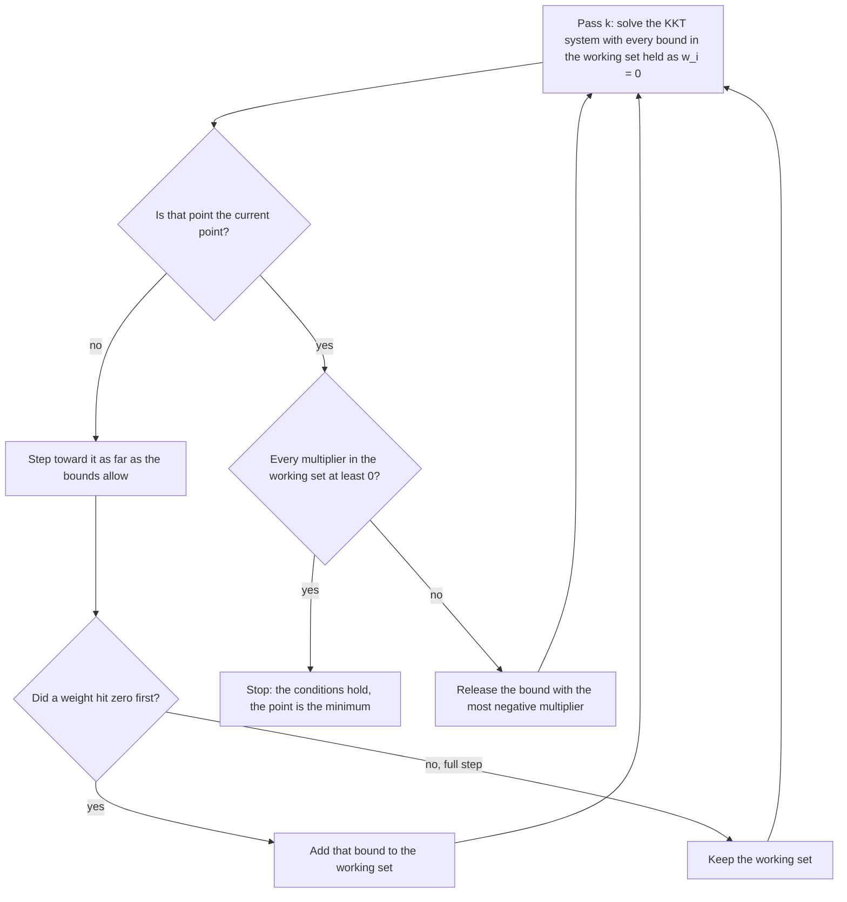
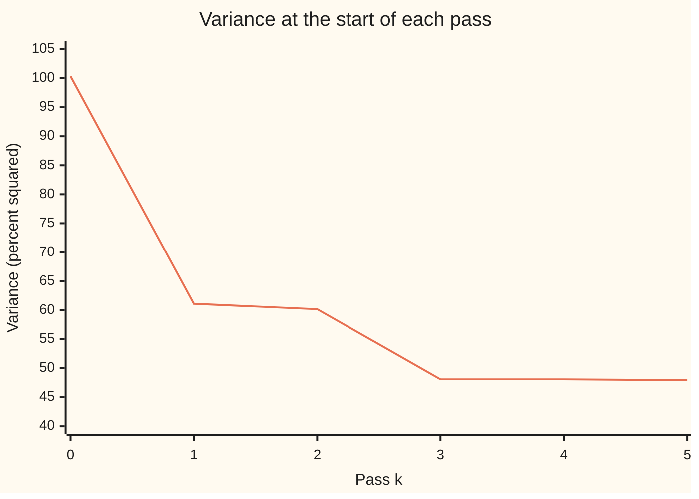

# Quadratic programs: a bowl-shaped cost under straight-line limits

[Syllabus](../../../SYLLABUS.md) → [Optimization](../README.md) → [Conic, Quadratic and Stochastic Programs](../README.md#s06) → Quadratic programs

---

## General Overview

A pension fund holds £1,000,000 split evenly across five assets: UK shares, world shares, property, gilts (UK government bonds) and gold, £200,000 in each. Its yearly risk, measured as variance (the square of the standard deviation, the typical size of a year's surprise), is 100.3440 in percent squared, a standard deviation of 10.0172 percent. The trustees want the split with the least variance. Their rules say every penny is invested, and no asset may be sold short (borrowed and sold, which would show as a negative weight).

The finance wing already answers the first half. Without the no-short rule, one system of linear equations gives the least-variance split: 59.07 percent UK shares, −26.68 percent world shares, −25.55 percent property, 71.71 percent gilts, 21.46 percent gold, with variance 42.0658. Two weights are negative, so the fund may not hold it. Clipping the negatives to zero and rescaling does not repair it: that split has variance 61.0968, far from the best.

This card finds the best split the rules allow: 13.26 percent UK shares, 6.48 percent world shares, no property, 69.01 percent gilts and 11.24 percent gold, variance 47.9473, standard deviation 6.9244 percent. It proves nothing allowed does better. Note that world shares, which the unrestricted answer sold short, are held. The method is an **active-set pass**: guess which "no shorting" limits bind, solve the linear equations that guess implies, and let the signs of the multipliers (prices on each limit) say whether the guess was right.

**A quadratic program minimises a bowl-shaped cost under straight-line limits: with only equations as limits it is one linear system, and with inequalities it is a short sequence of such systems, stopped when every multiplier on a binding limit is non-negative.**

**What kind of fact this is:** a theorem and a method. The theorem, proved on this card in Why it works, is that the printed conditions certify a global minimum when the bowl is convex. The method, the active-set pass, is shown finishing here in six passes; its general finite stopping is stated with a source.

### The picture: the allowed least-variance split

```
UK shares     █████                              13.26%
World shares  ███                                 6.48%
Property                                          0.00%
Gilts         ████████████████████████████       69.01%
Gold          ████                               11.24%
```

On £1,000,000 that is £132,634 in UK shares, £64,782 in world shares, £690,148 in gilts and £112,436 in gold.

---

## The formula

Notation first, in words. A **quadratic program** (QP; "program" here means a planning problem, not computer code) chooses a list of numbers $x$ to make a cost of the form $\tfrac12 x^\top Q x + c^\top x$ as small as possible: a quadratic part that makes a bowl and a straight-line part that tilts it. The limits are straight-line equations $Ax = b$ and the bounds $x \ge 0$, held entry by entry. The raised $\top$ turns a column into a row, so $c^\top x$ means "multiply the two lists entry by entry and add". $Q \succeq 0$ says $Q$ is positive semidefinite: $x^\top Q x \ge 0$ for every $x$, which is what makes the cost a bowl ([Convex functions](../01-Convexity/03-convex-functions-and-their-tests.md) gives the test).

$$\text{minimise } \tfrac12 x^\top Q x + c^\top x \quad \text{subject to} \quad Ax = b,\ \ x \ge 0.$$

With only the equations, the minimiser $x^*$ and the multipliers $\nu$ solve one linear system, the **KKT system** (after Karush, Kuhn and Tucker):

$$\begin{bmatrix} Q & A^\top \\ A & 0 \end{bmatrix} \begin{bmatrix} x \\ \nu \end{bmatrix} = \begin{bmatrix} -c \\ b \end{bmatrix}.$$

With the bounds too, $x^*$ is the minimiser exactly when some $\nu$ and some $\lambda$ satisfy

$$Qx + c + A^\top \nu - \lambda = 0, \qquad Ax = b, \qquad x \ge 0, \qquad \lambda \ge 0, \qquad \lambda_i x_i = 0 \text{ for every } i.$$

**Read it aloud:** at the bottom, the cost's slope is balanced by the equation limits plus a non-negative push from each bound, and a bound pushes only where its variable sits at zero.

For the fund, $x$ is the weights $w$, $Q$ is the covariance matrix $\Sigma$, $c = 0$, and the only equation is $\mathbf{1}^\top w = 1$. The cost $\tfrac12 w^\top \Sigma w$ is half the variance $V$; halving moves no minimiser and tidies the slope to $\Sigma w$. Multiplying the first condition by $w^\top$ shows $\nu = -V$, so the conditions read, asset by asset:

$$(\Sigma w)_i = V + \lambda_i, \qquad \lambda_i \ge 0, \qquad \lambda_i = 0 \text{ wherever } w_i > 0.$$

**Read it aloud:** every asset held has the same covariance with the portfolio, equal to the portfolio's variance; every asset left out has a covariance at least that large.

| Symbol | Plain meaning | In our example | Push it up and the answer… |
| --- | --- | --- | --- |
| $x$, $w$ | the list being chosen; for the fund, the weights, the fraction of the money in each asset | answer: 13.26%, 6.48%, 0, 69.01%, 11.24% | — |
| $Q$, $\Sigma$ | the bowl's matrix; for the fund, the covariance matrix, each entry a correlation times two standard deviations; $Q \succeq 0$ means no direction curves downward | diagonal 256, 225, 324, 64, 196 (percent squared) | a larger variance on one asset pushes money out of it |
| $c$ | the straight-line part of the cost, tilting the bowl | 0: the fund cares only about risk | — |
| $A$, $b$ | the equation limits, one row each, and their right-hand sides | one row, $\mathbf{1}^\top w = 1$ | — |
| $\mathbf{1}$, $\top$ | a list of ones, so $\mathbf{1}^\top w$ adds the weights; the raised $\top$ turns a column into a row | 1, 1, 1, 1, 1 | — |
| $V$ | the portfolio's variance, $w^\top \Sigma w$; its square root is the standard deviation | 47.9473, so 6.9244% | — |
| $\nu$ | the multiplier on the equation limit; here it equals $-V$ | −42.0658 with shorts allowed | — |
| $\lambda_i$ | the multiplier on the bound $w_i \ge 0$: how much half the variance would rise per unit of asset $i$ forced in | Property: 23.0185; the held assets: 0 | larger: the asset is further from being worth holding |
| $(\Sigma w)_i$ | asset $i$'s covariance with the whole portfolio: how much risk one more unit of it adds | 47.9473 for each held asset, 70.9658 for property | — |
| $\mathcal{W}_k$ | the working set at pass $k$: the bounds currently treated as equations $w_i = 0$ | finally {Property} | — |
| $k$, $d_k$, $\alpha_k$ | the pass number from $k = 0$, the direction to the working set's best point, and the fraction of that step taken | $\alpha_0$ = 0.4284 | — |
| $x^*$, $w^*$ | the minimiser | the answer above | — |

### When it holds

- **The bowl is convex: $Q \succeq 0$.** A covariance matrix built from one data set always is. Patch one correlation from a different data set and it may not be; then the conditions above hold at a saddle as well as at the bottom. On this card, a patched World–Property correlation of −0.2 makes the method stop at variance 48.0255 while a better allowed split has 46.5657.
- **The equation rows are independent and $Q$ is positive definite on the moves they allow.** Then the KKT matrix has an inverse and each linear system has one answer. If two assets were exact copies, many weight lists would tie and the elimination would hit a zero pivot.
- **Some point meets every limit.** If the limits contradict each other (say "invest everything" and "at most 10 percent in each of five assets"), there is nothing to minimise, and the first feasible point the method needs does not exist.
- **The limits are straight lines.** A limit such as "standard deviation at most 7 percent" is curved; it makes a cone program instead: [Second-order cone programs](04-second-order-cone-programs.md).

---

## Why it works

### Step 0: a bowl under flat walls

The cost is a bowl. Each equation limit is a flat slice through the space of choices; each bound is a flat wall. At the lowest allowed point, no allowed move goes downhill. If the walls touching the answer were known in advance, they could be treated as equations, and the problem would be a bowl sliced by flat planes: one linear system. The active-set method guesses that list of touching walls, solves, and then reads the multipliers to test the guess. A negative multiplier means a wall is holding the point *back from somewhere better*, so that wall comes off the list.

### Step 1: equations only, one linear system

Attach a multiplier $\nu_j$ to each equation and form $\tfrac12 x^\top Q x + c^\top x + \nu^\top(Ax - b)$, the Lagrangian of [The efficient frontier](../../12-Financial%20mathematics/37-Portfolio%20Theory/02-efficient-frontier-and-minimum-variance.md). Its slope in $x$ is $Qx + c + A^\top \nu$. Setting that to zero, and keeping $Ax = b$, gives the KKT system: square, linear, solved by elimination.

For the fund it is six equations in six unknowns: five rows $\Sigma w + \nu\mathbf{1} = 0$ and the row $\mathbf{1}^\top w = 1$. The finance card solves the same problem with the inverse matrix; here elimination returns 59.07%, −26.68%, −25.55%, 71.71%, 21.46% and $\nu$ = −42.0658, so $V$ = 42.0658 and the standard deviation is 6.4858%.

Why this is the minimum: any other split meeting the equation differs by a move $z$ with $\mathbf{1}^\top z = 0$. Its cost is the old cost plus $z^\top(Qx + c)$ plus $\tfrac12 z^\top Q z$. The middle term is $-z^\top A^\top \nu = 0$, and the last is never negative when $Q \succeq 0$. So nothing meeting the equation is lower.

### Step 2: bounds, and what the multipliers mean

With the bounds, the last condition of The formula, $(\Sigma w)_i = V + \lambda_i$, has a plain reading. $(\Sigma w)_i$ is the risk added by moving a sliver of money into asset $i$; $V$ is the risk removed by taking that sliver evenly out of the whole portfolio. If two held assets had different $(\Sigma w)_i$, shifting money from the higher to the lower would cut the variance, so at the bottom they are all equal. An asset left out may have a larger $(\Sigma w)_i$, which is why it is out, but not a smaller one: then a sliver of it would lower the variance. Its excess, $\lambda_i$, must be $\ge 0$.

These conditions are not only necessary but sufficient when $Q \succeq 0$, which is what makes them a certificate.

<details>
<summary>Detailed proof: the conditions certify a global minimum</summary>

Let $x$, $\nu$, $\lambda$ satisfy the conditions, and let $y$ be any point with $Ay = b$ and $y \ge 0$. Write $f(x) = \tfrac12 x^\top Q x + c^\top x$ and $z = y - x$. Expanding,

$$f(y) = f(x) + z^\top (Qx + c) + \tfrac12 z^\top Q z.$$

By stationarity, $Qx + c = \lambda - A^\top \nu$. Since $Az = Ay - Ax = 0$, the term $z^\top A^\top \nu$ is zero, so $z^\top(Qx + c) = \lambda^\top z = \lambda^\top y - \lambda^\top x$. Complementarity makes $\lambda^\top x = 0$, and $\lambda \ge 0$ with $y \ge 0$ makes $\lambda^\top y \ge 0$. Finally $z^\top Q z \ge 0$ because $Q \succeq 0$. So $f(y) \ge f(x)$.

If $Q$ is not positive semidefinite, the last step fails: $z^\top Q z$ can be negative and $y$ can beat $x$. That is the patched-correlation case in the checks.

That a minimiser always has such multipliers (necessity) is proved in [KKT conditions](../03-Constrained%20Optimisation/02-kkt-conditions.md) under LICQ: the gradients of the binding limits are linearly independent. The fund's limits always pass. At most four weights can be zero, and the budget row of ones is never a combination of four or fewer of the unit rows $w_i = 0$.

</details>

### Step 3: the active-set pass

The method keeps a working set $\mathcal{W}_k$ of bounds held as equations $w_i = 0$. Each pass solves the KKT system with those extra rows and compares its answer with the current point.



From equal weights at $k = 0$, with an empty working set, the fund's run is:

| Pass $k$ | Variance at the start | What happens |
| --- | --- | --- |
| 0 | 100.3440 | heads for the shorts-allowed answer; world shares hit zero at $\alpha_0$ = 0.4284, reaching 36.74%, 0, 0.49%, 42.15%, 20.62% |
| 1 | 61.1066 | heads for the best with world shares at 0; property hits zero at $\alpha_1$ = 0.0267 |
| 2 | 60.1801 | heads for the best with both at 0; full step to 18.78%, 0, 0, 68.41%, 12.81% |
| 3 | 48.0856 | at the target; multipliers: world shares −2.1349, property 25.7894; release world shares |
| 4 | 48.0856 | heads for the best with only property at 0; full step to 13.26%, 6.48%, 0, 69.01%, 11.24% |
| 5 | 47.9473 | at the target; property's multiplier 23.0185 ≥ 0; stop |



One line: the portfolio's variance as the passes run. It never rises. Pass 3 moves nothing; it only reads the multipliers and releases a bound. Pass 3 is also the answer of the common shortcut "delete the assets the formula shorted and re-solve": a fair point, but world shares' negative multiplier says it is not the bottom.

### Step 4: why it finishes

Each pass either moves the point downhill, adds a bound, or releases one. When a release happens, the next direction lowers the variance strictly, because the released asset's negative multiplier says a sliver of it helps. Each working set's best point is unique when $Q$ is positive definite on its moves, and the variance strictly falls between visits, so no working set is solved to its best point twice. Five bounds give at most $2^5$ working sets, so the method stops. The one catch is a step of length zero, possible when several bounds touch at once; Nocedal and Wright give the full argument and its guard. Here every step had positive length, and the run took six passes: four moves and two multiplier checks. Each pass costs one small elimination, a few hundred multiplications.

---

## Worked numbers, by hand

Pass 2 can be done by hand, because UK shares have zero covariance with gilts and gold. With world shares and property held at zero, the KKT rows are $256\,w_{UK} + \nu = 0$, $64\,w_G + 33.6\,w_{Au} + \nu = 0$, $33.6\,w_G + 196\,w_{Au} + \nu = 0$ and $w_{UK} + w_G + w_{Au} = 1$ ($G$ for gilts, $Au$ for gold). In both tables the Arithmetic column shows weights rounded to four decimals, while each Value comes from the unrounded weights; redone with the rounded ones, a row lands within 0.01 of it.

| Step | Arithmetic | Value |
| --- | --- | --- |
| determinant of the gilts–gold block | $64 \times 196 - 33.6^2$ | 11415.04 |
| gilts' row of its inverse, times the determinant | $196 - 33.6$ | 162.4 |
| gold's row, the same | $64 - 33.6$ | 30.4 |
| UK shares per unit of $-\nu$ | $1/256$ | 0.00390625 |
| gilts and gold per unit of $-\nu$ | $(162.4 + 30.4)/11415.04$ | 0.01689000 |
| $V = -\nu$, from "weights add to 1" | $1/(0.00390625 + 0.01689000)$ | 48.0856 |
| weights | $48.0856/256$; $48.0856 \times 162.4/11415.04$; $48.0856 \times 30.4/11415.04$ | 18.78%, 68.41%, 12.81% |
| world shares' covariance with this portfolio | $216 \times 0.1878 + 42 \times 0.1281$ | 45.9507 |
| world shares' multiplier | $45.9507 - 48.0856$ | **−2.1349** |

Negative: world shares add less risk than the portfolio carries, so a sliver of them lowers the variance. The bound on world shares comes off, and pass 4 lands on the answer. Check it the same way:

| Step | Arithmetic | Value |
| --- | --- | --- |
| UK shares' covariance with the portfolio | $256 \times 0.1326 + 216 \times 0.0648$ | 47.9473 |
| gilts' covariance with the portfolio | $64 \times 0.6901 + 33.6 \times 0.1124$ | 47.9473 |
| property's covariance with the portfolio | $201.6 \times 0.1326 + 135 \times 0.0648 + 43.2 \times 0.6901 + 50.4 \times 0.1124$ | 70.9658 |
| property's multiplier | $70.9658 - 47.9473$ | **23.0185** |

World shares and gold also give 47.9473 (printed by the checks). Every held asset adds the same risk, and property would add more, so the fund holds no property. The least variance the rules allow is 47.9473, a standard deviation of 6.9244 percent. Forcing 1 percent into property shows the multiplier's meaning: the variance rises by 0.4694, against the first-order prediction $2 \times 23.0185 \times 0.01$ = 0.4604 (the 2 because $\lambda$ prices half the variance).

### What breaks if you drop a piece

Correct answer: 13.26%, 6.48%, 0, 69.01%, 11.24%, variance 47.9473.

| Mistake | Comes out at | What went wrong |
| --- | --- | --- |
| Drop the no-short rule | 59.07%, −26.68%, −25.55%, 71.71%, 21.46%; variance 42.0658 | Lower, but it shorts two assets the fund may not short. |
| Clip the negative weights to zero and rescale | 38.80%, 0, 0, 47.10%, 14.09%; variance 61.0968 | Clipping is not solving: the other weights were balanced against positions that are gone. |
| Delete the shorted assets, re-solve, stop | 18.78%, 0, 0, 68.41%, 12.81%; variance 48.0856 | The multiplier test was skipped; world shares' multiplier −2.1349 says they belong back in. |
| Patch the World–Property correlation to −0.2 | method stops at 8.42%, 11.58%, 0.73%, 69.33%, 9.95%, variance 48.0255; enumeration finds 0, 21.63%, 8.53%, 63.86%, 5.98%, variance 46.5657 | The patched matrix is not positive semidefinite (a split beating a point that meets the conditions proves it), so the conditions found a saddle. |

---

## Code, from first principles, and it actually runs

Both programs build the covariance matrix from the standard deviations and correlations, solve every KKT system by Gaussian elimination written out, and run the active-set pass from equal weights. The answer is reached **three independent ways**: the active-set method; enumeration of all 31 possible sets of held assets, solving each and keeping the lowest long-only one; and a grid of all 135,751 splits in steps of 2.5 percent, which never beats the answer and lands just above it. On top of that, the KKT conditions are checked directly from $\Sigma w$, the by-hand algebra is checked against elimination, and the patched matrix is shown failing. An iteration cap of 20 passes turns a broken method into a failed assert instead of an endless loop.

### Python

```python
# Quadratic programs: minimum-variance weights over five assets, no shorting.
# Standard library only. Roads: the active-set method, every support solved, a 2.5% grid.
NAMES = ["UK shares", "World shares", "Property", "Gilts", "Gold"]
SD = [16.0, 15.0, 18.0, 8.0, 14.0]                     # yearly standard deviation, percent
RHO = {(0, 1): 0.9, (0, 2): 0.7, (1, 2): 0.5, (1, 4): 0.2, (2, 3): 0.3, (2, 4): 0.2, (3, 4): 0.3}
N, ONES = 5, [1.0] * 5

def cov(rho):                                          # Sigma: correlation times both deviations
    return [[SD[i] * SD[j] * (1.0 if i == j else rho.get((min(i, j), max(i, j)), 0.0))
             for j in range(N)] for i in range(N)]

def solve(M, r):                                       # Gaussian elimination, partial pivoting
    m = len(r); a = [M[i][:] + [r[i]] for i in range(m)]
    for c in range(m):
        p = max(range(c, m), key=lambda i: abs(a[i][c])); a[c], a[p] = a[p], a[c]
        for i in range(m):
            if i != c:
                f = a[i][c] / a[c][c]
                for j in range(c, m + 1): a[i][j] -= f * a[c][j]
    return [a[i][m] / a[i][i] for i in range(m)]

def kkt(Q, rows, rhs):                                 # [[Q, A^T], [A, 0]] [x; nu] = [-c; b], c = 0
    m = len(rows)
    M = [Q[i][:] + [rows[r][i] for r in range(m)] for i in range(N)] + [rows[r][:] + [0.0] * m for r in range(m)]
    z = solve(M, [0.0] * N + rhs)
    return z[:N], z[N:]

def var(Q, w): return sum(w[i] * Q[i][j] * w[j] for i in range(N) for j in range(N))
def mvec(Q, w): return [sum(Q[i][j] * w[j] for j in range(N)) for i in range(N)]
def unit(i): return [1.0 if j == i else 0.0 for j in range(N)]
def pct(w): return " ".join(f"{100 * x:7.2f}" for x in w)

def pinned(Q, pins):                                   # least variance with the assets in pins held at 0
    return kkt(Q, [ONES] + [unit(i) for i in pins], [1.0] + [0.0] * len(pins))

def active_set(Q, w, show):                            # start: a feasible w, empty working set
    W, k, path = [], 0, []
    while True:
        path.append(var(Q, w)); assert k < 20, "the method must finish"
        target, mult = pinned(Q, W)
        d = [target[i] - w[i] for i in range(N)]
        if max(abs(x) for x in d) < 1e-12:             # at the target: read the multipliers
            lam = [-mult[1 + t] for t in range(len(W))]
            if show: print(f"k={k}  V {path[-1]:.4f}  check: " + "  ".join(f"lambda {NAMES[i]} {l:.4f}" for i, l in zip(W, lam)))
            if not lam or min(lam) >= 0: return w, path, lam
            W.pop(lam.index(min(lam)))
        else:
            alpha, block = 1.0, None
            for i in range(N):
                if d[i] < -1e-12 and -w[i] / d[i] < alpha: alpha, block = -w[i] / d[i], i
            w = [w[i] + alpha * d[i] for i in range(N)]
            if block is not None: W.append(block)
            for i in W: w[i] = 0.0
            if show: print(f"k={k}  V {path[-1]:.4f}  alpha {alpha:.4f}  " + (f"blocked by {NAMES[block]}" if block is not None else "full step") + f"  w {pct(w)}")
        k += 1

def enumerate_supports(Q):                             # every set of held assets, keep the long-only ones
    best, feasible = None, 0
    for mask in range(1, 2 ** N):
        x, _ = pinned(Q, [i for i in range(N) if not mask >> i & 1])
        if min(x) >= -1e-12:
            feasible += 1
            if best is None or var(Q, x) < var(Q, best): best = x
    return best, feasible

def grid(Q, s=40):                                     # every weight a multiple of 2.5%
    best, count = None, 0
    for a in range(s + 1):
        for b in range(s + 1 - a):
            for c in range(s + 1 - a - b):
                for d in range(s + 1 - a - b - c):
                    w = [a / s, b / s, c / s, d / s, (s - a - b - c - d) / s]; count += 1
                    v = var(Q, w)
                    if best is None or v < best[0]: best = (v, w)
    return best[0], best[1], count

S = cov(RHO)
print("covariance, percent squared: UK, World, Property, Gilts, Gold")
for row in S: print("  " + " ".join(f"{x:6.1f}" for x in row))
wu, nu = pinned(S, [])
print(f"shorts allowed, one KKT solve: w {pct(wu)}  V {var(S, wu):.4f}  sd {var(S, wu) ** 0.5:.4f}  nu {nu[0]:.4f}")
print(f"equal weights: V {var(S, [0.2] * N):.4f}  sd {var(S, [0.2] * N) ** 0.5:.4f}")
w, path, lam = active_set(S, [0.2] * N, True)
V = var(S, w); m = mvec(S, w)
print(f"answer w {pct(w)}  V {V:.4f}  sd {V ** 0.5:.4f}")
print("answer on 1,000,000 pounds: " + "  ".join(f"{round(1e6 * x):,}" for x in w))
print("cov with portfolio (Sigma w): " + " ".join(f"{x:.4f}" for x in m) + f"  lambda Property {m[2] - V:.4f}")
h = [0.0, 0.0, 0.0, 0.0, 0.0]; det = 64 * 196 - 33.6 ** 2
g, o = 196 - 33.6, 64 - 33.6                           # rows of the 2-by-2 inverse, times det, summed
print(f"by hand on UK, Gilts, Gold: det {det:.2f}  gilts {g:.1f}  gold {o:.1f}  1/256 {1 / 256:.8f}  {g + o:.1f}/det {(g + o) / det:.8f}")
Vh = 1 / (1 / 256 + (g + o) / det); h[0], h[3], h[4] = Vh / 256, Vh * g / det, Vh * o / det
mh = mvec(S, h)
print(f"  V {Vh:.4f}  w {pct(h)}  World row {mh[1]:.4f}  lambda World {mh[1] - Vh:.4f}")
we, feas = enumerate_supports(S)
print(f"enumeration: 31 supports, {feas} long-only, best V {var(S, we):.4f}  w {pct(we)}")
gv, gw, cnt = grid(S)
print(f"grid: {cnt} portfolios, best V {gv:.4f}  w {pct(gw)}")
wf, _ = kkt(S, [ONES, unit(2)], [1.0, 0.01])
print(f"force 1% into Property: V {var(S, wf):.4f}  rise {var(S, wf) - V:.4f}  2*lambda*0.01 {2 * lam[0] * 0.01:.4f}")
clip = [max(x, 0.0) for x in wu]; clip = [x / sum(clip) for x in clip]
print(f"wrong, clip and rescale: w {pct(clip)}  V {var(S, clip):.4f}")
print(f"wrong, drop the shorted, re-solve: V {Vh:.4f}  sd {Vh ** 0.5:.4f}")
P = cov({**RHO, (1, 2): -0.2})
wp, _, _ = active_set(P, [0.2] * N, False); wpe, _ = enumerate_supports(P); gpv, _, _ = grid(P)
print(f"patched World-Property -0.2: active set V {var(P, wp):.4f}  w {pct(wp)}")
print(f"  enumeration V {var(P, wpe):.4f}  w {pct(wpe)}  grid V {gpv:.4f}")
T = cov({**RHO, (3, 4): 0.6}); wt, _, _ = active_set(T, [0.2] * N, False)
print(f"try, Gilts-Gold correlation 0.6: w {pct(wt)}  V {var(T, wt):.4f}")
f = [2 / 3 if i == 2 else 1.0 for i in range(N)]       # Property's deviation 18 -> 12
T = [[S[i][j] * f[i] * f[j] for j in range(N)] for i in range(N)]; wt, _, _ = active_set(T, [0.2] * N, False)
print(f"try, Property deviation 12: w {pct(wt)}  V {var(T, wt):.4f}")
print("chart, pass k        " + " ".join(f"{k:7d}" for k in range(len(path))))
print("chart, variance      " + " ".join(f"{v:7.2f}" for v in path))

assert max(abs(m[i] - V) for i in range(N) if w[i] > 0) < 1e-9, "held assets: equal covariance with the portfolio"
assert abs((m[2] - V) - lam[0]) < 1e-9 and lam[0] > 0, "Property's multiplier, two ways, and its sign"
assert min(w) >= 0 and abs(sum(w) - 1) < 1e-12, "long-only and fully invested"
assert abs(var(S, we) - V) < 1e-9 and max(abs(a - b) for a, b in zip(w, we)) < 1e-9, "enumeration agrees"
assert V <= gv < V + 0.05, "grid never beats the answer and gets close"
assert min(wu) < 0 and var(S, wu) < V, "shorts allowed: lower but infeasible"
assert min(wf) >= 0 and abs((var(S, wf) - V) - 2 * lam[0] * 0.01) < 0.015, "multiplier predicts the rise"
assert abs(Vh - var(S, pinned(S, [1, 2])[0])) < 1e-9, "hand algebra agrees with elimination"
assert mh[1] - Vh < -1, "World's multiplier is negative where the shorted assets were dropped"
assert var(P, wp) > gpv + 1, "non-convex: the KKT point is beaten by the grid"
print("ALL CHECKS PASS")
```

**Ran 2026-11-11 on macOS, Python 3.14.10, standard library only. All checks passed. Output, pasted from the run:**

```
covariance, percent squared: UK, World, Property, Gilts, Gold
   256.0  216.0  201.6    0.0    0.0
   216.0  225.0  135.0    0.0   42.0
   201.6  135.0  324.0   43.2   50.4
     0.0    0.0   43.2   64.0   33.6
     0.0   42.0   50.4   33.6  196.0
shorts allowed, one KKT solve: w   59.07  -26.68  -25.55   71.71   21.46  V 42.0658  sd 6.4858  nu -42.0658
equal weights: V 100.3440  sd 10.0172
k=0  V 100.3440  alpha 0.4284  blocked by World shares  w   36.74    0.00    0.49   42.15   20.62
k=1  V 61.1066  alpha 0.0267  blocked by Property  w   36.58    0.00    0.00   42.96   20.46
k=2  V 60.1801  alpha 1.0000  full step  w   18.78    0.00    0.00   68.41   12.81
k=3  V 48.0856  check: lambda World shares -2.1349  lambda Property 25.7894
k=4  V 48.0856  alpha 1.0000  full step  w   13.26    6.48    0.00   69.01   11.24
k=5  V 47.9473  check: lambda Property 23.0185
answer w   13.26    6.48    0.00   69.01   11.24  V 47.9473  sd 6.9244
answer on 1,000,000 pounds: 132,634  64,782  0  690,148  112,436
cov with portfolio (Sigma w): 47.9473 47.9473 70.9658 47.9473 47.9473  lambda Property 23.0185
by hand on UK, Gilts, Gold: det 11415.04  gilts 162.4  gold 30.4  1/256 0.00390625  192.8/det 0.01689000
  V 48.0856  w   18.78    0.00    0.00   68.41   12.81  World row 45.9507  lambda World -2.1349
enumeration: 31 supports, 21 long-only, best V 47.9473  w   13.26    6.48    0.00   69.01   11.24
grid: 135751 portfolios, best V 47.9696  w   12.50    7.50    0.00   70.00   10.00
force 1% into Property: V 48.4167  rise 0.4694  2*lambda*0.01 0.4604
wrong, clip and rescale: w   38.80    0.00    0.00   47.10   14.09  V 61.0968
wrong, drop the shorted, re-solve: V 48.0856  sd 6.9344
patched World-Property -0.2: active set V 48.0255  w    8.42   11.58    0.73   69.33    9.95
  enumeration V 46.5657  w    0.00   21.63    8.53   63.86    5.98  grid V 46.6396
try, Gilts-Gold correlation 0.6: w    4.09   18.18    0.00   77.73    0.00  V 49.7455
try, Property deviation 12: w   11.02    8.01    1.81   68.47   10.69  V 47.9358
chart, pass k              0       1       2       3       4       5
chart, variance       100.34   61.11   60.18   48.09   48.09   47.95
ALL CHECKS PASS
```

Three roads, one answer. Enumeration finds 21 long-only candidates among the 31 sets and its best is the active-set answer to nine decimals. The best grid split, 12.50%, 7.50%, 0, 70.00%, 10.00%, has variance 47.9696, a little above 47.9473, as it must be.

### Rust

Same algorithm, same inputs, same output. Rust has no thousands separator in its formatting, so a small helper adds the commas.

```rust
// Quadratic programs: minimum-variance weights over five assets, no shorting.
// Standard library only, no crates. Same roads and output as the Python check.
const NAMES: [&str; 5] = ["UK shares", "World shares", "Property", "Gilts", "Gold"];
const SD: [f64; 5] = [16.0, 15.0, 18.0, 8.0, 14.0]; // yearly standard deviation, percent
const N: usize = 5;
type M = Vec<Vec<f64>>;

fn cov(rho: &[(usize, usize, f64)]) -> M { // Sigma: correlation times both deviations
    let mut s = vec![vec![0.0; N]; N];
    for i in 0..N { s[i][i] = SD[i] * SD[i]; }
    for &(i, j, r) in rho { s[i][j] = SD[i] * SD[j] * r; s[j][i] = SD[j] * SD[i] * r; }
    s
}

fn solve(m: &M, r: &[f64]) -> Vec<f64> { // Gaussian elimination, partial pivoting
    let n = r.len();
    let mut a: M = (0..n).map(|i| { let mut row = m[i].clone(); row.push(r[i]); row }).collect();
    for c in 0..n {
        let mut p = c;
        for i in c..n { if a[i][c].abs() > a[p][c].abs() { p = i; } }
        a.swap(c, p);
        for i in 0..n {
            if i != c {
                let f = a[i][c] / a[c][c];
                for j in c..=n { a[i][j] -= f * a[c][j]; }
            }
        }
    }
    (0..n).map(|i| a[i][n] / a[i][i]).collect()
}

fn kkt(q: &M, rows: &M, rhs: &[f64]) -> (Vec<f64>, Vec<f64>) { // [[Q, A^T], [A, 0]] [x; nu] = [-c; b], c = 0
    let m = rows.len();
    let mut big: M = (0..N).map(|i| { let mut r = q[i].clone(); for k in 0..m { r.push(rows[k][i]); } r }).collect();
    for k in 0..m { let mut r = rows[k].clone(); r.extend(vec![0.0; m]); big.push(r); }
    let mut b = vec![0.0; N]; b.extend_from_slice(rhs);
    let z = solve(&big, &b);
    (z[..N].to_vec(), z[N..].to_vec())
}

fn var(q: &M, w: &[f64]) -> f64 { let mut s = 0.0; for i in 0..N { for j in 0..N { s += w[i] * q[i][j] * w[j]; } } s }
fn mvec(q: &M, w: &[f64]) -> Vec<f64> { (0..N).map(|i| { let mut s = 0.0; for j in 0..N { s += q[i][j] * w[j]; } s }).collect() }
fn unit(i: usize) -> Vec<f64> { (0..N).map(|j| if j == i { 1.0 } else { 0.0 }).collect() }
fn pct(w: &[f64]) -> String { w.iter().map(|x| format!("{:7.2}", 100.0 * x)).collect::<Vec<_>>().join(" ") }
fn pounds(x: f64) -> String { // thousands separated with commas
    let s = format!("{}", x.round() as i64);
    let mut out = String::new();
    for (k, ch) in s.chars().enumerate() { if k > 0 && (s.len() - k) % 3 == 0 { out.push(','); } out.push(ch); }
    out
}

fn pinned(q: &M, pins: &[usize]) -> (Vec<f64>, Vec<f64>) { // least variance with the assets in pins held at 0
    let mut rows = vec![vec![1.0; N]]; let mut rhs = vec![1.0];
    for &i in pins { rows.push(unit(i)); rhs.push(0.0); }
    kkt(q, &rows, &rhs)
}

fn active_set(q: &M, w0: &[f64], show: bool) -> (Vec<f64>, Vec<f64>, Vec<f64>) {
    let (mut w, mut wset, mut k, mut path): (Vec<f64>, Vec<usize>, usize, Vec<f64>) = (w0.to_vec(), vec![], 0, vec![]);
    loop {
        path.push(var(q, &w)); assert!(k < 20, "the method must finish");
        let (target, mult) = pinned(q, &wset);
        let d: Vec<f64> = (0..N).map(|i| target[i] - w[i]).collect();
        if d.iter().fold(0.0f64, |a, x| a.max(x.abs())) < 1e-12 { // at the target: read the multipliers
            let lam: Vec<f64> = (0..wset.len()).map(|t| -mult[1 + t]).collect();
            if show {
                let parts: Vec<String> = wset.iter().zip(&lam).map(|(&i, l)| format!("lambda {} {:.4}", NAMES[i], l)).collect();
                println!("k={}  V {:.4}  check: {}", k, path[k], parts.join("  "));
            }
            let mut lo = 0;
            for t in 0..lam.len() { if lam[t] < lam[lo] { lo = t; } }
            if lam.is_empty() || lam[lo] >= 0.0 { return (w, path, lam); }
            wset.remove(lo);
        } else {
            let (mut alpha, mut block) = (1.0, None);
            for i in 0..N { if d[i] < -1e-12 && -w[i] / d[i] < alpha { alpha = -w[i] / d[i]; block = Some(i); } }
            w = (0..N).map(|i| w[i] + alpha * d[i]).collect();
            if let Some(b) = block { wset.push(b); }
            for &i in &wset { w[i] = 0.0; }
            if show {
                let what = match block { Some(b) => format!("blocked by {}", NAMES[b]), None => "full step".to_string() };
                println!("k={}  V {:.4}  alpha {:.4}  {}  w {}", k, path[k], alpha, what, pct(&w));
            }
        }
        k += 1;
    }
}

fn enumerate_supports(q: &M) -> (Vec<f64>, usize) { // every set of held assets, keep the long-only ones
    let (mut best, mut feasible): (Option<Vec<f64>>, usize) = (None, 0);
    for mask in 1..(1usize << N) {
        let pins: Vec<usize> = (0..N).filter(|i| mask >> i & 1 == 0).collect();
        let (x, _) = pinned(q, &pins);
        if x.iter().cloned().fold(f64::INFINITY, f64::min) >= -1e-12 {
            feasible += 1;
            if best.as_ref().map_or(true, |b| var(q, &x) < var(q, b)) { best = Some(x); }
        }
    }
    (best.unwrap(), feasible)
}

fn grid(q: &M) -> (f64, Vec<f64>, usize) { // every weight a multiple of 2.5%
    let s = 40usize; let sf = s as f64;
    let (mut bv, mut bw, mut count) = (f64::INFINITY, vec![], 0);
    for a in 0..=s { for b in 0..=(s - a) { for c in 0..=(s - a - b) { for d in 0..=(s - a - b - c) {
        let w = vec![a as f64 / sf, b as f64 / sf, c as f64 / sf, d as f64 / sf, (s - a - b - c - d) as f64 / sf];
        count += 1;
        let v = var(q, &w);
        if v < bv { bv = v; bw = w; }
    } } } }
    (bv, bw, count)
}

fn main() {
    let rho = [(0, 1, 0.9), (0, 2, 0.7), (1, 2, 0.5), (1, 4, 0.2), (2, 3, 0.3), (2, 4, 0.2), (3, 4, 0.3)];
    let s = cov(&rho);
    let eq = vec![0.2; N];
    println!("covariance, percent squared: UK, World, Property, Gilts, Gold");
    for row in &s { println!("  {}", row.iter().map(|x| format!("{:6.1}", x)).collect::<Vec<_>>().join(" ")); }
    let (wu, nu) = pinned(&s, &[]);
    println!("shorts allowed, one KKT solve: w {}  V {:.4}  sd {:.4}  nu {:.4}", pct(&wu), var(&s, &wu), var(&s, &wu).sqrt(), nu[0]);
    println!("equal weights: V {:.4}  sd {:.4}", var(&s, &eq), var(&s, &eq).sqrt());
    let (w, path, lam) = active_set(&s, &eq, true);
    let v = var(&s, &w); let m = mvec(&s, &w);
    println!("answer w {}  V {:.4}  sd {:.4}", pct(&w), v, v.sqrt());
    println!("answer on 1,000,000 pounds: {}", w.iter().map(|x| pounds(1e6 * x)).collect::<Vec<_>>().join("  "));
    println!("cov with portfolio (Sigma w): {}  lambda Property {:.4}", m.iter().map(|x| format!("{:.4}", x)).collect::<Vec<_>>().join(" "), m[2] - v);
    let det = 64.0 * 196.0 - 33.6f64.powi(2);
    let (g, o) = (196.0 - 33.6, 64.0 - 33.6); // rows of the 2-by-2 inverse, times det, summed
    println!("by hand on UK, Gilts, Gold: det {:.2}  gilts {:.1}  gold {:.1}  1/256 {:.8}  {:.1}/det {:.8}", det, g, o, 1.0 / 256.0, g + o, (g + o) / det);
    let vh = 1.0 / (1.0 / 256.0 + (g + o) / det);
    let h = vec![vh / 256.0, 0.0, 0.0, vh * g / det, vh * o / det];
    let mh = mvec(&s, &h);
    println!("  V {:.4}  w {}  World row {:.4}  lambda World {:.4}", vh, pct(&h), mh[1], mh[1] - vh);
    let (we, feas) = enumerate_supports(&s);
    println!("enumeration: 31 supports, {} long-only, best V {:.4}  w {}", feas, var(&s, &we), pct(&we));
    let (gv, gw, cnt) = grid(&s);
    println!("grid: {} portfolios, best V {:.4}  w {}", cnt, gv, pct(&gw));
    let (wf, _) = kkt(&s, &vec![vec![1.0; N], unit(2)], &[1.0, 0.01]);
    println!("force 1% into Property: V {:.4}  rise {:.4}  2*lambda*0.01 {:.4}", var(&s, &wf), var(&s, &wf) - v, 2.0 * lam[0] * 0.01);
    let c0: Vec<f64> = wu.iter().map(|x| x.max(0.0)).collect(); let cs: f64 = c0.iter().sum();
    let clip: Vec<f64> = c0.iter().map(|x| x / cs).collect();
    println!("wrong, clip and rescale: w {}  V {:.4}", pct(&clip), var(&s, &clip));
    println!("wrong, drop the shorted, re-solve: V {:.4}  sd {:.4}", vh, vh.sqrt());
    let mut rp = rho.to_vec(); rp[2].2 = -0.2;
    let p = cov(&rp);
    let (wp, _, _) = active_set(&p, &eq, false); let (wpe, _) = enumerate_supports(&p); let (gpv, _, _) = grid(&p);
    println!("patched World-Property -0.2: active set V {:.4}  w {}", var(&p, &wp), pct(&wp));
    println!("  enumeration V {:.4}  w {}  grid V {:.4}", var(&p, &wpe), pct(&wpe), gpv);
    let mut rt = rho.to_vec(); rt[6].2 = 0.6;
    let t = cov(&rt); let (wt, _, _) = active_set(&t, &eq, false);
    println!("try, Gilts-Gold correlation 0.6: w {}  V {:.4}", pct(&wt), var(&t, &wt));
    let f: Vec<f64> = (0..N).map(|i| if i == 2 { 2.0 / 3.0 } else { 1.0 }).collect(); // Property's deviation 18 -> 12
    let t: M = (0..N).map(|i| (0..N).map(|j| s[i][j] * f[i] * f[j]).collect()).collect(); let (wt, _, _) = active_set(&t, &eq, false);
    println!("try, Property deviation 12: w {}  V {:.4}", pct(&wt), var(&t, &wt));
    println!("chart, pass k        {}", (0..path.len()).map(|k| format!("{:7}", k)).collect::<Vec<_>>().join(" "));
    println!("chart, variance      {}", path.iter().map(|x| format!("{:7.2}", x)).collect::<Vec<_>>().join(" "));

    assert!((0..N).filter(|&i| w[i] > 0.0).all(|i| (m[i] - v).abs() < 1e-9), "held assets: equal covariance with the portfolio");
    assert!(((m[2] - v) - lam[0]).abs() < 1e-9 && lam[0] > 0.0, "Property's multiplier, two ways, and its sign");
    assert!(w.iter().all(|&x| x >= 0.0) && (w.iter().sum::<f64>() - 1.0).abs() < 1e-12, "long-only and fully invested");
    assert!((var(&s, &we) - v).abs() < 1e-9 && (0..N).all(|i| (w[i] - we[i]).abs() < 1e-9), "enumeration agrees");
    assert!(v <= gv && gv < v + 0.05, "grid never beats the answer and gets close");
    assert!(wu.iter().any(|&x| x < 0.0) && var(&s, &wu) < v, "shorts allowed: lower but infeasible");
    assert!(wf.iter().all(|&x| x >= 0.0) && ((var(&s, &wf) - v) - 2.0 * lam[0] * 0.01).abs() < 0.015, "multiplier predicts the rise");
    assert!((vh - var(&s, &pinned(&s, &[1, 2]).0)).abs() < 1e-9, "hand algebra agrees with elimination");
    assert!(mh[1] - vh < -1.0, "World's multiplier is negative where the shorted assets were dropped");
    assert!(var(&p, &wp) > gpv + 1.0, "non-convex: the KKT point is beaten by the grid");
    println!("ALL CHECKS PASS");
}
```

**Ran 2026-11-11 on macOS, rustc 1.98.1, no crates. All checks passed. Output, pasted from the run:**

```
covariance, percent squared: UK, World, Property, Gilts, Gold
   256.0  216.0  201.6    0.0    0.0
   216.0  225.0  135.0    0.0   42.0
   201.6  135.0  324.0   43.2   50.4
     0.0    0.0   43.2   64.0   33.6
     0.0   42.0   50.4   33.6  196.0
shorts allowed, one KKT solve: w   59.07  -26.68  -25.55   71.71   21.46  V 42.0658  sd 6.4858  nu -42.0658
equal weights: V 100.3440  sd 10.0172
k=0  V 100.3440  alpha 0.4284  blocked by World shares  w   36.74    0.00    0.49   42.15   20.62
k=1  V 61.1066  alpha 0.0267  blocked by Property  w   36.58    0.00    0.00   42.96   20.46
k=2  V 60.1801  alpha 1.0000  full step  w   18.78    0.00    0.00   68.41   12.81
k=3  V 48.0856  check: lambda World shares -2.1349  lambda Property 25.7894
k=4  V 48.0856  alpha 1.0000  full step  w   13.26    6.48    0.00   69.01   11.24
k=5  V 47.9473  check: lambda Property 23.0185
answer w   13.26    6.48    0.00   69.01   11.24  V 47.9473  sd 6.9244
answer on 1,000,000 pounds: 132,634  64,782  0  690,148  112,436
cov with portfolio (Sigma w): 47.9473 47.9473 70.9658 47.9473 47.9473  lambda Property 23.0185
by hand on UK, Gilts, Gold: det 11415.04  gilts 162.4  gold 30.4  1/256 0.00390625  192.8/det 0.01689000
  V 48.0856  w   18.78    0.00    0.00   68.41   12.81  World row 45.9507  lambda World -2.1349
enumeration: 31 supports, 21 long-only, best V 47.9473  w   13.26    6.48    0.00   69.01   11.24
grid: 135751 portfolios, best V 47.9696  w   12.50    7.50    0.00   70.00   10.00
force 1% into Property: V 48.4167  rise 0.4694  2*lambda*0.01 0.4604
wrong, clip and rescale: w   38.80    0.00    0.00   47.10   14.09  V 61.0968
wrong, drop the shorted, re-solve: V 48.0856  sd 6.9344
patched World-Property -0.2: active set V 48.0255  w    8.42   11.58    0.73   69.33    9.95
  enumeration V 46.5657  w    0.00   21.63    8.53   63.86    5.98  grid V 46.6396
try, Gilts-Gold correlation 0.6: w    4.09   18.18    0.00   77.73    0.00  V 49.7455
try, Property deviation 12: w   11.02    8.01    1.81   68.47   10.69  V 47.9358
chart, pass k              0       1       2       3       4       5
chart, variance       100.34   61.11   60.18   48.09   48.09   47.95
ALL CHECKS PASS
```

> [!TIP]
> **Try changing**
> - Guess first: raise the Gilts–Gold correlation from 0.3 to 0.6. Does gold stay? It goes: the answer becomes 4.09%, 18.18%, 0, 77.73%, 0, variance 49.7455. Gold stops being a hedge for gilts.
> - Guess first: cut property's standard deviation from 18 to 12 percent. Property's multiplier was 23.0185, so does it stay out? It enters at 1.81%; the answer becomes 11.02%, 8.01%, 1.81%, 68.47%, 10.69%, variance 47.9358.
> - Guess first: force 1 percent of the money into property and re-solve. The multiplier predicts a rise of 0.4604; the variance becomes 48.4167, a rise of 0.4694.
> - Guess first: delete the no-short rows and keep only the budget. The first pass is then the whole method, and it returns the shorts-allowed answer, variance 42.0658.

---

## The usual mistake

> [!warning]
> **Treating "delete the negatives and re-solve" as the long-only answer.** It feels like the active-set method, and it is one pass of it with the stopping test left out. Here it gives 18.78% UK shares, 68.41% gilts and 12.81% gold at variance 48.0856, and drops world shares for good. But world shares were negative in an answer that also shorted property. With property out, world shares help: their multiplier is −2.1349. The real answer holds 6.48% of them, at variance 47.9473. Only the multiplier signs say when to stop.
>
> Smaller traps:
> - **Clipping instead of solving.** Clipping the shorted weights and rescaling gives variance 61.0968, against 47.9473 for the honest answer.
> - **Calling a KKT point a minimum without convexity.** With the patched correlation of −0.2, the method stops at variance 48.0255 with every condition met, yet a long-only split with 46.5657 exists. Check $Q \succeq 0$ before trusting the certificate.
> - **Losing the factor of 2.** The multiplier prices half the variance, because the cost is $\tfrac12 w^\top\Sigma w$. Forcing 1 percent into property raises the variance by about $2 \times 23.0185 \times 0.01$ = 0.4604 (actually 0.4694), not half that.
> - **Reading $\nu$ as a price of money.** Here $\nu = -V$: it is −42.0658 with shorts allowed, the variance with its sign flipped, not a cost of the budget in pounds.

---

## Where you meet it in real life

- **Long-only funds.** Pension funds, minimum-volatility index funds and robo-advisers solve this QP, usually with extra rows such as a cap per asset or a target return, every time they rebalance.
- **Index tracking.** A fund that copies an index with fewer stocks minimises the variance of its gap to the index, a QP in the weights, with no shorting and a cap on turnover.
- **The no-short rule as a stabiliser.** Jagannathan and Ma show that banning shorts acts like shrinking the covariance estimate, which is why long-only minimum-variance portfolios often hold up as well as or better than the formula's on new data.
- **Model predictive control.** A controller that steers a plant re-solves a small QP every few milliseconds, with actuator limits as the bounds; the engineering wing owns the loop and this card the solve.
- **Machine learning.** Training a support vector machine is a QP with one equation and box bounds: [Support vector machines](03-support-vector-machines-as-a-quadratic-program.md).

> **Say it back**
> A quadratic program minimises a bowl-shaped cost under straight-line limits. With equations only, the answer and its multipliers solve one linear system, the KKT system. With bounds, guess which bounds bind, solve that system, and read the multipliers: a negative one means release that bound, all non-negative means stop. For the fund, every held asset ends with the same covariance with the portfolio, and the excluded property has a larger one. That certificate proves the minimum only when the bowl is truly convex.

---

## What this builds on

- [KKT conditions](../03-Constrained%20Optimisation/02-kkt-conditions.md): the multiplier conditions for a minimum under inequality limits, and the proof that a minimiser has them when the binding limits are independent (LICQ), as the fund's always are. This card applies them; that card proves them.
- [Convex functions](../01-Convexity/03-convex-functions-and-their-tests.md): the curvature test $Q \succeq 0$ that makes the cost a bowl and the conditions sufficient.
- [The efficient frontier](../../12-Financial%20mathematics/37-Portfolio%20Theory/02-efficient-frontier-and-minimum-variance.md): the covariance matrix, the variance $w^\top\Sigma w$, and the shorts-allowed minimum-variance portfolio by Lagrange multipliers, which is the KKT system of Step 1.

## Where this goes next

- [Two goals at once](02-multi-objective-trade-offs-and-the-pareto-frontier.md): expected return as a second goal, on a five-fund menu with figures of its own; the efficient frontier appears as the curve where risk cannot fall without return falling too.
- [Support vector machines](03-support-vector-machines-as-a-quadratic-program.md): the same KKT conditions, where the assets with positive weight become the support vectors.
- [Second-order cone programs](04-second-order-cone-programs.md): limits on risk itself, which are curved and need cones; its example caps tracking error, the risk of straying from a benchmark, with a five-asset risk model of its own.

The active-set pass solves a fresh linear system for each guess, which is fast for five assets and slow for five thousand; how to handle a QP that large is the question this card leaves open.

---

## Sources

Verified 2026-11-11: every link below resolves to the publisher's page.

- Markowitz, Harry. "Portfolio Selection." *The Journal of Finance* 7, no. 1 (1952): 77–91. [doi:10.1111/j.1540-6261.1952.tb01525.x](https://doi.org/10.1111/j.1540-6261.1952.tb01525.x). The variance-minimising portfolio problem this card solves under a no-short rule.
- Wolfe, Philip. "The Simplex Method for Quadratic Programming." *Econometrica* 27, no. 3 (1959): 382–398. [doi:10.2307/1909468](https://doi.org/10.2307/1909468). An early finite method for QPs built on the KKT conditions and a pivoting pass.
- Nocedal, Jorge, and Stephen J. Wright. *Numerical Optimization*, 2nd ed. Springer, 2006. [doi:10.1007/978-0-387-40065-5](https://doi.org/10.1007/978-0-387-40065-5). Chapter 16: the KKT system of an equality-constrained QP and the active-set method for convex QPs, with its finite-termination argument.
- Boyd, Stephen, and Lieven Vandenberghe. *Convex Optimization*. Cambridge University Press, 2004. [Publisher page](https://www.cambridge.org/core/books/convex-optimization/17D2FAA54F641A2F62C7CCD01DFA97C4). Quadratic programs as convex problems and the KKT conditions as a certificate of optimality.
- Jagannathan, Ravi, and Tongshu Ma. "Risk Reduction in Large Portfolios: Why Imposing the Wrong Constraints Helps." *The Journal of Finance* 58, no. 4 (2003): 1651–1683. [doi:10.1111/1540-6261.00580](https://doi.org/10.1111/1540-6261.00580). Why the no-short rule stabilises minimum-variance portfolios in practice.
