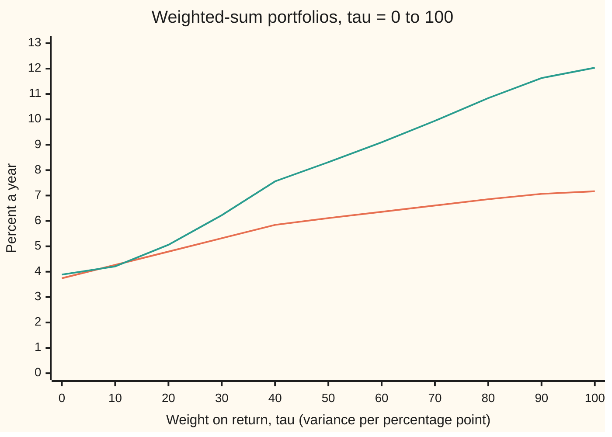
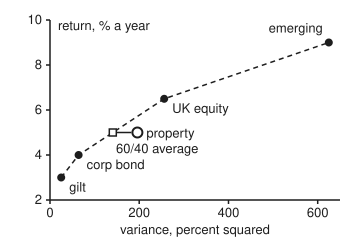

# Two goals at once: Pareto optimality and the frontier of trade-offs

[Syllabus](../../../SYLLABUS.md) → [Optimization](../README.md) → [Conic, Quadratic and Stochastic Programs](../README.md#s06) → Two goals at once

---

## General Overview

A pension scheme offers five funds. Each has an expected return a year and a risk, measured as variance (the square of the standard deviation, the typical size of a year's surprise):

| Fund | Expected return | Standard deviation | Variance |
| --- | ---: | ---: | ---: |
| gilt (UK government bonds) | 3.0% | 5% | 25 |
| corporate bond | 4.0% | 8% | 64 |
| property | 5.0% | 14% | 196 |
| UK equity | 6.5% | 16% | 256 |
| emerging markets | 9.0% | 25% | 625 |

The scheme's manager splits the money across the five and wants two things at once: return as high as possible and variance as low as possible. No split is best at both. The calmest split earns 3.741% a year; the richest one is all emerging markets, with a variance of 625. Every sensible answer is a trade.

So the question changes. Instead of "which split is best?", ask "which splits are not beaten?". A split is beaten when another split has at least its return, at most its variance, and is strictly better on one of the two. The splits nobody beats are **Pareto optimal** (after the economist Vilfredo Pareto; this is not the Pareto distribution of heavy tails). Together they form the **Pareto frontier**: the menu of honest trade-offs.

The usual way to find frontier points is a **weighted sum**: fold the two goals into one score, variance minus τ times return, and minimise it. The number τ (Greek "tau") says how much variance one extra percentage point of return is worth. Eleven values, τ = 0, 10, …, 100, give eleven frontier portfolios. But change the rule to "each saver picks exactly one fund", and the property fund is a Pareto-optimal choice that no weighting, however fine, ever selects.

**A weighted sum with weights that are not negative always lands on the Pareto frontier, and when the problem is convex it can reach every frontier point where the frontier's slope is finite, which here is every point; when the frontier has a dent, the points in the dent are Pareto optimal but no weighting can reach them, and a limit on one goal reaches them instead.**

**What kind of fact this is:** a theorem in two halves, both proved on this card in Why it works. The fund numbers are a model: the returns and variances are taken as known, and the funds are treated as uncorrelated (one fund's surprise does not tend to move with another's).

### The picture: eleven portfolios as the weight on return rises



Orange: expected return. Green: standard deviation. Each τ gives one frontier portfolio, so the two lines read at the same τ are one point of the frontier, risk across and return up. The eleven points, with their weights and variances, are the table the code prints: that table is the traced frontier.

Both lines climb as τ rises: each step buys return and pays for it in risk. The steps are not even: τ from 0 to 10 lifts the return from 3.741% to 4.267%, τ from 90 to 100 only from 7.066% to 7.167%. The frontier goes on past the chart and ends at τ = 500, all in emerging markets.

---

## The formula

Notation first, in words. The holdings are a list $x = (x_1, \dots, x_5)$: the fraction of the money in each fund, in the table's order. $\mu_i$ (Greek "mu") is fund $i$'s expected return and $\sigma_i^2$ its variance. With uncorrelated funds the portfolio's variance and return are

$$V(x) = \sum_i \sigma_i^2 x_i^2, \qquad R(x) = \sum_i \mu_i x_i .$$

**Pareto optimality.** A split is feasible when the rules allow it: all the money invested, nothing sold short. A feasible $y$ dominates $x$ when $V(y) \le V(x)$ and $R(y) \ge R(x)$, with at least one of the two strict. A feasible $x^*$ is Pareto optimal when nothing feasible dominates it.

**The weighted sum**, for a weight $\tau \ge 0$:

$$\text{minimise } V(x) - \tau\,R(x) \quad\text{subject to}\quad x_1 + \dots + x_5 = 1,\; x \ge 0 .$$

**Read it aloud:** among all splits that invest all the money and sell nothing short, find the one whose variance, less τ times its return, is smallest.

Its answer has a closed shape. A number $\nu$ (Greek "nu", the price of the budget) is fixed by making the weights add to 1, and

$$x_i = \max\!\Big(0,\; \frac{\tau\mu_i - \nu}{2\sigma_i^2}\Big).$$

**Read it aloud:** a fund is held when its weighted return $\tau\mu_i$ beats the budget price $\nu$, and it is held in proportion to that excess divided by twice its variance.

The two halves of the theorem:

1. Every weighted-sum answer with $\tau \ge 0$ is Pareto optimal (when $\tau = 0$, because the answer is unique).
2. If the set of choices is convex (a blend of any two choices is again a choice; see [Convex sets](../01-Convexity/02-convex-sets.md)), $V$ is convex (a bowl) and $R$ is a straight-line function, every Pareto-optimal point where the frontier's slope is finite is a weighted-sum answer for some $\tau \ge 0$, and that $\tau$ is the slope there: the extra variance per extra point of return. The slope is finite everywhere except perhaps at the top end, the largest return. There it can be infinite on a curved choice set, and then no finite $\tau$ reaches that point. It stays finite when $V$ is quadratic and the choices are cut out by straight-line limits, as here, where τ = 500 reaches the top. Without convexity a Pareto point can be missed by every $\tau$; the **epsilon-constraint** form, minimise $V(x)$ subject to $R(x) \ge \varepsilon$, still finds it.

| Symbol | Plain meaning | In our example | Push it up and the answer… |
| --- | --- | --- | --- |
| $x$, $x_i$ | the holdings, and the fraction of the money in fund $i$; $x^*$ is a weighted-sum answer and $y$ any rival split | at τ = 50: 0, 25.51%, 21.09%, 30.79%, 22.61% | — |
| $\mu_i$ | fund $i$'s expected return a year | 3, 4, 5, 6.5, 9 percent | that fund gets more weight |
| $\sigma_i^2$ | fund $i$'s variance, in percent squared | 25, 64, 196, 256, 625 | that fund gets less weight |
| $V(x)$ | the portfolio's variance: the goal to make small | 69.11 at τ = 50 | — |
| $R(x)$ | the portfolio's expected return: the goal to make large | 6.111% at τ = 50 | — |
| $\tau$ | weight on return: variance traded for one point of return | 0, 10, …, 100 | the answer slides up the frontier, riskier and richer |
| $\nu$ | the budget price, fixed so the weights add to 1 | 167.35 at τ = 50 | — |
| $\lambda_i$ | multiplier on $x_i \ge 0$: how hard a fund held at zero pushes to stay out | gilt 17.35 at τ = 50 | — |
| $\theta$ | a mixing fraction between two points, $\theta a + (1-\theta) b$ | 0.6 | — |
| $\varepsilon$ | the return floor in the epsilon-constraint form | 5% picks property | the answer moves to a richer fund |
| $F(m)$, $m^*$ | the frontier as a curve: least variance among splits with return at least $m$; $m^*$ is one frontier point's return | $F(6)$ = 63.795 | rises, faster and faster |

### When it holds

- **Weights not negative.** With $\tau < 0$ the score rewards *losing* return. At τ = −10 the answer returns 3.312% at variance 16.97, beaten on both counts by τ = 0's 3.741% at 15.10.
- **Convexity, for half 2.** Blending funds freely is a convex choice set, cut out by straight-line limits, and $V$ is a convex bowl, so every frontier point is reachable, the top end included. The one-fund rule allows only five separate points, not a convex set, and property falls in the dent.
- **A unique answer when one weight is zero.** At τ = 0 the score ignores return. Here the variance bowl is strictly curved, so the answer is unique and therefore Pareto optimal; with ties, a tied answer can be beaten on return.
- **The same feasible set throughout.** Drop the no-short-sales limit and τ = 100 sells gilts short to −87.87% of the money. That is a frontier point of a different problem, not a portfolio this scheme can hold.
- **Uncorrelated funds, for the closed shape.** Correlations change the formula for $x_i$ (it then needs a linear solve, as in [Quadratic programs](01-quadratic-programs-and-markowitz.md)), not the theorem.

---

## Why it works

### Step 0: a weighted sum is a ruler laid at a slope

Draw every achievable choice as a point: variance across, return up. The score $V - \tau R$ is the same all along a straight line of slope $1/\tau$ (return per unit of variance). Minimising the score means sliding that line up and to the left until it last touches the set of points. Whatever it touches last is the answer.

Two things follow at once. The touched point cannot have a point further up and to the left, or the ruler would have touched that one later: so it is Pareto optimal. And a ruler can only touch the outer boundary of the point cloud's convex hull (the shape a rubber band makes around it). A Pareto point tucked inside that band is never touched.

### Step 1: a weighted-sum answer is never beaten

Suppose $x^*$ minimises $V - \tau R$ with $\tau \ge 0$, and some $y$ dominates it: $V(y) \le V(x^*)$ and $R(y) \ge R(x^*)$, one strictly. Then

$$V(y) - \tau R(y) \;\le\; V(x^*) - \tau R(x^*).$$

If $\tau > 0$ either strict inequality makes this strict, contradicting that $x^*$ was the minimum. If $\tau = 0$, $y$ ties $x^*$ on variance, so $y$ is a second minimiser; when the minimiser is unique, $y = x^*$, and nothing beats it. That is half 1.

### Step 2: solving one weighted sum, with its certificate

For a fixed τ the problem is a quadratic program: a bowl ($V$) tilted by a straight-line term ($-\tau R$) under straight-line limits. Its KKT conditions (Karush–Kuhn–Tucker conditions: the optimality conditions of [Quadratic programs](01-quadratic-programs-and-markowitz.md), set out in general in [KKT conditions](../03-Constrained%20Optimisation/02-kkt-conditions.md)) say: there is one budget price $\nu$ and multipliers $\lambda_i \ge 0$ with

$$2\sigma_i^2 x_i - \tau\mu_i + \nu - \lambda_i = 0, \qquad \lambda_i x_i = 0 .$$

In words: every fund that is held has the same marginal score (the change in score per extra sliver of that fund), $-\nu$. A fund left at zero has $\lambda_i = \nu - \tau\mu_i \ge 0$: adding a sliver of it would raise the score. Solve the first equation for $x_i$ and the closed shape of The formula falls out. Because the bowl is convex, any point that meets these conditions is the global minimum, not just a local one; that makes the printed conditions a certificate.

The code finds the answer by trying all 31 possible sets of held funds and keeping one whose conditions hold. Any set that passes describes the same split: the strictly curved bowl has exactly one bottom.

### Step 3: when everything is convex, the weight is the frontier's slope

Let $F(m)$ be the least variance among splits with return at least $m$. Mix two such best splits, θ of one and $1-\theta$ of the other: the return mixes in the same proportion, and the variance comes out no more than the same mix of variances, because $V$ is convex. So $F$ is a convex curve. A convex curve has a supporting line at every point between its ends, and at an end where its slope is finite: a line touching it there and lying below it everywhere else. That line's slope is a τ, and the ruler at that slope touches the frontier at exactly that point.

So every frontier point of the blended problem is a weighted-sum answer, and τ is the curve's slope: the variance one more point of return costs right there. At a 6% target the code finds τ = 45.512 by bisection on τ (halving the search range until the return is 6%), then measures the frontier's slope by a central difference (the change in least variance across a small step either side of 6%) and gets 45.512 again.

<details>
<summary>Detailed proof: every Pareto point of a convex problem is a weighted-sum answer</summary>

Take a frontier point $x^*$ with return $m^* = R(x^*)$. Its variance is $F(m^*)$, or a split with at least that return and less variance would beat it. Suppose first that $m^*$ is above the least-variance portfolio's return and below the largest return. $F$ is convex (Step 3) and non-decreasing on that range, since a higher floor can only shrink the choice. A convex function on an interval has, at every interior point, a slope $\tau$ with $F(m) \ge F(m^*) + \tau (m - m^*)$ for all $m$; non-decreasing makes $\tau \ge 0$.

Now take any feasible $y$, with return $R(y)$. By the definition of $F$, $V(y) \ge F(R(y)) \ge F(m^*) + \tau(R(y) - m^*)$. Rearranged: $V(y) - \tau R(y) \ge V(x^*) - \tau R(x^*)$. So $x^*$ minimises the weighted sum with that $\tau$. The bottom end, the least-variance portfolio, is τ = 0. At the top end, $m^*$ the largest return, the same steps work with $\tau$ the slope of $F$ from the left, provided it is finite, because no split returns more than $m^*$. Here it is finite, and τ = 500 reaches all emerging markets. On a curved choice set it can be infinite. Take choices filling a disc, with $V$ the across coordinate and $R$ the up coordinate. The disc's topmost point is Pareto optimal, the frontier is vertical there, and every finite τ picks a point to its left.

</details>

### Step 4: the dent, and why no weight reaches it

Now the one-fund rule. The choices are five points, not a convex set. Average the corporate bond's point and UK equity's point with θ = 0.6:

- return: 0.6 × 4 + 0.4 × 6.5 = 5.00, exactly property's return;
- variance: 0.6 × 64 + 0.4 × 256 = 140.80, well under property's 196.

This average is not a fund anyone can buy. It is a point on the rubber band. But the score is a straight-line function of the point, so for every τ

$$\text{score(property)} - \big[0.6\,\text{score(corp bond)} + 0.4\,\text{score(UK equity)}\big] = 196 - 140.80 = 55.20 .$$

The return terms cancel because the returns match. An average is never below the smaller of its two parts, so property trails the better of those two funds by at least 55.20, at every τ. The sweep agrees: the winner is the gilt up to τ = 39.0, the corporate bond up to 76.8, UK equity up to 147.6, then emerging markets, and property comes closest at τ = 76.8, still 55.20 behind. Yet property is Pareto optimal: no single fund has its 5% return with less variance.

<p align="center"></p>

To scale: variance across, return up. The dashed rubber band joins the four funds a weighted sum can pick. Property sits 55.2 units of variance to the right of the band, in the dent.

### Step 5: the repair is a limit on one goal

The epsilon-constraint form keeps one goal as the objective and turns the other into a limit: minimise variance subject to return at least ε. Set ε = 5% and the only funds allowed are property, UK equity and emerging markets; the least variance among them is property's 196. Setting ε to each fund's return in turn picks all five funds, the dent included. On the blended problem the same form traces the frontier at chosen returns; its multiplier on the return floor is the τ of Step 3.

The price: one solve per ε, and a floor set where two choices tie on variance can return a point that is only weakly optimal (nothing beats it on both goals, but a rival ties its variance and earns more), so a careful solver breaks the tie on return.

---

## Worked numbers, by hand

The weighted sum at τ = 50, by hand. Guess that the gilt is left out, solve, then check the guess.

| Step | Arithmetic | Value |
| --- | --- | --- |
| weighted returns $\tau\mu_i$ | 50 × 3, 50 × 4, 50 × 5, 50 × 6.5, 50 × 9 | 150, 200, 250, 325, 450 |
| twice the variances | 2 × 25, 2 × 64, 2 × 196, 2 × 256, 2 × 625 | 50, 128, 392, 512, 1250 |
| first sum, four held funds | 200/128 + 250/392 + 325/512 + 450/1250 | 3.1950 |
| second sum | 1/128 + 1/392 + 1/512 + 1/1250 | 0.013117 |
| budget price $\nu$ | (3.1950 − 1) / 0.013117 | 167.35 |
| weights | (200 − 167.35)/128, (250 − 167.35)/392, (325 − 167.35)/512, (450 − 167.35)/1250 | 25.51%, 21.09%, 30.79%, 22.61% |
| check the gilt | $\lambda_1 = \nu - \tau\mu_1$ = 167.35 − 150 | 17.35, not negative, so the gilt stays out |
| return | sum of weight × return | 6.111% |
| variance | sum of variance × weight squared | 69.11, standard deviation **8.313%** |

So with return weighted at 50 units of variance a point, the scheme drops gilts, spreads across the other four, and expects 6.111% a year at a standard deviation of 8.313%. Every point on the 2% grid of 316,251 splits scores at least as badly, and none of them dominates it.

### What breaks if you drop a piece

| Mistake | Comes out at | What went wrong |
| --- | --- | --- |
| Hunt for property with weighted sums under the one-fund rule | never chosen; closest at τ = 76.8, still 55.20 behind | the choice set has a dent; weighted sums only touch the rubber band |
| Use a negative weight, τ = −10 | return 3.312%, variance 16.97 | rewards losing return; τ = 0 beats it on both goals (3.741%, 15.10) |
| Drop the no-short-sales limit at τ = 100 | gilt −87.87%, return 8.996%, variance 277.81 | solves a bigger problem; the scheme cannot hold the answer |

---

## Code, from first principles, and it actually runs

The script solves eleven weighted sums exactly and takes three independent roads to the answers. Road 1 tries all 31 sets of held funds and keeps the one whose KKT conditions hold, printing the multipliers as a certificate; it checks each answer's balance of slopes against a central difference of the score itself, not against the formula that built it. Road 2 lists every split on a 2% grid, 316,251 of them, and confirms that none scores better than the exact answer and none dominates any of the eleven. Road 3 tests the slope fact: bisection on τ for a 6% target, against a central difference of the frontier. A sweep of 10001 values of τ, from 0 to 1000 in steps of 0.1, then shows the one-fund dent, checked against the exact switch points and the 55.20 gap.

### Python

```python
# Two goals at once: Pareto optimality and the frontier of trade-offs -- the check behind the card.
# Standard library only. Five funds, treated as uncorrelated, no short sales.
# Risk is the variance in percent squared; return is in percent a year.
from itertools import product
NAME = ["gilt", "corp bond", "property", "UK equity", "emerging"]
MU = [3.0, 4.0, 5.0, 6.5, 9.0]
VAR = [s * s for s in [5.0, 8.0, 14.0, 16.0, 25.0]]
N = 5

def stats(x):
    return sum(v * a * a for v, a in zip(VAR, x)), sum(m * a for m, a in zip(MU, x))

def weighted(tau, longonly=True):
    # Road 1: minimise variance - tau * return over every set of funds held (31 sets);
    # keep the one whose KKT conditions hold: weights >= 0 and no fund left out wants in.
    for mask in range(1, 2 ** N):
        on = [i for i in range(N) if mask >> i & 1]
        if not longonly and len(on) < N:
            continue
        nu = (sum(tau * MU[i] / (2 * VAR[i]) for i in on) - 1) / sum(1 / (2 * VAR[i]) for i in on)
        x = [(tau * MU[i] - nu) / (2 * VAR[i]) if i in on else 0.0 for i in range(N)]
        lam = [0.0 if i in on else nu - tau * MU[i] for i in range(N)]  # multipliers on x_i >= 0
        if not longonly or (min(x) >= -1e-12 and min(lam) >= -1e-12):
            return x, nu, lam

def pct(x):
    return " ".join(f"{100 * a:6.2f}" for a in x)

# ---- eleven frontier portfolios, tau = 0, 10, ..., 100 ----
TAUS = [10 * k for k in range(11)]
front = []
print("tau  weights % (gilt corp prop UKeq emer)   return  var     sd")
for t in TAUS:
    x, nu, lam = weighted(t)
    v, r = stats(x)
    front.append((t, x, v, r, nu, lam))
    print(f"{t:3d} {pct(x)}  {r:6.3f} {v:7.2f} {v ** 0.5:6.3f}")
    sc = lambda i, s: (lambda z: stats(z)[0] - t * stats(z)[1])([a + s if j == i else a for j, a in enumerate(x)])
    resid = max(abs((sc(i, 1e-4) - sc(i, -1e-4)) / 2e-4 + nu - lam[i]) for i in range(N))  # score's slope, measured
    assert resid < 1e-6 and min(lam) >= -1e-12  # KKT certificate: slopes balance, no fund left out wants in
t, x, v, r, nu, lam = front[5]
top, bot = sum(50 * MU[i] / (2 * VAR[i]) for i in range(1, N)), sum(1 / (2 * VAR[i]) for i in range(1, N))
print(f"tau 50 by hand: sums {top:.4f} and {bot:.6f}, nu {nu:.2f}, gilt multiplier {lam[0]:.2f}, objective {v - 50 * r:.3f}")

# ---- road 2: every portfolio on a 2% grid (316,251 of them) ----
grid = []
for c in product(range(51), repeat=4):
    if sum(c) <= 50:
        grid.append(stats([a / 50 for a in c] + [(50 - sum(c)) / 50]))
worst_gap, dominators = 0.0, 0
for t, x, v, r, nu, lam in front:
    best = min(gv - t * gr for gv, gr in grid)
    assert best >= v - t * r - 1e-9          # no grid portfolio beats the exact answer
    worst_gap = max(worst_gap, best - (v - t * r))
    dominators += sum(1 for gv, gr in grid if gv <= v and gr >= r and (gv < v or gr > r))
print(f"grid portfolios {len(grid)}, worst grid shortfall {worst_gap:.4f}, grid portfolios dominating a frontier one {dominators}")
assert len(grid) == 316251 and dominators == 0 and worst_gap < 0.5
top_tau = 2 * VAR[4] / (MU[4] - MU[3])   # from here on, all in emerging markets
print(f"sets of funds tried per solve {2 ** N - 1}; all emerging from tau {top_tau:.1f}; tau values in the one-fund sweep 10001")
assert abs(weighted(top_tau)[0][4] - 1) < 1e-12 and weighted(top_tau - 1)[0][4] < 0.999

# ---- the weight is the slope: target 6% return by bisection on tau ----
def for_return(m):  # bisection on tau until the weighted answer returns m
    lo, hi = 0.0, 500.0
    for _ in range(100):
        mid = (lo + hi) / 2
        lo, hi = (mid, hi) if stats(weighted(mid)[0])[1] < m else (lo, mid)
    return lo
t6 = for_return(6.0)
v6, r6 = stats(weighted(t6)[0])
h = 1e-3
slope = (stats(weighted(for_return(6 + h))[0])[0] - stats(weighted(for_return(6 - h))[0])[0]) / (2 * h)
g6 = min(gv for gv, gr in grid if gr >= 6.0)
print(f"6% target: tau {t6:.3f}, variance {v6:.3f}, sd {v6 ** 0.5:.3f}; frontier slope {slope:.3f}; best 2% grid variance {g6:.3f}")
assert abs(slope - t6) < 1e-3 and v6 <= g6 + 1e-9

# ---- the one-fund rule: a dented frontier ----
score = lambda i, t: VAR[i] - t * MU[i]
winners, gap, at = [], 1e9, 0.0
for k in range(10001):                    # tau from 0 to 1000 in steps of 0.1
    t = k / 10
    w = min(range(N), key=lambda i: score(i, t))
    if not winners or winners[-1][0] != w:
        winners.append((w, t))
    d = score(2, t) - min(score(i, t) for i in range(N) if i != 2)
    if d < gap:
        gap, at = d, t
print("one fund, weighted-sum winners as tau rises:", ", ".join(NAME[w] for w, _ in winners))
cuts = [(VAR[b] - VAR[a]) / (MU[b] - MU[a]) for a, b in [(0, 1), (1, 3), (3, 4)]]
th = (MU[3] - MU[2]) / (MU[3] - MU[1])   # average of two funds' points, returning 5%
mixv = th * VAR[1] + (1 - th) * VAR[3]
print(f"switch points {cuts[0]:.1f} {cuts[1]:.1f} {cuts[2]:.1f}; property never wins; closest at tau {at:.1f}, loses by {gap:.2f}")
print(f"{100 * th:.0f}/{100 * (1 - th):.0f} average of corp bond and UK equity points: return {MU[2]:.2f}, variance {mixv:.2f} vs property {VAR[2]:.2f}")
assert [w for w, _ in winners] == [0, 1, 3, 4] and abs(gap - (VAR[2] - mixv)) < 1e-9
assert all(abs(t - c) <= 0.1 + 1e-9 for (_, t), c in zip(winners[1:], cuts))
pareto = [i for i in range(N) if not any(VAR[j] <= VAR[i] and MU[j] >= MU[i] and j != i for j in range(N))]
eps = [min((VAR[i], i) for i in range(N) if MU[i] >= e)[1] for e in MU]
print("Pareto-optimal funds:", ", ".join(NAME[i] for i in pareto), "| epsilon-constraint picks:", ", ".join(NAME[i] for i in eps))
assert pareto == eps == [0, 1, 2, 3, 4]

# ---- what breaks ----
x = weighted(-10)[0]
vb, rb = stats(x)
print(f"tau -10: return {rb:.3f}, var {vb:.2f}; tau 0 has return {front[0][3]:.3f}, var {front[0][2]:.2f}")
assert rb < front[0][3] and vb > front[0][2]
x = weighted(100, longonly=False)[0]
print(f"shorts allowed, tau 100: {pct(x)}, return {stats(x)[1]:.3f}, var {stats(x)[0]:.2f}")
assert x[0] < 0
print("figure, funds " + " ".join(f"({VAR[i]:.0f},{MU[i]:.1f})" for i in range(N)) + f", average ({mixv:.1f},{MU[2]:.1f})")
print("ALL CHECKS PASS")
```

**Ran 2026-11-11 on macOS, Python 3.14.10, standard library only. All checks passed. Output, pasted from the run:**

```
tau  weights % (gilt corp prop UKeq emer)   return  var     sd
  0  60.39  23.59   7.70   5.90   2.42   3.741   15.10  3.886
 10  45.57  25.61  10.91  11.29   6.62   4.267   17.73  4.210
 20  30.74  27.63  14.12  16.67  10.83   4.792   25.61  5.060
 30  15.91  29.65  17.34  22.06  15.04   5.318   38.74  6.224
 40   1.09  31.67  20.55  27.45  19.24   5.843   57.13  7.559
 50   0.00  25.51  21.09  30.79  22.61   6.111   69.11  8.313
 60   0.00  18.70  21.41  33.97  25.91   6.359   82.74  9.096
 70   0.00  11.89  21.74  37.15  29.22   6.607   98.86  9.943
 80   0.00   5.08  22.07  40.33  32.52   6.855  117.45 10.837
 90   0.00   0.00  21.56  42.88  35.56   7.066  135.21 11.628
100   0.00   0.00  18.61  43.55  37.84   7.167  144.82 12.034
tau 50 by hand: sums 3.1950 and 0.013117, nu 167.35, gilt multiplier 17.35, objective -236.455
grid portfolios 316251, worst grid shortfall 0.0767, grid portfolios dominating a frontier one 0
sets of funds tried per solve 31; all emerging from tau 500.0; tau values in the one-fund sweep 10001
6% target: tau 45.512, variance 63.795, sd 7.987; frontier slope 45.512; best 2% grid variance 63.920
one fund, weighted-sum winners as tau rises: gilt, corp bond, UK equity, emerging
switch points 39.0 76.8 147.6; property never wins; closest at tau 76.8, loses by 55.20
60/40 average of corp bond and UK equity points: return 5.00, variance 140.80 vs property 196.00
Pareto-optimal funds: gilt, corp bond, property, UK equity, emerging | epsilon-constraint picks: gilt, corp bond, property, UK equity, emerging
tau -10: return 3.312, var 16.97; tau 0 has return 3.741, var 15.10
shorts allowed, tau 100: -87.87  43.80  39.81  59.78  44.49, return 8.996, var 277.81
figure, funds (25,3.0) (64,4.0) (196,5.0) (256,6.5) (625,9.0), average (140.8,5.0)
ALL CHECKS PASS
```

### Rust

```rust
// Two goals at once: Pareto optimality and the frontier of trade-offs -- the check behind the card.
// std only. Five funds, treated as uncorrelated, no short sales.
// Risk is the variance in percent squared; return is in percent a year.
const NAME: [&str; 5] = ["gilt", "corp bond", "property", "UK equity", "emerging"];
const MU: [f64; 5] = [3.0, 4.0, 5.0, 6.5, 9.0];
const SD: [f64; 5] = [5.0, 8.0, 14.0, 16.0, 25.0];
const N: usize = 5;

fn var() -> [f64; 5] { let mut v = [0.0; 5]; for i in 0..N { v[i] = SD[i] * SD[i]; } v }

fn stats(x: &[f64; 5]) -> (f64, f64) {
    let v = var();
    let (mut a, mut b) = (0.0, 0.0);
    for i in 0..N { a += v[i] * x[i] * x[i]; }
    for i in 0..N { b += MU[i] * x[i]; }
    (a, b)
}

// Road 1: minimise variance - tau * return over every set of funds held (31 sets);
// keep the one whose KKT conditions hold: weights >= 0 and no fund left out wants in.
fn weighted(tau: f64, longonly: bool) -> ([f64; 5], f64, [f64; 5]) {
    let v = var();
    for mask in 1..(1usize << N) {
        let on: Vec<usize> = (0..N).filter(|i| mask >> i & 1 == 1).collect();
        if !longonly && on.len() < N { continue; }
        let (mut top, mut bot) = (0.0, 0.0);
        for &i in &on { top += tau * MU[i] / (2.0 * v[i]); }
        for &i in &on { bot += 1.0 / (2.0 * v[i]); }
        let nu = (top - 1.0) / bot;
        let (mut x, mut lam) = ([0.0; 5], [0.0; 5]);
        for i in 0..N {
            if on.contains(&i) { x[i] = (tau * MU[i] - nu) / (2.0 * v[i]); } else { lam[i] = nu - tau * MU[i]; }
        }
        let ok = x.iter().all(|&a| a >= -1e-12) && lam.iter().all(|&a| a >= -1e-12);
        if !longonly || ok { return (x, nu, lam); }
    }
    unreachable!()
}

fn pct(x: &[f64; 5]) -> String { x.iter().map(|a| format!("{:6.2}", 100.0 * a)).collect::<Vec<_>>().join(" ") }

fn for_return(m: f64) -> f64 { // bisection on tau until the weighted answer returns m
    let (mut lo, mut hi) = (0.0, 500.0);
    for _ in 0..100 {
        let mid = (lo + hi) / 2.0;
        if stats(&weighted(mid, true).0).1 < m { lo = mid; } else { hi = mid; }
    }
    lo
}

fn main() {
    let v = var();
    // ---- eleven frontier portfolios, tau = 0, 10, ..., 100 ----
    let mut front = Vec::new();
    println!("tau  weights % (gilt corp prop UKeq emer)   return  var     sd");
    for k in 0..11 {
        let t = 10.0 * k as f64;
        let (x, nu, lam) = weighted(t, true);
        let (fv, fr) = stats(&x);
        println!("{:3} {}  {:6.3} {:7.2} {:6.3}", 10 * k, pct(&x), fr, fv, fv.sqrt());
        let sc = |i: usize, s: f64| { let mut z = x; z[i] += s; let (a, b) = stats(&z); a - t * b };
        let resid = (0..N).map(|i| ((sc(i, 1e-4) - sc(i, -1e-4)) / 2e-4 + nu - lam[i]).abs()).fold(0.0, f64::max); // score's slope, measured
        assert!(resid < 1e-6 && lam.iter().all(|&a| a >= -1e-12)); // KKT certificate: slopes balance, no fund left out wants in
        front.push((t, x, fv, fr, nu, lam));
    }
    let (_, _, fv, fr, nu, lam) = front[5];
    let (mut top, mut bot) = (0.0, 0.0);
    for i in 1..N { top += 50.0 * MU[i] / (2.0 * v[i]); }
    for i in 1..N { bot += 1.0 / (2.0 * v[i]); }
    println!("tau 50 by hand: sums {:.4} and {:.6}, nu {:.2}, gilt multiplier {:.2}, objective {:.3}", top, bot, nu, lam[0], fv - 50.0 * fr);

    // ---- road 2: every portfolio on a 2% grid (316,251 of them) ----
    let mut grid = Vec::new();
    for a in 0..51 { for b in 0..51 { for c in 0..51 { for d in 0..51 {
        let s = a + b + c + d;
        if s <= 50 {
            let x = [a as f64 / 50.0, b as f64 / 50.0, c as f64 / 50.0, d as f64 / 50.0, (50 - s) as f64 / 50.0];
            grid.push(stats(&x));
        }
    }}}}
    let (mut worst_gap, mut dominators) = (0.0f64, 0usize);
    for &(t, _, fv, fr, _, _) in &front {
        let best = grid.iter().map(|&(gv, gr)| gv - t * gr).fold(f64::INFINITY, f64::min);
        assert!(best >= fv - t * fr - 1e-9); // no grid portfolio beats the exact answer
        worst_gap = worst_gap.max(best - (fv - t * fr));
        dominators += grid.iter().filter(|&&(gv, gr)| gv <= fv && gr >= fr && (gv < fv || gr > fr)).count();
    }
    println!("grid portfolios {}, worst grid shortfall {:.4}, grid portfolios dominating a frontier one {}", grid.len(), worst_gap, dominators);
    assert!(grid.len() == 316251 && dominators == 0 && worst_gap < 0.5);
    let top_tau = 2.0 * v[4] / (MU[4] - MU[3]); // from here on, all in emerging markets
    println!("sets of funds tried per solve {}; all emerging from tau {:.1}; tau values in the one-fund sweep 10001", (1 << N) - 1, top_tau);
    assert!((weighted(top_tau, true).0[4] - 1.0).abs() < 1e-12 && weighted(top_tau - 1.0, true).0[4] < 0.999);

    // ---- the weight is the slope: target 6% return by bisection on tau ----
    let t6 = for_return(6.0);
    let (v6, _) = stats(&weighted(t6, true).0);
    let h = 1e-3;
    let slope = (stats(&weighted(for_return(6.0 + h), true).0).0 - stats(&weighted(for_return(6.0 - h), true).0).0) / (2.0 * h);
    let g6 = grid.iter().filter(|p| p.1 >= 6.0).map(|p| p.0).fold(f64::INFINITY, f64::min);
    println!("6% target: tau {:.3}, variance {:.3}, sd {:.3}; frontier slope {:.3}; best 2% grid variance {:.3}", t6, v6, v6.sqrt(), slope, g6);
    assert!((slope - t6).abs() < 1e-3 && v6 <= g6 + 1e-9);

    // ---- the one-fund rule: a dented frontier ----
    let score = |i: usize, t: f64| v[i] - t * MU[i];
    let (mut winners, mut gap, mut at): (Vec<(usize, f64)>, f64, f64) = (Vec::new(), 1e9, 0.0);
    for k in 0..10001 { // tau from 0 to 1000 in steps of 0.1
        let t = k as f64 / 10.0;
        let mut w = 0;
        for i in 1..N { if score(i, t) < score(w, t) { w = i; } }
        if winners.last().map_or(true, |p| p.0 != w) { winners.push((w, t)); }
        let d = score(2, t) - (0..N).filter(|&i| i != 2).map(|i| score(i, t)).fold(f64::INFINITY, f64::min);
        if d < gap { gap = d; at = t; }
    }
    println!("one fund, weighted-sum winners as tau rises: {}", winners.iter().map(|p| NAME[p.0]).collect::<Vec<_>>().join(", "));
    let cuts: Vec<f64> = [(0, 1), (1, 3), (3, 4)].iter().map(|&(a, b)| (v[b] - v[a]) / (MU[b] - MU[a])).collect();
    let th = (MU[3] - MU[2]) / (MU[3] - MU[1]); // average of two funds' points, returning 5%
    let mixv = th * v[1] + (1.0 - th) * v[3];
    println!("switch points {:.1} {:.1} {:.1}; property never wins; closest at tau {:.1}, loses by {:.2}", cuts[0], cuts[1], cuts[2], at, gap);
    println!("{:.0}/{:.0} average of corp bond and UK equity points: return {:.2}, variance {:.2} vs property {:.2}", 100.0 * th, 100.0 * (1.0 - th), MU[2], mixv, v[2]);
    assert!(winners.iter().map(|p| p.0).collect::<Vec<_>>() == vec![0, 1, 3, 4] && (gap - (v[2] - mixv)).abs() < 1e-9);
    assert!(winners[1..].iter().zip(&cuts).all(|(p, c)| (p.1 - c).abs() <= 0.1 + 1e-9));
    let pareto: Vec<usize> = (0..N).filter(|&i| !(0..N).any(|j| v[j] <= v[i] && MU[j] >= MU[i] && j != i)).collect();
    let eps: Vec<usize> = MU.iter().map(|&e| {
        let mut best = (f64::INFINITY, 0);
        for i in 0..N { if MU[i] >= e && v[i] < best.0 { best = (v[i], i); } }
        best.1
    }).collect();
    let names = |s: &Vec<usize>| s.iter().map(|&i| NAME[i]).collect::<Vec<_>>().join(", ");
    println!("Pareto-optimal funds: {} | epsilon-constraint picks: {}", names(&pareto), names(&eps));
    assert!(pareto == eps && pareto == vec![0, 1, 2, 3, 4]);

    // ---- what breaks ----
    let (vb, rb) = stats(&weighted(-10.0, true).0);
    println!("tau -10: return {:.3}, var {:.2}; tau 0 has return {:.3}, var {:.2}", rb, vb, front[0].3, front[0].2);
    assert!(rb < front[0].3 && vb > front[0].2);
    let x = weighted(100.0, false).0;
    println!("shorts allowed, tau 100: {}, return {:.3}, var {:.2}", pct(&x), stats(&x).1, stats(&x).0);
    assert!(x[0] < 0.0);
    let pts: Vec<String> = (0..N).map(|i| format!("({:.0},{:.1})", v[i], MU[i])).collect();
    println!("figure, funds {}, average ({:.1},{:.1})", pts.join(" "), mixv, MU[2]);
    println!("ALL CHECKS PASS");
}
```

**Ran 2026-11-11 on macOS, rustc 1.98.1, no crates. All checks passed. Output, pasted from the run:**

```
tau  weights % (gilt corp prop UKeq emer)   return  var     sd
  0  60.39  23.59   7.70   5.90   2.42   3.741   15.10  3.886
 10  45.57  25.61  10.91  11.29   6.62   4.267   17.73  4.210
 20  30.74  27.63  14.12  16.67  10.83   4.792   25.61  5.060
 30  15.91  29.65  17.34  22.06  15.04   5.318   38.74  6.224
 40   1.09  31.67  20.55  27.45  19.24   5.843   57.13  7.559
 50   0.00  25.51  21.09  30.79  22.61   6.111   69.11  8.313
 60   0.00  18.70  21.41  33.97  25.91   6.359   82.74  9.096
 70   0.00  11.89  21.74  37.15  29.22   6.607   98.86  9.943
 80   0.00   5.08  22.07  40.33  32.52   6.855  117.45 10.837
 90   0.00   0.00  21.56  42.88  35.56   7.066  135.21 11.628
100   0.00   0.00  18.61  43.55  37.84   7.167  144.82 12.034
tau 50 by hand: sums 3.1950 and 0.013117, nu 167.35, gilt multiplier 17.35, objective -236.455
grid portfolios 316251, worst grid shortfall 0.0767, grid portfolios dominating a frontier one 0
sets of funds tried per solve 31; all emerging from tau 500.0; tau values in the one-fund sweep 10001
6% target: tau 45.512, variance 63.795, sd 7.987; frontier slope 45.512; best 2% grid variance 63.920
one fund, weighted-sum winners as tau rises: gilt, corp bond, UK equity, emerging
switch points 39.0 76.8 147.6; property never wins; closest at tau 76.8, loses by 55.20
60/40 average of corp bond and UK equity points: return 5.00, variance 140.80 vs property 196.00
Pareto-optimal funds: gilt, corp bond, property, UK equity, emerging | epsilon-constraint picks: gilt, corp bond, property, UK equity, emerging
tau -10: return 3.312, var 16.97; tau 0 has return 3.741, var 15.10
shorts allowed, tau 100: -87.87  43.80  39.81  59.78  44.49, return 8.996, var 277.81
figure, funds (25,3.0) (64,4.0) (196,5.0) (256,6.5) (625,9.0), average (140.8,5.0)
ALL CHECKS PASS
```

The two outputs match line for line.

### Lean

Lean proves both halves of the theorem in general, and the dent for the card's five funds under the one-fund rule.

- Half 1: a weighted-sum answer with τ ≥ 0 is Pareto optimal. When τ = 0, this uses the fact that the answer is unique.
- Half 2: take a convex choice set, a convex $V$ and a straight-line $R$. Every Pareto point with a finite frontier slope is a weighted-sum answer for some τ ≥ 0.
- Under the one-fund rule, all five funds are Pareto optimal, property included.
- At every τ, some other fund scores at least 55.2 below property, so no weighted sum ever picks it.
- The limit "return at least 5%" picks property: every fund meeting it has a variance of at least 196.
- The hand arithmetic holds: the 60/40 average returns 5% at variance 140.8, and the switch points are 39, 76.8 and 147.6.
- All emerging markets starts at τ = 500, and the 2% grid has 316,251 splits.

The eleven portfolios, the τ = 50 hand solve and the 6% slope match of 45.512 are left to the Python and Rust checks.

```lean
-- Two goals at once: a weighted sum with a weight that is not negative always picks a Pareto-optimal choice, in a convex problem every Pareto point with a finite frontier slope is picked by some weight, and the card's property fund is Pareto optimal yet never picked by any weight.
import Mathlib.Data.Real.Basic
import Mathlib.Analysis.Convex.Function
import Mathlib.LinearAlgebra.AffineSpace.AffineMap
import Mathlib.Data.Fin.VecNotation
import Mathlib.Tactic.NormNum
import Mathlib.Tactic.FinCases
import Mathlib.Tactic.Linarith
import Mathlib.Tactic.Positivity
import Mathlib.Tactic.FieldSimp
import Mathlib.Tactic.Ring
import Mathlib.Algebra.Order.Archimedean.Real.Basic

/-- `y` dominates `x` for the two goals "make `V` small" and "make `R` large":
`y` has at most the variance and at least the return of `x`, and is strictly better on one. -/
def Dominates {α : Type*} (V R : α → ℝ) (y x : α) : Prop :=
  V y ≤ V x ∧ R x ≤ R y ∧ (V y < V x ∨ R x < R y)

/-- `x` is a feasible choice in `S` that no feasible choice dominates. -/
def ParetoOptimal {α : Type*} (S : Set α) (V R : α → ℝ) (x : α) : Prop :=
  x ∈ S ∧ ¬ ∃ y ∈ S, Dominates V R y x

/-- Half 1. If `x` minimises the weighted sum `V - τ R` over the feasible set, with a weight
`τ ≥ 0`, then `x` is Pareto optimal. When `τ = 0` this needs the minimiser to be unique. -/
theorem weighted_sum_answer_is_pareto_optimal {α : Type*} (S : Set α) (V R : α → ℝ)
    (τ : ℝ) (hτ : 0 ≤ τ) (x : α) (hx : x ∈ S)
    (hmin : ∀ y ∈ S, V x - τ * R x ≤ V y - τ * R y)
    (huniq : τ = 0 → ∀ y ∈ S, (∀ z ∈ S, V y - τ * R y ≤ V z - τ * R z) → y = x) :
    ParetoOptimal S V R x := by
  refine ⟨hx, ?_⟩
  rintro ⟨y, hy, h1, h2, h3⟩
  have hm := hmin y hy
  have hle : V y - τ * R y ≤ V x - τ * R x := by nlinarith
  rcases eq_or_lt_of_le hτ with h0 | hpos
  · subst h0
    have hyx : y = x := huniq rfl y hy (fun z hz => by
      have := hmin z hz; linarith)
    subst hyx
    rcases h3 with h3 | h3 <;> linarith
  · have hVeq : V y = V x := by nlinarith
    have hReq : R y = R x := by
      have : τ * (R y - R x) ≤ 0 := by linarith
      have : R y - R x ≤ 0 := by
        by_contra hc; push Not at hc; nlinarith
      linarith
    rcases h3 with h3 | h3 <;> linarith

/-- Half 2. Take a convex set of choices, a variance `V` that is convex on it and a return `R`
that is a straight-line (affine) function. If `x` is Pareto optimal and the frontier's slope at
`x` is finite (going down from `x` in return, the variance saved per point of return given up is
bounded by some `c`), then `x` is a weighted-sum answer for some weight `τ ≥ 0`, and `τ` is the
slope of a line that supports the frontier at `x`. -/
theorem convex_pareto_point_is_weighted_sum_answer {E : Type*} [AddCommGroup E] [Module ℝ E]
    (S : Set E) (hS : Convex ℝ S) (V : E → ℝ) (hV : ConvexOn ℝ S V) (R : E →ᵃ[ℝ] ℝ)
    (x : E) (hx : ParetoOptimal S V R x)
    (hslope : ∃ c : ℝ, ∀ y ∈ S, R y ≤ R x → V x - V y ≤ c * (R x - R y)) :
    ∃ τ : ℝ, 0 ≤ τ ∧ ∀ y ∈ S, V x - τ * R x ≤ V y - τ * R y := by
  obtain ⟨hxS, hnd⟩ := hx
  obtain ⟨c, hc⟩ := hslope
  -- points with equal return have at least `x`'s variance
  have heq : ∀ z ∈ S, R z = R x → V x ≤ V z := by
    intro z hz hR
    by_contra h; push Not at h
    exact hnd ⟨z, hz, h.le, hR.ge, Or.inl h⟩
  -- points with higher return have strictly higher variance
  have hup : ∀ z ∈ S, R x < R z → V x < V z := by
    intro z hz hR
    by_contra h; push Not at h
    exact hnd ⟨z, hz, h, hR.le, Or.inr hR⟩
  -- the key convexity inequality
  have key : ∀ y₁ ∈ S, ∀ y₂ ∈ S, R y₁ < R x → R x < R y₂ →
      (R y₂ - R x) * (V x - V y₁) ≤ (R x - R y₁) * (V y₂ - V x) := by
    intro y₁ h₁ y₂ h₂ hr₁ hr₂
    set a := R y₂ - R x with ha
    set b := R x - R y₁ with hb
    have ha0 : 0 < a := by linarith
    have hb0 : 0 < b := by linarith
    have hab0 : 0 < a + b := by linarith
    set t := a / (a + b) with ht
    set u := b / (a + b) with hu
    have ht0 : 0 ≤ t := by positivity
    have hu0 : 0 ≤ u := by positivity
    have htu : t + u = 1 := by
      rw [ht, hu, ← add_div, div_self hab0.ne']
    have hzS : t • y₁ + u • y₂ ∈ S := hS h₁ h₂ ht0 hu0 htu
    have hVz := hV.2 h₁ h₂ ht0 hu0 htu
    have hRz : R (t • y₁ + u • y₂) = t • R y₁ + u • R y₂ := Convex.combo_affine_apply htu
    simp only [smul_eq_mul] at hVz hRz
    have hRzx : R (t • y₁ + u • y₂) = R x := by
      rw [hRz, ht, hu]
      field_simp
      rw [ha, hb]; ring
    have h3 := heq _ hzS hRzx
    have h4 : V x ≤ t * V y₁ + u * V y₂ := le_trans h3 hVz
    rw [ht, hu] at h4
    rw [div_mul_eq_mul_div, div_mul_eq_mul_div, ← add_div, le_div_iff₀ hab0] at h4
    nlinarith
  set L : Set ℝ := insert 0 {s | ∃ y ∈ S, R y < R x ∧ s = (V x - V y) / (R x - R y)} with hL
  have hLb : BddAbove L := by
    refine ⟨max c 0, ?_⟩
    rintro s (rfl | ⟨y, hy, hr, rfl⟩)
    · exact le_max_right _ _
    · have hpos : 0 < R x - R y := by linarith
      rw [div_le_iff₀ hpos]
      have := hc y hy hr.le
      nlinarith [le_max_left c 0, le_max_right c 0]
  have hLne : L.Nonempty := ⟨0, Set.mem_insert _ _⟩
  refine ⟨sSup L, le_csSup hLb (Set.mem_insert _ _), ?_⟩
  intro y hy
  rcases lt_trichotomy (R y) (R x) with hr | hr | hr
  · have hpos : 0 < R x - R y := by linarith
    have hmem : (V x - V y) / (R x - R y) ∈ L := Or.inr ⟨y, hy, hr, rfl⟩
    have := le_csSup hLb hmem
    rw [div_le_iff₀ hpos] at this
    nlinarith
  · have := heq y hy hr
    rw [hr]; linarith
  · have hpos : 0 < R y - R x := by linarith
    have hτle : sSup L ≤ (V y - V x) / (R y - R x) := by
      apply csSup_le hLne
      rintro s (rfl | ⟨y₁, hy₁, hr₁, rfl⟩)
      · have := hup y hy hr
        positivity
      · have hb : 0 < R x - R y₁ := by linarith
        rw [div_le_div_iff₀ hb hpos]
        have := key y₁ hy₁ y hy hr₁ hr
        linarith
    rw [le_div_iff₀ hpos] at hτle
    nlinarith

/-- The card's five funds, in order gilt, corporate bond, property, UK equity, emerging
markets: variance (percent squared). -/
noncomputable def fundVar : Fin 5 → ℝ := ![25, 64, 196, 256, 625]

/-- The card's five funds: expected return (percent a year). -/
noncomputable def fundRet : Fin 5 → ℝ := ![3, 4, 5, 13 / 2, 9]

/-- The dent. Under the one-fund rule, the property fund (index 2) is Pareto optimal; yet for
every weight `τ` some other fund scores at least 55.2 = 276/5 lower on `variance - τ × return`,
so no weighted sum ever picks it; and the limit "return at least 5%" picks it, since every fund
meeting that limit has at least property's variance. -/
theorem property_fund_pareto_optimal_but_never_weighted_sum_answer :
    ParetoOptimal (Set.univ : Set (Fin 5)) fundVar fundRet 2 ∧
    (∀ τ : ℝ, ∃ j : Fin 5, j ≠ 2 ∧
      fundVar j - τ * fundRet j + 276 / 5 ≤ fundVar 2 - τ * fundRet 2) ∧
    (∀ j : Fin 5, 5 ≤ fundRet j → fundVar 2 ≤ fundVar j) := by
  refine ⟨⟨Set.mem_univ _, ?_⟩, ?_, ?_⟩
  · rintro ⟨j, -, h1, h2, h3⟩
    revert h1 h2 h3
    fin_cases j <;> norm_num [fundVar, fundRet]
  · intro τ
    by_cases h : τ ≤ 384 / 5
    · refine ⟨1, by decide, ?_⟩
      norm_num [fundVar, fundRet]
      linarith
    · refine ⟨3, by decide, ?_⟩
      norm_num [fundVar, fundRet]
      linarith
  · intro j hj
    revert hj
    fin_cases j <;> norm_num [fundVar, fundRet]

-- The 60/40 average of the corporate bond and UK equity points returns exactly 5%.
example : (3 / 5 : ℚ) * 4 + (2 / 5) * (13 / 2) = 5 := by norm_num
-- Its variance is 140.8 = 704/5, so property's 196 trails it by 55.2 = 276/5.
example : (3 / 5 : ℚ) * 64 + (2 / 5) * 256 = 704 / 5 := by norm_num
example : (196 : ℚ) - 704 / 5 = 276 / 5 := by norm_num
-- Switch points of the one-fund sweep: 39, 76.8 = 384/5 and 147.6 = 738/5.
example : ((64 : ℚ) - 25) / (4 - 3) = 39 := by norm_num
example : ((256 : ℚ) - 64) / (13 / 2 - 4) = 384 / 5 := by norm_num
example : ((625 : ℚ) - 256) / (9 - 13 / 2) = 738 / 5 := by norm_num
-- All in emerging markets from τ = 2 × 625 / (9 − 6.5) = 500.
example : 2 * (625 : ℚ) / (9 - 13 / 2) = 500 := by norm_num
-- Variances are the squared standard deviations 5, 8, 14, 16, 25.
example : ((5 : ℕ) ^ 2, (8 : ℕ) ^ 2, (14 : ℕ) ^ 2, (16 : ℕ) ^ 2, (25 : ℕ) ^ 2)
    = (25, 64, 196, 256, 625) := by decide
-- Twice the variances in the τ = 50 hand calculation.
example : (2 * 25, 2 * 64, 2 * 196, 2 * 256, 2 * 625) = (50, 128, 392, 512, 1250) := by decide
-- The 2% grid has C(54, 4) = 316,251 splits.
example : Nat.choose 54 4 = 316251 := by decide
-- Every one of the five funds is Pareto optimal under the one-fund rule.
example : ∀ i : Fin 5, ParetoOptimal (Set.univ : Set (Fin 5)) fundVar fundRet i := by
  intro i
  refine ⟨Set.mem_univ _, ?_⟩
  rintro ⟨j, -, h1, h2, h3⟩
  revert h1 h2 h3
  fin_cases i <;> fin_cases j <;> norm_num [fundVar, fundRet]

#print axioms weighted_sum_answer_is_pareto_optimal
#print axioms convex_pareto_point_is_weighted_sum_answer
#print axioms property_fund_pareto_optimal_but_never_weighted_sum_answer
```

**Checked 2026-11-12 on macOS, Lean 4.36.0-rc2, Mathlib v4.36.0-rc2. Every proof is complete and uses only Lean's standard axioms. Output, pasted from the run:**

```
'weighted_sum_answer_is_pareto_optimal' depends on axioms: [propext, Classical.choice, Quot.sound]
'convex_pareto_point_is_weighted_sum_answer' depends on axioms: [propext, Classical.choice, Quot.sound]
'property_fund_pareto_optimal_but_never_weighted_sum_answer' depends on axioms: [propext, Classical.choice, Quot.sound]
```

> [!TIP]
> **Try changing**
> - **Guess first:** if property's standard deviation drops from 14 to 12, does a weighted sum ever choose it? Set `14.0` to `12.0` in the list of standard deviations. No: its variance 144.00 is still above the band's 140.80, and it trails by 3.20.
> - **Guess first:** what about 11? Set `14.0` to `11.0`. Property's variance, 121.00, is now under the band's 140.80, so it wins over a middle range of τ and the winners assert stops the run.
> - **Guess first:** where does the frontier end? Change `TAUS` to `[50 * k for k in range(11)]`. At τ = 500 the portfolio is 100% emerging markets, return 9.000%, and stays there for every larger τ.
> - **Guess first:** is a positive weight ever beaten? Change `weighted(-10)` to `weighted(10)`. The τ = 10 portfolio is not beaten by τ = 0's, so the assert that expects a dominated answer stops the run.

---

## The usual mistake

> [!warning]
> **"Sweep the weight finely enough and you get the whole frontier."** Only when the problem is convex. Under the one-fund rule property is Pareto optimal, yet a sweep of 10001 values of τ never picks it: at best it trails by 55.20. The weighted sum sees only the rubber band around the choices, not the dents inside it.
>
> - **Equal steps in τ are equal steps along the frontier.** The step from τ = 0 to 10 lifts the return from 3.741% to 4.267%; the step from 90 to 100 lifts it only from 7.066% to 7.167%.
> - **Pareto optimal means best.** All five funds are Pareto optimal, from the gilt at 3% to emerging markets at 9%. The frontier only rules out the beaten; picking a point on it still needs a preference, which τ or ε supplies.
> - **Any sign of weight will do.** τ = −10 lands on a split (3.312%, variance 16.97) that τ = 0 beats on both goals.
> - **Averages are portfolios.** The 60/40 average at variance 140.80 is a point on the band, not a holding. An actual 60/40 blend of the two funds has a different variance, because blending diversifies.

---

## Where you meet it in real life

- **Fund menus and the efficient frontier.** The finance wing traces the risk-return frontier itself in [The efficient frontier](../../12-Financial%20mathematics/37-Portfolio%20Theory/02-efficient-frontier-and-minimum-variance.md); this card is why that curve is a Pareto frontier and why a risk-aversion number picks one point on it.
- **Engineering design.** A car body is traded between mass and crash stiffness, a wing between weight and drag. Designers plot the frontier and choose on it, and switch to limits on one goal when weighted sums bunch or miss.
- **Radiotherapy planning.** A plan trades dose to the tumour against dose to nearby healthy organs. Planning systems compute a set of Pareto-optimal plans and let the clinician move between them.
- **Machine learning.** A regularised fit is a weighted sum of error and simplicity; sweeping the weight traces a trade-off curve, as with the lasso in [Proximal gradient](06-proximal-methods-ista-fista-and-the-lasso.md) and the margin against errors in [Support vector machines](03-support-vector-machines-as-a-quadratic-program.md).
- **Power systems.** Dispatching generators trades fuel cost against emissions; the emissions cap used in practice is an epsilon constraint.

> **Say it back**
> With two goals no single choice is best, so the target becomes the set of choices nothing beats: the Pareto frontier. A weighted sum folds the goals into one score and always lands on that frontier when the weights are not negative. When the problem is convex, every frontier point where the slope is finite is some weighted sum's answer, and the weight is the frontier's slope there. When the choices leave a dent, the points in it are Pareto optimal but no weight reaches them. A limit on one goal, minimise variance subject to return at least ε, reaches them.

---

## What this builds on

- [Quadratic programs](01-quadratic-programs-and-markowitz.md): each weighted sum here is one quadratic program, and the KKT conditions that certify its answer come from there.
- [The efficient frontier](../../12-Financial%20mathematics/37-Portfolio%20Theory/02-efficient-frontier-and-minimum-variance.md): the risk-return curve with free short sales, solved in closed form; this card borrows its picture of least risk at each return.

## Where this goes next

- [Robust and chance constraints](10-robust-and-chance-constrained-optimisation.md): a goal turned into a limit, as the epsilon constraint does, but a limit that must hold when the data are uncertain.
- [Support vector machines](03-support-vector-machines-as-a-quadratic-program.md): a weighted sum of a wide margin and few errors, with the weight chosen by the user.
- [Proximal gradient](06-proximal-methods-ista-fista-and-the-lasso.md): the lasso's weight traces the trade-off between fit and sparsity, one weighted sum per value.

This card stops at two goals; with three or more the frontier becomes a surface, and the open question is how to sample it evenly when weighted sums bunch.

---

## Sources

Verified 2026-11-11: every link below resolves to the publisher's page.

- Markowitz, Harry. "Portfolio Selection." *The Journal of Finance* 7, no. 1 (1952): 77–91. [doi:10.1111/j.1540-6261.1952.tb01525.x](https://doi.org/10.1111/j.1540-6261.1952.tb01525.x). Return against variance as two goals, and the efficient set of portfolios.
- Geoffrion, Arthur M. "Proper Efficiency and the Theory of Vector Maximization." *Journal of Mathematical Analysis and Applications* 22, no. 3 (1968): 618–630. [doi:10.1016/0022-247X(68)90201-1](https://doi.org/10.1016/0022-247X(68)90201-1). Weighted sums with positive weights give Pareto points, and under convexity every properly efficient point comes from positive weights.
- Das, Indraneel, and J. E. Dennis. "A Closer Look at Drawbacks of Minimizing Weighted Sums of Objectives for Pareto Set Generation in Multicriteria Optimization Problems." *Structural Optimization* 14 (1997): 63–69. [doi:10.1007/BF01197559](https://doi.org/10.1007/BF01197559). Why weighted sums miss dented frontiers and bunch their points.
- Ehrgott, Matthias. *Multicriteria Optimization*, 2nd ed. Springer, 2005. [doi:10.1007/3-540-27659-9](https://doi.org/10.1007/3-540-27659-9). Supported and unsupported Pareto points, and the epsilon-constraint method.
- Boyd, Stephen, and Lieven Vandenberghe. *Convex Optimization*. Cambridge University Press, 2004. [doi:10.1017/CBO9780511804441](https://doi.org/10.1017/CBO9780511804441). Section 4.7: Pareto optimality, scalarisation, and the risk-return trade-off as a worked case.
