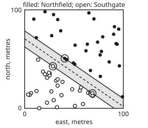
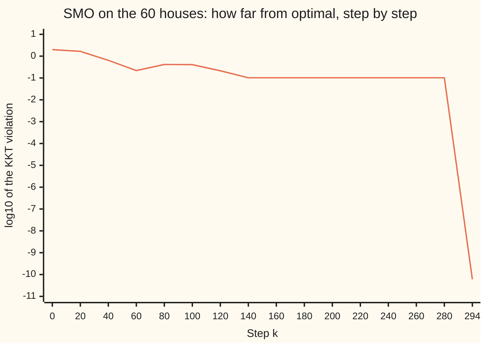

# Support vector machines: the widest gap as a quadratic program

[Syllabus](../../../SYLLABUS.md) → [Optimization](../README.md) → [Conic, Quadratic and Stochastic Programs](../README.md#s06) → Support vector machines

---

## General Overview

A council has a survey map of a site 100 m by 100 m. On it stand 60 houses: 30 belong to the Northfield estate, up and to the right, and 30 to Southgate, down and to the left. The council wants one straight road between the two estates. Every house must stay on its own estate's side, no house may be knocked down, and the road should be as wide as possible.

Most straight lines between the estates leave a narrow road that brushes some house. The widest one is 13.39 m wide. Only three houses touch its two kerbs: one in Northfield and two in Southgate. Move any of the other 57 a little, keeping it off the road, and the road does not change.

A **support vector machine** (SVM) is this problem with labelled data points for houses: the road is its **street**, and the kerb houses are its **support vectors**. The applied wing introduced SVMs and kernels ([Support vector machines](../../14-Applied%20and%20computational/06-Machine%20Learning%20Mathematics/09-kernels-and-support-vector-machines.md)). This card does the optimisation. It writes the widest road as a quadratic program (a bowl-shaped cost under straight-line limits) that **minimises** the squared length of a vector, which maximises the width: 3 unknowns, 60 limits. Its dual (a second problem whose every answer is a floor under the road's cost) has one price per house, and 57 of the 60 prices come out exactly zero. The houses are simulated from a fixed seed, so every number can be checked.

**The widest road is the shortest vector w that puts every house at least one unit of score from the centre line, a quadratic program whose dual gives each house a price, and only the houses on the kerbs get a price above zero.**

**What kind of fact this is:** a model, since a straight road is a choice and not a law; inside it, two theorems proved on this card in Why it works (the dual bounds the road, and a zero gap forces every house off the kerb to have price zero), plus one stated with its source (for a quadratic program the gap closes).

### The picture: 60 houses and the widest road

<p align="center"></p>

Across is metres east, up is metres north. The shaded strip is the widest straight road. Its north kerb runs from (0, 78.61) to (100, 9.86), its centre line from (0, 70.49) to (100, 1.74), and its south kerb from (0, 62.36) to (100, −6.39), leaving the site at the bottom edge. The ringed houses are numbers 10 at (40.6, 50.7) in Northfield, and 57 at (28.6, 42.7) and 34 at (68.6, 15.2) in Southgate.

---

## The formula

Number the houses $i = 1, \dots, 60$. House $i$ stands at $x_i$, a point (east, north) in metres, and carries a label $y_i$: $+1$ for Northfield, $-1$ for Southgate. A road is described by a vector $w$ and a number $b$. The **score** of a spot $x$ is $w^T x + b$: zero on the centre line, $+1$ on the north kerb, $-1$ on the south kerb. Here $x$ is data. The unknowns are $w$ and $b$.

$$\begin{aligned} \min_{w,\,b}\quad & \tfrac12\lVert w\rVert^2 \\ \text{subject to}\quad & y_i\,(w^T x_i + b) \ge 1, \quad i = 1, \dots, 60. \end{aligned}$$

**Read it aloud:** make the vector $w$ as short as possible, while every house scores at least $+1$ if it is in Northfield and at most $-1$ if it is in Southgate.

The road's width is $2/\lVert w\rVert$, so the shortest $w$ is the widest road. With the unknowns stacked as $(w_1, w_2, b)$, this is the shelf's quadratic program $\tfrac12 z^T Q z + c^T z$ with $Q = \text{diag}(1, 1, 0)$ and $c = 0$ ([Quadratic programs](01-quadratic-programs-and-markowitz.md)). The zero in $Q$ says that sliding the road sideways costs nothing, so $Q$ is only positive semidefinite, $Q \succeq 0$. The problem is still convex.

Give house $i$ a price $\lambda_i \ge 0$ on its limit. The **dual**, built in Why it works, is another quadratic program, in the 60 prices:

$$\begin{aligned} \max_{\lambda}\quad & q(\lambda) = \sum_{i=1}^{60} \lambda_i - \tfrac12 \sum_{i=1}^{60}\sum_{j=1}^{60} \lambda_i \lambda_j\, y_i y_j\, x_i^T x_j \\ \text{subject to}\quad & \lambda_i \ge 0, \qquad \sum_{i=1}^{60} \lambda_i y_i = 0, \end{aligned}$$

and the road comes back from the prices as $w = \sum_i \lambda_i y_i x_i$.

**Read it aloud:** price the houses so both estates' prices total the same, and make the prices' sum minus half the squared length of $w$ as large as possible.

| Symbol | Plain meaning | In our example | Push it up and the answer… |
| --- | --- | --- | --- |
| $x_i$, $y_i$ | house $i$'s position (east, north) in metres, and its label: $+1$ Northfield, $-1$ Southgate | house 10: (40.6, 50.7), $+1$ | — |
| $n$ | the number of houses | 60 | more limits, never a wider road |
| $w$ | the road's direction vector: it points across the road, and its entries are score per metre | (0.084615, 0.123077) | a longer $w$ means a narrower road |
| $b$ | the offset: slides the road sideways without turning it | −8.675385 | the road shifts south-west |
| $s_i$ | house $i$'s clearance score, $y_i(w^T x_i + b)$; at least 1 means clear of the road | 1 for the three kerb houses | — |
| $\lVert w\rVert$, $2/\lVert w\rVert$ | the length of $w$ (per metre), and the road's width (metres) | 0.149358 and 13.3907 m | — |
| $\lambda_i$ | house $i$'s price: how hard its limit pushes on the road | 0.011154, 0.001231, 0.009923, and 57 zeros | — |
| $\mathcal{L}$, $q(\lambda)$ | the Lagrangian (cost minus priced limits) and the dual function | — | — |
| $p^\star$, $d^\star$ | the best primal value and the best dual value | both 0.011153846 | — |
| $Q$, $c$, $z$ | the shelf's QP form: matrix, linear term, unknowns $(w_1, w_2, b)$ | diag(1, 1, 0), 0 | — |
| $\Lambda$, $D$ | Step 4: the price total on each estate, and the distance between the two hulls' nearest points | 0.011154 and 13.3907 m | a larger $D$ means a wider road |
| $k$, $C$ | the solver's step count; the price per metre of trespass in the soft-margin version | 294 steps; $C$ = 1, 10, 100 | larger $C$ trusts every label more |

### When it holds

- **The two estates can be split by a straight line.** Move one Southgate house into Northfield and no road clears every house: all 27,000 candidate roads fail, and the dual's value climbs without limit. The soft margin, with price $C$, is the fix (What breaks).
- **Both coordinates in the same unit.** Width is ordinary length; with one axis in kilometres, "widest" would mean something else.
- **A straight road is wanted.** A curved one needs a kernel, which slots into the dual because it uses houses only through $x_i^T x_j$.
- **At least one house on each side.** With no Southgate house, every limit can be met with $w = 0$, and the "road" is infinitely wide.

---

## Why it works

### Step 0: fix the scale, and width becomes length

Doubling $w$ and $b$ draws the same centre line. So pick the scale where the nearest houses score exactly $\pm 1$. Then each kerb is the line where the score is $+1$ or $-1$.

The distance from a point to the line $w^T x + b = 0$ is $|w^T x + b| / \lVert w\rVert$ ([Lines and planes](../../05-Geometry%20and%20trig/05-Vectors%20in%20Space/02-lines-and-planes-in-space.md) proves it for a plane in space, and the same proof works for a line on a flat map). Each kerb is therefore $1/\lVert w\rVert$ from the centre, and the road is $2/\lVert w\rVert$ wide. A wider road is a shorter $w$.

Minimising $\tfrac12\lVert w\rVert^2$ instead of $2/\lVert w\rVert$ gives the same road and a smooth bowl. Each limit $y_i(w^T x_i + b) \ge 1$ is a straight-line limit on $(w, b)$. A bowl under straight-line limits is a convex quadratic program, and because $\lVert w\rVert^2$ is strictly convex in $w$, the best $w$ is unique.

### Step 1: price every limit, and the dual appears

Charge $\lambda_i \ge 0$ for each unit by which house $i$ falls short of a score of 1. The Lagrangian is the cost minus the priced limits:

$$\mathcal{L}(w, b, \lambda) = \tfrac12\lVert w\rVert^2 - \sum_i \lambda_i\,\bigl(y_i(w^T x_i + b) - 1\bigr).$$

The dual function $q(\lambda)$ is the smallest $\mathcal{L}$ can be made by choosing $w$ and $b$ freely, with the prices held fixed.

- **In $w$:** $\mathcal{L}$ is a bowl, so set its gradient to zero: $w - \sum_i \lambda_i y_i x_i = 0$. The best road direction is a price-weighted sum of the houses.
- **In $b$:** $\mathcal{L}$ is a straight line in $b$ with slope $-\sum_i \lambda_i y_i$. Unless that slope is zero, $b$ can drive $\mathcal{L}$ to $-\infty$. So a useful price list must give the two estates equal totals: $\sum_i \lambda_i y_i = 0$.

Put $w = \sum_i \lambda_i y_i x_i$ back in. The $b$ term is gone, and what is left is the $q(\lambda)$ in The formula. Maximising the Lagrangian over the prices while its slope in $w$ and $b$ is held at zero is Wolfe's general form of a dual, so this problem in the prices is also called the **Wolfe dual**.

### Step 2: every price list gives a floor (weak duality)

Take any road $(w, b)$ that clears every house, and any prices with $\lambda \ge 0$ and $\sum_i \lambda_i y_i = 0$. Each priced limit $\lambda_i(s_i - 1)$ is at least zero, so $\mathcal{L} \le \tfrac12\lVert w\rVert^2$. And $q(\lambda)$ is the smallest $\mathcal{L}$ can be. So

$$q(\lambda) \le \tfrac12\lVert w\rVert^2.$$

Any price list is a floor under every road. If one price list's floor equals one road's cost, nothing can beat that road. That is the certificate the code prints: $p^\star = d^\star = 0.011153846$.

### Step 3: a zero gap forces prices off the kerb to zero

When $w$ is built from the prices, the gap between the two problems is a sum of terms that cannot be negative:

$$\tfrac12\lVert w\rVert^2 - q(\lambda) = \sum_i \lambda_i\,(s_i - 1).$$

Each term is a price, at least zero, times a clearance surplus, at least zero. A zero total therefore needs every term to be zero. Any house with surplus, standing off its kerb, must have price $\lambda_i = 0$. This is **complementary slackness**, one of the KKT conditions (the optimality conditions for problems with limits). It is how support vectors are read off the multipliers: the houses with $\lambda_i > 0$ are on a kerb.

<details>
<summary>Detailed proof: the gap identity</summary>

With $w = \sum_i \lambda_i y_i x_i$, the dual function is $q(\lambda) = \sum_i \lambda_i - \tfrac12\lVert w\rVert^2$, because $\lVert w\rVert^2 = \sum_i\sum_j \lambda_i\lambda_j y_i y_j x_i^T x_j$. So

$$\tfrac12\lVert w\rVert^2 - q(\lambda) = \lVert w\rVert^2 - \sum_i \lambda_i = \sum_i \lambda_i y_i\, w^T x_i - \sum_i \lambda_i.$$

The middle step writes $\lVert w\rVert^2 = w^T w = \sum_i \lambda_i y_i\, w^T x_i$. Add $b\sum_i \lambda_i y_i$, which is zero:

$$= \sum_i \lambda_i\bigl(y_i(w^T x_i + b) - 1\bigr) = \sum_i \lambda_i (s_i - 1).$$

If the road clears every house, each $s_i - 1 \ge 0$, and each $\lambda_i \ge 0$, so every term is at least zero.

</details>

The converse direction, that a zero-gap pair always exists, is **strong duality**. This card states it without proof: for a convex quadratic program whose straight-line limits can all be met, $d^\star = p^\star$ and the best prices exist (Boyd and Vandenberghe, sections 5.2.3 and 5.5, in Sources). The general theorem, strong duality under Slater's condition, is on [Lagrangian duality](../03-Constrained%20Optimisation/04-lagrangian-duality-weak-and-strong.md). Here the code exhibits the pair, which is all the certificate needs.

At the answer, Northfield's prices total the same as Southgate's, 0.011154 = 0.001231 + 0.009923, and all prices sum to $\lVert w\rVert^2$ = 0.022308, because the gap is zero.

### Step 4: the dual is the nearest-points problem

Divide each estate's prices by its total, 0.011154. Then $w$ is that total times the gap between two weighted averages: a point inside Northfield's **convex hull** (the smallest convex region holding all its houses) and a point inside Southgate's. Call the price total on each estate $\Lambda$ and the distance between the two averaged points $D$. Then $\sum_i \lambda_i = 2\Lambda$ and $\lVert w\rVert = \Lambda D$, so $q = 2\Lambda - \tfrac12 \Lambda^2 D^2$. For a fixed $D$ the best total is $\Lambda = 2/D^2$, which makes $q = 2/D^2$. Maximising $q$ therefore means making $D$ as small as possible: pick the two nearest points of the hulls. Then $\lVert w\rVert = 2/D$, so the road's width is exactly $D$. Boyd and Vandenberghe (section 8.6, in Sources) give this nearest-points reading of the dual.

For these houses the nearest Northfield point is house 10 itself, (40.60, 50.70). The nearest Southgate point is (33.01, 39.67), a mix of 0.8897 of house 57 and 0.1103 of house 34, lying on the edge between them. The two points are 13.3907 m apart, which is the width again. The price ratio 0.009923 : 0.001231 is that 0.8897 : 0.1103 mix.

### Step 5: the method, and how fast it gets there

The code solves the dual by **sequential minimal optimisation** (SMO): change two prices at a time. Moving a single price would break $\sum_i \lambda_i y_i = 0$, but two prices moved together can keep it. Each step picks the pair whose prices most want to move, measured by the KKT violation (how far the worst pair is from satisfying the optimality conditions). It moves them the exact best distance along their line, stopping at zero if a price would go negative.

Iterations count from $k = 0$ with every $\lambda_i = 0$. The stopping test is violation below $10^{-9}$. This run stops at $k = 294$.



The one line is the log of the violation. It falls quickly, then stalls for about 150 steps while the solver shuttles price back and forth between the same few houses. The violation zigzags up and down on alternate steps there, and every charted point, one every 20 steps, lands on the low side at −0.99, so the chart draws the stall as flat. Then the right three are found, and it drops to −10.22 within a few steps. SMO is proved to stop for any positive tolerance (Keerthi and Gilbert, in Sources). No rate is proved for it here, and this card claims none: the evidence that the answer is optimal is the certificate in Step 2, not the step count.

---

## Worked numbers, by hand

Take the three kerb houses from the picture and check the road from them alone. Two of them, 57 and 34, sit on the south kerb, so that kerb runs along the line through them.

| Step | Arithmetic | Value |
| --- | --- | --- |
| south kerb direction, 57 to 34 | (68.6 − 28.6, 15.2 − 42.7) | (40.0, −27.5) |
| turn it square, divide by 2.5 | (27.5, 40.0) / 2.5 | (11, 16) |
| from house 57 to house 10 | (40.6 − 28.6, 50.7 − 42.7) | (12.0, 8.0) |
| length of (11, 16) | $\sqrt{121 + 256} = \sqrt{377}$ | 19.4165 |
| climb from kerb to kerb along (11, 16) | (11 × 12.0 + 16 × 8.0) / 19.4165 | **13.3907 m** |
| length of $w$ | 2 / 13.3907 | 0.149358 |
| $w$, pointing along (11, 16) | 0.149358 × (11, 16) / 19.4165 | (0.084615, 0.123077) |
| $b$, so house 10 scores +1 | 1 − (0.084615 × 40.6 + 0.123077 × 50.7) | −8.675385 |
| total price on each estate | $\lVert w\rVert^2 / 2$ = 0.022308 / 2 | 0.011154 |
| foot of the square from house 10 onto the south kerb, as a share of the way from 57 to 34 | (12.0 × 40.0 + 8.0 × (−27.5)) / (40.0² + 27.5²) | 0.1103: the nearest Southgate point is 0.8897 of house 57 and 0.1103 of house 34 |
| split of Southgate's total | 0.8897 and 0.1103 of 0.011154 | 0.009923 and 0.001231 |
| check: Northfield total = Southgate total | 0.001231 + 0.009923 | 0.011154 |

The widest straight road is 13.39 m. Three houses fix it. Nothing on the site allows a wider one, and the dual prices prove it.

A house whose estate record is lost stands at (60.0, 45.0). Its score is 1.9400, positive, so it falls on Northfield's side, 12.99 m from the centre line. That is the SVM used as a classifier.

### What breaks if you drop a piece

| Mistake | Comes out at | What went wrong |
| --- | --- | --- |
| Keep the hard limits after one Southgate house is moved to (60.0, 45.0) | 0 of 27,000 roads clear every house; soft-margin dual value 2.9116, 29.0163, 290.0636 at $C$ = 1, 10, 100 | The hypothesis that a line splits the estates fails. The primal has no feasible point, and the dual grows without limit as the trespass price rises |
| Read the width as $1/\lVert w\rVert$ | 6.6953 m | That is centre line to kerb, half the road |
| Draw the road square to the line joining the two estates' average positions, through their midpoint | 4.5548 m wide | Averages use all 60 houses; the widest road depends only on the nearest ones |
| Take $b$ from house 0, which has price zero | $b$ = −12.0485; 10 houses on the wrong side | $b = y_i - w^T x_i$ holds only for a house on a kerb |

---

## Code, from first principles, and it actually runs

Both programs build the same 60 houses from a SplitMix64 generator written out, seed 2026: positions rounded down to 10 cm, each at least 4 m from the surveyor's line $3x + 4y = 300$. Three independent roads reach the answer. **The method:** the dual solved by SMO. **Enumeration:** every road with one house on each kerb, or two on one kerb and one on the other, 27,000 in all, each checked against all 60 houses; the best road always has this form. **The certificate:** primal and dual values, feasibility, $\sum_i \lambda_i y_i$, complementary slackness and the distance between the hulls. No optimisation or linear-algebra library is imported.

### Python

```python
# Support vector machines as a quadratic program -- the check behind the card.
# Standard library only.  Three roads to the widest road between two estates:
# (1) the dual QP solved by SMO, written out; (2) every pair and triple of
# houses that could sit on the kerbs, listed; (3) the KKT certificate.
from math import sqrt, log10, floor
M64 = (1 << 64) - 1
class Rng:                                       # SplitMix64, seed 2026
    def __init__(self, seed): self.s = seed
    def u(self):
        self.s = (self.s + 0x9E3779B97F4A7C15) & M64
        z = self.s
        z = ((z ^ (z >> 30)) * 0xBF58476D1CE4E5B9) & M64
        z = ((z ^ (z >> 27)) * 0x94D049BB133111EB) & M64
        return ((z ^ (z >> 31)) >> 11) / 9007199254740992.0
def houses(seed):                                # 30 Northfield (+1), then 30 Southgate (-1), in metres
    r, P, N = Rng(seed), [], []
    while len(P) < 30 or len(N) < 30:
        a = floor(1000 * r.u()) / 10; b = floor(1000 * r.u()) / 10   # to 10 cm
        d = (3 * a + 4 * b - 300) / 5            # metres from the surveyor's line 3x + 4y = 300
        if d >= 4 and len(P) < 30: P.append((a, b))
        elif d <= -4 and len(N) < 30: N.append((a, b))
    return P + N, [1] * 30 + [-1] * 30
def dot(p, q): return p[0] * q[0] + p[1] * q[1]
def tot(v):                                      # plain left-to-right sum, as in Rust
    t = 0.0
    for a in v: t += a
    return t
def sci(x):                                      # 1.62e-12, printed the same way in Rust
    if x == 0: return "0"
    e = floor(log10(abs(x))); m = x / 10.0 ** e
    return f"{m:.2f}e{e}"
def smo(X, y, C=float("inf"), tol=1e-9):        # minimise 1/2 lam'Q lam - sum lam, Q_ij = y_i y_j x_i.x_j
    n = len(X); K = [[dot(p, q) for q in X] for p in X]
    lam, G, k, viol = [0.0] * n, [-1.0] * n, 0, []   # G = Q lam - 1, the slope, kept up to date
    while True:
        assert k < 10_000_000, "SMO must stop"   # a broken update fails here instead of looping for ever
        up = [t for t in range(n) if (y[t] > 0 and lam[t] < C) or (y[t] < 0 and lam[t] > 0)]
        dn = [t for t in range(n) if (y[t] < 0 and lam[t] < C) or (y[t] > 0 and lam[t] > 0)]
        i = max(up, key=lambda t: -y[t] * G[t]); j = min(dn, key=lambda t: -y[t] * G[t])
        v = -y[i] * G[i] + y[j] * G[j]           # how far the worst pair breaks the KKT conditions
        viol.append(v)
        if v < tol: break                        # stopping test
        t = v / (K[i][i] + K[j][j] - 2 * K[i][j])            # exact step along the pair's line
        t = min(t, C - lam[i] if y[i] > 0 else lam[i], lam[j] if y[j] > 0 else C - lam[j])
        lam[i] += y[i] * t; lam[j] -= y[j] * t
        for m in range(n): G[m] += y[m] * t * (K[m][i] - K[m][j])
        k += 1
    w = (tot(lam[m] * y[m] * X[m][0] for m in range(n)), tot(lam[m] * y[m] * X[m][1] for m in range(n)))
    sv = [m for m in range(n) if lam[m] > 1e-8]
    b = tot(y[m] - dot(w, X[m]) for m in sv) / len(sv)
    return lam, w, b, k, viol, sv
def enumerate_kerbs(X, y):                       # every road with 2 or 3 houses on its kerbs
    n, best, cands, feas = len(X), None, 0, 0
    def try_road(w, b):
        nonlocal best, cands, feas
        cands += 1
        if w is None: return
        if min(y[m] * (dot(w, X[m]) + b) for m in range(n)) < 1 - 1e-9: return
        feas += 1
        if best is None or dot(w, w) < dot(best[0], best[0]): best = (w, b)
    for p in range(n):
        for q in range(n):
            if y[p] > 0 > y[q]:                  # one house on each kerb, road square to p - q
                d = (X[p][0] - X[q][0], X[p][1] - X[q][1]); s = 2 / dot(d, d)
                w = (s * d[0], s * d[1]); try_road(w, -dot(w, X[p]) + 1)
    for p in range(n):
        for r in range(p + 1, n):
            if y[p] != y[r]: continue
            nrm = (X[p][1] - X[r][1], X[r][0] - X[p][0])     # square to the kerb through p and r
            for q in range(n):
                if y[q] == y[p]: continue
                den = y[p] * (dot(nrm, X[p]) - dot(nrm, X[q]))
                if abs(den) < 1e-12: try_road(None, 0); continue        # p, r, q in a line: no road
                w = (2 * nrm[0] / den, 2 * nrm[1] / den); try_road(w, y[p] - dot(w, X[p]))
    return best, cands, feas
def width(X, y, w, b):                           # twice the smallest signed clearance, in metres
    return 2 * min(y[m] * (dot(w, X[m]) + b) for m in range(len(X))) / sqrt(dot(w, w))
X, y = houses(2026); n = len(X)
lam, w, b, k, viol, sv = smo(X, y)
nw = sqrt(dot(w, w)); s = [y[m] * (dot(w, X[m]) + b) for m in range(n)]
print("houses: 30 Northfield (+1), 30 Southgate (-1), seed 2026")
print(f"road 1, dual by SMO: {k} steps from lam = 0, stop when violation < 1e-9")
print(f"  w = ({w[0]:.6f}, {w[1]:.6f})   b = {b:.6f}   width 2/|w| = {2 / nw:.4f} m")
for m in sv:
    print(f"  support vector {m:2d} at ({X[m][0]:4.1f}, {X[m][1]:4.1f}), y = {y[m]:+d}, lam = {lam[m]:.6f}")
print(f"  houses with lam > 1e-8: {len(sv)} of {n}; sum of lam = {tot(lam):.6f}, |w|^2 = {nw * nw:.6f}")
print("  log10 violation at k = 0, 20, .., 280, " + str(k) + ": " + " ".join(f"{log10(v):.2f}" for v in viol[::20] + [viol[-1]]))
(we, be), cands, feas = enumerate_kerbs(X, y)
dk = (X[34][0] - X[57][0], X[34][1] - X[57][1]); up = (X[10][0] - X[57][0], X[10][1] - X[57][1])
cl = (11 * up[0] + 16 * up[1]) / sqrt(377)      # by hand: the climb from kerb to kerb along (11, 16)
print(f"by hand: kerb 57 to 34 = ({dk[0]:.1f}, {dk[1]:.1f}), 57 to 10 = ({up[0]:.1f}, {up[1]:.1f}), sqrt(377) = {sqrt(377):.4f}, width {cl:.4f} m, 2/width = {2 / cl:.6f}")
print(f"road 2, every kerb pair and triple: {cands} roads tried, {feas} clear every house")
print(f"  best: w = ({we[0]:.6f}, {we[1]:.6f})   b = {be:.6f}   width {2 / sqrt(dot(we, we)):.4f} m")
p_val, d_val = 0.5 * nw * nw, tot(lam) - 0.5 * nw * nw
print("road 3, the KKT certificate:")
print(f"  p* = 1/2|w|^2 = {p_val:.9f}   d* = q(lam) = {d_val:.9f}   |gap| {sci(abs(p_val - d_val))}")
print(f"  smallest y_i(w.x_i + b) - 1 = {sci(min(s) - 1)}   smallest lam = {sci(min(lam))}")
print(f"  |sum lam_i y_i| = {sci(abs(tot(lam[m] * y[m] for m in range(n))))}   largest lam_i(s_i - 1) = {sci(max(lam[m] * (s[m] - 1) for m in range(n)))}")
L = tot(lam) / 2                                 # the dual's picture: nearest points of the two hulls
pn = [tot(lam[m] * X[m][c] for m in range(n) if y[m] > 0) / L for c in (0, 1)]
ps = [tot(lam[m] * X[m][c] for m in range(n) if y[m] < 0) / L for c in (0, 1)]
gapd = sqrt((pn[0] - ps[0]) ** 2 + (pn[1] - ps[1]) ** 2)
print(f"  nearest points of the hulls ({pn[0]:.2f}, {pn[1]:.2f}) and ({ps[0]:.2f}, {ps[1]:.2f}), {gapd:.4f} m apart")
print(f"  Southgate's nearest point = {lam[57] / L:.4f} of house 57 + {lam[34] / L:.4f} of house 34")
print(f"  house 13 at ({X[13][0]:.1f}, {X[13][1]:.1f}): lam = {sci(lam[13])}, {(s[13] - 1) / nw:.4f} m outside the kerb")
new = (60.0, 45.0); sc = dot(w, new) + b
print(f"lost record at (60.0, 45.0): score {sc:.4f}, {sc / nw:.2f} m from the centre line: " + ("Northfield" if sc > 0 else "Southgate"))
print("what breaks:")
print(f"  width read as 1/|w|: {1 / nw:.4f} m")
cn = [tot(X[m][c] for m in range(30)) / 30 for c in (0, 1)]; cs = [tot(X[m][c] for m in range(30, 60)) / 30 for c in (0, 1)]
wa = (cn[0] - cs[0], cn[1] - cs[1]); ba = -dot(wa, ((cn[0] + cs[0]) / 2, (cn[1] + cs[1]) / 2))
cut = sum(1 for m in range(n) if y[m] * (dot(wa, X[m]) + ba) < 0)
print(f"  road through the estates' averages: width {width(X, y, wa, ba):.4f} m, {cut} houses on the wrong side")
bw = y[0] - dot(w, X[0])
cutb = sum(1 for m in range(n) if y[m] * (dot(w, X[m]) + bw) < 0)
print(f"  b taken from house 0 (lam = 0): b = {bw:.4f}, {cutb} houses on the wrong side")
Xb = X[:]; Xb[30] = (60.0, 45.0)                 # one Southgate house moved into Northfield
_, cb, fb = enumerate_kerbs(Xb, y)
print(f"  one Southgate house moved to (60.0, 45.0): {fb} of {cb} roads clear every house")
for C in (1.0, 10.0, 100.0):
    lc, wc, bc, kc, _, _ = smo(Xb, y, C)
    print(f"    soft margin C = {C:5.0f}: dual value {tot(lc) - 0.5 * dot(wc, wc):.4f} after {kc} steps")
for m, spot in ((13, (42.0, 49.0)), (0, (0.0, 100.0))):           # try changing: move one house
    Xt = X[:]; Xt[m] = spot; lt, wt, _, kt, _, st = smo(Xt, y)
    print(f"try: house {m} moved to ({spot[0]:.1f}, {spot[1]:.1f}): width {2 / sqrt(dot(wt, wt)):.4f} m, support vectors {st}, {kt} steps")
assert len(sv) == 3 and abs(2 / nw - 2 / sqrt(dot(we, we))) < 1e-6        # roads 1 and 2 agree
assert abs(w[0] - we[0]) < 1e-6 and abs(w[1] - we[1]) < 1e-6 and abs(b - be) < 1e-5
assert abs(p_val - d_val) < 1e-9 and min(s) > 1 - 1e-7                     # certificate
assert abs(gapd - 2 / nw) < 1e-6 and abs(cl - 2 / nw) < 1e-9 and abs(tot(lam) - nw * nw) < 1e-9        # hull distance, sum lam
assert fb == 0 and width(X, y, wa, ba) < 2 / nw and cutb > 0 and lam[13] < 1e-12 < s[13] - 1
print("figure, kerb +1, centre, kerb -1 at x = 0 and 100: " + " ".join(f"{(c - b - w[0] * xx) / w[1]:.2f}" for c in (1, 0, -1) for xx in (0, 100)))
print("ALL CHECKS PASS")
```

**Ran 2026-11-11 on macOS, Python 3.14.10, standard library only. All checks passed. Output, pasted from the run:**

```
houses: 30 Northfield (+1), 30 Southgate (-1), seed 2026
road 1, dual by SMO: 294 steps from lam = 0, stop when violation < 1e-9
  w = (0.084615, 0.123077)   b = -8.675385   width 2/|w| = 13.3907 m
  support vector 10 at (40.6, 50.7), y = +1, lam = 0.011154
  support vector 34 at (68.6, 15.2), y = -1, lam = 0.001231
  support vector 57 at (28.6, 42.7), y = -1, lam = 0.009923
  houses with lam > 1e-8: 3 of 60; sum of lam = 0.022308, |w|^2 = 0.022308
  log10 violation at k = 0, 20, .., 280, 294: 0.30 0.22 -0.19 -0.66 -0.38 -0.39 -0.67 -0.99 -0.99 -0.99 -0.99 -0.99 -0.99 -0.99 -0.99 -10.22
by hand: kerb 57 to 34 = (40.0, -27.5), 57 to 10 = (12.0, 8.0), sqrt(377) = 19.4165, width 13.3907 m, 2/width = 0.149358
road 2, every kerb pair and triple: 27000 roads tried, 4 clear every house
  best: w = (0.084615, 0.123077)   b = -8.675385   width 13.3907 m
road 3, the KKT certificate:
  p* = 1/2|w|^2 = 0.011153846   d* = q(lam) = 0.011153846   |gap| 6.05e-13
  smallest y_i(w.x_i + b) - 1 = -4.06e-11   smallest lam = 0
  |sum lam_i y_i| = 3.47e-18   largest lam_i(s_i - 1) = 2.50e-14
  nearest points of the hulls (40.60, 50.70) and (33.01, 39.67), 13.3907 m apart
  Southgate's nearest point = 0.8897 of house 57 + 0.1103 of house 34
  house 13 at (42.6, 49.5): lam = 0, 0.1442 m outside the kerb
lost record at (60.0, 45.0): score 1.9400, 12.99 m from the centre line: Northfield
what breaks:
  width read as 1/|w|: 6.6953 m
  road through the estates' averages: width 4.5548 m, 0 houses on the wrong side
  b taken from house 0 (lam = 0): b = -12.0485, 10 houses on the wrong side
  one Southgate house moved to (60.0, 45.0): 0 of 27000 roads clear every house
    soft margin C =     1: dual value 2.9116 after 7682 steps
    soft margin C =    10: dual value 29.0163 after 72247 steps
    soft margin C =   100: dual value 290.0636 after 715766 steps
try: house 13 moved to (42.0, 49.0): width 12.7830 m, support vectors [13, 34, 57], 152 steps
try: house 0 moved to (0.0, 100.0): width 13.3907 m, support vectors [10, 34, 57], 171 steps
figure, kerb +1, centre, kerb -1 at x = 0 and 100: 78.61 9.86 70.49 1.74 62.36 -6.39
ALL CHECKS PASS
```

### Rust

```rust
// Support vector machines as a quadratic program -- the check behind the card.
// std only.  Three roads to the widest road between two estates:
// (1) the dual QP solved by SMO, written out; (2) every pair and triple of
// houses that could sit on the kerbs, listed; (3) the KKT certificate.
type P = (f64, f64);
struct Rng { s: u64 }                            // SplitMix64, seed 2026
impl Rng {
    fn u(&mut self) -> f64 {
        self.s = self.s.wrapping_add(0x9E3779B97F4A7C15);
        let mut z = self.s;
        z = (z ^ (z >> 30)).wrapping_mul(0xBF58476D1CE4E5B9);
        z = (z ^ (z >> 27)).wrapping_mul(0x94D049BB133111EB);
        ((z ^ (z >> 31)) >> 11) as f64 / 9007199254740992.0
    }
}
fn houses(seed: u64) -> (Vec<P>, Vec<f64>) {    // 30 Northfield (+1), then 30 Southgate (-1), in metres
    let (mut r, mut pn, mut ps) = (Rng { s: seed }, vec![], vec![]);
    while pn.len() < 30 || ps.len() < 30 {
        let a = (1000.0 * r.u()).floor() / 10.0; let b = (1000.0 * r.u()).floor() / 10.0;   // to 10 cm
        let d = (3.0 * a + 4.0 * b - 300.0) / 5.0;   // metres from the surveyor's line 3x + 4y = 300
        if d >= 4.0 && pn.len() < 30 { pn.push((a, b)); } else if d <= -4.0 && ps.len() < 30 { ps.push((a, b)); }
    }
    pn.extend(ps);
    (pn, (0..60).map(|m| if m < 30 { 1.0 } else { -1.0 }).collect())
}
fn dot(p: P, q: P) -> f64 { p.0 * q.0 + p.1 * q.1 }
fn tot<I: Iterator<Item = f64>>(v: I) -> f64 { let mut t = 0.0; for a in v { t += a; } t }
fn sci(x: f64) -> String {                       // 1.62e-12, printed the same way in Python
    if x == 0.0 { return "0".to_string(); }
    let e = x.abs().log10().floor(); format!("{:.2}e{}", x / 10f64.powf(e), e as i64)
}
struct Fit { lam: Vec<f64>, w: P, b: f64, k: usize, viol: Vec<f64>, sv: Vec<usize> }
fn smo(x: &[P], y: &[f64], c: f64) -> Fit {      // minimise 1/2 lam'Q lam - sum lam, Q_ij = y_i y_j x_i.x_j
    let n = x.len();
    let kk: Vec<Vec<f64>> = x.iter().map(|&p| x.iter().map(|&q| dot(p, q)).collect()).collect();
    let (mut lam, mut g, mut k, mut viol) = (vec![0.0; n], vec![-1.0; n], 0, vec![]);
    loop {
        assert!(k < 10_000_000, "SMO must stop");   // a broken update fails here instead of looping for ever
        let (mut i, mut j) = (n, n);
        for t in 0..n {
            let s = -y[t] * g[t];
            if ((y[t] > 0.0 && lam[t] < c) || (y[t] < 0.0 && lam[t] > 0.0)) && (i == n || s > -y[i] * g[i]) { i = t; }
            if ((y[t] < 0.0 && lam[t] < c) || (y[t] > 0.0 && lam[t] > 0.0)) && (j == n || s < -y[j] * g[j]) { j = t; }
        }
        let v = -y[i] * g[i] + y[j] * g[j];      // how far the worst pair breaks the KKT conditions
        viol.push(v);
        if v < 1e-9 { break; }                   // stopping test
        let mut t = v / (kk[i][i] + kk[j][j] - 2.0 * kk[i][j]);   // exact step along the pair's line
        t = t.min(if y[i] > 0.0 { c - lam[i] } else { lam[i] }).min(if y[j] > 0.0 { lam[j] } else { c - lam[j] });
        lam[i] += y[i] * t; lam[j] -= y[j] * t;
        for m in 0..n { g[m] += y[m] * t * (kk[m][i] - kk[m][j]); }
        k += 1;
    }
    let w = (tot((0..n).map(|m| lam[m] * y[m] * x[m].0)), tot((0..n).map(|m| lam[m] * y[m] * x[m].1)));
    let sv: Vec<usize> = (0..n).filter(|&m| lam[m] > 1e-8).collect();
    let b = tot(sv.iter().map(|&m| y[m] - dot(w, x[m]))) / sv.len() as f64;
    Fit { lam, w, b, k, viol, sv }
}
fn enumerate_kerbs(x: &[P], y: &[f64]) -> (Option<(P, f64)>, usize, usize) {   // every road with 2 or 3 houses on its kerbs
    let n = x.len();
    let (mut best, mut cands, mut feas): (Option<(P, f64)>, usize, usize) = (None, 0, 0);
    let mut try_road = |w: Option<P>, b: f64| {
        cands += 1;
        let Some(w) = w else { return };
        if (0..n).map(|m| y[m] * (dot(w, x[m]) + b)).fold(f64::INFINITY, f64::min) < 1.0 - 1e-9 { return; }
        feas += 1;
        if best.map_or(true, |(bw, _)| dot(w, w) < dot(bw, bw)) { best = Some((w, b)); }
    };
    for p in 0..n {
        for q in 0..n {
            if y[p] > 0.0 && y[q] < 0.0 {        // one house on each kerb, road square to p - q
                let d = (x[p].0 - x[q].0, x[p].1 - x[q].1); let s = 2.0 / dot(d, d);
                let w = (s * d.0, s * d.1); try_road(Some(w), -dot(w, x[p]) + 1.0);
            }
        }
    }
    for p in 0..n {
        for r in p + 1..n {
            if y[p] != y[r] { continue; }
            let nrm = (x[p].1 - x[r].1, x[r].0 - x[p].0);   // square to the kerb through p and r
            for q in 0..n {
                if y[q] == y[p] { continue; }
                let den = y[p] * (dot(nrm, x[p]) - dot(nrm, x[q]));
                if den.abs() < 1e-12 { try_road(None, 0.0); continue; }   // p, r, q in a line: no road
                let w = (2.0 * nrm.0 / den, 2.0 * nrm.1 / den); try_road(Some(w), y[p] - dot(w, x[p]));
            }
        }
    }
    (best, cands, feas)
}
fn clear(x: &[P], y: &[f64], w: P, b: f64) -> Vec<f64> { (0..x.len()).map(|m| y[m] * (dot(w, x[m]) + b)).collect() }
fn lowest(v: &[f64]) -> f64 { v.iter().cloned().fold(f64::INFINITY, f64::min) }
fn main() {
    let (x, y) = houses(2026); let n = x.len();
    let f = smo(&x, &y, f64::INFINITY); let (lam, w, b) = (&f.lam, f.w, f.b);
    let nw = dot(w, w).sqrt(); let s = clear(&x, &y, w, b);
    println!("houses: 30 Northfield (+1), 30 Southgate (-1), seed 2026");
    println!("road 1, dual by SMO: {} steps from lam = 0, stop when violation < 1e-9", f.k);
    println!("  w = ({:.6}, {:.6})   b = {:.6}   width 2/|w| = {:.4} m", w.0, w.1, b, 2.0 / nw);
    for &m in &f.sv {
        println!("  support vector {:2} at ({:4.1}, {:4.1}), y = {:+}, lam = {:.6}", m, x[m].0, x[m].1, y[m] as i64, lam[m]);
    }
    let sl = tot(lam.iter().cloned());
    println!("  houses with lam > 1e-8: {} of {}; sum of lam = {:.6}, |w|^2 = {:.6}", f.sv.len(), n, sl, nw * nw);
    let mut hist: Vec<f64> = f.viol.iter().step_by(20).cloned().collect(); hist.push(*f.viol.last().unwrap());
    let hs: Vec<String> = hist.iter().map(|v| format!("{:.2}", v.log10())).collect();
    println!("  log10 violation at k = 0, 20, .., 280, {}: {}", f.k, hs.join(" "));
    let (best, cands, feas) = enumerate_kerbs(&x, &y); let (we, be) = best.unwrap();
    let dk = (x[34].0 - x[57].0, x[34].1 - x[57].1); let up = (x[10].0 - x[57].0, x[10].1 - x[57].1);
    let cl = (11.0 * up.0 + 16.0 * up.1) / 377f64.sqrt();   // by hand: the climb from kerb to kerb along (11, 16)
    println!("by hand: kerb 57 to 34 = ({:.1}, {:.1}), 57 to 10 = ({:.1}, {:.1}), sqrt(377) = {:.4}, width {:.4} m, 2/width = {:.6}", dk.0, dk.1, up.0, up.1, 377f64.sqrt(), cl, 2.0 / cl);
    println!("road 2, every kerb pair and triple: {} roads tried, {} clear every house", cands, feas);
    println!("  best: w = ({:.6}, {:.6})   b = {:.6}   width {:.4} m", we.0, we.1, be, 2.0 / dot(we, we).sqrt());
    let (p_val, d_val) = (0.5 * nw * nw, sl - 0.5 * nw * nw);
    println!("road 3, the KKT certificate:");
    println!("  p* = 1/2|w|^2 = {:.9}   d* = q(lam) = {:.9}   |gap| {}", p_val, d_val, sci((p_val - d_val).abs()));
    println!("  smallest y_i(w.x_i + b) - 1 = {}   smallest lam = {}", sci(lowest(&s) - 1.0), sci(lowest(lam)));
    let cs = (0..n).map(|m| lam[m] * (s[m] - 1.0)).fold(f64::NEG_INFINITY, f64::max);
    println!("  |sum lam_i y_i| = {}   largest lam_i(s_i - 1) = {}", sci(tot((0..n).map(|m| lam[m] * y[m])).abs()), sci(cs));
    let l = sl / 2.0;                            // the dual's picture: nearest points of the two hulls
    let side = |sg: f64, c: usize| tot((0..n).filter(|&m| y[m] * sg > 0.0).map(|m| lam[m] * if c == 0 { x[m].0 } else { x[m].1 })) / l;
    let (pn, ps) = ((side(1.0, 0), side(1.0, 1)), (side(-1.0, 0), side(-1.0, 1)));
    let gapd = ((pn.0 - ps.0).powi(2) + (pn.1 - ps.1).powi(2)).sqrt();
    println!("  nearest points of the hulls ({:.2}, {:.2}) and ({:.2}, {:.2}), {:.4} m apart", pn.0, pn.1, ps.0, ps.1, gapd);
    println!("  Southgate's nearest point = {:.4} of house 57 + {:.4} of house 34", lam[57] / l, lam[34] / l);
    println!("  house 13 at ({:.1}, {:.1}): lam = {}, {:.4} m outside the kerb", x[13].0, x[13].1, sci(lam[13]), (s[13] - 1.0) / nw);
    let sc = dot(w, (60.0, 45.0)) + b;
    println!("lost record at (60.0, 45.0): score {:.4}, {:.2} m from the centre line: {}", sc, sc / nw, if sc > 0.0 { "Northfield" } else { "Southgate" });
    println!("what breaks:");
    println!("  width read as 1/|w|: {:.4} m", 1.0 / nw);
    let mean = |r: std::ops::Range<usize>, c: usize| tot(r.map(|m| if c == 0 { x[m].0 } else { x[m].1 })) / 30.0;
    let (cn, cs2) = ((mean(0..30, 0), mean(0..30, 1)), (mean(30..60, 0), mean(30..60, 1)));
    let wa = (cn.0 - cs2.0, cn.1 - cs2.1); let ba = -dot(wa, ((cn.0 + cs2.0) / 2.0, (cn.1 + cs2.1) / 2.0));
    let sa = clear(&x, &y, wa, ba); let wida = 2.0 * lowest(&sa) / dot(wa, wa).sqrt();
    let cut = sa.iter().filter(|&&v| v < 0.0).count();
    println!("  road through the estates' averages: width {:.4} m, {} houses on the wrong side", wida, cut);
    let bw = y[0] - dot(w, x[0]);
    let cutb = clear(&x, &y, w, bw).iter().filter(|&&v| v < 0.0).count();
    println!("  b taken from house 0 (lam = 0): b = {:.4}, {} houses on the wrong side", bw, cutb);
    let mut xb = x.clone(); xb[30] = (60.0, 45.0);   // one Southgate house moved into Northfield
    let (_, cb, fb) = enumerate_kerbs(&xb, &y);
    println!("  one Southgate house moved to (60.0, 45.0): {} of {} roads clear every house", fb, cb);
    for c in [1.0, 10.0, 100.0] {
        let fc = smo(&xb, &y, c);
        println!("    soft margin C = {:5.0}: dual value {:.4} after {} steps", c, tot(fc.lam.iter().cloned()) - 0.5 * dot(fc.w, fc.w), fc.k);
    }
    for (m, spot) in [(13usize, (42.0, 49.0)), (0, (0.0, 100.0))] {   // try changing: move one house
        let mut xt = x.clone(); xt[m] = spot; let ft = smo(&xt, &y, f64::INFINITY);
        println!("try: house {} moved to ({:.1}, {:.1}): width {:.4} m, support vectors {:?}, {} steps", m, spot.0, spot.1, 2.0 / dot(ft.w, ft.w).sqrt(), ft.sv, ft.k);
    }
    assert!(f.sv.len() == 3 && (2.0 / nw - 2.0 / dot(we, we).sqrt()).abs() < 1e-6);   // roads 1 and 2 agree
    assert!((w.0 - we.0).abs() < 1e-6 && (w.1 - we.1).abs() < 1e-6 && (b - be).abs() < 1e-5);
    assert!((p_val - d_val).abs() < 1e-9 && lowest(&s) > 1.0 - 1e-7);                 // certificate
    assert!((gapd - 2.0 / nw).abs() < 1e-6 && (cl - 2.0 / nw).abs() < 1e-9 && (sl - nw * nw).abs() < 1e-9);            // hull distance, sum lam
    assert!(fb == 0 && wida < 2.0 / nw && cutb > 0 && lam[13] < 1e-12 && 1e-12 < s[13] - 1.0);
    let fig: Vec<String> = [1.0, 0.0, -1.0].iter().flat_map(|&c| [0.0, 100.0].map(|xx| format!("{:.2}", (c - b - w.0 * xx) / w.1))).collect();
    println!("figure, kerb +1, centre, kerb -1 at x = 0 and 100: {}", fig.join(" "));
    println!("ALL CHECKS PASS");
}
```

**Ran 2026-11-11 on macOS, rustc 1.98.1, no crates. All checks passed. Output, pasted from the run:**

```
houses: 30 Northfield (+1), 30 Southgate (-1), seed 2026
road 1, dual by SMO: 294 steps from lam = 0, stop when violation < 1e-9
  w = (0.084615, 0.123077)   b = -8.675385   width 2/|w| = 13.3907 m
  support vector 10 at (40.6, 50.7), y = +1, lam = 0.011154
  support vector 34 at (68.6, 15.2), y = -1, lam = 0.001231
  support vector 57 at (28.6, 42.7), y = -1, lam = 0.009923
  houses with lam > 1e-8: 3 of 60; sum of lam = 0.022308, |w|^2 = 0.022308
  log10 violation at k = 0, 20, .., 280, 294: 0.30 0.22 -0.19 -0.66 -0.38 -0.39 -0.67 -0.99 -0.99 -0.99 -0.99 -0.99 -0.99 -0.99 -0.99 -10.22
by hand: kerb 57 to 34 = (40.0, -27.5), 57 to 10 = (12.0, 8.0), sqrt(377) = 19.4165, width 13.3907 m, 2/width = 0.149358
road 2, every kerb pair and triple: 27000 roads tried, 4 clear every house
  best: w = (0.084615, 0.123077)   b = -8.675385   width 13.3907 m
road 3, the KKT certificate:
  p* = 1/2|w|^2 = 0.011153846   d* = q(lam) = 0.011153846   |gap| 6.05e-13
  smallest y_i(w.x_i + b) - 1 = -4.06e-11   smallest lam = 0
  |sum lam_i y_i| = 3.47e-18   largest lam_i(s_i - 1) = 2.50e-14
  nearest points of the hulls (40.60, 50.70) and (33.01, 39.67), 13.3907 m apart
  Southgate's nearest point = 0.8897 of house 57 + 0.1103 of house 34
  house 13 at (42.6, 49.5): lam = 0, 0.1442 m outside the kerb
lost record at (60.0, 45.0): score 1.9400, 12.99 m from the centre line: Northfield
what breaks:
  width read as 1/|w|: 6.6953 m
  road through the estates' averages: width 4.5548 m, 0 houses on the wrong side
  b taken from house 0 (lam = 0): b = -12.0485, 10 houses on the wrong side
  one Southgate house moved to (60.0, 45.0): 0 of 27000 roads clear every house
    soft margin C =     1: dual value 2.9116 after 7682 steps
    soft margin C =    10: dual value 29.0163 after 72247 steps
    soft margin C =   100: dual value 290.0636 after 715766 steps
try: house 13 moved to (42.0, 49.0): width 12.7830 m, support vectors [13, 34, 57], 152 steps
try: house 0 moved to (0.0, 100.0): width 13.3907 m, support vectors [10, 34, 57], 171 steps
figure, kerb +1, centre, kerb -1 at x = 0 and 100: 78.61 9.86 70.49 1.74 62.36 -6.39
ALL CHECKS PASS
```

The two outputs match line for line.

> [!TIP]
> **Try changing**
> - **Guess first: does a far-off house matter?** Move house 0 to the site's corner, `(0.0, 100.0)`. The road stays 13.3907 m with the same support vectors 10, 34 and 57. Only the solver's path changes: 171 steps instead of 294.
> - **Guess first: what happens if a near-kerb house moves into the road?** House 13 stands 0.1442 m outside the north kerb with price zero. Move it to `(42.0, 49.0)`. It becomes a support vector, house 10 drops out, and the road narrows to 12.7830 m.
> - **Guess first: does looser stopping change the road?** Set `tol=1e-3` in `smo`. The width moves by under 2 mm, in the third decimal place, and that is enough for the roads-agree assert to stop the run.
> - **Guess first: what does the trespass price buy?** Raise $C$ in the soft-margin loop. The dual value grows in step with $C$, because no road clears the moved house at any price.

---

## The usual mistake

> [!warning]
> **Thinking every house shapes the road.** It is natural to expect the road to sit between the two estates' centres, with all 60 houses having a say. A road drawn that way, square to the line joining the averages, is only 4.5548 m wide, against 13.3907 m. The widest road is set by three houses alone. The dual says so exactly: 57 of the 60 prices are zero.
>
> - **Width read as $1/\lVert w\rVert$.** That gives 6.6953 m, the half road from centre line to kerb.
> - **Offset taken from any house.** $b = y_i - w^T x_i$ only for a house on a kerb. From house 0, price zero, it gives −12.0485 and puts 10 houses on the wrong side.
> - **Close is not the same as support.** House 13 is 0.1442 m outside the north kerb, yet its price is 0. Support vectors are read off the prices, not off a distance cut-off.
> - **Hard limits on data that a line cannot split.** With one house moved across, 0 of 27,000 candidate roads work, and the dual value runs away: 290.0636 at $C = 100$.

---

## Where you meet it in real life

- **Text and image classifiers.** Linear SVMs on word counts were a standard tool for sorting documents and filtering spam. The training problem is this quadratic program with thousands of features instead of two coordinates.
- **Medical and biological screening.** Gene-expression studies with few patients and many measurements use the maximum-margin rule, because only the borderline cases (the support vectors) set it.
- **Collision checks in robotics and games.** Whether two convex shapes touch, and how far apart they are, is the nearest-points problem of Step 4. A positive distance is a separating road.
- **SVM software.** Standard solvers are refinements of the SMO method used here. A large soft-margin problem can instead be trained by stochastic gradient on the hinge loss ([Stochastic gradient](08-stochastic-gradient-and-sample-average-approximation.md)).

> **Say it back**
> The widest straight road between two labelled groups is the shortest vector $w$ that gives every point a score of at least 1 on its own side, and the road is $2/\lVert w\rVert$ wide. That is a convex quadratic program. Pricing each point's limit gives a dual program whose value can never exceed the road's cost, so a matching pair proves the road is best. The gap is a sum of price times surplus, so a zero gap forces every point off the kerb to have price zero. The points with positive prices are the support vectors: here three houses out of 60 fix a road 13.39 m wide.

---

## What this builds on

- [Quadratic programs](01-quadratic-programs-and-markowitz.md): the form $\tfrac12 z^T Q z + c^T z$ under straight-line limits, which the widest road fills with $Q = \text{diag}(1, 1, 0)$.
- [Lagrangian duality](../03-Constrained%20Optimisation/04-lagrangian-duality-weak-and-strong.md): the dual function, weak duality in general, and the theorem that the gap closes for convex problems under Slater's condition, which this card states for its quadratic program.
- [Logistic regression](../../09-Probability%20and%20statistics/09-Regression/05-logistic-regression.md): another straight-line classifier, which draws the line where the data are most likely instead of where the gap is widest.
- [Support vector machines](../../14-Applied%20and%20computational/06-Machine%20Learning%20Mathematics/09-kernels-and-support-vector-machines.md): the classifier, the distance to a line, the soft margin and kernels, used here as given.

## Where this goes next

- [Second-order cone programs](04-second-order-cone-programs.md), the next card: limits shaped like cones, which hold a road-width constraint written with $\lVert w\rVert$ directly instead of squared.
- [Proximal gradient](06-proximal-methods-ista-fista-and-the-lasso.md): the same kind of trade-off with an $\lVert w\rVert_1$ penalty, which picks out a few features the way the dual picks out a few houses.
- [Stochastic gradient](08-stochastic-gradient-and-sample-average-approximation.md): how the soft-margin problem is trained when the houses number in millions and the 60-by-60 table of dot products cannot be built.
- [Robust and chance constraints](10-robust-and-chance-constrained-optimisation.md): a road that stays clear even when each house's surveyed position is off by a known amount.

The question this card leaves open is how fast a pair-at-a-time method like SMO must converge, since the plateau in Step 5 shows that the step count alone proves nothing.

---

## Sources

Verified 2026-11-11: every link below resolves to the publisher's page.

- Boser, B. E., Guyon, I. M. and Vapnik, V. N. "A training algorithm for optimal margin classifiers." *Proceedings of the Fifth Annual Workshop on Computational Learning Theory* (1992), 144–152. [doi:10.1145/130385.130401](https://doi.org/10.1145/130385.130401). The maximum-margin classifier posed as a quadratic program and solved through its dual.
- Cortes, C. and Vapnik, V. "Support-vector networks." *Machine Learning* 20 (1995), 273–297. [doi:10.1007/BF00994018](https://doi.org/10.1007/BF00994018). The soft margin, with the trespass price $C$, used in What breaks.
- Boyd, S. and Vandenberghe, L. *Convex Optimization.* Cambridge University Press, 2004. [doi:10.1017/CBO9780511804441](https://doi.org/10.1017/CBO9780511804441). Weak and strong duality and the KKT conditions (chapter 5), and the separating-road problem with its convex-hull dual (section 8.6).
- Keerthi, S. S., Shevade, S. K., Bhattacharyya, C. and Murthy, K. R. K. "Improvements to Platt's SMO algorithm for SVM classifier design." *Neural Computation* 13, no. 3 (2001), 637–649. [doi:10.1162/089976601300014493](https://doi.org/10.1162/089976601300014493). The most-violating-pair rule the code uses.
- Keerthi, S. S. and Gilbert, E. G. "Convergence of a generalized SMO algorithm for SVM classifier design." *Machine Learning* 46 (2002), 351–360. [doi:10.1023/A:1012431217818](https://doi.org/10.1023/A:1012431217818). The proof that SMO stops for any positive tolerance.
