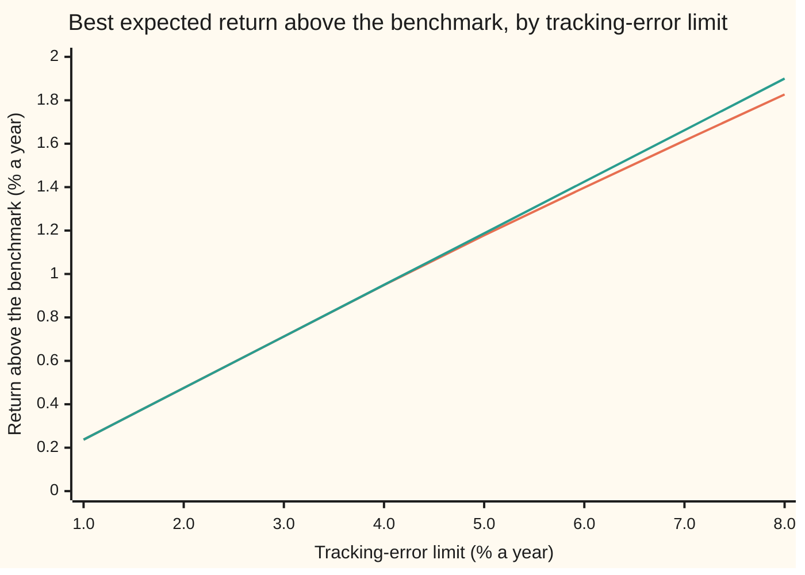

# Second-order cone programs: constraints shaped like ice cream cones

[Syllabus](../../../SYLLABUS.md) → [Optimization](../README.md) → [Conic, Quadratic and Stochastic Programs](../README.md#s06) → Second-order cone programs

---

## General Overview

A fund manager runs money against a benchmark: a fixed mix of five assets (UK shares, US shares, emerging-market shares, gilts, which are UK government bonds, and corporate bonds). The benchmark is expected to return 5.97% a year. The client will pay for a better return, but only if the fund stays close to the benchmark. The contract says the **tracking error**, the typical yearly gap between the fund's return and the benchmark's, may be at most **2%**.

So the decision is five weights. They must add to 100%, none may be negative (no shorting), and the tracking error must stay at or under 2%. Among all such mixes, the manager wants the one with the largest expected return. This card **maximises**.

The return is a straight-line function of the weights. The weights-add-to-one rule and the no-shorting floor are straight-line limits too. Only the tracking-error limit is curved: it says the *length* of a list of risk numbers is at most 2%. A limit of that shape is a **second-order cone constraint**, and a problem with a straight-line goal and such limits is a **second-order cone program** (SOCP; "program" here means an optimisation problem, not computer code).

The answer: hold 11.75% UK shares, 39.13% US, 21.11% emerging markets, 17.27% gilts and 10.73% corporate bonds, for an expected 6.4449% a year. A set of "prices" on the limits, printed by the code, proves that no mix inside the limits does better.

**A length kept below a number, or below a straight-line expression, is membership of an ice cream cone; with such constraints a problem stays convex, a Newton-based method solves it reliably, and a dual point in the same cone certifies the answer.**

**What kind of fact this is:** a definition (the cone and the problem class), plus two theorems: weak conic duality, proved on this card in Why it works, and strong conic duality, stated with its source.

### The picture: extra return bought with tracking error



The orange line is the long-only fund, solved by the method on this card at each limit. The green line allows shorting and comes from a closed formula. At limits of 1%, 2% and 3% the two agree to three decimals: the floor is slack and the extra return is exactly 0.237440 times the limit. Between 3% and 4% a weight hits zero, and from there the long-only line bends below the straight one.

---

## The formula

The **second-order cone** of dimension k, here written $\mathcal Q^{k}$, holds every point $(h, v)$ made of one number $h$ (the height) and a list $v$ of $k - 1$ numbers whose length is at most the height:

$$\mathcal Q^{k} = \{\,(h, v) : \lVert v\rVert \le h\,\}$$

**Read it aloud:** a point is in the cone when its list is no longer than its height.

In three dimensions this is an ice cream cone standing on its tip: at height $h$ the slice is a disc of radius $h$. The fund's problem is

$$\text{maximise } \mu^{\mathsf T} w \quad\text{subject to}\quad \mathbf 1^{\mathsf T} w = 1,\quad w \ge 0,\quad \big(\delta,\; A(w - w_b)\big) \in \mathcal Q^{8}$$

**Read it aloud:** make the expected return as large as possible, fully invested, with no negative weight, and with the risk list of the active weights no longer than 2%.

The proof of optimality is one inequality. For any numbers $\nu$, any $\lambda \ge 0$ and any cone point $(z, u)$ in $\mathcal Q^{8}$ that satisfy $A^{\mathsf T} u + \nu \mathbf 1 - \lambda = \mu$, every allowed mix obeys

$$\mu^{\mathsf T} w \;\le\; \nu + \delta z + u^{\mathsf T} A w_b$$

**Read it aloud:** a price on the budget, prices on the floors and a price list that lies in the same cone give a ceiling on the return of every mix inside the limits.

| Symbol | Plain meaning | In our example | Push it up and the answer… |
| --- | --- | --- | --- |
| $w$, $w_i$, $\mathbf 1$ | the five weights chosen, weight number $i$; a list of five ones, so $\mathbf 1^{\mathsf T} w$ is their total | 11.75, 39.13, 21.11, 17.27, 10.73 (%) | — |
| $w_b$ | the benchmark weights | 25, 30, 10, 20, 15 (%) | the fund starts nearer whatever it adds |
| $\mu$ | expected return of each asset, a year | 6, 7, 8.5, 4, 4.8 (%) | that asset gains weight |
| $A$, $\Sigma = A^{\mathsf T} A$ | the risk model: 7 rows, one per risk source, 5 columns; the covariance matrix it builds | table below | more risk per unit of active weight, less return |
| $t$ | the barrier weight of the interior-point method (Step 4) | 1, then ×10 each round | the method's answer nears the best |
| $\delta$ | the tracking-error limit, a year | 0.02 | return above the benchmark rises, in a straight line while the floor is slack |
| $\lVert v\rVert$ | length of a list: square root of the sum of squares | $\lVert A(w - w_b)\rVert$ = 0.02 at the answer | — |
| $\mathcal Q^{k}$, $(h, v)$ | the cone of dimension k; a point with height $h$ and list $v$ | k = 8: height 0.02, list of 7 | — |
| $\nu$, $\lambda$ | prices on the budget and on the five floors | $\nu$ = 0.042861, $\lambda$ = 0 (no floor binds) | — |
| $(z, u)$ | the dual point: a price list $u$ on the 7 risk sources and its height $z$ | $z$ = 0.237440 | the ceiling rises; the best certificate takes the smallest height the cone allows, $z = \lVert u\rVert$ |
| $g$, $r$ | the direction of the active bets, solving $\Sigma g = \mu - \nu\mathbf 1$ (built in Step 3 from $a = \Sigma^{-1}\mu$ and $o = \Sigma^{-1}\mathbf 1$); $r = \lVert Ag\rVert$, its risk length, the information ratio | $r$ = 0.237440 | — |
| $x_1$, $x_2$ | two numbers in the hyperbola example of Step 5 | $x_1 x_2 \ge 1$ | — |

The risk model has two shared sources (an equity factor and an interest-rate factor) and one private source per asset. Each entry is the asset's yearly return move, as a decimal, for a one-standard-deviation shock to that source.

| Asset | $\mu$ | $w_b$ | Equity factor | Rate factor | Own risk |
| --- | --- | --- | --- | --- | --- |
| UK shares | 0.060 | 0.25 | 0.14 | 0.00 | 0.06 |
| US shares | 0.070 | 0.30 | 0.15 | 0.00 | 0.05 |
| Emerging markets | 0.085 | 0.10 | 0.18 | 0.02 | 0.10 |
| Gilts | 0.040 | 0.20 | −0.01 | 0.06 | 0.02 |
| Corporate bonds | 0.048 | 0.15 | 0.04 | 0.05 | 0.03 |

The two factor columns are the first two rows of $A$; the "own risk" column fills the diagonal of its last five rows.

### Recognising a cone constraint

| Constraint as written | As cone membership |
| --- | --- |
| $\lVert A(w - w_b)\rVert \le \delta$ | $(\delta, A(w - w_b)) \in \mathcal Q^{8}$ |
| $(w - w_b)^{\mathsf T}\Sigma(w - w_b) \le \delta^2$, with $\Sigma = A^{\mathsf T}A$ | the same, after a square root of both sides |
| $x_1 x_2 \ge 1$, with $x_1, x_2 \ge 0$ (a hyperbola) | $\big(x_1 + x_2,\ (x_1 - x_2,\ 2)\big) \in \mathcal Q^{3}$ |
| a size limit on one number, $\lvert a\rvert \le h$ | $(h, a) \in \mathcal Q^{2}$, which is two straight-line limits |
| a straight-line limit, a number at least 0 | $\mathcal Q^{1}$: a height with an empty list |

A **turnover** limit (the sum of the sizes of the weight changes from the current holdings at most some number) is linear, not a cone: each size splits into two straight-line limits, as in a linear program. The tracking-error limit is the one that needs the cone. A limit like $\lVert v\rVert \ge 1$ (stay *outside* a ball) is not a cone constraint at all; it is not convex.

### When it holds

- **The curved limits are lengths bounded above.** Swap to a lower bound on a length and the feasible set gets a hole: no cone, no convexity, and a local optimum need not be global.
- **A quadratic limit has a covariance of the form $A^{\mathsf T}A$.** A covariance estimated badly, with a negative eigenvalue, has no such $A$; the "variance" can go negative and the limit is not convex. The factor model above gives $A$ directly, with no square root to take.
- **Strong duality needs a strictly feasible point**: one inside the cone, not on its rim, and inside every floor. The benchmark itself qualifies here (tracking error 0, every weight positive). Without one, the ceiling can sit above the best value. The dual side needs one too: without a strictly feasible dual point, the best value can be approached and never reached, as in Step 5, where the primal has a strictly feasible point and the dual does not.
- **The units must match.** $\delta$ is a standard deviation (0.02), so a variance limit is $\delta^2$ (0.0004). Writing 0.02 as a variance cap lets the optimiser reach a tracking error of 12.1130% (What breaks).

---

## Why it works

### Step 0: two cone points always meet at a non-negative angle

Take any two points of the cone, $(h, v)$ and $(z, u)$. Their inner product (sum of products of matching entries) is $hz + v^{\mathsf T}u$. The Cauchy–Schwarz inequality from wing 03 says $v^{\mathsf T}u \ge -\lVert v\rVert\,\lVert u\rVert$, and each length is at most its height, so

$$hz + v^{\mathsf T}u \;\ge\; hz - \lVert v\rVert\,\lVert u\rVert \;\ge\; hz - hz = 0.$$

The **dual cone** of a cone is the set of points whose inner product with every member is at least 0. The display shows every member of $\mathcal Q^{k}$ is in its dual cone, and the reverse also holds, so the second-order cone is **self-dual**: prices for a cone constraint live in the same cone. That one fact is what the whole duality theory below runs on. The non-negative orthant, where linear programs live, is self-dual too; that is why a linear program's prices are non-negative numbers.

### Step 1: turn the risk limit into a length

The variance of the fund's return minus the benchmark's is $(w - w_b)^{\mathsf T}\Sigma(w - w_b)$. With $\Sigma = A^{\mathsf T}A$, this is $(A(w - w_b))^{\mathsf T}(A(w - w_b)) = \lVert A(w - w_b)\rVert^2$. Written out, it is the square of the active equity exposure, plus the square of the active rate exposure, plus each asset's own risk times its active weight, squared. Tracking error is the square root of that variance, so "tracking error at most 2%" is "the 7-entry list $A(w - w_b)$ has length at most 0.02": a point of $\mathcal Q^{8}$.

The quadratic form and the length are the same number; the code computes the tracking error both ways and prints 2.0000% twice.

### Step 2: weak duality, the ceiling

Take any allowed mix $w$ and any prices with $A^{\mathsf T}u + \nu\mathbf 1 - \lambda = \mu$, $\lambda \ge 0$ and $(z, u) \in \mathcal Q^{8}$. Multiply that equation by $w$:

$$\mu^{\mathsf T}w = \nu\,\mathbf 1^{\mathsf T}w - \lambda^{\mathsf T}w + u^{\mathsf T}A(w - w_b) + u^{\mathsf T}Aw_b.$$

Now bound each term. The total weight is 1, so the first is $\nu$. Weights and floor prices are both non-negative, so $-\lambda^{\mathsf T}w \le 0$. Cauchy–Schwarz and the two cone memberships give $u^{\mathsf T}A(w - w_b) \le \lVert u\rVert\,\lVert A(w - w_b)\rVert \le z\delta$; this is Step 0's inequality for the cone points $(\delta, A(w - w_b))$ and $(z, -u)$. Adding up gives the ceiling in The formula. No mix inside the limits beats any such price set.

### Step 3: find the prices that touch the ceiling

The ceiling is tight when every inequality in Step 2 is an equality: $\lambda^{\mathsf T}w = 0$ (here no floor binds, so $\lambda = 0$), and $u$ points the same way as $A(w - w_b)$, with both cone points on the rim. Those are the KKT conditions (Karush–Kuhn–Tucker: the stationarity, feasibility and complementary-slackness conditions of [Quadratic programs](01-quadratic-programs-and-markowitz.md), here with a cone in place of a quadratic).

Solving them takes two linear solves. Find $g$ from $\Sigma g = \mu - \nu\mathbf 1$, with $\nu$ chosen so that $\mathbf 1^{\mathsf T}g = 0$: the active bets must net to zero, as the weights still add to one. Then scale $g$ until its risk length reaches the limit.

<details>
<summary>Detailed derivation: the closed form and its dual point</summary>

Write $a = \Sigma^{-1}\mu$ and $o = \Sigma^{-1}\mathbf 1$, each found by Gaussian elimination. Then $g = a - \nu o$, and $\mathbf 1^{\mathsf T}g = 0$ gives $\nu = \mathbf 1^{\mathsf T}a / \mathbf 1^{\mathsf T}o$.

Let $r = \sqrt{g^{\mathsf T}\Sigma g} = \lVert Ag\rVert$. The mix is $w = w_b + \delta g / r$, whose risk length is exactly $\delta$. Its return above the benchmark is $\mu^{\mathsf T}(w - w_b) = \delta\,\mu^{\mathsf T}g / r$. Since $\mu = \Sigma g + \nu\mathbf 1$ and $\mathbf 1^{\mathsf T}g = 0$, $\mu^{\mathsf T}g = g^{\mathsf T}\Sigma g = r^2$, so the extra return is $\delta r$: a straight line in $\delta$, slope $r$.

The prices: $u = (r/\delta)\,A(w - w_b) = Ag$ and $z = \lVert u\rVert = r$, so $(z, u)$ is on the rim of the cone. Then $A^{\mathsf T}u = \Sigma g = \mu - \nu\mathbf 1$, so stationarity holds with $\lambda = 0$. The ceiling is $\nu + \delta r + g^{\mathsf T}\Sigma w_b = \nu + \delta r + (\mu - \nu\mathbf 1)^{\mathsf T}w_b = \mu^{\mathsf T}w_b + \delta r$, which equals the mix's return. Ceiling met: the mix is optimal, provided every weight it gives is non-negative. If one is negative the closed form answers a different question (shorting allowed), and the method of Step 4 is needed.

</details>

The slope $r$ is the best ratio of extra return to tracking error any mix can reach; fund managers call that ratio the **information ratio**. Here it is 0.237440, so 2% of tracking error buys 0.4749% of extra return.

### Step 4: the method, when the floor might bind

The closed form ignores the no-shorting floor. The general method, used by every SOCP solver, is an **interior-point method** (the barrier idea of [Interior point methods](../03-Constrained%20Optimisation/08-interior-point-methods.md)): replace each limit with a penalty that rises to infinity at its edge, then minimise $-t\,\mu^{\mathsf T}w - \sum \log w_i - \log(\delta^2 - \lVert A(w - w_b)\rVert^2)$ with Newton's method. The term $-\log(h^2 - \lVert v\rVert^2)$ is the cone's own barrier. The weight $t$ starts at 1 and grows tenfold each round.

At the exact minimiser for a given $t$, the gap between its return and the true best is at most (number of barrier terms)$/t$, here $6/t$. The code stops when that bound is below $10^{-10}$, at $6 \times 10^{-11}$, after 61 Newton steps in total from the benchmark as the start. That count is measured, not promised. The proved bound on Newton steps depends on how fast $t$ grows (Boyd and Vandenberghe, section 11.5, in Sources; [Interior point methods](../03-Constrained%20Optimisation/08-interior-point-methods.md) states it too). Raise $t$ by a factor of one plus one over the square root of the number of barrier terms each round, and the total grows like that square root times the log of the accuracy wanted. With a fixed factor such as the 10 used here, the proved bound grows like the number of terms itself, times the same log.

### Step 5: the strong duality theorem, and what it does not promise

**Conic duality theorem** (stated, not proved here; *Lectures on Modern Convex Optimization*, chapter 2, in Sources). Take a conic problem: a straight-line goal, straight-line equalities, and a requirement that some affine expression (a straight-line expression plus a constant) lie in a closed convex cone (a cone that contains its rim and the segment between any two of its points). If the problem has a strictly feasible point (inside the cone, not on its rim) and its best value is finite, then the dual problem has an optimal point and the two best values are equal. Symmetrically, a strictly feasible dual with a finite value guarantees an optimal primal point.

For the fund the benchmark is strictly feasible, so a perfect certificate must exist, and Step 3 built it. The proof goes through a separating hyperplane: the set of reachable (return, constraint) pairs is convex, and a flat wall between it and a slightly better return supplies the prices ([Separating hyperplanes](../01-Convexity/06-separating-hyperplanes.md)).

The theorem does not promise that the best value is *reached*. Minimise $x_1$ subject to $x_1 x_2 \ge 1$ with both positive: a hyperbola, written as the single cone constraint $(x_1 + x_2, (x_1 - x_2, 2)) \in \mathcal Q^{3}$, which already forces both to be positive. Taking $x_2$ = 10, 100 and 1000 forces $x_1$ = 0.1000, 0.0100 and 0.0010: the value heads to 0 and no point gets there. The only dual point is $(0.5, 0.5, 0)$, which sits on the rim of its cone, so the dual is not strictly feasible and the primal attainment the theorem would give is lost. A linear program never does this; a cone program can.

---

## Worked numbers, by hand

| Step | Arithmetic | Value |
| --- | --- | --- |
| benchmark return | 0.25 × 6 + 0.30 × 7 + 0.10 × 8.5 + 0.20 × 4 + 0.15 × 4.8 | 5.9700% |
| direction of the active bets, $g$ | two solves by elimination (Step 3): $\Sigma g = \mu - \nu\mathbf 1$, entries adding to 0; the checks print it | −1.572593, 1.084034, 1.319204, −0.323704, −0.506941 |
| information ratio $r$ | $\sqrt{\mu^{\mathsf T}g}$, since $\mu^{\mathsf T}g = r^2$ (Step 3's fold): √(0.060 × (−1.572593) + 0.070 × 1.084034 + 0.085 × 1.319204 + 0.040 × (−0.323704) + 0.048 × (−0.506941)) | 0.237440 |
| $g$'s equity exposure, the first entry of $u = Ag$ | 0.14 × (−1.572593) + 0.15 × 1.084034 + 0.18 × 1.319204 − 0.01 × (−0.323704) + 0.04 × (−0.506941) | 0.162858 |
| price on the budget, $\nu$ | UK row of $\Sigma g = \mu - \nu\mathbf 1$; UK shares have no rate exposure, so that row of $\Sigma$ is 0.14 times the equity column plus 0.06² on the diagonal: 0.060 − 0.14 × 0.162858 − 0.06² × (−1.572593) | 0.042861 |
| extra return | 0.02 × 0.237440 | 0.4749% |
| weights, $w_b + 0.02\,g / r$ | UK: 0.25 + 0.02 × (−1.572593) / 0.237440; the other four alike | 11.75, 39.13, 21.11, 17.27, 10.73 (%) |
| floor check | smallest weight | 10.73% > 0, so $\lambda = 0$ |
| tracking error, two ways | $\lVert A(w - w_b)\rVert$ and $\sqrt{(w - w_b)^{\mathsf T}\Sigma(w - w_b)}$ | 2.0000% and 2.0000% |
| dual height | $z = \lVert u\rVert$ | 0.237440 |
| ceiling | $\nu + 0.02 z + u^{\mathsf T}Aw_b$ | 6.4449% |
| **best expected return** | 5.9700 + 0.4749 | **6.4449%** |

The fund tilts from UK shares toward US and emerging-market shares (its turnover, the sum of the sizes of the weight changes, is 40.49%) and expects 6.4449% a year; the price list with height 0.237440 shows that no long-only mix within 2% tracking error expects more.

### What breaks if you drop a piece

| Mistake | Comes out at | What went wrong |
| --- | --- | --- |
| Variance capped at 0.02 instead of 0.02² | 100% emerging markets; 2.5300% extra, real tracking error 12.1130% | A standard deviation used as a variance: the real limit is the square root of 0.02, far looser than 2% |
| Plain length of weight changes $\lVert w - w_b\rVert \le$ 0.02 | 0.0712% extra at 0.3453% tracking error; scaled up to 2%, still only 0.4124% | No risk model: correlation and each asset's own risk are ignored, so the bets point the wrong way |
| Closed form used at a 5% limit | UK shares at −8.12% | The floor binds; the long-only answer needs the method of Step 4 |
| Expecting the best value to be reached: minimise $x_1$ with $x_1 x_2 \ge 1$ | $x_1$ = 0.1000, 0.0100, 0.0010, never 0 | The dual point (0.5, 0.5, 0) is on the rim, so no strictly feasible dual |

The code prints all four.

---

## Code, from first principles, and it actually runs

Nothing imported holds the answer: there is no optimisation or linear-algebra library, and linear systems are solved by Gaussian elimination written out. The code reaches the fund's answer by three roads. Road 1 is the log-barrier Newton method of Step 4, long-only, started at the benchmark. Road 2 is the closed form of Step 3, which ignores the floor. Road 3 builds the dual point $(z, u)$, checks it is in the cone and satisfies stationarity, and checks that its ceiling meets the return. Then it prints the mistakes, the hyperbola and the chart points, which come from road 1 at each limit. A plain left-to-right sum replaces Python's built-in `sum`, which adds with extra precision, so both languages do the same arithmetic.

### Python

```python
# Second-order cone programs -- the check behind the card.  Standard library only.
# A fund holds five assets against a benchmark.  It chooses weights w to make the
# expected return largest, fully invested and long-only, with tracking error
# ||A (w - wb)|| at most DELTA = 2% a year: one second-order cone constraint.
# Road 1 is a log-barrier Newton method, road 2 the KKT closed form, road 3 a dual
# certificate whose bound meets the return.  Then the mistakes, and the chart.
import math

NAMES = ["UK", "US", "EM", "gilts", "corp"]
MU = [0.060, 0.070, 0.085, 0.040, 0.048]           # expected return a year
WB = [0.25, 0.30, 0.10, 0.20, 0.15]                # benchmark weights
A = [[0.14, 0.15, 0.18, -0.01, 0.04],              # equity-factor exposure a year
     [0.00, 0.00, 0.02, 0.06, 0.05]]               # interest-rate exposure a year
A += [[s if j == i else 0.0 for j in range(5)] for i, s in enumerate([0.06, 0.05, 0.10, 0.02, 0.03])]
N, DELTA = 5, 0.02

def add(xs):                                       # plain left-to-right sum, as in Rust
    s = 0.0
    for v in xs:
        s += v
    return s

def dot(x, y):
    return add(a * b for a, b in zip(x, y))

def mat_vec(M, x):
    return [dot(row, x) for row in M]

SIG = [[add(row[i] * row[j] for row in A) for j in range(N)] for i in range(N)]

def solve(M, b):                                   # Gaussian elimination, partial pivoting
    n = len(b)
    R = [M[i][:] + [b[i]] for i in range(n)]
    for c in range(n):
        p = c
        for r in range(c + 1, n):
            if abs(R[r][c]) > abs(R[p][c]):
                p = r
        R[c], R[p] = R[p], R[c]
        for r in range(c + 1, n):
            f = R[r][c] / R[c][c]
            R[r] = [a - f * b for a, b in zip(R[r], R[c])]
    x = [0.0] * n
    for i in range(n - 1, -1, -1):
        x[i] = (R[i][n] - add(R[i][j] * x[j] for j in range(i + 1, n))) / R[i][i]
    return x

def te2(w):                                        # squared length of A (w - wb)
    v = mat_vec(A, [a - b for a, b in zip(w, WB)])
    return dot(v, v)

def te(w):                                         # tracking error
    return math.sqrt(te2(w))

def phi(x, t, delta):                              # barrier cost; x = first four weights
    w = x + [1.0 - add(x)]
    slack = delta * delta - te2(w)
    if min(w) <= 0.0 or slack <= 0.0:
        return math.inf
    return -t * dot(MU, w) - add(math.log(v) for v in w) - math.log(slack)

def barrier(delta):                                # road 1: long-only, start at the benchmark
    x, t, steps = WB[:4], 1.0, 0
    while True:
        for _ in range(100):                       # Newton steps at this t, capped
            w = x + [1.0 - add(x)]
            sd = mat_vec(SIG, [a - b for a, b in zip(w, WB)])
            sl = delta * delta - te2(w)
            gw = [-t * MU[i] - 1.0 / w[i] + 2.0 * sd[i] / sl for i in range(N)]
            hw = [[(1.0 / (w[i] * w[i]) if i == j else 0.0) + 2.0 * SIG[i][j] / sl
                   + 4.0 * sd[i] * sd[j] / (sl * sl) for j in range(N)] for i in range(N)]
            g = [gw[i] - gw[4] for i in range(4)]
            H = [[hw[i][j] - hw[i][4] - hw[4][j] + hw[4][4] for j in range(4)] for i in range(4)]
            dx = solve(H, [-v for v in g])
            if -dot(g, dx) / 2.0 < 1e-9:
                break
            s, f0 = 1.0, phi(x, t, delta)
            while phi([a + s * b for a, b in zip(x, dx)], t, delta) > f0 + 0.25 * s * dot(g, dx) and s > 1e-12:
                s *= 0.5
            x, steps = [a + s * b for a, b in zip(x, dx)], steps + 1
        if 6.0 / t < 1e-10:
            return x + [1.0 - add(x)], steps, 6.0 / t
        t *= 10.0

def closed_form(delta):                            # road 2: KKT, cone active, floor ignored
    a, o = solve(SIG, MU), solve(SIG, [1.0] * N)
    nu = add(a) / add(o)
    g = [p - nu * q for p, q in zip(a, o)]         # Sigma g = mu - nu * ones
    ir = math.sqrt(dot(g, mat_vec(SIG, g)))
    return [b + delta * gi / ir for b, gi in zip(WB, g)], nu, ir

def pct(w):
    return "  ".join(f"{n} {100 * v:.2f}" for n, v in zip(NAMES, w))

wb_ret = dot(MU, WB)
w1, steps, gap = barrier(DELTA)
w2, nu, ir = closed_form(DELTA)
d2 = [a - b for a, b in zip(w2, WB)]
u = [ir / DELTA * v for v in mat_vec(A, d2)]       # road 3: dual point (z, u), lambda = 0
z = math.sqrt(dot(u, u))
resid = max(abs(add(A[k][i] * u[k] for k in range(len(A))) + nu - MU[i]) for i in range(N))
bound = nu + DELTA * z + dot(u, mat_vec(A, WB))
print(f"risk model rows {len(A)}, so the cone has dimension {len(A) + 1}")
print(f"benchmark return             {100 * wb_ret:.4f}%")
print(f"road 1 barrier weights %     {pct(w1)}")
print(f"road 1 return {100 * dot(MU, w1):.4f}%  tracking error {100 * te(w1):.4f}%  Newton steps {steps}  gap bound {gap:.0e}")
print(f"road 2 closed-form weights % {pct(w2)}")
print(f"road 2 nu {nu:.6f}  best ratio sqrt(g'Sg) {ir:.6f}  return {100 * dot(MU, w2):.4f}%")
print(f"road 2 excess = delta x ratio {100 * DELTA * ir:.4f}%  direction g = {' '.join(f'{v * ir / DELTA:.6f}' for v in d2)}")
print(f"road 3 dual z = |u| {z:.6f}  u = {' '.join(f'{v:.6f}' for v in u)}")
print(f"road 3 stationarity residual below 1e-12: {'yes' if resid < 1e-12 else 'no'}")
print(f"road 3 dual bound {100 * bound:.4f}%  gap to the return below 1e-12: {'yes' if abs(bound - dot(MU, w2)) < 1e-12 else 'no'}")
print(f"tracking error by 7-row length {100 * te(w2):.4f}%, by sqrt of variance "
      f"{100 * math.sqrt(dot(d2, mat_vec(SIG, d2))):.4f}%")
print(f"turnover from benchmark, sum |w - wb| {100 * add(abs(v) for v in d2):.2f}%")
wv, _, _ = barrier(math.sqrt(DELTA))               # mistake: variance capped at 0.02, not 0.0004
print(f"wrong: variance cap 0.02    weights % {pct(wv)}")
print(f"wrong: variance cap 0.02    excess {100 * (dot(MU, wv) - wb_ret):.4f}%  real tracking error {100 * te(wv):.4f}%")
m = [v - add(MU) / N for v in MU]                  # mistake: plain length of weight changes
wl = [b + DELTA * v / math.sqrt(dot(m, m)) for b, v in zip(WB, m)]
print(f"wrong: |w - wb| <= 2%       excess {100 * (dot(MU, wl) - wb_ret):.4f}%  real tracking error {100 * te(wl):.4f}%")
print(f"wrong: |w - wb| scaled up to 2% tracking error: excess {100 * (dot(MU, wl) - wb_ret) * DELTA / te(wl):.4f}%")
w5, _, _ = closed_form(0.05)
print(f"wrong: closed form at 5%    weights % {pct(w5)}")
for x2 in (10.0, 100.0, 1000.0):                   # min x1 with x1 * x2 >= 1: never reached
    x1 = 1.0 / x2
    print(f"hyperbola x2 {x2:6.0f}  x1 {x1:.4f}  |(x1 - x2, 2)| {math.sqrt((x1 - x2) * (x1 - x2) + 4.0):.4f}  x1 + x2 {x1 + x2:.4f}")
print("hyperbola dual point (0.5, 0.5, 0): on the rim, |(0.5, 0)| = 0.5, dual value 0")
deltas = [0.01 * k for k in range(1, 9)]
long_only = [100 * (dot(MU, barrier(d)[0]) - wb_ret) for d in deltas]
print("chart, limit %   " + " ".join(f"{100 * d:5.1f}" for d in deltas))
print("chart, long-only " + " ".join(f"{v:5.3f}" for v in long_only))
print("chart, shorting  " + " ".join(f"{100 * d * ir:5.3f}" for d in deltas))
assert abs(dot(MU, w1) - dot(MU, w2)) < 1e-8, "barrier method meets the closed form"
assert max(abs(a - b) for a, b in zip(w1, w2)) < 1e-6 and min(w2) > 0, "same weights, floor slack"
assert resid < 1e-12 and abs(bound - dot(MU, w2)) < 1e-12, "dual certificate meets the return"
assert abs(te(w2) - DELTA) < 1e-12 and abs(z - ir) < 1e-12, "cone tight, |u| is the best ratio"
assert te(wv) > 3 * DELTA and te(wl) < DELTA / 2 and min(w5) < 0, "each mistake breaks a limit"
assert long_only[-1] < 100 * 0.08 * ir - 1e-4 and abs(long_only[0] - ir) < 1e-6, "chart bends"
print("ALL CHECKS PASS")
```

**Ran 2026-11-11 on macOS, Python 3.14.10, standard library only. All checks passed. Output, pasted from the run:**

```
risk model rows 7, so the cone has dimension 8
benchmark return             5.9700%
road 1 barrier weights %     UK 11.75  US 39.13  EM 21.11  gilts 17.27  corp 10.73
road 1 return 6.4449%  tracking error 2.0000%  Newton steps 61  gap bound 6e-11
road 2 closed-form weights % UK 11.75  US 39.13  EM 21.11  gilts 17.27  corp 10.73
road 2 nu 0.042861  best ratio sqrt(g'Sg) 0.237440  return 6.4449%
road 2 excess = delta x ratio 0.4749%  direction g = -1.572593 1.084034 1.319204 -0.323704 -0.506941
road 3 dual z = |u| 0.237440  u = 0.162858 -0.018385 -0.094356 0.054202 0.131920 -0.006474 -0.015208
road 3 stationarity residual below 1e-12: yes
road 3 dual bound 6.4449%  gap to the return below 1e-12: yes
tracking error by 7-row length 2.0000%, by sqrt of variance 2.0000%
turnover from benchmark, sum |w - wb| 40.49%
wrong: variance cap 0.02    weights % UK 0.00  US 0.00  EM 100.00  gilts 0.00  corp 0.00
wrong: variance cap 0.02    excess 2.5300%  real tracking error 12.1130%
wrong: |w - wb| <= 2%       excess 0.0712%  real tracking error 0.3453%
wrong: |w - wb| scaled up to 2% tracking error: excess 0.4124%
wrong: closed form at 5%    weights % UK -8.12  US 52.83  EM 37.78  gilts 13.18  corp 4.32
hyperbola x2     10  x1 0.1000  |(x1 - x2, 2)| 10.1000  x1 + x2 10.1000
hyperbola x2    100  x1 0.0100  |(x1 - x2, 2)| 100.0100  x1 + x2 100.0100
hyperbola x2   1000  x1 0.0010  |(x1 - x2, 2)| 1000.0010  x1 + x2 1000.0010
hyperbola dual point (0.5, 0.5, 0): on the rim, |(0.5, 0)| = 0.5, dual value 0
chart, limit %     1.0   2.0   3.0   4.0   5.0   6.0   7.0   8.0
chart, long-only 0.237 0.475 0.712 0.949 1.178 1.398 1.614 1.827
chart, shorting  0.237 0.475 0.712 0.950 1.187 1.425 1.662 1.900
ALL CHECKS PASS
```

### Rust

Same numbers, same labels, built with `rustc --edition 2021 -O`.

```rust
// Second-order cone programs -- the same check as the Python, in Rust.  No crates.
// A fund holds five assets against a benchmark.  It chooses weights w to make the
// expected return largest, fully invested and long-only, with tracking error
// ||A (w - wb)|| at most DELTA = 2% a year: one second-order cone constraint.
// Road 1 is a log-barrier Newton method, road 2 the KKT closed form, road 3 a dual
// certificate whose bound meets the return.  Then the mistakes, and the chart.
const N: usize = 5;
const DELTA: f64 = 0.02;
const NAMES: [&str; 5] = ["UK", "US", "EM", "gilts", "corp"];
const MU: [f64; 5] = [0.060, 0.070, 0.085, 0.040, 0.048];   // expected return a year
const WB: [f64; 5] = [0.25, 0.30, 0.10, 0.20, 0.15];        // benchmark weights

fn add(xs: impl Iterator<Item = f64>) -> f64 {               // plain left-to-right sum
    let mut s = 0.0;
    for v in xs { s += v }
    s
}
fn dot(x: &[f64], y: &[f64]) -> f64 { add(x.iter().zip(y).map(|(a, b)| a * b)) }
fn mat_vec(m: &[Vec<f64>], x: &[f64]) -> Vec<f64> { m.iter().map(|r| dot(r, x)).collect() }
fn sub(x: &[f64], y: &[f64]) -> Vec<f64> { x.iter().zip(y).map(|(a, b)| a - b).collect() }
fn min(x: &[f64]) -> f64 { x.iter().fold(f64::INFINITY, |a, &b| a.min(b)) }
fn full(x: &[f64]) -> Vec<f64> { let mut w = x.to_vec(); w.push(1.0 - add(x.iter().copied())); w }

fn solve(m: &[Vec<f64>], b: &[f64]) -> Vec<f64> {           // Gaussian elimination, partial pivoting
    let n = b.len();
    let mut r: Vec<Vec<f64>> = (0..n).map(|i| { let mut row = m[i].clone(); row.push(b[i]); row }).collect();
    for c in 0..n {
        let mut p = c;
        for k in c + 1..n { if r[k][c].abs() > r[p][c].abs() { p = k } }
        r.swap(c, p);
        for k in c + 1..n {
            let f = r[k][c] / r[c][c];
            let pivot = r[c].clone();
            r[k] = r[k].iter().zip(&pivot).map(|(a, b)| a - f * b).collect();
        }
    }
    let mut x = vec![0.0; n];
    for i in (0..n).rev() {
        x[i] = (r[i][n] - add((i + 1..n).map(|j| r[i][j] * x[j]))) / r[i][i];
    }
    x
}

struct P { a: Vec<Vec<f64>>, sig: Vec<Vec<f64>> }

impl P {
    fn te2(&self, w: &[f64]) -> f64 { let v = mat_vec(&self.a, &sub(w, &WB)); dot(&v, &v) }
    fn te(&self, w: &[f64]) -> f64 { self.te2(w).sqrt() }
    fn phi(&self, x: &[f64], t: f64, delta: f64) -> f64 {     // barrier cost; x = first four weights
        let w = full(x);
        let slack = delta * delta - self.te2(&w);
        if min(&w) <= 0.0 || slack <= 0.0 { return f64::INFINITY }
        -t * dot(&MU, &w) - add(w.iter().map(|v| v.ln())) - slack.ln()
    }
    fn barrier(&self, delta: f64) -> (Vec<f64>, usize, f64) { // road 1: long-only, from the benchmark
        let (mut x, mut t, mut steps) = (WB[..4].to_vec(), 1.0_f64, 0usize);
        loop {
            for _ in 0..100 {                                // Newton steps at this t, capped
                let w = full(&x);
                let sd = mat_vec(&self.sig, &sub(&w, &WB));
                let sl = delta * delta - self.te2(&w);
                let gw: Vec<f64> = (0..N).map(|i| -t * MU[i] - 1.0 / w[i] + 2.0 * sd[i] / sl).collect();
                let hw: Vec<Vec<f64>> = (0..N).map(|i| (0..N).map(|j|
                    (if i == j { 1.0 / (w[i] * w[i]) } else { 0.0 }) + 2.0 * self.sig[i][j] / sl
                    + 4.0 * sd[i] * sd[j] / (sl * sl)).collect()).collect();
                let g: Vec<f64> = (0..4).map(|i| gw[i] - gw[4]).collect();
                let h: Vec<Vec<f64>> = (0..4).map(|i| (0..4).map(|j|
                    hw[i][j] - hw[i][4] - hw[4][j] + hw[4][4]).collect()).collect();
                let dx = solve(&h, &g.iter().map(|v| -v).collect::<Vec<f64>>());
                if -dot(&g, &dx) / 2.0 < 1e-9 { break }
                let (mut s, f0) = (1.0_f64, self.phi(&x, t, delta));
                let step = |s: f64| -> Vec<f64> { x.iter().zip(&dx).map(|(a, b)| a + s * b).collect() };
                while self.phi(&step(s), t, delta) > f0 + 0.25 * s * dot(&g, &dx) && s > 1e-12 { s *= 0.5 }
                x = step(s);
                steps += 1;
            }
            if 6.0 / t < 1e-10 { return (full(&x), steps, 6.0 / t) }
            t *= 10.0;
        }
    }
    fn closed_form(&self, delta: f64) -> (Vec<f64>, f64, f64) { // road 2: KKT, floor ignored
        let (a, o) = (solve(&self.sig, &MU), solve(&self.sig, &[1.0; N]));
        let nu = add(a.iter().copied()) / add(o.iter().copied());
        let g: Vec<f64> = a.iter().zip(&o).map(|(p, q)| p - nu * q).collect();
        let ir = dot(&g, &mat_vec(&self.sig, &g)).sqrt();
        (WB.iter().zip(&g).map(|(b, gi)| b + delta * gi / ir).collect(), nu, ir)
    }
}

fn pct(w: &[f64]) -> String {
    NAMES.iter().zip(w).map(|(n, v)| format!("{} {:.2}", n, 100.0 * v)).collect::<Vec<_>>().join("  ")
}

fn main() {
    let mut a = vec![vec![0.14, 0.15, 0.18, -0.01, 0.04], vec![0.00, 0.00, 0.02, 0.06, 0.05]];
    for (i, s) in [0.06, 0.05, 0.10, 0.02, 0.03].iter().enumerate() {
        a.push((0..N).map(|j| if j == i { *s } else { 0.0 }).collect());
    }
    let sig: Vec<Vec<f64>> = (0..N).map(|i| (0..N).map(|j| add(a.iter().map(|r| r[i] * r[j]))).collect()).collect();
    let p = P { a: a.clone(), sig };
    let wb_ret = dot(&MU, &WB);
    let (w1, steps, gap) = p.barrier(DELTA);
    let (w2, nu, ir) = p.closed_form(DELTA);
    let d2 = sub(&w2, &WB);
    let u: Vec<f64> = mat_vec(&a, &d2).iter().map(|v| ir / DELTA * v).collect();   // road 3, lambda = 0
    let z = dot(&u, &u).sqrt();
    let resid = (0..N).map(|i| (add((0..a.len()).map(|k| a[k][i] * u[k])) + nu - MU[i]).abs()).fold(0.0, f64::max);
    let bound = nu + DELTA * z + dot(&u, &mat_vec(&a, &WB));
    let yn = |c: bool| if c { "yes" } else { "no" };
    println!("risk model rows {}, so the cone has dimension {}", a.len(), a.len() + 1);
    println!("benchmark return             {:.4}%", 100.0 * wb_ret);
    println!("road 1 barrier weights %     {}", pct(&w1));
    println!("road 1 return {:.4}%  tracking error {:.4}%  Newton steps {}  gap bound {:.0e}",
             100.0 * dot(&MU, &w1), 100.0 * p.te(&w1), steps, gap);
    println!("road 2 closed-form weights % {}", pct(&w2));
    println!("road 2 nu {:.6}  best ratio sqrt(g'Sg) {:.6}  return {:.4}%", nu, ir, 100.0 * dot(&MU, &w2));
    println!("road 2 excess = delta x ratio {:.4}%  direction g = {}", 100.0 * DELTA * ir,
             d2.iter().map(|v| format!("{:.6}", v * ir / DELTA)).collect::<Vec<_>>().join(" "));
    println!("road 3 dual z = |u| {:.6}  u = {}", z, u.iter().map(|v| format!("{:.6}", v)).collect::<Vec<_>>().join(" "));
    println!("road 3 stationarity residual below 1e-12: {}", yn(resid < 1e-12));
    println!("road 3 dual bound {:.4}%  gap to the return below 1e-12: {}", 100.0 * bound,
             yn((bound - dot(&MU, &w2)).abs() < 1e-12));
    println!("tracking error by 7-row length {:.4}%, by sqrt of variance {:.4}%",
             100.0 * p.te(&w2), 100.0 * dot(&d2, &mat_vec(&p.sig, &d2)).sqrt());
    println!("turnover from benchmark, sum |w - wb| {:.2}%", 100.0 * add(d2.iter().map(|v| v.abs())));
    let (wv, _, _) = p.barrier(DELTA.sqrt());                 // mistake: variance capped at 0.02
    println!("wrong: variance cap 0.02    weights % {}", pct(&wv));
    println!("wrong: variance cap 0.02    excess {:.4}%  real tracking error {:.4}%",
             100.0 * (dot(&MU, &wv) - wb_ret), 100.0 * p.te(&wv));
    let m: Vec<f64> = MU.iter().map(|v| v - add(MU.iter().copied()) / N as f64).collect();
    let wl: Vec<f64> = WB.iter().zip(&m).map(|(b, v)| b + DELTA * v / dot(&m, &m).sqrt()).collect();
    println!("wrong: |w - wb| <= 2%       excess {:.4}%  real tracking error {:.4}%",
             100.0 * (dot(&MU, &wl) - wb_ret), 100.0 * p.te(&wl));
    println!("wrong: |w - wb| scaled up to 2% tracking error: excess {:.4}%",
             100.0 * (dot(&MU, &wl) - wb_ret) * DELTA / p.te(&wl));
    let (w5, _, _) = p.closed_form(0.05);
    println!("wrong: closed form at 5%    weights % {}", pct(&w5));
    for x2 in [10.0_f64, 100.0, 1000.0] {                     // min x1 with x1 * x2 >= 1: never reached
        let x1 = 1.0 / x2;
        println!("hyperbola x2 {:6.0}  x1 {:.4}  |(x1 - x2, 2)| {:.4}  x1 + x2 {:.4}",
                 x2, x1, ((x1 - x2) * (x1 - x2) + 4.0).sqrt(), x1 + x2);
    }
    println!("hyperbola dual point (0.5, 0.5, 0): on the rim, |(0.5, 0)| = 0.5, dual value 0");
    let deltas: Vec<f64> = (1..9).map(|k| 0.01 * k as f64).collect();
    let long_only: Vec<f64> = deltas.iter().map(|&d| 100.0 * (dot(&MU, &p.barrier(d).0) - wb_ret)).collect();
    let row = |v: Vec<String>| v.join(" ");
    println!("chart, limit %   {}", row(deltas.iter().map(|d| format!("{:5.1}", 100.0 * d)).collect()));
    println!("chart, long-only {}", row(long_only.iter().map(|v| format!("{:5.3}", v)).collect()));
    println!("chart, shorting  {}", row(deltas.iter().map(|d| format!("{:5.3}", 100.0 * d * ir)).collect()));
    assert!((dot(&MU, &w1) - dot(&MU, &w2)).abs() < 1e-8, "barrier method meets the closed form");
    assert!(w1.iter().zip(&w2).all(|(a, b)| (a - b).abs() < 1e-6) && min(&w2) > 0.0, "same weights");
    assert!(resid < 1e-12 && (bound - dot(&MU, &w2)).abs() < 1e-12, "dual certificate meets the return");
    assert!((p.te(&w2) - DELTA).abs() < 1e-12 && (z - ir).abs() < 1e-12, "cone tight, |u| is the ratio");
    assert!(p.te(&wv) > 3.0 * DELTA && p.te(&wl) < DELTA / 2.0 && min(&w5) < 0.0, "each mistake breaks a limit");
    assert!(long_only[7] < 100.0 * 0.08 * ir - 1e-4 && (long_only[0] - ir).abs() < 1e-6, "chart bends");
    println!("ALL CHECKS PASS");
}
```

**Ran 2026-11-11 on macOS, rustc 1.98.1, no crates. All checks passed. Output, pasted from the run:**

```
risk model rows 7, so the cone has dimension 8
benchmark return             5.9700%
road 1 barrier weights %     UK 11.75  US 39.13  EM 21.11  gilts 17.27  corp 10.73
road 1 return 6.4449%  tracking error 2.0000%  Newton steps 61  gap bound 6e-11
road 2 closed-form weights % UK 11.75  US 39.13  EM 21.11  gilts 17.27  corp 10.73
road 2 nu 0.042861  best ratio sqrt(g'Sg) 0.237440  return 6.4449%
road 2 excess = delta x ratio 0.4749%  direction g = -1.572593 1.084034 1.319204 -0.323704 -0.506941
road 3 dual z = |u| 0.237440  u = 0.162858 -0.018385 -0.094356 0.054202 0.131920 -0.006474 -0.015208
road 3 stationarity residual below 1e-12: yes
road 3 dual bound 6.4449%  gap to the return below 1e-12: yes
tracking error by 7-row length 2.0000%, by sqrt of variance 2.0000%
turnover from benchmark, sum |w - wb| 40.49%
wrong: variance cap 0.02    weights % UK 0.00  US 0.00  EM 100.00  gilts 0.00  corp 0.00
wrong: variance cap 0.02    excess 2.5300%  real tracking error 12.1130%
wrong: |w - wb| <= 2%       excess 0.0712%  real tracking error 0.3453%
wrong: |w - wb| scaled up to 2% tracking error: excess 0.4124%
wrong: closed form at 5%    weights % UK -8.12  US 52.83  EM 37.78  gilts 13.18  corp 4.32
hyperbola x2     10  x1 0.1000  |(x1 - x2, 2)| 10.1000  x1 + x2 10.1000
hyperbola x2    100  x1 0.0100  |(x1 - x2, 2)| 100.0100  x1 + x2 100.0100
hyperbola x2   1000  x1 0.0010  |(x1 - x2, 2)| 1000.0010  x1 + x2 1000.0010
hyperbola dual point (0.5, 0.5, 0): on the rim, |(0.5, 0)| = 0.5, dual value 0
chart, limit %     1.0   2.0   3.0   4.0   5.0   6.0   7.0   8.0
chart, long-only 0.237 0.475 0.712 0.949 1.178 1.398 1.614 1.827
chart, shorting  0.237 0.475 0.712 0.950 1.187 1.425 1.662 1.900
ALL CHECKS PASS
```

The two outputs match line for line, Newton step count included.

> [!TIP]
> **Try changing**
> - Guess first: what does a 3% limit buy? Set `DELTA` to `0.03`. The floor stays slack, the weights become 5.13, 43.70, 26.67, 15.91, 8.59 (%), and the extra return is 0.7123%: three times 0.237440, as the straight line says. All checks still pass.
> - Guess first: at a 5% limit, which weights hit zero? Set `DELTA` to `0.05`. Road 1 puts UK shares and corporate bonds at 0.00 and expects 7.1476%; the closed form shorts UK shares at −8.12% and claims 7.1572%. The first assert stops the run, because the two roads now answer different questions.
> - Guess first: make corporate bonds less attractive. Set their expected return to `0.045`. At 2% the floor now binds: road 1 holds no corporate bonds and expects 6.4360%, while the closed form shorts them at −7.37%. The first assert stops the run.

---

## The usual mistake

> [!warning]
> **Putting a standard deviation where a variance belongs.** The contract's 2% is a tracking error, a standard deviation. As a cone constraint it reads "length at most 0.02". Written as a variance it reads "at most 0.0004". Write 0.02 as the variance cap and the real limit is the square root of 0.02, far looser than 2%. The optimiser goes 100% into emerging markets: 2.5300% extra return at a real tracking error of 12.1130%.
>
> - **Dropping the risk model.** Bounding the plain length of the weight changes treats every asset as equally risky and unrelated. It gives 0.0712% extra at a tracking error of 0.3453%, and even scaled up to the full 2% only 0.4124%, against 0.4749% from the true constraint.
> - **Trusting a closed form past its floor.** The formula of Step 3 is right only while every weight stays positive. At a 5% limit it shorts UK shares at −8.12%.
> - **Calling turnover a cone constraint.** A turnover cap is a sum of sizes of changes: linear pieces, solvable as a linear program. Here the turnover is 40.49%; capping it adds straight-line limits, not cones.
> - **Expecting an optimum to be reached.** Minimising $x_1$ with $x_1 x_2 \ge 1$ gives 0.1000, 0.0100, 0.0010 and never 0. Check for strict feasibility on both sides before relying on attainment.

---

## Where you meet it in real life

- **Fund management.** Tracking-error limits on active funds are exactly the constraint on this card, and portfolio construction software solves them as SOCPs. A 1992 analysis of tracking error (Sources) is the classic statement of the problem.
- **Robust portfolios.** When the expected returns are uncertain within an ellipsoid (a stretched ball), the worst-case return is the estimate minus a length, so a "safe" return target becomes a cone constraint: [Robust and chance constraints](10-robust-and-chance-constrained-optimisation.md).
- **Antenna arrays and filter design.** Keeping the size of a complex-valued response below a level at many frequencies is a set of second-order cone constraints; the 1998 applications survey in Sources works such examples.
- **Engineering structures.** The force in a bar, or friction at a contact (the friction cone of mechanics), must stay inside a cone; truss and grasping problems are solved as SOCPs.

> **Say it back**
> A second-order cone holds the points whose list is no longer than their height, like an ice cream cone. A length bounded by a number or a straight-line expression is a cone constraint, and so are convex quadratic limits written through a factor $A$ with $\Sigma = A^{\mathsf T}A$, and hyperbolas. The cone is its own dual, by Cauchy–Schwarz, so prices on a cone constraint form a cone point, and any such prices give a ceiling on the best value. When the problem has a strictly feasible point, prices exist that meet the ceiling exactly. For the fund, a 2% tracking-error limit buys 0.4749% of extra return, and the price list with height 0.237440 proves nothing does better.

---

## What this builds on

- [Quadratic programs](01-quadratic-programs-and-markowitz.md): the covariance matrix, minimum-variance portfolios and the KKT system that Step 3 reuses with a cone in place of a quadratic.
- [Separating hyperplanes](../01-Convexity/06-separating-hyperplanes.md): the flat wall between a point and a convex set, which proves the conic duality theorem stated in Step 5.

## Where this goes next

- [Semidefinite programs](05-semidefinite-programs-and-relaxations.md): the next cone up, matrices that must stay positive semidefinite; every second-order cone constraint is a special case of one.
- [Robust and chance constraints](10-robust-and-chance-constrained-optimisation.md): ellipsoidal uncertainty sets, whose worst cases are exactly the lengths this card turns into cones.

The fund's answer trusts its expected returns to four decimals; what happens when those estimates are themselves uncertain is the open question this card leaves.

---

## Sources

Verified 2026-11-11: every link below resolves to the publisher's page.

- Lobo, Miguel Sousa, Lieven Vandenberghe, Stephen Boyd, and Hervé Lebret. "Applications of Second-Order Cone Programming." *Linear Algebra and its Applications* 284 (1998): 193–228. [doi:10.1016/S0024-3795(98)10032-0](https://doi.org/10.1016/S0024-3795(98)10032-0). The survey: what converts to a cone, with portfolio and engineering examples.
- Alizadeh, Farid, and Donald Goldfarb. "Second-Order Cone Programming." *Mathematical Programming* 95 (2003): 3–51. [doi:10.1007/s10107-002-0339-5](https://doi.org/10.1007/s10107-002-0339-5). Self-duality, the duality theory and interior-point methods for the cone.
- Ben-Tal, Aharon, and Arkadi Nemirovski. *Lectures on Modern Convex Optimization*. SIAM, 2001. [doi:10.1137/1.9780898718829](https://doi.org/10.1137/1.9780898718829). The conic duality theorem stated in Step 5, and the hyperbola-type examples where the optimum is not reached.
- Boyd, Stephen, and Lieven Vandenberghe. *Convex Optimization*. Cambridge University Press, 2004. [Publisher page](https://www.cambridge.org/core/books/convex-optimization/17D2FAA54F641A2F62C7CCD01DFA97C4). Generalised inequalities, dual cones and the barrier method used as road 1.
- Roll, Richard. "A Mean/Variance Analysis of Tracking Error." *The Journal of Portfolio Management* 18, no. 4 (1992): 13–22. [doi:10.3905/jpm.1992.701922](https://doi.org/10.3905/jpm.1992.701922). Tracking error as the limit an active fund manager works under.
