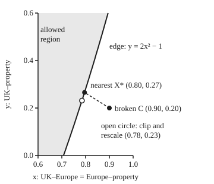

# Semidefinite programs: optimising over matrices that must stay positive

[Syllabus](../../../SYLLABUS.md) → [Optimization](../README.md) → [Conic, Quadratic and Stochastic Programs](../README.md#s06) → Semidefinite programs

---

## General Overview

A risk desk holds three assets: UK shares, European shares and a property fund. It estimated each pair's correlation from whatever history that pair had. UK with Europe came out at 0.9, over ten years. Europe with property came out at 0.9, over two. UK with property came out at 0.2, over five. Each number is reasonable on its own.

Together they are impossible. Put £100,000 long in UK shares, £100,000 short in European shares and £100,000 long in property, each with a volatility of 20% a year. The desk's matrix says this mix has a variance of minus 80,000,000 pounds squared. A variance is an average of squares, so it cannot be negative, and its square root, the risk in pounds, does not exist. The risk system stops.

The fix is to change the matrix as little as possible until every mix has a variance of zero or more. That is a **semidefinite program**, or SDP: an optimisation whose unknown is a symmetric matrix, with one rule that a linear program never has. The matrix must stay positive semidefinite, meaning no mix of the assets has a negative variance. The answer here moves UK with Europe and Europe with property from 0.9 to 0.795511, and UK with property from 0.2 to 0.265674. The same mix then carries a real risk of £11,820.

A dual bound that meets the answer proves "nearest". Two more tools come with it: the **Schur complement**, which turns a ratio limit into a matrix rule, and the **max-cut** relaxation, where the same matrices bound a hard network-splitting problem.

**A semidefinite program is a linear objective, minimised or maximised over a symmetric matrix, under linear limits plus one rule: every mix must keep a variance of zero or more; that rule cuts out a convex set, so the best point can be found and proved best.**

**What kind of fact this is:** a modelling class, the SDP, plus two theorems proved on this card in Why it works: the Schur complement test, and the bound that the SDP puts on max-cut. The 0.878 rounding guarantee for max-cut is proved there too, in Step 5, with its constant α found as a computed minimum.

### The picture: which correlations are allowed

Keep UK–Europe equal to Europe–property, call that shared value x, and call UK–property y. Every 3 by 3 correlation matrix of that shape is then a point (x, y). The nearest repair has that shape too: swapping UK and property leaves C unchanged and turns the nearest repair into one just as near; the nearest is unique, so the swap must leave it as it is.

<p align="center"></p>

Shaded pairs keep every variance at zero or more; the edge is y = 2x² − 1, and the top edge y = 1 is off the drawing. The desk's C is outside. The nearest repair X* is on the edge; the open circle, the clip-and-rescale shortcut, is on the edge but farther from C. The dashed line is not at a right angle to the curve because x stands for two matrix entries and y for one, so a step in x costs more distance.

---

## The formula

The repair, written as an SDP. X is the matrix chosen, C the broken one, and X ⪰ 0 means X is positive semidefinite:

$$\min_{X}\ \lVert X - C\rVert_F \quad \text{subject to}\quad X_{ii} = 1 \ \text{for each asset } i,\qquad X \succeq 0.$$

**Read it aloud:** find the symmetric matrix closest to the desk's estimate whose diagonal is all ones, as a correlation matrix's must be, and under which no mix has a negative variance.

The Schur complement, the tool that turns ratios into matrix conditions. For a number a, a column b and a positive definite block D:

$$\begin{pmatrix} a & b^T \\ b & D \end{pmatrix} \succeq 0 \iff a - b^T D^{-1} b \ \ge\ 0, \qquad\text{so}\qquad \begin{pmatrix} s & r^T \\ r & t\,I \end{pmatrix} \succeq 0 \iff s \ \ge\ \frac{\lVert r\rVert^2}{t} \quad (t > 0).$$

**Read it aloud:** a matrix with a positive definite block is positive semidefinite exactly when the other corner is at least the ratio $b^T D^{-1} b$, which for a single entry d is just b²/d; so a ratio limit like $s \ge \lVert r\rVert^2/t$ becomes a matrix rule.

The max-cut relaxation, for a network whose links make the list E:

$$\max_{X}\ \sum_{(i,j) \in E} \tfrac12\,(1 - X_{ij}) \quad \text{subject to}\quad X_{ii} = 1,\quad X \succeq 0 .$$

**Read it aloud:** over the same correlation-shaped matrices, make the links' correlations as negative as possible; the best value bounds every way of splitting the network in two.

| Symbol | Plain meaning | In our example | Push it up and the answer… |
| --- | --- | --- | --- |
| $C$ | the broken estimate, a symmetric matrix | rows (1, 0.9, 0.2), (0.9, 1, 0.9), (0.2, 0.9, 1) | a further-off estimate needs a bigger repair |
| $X$, $X^*$, $X_{ij}$ | the matrix chosen; $X^*$ the minimiser, the repair; $X_{ij}$ its entry in row $i$, column $j$ | $X^*$ has 0.795511 and 0.265674 off the diagonal | — |
| $X \succeq 0$, $w$ | positive semidefinite: $w^T X w \ge 0$ for every mix $w$ | the mix $w$ = (1, −1, 1) scores −0.200000 under $C$ | — |
| $x$, $y$ | in the picture: UK–Europe = Europe–property, and UK–property | (0.9, 0.2) broken, (0.795511, 0.265674) repaired | a larger $x$ forces $y \ge 2x^2 - 1$ higher |
| $\lVert X - C\rVert_F$ | the Frobenius distance: square every entry's change, add, take the root | 0.228688 | — |
| $s$, $r$, $t$, $I$ | a bound, a vector, a positive divisor in the ratio $\lVert r\rVert^2/t$; $I$ the identity matrix | $s$ bounds the squared distance, with $t = 1$ | a larger $t$ loosens the limit |
| $a$, $b$, $D$, $d$; $p$, $h$, $\varphi$ | the blocks of a matrix split after one row and column: corner, column, the rest, written $d$ when it is a single number; a test vector split the same way (number $p$, vector $h$) and its quadratic form $\varphi$ | pivot on Europe: Schur complement entries 0.19 and −0.61 | — |
| $(\cdot)_+$ | the PSD part: the same matrix with negative eigenvalues clipped to zero | clipping $C$ puts 1.095278 on Europe's diagonal | — |
| $\nu_i$, $q(\nu)$, $\operatorname{Diag}$, $\operatorname{diag}$ | the price on asset $i$'s rule $X_{ii} = 1$; the dual function, a floor under every repair; a list turned into a diagonal matrix, and back | $\nu$ = −0.065674 for UK and property, −0.166245 for Europe | — |
| $E$, $z_i$, $v_i$ | a network's links; node $i$'s side, +1 or −1; its unit vector, with $X_{ij} = v_i \cdot v_j$ | a ring of five; best split cuts 4 links; neighbours meet at −0.809017 | — |
| $L$, $u_i$ | the network's Laplacian (links per node on the diagonal, −1 per link off it), not the smoothness constant $L$ of other cards; dual prices per node | the $u_i$ add to 4.522542 | — |
| $\theta$, $\alpha$ | the angle between two nodes' vectors; the rounding guarantee | neighbours at $4\pi/5$; $\alpha$ = 0.878567 | — |

### When it holds

- **The matrix is symmetric with real entries.** Positive semidefinite is then the same as "every eigenvalue is zero or more" ([The spectral theorem](../../03-Algebra/07-Eigenvalues%20and%20Symmetric%20Matrices/04-spectral-theorem.md)). The desk's C fails: its smallest eigenvalue is −0.176715.
- **The Schur test needs a positive definite pivot.** With a negative one it lies: `[[-1, 1], [1, 0]]` gives a ratio test of 1.000000, which looks fine, yet the matrix has an eigenvalue of −1.618034.
- **"Nearest" depends on the distance chosen.** The Frobenius distance makes the problem convex with one answer. Weighting the entries changes the answer, and the method below needs that weight written into it.
- **The certificate needs a strictly feasible point.** The identity matrix, all correlations zero, has every eigenvalue 1, strictly inside. That is what lets the dual bound meet the answer with no gap.
- **The max-cut bound is a bound, not a cut.** It is 4.522542 on the ring; no split cuts 4.5 links. The 0.878 guarantee also needs every link weight to be zero or more.

---

## Why it works

### Step 0: one variance rule per mix, and every one of them is straight

For a fixed mix w, the variance $w^T X w$ is a sum of entries of X, each times a fixed number. So "this mix has variance zero or more" is a linear inequality in the entries of X: a flat wall with the allowed side marked. Positive semidefinite asks this for every mix at once, an infinite pile of flat walls. Any shape cut out by flat walls has no dents ([Convex sets](../01-Convexity/02-convex-sets.md)). So the allowed matrices form a convex set, and the curved edge in the picture is the envelope of infinitely many straight ones.

The repair is then a convex bowl, the distance to C, over a convex set, with no false bottoms ([Convexity pays off](../01-Convexity/04-local-minima-are-global-when-convex.md)). The cone of [Second-order cone programs](04-second-order-cone-programs.md) is the special case of an arrow-shaped matrix, so every SOCP is an SDP.

### Step 1: the Schur complement, by completing the square

Take the matrix with corner a, column b and block D. Feed it a vector split the same way, a number p on top and a vector h below. The quadratic form ([Quadratic forms](../../03-Algebra/07-Eigenvalues%20and%20Symmetric%20Matrices/05-quadratic-forms-and-positive-definite.md)) is

$$a p^2 + 2p\, b^T h + h^T D h .$$

For a fixed p, choose h to make this as small as possible. Because D is positive definite, the bowl in h has one bottom, at $h = -p D^{-1} b$, and the value there is $p^2\,(a - b^T D^{-1} b)$. Every other h gives more. So the whole form is never negative exactly when $a - b^T D^{-1} b \ge 0$.

That leftover, $a - b^T D^{-1} b$, is the Schur complement. Its use is the ratio. The condition $s \ge \lVert r\rVert^2 / t$, with t above zero, is not linear in s, r and t. The matrix with corner s, column r and block $t I$ is linear in them, and by the test it is positive semidefinite exactly when the ratio condition holds. A ratio has become a matrix rule a solver accepts. With t = 1 it turns the squared distance in the repair into a linear objective: minimise s with the matrix of s and the changes $X - C$ kept positive semidefinite.

<details>
<summary>Detailed proof: the Schur complement test, both directions</summary>

Write $\varphi(p, h) = ap^2 + 2p\, b^T h + h^T D h$ with D positive definite.

Complete the square in h: $\varphi = (h + p D^{-1} b)^T D\, (h + p D^{-1} b) + p^2 (a - b^T D^{-1} b)$. Multiply out the first term to check: it gives $h^T D h + 2p\, b^T h + p^2 b^T D^{-1} b$, and the second term supplies the rest.

**If the complement is zero or more:** the first term is never negative, since D is positive definite, and the second is a square times a number at least zero. So φ is never negative, and the matrix is positive semidefinite.

**If the complement is negative:** take p = 1 and $h = -D^{-1} b$. The first term vanishes and φ equals the complement, below zero. So the matrix is not positive semidefinite.

The proof used D's positivity to say the first term is never negative. With a negative pivot that step fails, which is the `[[-1, 1], [1, 0]]` case under When it holds.

</details>

### Step 2: the Schur complement draws the allowed region

The test works with either block as the pivot. With the single corner a above zero as the pivot, the matrix is positive semidefinite exactly when $D - b\,b^T/a$ is; the same completing of the square proves it. Put Europe first: a = 1, b = (x, x), and D is the 2 by 2 of UK and property, with 1 on its diagonal and y off it. Then

$$D - b\,b^T = \begin{pmatrix} 1 - x^2 & y - x^2 \\ y - x^2 & 1 - x^2 \end{pmatrix}.$$

A 2 by 2 is positive semidefinite when its diagonal is zero or more and its determinant is too. That gives $\lvert y - x^2\rvert \le 1 - x^2$, which unpacks to

$$2x^2 - 1 \ \le\ y \ \le\ 1 .$$

That is the shaded region in the picture. In plain words: if UK moves with Europe at 0.9, and Europe with property at 0.9, then UK must move with property at 0.62 at least. The desk's 0.2 is outside. For the desk's numbers the complement has 0.19 on the diagonal and −0.61 off it, determinant −0.336, so C fails. The determinant of C by cofactors, and the product of its eigenvalues, are the same −0.336.

### Step 3: the method, prices on the diagonal

Two facts do the work.

1. **The nearest positive semidefinite matrix to any symmetric matrix**, in Frobenius distance, keeps its eigenvectors and clips every negative eigenvalue to zero. The spectral theorem writes the matrix as stretches along perpendicular axes, and the Frobenius distance is the same along any perpendicular axes, so measure along these. Along them the matrix is just its eigenvalues on the diagonal. A candidate's off-diagonal entries only add distance, and its diagonal entries are variances, so zero or more. The nearest candidate is therefore diagonal too: each eigenvalue kept if zero or more, zero otherwise. Call the clipped matrix the PSD part, written with a subscript +.
2. **Clipping alone breaks the diagonal.** Clip C and its diagonal reads 1.040718 for UK and 1.095278 for Europe. It is no longer a correlation matrix.

So put a price $\nu_i$ on each diagonal rule $X_{ii} = 1$, the equality multiplier of the [KKT conditions](../03-Constrained%20Optimisation/02-kkt-conditions.md). Shift C's diagonal by the prices, clip, and look at the diagonal. Where it is above 1, lower that price; where below, raise it:

$$\nu \ \leftarrow\ \nu + \bigl(1 - \operatorname{diag}\,(C + \operatorname{Diag}\nu)_+\bigr), \qquad \nu = 0 \text{ at the start}.$$

This is gradient ascent on the dual function. That function is

$$q(\nu) = \tfrac12 \lVert C\rVert_F^2 + \sum_i \nu_i - \tfrac12 \lVert (C + \operatorname{Diag}\nu)_+\rVert_F^2 ,$$

and for any prices at all it sits at or below half the squared distance of every allowed repair. Here is why. Add the priced rules $\sum_i \nu_i (1 - X_{ii})$ to half the squared distance and minimise over every $X \succeq 0$, diagonal rule dropped. Completing the square leaves half the squared distance from X to $C + \operatorname{Diag}\nu$, plus terms free of X, so by fact 1 the best X is $(C + \operatorname{Diag}\nu)_+$, with value q(ν). An allowed repair pays nothing for the rules and was among the X tried, so q(ν) is at most its half squared distance: weak duality, from [Lagrangian duality](../03-Constrained%20Optimisation/04-lagrangian-duality-weak-and-strong.md). The identity matrix, strictly inside, meets [Slater's condition](../03-Constrained%20Optimisation/05-slaters-condition-and-duality-gaps.md), which lets the best floor reach the repair.

The slope of q is exactly the diagonal error in the update, and that slope changes no faster than the prices do, so a step of 1 is safe. For a slope with that property, gradient ascent is guaranteed an error falling like O(1/k) after k steps. On this matrix it does much better: from ν = 0, it stops after 25 steps with every diagonal entry within 10⁻¹⁰ of 1. A final rescaling makes the diagonal exactly 1.

The certificate: half the squared distance of the repair, minus q at the final prices, prints as 0.000000; the checks assert it lies within 10⁻⁹ of zero on either side, since a negative gap would mean a miscoded bound. No allowed matrix can be nearer than q says, and this one is within 10⁻⁹ of that floor, so it is the nearest, to that tolerance. The smallest eigenvalue of the repair prints as 0.000000: the repair sits on the edge of the allowed set, as the picture shows.

### Step 4: max-cut, relaxed

Five assets sit in a ring: each strongly linked to the next, the fifth to the first. Two traders split the book, and a linked pair inside one book concentrates that trader's risk, so split linked pairs as often as possible. Counting the links split across the two sides is **max-cut**. For large networks it is NP-hard: no fast method is known that always finds the best split.

Give each asset a side $z_i$, +1 or −1. A link is cut when its two signs differ, and then $(1 - z_i z_j)/2$ is 1; otherwise it is 0. Now build the matrix $X = z z^T$, with entries $z_i z_j$. Its diagonal is all ones, and every mix w scores $(w \cdot z)^2$, never negative. So **every split is a correlation matrix**, one whose entries are all ±1 and whose rank is one.

Drop the demand that the entries be ±1 and keep only "diagonal ones, positive semidefinite". That is the relaxation in the formula. The relaxed problem allows every split and more, so its best value is at least the best cut. On the ring it is 4.522542; the best cut, from listing all 32 sign patterns, is 4.

To solve the relaxation, write $X_{ij} = v_i \cdot v_j$ with one unit vector per asset in three dimensions. The **mixing method** visits each asset in turn and points its vector straight away from the sum of its neighbours' vectors, the best direction for it with the others held still. From fixed starting vectors, stopping when no vector moves more than 10⁻¹², it takes 30 sweeps. The neighbours settle at an inner product of −0.809017, which is $\cos(4\pi/5)$, a five-pointed star. The certificate uses the network's Laplacian L: links per node on the diagonal, −1 per link off it. The objective equals $\tfrac14\langle L, X\rangle$, the entries of L times those of X, added. Give each asset the dual price $u_i = \tfrac14(2 - X_{i,i-1} - X_{i,i+1})$ from the mixing answer; by construction these add to its value, 4.522542, so the sum alone proves nothing. For any allowed X the objective is $\sum_i u_i$ minus the entry-by-entry product of $\operatorname{Diag}(u) - L/4$ with X. If $\operatorname{Diag}(u) - L/4$ is positive semidefinite, that product of two positive semidefinite matrices is never negative, so no allowed X scores above $\sum_i u_i$. That test is the certificate, and it passes (smallest eigenvalue 0.000000): the relaxation is solved.

### Step 5: rounding back to a split

A bound is not a split. Goemans and Williamson's rounding draws a random flat plane through the origin and puts each asset on the side its vector falls. A link whose vectors meet at angle θ is cut with chance θ/π, because the plane separates the two vectors exactly when it passes between them. Add over links: the expected cut on the ring is 4.000000, which is the best cut. A plane with normal (1, 0.5, 0.25) cuts 4 links.

The guarantee compares the chance θ/π with the link's share in the relaxation, $(1 - \cos\theta)/2$. Their ratio is never below α = 0.878567, the minimum of $2\theta / (\pi (1 - \cos\theta))$ over angles θ. So on any network with weights zero or more, the expected cut is at least 0.878567 times the relaxation, and so at least 0.878567 times the best cut. On the ring the true ratio of best cut to bound is 0.884458, just above α.

---

## Worked numbers, by hand

| Step | Arithmetic | Value |
| --- | --- | --- |
| the broken mix's variance | 3 + 2(−0.9) + 2(0.2) + 2(−0.9) | −0.200000 |
| in pounds squared | (£20,000)² × −0.2 | −80,000,000 |
| Schur complement on Europe | 1 − 0.9², and 0.2 − 0.9² | 0.19 and −0.61 |
| its determinant | 0.19 × 0.19 − (−0.61)² | −0.336, so C fails |
| least UK–property allowed | 2 × 0.9² − 1 | 0.62 |
| nearest repair on the edge | root of 4x³ − 1.4x − 0.9, then y = 2x² − 1 | x = 0.795511, y = 0.265674 |
| distance moved | square root of 4(0.9 − x)² + 2(0.2 − y)² | 0.228688 |
| repaired variance of the mix | 3 + 2(−0.795511) + 2(0.265674) + 2(−0.795511), with x and y unrounded | 0.349306 |
| **risk of the mix, repaired** | £20,000 × square root of 0.349306 | **£11,820** |

The cubic is the distance's slope along the edge set to zero. The repaired matrix gives the long-short mix a real risk of £11,820, where the desk's gave none.

### What breaks if you drop a piece

| Mistake | Comes out at | What went wrong |
| --- | --- | --- |
| Clip the negative eigenvalue and stop | diagonal 1.040718 and 1.095278 | Each asset now correlates above 1 with itself: not a correlation matrix |
| Clip, then rescale the diagonal to 1 | UK–Europe 0.784634, distance 0.234940 against 0.228688 | Allowed, but not nearest: rescaling moves every entry again |
| Schur test with a negative pivot, `[[-1, 1], [1, 0]]` | ratio test 1.000000, eigenvalue −1.618034 | The test needs D positive definite |
| Read the max-cut bound as a cut | 4.522542 links | The relaxation allows matrices that are no split; the best split cuts 4 |

---

## Code, from first principles, and it actually runs

Both programs build every piece by hand: eigenvalues by Jacobi rotations (turning the matrix one pair of axes at a time until the off-diagonal entries vanish; why that works belongs to numerical methods), the PSD part from them, and the rest from loops. The repair is reached **three independent ways**: dual ascent with its certificate, Higham's alternating projections with Dykstra's correction, and a bisection for the root of the cubic along the Schur edge. Max-cut is reached two ways: listing all 32 sign patterns, and the mixing method with its dual certificate. Every number on this card is printed.

### Python

```python
# Semidefinite programs -- the check behind the card.  Standard library only.
# Eigenvalues come from Jacobi rotations written out below; no linear-algebra library.
from math import sqrt, cos, acos, pi

def eig(A):                                   # Jacobi: rotate away off-diagonal entries
    n = len(A); A = [r[:] for r in A]; V = [[float(i == j) for j in range(n)] for i in range(n)]
    for _ in range(100):
        if sum(A[i][j] ** 2 for i in range(n) for j in range(n) if i != j) < 1e-30: break
        for p in range(n):
            for q in range(p + 1, n):
                if A[p][q] == 0.0: continue
                th = (A[q][q] - A[p][p]) / (2 * A[p][q])
                t = (1.0 if th >= 0 else -1.0) / (abs(th) + sqrt(th * th + 1)); c = 1 / sqrt(t * t + 1); s = t * c
                for M, rows in ((A, False), (A, True), (V, False)):
                    for k in range(n):
                        if rows: a, b = M[p][k], M[q][k]; M[p][k], M[q][k] = c * a - s * b, s * a + c * b
                        else: a, b = M[k][p], M[k][q]; M[k][p], M[k][q] = c * a - s * b, s * a + c * b
    return [A[i][i] for i in range(n)], V

def psd_part(A):                              # nearest PSD matrix: clip negative eigenvalues to zero
    w, V = eig(A); n = len(A)
    return [[sum(max(w[k], 0.0) * V[i][k] * V[j][k] for k in range(n)) for j in range(n)] for i in range(n)]

def dist(A, B): return sqrt(sum((A[i][j] - B[i][j]) ** 2 for i in range(len(A)) for j in range(len(A))))
def quad(A, w): return sum(w[i] * A[i][j] * w[j] for i in range(len(A)) for j in range(len(A)))
def show(label, v): print(f"{label:<44} {0.0 if abs(v) < 5e-10 else v:.6f}")   # specks below 5e-10 print as 0
def corr(x, y, z): return [[1.0, x, y], [x, 1.0, z], [y, z, 1.0]]   # UK, Europe, property

# ---- the broken matrix: UK-Europe 0.9, UK-property 0.2, Europe-property 0.9 ----
C = corr(0.9, 0.2, 0.9)
lam = sorted(eig(C)[0]); mix = [1.0, -1.0, 1.0]
show("eigenvalue, smallest", lam[0]); show("eigenvalue, middle", lam[1]); show("eigenvalue, largest", lam[2])
show("variance of long UK, short Europe, long property", quad(C, mix))
show("  in pounds squared, 100000 each at 20% vol", quad(C, mix) * 20000.0 ** 2)
x, y = 0.9, 0.2
S = [[1 - x * x, y - x * x], [y - x * x, 1 - x * x]]           # Schur complement, pivot on Europe
show("Schur complement corner 1 - x^2", S[0][0]); show("Schur complement off-corner y - x^2", S[0][1])
show("det of Schur complement", S[0][0] * S[1][1] - S[0][1] ** 2)
det3 = 1 + 2 * x * y * x - 2 * x * x - y * y
show("det of C by cofactors", det3); show("product of eigenvalues", lam[0] * lam[1] * lam[2])
show("least UK-property allowed, 2x^2 - 1", 2 * x * x - 1)

# ---- road 1: dual ascent, nu <- nu + (1 - diag((C + Diag nu)+)), from nu = 0 ----
def shift(C, nu): return [[C[i][j] + (nu[i] if i == j else 0.0) for j in range(3)] for i in range(3)]
def repair(C, tol):
    nu, k = [0.0, 0.0, 0.0], 0
    while k < 1000:                           # cap, so a broken update fails an assert instead of hanging
        X = psd_part(shift(C, nu)); g = [1 - X[i][i] for i in range(3)]
        if max(abs(v) for v in g) < tol: break
        nu = [nu[i] + g[i] for i in range(3)]; k += 1
    d = [sqrt(X[i][i]) for i in range(3)]
    return [[X[i][j] / (d[i] * d[j]) for j in range(3)] for i in range(3)], nu, k   # exact unit diagonal
X, nu, k = repair(C, 1e-10); Z = [[0.0] * 3] * 3
primal = 0.5 * dist(X, C) ** 2
dual = 0.5 * dist(C, Z) ** 2 + sum(nu) - 0.5 * dist(psd_part(shift(C, nu)), Z) ** 2
print(f"road 1 dual ascent: {k} steps to max |1 - diag| < 1e-10")
show("  repaired UK-Europe = Europe-property", X[0][1]); show("  repaired UK-property", X[0][2])
show("  multiplier nu, UK and property", nu[0]); show("  multiplier nu, Europe", nu[1])
show("  distance moved, Frobenius", dist(X, C)); show("  smallest eigenvalue after repair", min(eig(X)[0]))
show("  primal half-distance^2 minus dual bound", primal - dual)

# ---- road 2: Higham's alternating projections with Dykstra's correction ----
def higham(C, dykstra):
    Y = [r[:] for r in C]; dS = [[0.0] * 3 for _ in range(3)]; it = 0
    while it < 1000:
        R = [[Y[i][j] - dS[i][j] for j in range(3)] for i in range(3)]
        P = psd_part(R); dS = [[(P[i][j] - R[i][j]) * dykstra for j in range(3)] for i in range(3)]
        Ynew = [[1.0 if i == j else P[i][j] for j in range(3)] for i in range(3)]; it += 1
        done = dist(Ynew, Y) < 1e-12; Y = Ynew
        if done: break
    return Y, it
Y, it = higham(C, 1.0)
print(f"road 2 Dykstra projections: {it} rounds"); show("  repaired UK-Europe", Y[0][1]); show("  repaired UK-property", Y[0][2])

# ---- road 3: on the boundary y = 2x^2 - 1, minimise 4(x-0.9)^2 + 2(y-0.2)^2: root of 4x^3 - 1.4x - 0.9 ----
lo, hi = 0.0, 1.0
for _ in range(80):
    mid = (lo + hi) / 2
    lo, hi = (mid, hi) if 4 * mid ** 3 - 1.4 * mid - 0.9 < 0 else (lo, mid)
show("road 3 boundary root x", lo); show("  y = 2x^2 - 1", 2 * lo * lo - 1)
show("variance of the same mix, repaired", quad(X, mix))
show("  its risk in pounds", 20000.0 * sqrt(quad(X, mix)))

# ---- what breaks ----
Pc = psd_part(C)
show("wrong: clip only, diagonal UK", Pc[0][0]); show("wrong: clip only, diagonal Europe", Pc[1][1])
dc = [sqrt(Pc[i][i]) for i in range(3)]; Rc = [[Pc[i][j] / (dc[i] * dc[j]) for j in range(3)] for i in range(3)]
show("wrong: clip then rescale, UK-Europe", Rc[0][1]); show("wrong: clip then rescale, distance", dist(Rc, C))
bad = [[-1.0, 1.0], [1.0, 0.0]]
show("negative pivot: d - b^2/a", bad[1][1] - bad[0][1] ** 2 / bad[0][0]); show("  yet smallest eigenvalue", min(eig(bad)[0]))
print(f"figure, C ({x:.2f}, {y:.2f}); X* ({X[0][1]:.4f}, {X[0][2]:.4f}); clip-rescale ({Rc[0][1]:.4f}, {Rc[0][2]:.4f})")

# ---- max-cut on a ring of five assets: edges i -- i+1 ----
E = [(i, (i + 1) % 5) for i in range(5)]
cuts = [sum(1 for i, j in E if (m >> i & 1) != (m >> j & 1)) for m in range(32)]
print(f"max-cut by listing all 32 sign patterns: {max(cuts)} edges, reached by {cuts.count(max(cuts))} patterns")
v = [[1.0, float(i), float(i * i)] for i in range(5)]
v = [[a / sqrt(sum(b * b for b in u)) for a in u] for u in v]
val = lambda: sum((1 - sum(v[i][t] * v[j][t] for t in range(3))) / 2 for i, j in E)
move, sweeps = 1.0, 0
while move > 1e-12 and sweeps < 1000:        # stop when no vector moves more than 1e-12
    move = 0.0; sweeps += 1
    for i in range(5):
        s = [-(v[(i - 1) % 5][t] + v[(i + 1) % 5][t]) for t in range(3)]; nrm = sqrt(sum(a * a for a in s))
        move = max(move, max(abs(s[t] / nrm - v[i][t]) for t in range(3))); v[i] = [a / nrm for a in s]
Xc = [[sum(v[i][t] * v[j][t] for t in range(3)) for j in range(5)] for i in range(5)]
yd = [(2 - Xc[i][(i - 1) % 5] - Xc[i][(i + 1) % 5]) / 4 for i in range(5)]
Lq = [[(yd[i] if i == j else 0.0) - (0.5 if i == j else (-0.25 if (j - i) % 5 in (1, 4) else 0.0)) for j in range(5)] for i in range(5)]
print(f"SDP by mixing sweeps: {sweeps} sweeps"); show("  SDP value, upper bound on every cut", val())
show("  neighbour inner product v_i.v_j", Xc[0][1]); show("  dual bound, sum of u_i", sum(yd))
show("  smallest eigenvalue of Diag(u) - L/4", min(eig(Lq)[0])); show("  closed form 2.5(1 + cos(pi/5))", 2.5 * (1 + cos(pi / 5)))
expct = sum(acos(max(-1.0, min(1.0, Xc[i][j]))) / pi for i, j in E)
r = [1.0, 0.5, 0.25]; side = [sum(v[i][t] * r[t] for t in range(3)) > 0 for i in range(5)]
alpha = min(2 * (t / 1e5 * pi) / (pi * (1 - cos(t / 1e5 * pi))) for t in range(1, 100001))
show("expected cut, random hyperplane", expct); print(f"cut from hyperplane (1, 0.5, 0.25): {sum(side[i] != side[j] for i, j in E)} edges")
show("ratio best cut / SDP bound", max(cuts) / val()); show("guarantee constant alpha", alpha)
print(f"try: stop at 1e-4, steps {repair(C, 1e-4)[2]}"); show("try: UK-property 0.7, distance moved", dist(repair(corr(0.9, 0.7, 0.9), 1e-10)[0], corr(0.9, 0.7, 0.9)))
show("try: no Dykstra correction, UK-Europe", higham(C, 0.0)[0][0][1]); show("try: no Dykstra correction, distance", dist(higham(C, 0.0)[0], C))

assert lam[0] < 0 and abs(det3 - lam[0] * lam[1] * lam[2]) < 1e-12           # Schur/cofactor vs eigenvalues
assert abs(X[0][1] - Y[0][1]) < 1e-7 and abs(X[0][2] - Y[0][2]) < 1e-7         # road 1 vs road 2
assert abs(X[0][1] - lo) < 1e-7 and abs(X[0][2] - (2 * lo * lo - 1)) < 1e-7     # road 1 vs road 3
assert abs(primal - dual) < 1e-9 and min(eig(X)[0]) > -1e-12                     # certificate, both sides
assert dist(Rc, C) > dist(X, C) + 1e-3                                           # rescaling is not nearest
assert min(eig(Lq)[0]) > -1e-9                                                   # max-cut SDP certificate
assert abs(val() - 2.5 * (1 + cos(pi / 5))) < 1e-9 and max(cuts) == 4          # mixing vs closed form
print("ALL CHECKS PASS")
```

**Ran 2026-11-11 on macOS, Python 3.14.10, standard library only. All checks passed. Output, pasted from the run:**

```
eigenvalue, smallest                         -0.176715
eigenvalue, middle                           0.800000
eigenvalue, largest                          2.376715
variance of long UK, short Europe, long property -0.200000
  in pounds squared, 100000 each at 20% vol  -80000000.000000
Schur complement corner 1 - x^2              0.190000
Schur complement off-corner y - x^2          -0.610000
det of Schur complement                      -0.336000
det of C by cofactors                        -0.336000
product of eigenvalues                       -0.336000
least UK-property allowed, 2x^2 - 1          0.620000
road 1 dual ascent: 25 steps to max |1 - diag| < 1e-10
  repaired UK-Europe = Europe-property       0.795511
  repaired UK-property                       0.265674
  multiplier nu, UK and property             -0.065674
  multiplier nu, Europe                      -0.166245
  distance moved, Frobenius                  0.228688
  smallest eigenvalue after repair           0.000000
  primal half-distance^2 minus dual bound    0.000000
road 2 Dykstra projections: 32 rounds
  repaired UK-Europe                         0.795511
  repaired UK-property                       0.265674
road 3 boundary root x                       0.795511
  y = 2x^2 - 1                               0.265674
variance of the same mix, repaired           0.349306
  its risk in pounds                         11820.425993
wrong: clip only, diagonal UK                1.040718
wrong: clip only, diagonal Europe            1.095278
wrong: clip then rescale, UK-Europe          0.784634
wrong: clip then rescale, distance           0.234940
negative pivot: d - b^2/a                    1.000000
  yet smallest eigenvalue                    -1.618034
figure, C (0.90, 0.20); X* (0.7955, 0.2657); clip-rescale (0.7846, 0.2313)
max-cut by listing all 32 sign patterns: 4 edges, reached by 10 patterns
SDP by mixing sweeps: 30 sweeps
  SDP value, upper bound on every cut        4.522542
  neighbour inner product v_i.v_j            -0.809017
  dual bound, sum of u_i                     4.522542
  smallest eigenvalue of Diag(u) - L/4       0.000000
  closed form 2.5(1 + cos(pi/5))             4.522542
expected cut, random hyperplane              4.000000
cut from hyperplane (1, 0.5, 0.25): 4 edges
ratio best cut / SDP bound                   0.884458
guarantee constant alpha                     0.878567
try: stop at 1e-4, steps 9
try: UK-property 0.7, distance moved         0.000000
try: no Dykstra correction, UK-Europe        0.796002
try: no Dykstra correction, distance         0.228701
ALL CHECKS PASS
```

Three roads land on 0.795511 and 0.265674, and the dual bound meeting the repair proves nothing is nearer. Higham's method takes 32 rounds against dual ascent's 25 steps.

### Rust

Same numbers, same labels, built with `rustc --edition 2021 -O`.

```rust
// Semidefinite programs -- the same check as the Python, in Rust.  No crates.
// Eigenvalues come from Jacobi rotations written out below; no linear-algebra library.
use std::f64::consts::PI;
type M = Vec<Vec<f64>>;

fn eig(a0: &M) -> (Vec<f64>, M) {                 // Jacobi: rotate away off-diagonal entries
    let n = a0.len();
    let mut a = a0.clone();
    let mut v: M = (0..n).map(|i| (0..n).map(|j| if i == j { 1.0 } else { 0.0 }).collect()).collect();
    for _ in 0..100 {
        let mut off = 0.0;
        for i in 0..n { for j in 0..n { if i != j { off += a[i][j] * a[i][j]; } } }
        if off < 1e-30 { break; }
        for p in 0..n {
            for q in p + 1..n {
                if a[p][q] == 0.0 { continue; }
                let th = (a[q][q] - a[p][p]) / (2.0 * a[p][q]);
                let t = (if th >= 0.0 { 1.0 } else { -1.0 }) / (th.abs() + (th * th + 1.0).sqrt());
                let c = 1.0 / (t * t + 1.0).sqrt();
                let s = t * c;
                for k in 0..n { let (x, y) = (a[k][p], a[k][q]); a[k][p] = c * x - s * y; a[k][q] = s * x + c * y; }
                for k in 0..n { let (x, y) = (a[p][k], a[q][k]); a[p][k] = c * x - s * y; a[q][k] = s * x + c * y; }
                for k in 0..n { let (x, y) = (v[k][p], v[k][q]); v[k][p] = c * x - s * y; v[k][q] = s * x + c * y; }
            }
        }
    }
    ((0..n).map(|i| a[i][i]).collect(), v)
}

fn psd_part(a: &M) -> M {                         // nearest PSD matrix: clip negative eigenvalues to zero
    let (w, v) = eig(a);
    let n = a.len();
    (0..n).map(|i| (0..n).map(|j| (0..n).map(|k| w[k].max(0.0) * v[i][k] * v[j][k]).sum()).collect()).collect()
}

fn dist(a: &M, b: &M) -> f64 {
    let n = a.len();
    (0..n).flat_map(|i| (0..n).map(move |j| (i, j))).map(|(i, j)| (a[i][j] - b[i][j]).powi(2)).sum::<f64>().sqrt()
}
fn quad(a: &M, w: &[f64]) -> f64 { let n = a.len(); (0..n).flat_map(|i| (0..n).map(move |j| (i, j))).map(|(i, j)| w[i] * a[i][j] * w[j]).sum() }
fn show(label: &str, v: f64) { println!("{:<44} {:.6}", label, if v.abs() < 5e-10 { 0.0 } else { v }); }
fn corr(x: f64, y: f64, z: f64) -> M { vec![vec![1.0, x, y], vec![x, 1.0, z], vec![y, z, 1.0]] }
fn min_eig(a: &M) -> f64 { eig(a).0.into_iter().fold(f64::INFINITY, f64::min) }
fn shift(c: &M, th: &[f64]) -> M { (0..3).map(|i| (0..3).map(|j| c[i][j] + if i == j { th[i] } else { 0.0 }).collect()).collect() }
fn unit_diag(p: &M) -> M { let d: Vec<f64> = (0..3).map(|i| p[i][i].sqrt()).collect(); (0..3).map(|i| (0..3).map(|j| p[i][j] / (d[i] * d[j])).collect()).collect() }

fn repair(c: &M, tol: f64) -> (M, Vec<f64>, usize) {
    let (mut nu, mut k) = (vec![0.0; 3], 0);
    let mut x: M;
    loop {                                        // cap at 1000, so a broken update fails an assert instead of hanging
        x = psd_part(&shift(c, &nu));
        let g: Vec<f64> = (0..3).map(|i| 1.0 - x[i][i]).collect();
        if k >= 1000 || g.iter().fold(0.0f64, |m, v| m.max(v.abs())) < tol { break; }
        for i in 0..3 { nu[i] += g[i]; } k += 1;
    }
    (unit_diag(&x), nu, k)
}

fn higham(c: &M, dykstra: f64) -> (M, usize) {
    let (mut y, mut ds, mut it) = (c.clone(), vec![vec![0.0; 3]; 3], 0);
    while it < 1000 {
        let r: M = (0..3).map(|i| (0..3).map(|j| y[i][j] - ds[i][j]).collect()).collect();
        let p = psd_part(&r);
        ds = (0..3).map(|i| (0..3).map(|j| (p[i][j] - r[i][j]) * dykstra).collect()).collect();
        let ynew: M = (0..3).map(|i| (0..3).map(|j| if i == j { 1.0 } else { p[i][j] }).collect()).collect();
        it += 1;
        let done = dist(&ynew, &y) < 1e-12; y = ynew;
        if done { break; }
    }
    (y, it)
}

fn main() {
    // ---- the broken matrix: UK-Europe 0.9, UK-property 0.2, Europe-property 0.9 ----
    let c = corr(0.9, 0.2, 0.9);
    let mut lam = eig(&c).0; lam.sort_by(|a, b| a.partial_cmp(b).unwrap());
    let mix = [1.0, -1.0, 1.0];
    show("eigenvalue, smallest", lam[0]); show("eigenvalue, middle", lam[1]); show("eigenvalue, largest", lam[2]);
    show("variance of long UK, short Europe, long property", quad(&c, &mix));
    show("  in pounds squared, 100000 each at 20% vol", quad(&c, &mix) * 20000.0f64.powi(2));
    let (x, y) = (0.9f64, 0.2f64);
    let s = [[1.0 - x * x, y - x * x], [y - x * x, 1.0 - x * x]];     // Schur complement, pivot on Europe
    show("Schur complement corner 1 - x^2", s[0][0]); show("Schur complement off-corner y - x^2", s[0][1]);
    show("det of Schur complement", s[0][0] * s[1][1] - s[0][1].powi(2));
    let det3 = 1.0 + 2.0 * x * y * x - 2.0 * x * x - y * y;
    show("det of C by cofactors", det3); show("product of eigenvalues", lam[0] * lam[1] * lam[2]);
    show("least UK-property allowed, 2x^2 - 1", 2.0 * x * x - 1.0);

    // ---- road 1: dual ascent, nu <- nu + (1 - diag((C + Diag nu)+)), from nu = 0 ----
    let (xm, nu, k) = repair(&c, 1e-10);
    let zero = vec![vec![0.0; 3]; 3];
    let primal = 0.5 * dist(&xm, &c).powi(2);
    let dual = 0.5 * dist(&c, &zero).powi(2) + nu.iter().sum::<f64>() - 0.5 * dist(&psd_part(&shift(&c, &nu)), &zero).powi(2);
    println!("road 1 dual ascent: {} steps to max |1 - diag| < 1e-10", k);
    show("  repaired UK-Europe = Europe-property", xm[0][1]); show("  repaired UK-property", xm[0][2]);
    show("  multiplier nu, UK and property", nu[0]); show("  multiplier nu, Europe", nu[1]);
    show("  distance moved, Frobenius", dist(&xm, &c)); show("  smallest eigenvalue after repair", min_eig(&xm));
    show("  primal half-distance^2 minus dual bound", primal - dual);

    // ---- road 2: Higham's alternating projections with Dykstra's correction ----
    let (ym, it) = higham(&c, 1.0);
    println!("road 2 Dykstra projections: {} rounds", it); show("  repaired UK-Europe", ym[0][1]); show("  repaired UK-property", ym[0][2]);

    // ---- road 3: on the boundary y = 2x^2 - 1, minimise 4(x-0.9)^2 + 2(y-0.2)^2: root of 4x^3 - 1.4x - 0.9 ----
    let (mut lo, mut hi) = (0.0f64, 1.0f64);
    for _ in 0..80 {
        let mid = (lo + hi) / 2.0;
        if 4.0 * mid.powi(3) - 1.4 * mid - 0.9 < 0.0 { lo = mid; } else { hi = mid; }
    }
    let _ = hi;
    show("road 3 boundary root x", lo); show("  y = 2x^2 - 1", 2.0 * lo * lo - 1.0);
    show("variance of the same mix, repaired", quad(&xm, &mix));
    show("  its risk in pounds", 20000.0 * quad(&xm, &mix).sqrt());

    // ---- what breaks ----
    let pc = psd_part(&c);
    show("wrong: clip only, diagonal UK", pc[0][0]); show("wrong: clip only, diagonal Europe", pc[1][1]);
    let rc = unit_diag(&pc);
    show("wrong: clip then rescale, UK-Europe", rc[0][1]); show("wrong: clip then rescale, distance", dist(&rc, &c));
    let bad = vec![vec![-1.0, 1.0], vec![1.0, 0.0]];
    show("negative pivot: d - b^2/a", bad[1][1] - bad[0][1] * bad[0][1] / bad[0][0]); show("  yet smallest eigenvalue", min_eig(&bad));
    println!("figure, C ({:.2}, {:.2}); X* ({:.4}, {:.4}); clip-rescale ({:.4}, {:.4})", x, y, xm[0][1], xm[0][2], rc[0][1], rc[0][2]);

    // ---- max-cut on a ring of five assets: edges i -- i+1 ----
    let e: Vec<(usize, usize)> = (0..5).map(|i| (i, (i + 1) % 5)).collect();
    let cuts: Vec<usize> = (0..32u32).map(|m| e.iter().filter(|&&(i, j)| (m >> i & 1) != (m >> j & 1)).count()).collect();
    let best = *cuts.iter().max().unwrap();
    println!("max-cut by listing all 32 sign patterns: {} edges, reached by {} patterns", best, cuts.iter().filter(|&&c| c == best).count());
    let mut v: M = (0..5).map(|i| { let u = [1.0, i as f64, (i * i) as f64]; let n = u.iter().map(|b| b * b).sum::<f64>().sqrt(); u.iter().map(|a| a / n).collect() }).collect();
    let dot = |v: &M, i: usize, j: usize| (0..3).map(|t| v[i][t] * v[j][t]).sum::<f64>();
    let val = |v: &M| e.iter().map(|&(i, j)| (1.0 - dot(v, i, j)) / 2.0).sum::<f64>();
    let (mut mv, mut sweeps) = (1.0f64, 0);
    while mv > 1e-12 && sweeps < 1000 {                // stop when no vector moves more than 1e-12
        mv = 0.0; sweeps += 1;
        for i in 0..5 {
            let s: Vec<f64> = (0..3).map(|t| -(v[(i + 4) % 5][t] + v[(i + 1) % 5][t])).collect();
            let nrm = s.iter().map(|a| a * a).sum::<f64>().sqrt();
            for t in 0..3 { mv = mv.max((s[t] / nrm - v[i][t]).abs()); }
            v[i] = s.iter().map(|a| a / nrm).collect();
        }
    }
    let xc: M = (0..5).map(|i| (0..5).map(|j| dot(&v, i, j)).collect()).collect();
    let yd: Vec<f64> = (0..5).map(|i| (2.0 - xc[i][(i + 4) % 5] - xc[i][(i + 1) % 5]) / 4.0).collect();
    let lq: M = (0..5).map(|i| (0..5).map(|j| (if i == j { yd[i] } else { 0.0 })
        - (if i == j { 0.5 } else if (j + 5 - i) % 5 == 1 || (j + 5 - i) % 5 == 4 { -0.25 } else { 0.0 })).collect()).collect();
    let sdp = val(&v); let ysum: f64 = yd.iter().sum();
    println!("SDP by mixing sweeps: {} sweeps", sweeps); show("  SDP value, upper bound on every cut", sdp);
    show("  neighbour inner product v_i.v_j", xc[0][1]); show("  dual bound, sum of u_i", ysum);
    show("  smallest eigenvalue of Diag(u) - L/4", min_eig(&lq)); show("  closed form 2.5(1 + cos(pi/5))", 2.5 * (1.0 + (PI / 5.0).cos()));
    let expct: f64 = e.iter().map(|&(i, j)| xc[i][j].clamp(-1.0, 1.0).acos() / PI).sum();
    let r = [1.0, 0.5, 0.25];
    let side: Vec<bool> = (0..5).map(|i| (0..3).map(|t| v[i][t] * r[t]).sum::<f64>() > 0.0).collect();
    let alpha = (1..=100000).map(|t| { let a = t as f64 / 1e5 * PI; 2.0 * a / (PI * (1.0 - a.cos())) }).fold(f64::INFINITY, f64::min);
    show("expected cut, random hyperplane", expct);
    println!("cut from hyperplane (1, 0.5, 0.25): {} edges", e.iter().filter(|&&(i, j)| side[i] != side[j]).count());
    show("ratio best cut / SDP bound", best as f64 / sdp); show("guarantee constant alpha", alpha);
    println!("try: stop at 1e-4, steps {}", repair(&c, 1e-4).2);
    let c7 = corr(0.9, 0.7, 0.9); show("try: UK-property 0.7, distance moved", dist(&repair(&c7, 1e-10).0, &c7));
    let (y0, _) = higham(&c, 0.0); show("try: no Dykstra correction, UK-Europe", y0[0][1]); show("try: no Dykstra correction, distance", dist(&y0, &c));

    assert!(lam[0] < 0.0 && (det3 - lam[0] * lam[1] * lam[2]).abs() < 1e-12);            // Schur/cofactor vs eigenvalues
    assert!((xm[0][1] - ym[0][1]).abs() < 1e-7 && (xm[0][2] - ym[0][2]).abs() < 1e-7);   // road 1 vs road 2
    assert!((xm[0][1] - lo).abs() < 1e-7 && (xm[0][2] - (2.0 * lo * lo - 1.0)).abs() < 1e-7); // road 1 vs road 3
    assert!((primal - dual).abs() < 1e-9 && min_eig(&xm) > -1e-12);                        // certificate, both sides
    assert!(dist(&rc, &c) > dist(&xm, &c) + 1e-3);                                         // rescaling is not nearest
    assert!(min_eig(&lq) > -1e-9);                                                         // max-cut SDP certificate
    assert!((sdp - 2.5 * (1.0 + (PI / 5.0).cos())).abs() < 1e-9 && best == 4);           // mixing vs closed form
    println!("ALL CHECKS PASS");
}
```

**Ran 2026-11-11 on macOS, rustc 1.98.1, no crates. All checks passed. Output, pasted from the run:**

```
eigenvalue, smallest                         -0.176715
eigenvalue, middle                           0.800000
eigenvalue, largest                          2.376715
variance of long UK, short Europe, long property -0.200000
  in pounds squared, 100000 each at 20% vol  -80000000.000000
Schur complement corner 1 - x^2              0.190000
Schur complement off-corner y - x^2          -0.610000
det of Schur complement                      -0.336000
det of C by cofactors                        -0.336000
product of eigenvalues                       -0.336000
least UK-property allowed, 2x^2 - 1          0.620000
road 1 dual ascent: 25 steps to max |1 - diag| < 1e-10
  repaired UK-Europe = Europe-property       0.795511
  repaired UK-property                       0.265674
  multiplier nu, UK and property             -0.065674
  multiplier nu, Europe                      -0.166245
  distance moved, Frobenius                  0.228688
  smallest eigenvalue after repair           0.000000
  primal half-distance^2 minus dual bound    0.000000
road 2 Dykstra projections: 32 rounds
  repaired UK-Europe                         0.795511
  repaired UK-property                       0.265674
road 3 boundary root x                       0.795511
  y = 2x^2 - 1                               0.265674
variance of the same mix, repaired           0.349306
  its risk in pounds                         11820.425993
wrong: clip only, diagonal UK                1.040718
wrong: clip only, diagonal Europe            1.095278
wrong: clip then rescale, UK-Europe          0.784634
wrong: clip then rescale, distance           0.234940
negative pivot: d - b^2/a                    1.000000
  yet smallest eigenvalue                    -1.618034
figure, C (0.90, 0.20); X* (0.7955, 0.2657); clip-rescale (0.7846, 0.2313)
max-cut by listing all 32 sign patterns: 4 edges, reached by 10 patterns
SDP by mixing sweeps: 30 sweeps
  SDP value, upper bound on every cut        4.522542
  neighbour inner product v_i.v_j            -0.809017
  dual bound, sum of u_i                     4.522542
  smallest eigenvalue of Diag(u) - L/4       0.000000
  closed form 2.5(1 + cos(pi/5))             4.522542
expected cut, random hyperplane              4.000000
cut from hyperplane (1, 0.5, 0.25): 4 edges
ratio best cut / SDP bound                   0.884458
guarantee constant alpha                     0.878567
try: stop at 1e-4, steps 9
try: UK-property 0.7, distance moved         0.000000
try: no Dykstra correction, UK-Europe        0.796002
try: no Dykstra correction, distance         0.228701
ALL CHECKS PASS
```

The two outputs agree line for line.

> [!TIP]
> **Try changing**
> - Guess first: how many steps does dual ascent need for a looser tolerance? Call `repair(C, 1e-4)`. It stops after **9** steps instead of 25.
> - Guess first: what if the desk had estimated UK–property at 0.7? Set `corr(0.9, 0.7, 0.9)`. The distance moved is **0.000000**: 0.7 is above the 0.62 floor, so the matrix was already allowed.
> - Guess first: does Dykstra's correction matter? Call `higham(C, 0.0)`, which drops it. It settles at UK–Europe **0.796002**, distance **0.228701**: allowed, close, but not the nearest 0.228688.

---

## The usual mistake

> [!warning]
> **Fixing the eigenvalues and calling the job done.** Clipping the negative eigenvalue gives the nearest positive semidefinite matrix, but not a correlation matrix: its diagonal reads 1.040718 and 1.095278. The diagonal rule and the eigenvalue rule must hold together, and only the SDP finds the nearest point that obeys both.
>
> - **Rescaling after clipping and calling it nearest.** It is allowed, but the distance is 0.234940, not 0.228688. Without a dual bound there is no proof of "nearest".
> - **A Schur test on a pivot that is not positive.** `[[-1, 1], [1, 0]]` passes the ratio test with 1.000000 and still has an eigenvalue of −1.618034.
> - **Reporting the relaxation as the answer.** The max-cut SDP gives 4.522542 for the ring. It is an upper bound; the cut you can actually make is 4.
> - **Promising more than 0.878.** The rounding promise is an expected value of at least 0.878567 times the bound, for weights zero or more. On one draw a plane can do worse.

---

## Where you meet it in real life

- **Risk systems.** Correlation and covariance matrices assembled from mismatched histories, stress scenarios or traders' views often have a negative eigenvalue. Banks repair them with the nearest-correlation SDP before computing any portfolio risk ([Quadratic programs](01-quadratic-programs-and-markowitz.md) needs a valid matrix to start).
- **Control engineering.** "This system is stable" becomes "a matrix built from it is positive semidefinite", and Schur complements put the design rules in that form.
- **Circuit layout and physics.** Max-cut models splitting a circuit's wires across two layers, and finding the lowest-energy state of a ring of magnets with opposite-preferring neighbours.
- **Robust portfolios.** Uncertainty about the inputs can be written as a matrix rule; see [Robust and chance constraints](10-robust-and-chance-constrained-optimisation.md).

> **Say it back**
> A semidefinite program chooses a symmetric matrix under linear limits plus one rule: every mix keeps a variance of zero or more. Each mix's rule is a flat wall, so the allowed matrices form a convex set and the best answer can be proved best by a dual bound. The Schur complement turns a ratio condition into a matrix condition by completing the square, and it shows the desk's 0.2 must be at least 0.62. The nearest repair, 0.795511 and 0.265674, is found by pricing the diagonal and proved by a bound that meets it. Every split of a network is a rank-one correlation matrix, so relaxing max-cut to an SDP gives a bound, and rounding by a random plane recovers at least 0.878 of it on average.

---

## What this builds on

- [Second-order cone programs](04-second-order-cone-programs.md): the cone that an SDP generalises; every SOCP is an SDP with an arrow-shaped matrix.
- [The spectral theorem](../../03-Algebra/07-Eigenvalues%20and%20Symmetric%20Matrices/04-spectral-theorem.md): a symmetric matrix is stretches along perpendicular axes, which is why clipping eigenvalues gives the nearest positive semidefinite matrix.
- [Quadratic forms](../../03-Algebra/07-Eigenvalues%20and%20Symmetric%20Matrices/05-quadratic-forms-and-positive-definite.md): $w^T X w$ as the variance of a mix, and what positive definite means.

## Where this goes next

- Relaxation and rounding: the general pattern of Steps 4 and 5, relaxing a hard problem and rounding back with a proved ratio, across many problems.
- The unique games conjecture: if it is true, and P ≠ NP (the widely held belief that some quickly checked answers cannot be found quickly), no fast method beats the 0.878567 ratio for max-cut, so the rounding on this card would be the best possible.
- [Proximal gradient](06-proximal-methods-ista-fista-and-the-lasso.md): the next card, where the hard part of each step is solved exactly in closed form, as a proximal map; for the lasso that map is soft thresholding.

The ring's relaxation was off by more than half a link; which networks make that gap as large as the 0.878 promise allows is the question this card leaves open.

---

## Sources

Verified 2026-11-11: every link below resolves to the publisher's page.

- Vandenberghe, Lieven, and Stephen Boyd. "Semidefinite Programming." *SIAM Review* 38, no. 1 (1996): 49–95. [doi:10.1137/1038003](https://doi.org/10.1137/1038003). The standard form, duality and the Schur complement trick for SDPs.
- Goemans, Michel X., and David P. Williamson. "Improved Approximation Algorithms for Maximum Cut and Satisfiability Problems Using Semidefinite Programming." *Journal of the ACM* 42, no. 6 (1995): 1115–1145. [doi:10.1145/227683.227684](https://doi.org/10.1145/227683.227684). The max-cut relaxation, random-plane rounding and the 0.878 guarantee.
- Higham, Nicholas J. "Computing the Nearest Correlation Matrix—A Problem from Finance." *IMA Journal of Numerical Analysis* 22, no. 3 (2002): 329–343. [doi:10.1093/imanum/22.3.329](https://doi.org/10.1093/imanum/22.3.329). The repair problem and the alternating projections with Dykstra's correction used as road 2.
- Boyd, Stephen, and Lin Xiao. "Least-Squares Covariance Matrix Adjustment." *SIAM Journal on Matrix Analysis and Applications* 27, no. 2 (2005): 532–546. [doi:10.1137/040609902](https://doi.org/10.1137/040609902). The dual function and its gradient method, road 1.
- Boyd, Stephen, and Lieven Vandenberghe. *Convex Optimization*. Cambridge University Press, 2004. [Publisher page](https://www.cambridge.org/core/books/convex-optimization/17D2FAA54F641A2F62C7CCD01DFA97C4). Positive semidefinite cones, the Schur complement (appendix A.5.5) and the max-cut bound.
