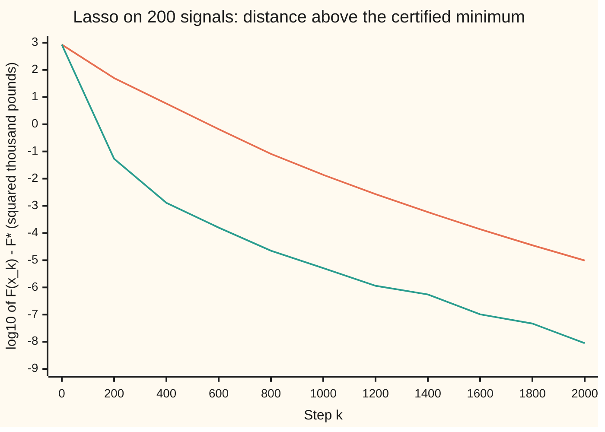

# Proximal gradient: a smooth step, then a shrink, and the lasso falls out

[Syllabus](../../../SYLLABUS.md) → [Optimization](../README.md) → [Conic, Quadratic and Stochastic Programs](../README.md#s06) → Proximal gradient

---

## General Overview

A garden centre wants to know what drives its weekly sales. It has 100 weeks of history and 200 candidate signals per week: rainfall, temperature, school holidays, its own prices, a rival's offers, web searches for "lawn feed", and more. Sales are in thousands of pounds, measured from the average week. Every signal is **standardised**: measured from its own average, in units of its own standard deviation.

The signals also move together. Spring lifts temperature, searches and footfall at once, so here each signal shares half its swing with one seasonal factor. The data are simulated, so the truth is known: nine signals matter and the other 191 add nothing.

Least squares cannot even start. Two hundred unknowns and 100 weeks means endless coefficient lists that fit every week perfectly, noise included. The **lasso** picks one by minimising a total: half the squared misses, plus a charge of λ (lambda, here 40) times the sum of the coefficients' sizes. The charge makes most coefficients exactly zero. This card **minimises** that total.

The trouble is the charge. The size of a number, |x|, has a corner at zero, where gradient descent has no slope to follow.

The **proximal gradient** method splits the work: an ordinary gradient step on the squared misses, then the charge applied exactly, by pulling every coefficient toward zero by a fixed amount and stopping at zero. That pull is **soft thresholding**.

Repeating the pair is **ISTA**; adding a momentum push is **FISTA**. Both have all 200 signals switched on after step 1, and both end on the true nine, with a printed certificate that nothing does better.

**Proximal gradient minimises a smooth cost plus a kinked charge by alternating a gradient step on the smooth part with the charge's proximal step; for the lasso's sum of sizes that step is soft thresholding, which is why the answer has exact zeros.**

**What kind of fact this is:** a method, with theorems inside it. Soft thresholding as the proximal step, ISTA's never-uphill property and its O(1/k) rate are proved on this card in Why it works. O(1/k) means the gap above the minimum shrinks in proportion to 1/k after k steps. FISTA's O(1/k²) rate is stated, with its source (Beck and Teboulle, 2009).

### The picture: how far above the minimum each method is, step by step



Orange: ISTA. Green: FISTA. Each unit down the scale is ten times closer. At step 1000 ISTA is 10^−1.86 above the minimum and FISTA 10^−5.29: the momentum bought more than three powers of ten.

---

## The formula

Notation first, in words. The 100 weekly sales form the list $y$. The table $A$ has one row per week and one column per signal; column $A_j$ is signal $j$ over the 100 weeks. The coefficients are $x$, one per signal, and $x^*$ is the minimiser. As on [Subgradients](../01-Convexity/07-subgradients.md), $\lVert x\rVert_1$ is the sum of the sizes $|x_j|$ and $\lVert v\rVert$ is ordinary length. (The regularisation card calls the coefficients $b$; the code here does too.)

The problem, split into a smooth part $f$ and a kinked charge:

$$\min_x\ F(x) = \underbrace{\tfrac12\lVert y - Ax\rVert^2}_{f(x)} \;+\; \lambda\lVert x\rVert_1$$

**Read it aloud:** find the coefficients that make half the squared misses plus lambda times the summed sizes as small as possible.

The **proximal operator** (prox) of a charge $h$ with step $\alpha$ turns any point $v$ into the point that best trades the charge against distance from $v$:

$$\operatorname{prox}_{\alpha h}(v) = \arg\min_u \Big( h(u) + \frac{1}{2\alpha}\lVert u - v\rVert^2 \Big)$$

**Read it aloud:** the prox of v is the point that keeps the charge low without straying far from v.

For $h = \lambda\lVert\cdot\rVert_1$ it is soft thresholding, entry by entry:

$$\operatorname{prox}_{\alpha\lambda\lVert\cdot\rVert_1}(v)_j = S_{\alpha\lambda}(v_j), \qquad S_\tau(v) = \operatorname{sign}(v)\,\max(|v| - \tau,\ 0)$$

**Read it aloud:** shrink each entry toward zero by alpha times lambda, and stop at zero.

ISTA, from $x_0 = 0$, with gradient $\nabla f(x) = A^\top(Ax - y)$ and step $\alpha = 1/L$:

$$x_{k+1} = S_{\alpha\lambda}\big(x_k - \alpha\,\nabla f(x_k)\big)$$

**Read it aloud:** take an ordinary gradient step on the squared misses, then shrink every coefficient toward zero by alpha times lambda.

FISTA takes the same step from a look-ahead point $z_k$, starting $z_0 = x_0$ and $t_0 = 1$:

$$x_{k+1} = S_{\alpha\lambda}\big(z_k - \alpha\,\nabla f(z_k)\big), \quad t_{k+1} = \frac{1 + \sqrt{1 + 4t_k^2}}{2}, \quad z_{k+1} = x_{k+1} + \frac{t_k - 1}{t_{k+1}}\,(x_{k+1} - x_k)$$

**Read it aloud:** step and shrink as before, but from a point pushed a little further along the last move, with the push growing toward one.

The rates, for convex $f$ whose gradient changes at most at rate $L$:

$$\text{ISTA: } F(x_k) - F^* \le \frac{L\lVert x_0 - x^*\rVert^2}{2k}, \qquad \text{FISTA: } F(x_k) - F^* \le \frac{2L\lVert x_0 - x^*\rVert^2}{(k+1)^2}$$

**Read it aloud:** after k steps, ISTA's total is above the minimum by at most L times the squared distance from start to answer, over 2k. FISTA's is at most twice that top line over (k + 1) squared, so it falls much faster.

| Symbol | Plain meaning | In our example | Push it up and the answer… |
| --- | --- | --- | --- |
| $y$, $N$ | weekly sales from the average week, £ thousand; N weeks | 100 weeks | more weeks: the nine are found more reliably |
| $A$, $A_j$, $P$ | the table of standardised signals; column j; P signals | 100 by 200 | more signals: more false candidates to shrink away |
| $x$, $x_j$, $x^*$ | the coefficients, £ thousand per standard deviation of the signal; the minimiser | 9 of 200 nonzero | — |
| $f$, $\nabla f$ | half the squared misses; its gradient, $A^\top(Ax - y)$ | $f(x^*) = 157.81$ | — |
| $\lambda$, $\lambda_{\max}$ | the charge per unit of summed size; the smallest charge that zeroes every coefficient | 40; 390.18 | more coefficients exactly zero |
| $h$, $\lVert x\rVert_1$, $\partial$ | the kinked charge, here $\lambda\lVert x\rVert_1$; sum of sizes; the subdifferential, the set of slopes at a corner | charge $\lambda\lVert x^*\rVert_1 = 401.60$ | — |
| $F$, $F^*$ | the total being minimised; its minimum | 1415.94 at $x = 0$; 559.412115 | — |
| $L$ | the largest eigenvalue of $A^\top A$: the steepest curvature of $f$ | 9437.47 | smaller safe step, slower progress |
| $\alpha$ | the step length, $1/L$ | 0.00010596 | the guarantee here needs α ≤ 1/L; past 2/L it can diverge (3/L blows up) |
| $\operatorname{prox}$, $S_\tau$, $\tau$, sign, $u$, $v$, $d$ | proximal operator; soft threshold by $\tau$; sign(v) is +1, 0 or −1 as v is positive, zero or negative; a candidate point; the point being shrunk; a move | $\tau = \alpha\lambda = 0.004238$ | bigger τ: more zeros per step |
| $x_k$, $k$, $i$, $x^+$, $z_k$, $t_k$ | the iterate after k steps, from $x_0 = 0$; i counts steps in a sum; $x^+$ is one step on from x; FISTA's look-ahead point and momentum counter | within 0.000001 of $F^*$ at k = 2367 (ISTA), 1133 (FISTA) | — |
| $r$, $\theta$ | the leftover misses $y - Ax$; a dual list of 100 numbers whose match with every signal is at most λ | θ = scaled r | — |

### When it holds

- **The smooth part's slope changes at a bounded rate $L$, and the step is at most $1/L$.** Above $2/L$ the gradient step overshoots along the steepest direction: at $3/L$ the total reaches 10^61.99 after 100 steps.
- **The charge is convex and its prox is cheap.** The sum of sizes qualifies. A charge that counts nonzeros also has a prox (keep or kill each entry), but it is not convex, and every guarantee here is lost.
- **The smooth part is convex.** Squared misses always are. Without convexity the method still goes downhill but may stop at a local minimum.
- **The bounds are about the total, measured from the start.** Both scale with $\lVert x_0 - x^*\rVert^2$, so a start near the answer helps; neither says how close the coefficients are.

---

## Why it works

### Step 0: make the smooth part simple, keep the kink exact

Gradient descent works because near the current point the cost looks like its tangent plane. The charge has no tangent plane at zero. So do not approximate it.

Replace only the smooth part by a simple bowl that sits on or above it, add the charge back unchanged, and minimise that. If the bowl touches $f$ at the current point and lies above it everywhere else, the step can never go uphill. The bowl's minimiser plus the charge turns out to be a prox, and for the sum of sizes the prox is a shrink.

### Step 1: a bowl of curvature $L$ sits above the squared misses

For any point $x$ and any move $d$, multiply out:

$$f(x + d) = f(x) + \nabla f(x)^\top d + \tfrac12\lVert Ad\rVert^2$$

The last term is at most $\tfrac{L}{2}\lVert d\rVert^2$, because $L$ is the largest eigenvalue of $A^\top A$: no direction is stretched by more. So the bowl

$$f(x) + \nabla f(x)^\top (u - x) + \frac{L}{2}\lVert u - x\rVert^2$$

equals $f$ at $u = x$ and is never below it. The checks find $L = 9437.47$ by power iteration (multiply by $A^\top A$ and rescale, 200 times) and confirm it is an eigenvalue. It is large because the shared season makes all 200 signals point roughly the same way.

### Step 2: minimising bowl plus charge is a prox

Complete the square. With $\alpha = 1/L$ the bowl is, up to a constant that does not depend on $u$,

$$\frac{1}{2\alpha}\big\lVert u - (x - \alpha\nabla f(x))\big\rVert^2$$

So the step minimises $h(u) + \frac{1}{2\alpha}\lVert u - v\rVert^2$ with $v = x - \alpha\nabla f(x)$: the ordinary gradient step, then $\operatorname{prox}_{\alpha h}$ of where it landed. That is the whole method, for any convex charge with a computable prox.

### Step 3: the prox of the sum of sizes is soft thresholding

The sum of sizes and the squared distance both add up entry by entry, so each entry is its own one-variable problem: minimise $\tau|u| + \tfrac12(u - v)^2$ with $\tau = \alpha\lambda$. By the zero-slope rule of [Subgradients](../01-Convexity/07-subgradients.md), $u$ is the minimiser exactly when 0 is a slope of the total there:

$$0 \in \tau\,\partial|u| + (u - v)$$

- If $u > 0$, the slope of $|u|$ is 1, so $u = v - \tau$. That is positive only when $v > \tau$.
- If $u < 0$, the slope is −1, so $u = v + \tau$, needing $v < -\tau$.
- If $u = 0$, the slopes of $|u|$ fill $[-1, 1]$, so 0 is a slope of the total when $|v| \le \tau$.

Together: $u = S_\tau(v)$. The [Regularisation](../../09-Probability%20and%20statistics/09-Regression/06-ridge-and-lasso.md) card met the same rule for one coefficient inside coordinate descent (which adjusts one coefficient at a time, holding the rest fixed); here it is the prox, applied to all 200 at once. The checks confirm it against a brute-force golden-section search (which keeps narrowing an interval around the lowest point) on every one of the 200 first-step entries.

### Step 4: the method stops exactly at the minimisers

A point is a minimiser when 0 is a slope of $F$ there: $-\nabla f(x) \in \lambda\,\partial\lVert x\rVert_1$. Entry by entry, with $A_j^\top(y - Ax)$ the match between signal $j$ and what is still unexplained:

- a kept signal has match exactly $\lambda$, with its coefficient's sign;
- a dropped signal has match at most $\lambda$ in size.

Step 3's three cases say $x = S_{\alpha\lambda}(x - \alpha\nabla f(x))$ exactly when these hold. So the method's resting points are the minimisers and nothing else.

One consequence comes free. At $x = 0$ the match is $A_j^\top y$, so all-zero is optimal when every $|A_j^\top y| \le \lambda$. For the garden centre the largest is $\lambda_{\max} = 390.18$: any charge at or above it keeps no signal.

### Step 5: ISTA never goes uphill, and closes the gap like 1/k

Because the bowl lies above $f$, the minimiser of bowl plus charge is at least as good as staying put: ISTA never goes uphill, and its total fell or held on all of its first 1000 steps. A sharper form of the same inequality gives the rate.

<details>
<summary>Detailed proof: ISTA's gap is at most L‖x₀ − x*‖² / (2k)</summary>

Write $x^+$ for one ISTA step from $x$, and $v = x - \nabla f(x)/L$. The prox's target, $h(u) + \frac{L}{2}\lVert u - v\rVert^2$, is a convex charge plus an exact bowl of curvature $L$, and $x^+$ minimises it. So it rises at least like that bowl away from $x^+$: for every $u$,

$$h(u) + \tfrac{L}{2}\lVert u - v\rVert^2 \ge h(x^+) + \tfrac{L}{2}\lVert x^+ - v\rVert^2 + \tfrac{L}{2}\lVert u - x^+\rVert^2.$$

Expand $\frac L2\lVert u - v\rVert^2 = \frac L2\lVert u - x\rVert^2 + \nabla f(x)^\top(u - x)$ plus a term that does not depend on $u$, and the same for $x^+$. Then

$$h(x^+) + \nabla f(x)^\top(x^+ - x) + \tfrac L2\lVert x^+ - x\rVert^2 \le h(u) + \nabla f(x)^\top(u - x) + \tfrac L2\lVert u - x\rVert^2 - \tfrac L2\lVert u - x^+\rVert^2.$$

Step 1 bounds $f(x^+)$ by $f(x) + \nabla f(x)^\top(x^+ - x) + \frac L2\lVert x^+ - x\rVert^2$. Convexity of $f$ gives $f(x) + \nabla f(x)^\top(u - x) \le f(u)$. Add $f(x)$ to both sides above and use both:

$$F(x^+) \le F(u) + \tfrac L2\big(\lVert u - x\rVert^2 - \lVert u - x^+\rVert^2\big).$$

With $u = x$ this says $F(x^+) \le F(x)$: never uphill. With $u = x^*$ and $x = x_i$:

$$F(x_{i+1}) - F^* \le \tfrac L2\big(\lVert x_i - x^*\rVert^2 - \lVert x_{i+1} - x^*\rVert^2\big).$$

Add these for $i = 0, \dots, k-1$. The right side telescopes (its middle terms cancel in pairs) to at most $\frac L2\lVert x_0 - x^*\rVert^2$. The left side has $k$ terms, each at least the last one, $F(x_k) - F^*$, because the totals never rise. So $k\,(F(x_k) - F^*) \le \frac L2\lVert x_0 - x^*\rVert^2$.

</details>

The bound is a worst case: at step 1000 it allows 10^1.87, and ISTA is at 10^−1.86. Once the nine signals are found, the problem restricted to them curves upward in every direction, and ISTA's gap shrinks by a near-fixed fraction per step: from 10^−5.01 at step 2000 to 10^−7.64 at step 3000, far below the 1/k bound.

### Step 6: momentum buys a square, FISTA

ISTA forgets how it got where it is. FISTA remembers the last move, $x_{k+1} - x_k$, and takes the next step from a point pushed further along it, by the fraction $(t_k - 1)/t_{k+1}$, which grows from 0 toward 1.

Beck and Teboulle proved, under the same hypotheses with $\alpha = 1/L$, that the gap then falls like $1/k^2$: the second bound in The formula. Their proof extends the telescoping above with a weighted choice of $u$; this card states the result, and the checks test it at every one of 3000 steps.

The price is monotonicity. FISTA overshoots and comes back, so its total rose on 363 of its first 1000 steps. The guarantee bounds the gap, not each step.

```
   k   signals kept: ISTA   FISTA
   1   ████████████████████ 200   ████████████████████ 200
  10   ████████████▏        121   ████████▋             86
  50   █████▎                53   █▏                    12
 100   ███▌                  35   █                     10
 200   ██▏                   22   ▉                      9
 500   █▏                    12   ▉                      9
1000   ▉                      9   ▉                      9
```

Every signal moves with the season, so after one step all 200 look useful. The shrink then removes them over the iterations. FISTA settles on the nine by step 200, ISTA by step 1000.

### Step 7: the certificate, a dual bound that meets the answer

"Optimal" needs evidence that does not trust the method. Take any list $\theta$ of 100 numbers whose match with every signal is at most $\lambda$ in size, $|A_j^\top\theta| \le \lambda$. Then for every $x$, with $r = y - Ax$:

- $\tfrac12\lVert r\rVert^2 \ge \theta^\top r - \tfrac12\lVert\theta\rVert^2$, since $\tfrac12\lVert r - \theta\rVert^2 \ge 0$;
- $\lambda\lVert x\rVert_1 \ge \sum_j |A_j^\top\theta|\,|x_j| \ge \theta^\top A x$.

Add them: $F(x) \ge \theta^\top y - \tfrac12\lVert\theta\rVert^2$, a floor under every possible total. The checks take $\theta$ as the leftover misses $r$, scaled down just enough to meet the match limit. At coordinate descent's answer the floor meets the total to 12 decimals: the dual gap, total minus floor, prints as 0.000000000000. So $F^* = 559.412115$ is the minimum, not merely the best found. The same answer passes Step 4's test with a worst miss of 0.000000000.

---

## Worked numbers, by hand

The first ISTA step from $x_0 = 0$. There, the gradient is $-A^\top y$, so the gradient step moves signal $j$ to $\alpha A_j^\top y$ and the shrink then subtracts $\alpha\lambda$.

| Step | Arithmetic | Value |
| --- | --- | --- |
| step length | $\alpha = 1/L = 1/9437.47$ | 0.00010596 |
| shrink per step | $\alpha\lambda = 40/9437.47$ | 0.004238 |
| signal 1, gradient step | $\alpha \times 390.18$ | 0.041344 |
| signal 1, shrink | 0.041344 − 0.004238 | 0.037105 |
| signal 2, gradient step | $\alpha \times 46.13$ | 0.004888 |
| signal 2, shrink | 0.004888 − 0.004238 | 0.000650 |
| signal 10, worth nothing | $\alpha \times 220.31 = 0.023344$, less 0.004238 | 0.019106 |
| signals kept after step 1 | every $\lvert A_j^\top y\rvert$ exceeds 40 | 200 |
| at the minimum | half squared misses 157.81 + charge 401.60 | **F\* = 559.412115** |

Step 1 gets things wrong. Signal 2 truly lowers weekly sales by £2,500 per standard deviation, yet starts positive, because the season it rides on raises sales. Signal 10 is worth nothing yet starts large. The iterations sort this out:

```
  signal   1  ############################   2.78  true  3.00
  signal   2  ################              -1.61  true -2.50
  signal   3  ###############                1.53  true  2.00
  signal   4  #########                     -0.91  true -2.00
  signal   5  #######                        0.72  true  1.50
  signal   6  #########                      0.91  true  1.50
  signal   7  ######                        -0.57  true -1.20
  signal   8  ######                         0.62  true  1.00
  signal   9  ####                           0.39  true  1.00
```

The nine kept are the true nine, with the right signs, each shrunk toward zero; the other 191 are exactly zero. No coefficient list gives a smaller total than 559.412115 squared thousand pounds, and the certificate proves it.

### What breaks if you drop a piece

| Mistake | Comes out at | What went wrong |
| --- | --- | --- |
| Step 3/L instead of 1/L | total 10^61.99 after 100 steps | Past 2/L the gradient step overshoots along the seasonal direction by more than it corrects |
| Shrink by λ instead of αλ | 0 signals kept; total stuck at F(0) = 1415.94 | The prox is of the scaled charge αλ‖x‖₁; a shrink of 40 wipes out every gradient step of about 0.04 |
| Plain subgradient steps, slope sign(x) × λ at the kink | 200 signals kept; 16.4982 above F\* after 3000 steps | A fixed step through a corner rattles across zero and never lands on it |

---

## Code, from first principles, and it actually runs

Both programs build the garden centre's 100 weeks from SplitMix64, a short random generator written out in both languages (seed 11), turned into bell-curve noise by the Box–Muller recipe. They find $L$ by power iteration and run four roads to the same lasso: ISTA, FISTA, coordinate descent (the method of the regularisation card), and the dual floor of Step 7, which certifies the minimum without trusting any of them. A golden-section search checks soft thresholding against the prox's definition. The asserts check the certificate, the agreement of the roads, both rate bounds at every step, ISTA's never-uphill property and the blow-up at step 3/L.

### Python

```python
# Proximal gradient on a lasso -- the check behind the card; only math is imported.
# A garden centre explains weekly sales (GBP thousand, measured from the average week) by
# 200 candidate signals over 100 weeks.  Every signal shares half its swing with one
# seasonal factor.  Truth: nine signals matter, noise SD 1.  Minimise
# F(x) = 1/2 |y - Ax|^2 + LAM |x|_1 by ISTA, by FISTA and by coordinate descent.
# The coefficients x are called b below; A[j] is signal j's column.
import math

N, P, LAM, RHO, SEED, K = 100, 200, 40.0, 0.5, 11, 3000
TRUE = [3.0, -2.5, 2.0, -2.0, 1.5, 1.5, -1.2, 1.0, 1.0] + [0.0] * (P - 9)
M64, state = (1 << 64) - 1, SEED

def uniform():                                # SplitMix64: a draw in (0, 1]
    global state
    state = (state + 0x9E3779B97F4A7C15) & M64
    z = ((state ^ (state >> 30)) * 0xBF58476D1CE4E5B9) & M64
    z = ((z ^ (z >> 27)) * 0x94D049BB133111EB) & M64
    return (((z ^ (z >> 31)) >> 11) + 1) * 2.0 ** -53

def normal():                                 # Box-Muller, cosine half only
    u = uniform()
    return math.sqrt(-2.0 * math.log(u)) * math.cos(2.0 * math.pi * uniform())

def dot(u, v): return sum(a * b for a, b in zip(u, v))
def Ab(b): return [sum(b[j] * A[j][i] for j in range(P) if b[j] != 0.0) for i in range(N)]
def AT(r): return [dot(a, r) for a in A]     # A transpose times r: one number per signal
def F(b): r = [u - v for u, v in zip(Ab(b), y)]; return 0.5 * dot(r, r) + LAM * sum(map(abs, b))
def soft(v, t): return math.copysign(max(abs(v) - t, 0.0), v) + 0.0   # prox of t|.|

def dual_gap(b):                              # F(b) minus a dual value: a bound on F(b) - F*
    r = [u - v for u, v in zip(y, Ab(b))]
    s = min(1.0, LAM / max(map(abs, AT(r))))  # scale r until no |A_j . theta| exceeds LAM
    return F(b) - (0.5 * dot(y, y) - 0.5 * sum((u - s * v) ** 2 for u, v in zip(y, r)))

f = [normal() for _ in range(N)]              # the seasonal factor
A = []                                        # A[j] = signal j over the 100 weeks, standardised
for j in range(P):
    c = [math.sqrt(RHO) * f[i] + math.sqrt(1 - RHO) * normal() for i in range(N)]
    m = sum(c) / N; c = [t - m for t in c]; sd = math.sqrt(dot(c, c) / N)
    A.append([t / sd for t in c])
y = [dot([A[j][i] for j in range(9)], TRUE[:9]) + normal() for i in range(N)]
m = sum(y) / N; y = [t - m for t in y]
v = [1.0] * P                                 # power iteration: L = largest eigenvalue of A'A
for _ in range(200):
    w = AT(Ab(v)); n = math.sqrt(dot(w, w)); v = [t / n for t in w]
L = dot(Ab(v), Ab(v)); al = 1.0 / L
eig_res = math.sqrt(sum((a - L * b) ** 2 for a, b in zip(AT(Ab(v)), v)))
c0 = AT(y)
print(f"setup: {N} weeks, {P} signals, lambda {LAM:.0f} (the regularisation card's {2 * LAM:.0f}), L {L:.2f}, step 1/L {al:.8f}")
print(f"lambda_max = max |A_j . y| = {max(map(abs, c0)):.2f}: at or above it every coefficient is 0; F(0) = {F([0.0] * P):.2f}")

def prox_by_search(v, t):                     # minimise t|x| + (x - v)^2 / 2 by golden section
    lo, hi, g = -abs(v) - 1.0, abs(v) + 1.0, (math.sqrt(5) - 1) / 2
    for _ in range(200):
        a, b = hi - g * (hi - lo), lo + g * (hi - lo)
        if t * abs(a) + (a - v) ** 2 / 2 < t * abs(b) + (b - v) ** 2 / 2: hi = b
        else: lo = a
    return (lo + hi) / 2
print("first ISTA step from x = 0, signals 1, 2, 10, 11:")
for j in (0, 1, 9, 10):
    x1, xs = soft(al * c0[j], al * LAM), prox_by_search(al * c0[j], al * LAM)
    print(f"  signal {j + 1:3d}: A_j.y {c0[j]:8.2f}  step*A_j.y {al * c0[j]:.6f}"
          f"  shrink {al * LAM:.6f}  x_1 {x1:.6f}  by search {xs:.6f}")
kept1 = sum(abs(t) > LAM for t in c0)
print(f"  signals kept after step 1: {kept1} (those with |A_j . y| > {LAM:.0f})")

def run(K, step, thr, momentum, subgrad=False):
    b, z, t, hist, kept = [0.0] * P, [0.0] * P, 1.0, [F([0.0] * P)], {}
    for k in range(K):
        g = AT([u - w for u, w in zip(Ab(z), y)])
        if subgrad: bn = [x - step * (gi + LAM * ((x > 0) - (x < 0))) for x, gi in zip(z, g)]
        else: bn = [soft(x - step * gi, thr) for x, gi in zip(z, g)]
        tn = (1 + math.sqrt(1 + 4 * t * t)) / 2 if momentum else 1.0
        z = [u + (t - 1) / tn * (u - w) for u, w in zip(bn, b)]
        b, t = bn, tn; hist.append(F(b)); kept[k + 1] = sum(x != 0.0 for x in b)
    return b, hist, kept

def cd(sweeps):                               # road 2: coordinate descent, one signal at a time
    b, r, nn, hist = [0.0] * P, y[:], [dot(a, a) for a in A], [F([0.0] * P)]
    for s in range(sweeps):
        for j in range(P):
            new = soft(dot(A[j], r) + nn[j] * b[j], LAM) / nn[j]
            if new != b[j]: r = [ri - (new - b[j]) * a for ri, a in zip(r, A[j])]; b[j] = new
        hist.append(F(b))
    return b, hist

bi, Hi, ki = run(K, al, al * LAM, False)
bf, Hf, kf = run(K, al, al * LAM, True)
bstar, Hc = cd(300)
Fs, gs = F(bstar), dual_gap(bstar)
d0 = dot(bstar, bstar)                        # |b_0 - b*|^2 with b_0 = 0
def first(H): return next((str(k) for k, h in enumerate(H) if h - Fs < 1e-6), "none")
def lg(x): return math.log10(max(x, 1e-16))      # log10, floored where the gap is exactly 0
print(f"F* = {Fs:.6f}, certified: dual gap {gs:.12f}")
print(f"first within 0.000001 of F*: ISTA step {first(Hi)}, FISTA step {first(Hf)},"
      f" coordinate descent sweep {first(Hc)}")
print("   k  kept: ISTA  FISTA")
for k in (1, 10, 50, 100, 200, 500, 1000):
    print(f"{k:4d} {ki[k]:11d} {kf[k]:6d}")
print("   k  log10 gap: ISTA  FISTA | log10 bound: ISTA  FISTA")
for k in (1, 10, 100, 1000, 3000):
    print(f"{k:4d} {lg(Hi[k] - Fs):16.2f} {lg(Hf[k] - Fs):6.2f} |"
          f" {math.log10(L * d0 / (2 * k)):17.2f} {math.log10(2 * L * d0 / (k + 1) ** 2):6.2f}")
ks = list(range(0, 2001, 200))
print("chart, k     ", " ".join(f"{k:6d}" for k in ks))
print("chart, ISTA  ", " ".join(f"{lg(Hi[k] - Fs):6.2f}" for k in ks))
print("chart, FISTA ", " ".join(f"{lg(Hf[k] - Fs):6.2f}" for k in ks))
print(f"steps where F rose, of the first 1000: ISTA {sum(Hi[k + 1] > Hi[k] for k in range(1000))},"
      f" FISTA {sum(Hf[k + 1] > Hf[k] for k in range(1000))}")
kkt = max(abs(g - LAM * math.copysign(1, b)) if b != 0.0 else max(abs(g) - LAM, 0.0)
          for b, g in zip(bstar, AT([u - w for u, w in zip(y, Ab(bstar))])))
gap_cd = max(abs(a - b) for a, b in zip(bf, bstar))
print(f"optimality conditions at coordinate descent's answer, worst miss: {kkt:.9f}")
print(f"FISTA against coordinate descent, largest coefficient gap: {gap_cd:.9f}")
print(f"kept: FISTA {sum(t != 0.0 for t in bf)}, ISTA {sum(t != 0.0 for t in bi)},"
      f" coordinate descent {sum(t != 0.0 for t in bstar)}")
for j in range(P):
    if bf[j] != 0.0:
        print(f"  signal {j + 1:3d}  " + f"{'#' * round(10 * abs(bf[j])):<28}" + f"  {bf[j]:5.2f}  true {TRUE[j]:5.2f}")
print(f"F* splits as half squared misses {Fs - LAM * sum(map(abs, bstar)):.2f} plus charge {LAM * sum(map(abs, bstar)):.2f}")
_, Hb, _ = run(100, 3 * al, 3 * al * LAM, False)
bl, Hl, _ = run(50, al, LAM, False)
bs, Hs, _ = run(K, al, 0.0, False, subgrad=True)
print(f"mistake, step 3/L: log10 F after 100 steps {math.log10(Hb[-1]):.2f}")
print(f"mistake, shrink by lambda not step*lambda: kept {sum(t != 0.0 for t in bl)}, F {Hl[-1]:.2f}")
print(f"mistake, subgradient steps: kept {sum(t != 0.0 for t in bs)}, F - F* after {K} steps {Hs[-1] - Fs:.4f}")
assert eig_res < 1e-6 * L                                   # L is an eigenvalue of A'A
assert all(abs(soft(al * c0[j], al * LAM) - prox_by_search(al * c0[j], al * LAM)) < 1e-7 for j in range(P))
assert abs(gs) < 1e-6 and kkt < 1e-6 and gap_cd < 1e-5      # certificate; two roads agree
assert all(Hi[k] - Fs <= L * d0 / (2 * k) for k in range(1, K + 1))          # ISTA's rate
assert all(Hf[k] - Fs <= 2 * L * d0 / (k + 1) ** 2 for k in range(1, K + 1)) # FISTA's rate
assert all(Hi[k + 1] <= Hi[k] + 1e-9 for k in range(K))     # ISTA never goes uphill
assert Hb[-1] > 1e6 * Hb[0] and Hl[-1] == F([0.0] * P)
print("ALL CHECKS PASS")
```

**Ran 2026-11-11 on macOS, Python 3.14.10, standard library only. All checks passed. Output, pasted from the run:**

```
setup: 100 weeks, 200 signals, lambda 40 (the regularisation card's 80), L 9437.47, step 1/L 0.00010596
lambda_max = max |A_j . y| = 390.18: at or above it every coefficient is 0; F(0) = 1415.94
first ISTA step from x = 0, signals 1, 2, 10, 11:
  signal   1: A_j.y   390.18  step*A_j.y 0.041344  shrink 0.004238  x_1 0.037105  by search 0.037105
  signal   2: A_j.y    46.13  step*A_j.y 0.004888  shrink 0.004238  x_1 0.000650  by search 0.000650
  signal  10: A_j.y   220.31  step*A_j.y 0.023344  shrink 0.004238  x_1 0.019106  by search 0.019106
  signal  11: A_j.y   144.84  step*A_j.y 0.015347  shrink 0.004238  x_1 0.011109  by search 0.011109
  signals kept after step 1: 200 (those with |A_j . y| > 40)
F* = 559.412115, certified: dual gap 0.000000000000
first within 0.000001 of F*: ISTA step 2367, FISTA step 1133, coordinate descent sweep 26
   k  kept: ISTA  FISTA
   1         200    200
  10         121     86
  50          53     12
 100          35     10
 200          22      9
 500          12      9
1000           9      9
   k  log10 gap: ISTA  FISTA | log10 bound: ISTA  FISTA
   1             2.77   2.77 |              4.87   4.87
  10             2.64   2.56 |              3.87   3.39
 100             2.15  -0.28 |              2.87   1.46
1000            -1.86  -5.29 |              1.87  -0.53
3000            -7.64 -10.70 |              1.39  -1.48
chart, k           0    200    400    600    800   1000   1200   1400   1600   1800   2000
chart, ISTA     2.93   1.70   0.76  -0.18  -1.09  -1.86  -2.57  -3.23  -3.86  -4.45  -5.01
chart, FISTA    2.93  -1.27  -2.89  -3.80  -4.65  -5.29  -5.94  -6.26  -6.99  -7.33  -8.05
steps where F rose, of the first 1000: ISTA 0, FISTA 363
optimality conditions at coordinate descent's answer, worst miss: 0.000000000
FISTA against coordinate descent, largest coefficient gap: 0.000000520
kept: FISTA 9, ISTA 9, coordinate descent 9
  signal   1  ############################   2.78  true  3.00
  signal   2  ################              -1.61  true -2.50
  signal   3  ###############                1.53  true  2.00
  signal   4  #########                     -0.91  true -2.00
  signal   5  #######                        0.72  true  1.50
  signal   6  #########                      0.91  true  1.50
  signal   7  ######                        -0.57  true -1.20
  signal   8  ######                         0.62  true  1.00
  signal   9  ####                           0.39  true  1.00
F* splits as half squared misses 157.81 plus charge 401.60
mistake, step 3/L: log10 F after 100 steps 61.99
mistake, shrink by lambda not step*lambda: kept 0, F 1415.94
mistake, subgradient steps: kept 200, F - F* after 3000 steps 16.4982
ALL CHECKS PASS
```

### Rust

```rust
// Proximal gradient on a lasso -- the check behind the card; std only.
// A garden centre explains weekly sales (GBP thousand, measured from the average week) by
// 200 candidate signals over 100 weeks.  Every signal shares half its swing with one
// seasonal factor.  Truth: nine signals matter, noise SD 1.  Minimise
// F(x) = 1/2 |y - Ax|^2 + LAM |x|_1 by ISTA, by FISTA and by coordinate descent.
// The coefficients x are called b below; a[j] is signal j's column.
const N: usize = 100; const P: usize = 200; const LAM: f64 = 40.0; const RHO: f64 = 0.5;
const K: usize = 3000;

struct Rng(u64);
impl Rng {
    fn uniform(&mut self) -> f64 { // SplitMix64: a draw in (0, 1]
        self.0 = self.0.wrapping_add(0x9E3779B97F4A7C15);
        let mut z = (self.0 ^ (self.0 >> 30)).wrapping_mul(0xBF58476D1CE4E5B9);
        z = (z ^ (z >> 27)).wrapping_mul(0x94D049BB133111EB);
        (((z ^ (z >> 31)) >> 11) + 1) as f64 * 2f64.powi(-53)
    }
    fn normal(&mut self) -> f64 { // Box-Muller, cosine half only
        let u = self.uniform();
        (-2.0 * u.ln()).sqrt() * (2.0 * std::f64::consts::PI * self.uniform()).cos()
    }
}
fn dot(u: &[f64], v: &[f64]) -> f64 { u.iter().zip(v).fold(0.0, |s, (a, b)| s + a * b) }
fn l1(b: &[f64]) -> f64 { b.iter().fold(0.0, |s, x| s + x.abs()) }
fn soft(v: f64, t: f64) -> f64 { (v.abs() - t).max(0.0).copysign(v) + 0.0 } // prox of t|.|
fn kept(b: &[f64]) -> usize { b.iter().filter(|x| **x != 0.0).count() }

struct Lasso { a: Vec<Vec<f64>>, y: Vec<f64> }
impl Lasso {
    fn ab(&self, b: &[f64]) -> Vec<f64> {
        (0..N).map(|i| (0..P).filter(|&j| b[j] != 0.0).fold(0.0, |s, j| s + b[j] * self.a[j][i])).collect()
    }
    fn at(&self, r: &[f64]) -> Vec<f64> { self.a.iter().map(|c| dot(c, r)).collect() } // A'r
    fn resid(&self, b: &[f64]) -> Vec<f64> { self.y.iter().zip(self.ab(b)).map(|(u, v)| u - v).collect() }
    fn f(&self, b: &[f64]) -> f64 { let r = self.resid(b); 0.5 * dot(&r, &r) + LAM * l1(b) }
    fn dual_gap(&self, b: &[f64]) -> f64 { // F(b) minus a dual value: a bound on F(b) - F*
        let r = self.resid(b);
        let s = (LAM / self.at(&r).iter().fold(0.0f64, |m, x| m.max(x.abs()))).min(1.0);
        let d = self.y.iter().zip(&r).fold(0.0, |acc, (u, v)| acc + (u - s * v) * (u - s * v));
        self.f(b) - (0.5 * dot(&self.y, &self.y) - 0.5 * d)
    }
    fn run(&self, k_max: usize, step: f64, thr: f64, momentum: bool, subgrad: bool) -> (Vec<f64>, Vec<f64>, Vec<usize>) {
        let (mut b, mut z, mut t) = (vec![0.0; P], vec![0.0; P], 1.0f64);
        let (mut hist, mut kp) = (vec![self.f(&b)], vec![P]);
        for _ in 0..k_max {
            let g: Vec<f64> = self.at(&self.ab(&z).iter().zip(&self.y).map(|(u, w)| u - w).collect::<Vec<_>>());
            let bn: Vec<f64> = z.iter().zip(&g).map(|(x, gi)| if subgrad {
                x - step * (gi + LAM * ((*x > 0.0) as i32 - (*x < 0.0) as i32) as f64)
            } else { soft(x - step * gi, thr) }).collect();
            let tn = if momentum { (1.0 + (1.0 + 4.0 * t * t).sqrt()) / 2.0 } else { 1.0 };
            z = bn.iter().zip(&b).map(|(u, w)| u + (t - 1.0) / tn * (u - w)).collect();
            b = bn; t = tn; hist.push(self.f(&b)); kp.push(kept(&b));
        }
        (b, hist, kp)
    }
    fn cd(&self, sweeps: usize) -> (Vec<f64>, Vec<f64>) { // road 2: one signal at a time
        let (mut b, mut r) = (vec![0.0; P], self.y.clone());
        let nn: Vec<f64> = self.a.iter().map(|c| dot(c, c)).collect();
        let mut hist = vec![self.f(&b)];
        for _ in 0..sweeps {
            for j in 0..P {
                let new = soft(dot(&self.a[j], &r) + nn[j] * b[j], LAM) / nn[j];
                if new != b[j] { for i in 0..N { r[i] -= (new - b[j]) * self.a[j][i]; } b[j] = new; }
            }
            hist.push(self.f(&b));
        }
        (b, hist)
    }
}
fn prox_by_search(v: f64, t: f64) -> f64 { // minimise t|x| + (x - v)^2 / 2 by golden section
    let (mut lo, mut hi, g) = (-v.abs() - 1.0, v.abs() + 1.0, (5f64.sqrt() - 1.0) / 2.0);
    for _ in 0..200 {
        let (a, b) = (hi - g * (hi - lo), lo + g * (hi - lo));
        if t * a.abs() + (a - v) * (a - v) / 2.0 < t * b.abs() + (b - v) * (b - v) / 2.0 { hi = b } else { lo = a }
    }
    (lo + hi) / 2.0
}

fn main() {
    let mut rng = Rng(11);
    let mut truth = vec![0.0; P];
    truth[..9].copy_from_slice(&[3.0, -2.5, 2.0, -2.0, 1.5, 1.5, -1.2, 1.0, 1.0]);
    let f: Vec<f64> = (0..N).map(|_| rng.normal()).collect(); // the seasonal factor
    let mut a = Vec::new(); // a[j] = signal j over the 100 weeks, standardised
    for _ in 0..P {
        let c: Vec<f64> = (0..N).map(|i| RHO.sqrt() * f[i] + (1.0 - RHO).sqrt() * rng.normal()).collect();
        let m = c.iter().sum::<f64>() / N as f64;
        let c: Vec<f64> = c.iter().map(|t| t - m).collect();
        let sd = (dot(&c, &c) / N as f64).sqrt();
        a.push(c.iter().map(|t| t / sd).collect::<Vec<f64>>());
    }
    let y: Vec<f64> = (0..N).map(|i| dot(&(0..9).map(|j| a[j][i]).collect::<Vec<_>>(), &truth[..9]) + rng.normal()).collect();
    let m = y.iter().sum::<f64>() / N as f64;
    let ls = Lasso { a, y: y.iter().map(|t| t - m).collect() };
    let mut v = vec![1.0; P]; // power iteration: L = largest eigenvalue of A'A
    for _ in 0..200 { let w = ls.at(&ls.ab(&v)); let n = dot(&w, &w).sqrt(); v = w.iter().map(|t| t / n).collect(); }
    let av = ls.ab(&v);
    let l = dot(&av, &av); let al = 1.0 / l;
    let eig_res = ls.at(&av).iter().zip(&v).fold(0.0, |s, (x, w)| s + (x - l * w) * (x - l * w)).sqrt();
    let c0 = ls.at(&ls.y);
    let cmax = c0.iter().fold(0.0f64, |m, x| m.max(x.abs()));
    println!("setup: {} weeks, {} signals, lambda {:.0} (the regularisation card's {:.0}), L {:.2}, step 1/L {:.8}", N, P, LAM, 2.0 * LAM, l, al);
    println!("lambda_max = max |A_j . y| = {:.2}: at or above it every coefficient is 0; F(0) = {:.2}", cmax, ls.f(&vec![0.0; P]));
    println!("first ISTA step from x = 0, signals 1, 2, 10, 11:");
    for j in [0usize, 1, 9, 10] {
        let (x1, xs) = (soft(al * c0[j], al * LAM), prox_by_search(al * c0[j], al * LAM));
        println!("  signal {:3}: A_j.y {:8.2}  step*A_j.y {:.6}  shrink {:.6}  x_1 {:.6}  by search {:.6}",
                 j + 1, c0[j], al * c0[j], al * LAM, x1, xs);
    }
    let kept1 = c0.iter().filter(|t| t.abs() > LAM).count();
    println!("  signals kept after step 1: {} (those with |A_j . y| > {:.0})", kept1, LAM);
    let (bi, hi, ki) = ls.run(K, al, al * LAM, false, false);
    let (bf, hf, kf) = ls.run(K, al, al * LAM, true, false);
    let (bstar, hc) = ls.cd(300);
    let (fs, gs) = (ls.f(&bstar), ls.dual_gap(&bstar));
    let d0 = dot(&bstar, &bstar); // |b_0 - b*|^2 with b_0 = 0
    let first = |h: &Vec<f64>| h.iter().position(|x| x - fs < 1e-6).map_or("none".to_string(), |k| k.to_string());
    let lg = |x: f64| x.max(1e-16).log10(); // log10, floored where the gap is exactly 0
    println!("F* = {:.6}, certified: dual gap {:.12}", fs, gs);
    println!("first within 0.000001 of F*: ISTA step {}, FISTA step {}, coordinate descent sweep {}",
             first(&hi), first(&hf), first(&hc));
    println!("   k  kept: ISTA  FISTA");
    for k in [1usize, 10, 50, 100, 200, 500, 1000] { println!("{:4} {:11} {:6}", k, ki[k], kf[k]); }
    println!("   k  log10 gap: ISTA  FISTA | log10 bound: ISTA  FISTA");
    let bi_bound = |k: usize| l * d0 / (2 * k) as f64;
    let bf_bound = |k: usize| 2.0 * l * d0 / ((k + 1) * (k + 1)) as f64;
    for k in [1usize, 10, 100, 1000, 3000] {
        println!("{:4} {:16.2} {:6.2} | {:17.2} {:6.2}", k, lg(hi[k] - fs), lg(hf[k] - fs),
                 bi_bound(k).log10(), bf_bound(k).log10());
    }
    let ks: Vec<usize> = (0..=2000).step_by(200).collect();
    let row = |h: &Vec<f64>| ks.iter().map(|&k| format!("{:6.2}", lg(h[k] - fs))).collect::<Vec<_>>().join(" ");
    println!("chart, k      {}", ks.iter().map(|k| format!("{:6}", k)).collect::<Vec<_>>().join(" "));
    println!("chart, ISTA   {}", row(&hi));
    println!("chart, FISTA  {}", row(&hf));
    let rises = |h: &Vec<f64>| (0..1000).filter(|&k| h[k + 1] > h[k]).count();
    println!("steps where F rose, of the first 1000: ISTA {}, FISTA {}", rises(&hi), rises(&hf));
    let gstar = ls.at(&ls.resid(&bstar));
    let kkt = bstar.iter().zip(&gstar).fold(0.0f64, |m, (b, g)| m.max(if *b != 0.0 {
        (g - LAM * 1f64.copysign(*b)).abs() } else { (g.abs() - LAM).max(0.0) }));
    let gap_cd = bf.iter().zip(&bstar).fold(0.0f64, |m, (a, b)| m.max((a - b).abs()));
    println!("optimality conditions at coordinate descent's answer, worst miss: {:.9}", kkt);
    println!("FISTA against coordinate descent, largest coefficient gap: {:.9}", gap_cd);
    println!("kept: FISTA {}, ISTA {}, coordinate descent {}", kept(&bf), kept(&bi), kept(&bstar));
    for j in 0..P {
        if bf[j] != 0.0 {
            let bar = "#".repeat((10.0 * bf[j].abs()).round() as usize);
            println!("  signal {:3}  {:<28}  {:5.2}  true {:5.2}", j + 1, bar, bf[j], truth[j]);
        }
    }
    println!("F* splits as half squared misses {:.2} plus charge {:.2}", fs - LAM * l1(&bstar), LAM * l1(&bstar));
    let (_, hb, _) = ls.run(100, 3.0 * al, 3.0 * al * LAM, false, false);
    let (bl, hl, _) = ls.run(50, al, LAM, false, false);
    let (bs, hs, _) = ls.run(K, al, 0.0, false, true);
    println!("mistake, step 3/L: log10 F after 100 steps {:.2}", hb[100].log10());
    println!("mistake, shrink by lambda not step*lambda: kept {}, F {:.2}", kept(&bl), hl[50]);
    println!("mistake, subgradient steps: kept {}, F - F* after {} steps {:.4}", kept(&bs), K, hs[K] - fs);
    assert!(eig_res < 1e-6 * l); // L is an eigenvalue of A'A
    assert!((0..P).all(|j| (soft(al * c0[j], al * LAM) - prox_by_search(al * c0[j], al * LAM)).abs() < 1e-7));
    assert!(gs.abs() < 1e-6 && kkt < 1e-6 && gap_cd < 1e-5); // certificate; two roads agree
    assert!((1..=K).all(|k| hi[k] - fs <= bi_bound(k))); // ISTA's rate
    assert!((1..=K).all(|k| hf[k] - fs <= bf_bound(k))); // FISTA's rate
    assert!((0..K).all(|k| hi[k + 1] <= hi[k] + 1e-9)); // ISTA never goes uphill
    assert!(hb[100] > 1e6 * hb[0] && hl[50] == ls.f(&vec![0.0; P]));
    println!("ALL CHECKS PASS");
}
```

**Ran 2026-11-11 on macOS, rustc 1.98.1, no crates. All checks passed. Output, pasted from the run:**

```
setup: 100 weeks, 200 signals, lambda 40 (the regularisation card's 80), L 9437.47, step 1/L 0.00010596
lambda_max = max |A_j . y| = 390.18: at or above it every coefficient is 0; F(0) = 1415.94
first ISTA step from x = 0, signals 1, 2, 10, 11:
  signal   1: A_j.y   390.18  step*A_j.y 0.041344  shrink 0.004238  x_1 0.037105  by search 0.037105
  signal   2: A_j.y    46.13  step*A_j.y 0.004888  shrink 0.004238  x_1 0.000650  by search 0.000650
  signal  10: A_j.y   220.31  step*A_j.y 0.023344  shrink 0.004238  x_1 0.019106  by search 0.019106
  signal  11: A_j.y   144.84  step*A_j.y 0.015347  shrink 0.004238  x_1 0.011109  by search 0.011109
  signals kept after step 1: 200 (those with |A_j . y| > 40)
F* = 559.412115, certified: dual gap 0.000000000000
first within 0.000001 of F*: ISTA step 2367, FISTA step 1133, coordinate descent sweep 26
   k  kept: ISTA  FISTA
   1         200    200
  10         121     86
  50          53     12
 100          35     10
 200          22      9
 500          12      9
1000           9      9
   k  log10 gap: ISTA  FISTA | log10 bound: ISTA  FISTA
   1             2.77   2.77 |              4.87   4.87
  10             2.64   2.56 |              3.87   3.39
 100             2.15  -0.28 |              2.87   1.46
1000            -1.86  -5.29 |              1.87  -0.53
3000            -7.64 -10.70 |              1.39  -1.48
chart, k           0    200    400    600    800   1000   1200   1400   1600   1800   2000
chart, ISTA     2.93   1.70   0.76  -0.18  -1.09  -1.86  -2.57  -3.23  -3.86  -4.45  -5.01
chart, FISTA    2.93  -1.27  -2.89  -3.80  -4.65  -5.29  -5.94  -6.26  -6.99  -7.33  -8.05
steps where F rose, of the first 1000: ISTA 0, FISTA 363
optimality conditions at coordinate descent's answer, worst miss: 0.000000000
FISTA against coordinate descent, largest coefficient gap: 0.000000520
kept: FISTA 9, ISTA 9, coordinate descent 9
  signal   1  ############################   2.78  true  3.00
  signal   2  ################              -1.61  true -2.50
  signal   3  ###############                1.53  true  2.00
  signal   4  #########                     -0.91  true -2.00
  signal   5  #######                        0.72  true  1.50
  signal   6  #########                      0.91  true  1.50
  signal   7  ######                        -0.57  true -1.20
  signal   8  ######                         0.62  true  1.00
  signal   9  ####                           0.39  true  1.00
F* splits as half squared misses 157.81 plus charge 401.60
mistake, step 3/L: log10 F after 100 steps 61.99
mistake, shrink by lambda not step*lambda: kept 0, F 1415.94
mistake, subgradient steps: kept 200, F - F* after 3000 steps 16.4982
ALL CHECKS PASS
```

### Lean

Lean proves Steps 3, 4 and 5 of Why it works for every table, sales list, charge $\lambda \ge 0$ and start.

- For any shrink $\tau \ge 0$, the prox of $\tau$ times the sum of sizes is soft thresholding by $\tau$, entry by entry. No other point minimises.
- Take any $L > 0$ with $\lVert Ad\rVert^2 \le L\lVert d\rVert^2$ for every move $d$. ISTA with step $1/L$ never goes uphill.
- With that same $L$, after $k \ge 1$ steps ISTA's total is above the minimum by at most $L\lVert x_0 - x^*\rVert^2/(2k)$.
- For any $L > 0$, a point is left unchanged by an ISTA step exactly when it minimises the total.

FISTA's 1/k² rate, the dual certificate, the value of $L$ and the garden centre's numbers are left to the Python and Rust checks.

```lean
-- Proximal gradient: for the lasso, the prox of the sum of sizes is soft thresholding, ISTA never goes uphill and its gap above the minimum after k steps is at most L‖x₀ − x*‖²/(2k), and ISTA's resting points are exactly the minimisers.
import Mathlib.Data.Real.Sign
import Mathlib.Data.Matrix.Mul
import Mathlib.Algebra.Order.BigOperators.Group.Finset
import Mathlib

open Matrix

/-! The coefficients are `x : Fin n → ℝ`, one per signal. The table is `A`, a matrix with one
row per week (`m` weeks) and one column per signal, and `y : Fin m → ℝ` is the weekly sales.
`A *ᵥ x` is the matrix times the list, and `Aᵀ` is the transpose. The smooth part is
`f(x) = ½‖y − Ax‖²`, its gradient is `Aᵀ(Ax − y)`, and the charge is `λ‖x‖₁ = λ ∑ |x_j|`.

The step is `α = 1/L`. "The slope of the smooth part changes at rate at most `L`" is the card's
Step 1 bowl: `‖Ad‖² ≤ L‖d‖²` for every move `d`. The card takes `L` to be the largest
eigenvalue of `AᵀA`; any `L` with this bound is allowed here, which includes that one and covers
every step `1/L` at most one over the largest eigenvalue. "The charge is convex" is `0 ≤ λ`. -/

/-- Soft thresholding `S_τ(v) = sign(v) · max(|v| − τ, 0)`: pull `v` toward zero by `τ`
and stop at zero. -/
noncomputable def softThreshold (τ v : ℝ) : ℝ := Real.sign v * max (|v| - τ) 0

/-- The lasso total `F(x) = ½‖y − Ax‖² + λ‖x‖₁`. -/
noncomputable def lassoTotal {m n : ℕ} (A : Matrix (Fin m) (Fin n) ℝ) (y : Fin m → ℝ)
    (lam : ℝ) (x : Fin n → ℝ) : ℝ :=
  (1 / 2) * ∑ i, (y i - (A *ᵥ x) i) ^ 2 + lam * ∑ j, |x j|

/-- One ISTA step with step length `1/L`: a gradient step on the squared misses,
`x − (1/L) Aᵀ(Ax − y)`, then soft thresholding of every entry by `λ/L`. -/
noncomputable def istaStep {m n : ℕ} (A : Matrix (Fin m) (Fin n) ℝ) (y : Fin m → ℝ)
    (lam L : ℝ) (x : Fin n → ℝ) : Fin n → ℝ :=
  fun j => softThreshold (lam / L) (x j - (1 / L) * (Aᵀ *ᵥ (A *ᵥ x - y)) j)

/-- One coordinate: soft thresholding minimises `τ|w| + ½(w − v)²`, with a quadratic margin. -/
theorem soft_threshold_one_dim {τ : ℝ} (hτ : 0 ≤ τ) (v w : ℝ) :
    τ * |softThreshold τ v| + (1 / 2) * (softThreshold τ v - v) ^ 2 +
        (1 / 2) * (w - softThreshold τ v) ^ 2 ≤
      τ * |w| + (1 / 2) * (w - v) ^ 2 := by
  unfold softThreshold
  rcases lt_or_ge τ v with h | h
  · have hv : 0 < v := lt_of_le_of_lt hτ h
    rw [Real.sign_of_pos hv, abs_of_pos hv, max_eq_left (by linarith), one_mul,
      abs_of_nonneg (by linarith)]
    have := le_abs_self w
    nlinarith
  · rcases lt_or_ge v (-τ) with h' | h'
    · have hv : v < 0 := by linarith
      rw [Real.sign_of_neg hv, abs_of_neg hv, max_eq_left (by linarith),
        abs_of_nonpos (by linarith)]
      have := neg_abs_le w
      nlinarith
    · have hav : |v| - τ ≤ 0 := by rw [sub_nonpos, abs_le]; constructor <;> linarith
      rw [max_eq_right hav, mul_zero]
      simp only [abs_zero, mul_zero, zero_sub, zero_add, sub_zero]
      have h1 : w * v ≤ τ * |w| := by
        rcases abs_cases w with ⟨hw, _⟩ | ⟨hw, _⟩ <;> rw [hw] <;> nlinarith
      have e1 : (w - v) ^ 2 = w ^ 2 - 2 * (w * v) + v ^ 2 := by ring
      have e2 : (-v) ^ 2 = v ^ 2 := by ring
      rw [e1, e2]
      linarith
#print axioms soft_threshold_one_dim

/-- A sum of squares that is at most zero forces equality. -/
theorem eq_of_sum_sq_sub_nonpos {n : ℕ} (u v : Fin n → ℝ)
    (h : ∑ j, (u j - v j) ^ 2 ≤ 0) : u = v := by
  have h0 : ∑ j, (u j - v j) ^ 2 = 0 :=
    le_antisymm h (Finset.sum_nonneg fun j _ => sq_nonneg _)
  rw [Finset.sum_eq_zero_iff_of_nonneg (fun j _ => sq_nonneg _)] at h0
  funext j
  have := h0 j (Finset.mem_univ j)
  have := pow_eq_zero_iff (n := 2) (by norm_num) |>.mp this
  linarith
#print axioms eq_of_sum_sq_sub_nonpos

/-- The transpose moves across the dot product. -/
theorem sum_transpose_mulVec_mul {m n : ℕ} (A : Matrix (Fin m) (Fin n) ℝ) (r : Fin m → ℝ)
    (d : Fin n → ℝ) : ∑ j, (Aᵀ *ᵥ r) j * d j = ∑ i, r i * (A *ᵥ d) i := by
  change (Aᵀ *ᵥ r) ⬝ᵥ d = r ⬝ᵥ (A *ᵥ d)
  rw [mulVec_transpose, dotProduct_mulVec]
#print axioms sum_transpose_mulVec_mul

/-- Exact expansion of the squared misses around `x`. -/
theorem sq_misses_expand {m n : ℕ} (A : Matrix (Fin m) (Fin n) ℝ) (y : Fin m → ℝ)
    (x z : Fin n → ℝ) :
    ∑ i, (y i - (A *ᵥ z) i) ^ 2 = ∑ i, (y i - (A *ᵥ x) i) ^ 2 +
      2 * ∑ j, (Aᵀ *ᵥ (A *ᵥ x - y)) j * (z j - x j) + ∑ i, ((A *ᵥ (z - x)) i) ^ 2 := by
  have hc : ∑ j, (Aᵀ *ᵥ (A *ᵥ x - y)) j * (z j - x j) =
      ∑ j, (Aᵀ *ᵥ (A *ᵥ x - y)) j * (z - x) j := rfl
  rw [hc, sum_transpose_mulVec_mul, Finset.mul_sum, ← Finset.sum_add_distrib,
    ← Finset.sum_add_distrib]
  refine Finset.sum_congr rfl fun i _ => ?_
  simp only [mulVec_sub, Pi.sub_apply]
  ring
#print axioms sq_misses_expand

/-- The prox step inequality for one ISTA step (needs no curvature bound): with
`g = Aᵀ(Ax − y)` and `x⁺ = T x`, for every `w`,
`λ‖x⁺‖₁ + (L/2)‖x⁺ − x‖² + ⟨g, x⁺ − x⟩ + (L/2)‖w − x⁺‖² ≤ λ‖w‖₁ + (L/2)‖w − x‖² + ⟨g, w − x⟩`. -/
theorem ista_prox_ineq {m n : ℕ} (A : Matrix (Fin m) (Fin n) ℝ) (y : Fin m → ℝ) {lam L : ℝ}
    (hlam : 0 ≤ lam) (hL : 0 < L) (x w : Fin n → ℝ) :
    lam * ∑ j, |istaStep A y lam L x j| +
        L / 2 * ∑ j, (istaStep A y lam L x j - x j) ^ 2 +
        ∑ j, (Aᵀ *ᵥ (A *ᵥ x - y)) j * (istaStep A y lam L x j - x j) +
        L / 2 * ∑ j, (w j - istaStep A y lam L x j) ^ 2 ≤
      lam * ∑ j, |w j| + L / 2 * ∑ j, (w j - x j) ^ 2 +
        ∑ j, (Aᵀ *ᵥ (A *ᵥ x - y)) j * (w j - x j) := by
  set g := Aᵀ *ᵥ (A *ᵥ x - y) with hg
  set xp := istaStep A y lam L x with hxp
  have hτ : 0 ≤ lam / L := div_nonneg hlam hL.le
  have hpt : ∀ j, lam * |xp j| + L / 2 * (xp j - x j) ^ 2 + g j * (xp j - x j) +
      L / 2 * (w j - xp j) ^ 2 ≤ lam * |w j| + L / 2 * (w j - x j) ^ 2 + g j * (w j - x j) := by
    intro j
    have h1 := soft_threshold_one_dim hτ (x j - 1 / L * g j) (w j)
    have hxpj : xp j = softThreshold (lam / L) (x j - 1 / L * g j) := rfl
    rw [← hxpj] at h1
    have h2 := mul_le_mul_of_nonneg_left h1 hL.le
    have e1 : L * (lam / L * |w j| + 1 / 2 * (w j - (x j - 1 / L * g j)) ^ 2) =
        lam * |w j| + L / 2 * (w j - x j) ^ 2 + g j * (w j - x j) + g j ^ 2 / (2 * L) := by
      field_simp; ring
    have e2 : L * (lam / L * |xp j| + 1 / 2 * (xp j - (x j - 1 / L * g j)) ^ 2 +
        1 / 2 * (w j - xp j) ^ 2) =
        lam * |xp j| + L / 2 * (xp j - x j) ^ 2 + g j * (xp j - x j) + g j ^ 2 / (2 * L) +
          L / 2 * (w j - xp j) ^ 2 := by
      field_simp; ring
    linarith
  have hsum := Finset.sum_le_sum fun j (_ : j ∈ Finset.univ) => hpt j
  simp only [Finset.sum_add_distrib, ← Finset.mul_sum] at hsum
  exact hsum
#print axioms ista_prox_ineq

/-- The basic ISTA inequality: for every `w`,
`F(T x) ≤ F(w) + (L/2)‖w − x‖² − (L/2)‖w − T x‖²`. -/
theorem ista_key_ineq {m n : ℕ} (A : Matrix (Fin m) (Fin n) ℝ) (y : Fin m → ℝ) {lam L : ℝ}
    (hlam : 0 ≤ lam) (hL : 0 < L)
    (hcurv : ∀ d : Fin n → ℝ, ∑ i, ((A *ᵥ d) i) ^ 2 ≤ L * ∑ j, (d j) ^ 2)
    (x w : Fin n → ℝ) :
    lassoTotal A y lam (istaStep A y lam L x) ≤ lassoTotal A y lam w +
      L / 2 * ∑ j, (w j - x j) ^ 2 - L / 2 * ∑ j, (w j - istaStep A y lam L x j) ^ 2 := by
  have hsum := ista_prox_ineq A y hlam hL x w
  set xp := istaStep A y lam L x with hxp
  have ex := sq_misses_expand A y x xp
  have ew := sq_misses_expand A y x w
  have hc := hcurv (xp - x)
  have hnn : 0 ≤ ∑ i, ((A *ᵥ (w - x)) i) ^ 2 := Finset.sum_nonneg fun i _ => sq_nonneg _
  have hcx : ∑ j, ((xp - x) j) ^ 2 = ∑ j, (xp j - x j) ^ 2 := rfl
  rw [hcx] at hc
  unfold lassoTotal
  nlinarith
#print axioms ista_key_ineq

/-- **ISTA never goes uphill and closes the gap like 1/k.** Take any table `A`, sales `y`,
charge `λ ≥ 0`, and a curvature bound `L > 0` with `‖Ad‖² ≤ L‖d‖²` for every move `d`.
Run ISTA with step `1/L` from any start `x₀`, and let `x*` be a minimiser of the lasso total `F`.
Then the total never rises from one step to the next, and after `k ≥ 1` steps
`F(x_k) − F(x*) ≤ L‖x₀ − x*‖² / (2k)`. -/
theorem ista_never_uphill_and_gap_le_L_dist_sq_div_two_k {m n : ℕ}
    (A : Matrix (Fin m) (Fin n) ℝ) (y : Fin m → ℝ) {lam L : ℝ} (hlam : 0 ≤ lam) (hL : 0 < L)
    (hcurv : ∀ d : Fin n → ℝ, ∑ i, ((A *ᵥ d) i) ^ 2 ≤ L * ∑ j, (d j) ^ 2)
    (x₀ xstar : Fin n → ℝ) (hmin : ∀ u, lassoTotal A y lam xstar ≤ lassoTotal A y lam u) :
    (∀ k : ℕ, lassoTotal A y lam ((istaStep A y lam L)^[k + 1] x₀) ≤
        lassoTotal A y lam ((istaStep A y lam L)^[k] x₀)) ∧
    (∀ k : ℕ, 0 < k →
      lassoTotal A y lam ((istaStep A y lam L)^[k] x₀) - lassoTotal A y lam xstar ≤
        L * (∑ j, (x₀ j - xstar j) ^ 2) / (2 * k)) := by
  have key := fun x w => ista_key_ineq A y hlam hL hcurv x w
  set T := istaStep A y lam L
  set F := lassoTotal A y lam
  have mono : ∀ k : ℕ, F (T^[k + 1] x₀) ≤ F (T^[k] x₀) := by
    intro k
    have h := key (T^[k] x₀) (T^[k] x₀)
    rw [Function.iterate_succ_apply']
    have h0 : ∑ j, ((T^[k] x₀) j - (T^[k] x₀) j) ^ 2 = 0 := by simp
    have h1 : 0 ≤ ∑ j, ((T^[k] x₀) j - T (T^[k] x₀) j) ^ 2 :=
      Finset.sum_nonneg fun j _ => sq_nonneg _
    rw [h0] at h
    nlinarith
  refine ⟨mono, ?_⟩
  have ind : ∀ k : ℕ, (k : ℝ) * (F (T^[k] x₀) - F xstar) +
      L / 2 * ∑ j, (xstar j - (T^[k] x₀) j) ^ 2 ≤ L / 2 * ∑ j, (xstar j - x₀ j) ^ 2 := by
    intro k
    induction k with
    | zero => simp
    | succ k ih =>
      have h := key (T^[k] x₀) xstar
      rw [← Function.iterate_succ_apply' T k x₀] at h
      have hm := mono k
      have hk : (0 : ℝ) ≤ k := Nat.cast_nonneg k
      have h2 : (k : ℝ) * (F (T^[k + 1] x₀) - F xstar) ≤ (k : ℝ) * (F (T^[k] x₀) - F xstar) :=
        mul_le_mul_of_nonneg_left (by linarith) hk
      push_cast
      nlinarith
  intro k hk
  have h := ind k
  have hD : 0 ≤ ∑ j, (xstar j - (T^[k] x₀) j) ^ 2 := Finset.sum_nonneg fun j _ => sq_nonneg _
  have hswap : ∑ j, (xstar j - x₀ j) ^ 2 = ∑ j, (x₀ j - xstar j) ^ 2 :=
    Finset.sum_congr rfl fun j _ => by ring
  rw [hswap] at h
  have hkpos : (0 : ℝ) < k := by exact_mod_cast hk
  rw [le_div_iff₀ (by positivity)]
  nlinarith

/-- **The prox of the sum of sizes is soft thresholding.** For a shrink `τ ≥ 0` and any point
`v`, the points `u` that minimise `τ‖u‖₁ + ½‖u − v‖²` are exactly one: the list that applies
`S_τ` to every entry of `v`. -/
theorem prox_sum_of_sizes_eq_soft_threshold {n : ℕ} {τ : ℝ} (hτ : 0 ≤ τ) (v u : Fin n → ℝ) :
    (∀ w : Fin n → ℝ, τ * ∑ j, |u j| + (1 / 2) * ∑ j, (u j - v j) ^ 2 ≤
        τ * ∑ j, |w j| + (1 / 2) * ∑ j, (w j - v j) ^ 2) ↔
      u = fun j => softThreshold τ (v j) := by
  constructor
  · intro h
    have h1 := h (fun j => softThreshold τ (v j))
    have h2 := Finset.sum_le_sum fun j (_ : j ∈ Finset.univ) =>
      soft_threshold_one_dim hτ (v j) (u j)
    simp only [Finset.sum_add_distrib, ← Finset.mul_sum] at h2
    apply eq_of_sum_sq_sub_nonpos
    nlinarith
  · rintro rfl w
    have h2 := Finset.sum_le_sum fun j (_ : j ∈ Finset.univ) =>
      soft_threshold_one_dim hτ (v j) (w j)
    simp only [Finset.sum_add_distrib, ← Finset.mul_sum] at h2
    have h3 : 0 ≤ ∑ j, (w j - softThreshold τ (v j)) ^ 2 :=
      Finset.sum_nonneg fun j _ => sq_nonneg _
    nlinarith

/-- **ISTA stops exactly at the minimisers.** For a charge `λ ≥ 0` and a step `1/L` with
`L > 0`, a list `x` is left unchanged by an ISTA step exactly when it minimises the lasso
total. -/
theorem ista_fixed_point_iff_minimiser {m n : ℕ} (A : Matrix (Fin m) (Fin n) ℝ)
    (y : Fin m → ℝ) {lam L : ℝ} (hlam : 0 ≤ lam) (hL : 0 < L) (x : Fin n → ℝ) :
    istaStep A y lam L x = x ↔ ∀ u, lassoTotal A y lam x ≤ lassoTotal A y lam u := by
  have hsum := fun w => ista_prox_ineq A y hlam hL x w
  set g := Aᵀ *ᵥ (A *ᵥ x - y) with hg
  set xp := istaStep A y lam L x with hxp
  constructor
  · intro hfix w
    have h := hsum w
    rw [hfix] at h
    simp only [sub_self, mul_zero, Finset.sum_const_zero, ne_eq, OfNat.ofNat_ne_zero,
      not_false_eq_true, zero_pow, add_zero] at h
    have ew := sq_misses_expand A y x w
    have hnn : 0 ≤ ∑ i, ((A *ᵥ (w - x)) i) ^ 2 := Finset.sum_nonneg fun i _ => sq_nonneg _
    unfold lassoTotal
    nlinarith
  · intro hmin
    have h := hsum x
    simp only [sub_self, mul_zero, Finset.sum_const_zero, ne_eq, OfNat.ofNat_ne_zero,
      not_false_eq_true, zero_pow, add_zero] at h
    set d : Fin n → ℝ := fun j => xp j - x j with hd
    set D := ∑ j, (xp j - x j) ^ 2 with hD
    set K := ∑ i, ((A *ᵥ d) i) ^ 2 with hK
    set a := ∑ j, g j * (xp j - x j) + lam * ∑ j, |xp j| - lam * ∑ j, |x j| with ha
    have hswap : ∑ j, (x j - xp j) ^ 2 = D := Finset.sum_congr rfl fun j _ => by ring
    rw [hswap] at h
    have haD : a ≤ -(L * D) := by rw [ha]; linarith
    have hK0 : 0 ≤ K := Finset.sum_nonneg fun i _ => sq_nonneg _
    have hD0 : 0 ≤ D := Finset.sum_nonneg fun j _ => sq_nonneg _
    -- minimality along the segment from `x` toward `xp`
    have hseg : ∀ t : ℝ, 0 < t → t ≤ 1 → 0 ≤ t * a + t ^ 2 * K / 2 := by
      intro t ht0 ht1
      have hm := hmin (fun j => x j + t * d j)
      have ex := sq_misses_expand A y x (fun j => x j + t * d j)
      have hdiff : (fun j => x j + t * d j) - x = t • d := by
        funext j; simp
      rw [hdiff, mulVec_smul] at ex
      have hK' : ∑ i, ((t • (A *ᵥ d)) i) ^ 2 = t ^ 2 * K := by
        rw [hK, Finset.mul_sum]
        refine Finset.sum_congr rfl fun i _ => ?_
        simp only [Pi.smul_apply, smul_eq_mul]; ring
      have hg' : ∑ j, g j * (x j + t * d j - x j) = t * ∑ j, g j * (xp j - x j) := by
        rw [Finset.mul_sum]
        refine Finset.sum_congr rfl fun j _ => ?_
        simp only [hd]; ring
      have habs : ∑ j, |x j + t * d j| ≤ (1 - t) * ∑ j, |x j| + t * ∑ j, |xp j| := by
        rw [Finset.mul_sum, Finset.mul_sum, ← Finset.sum_add_distrib]
        refine Finset.sum_le_sum fun j _ => ?_
        have e : x j + t * d j = (1 - t) * x j + t * xp j := by simp only [hd]; ring
        rw [e]
        calc |(1 - t) * x j + t * xp j| ≤ |(1 - t) * x j| + |t * xp j| := abs_add_le _ _
          _ = (1 - t) * |x j| + t * |xp j| := by
            rw [abs_mul, abs_mul, abs_of_nonneg (by linarith), abs_of_pos ht0]
      rw [hK', hg'] at ex
      unfold lassoTotal at hm
      have hl := mul_le_mul_of_nonneg_left habs hlam
      rw [ha]
      nlinarith
    have ha0 : 0 ≤ a := by
      by_contra hneg
      rw [not_le] at hneg
      set t := min 1 (-a / (K + 1)) with ht
      have ht0 : 0 < t := lt_min one_pos (div_pos (by linarith) (by linarith))
      have ht1 : t ≤ 1 := min_le_left _ _
      have ht2 : t ≤ -a / (K + 1) := min_le_right _ _
      rw [le_div_iff₀ (by linarith)] at ht2
      have := hseg t ht0 ht1
      nlinarith [mul_pos ht0 ht0]
    have hDle : D ≤ 0 := by nlinarith
    exact eq_of_sum_sq_sub_nonpos xp x hDle

#print axioms ista_never_uphill_and_gap_le_L_dist_sq_div_two_k
#print axioms prox_sum_of_sizes_eq_soft_threshold
#print axioms ista_fixed_point_iff_minimiser
```

**Checked 2026-11-12 on macOS, Lean 4.36.0-rc2, Mathlib v4.36.0-rc2. Every proof is complete and uses only Lean's standard axioms. Output, pasted from the run:**

```
'soft_threshold_one_dim' depends on axioms: [propext, Classical.choice, Quot.sound]
'eq_of_sum_sq_sub_nonpos' depends on axioms: [propext, Classical.choice, Quot.sound]
'sum_transpose_mulVec_mul' depends on axioms: [propext, Classical.choice, Quot.sound]
'sq_misses_expand' depends on axioms: [propext, Classical.choice, Quot.sound]
'ista_prox_ineq' depends on axioms: [propext, Classical.choice, Quot.sound]
'ista_key_ineq' depends on axioms: [propext, Classical.choice, Quot.sound]
'ista_never_uphill_and_gap_le_L_dist_sq_div_two_k' depends on axioms: [propext, Classical.choice, Quot.sound]
'prox_sum_of_sizes_eq_soft_threshold' depends on axioms: [propext, Classical.choice, Quot.sound]
'ista_fixed_point_iff_minimiser' depends on axioms: [propext, Classical.choice, Quot.sound]
```

> [!TIP]
> **Try changing**
> - Guess first: double the charge. Set `LAM = 80.0`. Seven signals are kept; true signals 4 and 7 are dropped, and signals 5 and 9 hang on at 0.01 and 0.02. FISTA gets within 0.000001 of the minimum at step 860, ISTA at step 2259.
> - Guess first: halve the charge. Set `LAM = 20.0`. Thirteen signals are kept, the true nine plus false signals 81, 128, 181 and 198. FISTA needs 1225 steps; ISTA does not get within 0.000001 in 3000 and prints `none`.
> - Guess first: remove the season. Set `RHO = 0.0`. $L$ drops from 9437.47 to 600.31, ISTA needs 91 steps, FISTA 75 and coordinate descent 5 sweeps: with no shared direction the problem is easy and momentum has little to add. The last assert now fails, honestly: the step-3/L run settles instead of blowing up. Above 2/L the guarantee is gone, which is not the same as certain failure.

---

## The usual mistake

> [!warning]
> **Shrinking by λ instead of αλ.** The prox belongs to the charge scaled by the step, αλ‖x‖₁, because the gradient step was scaled by α. Shrink by λ = 40 when the gradient steps are about 0.04 and every coefficient is zeroed on every step: 0 signals kept, the total stuck at 1415.94, and no error message.
>
> - **Expecting FISTA's total to fall every step.** It rose on 363 of its first 1000 steps. A stopping test of "stop when the total rises" ends FISTA early; test the dual gap, the optimality conditions, or the size of the step instead.
> - **A step past 2/L.** At 3/L the total reaches 10^61.99 in 100 steps. Find $L$ first, or shrink the step whenever the total breaks Step 1's bowl.
> - **Subgradient steps instead of the prox.** After 3000 steps they leave all 200 signals nonzero and sit 16.4982 above the minimum. The exact zeros come from the prox, not from the charge alone.
> - **Comparing λ across write-ups.** This card puts a half in front of the squared misses; the regularisation card does not. The same fit is λ = 40 here and 80 there.

---

## Where you meet it in real life

- **MRI scanners.** Compressed-sensing scans take fewer measurements and rebuild the image with a sum-of-sizes charge on wavelet coefficients. FISTA-type iterations suit them, because each step needs only fast transforms, never a stored matrix.
- **Image deblurring.** Beck and Teboulle introduced FISTA on this problem: the blur is the matrix $A$, applied by a fast convolution.
- **Statistics software.** Lasso, group lasso and sparse logistic regression are fitted by proximal gradient or coordinate descent; the group charge's prox shrinks a whole block's length at once.
- **Sparse portfolios.** A sum-of-sizes charge on trades keeps a rebalance to a handful of assets, on top of the risk problem of [Quadratic programs](01-quadratic-programs-and-markowitz.md).
- **Sparse recovery.** The solver of [Compressed sensing](../../13-Engineering%20mathematics/05-Signals/10-compressed-sensing-in-outline.md) uses the same shrink as its basic step.

On the garden centre's small table, coordinate descent wins: 26 sweeps against FISTA's 1133 steps; a sweep costs about one pass over the table, a FISTA step about two (one with $A$, one with $A^\top$). Proximal gradient earns its place when the matrix is only ever applied, never stored (a transform, a blur, a scanner), and when each step must run in parallel.

> **Say it back**
> The lasso adds a sum-of-sizes charge to squared misses, and the charge's corner at zero stops plain gradient descent. Proximal gradient takes a gradient step on the squared misses alone, then applies the charge exactly through its prox, which for the sum of sizes is soft thresholding: shrink each entry by αλ and stop at zero. ISTA repeats that pair, never goes uphill, and closes the gap like 1/k; FISTA adds a growing momentum push and closes it like 1/k², at the cost of occasional rises. For the garden centre both start with all 200 signals and end on the true nine, and a dual floor certifies the minimum at 559.412115.

---

## What this builds on

- [Subgradients](../01-Convexity/07-subgradients.md): the set of slopes at a corner, and the rule that a minimum is where 0 is one of them, which Step 3 uses to derive the shrink.
- [Gradient descent](../02-Unconstrained%20Methods/02-gradient-descent-and-its-rate.md): the step $x_k - \alpha\nabla f(x_k)$, its step-size limit 2/L, and the bowl of curvature L that Step 1 reuses.
- [Regularisation](../../09-Probability%20and%20statistics/09-Regression/06-ridge-and-lasso.md): the lasso itself, why its charge gives exact zeros, and coordinate descent with the one-coefficient soft-threshold rule.
- [Compressed sensing](../../13-Engineering%20mathematics/05-Signals/10-compressed-sensing-in-outline.md): sparse recovery, and the swap from counting nonzeros to summing sizes that makes the problem convex.

## Where this goes next

- [ADMM](07-admm.md): gives the fit and the charge separate copies of the coefficients, solves each exactly, and reconciles the copies with a price; the same split spreads one fit across many machines.
- Wavelet denoising: soft thresholding applied once, in a basis where the matrix is orthogonal (it keeps lengths and angles unchanged), so a single prox step is the exact answer.

Both rate bounds are worst cases, and ISTA ran far faster than its bound once the nine signals were found; when that faster, straight-line rate can be promised in advance is the question this card leaves open.

---

## Sources

Verified 2026-11-11: every link below resolves to the publisher's page. Each DOI was checked on Crossref for its title and first author.

- Beck, Amir, and Marc Teboulle. "A Fast Iterative Shrinkage-Thresholding Algorithm for Linear Inverse Problems." *SIAM Journal on Imaging Sciences* 2, no. 1 (2009): 183–202. [doi:10.1137/080716542](https://doi.org/10.1137/080716542). FISTA, its O(1/k²) rate and ISTA's O(1/k) rate, with the constants used here.
- Daubechies, Ingrid, Michel Defrise, and Christine De Mol. "An Iterative Thresholding Algorithm for Linear Inverse Problems with a Sparsity Constraint." *Communications on Pure and Applied Mathematics* 57, no. 11 (2004): 1413–1457. [doi:10.1002/cpa.20042](https://doi.org/10.1002/cpa.20042). The iterative shrink-after-gradient-step method and its convergence.
- Combettes, Patrick L., and Valérie R. Wajs. "Signal Recovery by Proximal Forward-Backward Splitting." *Multiscale Modeling & Simulation* 4, no. 4 (2005): 1168–1200. [doi:10.1137/050626090](https://doi.org/10.1137/050626090). The general frame of Step 2: a gradient step on the smooth part, a prox on the rest.
- Parikh, Neal, and Stephen Boyd. "Proximal Algorithms." *Foundations and Trends in Optimization* 1, no. 3 (2014): 127–239. [doi:10.1561/2400000003](https://doi.org/10.1561/2400000003). Proximal operators, their table of closed forms including soft thresholding, and accelerated variants.
- Tibshirani, Robert. "Regression Shrinkage and Selection via the Lasso." *Journal of the Royal Statistical Society, Series B* 58, no. 1 (1996): 267–288. [doi:10.1111/j.2517-6161.1996.tb02080.x](https://doi.org/10.1111/j.2517-6161.1996.tb02080.x). The lasso problem minimised here.
