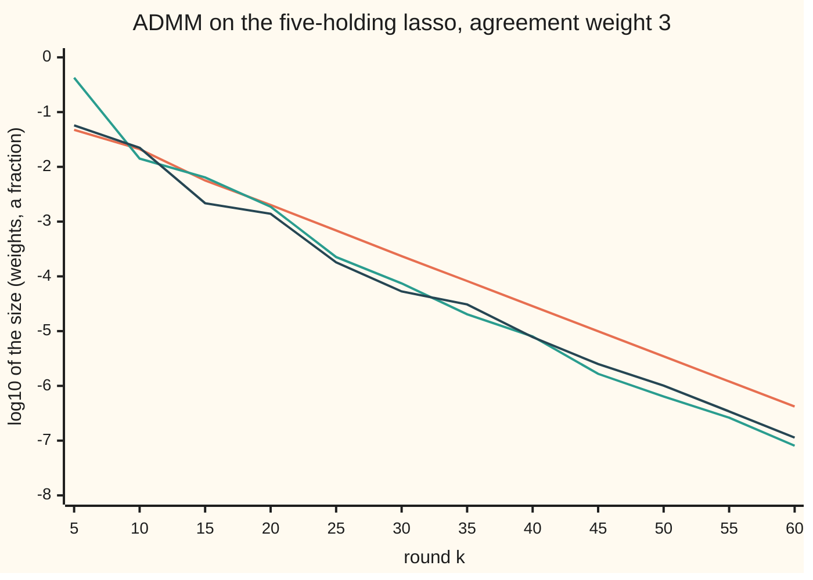

# ADMM: split the problem, solve the easy halves, reconcile each round

[Syllabus](../../../SYLLABUS.md) → [Optimization](../README.md) → [Conic, Quadratic and Stochastic Programs](../README.md#s06) → ADMM

---

## General Overview

A fund wants to copy a balanced index with as few of five holdings as possible: UK shares, US shares, UK gilts (government bonds), gold and property. It has eight months of returns (invented for this card), in percent a month, for the index and for each holding. It chooses five weights: the fraction of each pound to put in each holding, with whatever is left over kept in cash.

It **minimises** a total of two parts. The **fit** is half the sum, over the eight months, of the squared gap between the copy's return and the index's return. The **penalty** is 2 times the sum of the weights' sizes. That is the lasso (least squares plus a charge on the size of every weight), and its charge pushes small holdings to exactly zero.

Each part alone is easy. The fit alone is a smooth bowl, solved by one linear system. The penalty alone is solved weight by weight: shrink each weight towards zero and cut it to zero when it is small. Together they are awkward for plain gradient descent, because the penalty has corners.

[Proximal gradient](06-proximal-methods-ista-fista-and-the-lasso.md) handles the pair with small steps, each sized by how sharply the bowl curves. ADMM (the alternating direction method of multipliers) gives each part its own copy of the weights. It solves the fit for one copy and the penalty for the other, then charges a price for the gap between the copies and does it again.

Each half is solved exactly every round, and the fit's linear system keeps the same matrix throughout. How hard the gap is charged changes only the speed, never whether the copies meet, whereas a gradient step must stay under a limit set by the curvature. The same split also works when the penalty has no cheap shrink, or when the data sit on many machines.

Starting from all zeros, with an agreement weight of 3 on the gap between the copies, the two copies agree to within 0.0000005 after **60 rounds**. The answer, per £1,000,000: **£312,500 in UK shares, £200,000 in US shares, £50,000 in property, nothing in gilts or gold, £437,500 in cash.** A list of all 243 sign patterns finds the same weights, and a check of the lasso's optimality conditions proves that no other weights cost less.

**ADMM splits a problem into two halves that are easy alone, solves each half in turn against a shared price on their disagreement, and updates that price by the disagreement left over; for two convex halves the disagreement and the price change both fall to zero, and what remains is the optimum.**

**What kind of fact this is:** a method. Its stopping test is justified on this card (Why it works, Step 3). Its convergence for two convex halves is a theorem, stated with its source and proved in outline in a fold, and the code checks the proof's key inequality at every round. The final weights are certified optimal by the lasso's conditions, checked in the code.

### The picture: the disagreement falling, round by round



Orange: the primal residual $r_k$, the gap between the fit's copy and the penalty's copy. Green: the dual residual $s_k$, how far the penalty's copy moved this round. Dark: the true error, the distance from the exact answer. Each step down by 1 is a factor of 10. All three fall together, roughly in a straight line, and the run stops when the first two are both below $\varepsilon = 5 \times 10^{-7}$.

---

## The formula

The problem, with the agreement written as a constraint:

$$\text{minimise } f(x) + g(z) \quad\text{subject to}\quad x = z, \qquad f(x) = \tfrac12\|Ax - b\|^2, \quad g(z) = \lambda\|z\|_1 .$$

ADMM, in scaled form, from $x_0 = z_0 = u_0 = 0$, for $k = 0, 1, 2, \dots$:

$$
\begin{aligned}
x_{k+1} &= \operatorname*{argmin}_x \Big( f(x) + \tfrac{\rho}{2}\|x - z_k + u_k\|^2 \Big) && \text{so } (A^T A + \rho I)\,x_{k+1} = A^T b + \rho(z_k - u_k) \\
z_{k+1} &= \operatorname*{argmin}_z \Big( g(z) + \tfrac{\rho}{2}\|x_{k+1} - z + u_k\|^2 \Big) && \text{so } z_{k+1} = S_{\lambda/\rho}(x_{k+1} + u_k) \\
u_{k+1} &= u_k + x_{k+1} - z_{k+1}
\end{aligned}
$$

Stop when $r_{k+1} = \|x_{k+1} - z_{k+1}\|$ and $s_{k+1} = \rho\|z_{k+1} - z_k\|$ are both below $\varepsilon$.

**Read it aloud:** fit the data while being pulled towards the penalty's copy, shrink the result while being pulled towards the fit's copy, then add the remaining gap to the running price, and repeat until the copies agree and stop moving.

Here $S_t$ is soft-thresholding (shrink every entry towards zero by $t$, and set it to zero if it is smaller than $t$), the proximal step of the $\ell_1$ penalty taught on [Proximal gradient](06-proximal-methods-ista-fista-and-the-lasso.md).

The other marks: $\|v\|$ is the length of a list of numbers $v$ (the square root of the sum of its squares), $\|v\|_1$ is the sum of the sizes of its entries, $A^T$ is $A$ with rows and columns swapped, and $\operatorname{argmin}_x$ names the $x$ that makes the bracket smallest.

| Symbol | Plain meaning | In our example | Push it up and the answer… |
| --- | --- | --- | --- |
| $A$, $b$, $I$ | the holdings' monthly returns (8 rows, 5 columns) and the index's, in percent; $I$ the 5-by-5 identity (1 on the diagonal, 0 elsewhere) | first month: $(2, 3, -1, 1, 2)$ and 1.8 | — |
| $f$, $\nabla f$ | the fit: half the sum of squared monthly gaps; its gradient $A^T(Ax - b)$ | 0.408125 at the answer | — |
| $g$, $\partial g$ | the penalty $\lambda\|z\|_1$ (sum of sizes); its subdifferential, the set of its slopes | 1.125 at the answer | — |
| $\lambda$ | the lasso weight: the price of holding anything at all | 2 | fewer holdings: at 4, only UK and US shares |
| $x$, $z$; $k$ | the fit's copy and the penalty's copy of the five weights; $x_k$, $z_k$ are their values after round $k$ | $z = (0.3125, 0.2, 0, 0, 0.05)$ | — |
| $\rho$ | the agreement weight: how hard disagreement between the copies is charged (the penalty weight of shelf 03's penalty card) | 3 | rounds fall, then rise: 324 at 0.5, 43 at 10, 252 at 100 |
| $y$, $u = y/\rho$ | the price on the gap $x - z$ (the equality multiplier, written ν on [KKT conditions](../03-Constrained%20Optimisation/02-kkt-conditions.md)), and the same price scaled | $u_1 = x_1$ | — |
| $L_\rho$, $L_0$ | the augmented Lagrangian: cost plus price times gap plus $\tfrac{\rho}{2}$ times gap squared; $L_0$, the plain Lagrangian, is the same with $\rho = 0$ | — | — |
| $S_t$ | soft-thresholding at level $t$ | $t = \lambda/\rho = 2/3$ | more entries cut to zero |
| $r_k$, $s_k$, $\varepsilon$ | primal residual (copies' gap), dual residual (penalty copy's move times $\rho$), stopping level | $\varepsilon = 5 \times 10^{-7}$ | a smaller $\varepsilon$ takes more rounds |
| $x^*$, $y^*$, $p^*$ | the optimal weights, optimal price and optimal cost | $p^* = 1.533125$ | — |
| $V_k$ | the yardstick in the convergence proof: $\tfrac{1}{\rho}\|y_k - y^*\|^2 + \rho\|z_k - x^*\|^2$ | falls every round | — |

The agreement weight $\rho$ is the penalty weight of [Penalties and augmented Lagrangians](../03-Constrained%20Optimisation/07-penalty-and-augmented-lagrangian-methods.md). The fit and penalty at the answer, 0.408125 and 1.125, add to $p^* = 1.533125$, which the code prints.

### When it holds

- **Both halves convex, closed and proper.** Convex: a straight line between two points on the graph never dips below the graph. Closed: at the edge of where the function is finite, it does not jump up above the values it approaches. Proper: never −∞, and finite somewhere. Here $f$ is a bowl and $g$ a sum of V shapes. If one half has two separate dips, ADMM can settle at a point that satisfies the stopping test but is only a local answer, and nothing on this card certifies it.
- **An optimum and a matching price exist.** The theorem needs a saddle point of the plain Lagrangian $L_0$: weights and a price where no change of weights lowers $L_0$ and no change of price raises it ([Saddle points](../03-Constrained%20Optimisation/06-saddle-points-and-minimax.md)). For the lasso one always exists. For a problem with no feasible point, $r_k$ never reaches zero and $u_k$ grows without bound.
- **Exactly two blocks.** Updating three unknowns in turn with one shared price is not covered, and can blow up: in What breaks, the sizes grow from 1.7321 to 413.7233 in 200 rounds.
- **The dual step equals $\rho$.** The price must move by exactly $\rho$ times the gap, which in scaled form is $u + (x - z)$. Any other step loses the property in Step 3 that makes the stopping test correct.
- **Each half solved exactly.** Here both steps are exact. Inexact inner solves need errors that shrink fast enough (Eckstein and Bertsekas), or the residuals stall.

---

## Why it works

### Step 0: give each half its own copy, then charge for disagreement

Minimising $f(x) + g(x)$ in one go is hard because $f$ is smooth and $g$ has corners. Write the same problem with two copies, $f(x) + g(z)$ with $x = z$. Now each half sees only its own variable.

The one thing joining them is the constraint $x = z$, and a constraint can be priced, as Lagrange multipliers do. A price $y$ on the gap plus a quadratic penalty on its size gives a cost that each copy can minimise separately while the other copy stays fixed.

### Step 1: the augmented Lagrangian

$$L_\rho(x, z, y) = f(x) + g(z) + y^T(x - z) + \tfrac{\rho}{2}\|x - z\|^2 .$$

The method of multipliers minimises $L_\rho$ over $x$ and $z$ together, then moves the price: $y \leftarrow y + \rho(x - z)$. The quadratic term makes each inner problem well behaved, and the price update steers the gap to zero without sending $\rho$ to infinity, as [Penalties and augmented Lagrangians](../03-Constrained%20Optimisation/07-penalty-and-augmented-lagrangian-methods.md) shows. The trouble is "together": minimising over $x$ and $z$ at once is the original hard problem again.

### Step 2: one sweep instead of a joint minimisation

ADMM replaces the joint minimisation by one pass: minimise $L_\rho$ over $x$ with $z$ fixed, then over $z$ with the new $x$ fixed, then update $y$. Each pass touches only one half.

Completing the square makes the steps tidy. With $u = y/\rho$,

$$y^T(x - z) + \tfrac{\rho}{2}\|x - z\|^2 = \tfrac{\rho}{2}\|x - z + u\|^2 - \tfrac{\rho}{2}\|u\|^2 ,$$

and the last term does not depend on $x$ or $z$. So the $x$ step minimises $f(x) + \tfrac{\rho}{2}\|x - z_k + u_k\|^2$. Setting its gradient to zero gives $A^T(Ax - b) + \rho(x - z_k + u_k) = 0$, the linear system in The formula.

The $z$ step minimises $\lambda\|z\|_1 + \tfrac{\rho}{2}\|z - (x_{k+1} + u_k)\|^2$, which separates into five one-variable problems, each solved by shrinking by $\lambda/\rho$. The price update $y \leftarrow y + \rho(x - z)$ becomes $u \leftarrow u + x - z$.

### Step 3: why the two residuals are the right stopping test

The lasso is optimal at $x^* = z^*$ with price $y^*$ exactly when three conditions hold: $x^* = z^*$; $\nabla f(x^*) + y^* = 0$; and $y^* \in \partial g(z^*)$, a slope of the penalty at $z^*$. ADMM satisfies the third one exactly at every round, leaves the first as $r$, and leaves the second as $s$.

**The penalty's condition always holds.** The $z$ step is optimal, so $0 \in \partial g(z_{k+1}) - y_k - \rho(x_{k+1} - z_{k+1})$. The price update turns the last two terms into $-y_{k+1}$. So $y_{k+1} \in \partial g(z_{k+1})$ at every round. This is why the price step must be exactly $\rho$.

**The fit's condition is off by $s$.** The $x$ step is optimal, so $\nabla f(x_{k+1}) + y_k + \rho(x_{k+1} - z_k) = 0$. Since $y_k + \rho(x_{k+1} - z_k) = y_{k+1} + \rho(z_{k+1} - z_k)$, this reads

$$\nabla f(x_{k+1}) + y_{k+1} = -\rho\,(z_{k+1} - z_k).$$

The right side has size $s_{k+1}$. **The agreement condition is off by $r$**, by definition. So when $r$ and $s$ are both zero, all three conditions hold, and for a convex problem those conditions mean optimal. Small $r$ and $s$ mean the conditions nearly hold. That is the whole justification for the test.

### Step 4: the two residuals must fall to zero

The convergence theorem (Gabay and Mercier 1976; in this form, Boyd and co-authors 2011, section 3.2): if $f$ and $g$ are closed, proper and convex and the plain Lagrangian $L_0$ has a saddle point, then for any $\rho > 0$, $r_k \to 0$, $f(x_k) + g(z_k) \to p^*$, and $y_k \to$ an optimal price. Nothing about smoothness or strong convexity is needed.

Without more hypotheses the guaranteed rate is slow, $O(1/k)$ in an averaged sense: the averaged error falls in proportion to $1/k$ (He and Yuan 2012). On this lasso the residuals fell much faster, by a roughly constant factor each round, as the straight lines in the chart show.

<details>
<summary>Detailed proof, in outline: a yardstick that falls every round</summary>

Take an optimal pair $(x^*, y^*)$ and define

$$V_k = \tfrac{1}{\rho}\|y_k - y^*\|^2 + \rho\|z_k - x^*\|^2 .$$

The proof adds two inequalities. One comes from the optimality of the $x$ step and of $x^*$. The other comes from the optimality of the $z$ step. Each is a statement that a convex function lies above its tangent. The cross terms cancel, and what is left is

$$V_{k+1} \le V_k - \rho\,r_{k+1}^2 - \rho\,\|z_{k+1} - z_k\|^2 .$$

So $V$ never rises, and it falls by at least $\rho r^2 + s^2/\rho$ each round. Since $V \ge 0$, the total of all those falls is finite, which forces $r_k \to 0$ and $z_{k+1} - z_k \to 0$. Feeding those limits back into Step 3 gives the cost and price limits. Boyd and co-authors give the algebra in full in their Appendix A.

The code computes $V_k$ from the exact $x^*$ and $y^* = -\nabla f(x^*)$ and asserts this inequality at every one of the 60 rounds. The smallest ratio of actual fall to the required fall is 1.7866: never below the floor.

</details>

### Step 5: the certificate at the end

For the lasso, the conditions of Step 3 read: on every holding, $-\nabla f$ equals $\lambda$ times the weight's sign; on every zero weight, $-\nabla f$ lies between $-\lambda$ and $\lambda$. At the final $z$, $-\nabla f = (2.00000, 2.00000, 1.00000, 1.66250, 2.00000)$: the three holdings sit at $\lambda = 2$, and gilts and gold lie inside $[-2, 2]$. That is the printed certificate that the answer is optimal, not only the best found. Worked numbers checks it by hand.

---

## Worked numbers, by hand

The data: $A^T A$ and $A^T b$ are what the fit sees.

| Step | Arithmetic | Value |
| --- | --- | --- |
| $A^T A$ diagonal | each holding's sum of squared returns | 24, 24, 21, 20, 24 |
| $A^T b$ | each holding's returns times the index's, summed | 12.7, 10.8, −6.1, 5.8, 9.2 |
| round 1, fit half | solve $(A^T A + 3I)x_1 = A^T b$ | $x_1 = (0.253348, 0.267164, 0.087908, 0.122235, 0.169723)$ |
| round 1, penalty half | shrink $x_1 + u_0 = x_1$ by $\lambda/\rho = 2/3$; every entry is below 0.6667 | $z_1 = (0, 0, 0, 0, 0)$ |
| round 1, reconcile | $u_1 = 0 + x_1 - 0$ | $u_1 = x_1$ |
| round 1, residuals | $r_1 = \|x_1\|$; $s_1 = 3\|z_1 - z_0\|$ | 0.432478, 0 |
| round 60, the copies | $z_{60}$; $x_{60}$ agrees to within $5 \times 10^{-7}$ | $(0.3125, 0.2, 0, 0, 0.05)$ |
| certificate, UK row | $24(0.3125) + 12(0.2) + 16(0.05) = 7.5 + 2.4 + 0.8$ | $10.7 = 12.7 - 2$ ✓ |
| certificate, US row | $12(0.3125) + 24(0.2) + 5(0.05) = 3.75 + 4.8 + 0.25$ | $8.8 = 10.8 - 2$ ✓ |
| certificate, property row | $16(0.3125) + 5(0.2) + 24(0.05) = 5 + 1 + 1.2$ | $7.2 = 9.2 - 2$ ✓ |
| certificate, gilts | $-6.1 - (-16)(0.3125) - (-9)(0.2) - (-6)(0.05) = -6.1 + 5 + 1.8 + 0.3$ | $1.0$, inside $[-2, 2]$ ✓ |
| certificate, gold | $5.8 - 11(0.3125) - 4(0.2) - (-2)(0.05) = 5.8 - 3.4375 - 0.8 + 0.1$ | $1.6625$, inside $[-2, 2]$ ✓ |
| lasso cost | fit plus penalty | $p^* = 1.533125$ |
| **per £1,000,000** | weights times £1,000,000 | **£312,500 UK shares, £200,000 US shares, £50,000 property, £437,500 cash** |

On each holding the fit's pull is exactly balanced by the charge of 2; towards gilts and gold the pull is weaker than the charge, so neither is worth holding. The copy tracks the index with a root-mean-square gap of 0.3194 percent a month. It misses by more than plain least squares would, which holds all five, $(0.436692, 0.279295, 0.206540, 0.065030, 0.091073)$, but it needs three holdings, not five.

### What breaks if you drop a piece

| Mistake | Comes out at | What went wrong |
| --- | --- | --- |
| No reconcile step: $u$ stays 0 | after 2,000 rounds, $z = 0$ and $x = x_1$; the gap is still 0.432478 | Without a price the rounds minimise $f(x) + g(z) + \tfrac{\rho}{2}\|x - z\|^2$, a different problem whose best point has the copies apart. The price is what closes the gap. |
| Shrink by $\lambda$, not $\lambda/\rho$ | $z = (0.238889, 0.080556, 0, 0, 0)$ | The $z$ step solved a lasso with weight $\rho\lambda = 6$. ADMM converged, to the wrong problem. |
| Stop when $s$ alone is small | stops at round 1 with $s_1 = 0$, holding nothing; $r_1 = 0.432478$ | At rounds 1 and 2 the penalty copy has not moved yet. Only both residuals together certify the answer. |
| Three unknowns updated in turn, one price: minimise 0 subject to `[[1, 1, 1], [1, 1, 2], [1, 2, 2]]` times the unknowns equal to 0, $\rho = 1$, start `(1, 1, 1)` | the unknowns' size goes 1.7321, 3.2759, 6.9647, 32.0870, 413.7233 at rounds 0, 1, 50, 100, 200 | The answer is all zeros, but the theorem covers two blocks only. This is the counterexample of Chen, He, Ye and Yuan: the three-block sweep is not a contraction (a step that brings every two points closer) and the iterates grow without bound. |

---

## Watching the residuals fall

Each round, the fit copy pulls towards the index, the penalty copy towards few, small weights, and the price $u$ keeps a running total of their disagreement.

### One run, round by round

| Round $k$ | UK shares $z$ | US shares $z$ | property $z$ | $r_k$ | $s_k$ |
| --- | --- | --- | --- | --- | --- |
| 1 | 0.000000 | 0.000000 | 0.000000 | 0.432478314 | 0.000000000 |
| 2 | 0.000000 | 0.000000 | 0.000000 | 0.381480604 | 0.000000000 |
| 3 | 0.000000 | 0.058012 | 0.000000 | 0.311769833 | 0.174037038 |
| 5 | 0.261978 | 0.218413 | 0.069303 | 0.047377849 | 0.424325815 |
| 10 | 0.333080 | 0.199459 | 0.041474 | 0.021017609 | 0.014118658 |
| 20 | 0.311611 | 0.200424 | 0.050982 | 0.002012895 | 0.001870240 |
| 40 | 0.312500 | 0.200004 | 0.050007 | 0.000028574 | 0.000008003 |
| 59 | 0.312500 | 0.200000 | 0.050000 | 0.000000518 | 0.000000102 |
| 60 | 0.312500 | 0.200000 | 0.050000 | 0.000000420 | 0.000000081 |

For two rounds the penalty copy holds nothing: the shrink of 2/3 is bigger than any entry of $x + u$. Meanwhile $u$ piles up the gap, so the penalty copy sees $x + u$, larger each round, and at round 3 US shares cross the threshold.

By round 5 all three holdings are in. UK shares overshoot to 0.333 at round 10, then settle back to 0.3125.

Round 59 is still just above the stopping level ($r = 5.18 \times 10^{-7}$); round 60 is below it on both counts. Gilts and gold stay at exactly zero in $z$ from the first round to the last. In $x$ they are never exactly zero: at round 60 they are 0.000000320 and 0.000000272.

### One force at a time: the agreement weight $\rho$

The agreement weight trades one residual against the other. A small $\rho$ lets the copies disagree cheaply, so $r$ falls slowly. A large $\rho$ forces agreement but makes the price move in big jumps and the penalty copy crawl, so $s$ falls slowly. Rounds to reach both residuals below $5 \times 10^{-7}$:

```
     rho   rounds to stop
    0.5   ████████████████████████████████  324
      1   █████████████████                 166
      3   ██████                             60
     10   ████                               43
     30   ███████                            74
    100   █████████████████████████          252
```

Of these weights, 10 is the fastest, not 3. No formula picks $\rho$ in general; practical codes adjust it during the run by comparing $r$ and $s$.

---

## Code, from first principles, and it actually runs

The script writes ADMM out in full: the $x$ step is a 5-by-5 linear system solved by Gauss–Jordan elimination, the $z$ step is soft-thresholding, the $u$ step one line.

It reaches the answer by **four independent roads**. Road 1 is ADMM from zero. Road 2 lists all 243 sign patterns (each holding positive, negative or zero), solves the lasso's equations for each and keeps the one that passes the optimality test; exactly one does. Road 3 checks the lasso's optimality conditions at ADMM's answer, the certificate. Road 4 checks the convergence proof's inequality $V_{k+1} \le V_k - \rho r^2 - s^2/\rho$ at every round. Then it prints the mistakes, the three-block blow-up and the chart's points.

### Python

```python
# ADMM on a split lasso: copy an index with few of five assets.  Standard library only.
# Minimise f(x) + g(z) = 1/2 |Ax - b|^2 + lam*|z|_1 subject to x = z.  Returns in percent a month.
from itertools import product
from math import sqrt, log10

A = [[2, 3, -1, 1, 2], [-1, 1, 2, 0, -2], [3, 2, -2, 2, 1], [1, -2, 1, -1, 3],
     [-2, -1, 3, 1, -1], [0, 2, 0, -2, 1], [2, 0, -1, 3, 0], [1, 1, 1, 0, 2]]  # 8 months x 5 assets
b = [1.8, 0.1, 1.6, 0.3, -0.6, 0.5, 0.9, 1.1]          # the index, same 8 months
LAM, RHO, EPS, N = 2.0, 3.0, 5e-7, 5
AtA = [[float(sum(r[i] * r[j] for r in A)) for j in range(N)] for i in range(N)]
Atb = [sum(r[i] * bb for r, bb in zip(A, b)) for i in range(N)]

def solve(M, v):                        # Gauss-Jordan elimination with row swaps
    k = len(v); M = [list(M[i]) + [v[i]] for i in range(k)]
    for c in range(k):
        p = max(range(c, k), key=lambda r: abs(M[r][c])); M[c], M[p] = M[p], M[c]
        for r in range(k):
            if r != c:
                f = M[r][c] / M[c][c]
                M[r] = [a - f * bb for a, bb in zip(M[r], M[c])]
    return [M[i][k] / M[i][i] for i in range(k)]
def norm(v): return sqrt(sum(t * t for t in v))
def soft(v, t): return 0.0 if abs(v) <= t else (v - t if v > 0 else v + t)
def grad(x): return [sum(AtA[i][j] * x[j] for j in range(N)) - Atb[i] for i in range(N)]
def cost(x): return 0.5 * sum((sum(a * t for a, t in zip(r, x)) - bb) ** 2 for r, bb in zip(A, b)) + LAM * sum(map(abs, x))
def show(v): return " ".join(f"{t:9.6f}" for t in v)

def admm(rho, rounds=1000, eps=EPS, shrink=None, dual=True):
    M = [[AtA[i][j] + (rho if i == j else 0.0) for j in range(N)] for i in range(N)]
    x, z, u, hist = [0.0] * N, [0.0] * N, [0.0] * N, []
    for k in range(1, rounds + 1):
        x = solve(M, [Atb[i] + rho * (z[i] - u[i]) for i in range(N)])   # fit half
        z_old, z = z, [soft(x[i] + u[i], shrink or LAM / rho) for i in range(N)]  # penalty half
        if dual: u = [u[i] + x[i] - z[i] for i in range(N)]               # reconcile
        r, s = norm([x[i] - z[i] for i in range(N)]), rho * norm([z[i] - z_old[i] for i in range(N)])
        hist.append((k, x, z, u, r, s))
        if r < eps and s < eps: break
    return hist

# Road 1: ADMM from x = z = u = 0
hist = admm(RHO); K, x, z, u, r, s = hist[-1]
# Road 2: every sign pattern (+, -, 0 for each asset); keep the one that passes the lasso's test
found = []
for sg in product((1, -1, 0), repeat=N):
    S = [i for i in range(N) if sg[i]]
    w = [0.0] * N
    for i, t in zip(S, solve([[AtA[i][j] for j in S] for i in S], [Atb[i] - LAM * sg[i] for i in S]) if S else []): w[i] = t
    g = grad(w)
    if all(w[i] * sg[i] > 0 for i in S) and all(abs(g[i]) <= LAM + 1e-12 for i in range(N) if not sg[i]): found.append(w)
assert len(found) == 1; xs = found[0]
# Road 3: the certificate.  -grad f(z) must equal lam*sign on holdings and lie in [-lam, lam] elsewhere
gz = grad(z); ystar = [-t for t in grad(xs)]
assert all(abs(gz[i] + LAM * (1 if z[i] > 0 else -1)) < 1e-5 for i in range(N) if z[i] != 0)
assert all(abs(gz[i]) < LAM for i in range(N) if z[i] == 0)
assert max(abs(z[i] - xs[i]) for i in range(N)) < 1e-6 and K == 60
# Road 4: the convergence proof's yardstick V falls every round by at least rho(|r|^2 + |dz|^2)
V = lambda zz, uu: sum((RHO * uu[i] - ystar[i]) ** 2 for i in range(N)) / RHO + RHO * sum((zz[i] - xs[i]) ** 2 for i in range(N))
prev, worst = ([0.0] * N, [0.0] * N), float("inf")
for k, xk, zk, uk, rk, sk in hist:
    drop = V(*prev) - V(zk, uk); need = RHO * rk * rk + sk * sk / RHO
    assert drop >= need - 1e-12; worst = min(worst, drop / need) if need > 1e-20 else worst; prev = (zk, uk)

print("A^T A rows:"); [print("  ", show(row)) for row in AtA]
print("A^T b      ", show(Atb))
print("round 1 x  ", show(hist[0][1]), f" shrink lam/rho = {LAM / RHO:.4f}"); print("round 60 x ", " ".join(f"{t:.9f}" for t in x))
print("rounds, k: z_UK z_US z_prop |r| |s|")
for k, xk, zk, uk, rk, sk in hist:
    if k in (1, 2, 3, 5, 10, 20, 40, 59, 60):
        print(f"  {k:3d} {zk[0]:.6f} {zk[1]:.6f} {zk[4]:.6f} {rk:.9f} {sk:.9f}")
print("ADMM z     ", show(z)); print("enumerated ", show(xs))
print("-grad f(z) ", " ".join(f"{-t:.5f}" for t in gz), "  (lam = 2)")
print(f"lasso cost at z {cost(z):.6f}, at enumerated {cost(xs):.6f} = fit {cost(xs) - LAM * sum(map(abs, xs)):.6f} + penalty {LAM * sum(map(abs, xs)):.6f}")
print("least squares", show(solve(AtA, Atb)))
fit = [sum(a * t for a, t in zip(row, xs)) for row in A]
print("copy's returns", " ".join(f"{t:.4f}" for t in fit), f" rms gap {sqrt(sum((f - bb) ** 2 for f, bb in zip(fit, b)) / 8):.4f}")
print(f"per 1000000 pounds: UK shares {xs[0]*1e6:.0f}, US shares {xs[1]*1e6:.0f}, property {xs[4]*1e6:.0f}, cash {(1-sum(xs))*1e6:.0f}")
print(f"V falls every round; smallest drop / proof's floor = {worst:.4f}")
print("chart, k: log10|r|, log10|s|, log10|z - z*|")
for k, xk, zk, uk, rk, sk in hist:
    if k % 5 == 0:
        print(f"  {k:3d} {log10(rk):7.3f} {log10(sk):7.3f} {log10(norm([zk[i] - xs[i] for i in range(N)])):7.3f}")
print("rounds to stop at rho 0.5, 1, 3, 10, 30, 100:", " ".join(str(admm(rho)[-1][0]) for rho in (0.5, 1.0, 3.0, 10.0, 30.0, 100.0)))
# What breaks
nd = admm(RHO, rounds=2000, dual=False)[-1]
print(f"no dual update, after {nd[0]} rounds: x {show(nd[1])}, z {show(nd[2])}, |x - z| {nd[4]:.6f}")
assert nd[4] > 0.01
ws = admm(RHO, shrink=LAM)[-1]
print(f"shrink by lam not lam/rho: z {show(ws[2])}, the lasso at weight rho*lam = {RHO * LAM:.1f}")
assert abs(ws[2][1] - xs[1]) > 0.05
# Three blocks: minimise 0 subject to B1 v1 + B2 v2 + B3 v3 = 0, sweeping one block at a time
B = [[1, 1, 1], [1, 1, 2], [1, 2, 2]]; v, y = [1.0, 1.0, 1.0], [0.0, 0.0, 0.0]
print(f"three blocks, round   0: |v| = {norm(v):.4f}")
for k in range(1, 201):
    for j in range(3):
        rest = [sum(B[i][m] * v[m] for m in range(3) if m != j) + y[i] for i in range(3)]
        v[j] = -sum(B[i][j] * rest[i] for i in range(3)) / sum(B[i][j] ** 2 for i in range(3))
    y = [y[i] + sum(B[i][m] * v[m] for m in range(3)) for i in range(3)]
    if k in (1, 50, 100, 200): print(f"three blocks, round {k:3d}: |v| = {norm(v):.4f}")
assert norm(v) > 10
for lam in (1.0, 4.0):
    LAM = lam; print(f"try lam {lam}: z {show(admm(RHO)[-1][2])}")
print("ALL CHECKS PASS")
```

**Ran 2026-11-11 on macOS, Python 3.14.10, standard library only. All checks passed. Output, pasted from the run:**

```
A^T A rows:
   24.000000 12.000000 -16.000000 11.000000 16.000000
   12.000000 24.000000 -9.000000  4.000000  5.000000
   -16.000000 -9.000000 21.000000 -6.000000 -6.000000
   11.000000  4.000000 -6.000000 20.000000 -2.000000
   16.000000  5.000000 -6.000000 -2.000000 24.000000
A^T b       12.700000 10.800000 -6.100000  5.800000  9.200000
round 1 x    0.253348  0.267164  0.087908  0.122235  0.169723  shrink lam/rho = 0.6667
round 60 x  0.312499994 0.200000059 0.000000320 0.000000272 0.050000097
rounds, k: z_UK z_US z_prop |r| |s|
    1 0.000000 0.000000 0.000000 0.432478314 0.000000000
    2 0.000000 0.000000 0.000000 0.381480604 0.000000000
    3 0.000000 0.058012 0.000000 0.311769833 0.174037038
    5 0.261978 0.218413 0.069303 0.047377849 0.424325815
   10 0.333080 0.199459 0.041474 0.021017609 0.014118658
   20 0.311611 0.200424 0.050982 0.002012895 0.001870240
   40 0.312500 0.200004 0.050007 0.000028574 0.000008003
   59 0.312500 0.200000 0.050000 0.000000518 0.000000102
   60 0.312500 0.200000 0.050000 0.000000420 0.000000081
ADMM z       0.312500  0.200000  0.000000  0.000000  0.050000
enumerated   0.312500  0.200000  0.000000  0.000000  0.050000
-grad f(z)  2.00000 2.00000 1.00000 1.66250 2.00000   (lam = 2)
lasso cost at z 1.533125, at enumerated 1.533125 = fit 0.408125 + penalty 1.125000
least squares  0.436692  0.279295  0.206540  0.065030  0.091073
copy's returns 1.3250 -0.2125 1.3875 0.0625 -0.8750 0.4500 0.6250 0.6125  rms gap 0.3194
per 1000000 pounds: UK shares 312500, US shares 200000, property 50000, cash 437500
V falls every round; smallest drop / proof's floor = 1.7866
chart, k: log10|r|, log10|s|, log10|z - z*|
    5  -1.324  -0.372  -1.243
   10  -1.677  -1.850  -1.652
   15  -2.249  -2.193  -2.664
   20  -2.696  -2.728  -2.857
   25  -3.162  -3.647  -3.744
   30  -3.631  -4.128  -4.275
   35  -4.085  -4.693  -4.513
   40  -4.544  -5.097  -5.110
   45  -5.003  -5.780  -5.601
   50  -5.461  -6.193  -5.996
   55  -5.919  -6.581  -6.466
   60  -6.377  -7.093  -6.945
rounds to stop at rho 0.5, 1, 3, 10, 30, 100: 324 166 60 43 74 252
no dual update, after 2000 rounds: x  0.253348  0.267164  0.087908  0.122235  0.169723, z  0.000000  0.000000  0.000000  0.000000  0.000000, |x - z| 0.432478
shrink by lam not lam/rho: z  0.238889  0.080556  0.000000  0.000000  0.000000, the lasso at weight rho*lam = 6.0
three blocks, round   0: |v| = 1.7321
three blocks, round   1: |v| = 3.2759
three blocks, round  50: |v| = 6.9647
three blocks, round 100: |v| = 32.0870
three blocks, round 200: |v| = 413.7233
try lam 1.0: z  0.294488  0.243661  0.036055  0.050899  0.107834
try lam 4.0: z  0.294444  0.136111  0.000000  0.000000  0.000000
ALL CHECKS PASS
```

### Rust

```rust
// ADMM on a split lasso: copy an index with few of five assets.  Standard library only.
// Minimise f(x) + g(z) = 1/2 |Ax - b|^2 + lam*|z|_1 subject to x = z.  Returns in percent a month.
const N: usize = 5;
const A: [[f64; 5]; 8] = [[2., 3., -1., 1., 2.], [-1., 1., 2., 0., -2.], [3., 2., -2., 2., 1.], [1., -2., 1., -1., 3.],
    [-2., -1., 3., 1., -1.], [0., 2., 0., -2., 1.], [2., 0., -1., 3., 0.], [1., 1., 1., 0., 2.]]; // 8 months x 5 assets
const B: [f64; 8] = [1.8, 0.1, 1.6, 0.3, -0.6, 0.5, 0.9, 1.1]; // the index, same 8 months
const RHO: f64 = 3.0;
const EPS: f64 = 5e-7;

struct P { ata: Vec<Vec<f64>>, atb: Vec<f64>, lam: f64 }
type Round = (usize, Vec<f64>, Vec<f64>, Vec<f64>, f64, f64);

fn solve(m: &[Vec<f64>], v: &[f64]) -> Vec<f64> { // Gauss-Jordan elimination with row swaps
    let k = v.len();
    let mut m: Vec<Vec<f64>> = (0..k).map(|i| { let mut r = m[i].clone(); r.push(v[i]); r }).collect();
    for c in 0..k {
        let mut p = c;
        for r in c + 1..k { if m[r][c].abs() > m[p][c].abs() { p = r; } }
        m.swap(c, p);
        for r in 0..k {
            if r != c {
                let f = m[r][c] / m[c][c];
                let pivot = m[c].clone();
                for j in 0..=k { m[r][j] = m[r][j] - f * pivot[j]; }
            }
        }
    }
    (0..k).map(|i| m[i][k] / m[i][i]).collect()
}
fn norm(v: &[f64]) -> f64 { v.iter().fold(0.0, |a, t| a + t * t).sqrt() }
fn soft(v: f64, t: f64) -> f64 { if v.abs() <= t { 0.0 } else if v > 0.0 { v - t } else { v + t } }
fn diff(a: &[f64], b: &[f64]) -> Vec<f64> { (0..a.len()).map(|i| a[i] - b[i]).collect() }
fn show(v: &[f64]) -> String { v.iter().map(|t| format!("{:9.6}", t)).collect::<Vec<_>>().join(" ") }
fn fitted(x: &[f64]) -> Vec<f64> { A.iter().map(|r| (0..N).fold(0.0, |a, j| a + r[j] * x[j])).collect() }
impl P {
    fn grad(&self, x: &[f64]) -> Vec<f64> {
        (0..N).map(|i| (0..N).fold(0.0, |a, j| a + self.ata[i][j] * x[j]) - self.atb[i]).collect()
    }
    fn cost(&self, x: &[f64]) -> f64 {
        let f = fitted(x);
        0.5 * (0..8).fold(0.0, |a, r| a + (f[r] - B[r]).powi(2)) + self.lam * x.iter().fold(0.0, |a, t| a + t.abs())
    }
    fn admm(&self, rho: f64, rounds: usize, shrink: Option<f64>, dual: bool) -> Vec<Round> {
        let m: Vec<Vec<f64>> = (0..N).map(|i| (0..N).map(|j| self.ata[i][j] + if i == j { rho } else { 0.0 }).collect()).collect();
        let (mut z, mut u, mut hist) = (vec![0.0; N], vec![0.0; N], Vec::new());
        for k in 1..=rounds {
            let rhs: Vec<f64> = (0..N).map(|i| self.atb[i] + rho * (z[i] - u[i])).collect();
            let x = solve(&m, &rhs); // fit half
            let t = shrink.unwrap_or(self.lam / rho);
            let z_new: Vec<f64> = (0..N).map(|i| soft(x[i] + u[i], t)).collect(); // penalty half
            if dual { u = (0..N).map(|i| u[i] + x[i] - z_new[i]).collect(); } // reconcile
            let r = norm(&diff(&x, &z_new));
            let s = rho * norm(&diff(&z_new, &z));
            z = z_new;
            hist.push((k, x, z.clone(), u.clone(), r, s));
            if r < EPS && s < EPS { break; }
        }
        hist
    }
}

fn main() {
    let ata: Vec<Vec<f64>> = (0..N).map(|i| (0..N).map(|j| A.iter().fold(0.0, |a, r| a + r[i] * r[j])).collect()).collect();
    let atb: Vec<f64> = (0..N).map(|i| (0..8).fold(0.0, |a, r| a + A[r][i] * B[r])).collect();
    let mut p = P { ata, atb, lam: 2.0 };
    // Road 1: ADMM from x = z = u = 0
    let hist = p.admm(RHO, 1000, None, true);
    let (kk, xk, z, _, _, _) = hist.last().unwrap().clone();
    // Road 2: every sign pattern (+, -, 0 for each asset); keep the one that passes the lasso's test
    let mut found: Vec<Vec<f64>> = Vec::new();
    for code in 0..243usize {
        let mut c = code;
        let mut sg = [0i32; N];
        for i in (0..N).rev() { sg[i] = [1, -1, 0][c % 3]; c /= 3; }
        let s: Vec<usize> = (0..N).filter(|&i| sg[i] != 0).collect();
        let mut w = vec![0.0; N];
        if !s.is_empty() {
            let m: Vec<Vec<f64>> = s.iter().map(|&i| s.iter().map(|&j| p.ata[i][j]).collect()).collect();
            let rhs: Vec<f64> = s.iter().map(|&i| p.atb[i] - p.lam * sg[i] as f64).collect();
            for (&i, t) in s.iter().zip(solve(&m, &rhs)) { w[i] = t; }
        }
        let g = p.grad(&w);
        if s.iter().all(|&i| w[i] * sg[i] as f64 > 0.0) && (0..N).all(|i| sg[i] != 0 || g[i].abs() <= p.lam + 1e-12) { found.push(w); }
    }
    assert!(found.len() == 1);
    let xs = found[0].clone();
    // Road 3: the certificate.  -grad f(z) must equal lam*sign on holdings and lie in [-lam, lam] elsewhere
    let gz = p.grad(&z);
    let ystar: Vec<f64> = p.grad(&xs).iter().map(|t| -t).collect();
    assert!((0..N).all(|i| z[i] == 0.0 || (gz[i] + p.lam * z[i].signum()).abs() < 1e-5));
    assert!((0..N).all(|i| z[i] != 0.0 || gz[i].abs() < p.lam));
    assert!(diff(&z, &xs).iter().all(|t| t.abs() < 1e-6) && kk == 60);
    // Road 4: the convergence proof's yardstick V falls every round by at least rho(|r|^2 + |dz|^2)
    let v = |zz: &[f64], uu: &[f64]| (0..N).fold(0.0, |a, i| a + (RHO * uu[i] - ystar[i]).powi(2)) / RHO
        + RHO * (0..N).fold(0.0, |a, i| a + (zz[i] - xs[i]).powi(2));
    let (mut pz, mut pu, mut worst) = (vec![0.0; N], vec![0.0; N], f64::INFINITY);
    for (_, _, zk, uk, rk, sk) in &hist {
        let drop = v(&pz, &pu) - v(zk, uk);
        let need = RHO * rk * rk + sk * sk / RHO;
        assert!(drop >= need - 1e-12);
        if need > 1e-20 { worst = worst.min(drop / need); }
        pz = zk.clone(); pu = uk.clone();
    }

    println!("A^T A rows:");
    for row in &p.ata { println!("   {}", show(row)); }
    println!("A^T b       {}", show(&p.atb));
    println!("round 1 x   {}  shrink lam/rho = {:.4}", show(&hist[0].1), p.lam / RHO);
    println!("round 60 x  {}", xk.iter().map(|t| format!("{:.9}", t)).collect::<Vec<_>>().join(" "));
    println!("rounds, k: z_UK z_US z_prop |r| |s|");
    for (k, _, zk, _, rk, sk) in &hist {
        if [1, 2, 3, 5, 10, 20, 40, 59, 60].contains(k) {
            println!("  {:3} {:.6} {:.6} {:.6} {:.9} {:.9}", k, zk[0], zk[1], zk[4], rk, sk);
        }
    }
    println!("ADMM z      {}", show(&z));
    println!("enumerated  {}", show(&xs));
    println!("-grad f(z)  {}   (lam = 2)", gz.iter().map(|t| format!("{:.5}", -t)).collect::<Vec<_>>().join(" "));
    let pen = p.lam * xs.iter().fold(0.0, |a, t| a + t.abs());
    println!("lasso cost at z {:.6}, at enumerated {:.6} = fit {:.6} + penalty {:.6}", p.cost(&z), p.cost(&xs), p.cost(&xs) - pen, pen);
    println!("least squares {}", show(&solve(&p.ata, &p.atb)));
    let fit = fitted(&xs);
    let gap = ((0..8).fold(0.0, |a, r| a + (fit[r] - B[r]).powi(2)) / 8.0).sqrt();
    println!("copy's returns {}  rms gap {:.4}", fit.iter().map(|t| format!("{:.4}", t)).collect::<Vec<_>>().join(" "), gap);
    let total = xs.iter().fold(0.0, |a, t| a + t);
    println!("per 1000000 pounds: UK shares {:.0}, US shares {:.0}, property {:.0}, cash {:.0}",
        xs[0] * 1e6, xs[1] * 1e6, xs[4] * 1e6, (1.0 - total) * 1e6);
    println!("V falls every round; smallest drop / proof's floor = {:.4}", worst);
    println!("chart, k: log10|r|, log10|s|, log10|z - z*|");
    for (k, _, zk, _, rk, sk) in &hist {
        if k % 5 == 0 {
            println!("  {:3} {:7.3} {:7.3} {:7.3}", k, rk.log10(), sk.log10(), norm(&diff(zk, &xs)).log10());
        }
    }
    let counts: Vec<String> = [0.5, 1.0, 3.0, 10.0, 30.0, 100.0].iter().map(|&rho| p.admm(rho, 1000, None, true).last().unwrap().0.to_string()).collect();
    println!("rounds to stop at rho 0.5, 1, 3, 10, 30, 100: {}", counts.join(" "));
    // What breaks
    let nd = p.admm(RHO, 2000, None, false).last().unwrap().clone();
    println!("no dual update, after {} rounds: x {}, z {}, |x - z| {:.6}", nd.0, show(&nd.1), show(&nd.2), nd.4);
    assert!(nd.4 > 0.01);
    let ws = p.admm(RHO, 1000, Some(p.lam), true).last().unwrap().clone();
    println!("shrink by lam not lam/rho: z {}, the lasso at weight rho*lam = {:.1}", show(&ws.2), RHO * p.lam);
    assert!((ws.2[1] - xs[1]).abs() > 0.05);
    // Three blocks: minimise 0 subject to B1 v1 + B2 v2 + B3 v3 = 0, sweeping one block at a time
    let bm = [[1.0, 1.0, 1.0], [1.0, 1.0, 2.0], [1.0, 2.0, 2.0]];
    let (mut vv, mut y) = ([1.0f64; 3], [0.0f64; 3]);
    println!("three blocks, round   0: |v| = {:.4}", norm(&vv));
    for k in 1..=200 {
        for j in 0..3 {
            let rest: Vec<f64> = (0..3).map(|i| (0..3).filter(|&m| m != j).fold(0.0, |a, m| a + bm[i][m] * vv[m]) + y[i]).collect();
            vv[j] = -(0..3).fold(0.0, |a, i| a + bm[i][j] * rest[i]) / (0..3).fold(0.0, |a, i| a + bm[i][j] * bm[i][j]);
        }
        for i in 0..3 { y[i] = y[i] + (0..3).fold(0.0, |a, m| a + bm[i][m] * vv[m]); }
        if [1, 50, 100, 200].contains(&k) { println!("three blocks, round {:3}: |v| = {:.4}", k, norm(&vv)); }
    }
    assert!(norm(&vv) > 10.0);
    for lam in [1.0, 4.0] {
        p.lam = lam;
        println!("try lam {:.1}: z {}", lam, show(&p.admm(RHO, 1000, None, true).last().unwrap().2));
    }
    println!("ALL CHECKS PASS");
}
```

**Ran 2026-11-11 on macOS, rustc 1.98.1, no crates. All checks passed. Output, pasted from the run:**

```
A^T A rows:
   24.000000 12.000000 -16.000000 11.000000 16.000000
   12.000000 24.000000 -9.000000  4.000000  5.000000
   -16.000000 -9.000000 21.000000 -6.000000 -6.000000
   11.000000  4.000000 -6.000000 20.000000 -2.000000
   16.000000  5.000000 -6.000000 -2.000000 24.000000
A^T b       12.700000 10.800000 -6.100000  5.800000  9.200000
round 1 x    0.253348  0.267164  0.087908  0.122235  0.169723  shrink lam/rho = 0.6667
round 60 x  0.312499994 0.200000059 0.000000320 0.000000272 0.050000097
rounds, k: z_UK z_US z_prop |r| |s|
    1 0.000000 0.000000 0.000000 0.432478314 0.000000000
    2 0.000000 0.000000 0.000000 0.381480604 0.000000000
    3 0.000000 0.058012 0.000000 0.311769833 0.174037038
    5 0.261978 0.218413 0.069303 0.047377849 0.424325815
   10 0.333080 0.199459 0.041474 0.021017609 0.014118658
   20 0.311611 0.200424 0.050982 0.002012895 0.001870240
   40 0.312500 0.200004 0.050007 0.000028574 0.000008003
   59 0.312500 0.200000 0.050000 0.000000518 0.000000102
   60 0.312500 0.200000 0.050000 0.000000420 0.000000081
ADMM z       0.312500  0.200000  0.000000  0.000000  0.050000
enumerated   0.312500  0.200000  0.000000  0.000000  0.050000
-grad f(z)  2.00000 2.00000 1.00000 1.66250 2.00000   (lam = 2)
lasso cost at z 1.533125, at enumerated 1.533125 = fit 0.408125 + penalty 1.125000
least squares  0.436692  0.279295  0.206540  0.065030  0.091073
copy's returns 1.3250 -0.2125 1.3875 0.0625 -0.8750 0.4500 0.6250 0.6125  rms gap 0.3194
per 1000000 pounds: UK shares 312500, US shares 200000, property 50000, cash 437500
V falls every round; smallest drop / proof's floor = 1.7866
chart, k: log10|r|, log10|s|, log10|z - z*|
    5  -1.324  -0.372  -1.243
   10  -1.677  -1.850  -1.652
   15  -2.249  -2.193  -2.664
   20  -2.696  -2.728  -2.857
   25  -3.162  -3.647  -3.744
   30  -3.631  -4.128  -4.275
   35  -4.085  -4.693  -4.513
   40  -4.544  -5.097  -5.110
   45  -5.003  -5.780  -5.601
   50  -5.461  -6.193  -5.996
   55  -5.919  -6.581  -6.466
   60  -6.377  -7.093  -6.945
rounds to stop at rho 0.5, 1, 3, 10, 30, 100: 324 166 60 43 74 252
no dual update, after 2000 rounds: x  0.253348  0.267164  0.087908  0.122235  0.169723, z  0.000000  0.000000  0.000000  0.000000  0.000000, |x - z| 0.432478
shrink by lam not lam/rho: z  0.238889  0.080556  0.000000  0.000000  0.000000, the lasso at weight rho*lam = 6.0
three blocks, round   0: |v| = 1.7321
three blocks, round   1: |v| = 3.2759
three blocks, round  50: |v| = 6.9647
three blocks, round 100: |v| = 32.0870
three blocks, round 200: |v| = 413.7233
try lam 1.0: z  0.294488  0.243661  0.036055  0.050899  0.107834
try lam 4.0: z  0.294444  0.136111  0.000000  0.000000  0.000000
ALL CHECKS PASS
```

### Lean

Lean proves the convergence theorem for any two closed, proper, convex halves, and checks the five-holding lasso answer exactly.

- For two convex, closed, proper halves with a saddle point, and any $\rho > 0$, both residuals $r_k$ and $s_k$ fall to zero.
- In the same setting, the cost tends to $p^*$ and the price $\rho u_k$ tends to an optimal price.
- These hold from any start, with each half solved exactly and the price step equal to $\rho$.
- After every round, the penalty's condition holds exactly, and the fit's condition is off by the dual residual.
- When both residuals are zero, the fit's copy is optimal.
- The weights $(0.3125, 0.2, 0, 0, 0.05)$ cost exactly $p^* = 1.533125$, and no other weights cost less.
- $A^T A$, $A^T b$, the certificate rows and the split per £1,000,000 match Worked numbers exactly.

The round counts, the residual table, the effect of $\rho$ and the three-block blow-up are left to the Python and Rust checks.

```lean
-- ADMM: for two closed, proper, convex halves whose plain Lagrangian has a saddle point, the ADMM rounds keep the penalty's optimality condition exactly, drive the copies' gap and the penalty copy's move to zero, and bring the cost to the optimum and the price to an optimal price; and the card's five-holding lasso answer is optimal.
import Mathlib.Analysis.InnerProductSpace.PiL2
import Mathlib.Analysis.Convex.Function
import Mathlib.LinearAlgebra.Matrix.Notation
import Mathlib.Tactic.NormNum
import Mathlib.Topology.MetricSpace.Sequences

open Filter Topology RealInnerProductSpace Matrix

/-! ### How the card's objects are written here

The unknowns are lists of `n` real numbers, `EuclideanSpace ℝ (Fin n)`, with the usual length
`‖v‖` and dot product `⟪v, w⟫`.

A function that may take the value +∞ is written as a real function `f` together with the set
`Df` where it is finite. Then:
* proper: `Df` is not empty (and `f` is never −∞, automatic for a real function);
* convex: `ConvexOn ℝ Df f` (the set `Df` is convex and `f` never dips below a chord on it);
* closed: the epigraph `{(v, t) | v ∈ Df ∧ f v ≤ t}` is a closed set.

ADMM in scaled form, for `k = 0, 1, 2, …`, from any starting `x 0`, `z 0`, `u 0`:
* `x (k+1)` minimises `f v + ρ/2 ‖v - z k + u k‖²` over `v ∈ Df` (the fit half, solved exactly);
* `z (k+1)` minimises `g w + ρ/2 ‖x (k+1) - w + u k‖²` over `w ∈ Dg` (the penalty half, exactly);
* `u (k+1) = u k + x (k+1) - z (k+1)` (the reconcile step; the price is `y = ρ u`, so the price
  moves by exactly `ρ` times the gap).

The plain Lagrangian is `L₀ (x, z, y) = f x + g z + ⟪y, x - z⟫`. A saddle point `(xs, zs, ys)`
has `L₀ (xs, zs, y) ≤ L₀ (xs, zs, ys) ≤ L₀ (x, z, ys)` for every price `y` and every `x ∈ Df`,
`z ∈ Dg`. The optimal cost is then `p* = f xs + g zs`. -/

/-- First-order condition for an exact proximal step on a convex function. -/
theorem admm_prox_first_order {E : Type*} [NormedAddCommGroup E] [InnerProductSpace ℝ E]
    (h : E → ℝ) (D : Set E) (hconv : ConvexOn ℝ D h) (ρ : ℝ) (hρ : 0 < ρ) (c p : E)
    (hc : c ∈ D) (hmin : ∀ v ∈ D, h c + ρ / 2 * ‖c - p‖ ^ 2 ≤ h v + ρ / 2 * ‖v - p‖ ^ 2) :
    ∀ v ∈ D, h c - ρ * ⟪c - p, v - c⟫ ≤ h v := by
  intro v hv
  apply le_of_forall_pos_lt_add
  intro ε hε
  set M := ρ / 2 * ‖v - c‖ ^ 2 with hM
  have hM0 : 0 ≤ M := by positivity
  set t := min 1 (ε / (M + 1)) with ht
  have ht0 : 0 < t := lt_min one_pos (by positivity)
  have ht1 : t ≤ 1 := min_le_left _ _
  have ht2 : t ≤ ε / (M + 1) := min_le_right _ _
  have htM : t * M < ε := by
    have : t * (M + 1) ≤ ε := by
      rw [le_div_iff₀ (by positivity)] at ht2; linarith
    nlinarith
  have hmem : (1 - t) • c + t • v ∈ D := hconv.1 hc hv (by linarith) ht0.le (by ring)
  have hcv : h ((1 - t) • c + t • v) ≤ (1 - t) • h c + t • h v :=
    hconv.2 hc hv (by linarith) ht0.le (by ring)
  simp only [smul_eq_mul] at hcv
  have hpt : (1 - t) • c + t • v - p = (c - p) + t • (v - c) := by
    simp only [sub_smul, one_smul, smul_sub]; abel
  have key := hmin _ hmem
  rw [hpt, norm_add_sq_real, inner_smul_right, norm_smul, mul_pow, Real.norm_eq_abs, sq_abs]
    at key
  have : t * (h c - ρ * ⟪c - p, v - c⟫ - h v - t * M) ≤ 0 := by
    rw [hM]; nlinarith
  have : h c - ρ * ⟪c - p, v - c⟫ - h v - t * M ≤ 0 := by
    by_contra hcon
    rw [not_le] at hcon
    have := mul_pos ht0 hcon
    linarith
  linarith

/-- The optimality conditions after one ADMM round. -/
theorem admm_round_conditions {n : ℕ}
    (f g : EuclideanSpace ℝ (Fin n) → ℝ) (Df Dg : Set (EuclideanSpace ℝ (Fin n)))
    (hf_convex : ConvexOn ℝ Df f) (hg_convex : ConvexOn ℝ Dg g)
    (ρ : ℝ) (hρ : 0 < ρ) (x z u : ℕ → EuclideanSpace ℝ (Fin n))
    (hx_mem : ∀ k, x (k + 1) ∈ Df)
    (hx_min : ∀ k, ∀ v ∈ Df,
      f (x (k + 1)) + ρ / 2 * ‖x (k + 1) - z k + u k‖ ^ 2 ≤ f v + ρ / 2 * ‖v - z k + u k‖ ^ 2)
    (hz_mem : ∀ k, z (k + 1) ∈ Dg)
    (hz_min : ∀ k, ∀ w ∈ Dg,
      g (z (k + 1)) + ρ / 2 * ‖x (k + 1) - z (k + 1) + u k‖ ^ 2 ≤
        g w + ρ / 2 * ‖x (k + 1) - w + u k‖ ^ 2)
    (hu : ∀ k, u (k + 1) = u k + x (k + 1) - z (k + 1)) (k : ℕ) :
    (∀ w ∈ Dg, g (z (k + 1)) + ⟪ρ • u (k + 1), w - z (k + 1)⟫ ≤ g w) ∧
      (∀ v ∈ Df, f (x (k + 1)) +
        ⟪-(ρ • u (k + 1)) - ρ • (z (k + 1) - z k), v - x (k + 1)⟫ ≤ f v) := by
  constructor
  · have hn : ∀ w, ‖x (k + 1) - w + u k‖ = ‖w - (x (k + 1) + u k)‖ := by
      intro w; rw [← norm_neg]; congr 1; abel
    have H := admm_prox_first_order g Dg hg_convex ρ hρ (z (k + 1)) (x (k + 1) + u k)
      (hz_mem k) (by intro w hw; have := hz_min k w hw; rwa [hn, hn] at this)
    intro w hw
    have H1 := H w hw
    have he : z (k + 1) - (x (k + 1) + u k) = -u (k + 1) := by rw [hu k]; abel
    rw [he, inner_neg_left] at H1
    rw [real_inner_smul_left]; linarith
  · have hn : ∀ v, ‖v - z k + u k‖ = ‖v - (z k - u k)‖ := by
      intro v; congr 1; abel
    have H := admm_prox_first_order f Df hf_convex ρ hρ (x (k + 1)) (z k - u k)
      (hx_mem k) (by intro v hv; have := hx_min k v hv; rwa [hn, hn] at this)
    intro v hv
    have H1 := H v hv
    have he : -(ρ • u (k + 1)) - ρ • (z (k + 1) - z k) = (-ρ) • (x (k + 1) - (z k - u k)) := by
      rw [hu k]; module
    rw [he, real_inner_smul_left]; linarith

/-- One round of ADMM shrinks the distance to a solution pair. -/
theorem admm_lyapunov_step {E : Type*} [NormedAddCommGroup E] [InnerProductSpace ℝ E]
    (f g : E → ℝ) (ρ : ℝ) (hρ : 0 < ρ) (u0 u1 x1 z0 z1 a us : E)
    (hu : u1 = u0 + x1 - z1)
    (hG1 : g z1 + ⟪ρ • u1, a - z1⟫ ≤ g a)
    (hF1 : f x1 + ⟪-(ρ • u1) - ρ • (z1 - z0), a - x1⟫ ≤ f a)
    (hS : f a + g a ≤ f x1 + g z1 + ρ * ⟪us, x1 - z1⟫)
    (hG0 : g z0 + ⟪ρ • u0, z1 - z0⟫ ≤ g z1)
    (hG10 : g z1 + ⟪ρ • u1, z0 - z1⟫ ≤ g z0) :
    ‖u1 - us‖ ^ 2 + ‖z1 - a‖ ^ 2 ≤
      ‖u0 - us‖ ^ 2 + ‖z0 - a‖ ^ 2 - ‖u1 - u0‖ ^ 2 - ‖z1 - z0‖ ^ 2 := by
  subst hu
  refine le_of_mul_le_mul_left ?_ hρ
  simp only [← real_inner_self_eq_norm_sq]
  simp only [inner_add_left, inner_add_right, inner_sub_left, inner_sub_right, inner_neg_left,
    real_inner_smul_left] at *
  simp only [real_inner_comm] at *
  linarith

/-- From squares to values. -/
theorem admm_tendsto_of_sq {a : ℕ → ℝ} (ha : ∀ j, 0 ≤ a j)
    (h : Tendsto (fun j => a j ^ 2) atTop (𝓝 0)) : Tendsto a atTop (𝓝 0) := by
  have h2 := h.sqrt
  have e : (fun j => √(a j ^ 2)) = a := funext fun j => Real.sqrt_sq (ha j)
  rw [e, Real.sqrt_zero] at h2
  exact h2

/-- Squeeze towards zero. -/
theorem admm_squeeze {a b : ℕ → ℝ} (ha : ∀ j, 0 ≤ a j) (hab : ∀ j, a j ≤ b j)
    (hb : Tendsto b atTop (𝓝 0)) : Tendsto a atTop (𝓝 0) :=
  tendsto_of_tendsto_of_tendsto_of_le_of_le tendsto_const_nhds hb ha hab

/-- A nonnegative sequence that drops by at least `e j` each step converges, and `e j → 0`. -/
theorem admm_antitone_lim {V e : ℕ → ℝ} (hV0 : ∀ j, 0 ≤ V j) (he0 : ∀ j, 0 ≤ e j)
    (hdec : ∀ j, V (j + 1) ≤ V j - e j) :
    Tendsto e atTop (𝓝 0) ∧ ∃ L, Tendsto V atTop (𝓝 L) := by
  have anti : Antitone V := antitone_nat_of_succ_le fun j => by linarith [hdec j, he0 j]
  have hL := tendsto_atTop_ciInf anti ⟨0, by rintro _ ⟨j, rfl⟩; exact hV0 j⟩
  refine ⟨?_, _, hL⟩
  have hd := hL.sub (hL.comp (tendsto_add_atTop_nat 1))
  rw [sub_self] at hd
  exact admm_squeeze he0 (fun j => by have := hdec j; simp only [Function.comp]; linarith) hd

/-- The card's convergence theorem (Gabay and Mercier 1976; Boyd and co-authors 2011, section 3.2).
Minimise `f x + g z` subject to `x = z`, with `f` and `g` closed, proper and convex, and suppose
the plain Lagrangian has a saddle point `(xs, zs, ys)`. Run ADMM with any agreement weight
`ρ > 0`, each half solved exactly, the price moved by exactly `ρ` times the gap. Then the primal
residual `‖x k - z k‖` falls to zero, the dual residual `ρ ‖z (k+1) - z k‖` falls to zero, the
cost `f (x k) + g (z k)` tends to the optimal cost `f xs + g zs`, and the price `ρ u k` tends to
an optimal price: a price `ybar` that makes `(xs, zs, ybar)` a saddle point too. -/
theorem admm_converges_for_two_convex_halves {n : ℕ}
    (f g : EuclideanSpace ℝ (Fin n) → ℝ) (Df Dg : Set (EuclideanSpace ℝ (Fin n)))
    (hf_proper : Df.Nonempty) (hg_proper : Dg.Nonempty)
    (hf_convex : ConvexOn ℝ Df f) (hg_convex : ConvexOn ℝ Dg g)
    (hf_closed : IsClosed {p : EuclideanSpace ℝ (Fin n) × ℝ | p.1 ∈ Df ∧ f p.1 ≤ p.2})
    (hg_closed : IsClosed {p : EuclideanSpace ℝ (Fin n) × ℝ | p.1 ∈ Dg ∧ g p.1 ≤ p.2})
    (xs zs ys : EuclideanSpace ℝ (Fin n)) (hxs : xs ∈ Df) (hzs : zs ∈ Dg)
    (h_saddle_price : ∀ y, f xs + g zs + ⟪y, xs - zs⟫ ≤ f xs + g zs + ⟪ys, xs - zs⟫)
    (h_saddle_weights : ∀ x ∈ Df, ∀ z ∈ Dg,
      f xs + g zs + ⟪ys, xs - zs⟫ ≤ f x + g z + ⟪ys, x - z⟫)
    (ρ : ℝ) (hρ : 0 < ρ) (x z u : ℕ → EuclideanSpace ℝ (Fin n))
    (hx_mem : ∀ k, x (k + 1) ∈ Df)
    (hx_min : ∀ k, ∀ v ∈ Df,
      f (x (k + 1)) + ρ / 2 * ‖x (k + 1) - z k + u k‖ ^ 2 ≤ f v + ρ / 2 * ‖v - z k + u k‖ ^ 2)
    (hz_mem : ∀ k, z (k + 1) ∈ Dg)
    (hz_min : ∀ k, ∀ w ∈ Dg,
      g (z (k + 1)) + ρ / 2 * ‖x (k + 1) - z (k + 1) + u k‖ ^ 2 ≤
        g w + ρ / 2 * ‖x (k + 1) - w + u k‖ ^ 2)
    (hu : ∀ k, u (k + 1) = u k + x (k + 1) - z (k + 1)) :
    Tendsto (fun k => ‖x k - z k‖) atTop (𝓝 0) ∧
      Tendsto (fun k => ρ * ‖z (k + 1) - z k‖) atTop (𝓝 0) ∧
      Tendsto (fun k => f (x k) + g (z k)) atTop (𝓝 (f xs + g zs)) ∧
      ∃ ybar : EuclideanSpace ℝ (Fin n),
        Tendsto (fun k => ρ • u k) atTop (𝓝 ybar) ∧
        (∀ y, f xs + g zs + ⟪y, xs - zs⟫ ≤ f xs + g zs + ⟪ybar, xs - zs⟫) ∧
        ∀ x' ∈ Df, ∀ z' ∈ Dg, f xs + g zs + ⟪ybar, xs - zs⟫ ≤ f x' + g z' + ⟪ybar, x' - z'⟫ := by
  classical
  have hxz : xs = zs := by
    have h := h_saddle_price (ys + (xs - zs))
    rw [inner_add_left, real_inner_self_eq_norm_sq] at h
    have h3 : ‖xs - zs‖ = 0 := by nlinarith [norm_nonneg (xs - zs)]
    exact sub_eq_zero.mp (norm_eq_zero.mp h3)
  subst hxz
  have hround := admm_round_conditions f g Df Dg hf_convex hg_convex ρ hρ x z u hx_mem hx_min
    hz_mem hz_min hu
  have hx_eq : ∀ k, x (k + 1) = z (k + 1) + (u (k + 1) - u k) := by
    intro k; rw [hu k]; abel
  have lyap : ∀ a us : EuclideanSpace ℝ (Fin n), a ∈ Df → a ∈ Dg →
      (∀ v ∈ Df, ∀ w ∈ Dg, f a + g a ≤ f v + g w + ρ * ⟪us, v - w⟫) → ∀ k,
      ‖u (k + 1 + 1) - us‖ ^ 2 + ‖z (k + 1 + 1) - a‖ ^ 2 ≤
        ‖u (k + 1) - us‖ ^ 2 + ‖z (k + 1) - a‖ ^ 2 - ‖u (k + 1 + 1) - u (k + 1)‖ ^ 2 -
          ‖z (k + 1 + 1) - z (k + 1)‖ ^ 2 := by
    intro a us haf hag hS k
    exact admm_lyapunov_step f g ρ hρ (u (k + 1)) (u (k + 1 + 1)) (x (k + 1 + 1)) (z (k + 1))
      (z (k + 1 + 1)) a us (hu (k + 1)) ((hround (k + 1)).1 a hag) ((hround (k + 1)).2 a haf)
      (hS _ (hx_mem _) _ (hz_mem _)) ((hround k).1 _ (hz_mem _))
      ((hround (k + 1)).1 _ (hz_mem _))
  have hS0 : ∀ v ∈ Df, ∀ w ∈ Dg, f xs + g xs ≤ f v + g w + ρ * ⟪ρ⁻¹ • ys, v - w⟫ := by
    intro v hv w hw
    have h := h_saddle_weights v hv w hw
    rw [sub_self, inner_zero_right, add_zero] at h
    rw [real_inner_smul_left, ← mul_assoc, mul_inv_cancel₀ hρ.ne', one_mul]
    exact h
  obtain ⟨he0, -⟩ := admm_antitone_lim
    (V := fun j => ‖u (j + 1) - ρ⁻¹ • ys‖ ^ 2 + ‖z (j + 1) - xs‖ ^ 2)
    (e := fun j => ‖u (j + 1 + 1) - u (j + 1)‖ ^ 2 + ‖z (j + 1 + 1) - z (j + 1)‖ ^ 2)
    (fun j => by positivity) (fun j => by positivity)
    (fun j => by have := lyap xs (ρ⁻¹ • ys) hxs hzs hS0 j; linarith)
  have hdu : Tendsto (fun k => u (k + 1) - u k) atTop (𝓝 0) := by
    rw [← tendsto_add_atTop_iff_nat 1, tendsto_zero_iff_norm_tendsto_zero]
    exact admm_tendsto_of_sq (fun j => norm_nonneg _)
      (admm_squeeze (fun j => sq_nonneg _) (fun j => le_add_of_nonneg_right (sq_nonneg _)) he0)
  have hdz : Tendsto (fun k => z (k + 1) - z k) atTop (𝓝 0) := by
    rw [← tendsto_add_atTop_iff_nat 1, tendsto_zero_iff_norm_tendsto_zero]
    exact admm_tendsto_of_sq (fun j => norm_nonneg _)
      (admm_squeeze (fun j => sq_nonneg _) (fun j => le_add_of_nonneg_left (sq_nonneg _)) he0)
  set V0 := ‖u (0 + 1) - ρ⁻¹ • ys‖ ^ 2 + ‖z (0 + 1) - xs‖ ^ 2 with hV0
  have hbound : ∀ j, ‖u (j + 1) - ρ⁻¹ • ys‖ ^ 2 + ‖z (j + 1) - xs‖ ^ 2 ≤ V0 := by
    intro j
    induction j with
    | zero => exact le_refl _
    | succ j ih =>
      have := lyap xs (ρ⁻¹ • ys) hxs hzs hS0 j
      nlinarith [sq_nonneg ‖u (j + 1 + 1) - u (j + 1)‖, sq_nonneg ‖z (j + 1 + 1) - z (j + 1)‖]
  obtain ⟨⟨ubar, zbar⟩, -, φ, hφ, hlim⟩ := tendsto_subseq_of_bounded
    (Metric.isBounded_closedBall (x := (ρ⁻¹ • ys, xs)) (r := V0 + 1))
    (x := fun j => (u (j + 1), z (j + 1))) (fun j => by
      rw [Metric.mem_closedBall, Prod.dist_eq, dist_eq_norm, dist_eq_norm]
      have := hbound j
      refine max_le ?_ ?_
      · nlinarith [norm_nonneg (u (j + 1) - ρ⁻¹ • ys), norm_nonneg (z (j + 1) - xs),
          sq_nonneg (‖u (j + 1) - ρ⁻¹ • ys‖ - 1 / 2), sq_nonneg ‖z (j + 1) - xs‖]
      · nlinarith [norm_nonneg (u (j + 1) - ρ⁻¹ • ys), norm_nonneg (z (j + 1) - xs),
          sq_nonneg (‖z (j + 1) - xs‖ - 1 / 2), sq_nonneg ‖u (j + 1) - ρ⁻¹ • ys‖])
  have hu_sub : Tendsto (fun j => u (φ j + 1)) atTop (𝓝 ubar) :=
    (continuous_fst.tendsto _).comp hlim
  have hz_sub : Tendsto (fun j => z (φ j + 1)) atTop (𝓝 zbar) :=
    (continuous_snd.tendsto _).comp hlim
  have hz_sub0 : Tendsto (fun j => z (φ j)) atTop (𝓝 zbar) := by
    have h := hz_sub.sub (hdz.comp hφ.tendsto_atTop)
    rw [sub_zero] at h
    exact h.congr fun j => by simp
  have hx_sub : Tendsto (fun j => x (φ j + 1)) atTop (𝓝 zbar) := by
    have h := hz_sub.add (hdu.comp hφ.tendsto_atTop)
    rw [add_zero] at h
    exact h.congr fun j => (hx_eq (φ j)).symm
  have hFlim : ∀ v ∈ Df, zbar ∈ Df ∧ f zbar - ρ * ⟪ubar, v - zbar⟫ ≤ f v := by
    intro v hv
    have hc : Tendsto (fun j => (x (φ j + 1), f v -
        ⟪-(ρ • u (φ j + 1)) - ρ • (z (φ j + 1) - z (φ j)), v - x (φ j + 1)⟫)) atTop
        (𝓝 (zbar, f v - ⟪-(ρ • ubar) - ρ • (zbar - zbar), v - zbar⟫)) := by
      refine hx_sub.prodMk_nhds ?_
      refine tendsto_const_nhds.sub (Tendsto.inner ?_ (tendsto_const_nhds.sub hx_sub))
      exact ((hu_sub.const_smul ρ).neg).sub ((hz_sub.sub hz_sub0).const_smul ρ)
    have hmem := hf_closed.mem_of_tendsto hc (Eventually.of_forall fun j => by
      refine ⟨hx_mem _, ?_⟩
      have := (hround (φ j)).2 v hv
      simp only
      linarith)
    obtain ⟨h1, h2⟩ := hmem
    refine ⟨h1, ?_⟩
    simp only [sub_self, smul_zero, sub_zero, inner_neg_left, real_inner_smul_left] at h2
    linarith
  have hGlim : ∀ w ∈ Dg, zbar ∈ Dg ∧ g zbar + ρ * ⟪ubar, w - zbar⟫ ≤ g w := by
    intro w hw
    have hc : Tendsto (fun j => (z (φ j + 1), g w - ⟪ρ • u (φ j + 1), w - z (φ j + 1)⟫)) atTop
        (𝓝 (zbar, g w - ⟪ρ • ubar, w - zbar⟫)) :=
      hz_sub.prodMk_nhds (tendsto_const_nhds.sub
        ((hu_sub.const_smul ρ).inner (tendsto_const_nhds.sub hz_sub)))
    have hmem := hg_closed.mem_of_tendsto hc (Eventually.of_forall fun j => by
      refine ⟨hz_mem _, ?_⟩
      have := (hround (φ j)).1 w hw
      simp only
      linarith)
    obtain ⟨h1, h2⟩ := hmem
    refine ⟨h1, ?_⟩
    rw [real_inner_smul_left] at h2
    linarith
  have hzbar_f : zbar ∈ Df := (hFlim xs hxs).1
  have hzbar_g : zbar ∈ Dg := (hGlim xs hzs).1
  have hSbar : ∀ v ∈ Df, ∀ w ∈ Dg, f zbar + g zbar ≤ f v + g w + ρ * ⟪ubar, v - w⟫ := by
    intro v hv w hw
    have h1 := (hFlim v hv).2
    have h2 := (hGlim w hw).2
    have e : ⟪ubar, v - w⟫ = ⟪ubar, v - zbar⟫ - ⟪ubar, w - zbar⟫ := by
      simp only [inner_sub_right]; ring
    rw [e]; linarith
  obtain ⟨-, L, hL⟩ := admm_antitone_lim
    (V := fun j => ‖u (j + 1) - ubar‖ ^ 2 + ‖z (j + 1) - zbar‖ ^ 2)
    (e := fun j => ‖u (j + 1 + 1) - u (j + 1)‖ ^ 2 + ‖z (j + 1 + 1) - z (j + 1)‖ ^ 2)
    (fun j => by positivity) (fun j => by positivity)
    (fun j => by have := lyap zbar ubar hzbar_f hzbar_g hSbar j; linarith)
  have hL0 : L = 0 := by
    have h1 : Tendsto (fun j => ‖u (φ j + 1) - ubar‖ ^ 2 + ‖z (φ j + 1) - zbar‖ ^ 2) atTop
        (𝓝 (‖ubar - ubar‖ ^ 2 + ‖zbar - zbar‖ ^ 2)) :=
      (((hu_sub.sub tendsto_const_nhds).norm).pow 2).add
        (((hz_sub.sub tendsto_const_nhds).norm).pow 2)
    simp only [sub_self, norm_zero] at h1
    norm_num at h1
    exact tendsto_nhds_unique (hL.comp hφ.tendsto_atTop) h1
  rw [hL0] at hL
  have hu_lim : Tendsto u atTop (𝓝 ubar) := by
    rw [← tendsto_add_atTop_iff_nat 1, tendsto_iff_norm_sub_tendsto_zero]
    exact admm_tendsto_of_sq (fun j => norm_nonneg _)
      (admm_squeeze (fun j => sq_nonneg _) (fun j => le_add_of_nonneg_right (sq_nonneg _)) hL)
  have hz_lim : Tendsto z atTop (𝓝 zbar) := by
    rw [← tendsto_add_atTop_iff_nat 1, tendsto_iff_norm_sub_tendsto_zero]
    exact admm_tendsto_of_sq (fun j => norm_nonneg _)
      (admm_squeeze (fun j => sq_nonneg _) (fun j => le_add_of_nonneg_left (sq_nonneg _)) hL)
  have hz1 : Tendsto (fun k => z (k + 1)) atTop (𝓝 zbar) := hz_lim.comp (tendsto_add_atTop_nat 1)
  have hu1 : Tendsto (fun k => u (k + 1)) atTop (𝓝 ubar) := hu_lim.comp (tendsto_add_atTop_nat 1)
  have hx_lim : Tendsto (fun k => x (k + 1)) atTop (𝓝 zbar) := by
    have h := hz1.add hdu
    rw [add_zero] at h
    exact h.congr fun k => (hx_eq k).symm
  refine ⟨?_, ?_, ?_, ρ • ubar, hu_lim.const_smul ρ, ?_, ?_⟩
  · rw [← tendsto_add_atTop_iff_nat 1]
    have h := hdu.norm
    rw [norm_zero] at h
    exact h.congr fun k => by rw [hu k]; congr 1; abel
  · have h := hdz.norm.const_mul ρ
    rw [norm_zero, mul_zero] at h
    exact h
  · rw [← tendsto_add_atTop_iff_nat 1]
    have hlow : Tendsto (fun k => f xs + g xs - ⟪ys, x (k + 1) - z (k + 1)⟫) atTop
        (𝓝 (f xs + g xs)) := by
      have h := (tendsto_const_nhds (x := f xs + g xs)).sub
        ((tendsto_const_nhds (x := ys)).inner (hx_lim.sub hz1))
      rw [sub_self, inner_zero_right, sub_zero] at h
      exact h
    have hup : Tendsto (fun k => f xs + g xs - ⟪ρ • u (k + 1), xs - z (k + 1)⟫ -
        ⟪-(ρ • u (k + 1)) - ρ • (z (k + 1) - z k), xs - x (k + 1)⟫) atTop
        (𝓝 (f xs + g xs)) := by
      have h := ((tendsto_const_nhds (x := f xs + g xs)).sub
        ((hu1.const_smul ρ).inner ((tendsto_const_nhds (x := xs)).sub hz1))).sub
        ((((hu1.const_smul ρ).neg).sub ((hz1.sub hz_lim).const_smul ρ)).inner
          ((tendsto_const_nhds (x := xs)).sub hx_lim))
      have e : f xs + g xs - ⟪ρ • ubar, xs - zbar⟫ -
          ⟪-(ρ • ubar) - ρ • (zbar - zbar), xs - zbar⟫ = f xs + g xs := by
        simp only [sub_self, smul_zero, sub_zero, inner_neg_left]; ring
      rw [e] at h
      exact h
    refine tendsto_of_tendsto_of_tendsto_of_le_of_le hlow hup (fun k => ?_) (fun k => ?_)
    · have h := h_saddle_weights (x (k + 1)) (hx_mem k) (z (k + 1)) (hz_mem k)
      rw [sub_self, inner_zero_right, add_zero] at h
      simp only
      linarith
    · have h1 := (hround k).1 xs hzs
      have h2 := (hround k).2 xs hxs
      simp only
      linarith
  · intro y
    rw [sub_self, inner_zero_right, inner_zero_right]
  · intro x' hx' z' hz'
    rw [sub_self, inner_zero_right, add_zero, real_inner_smul_left]
    have h1 := h_saddle_weights zbar hzbar_f zbar hzbar_g
    simp only [sub_self, inner_zero_right, add_zero] at h1
    have h2 := hSbar x' hx' z' hz'
    linarith

/-- Step 3, why the stopping test is right. With `f` and `g` convex, each half solved exactly and
the price `y = ρ u` moved by exactly `ρ` times the gap, after every round `k + 1`:
* the penalty's condition holds exactly: the price `ρ u (k+1)` is a slope of `g` at `z (k+1)`;
* the fit's condition is off by the dual residual: `-(ρ u (k+1)) - ρ (z (k+1) - z k)` is a slope
  of `f` at `x (k+1)`;
* so when both residuals are zero (`x (k+1) = z (k+1)` and `z (k+1) = z k`), `x (k+1)` is
  optimal: no `w` where both halves are finite gives a lower `f w + g w`. -/
theorem admm_residuals_measure_optimality {n : ℕ}
    (f g : EuclideanSpace ℝ (Fin n) → ℝ) (Df Dg : Set (EuclideanSpace ℝ (Fin n)))
    (hf_convex : ConvexOn ℝ Df f) (hg_convex : ConvexOn ℝ Dg g)
    (ρ : ℝ) (hρ : 0 < ρ) (x z u : ℕ → EuclideanSpace ℝ (Fin n))
    (hx_mem : ∀ k, x (k + 1) ∈ Df)
    (hx_min : ∀ k, ∀ v ∈ Df,
      f (x (k + 1)) + ρ / 2 * ‖x (k + 1) - z k + u k‖ ^ 2 ≤ f v + ρ / 2 * ‖v - z k + u k‖ ^ 2)
    (hz_mem : ∀ k, z (k + 1) ∈ Dg)
    (hz_min : ∀ k, ∀ w ∈ Dg,
      g (z (k + 1)) + ρ / 2 * ‖x (k + 1) - z (k + 1) + u k‖ ^ 2 ≤
        g w + ρ / 2 * ‖x (k + 1) - w + u k‖ ^ 2)
    (hu : ∀ k, u (k + 1) = u k + x (k + 1) - z (k + 1)) (k : ℕ) :
    (∀ w ∈ Dg, g (z (k + 1)) + ⟪ρ • u (k + 1), w - z (k + 1)⟫ ≤ g w) ∧
      (∀ v ∈ Df, f (x (k + 1)) +
        ⟪-(ρ • u (k + 1)) - ρ • (z (k + 1) - z k), v - x (k + 1)⟫ ≤ f v) ∧
      (x (k + 1) = z (k + 1) → z (k + 1) = z k →
        ∀ w ∈ Df ∩ Dg, f (x (k + 1)) + g (x (k + 1)) ≤ f w + g w) := by
  obtain ⟨hG, hF⟩ := admm_round_conditions f g Df Dg hf_convex hg_convex ρ hρ x z u hx_mem
    hx_min hz_mem hz_min hu k
  refine ⟨hG, hF, ?_⟩
  intro hxz hzz w hw
  have h1 := hG w hw.2
  have h2 := hF w hw.1
  rw [hzz, sub_self, smul_zero, sub_zero, inner_neg_left] at h2
  rw [hxz] at h2 ⊢
  linarith

/-! ### The card's five-holding lasso

Eight months of returns (percent a month) for UK shares, US shares, UK gilts, gold and property,
and the index `b = (1.8, 0.1, 1.6, 0.3, -0.6, 0.5, 0.9, 1.1)`, written as exact fractions. -/

/-- The holdings' monthly returns: 8 months, 5 holdings. -/
def lassoA : Matrix (Fin 8) (Fin 5) ℝ :=
  !![2, 3, -1, 1, 2; -1, 1, 2, 0, -2; 3, 2, -2, 2, 1; 1, -2, 1, -1, 3;
     -2, -1, 3, 1, -1; 0, 2, 0, -2, 1; 2, 0, -1, 3, 0; 1, 1, 1, 0, 2]

/-- The index's monthly returns. -/
noncomputable def lassoB : Fin 8 → ℝ :=
  ![18 / 10, 1 / 10, 16 / 10, 3 / 10, -6 / 10, 5 / 10, 9 / 10, 11 / 10]

/-- The lasso cost with weight `λ = 2`: half the sum of squared monthly gaps plus 2 times the sum
of the weights' sizes. -/
noncomputable def lassoCost (w : Fin 5 → ℝ) : ℝ :=
  (1 / 2) * ∑ t, ((lassoA *ᵥ w) t - lassoB t) ^ 2 + 2 * ∑ i, |w i|

/-- The card's answer, certified: the weights `(0.3125, 0.2, 0, 0, 0.05)` (UK shares, US shares,
nothing in gilts or gold, property) cost exactly `p* = 1.533125`, and no other weights cost
less. -/
theorem lasso_answer_is_optimal :
    lassoCost ![5 / 16, 1 / 5, 0, 0, 1 / 20] = 2453 / 1600 ∧
      ∀ w : Fin 5 → ℝ, lassoCost ![5 / 16, 1 / 5, 0, 0, 1 / 20] ≤ lassoCost w := by
  have hval : lassoCost ![5 / 16, 1 / 5, 0, 0, 1 / 20] = 2453 / 1600 := by
    simp [lassoCost, lassoA, lassoB, Matrix.mulVec, dotProduct, Fin.sum_univ_succ]
    norm_num [abs_of_pos]
  refine ⟨hval, fun w => ?_⟩
  rw [hval]
  simp only [lassoCost, lassoA, lassoB, Matrix.mulVec, dotProduct, Fin.sum_univ_succ,
    Fin.sum_univ_zero]
  simp
  have a0 := le_abs_self (w 0)
  have a1 := le_abs_self (w 1)
  have a4 := le_abs_self (w 4)
  have a2 := le_abs_self (w 2)
  have b2 := neg_abs_le (w 2)
  have a3 := le_abs_self (w 3)
  have b3 := neg_abs_le (w 3)
  linarith [sq_nonneg (2*(w 0 - 5/16) + 3*(w 1 - 1/5) - w 2 + w 3 + 2*(w 4 - 1/20)),
    sq_nonneg (-(w 0 - 5/16) + (w 1 - 1/5) + 2*w 2 - 2*(w 4 - 1/20)),
    sq_nonneg (3*(w 0 - 5/16) + 2*(w 1 - 1/5) - 2*w 2 + 2*w 3 + (w 4 - 1/20)),
    sq_nonneg ((w 0 - 5/16) - 2*(w 1 - 1/5) + w 2 - w 3 + 3*(w 4 - 1/20)),
    sq_nonneg (-2*(w 0 - 5/16) - (w 1 - 1/5) + 3*w 2 + w 3 - (w 4 - 1/20)),
    sq_nonneg (2*(w 1 - 1/5) - 2*w 3 + (w 4 - 1/20)),
    sq_nonneg (2*(w 0 - 5/16) - w 2 + 3*w 3),
    sq_nonneg ((w 0 - 5/16) + (w 1 - 1/5) + w 2 + 2*(w 4 - 1/20))]

/-! ### The card's worked numbers, checked exactly -/

/-- `AᵀA` and `Aᵀb`, the data the fit sees (`Aᵀb = (12.7, 10.8, -6.1, 5.8, 9.2)`). -/
example :
    lassoAᵀ * lassoA = !![24, 12, -16, 11, 16; 12, 24, -9, 4, 5; -16, -9, 21, -6, -6;
      11, 4, -6, 20, -2; 16, 5, -6, -2, 24] ∧
    lassoAᵀ *ᵥ lassoB = ![127 / 10, 108 / 10, -61 / 10, 58 / 10, 92 / 10] := by
  constructor
  · ext i j
    fin_cases i <;> fin_cases j <;>
      simp [lassoA, Matrix.mul_apply, Fin.sum_univ_succ] <;> norm_num
  · ext i
    fin_cases i <;>
      simp [lassoA, lassoB, Matrix.mulVec, dotProduct, Fin.sum_univ_succ] <;> norm_num

/-- Certificate, the three holdings: each row of `AᵀA z` equals that row of `Aᵀb` minus `λ = 2`. -/
example :
    (24 * (5 / 16) + 12 * (1 / 5) + 16 * (1 / 20) : ℚ) = 127 / 10 - 2 ∧
    (12 * (5 / 16) + 24 * (1 / 5) + 5 * (1 / 20) : ℚ) = 108 / 10 - 2 ∧
    (16 * (5 / 16) + 5 * (1 / 5) + 24 * (1 / 20) : ℚ) = 92 / 10 - 2 := by
  norm_num

/-- Certificate, gilts and gold: the pull `-∇f` is 1 and 1.6625, both inside `[-2, 2]`. -/
example :
    (-61 / 10 - (-16) * (5 / 16) - (-9) * (1 / 5) - (-6) * (1 / 20) : ℚ) = 1 ∧
    (58 / 10 - 11 * (5 / 16) - 4 * (1 / 5) - (-2) * (1 / 20) : ℚ) = 133 / 80 ∧
    |(1 : ℚ)| ≤ 2 ∧ |(133 / 80 : ℚ)| ≤ 2 := by
  norm_num

/-- The cost splits as fit 0.408125 plus penalty 1.125, and per £1,000,000 the answer is
£312,500 UK shares, £200,000 US shares, £50,000 property and £437,500 cash. -/
example :
    (2 * (5 / 16 + 1 / 5 + 1 / 20) : ℚ) = 1125 / 1000 ∧
    (653 / 1600 + 1125 / 1000 : ℚ) = 2453 / 1600 ∧
    (1000000 * (5 / 16) : ℚ) = 312500 ∧ (1000000 * (1 / 5) : ℚ) = 200000 ∧
    (1000000 * (1 / 20) : ℚ) = 50000 ∧
    (1000000 * (1 - (5 / 16 + 1 / 5 + 1 / 20)) : ℚ) = 437500 := by
  norm_num

#print axioms admm_prox_first_order
#print axioms admm_round_conditions
#print axioms admm_lyapunov_step
#print axioms admm_tendsto_of_sq
#print axioms admm_squeeze
#print axioms admm_antitone_lim
#print axioms admm_converges_for_two_convex_halves
#print axioms admm_residuals_measure_optimality
#print axioms lasso_answer_is_optimal
```

**Checked 2026-11-12 on macOS, Lean 4.36.0-rc2, Mathlib v4.36.0-rc2. Every proof is complete and uses only Lean's standard axioms. Output, pasted from the run:**

```
'admm_prox_first_order' depends on axioms: [propext, Classical.choice, Quot.sound]
'admm_round_conditions' depends on axioms: [propext, Classical.choice, Quot.sound]
'admm_lyapunov_step' depends on axioms: [propext, Classical.choice, Quot.sound]
'admm_tendsto_of_sq' depends on axioms: [propext, Classical.choice, Quot.sound]
'admm_squeeze' depends on axioms: [propext, Classical.choice, Quot.sound]
'admm_antitone_lim' depends on axioms: [propext, Classical.choice, Quot.sound]
'admm_converges_for_two_convex_halves' depends on axioms: [propext, Classical.choice, Quot.sound]
'admm_residuals_measure_optimality' depends on axioms: [propext, Classical.choice, Quot.sound]
'lasso_answer_is_optimal' depends on axioms: [propext, Classical.choice, Quot.sound]
```

> [!TIP]
> **Try changing**
> - Guess first: does a larger lasso weight drop property or a share holding? Set `LAM` to 4 (the last loop already does). Property goes: $z = (0.294444, 0.136111, 0, 0, 0)$.
> - Guess first: does a smaller weight keep three holdings? At `LAM = 1.0` all five are held: $(0.294488, 0.243661, 0.036055, 0.050899, 0.107834)$.
> - Guess first: is a bigger $\rho$ always faster? Set `RHO` to 10 and the run stops at round 43; at 100 it takes 252 rounds. (The assert `K == 60` will then fail, as it should.)
> - Guess first: how much of the work does the price do? Call `admm(RHO, rounds=2000, dual=False)`, as the "What breaks" part of the script does: after 2,000 rounds the copies are still 0.432478 apart, and $z$ holds nothing.

---

## The usual mistake

> [!warning]
> **Stopping when the copies look settled, without checking both residuals.** At rounds 1 and 2 the penalty copy does not move at all, so $s = 0$, yet it holds nothing and sits 0.432478 away from the fit copy. Only $r$ and $s$ together match the optimality conditions of Step 3; here $s$ alone was zero at an answer that holds nothing.
>
> - **Shrinking by $\lambda$ instead of $\lambda/\rho$.** The run converges cleanly, to $(0.238889, 0.080556, 0, 0, 0)$, the lasso with weight 6.
> - **Reading the answer from $x$.** The sparse answer is $z$. The fit copy is never exactly zero: gilts sit at 0.000000320 in $x_{60}$.
> - **Dropping the price update.** The copies stay 0.432478 apart for ever, and $z$ holds nothing.
> - **Adding a third block "the same way".** With three unknowns updated in turn and one price, the sizes grow from 1.7321 to 413.7233 in 200 rounds. Group the unknowns into two blocks first.

---

## Where you meet it in real life

- **Fitting one model on many machines.** Each machine fits its own share of the data as an $x$ step, and the shared answer is the $z$ step: an average followed by the penalty's shrink. Only the copies travel over the network, never the data.
- **Quadratic-program solvers in controllers.** Embedded solvers for problems like [Quadratic programs](01-quadratic-programs-and-markowitz.md) split "minimise the bowl" from "stay inside the box" and run ADMM rounds, because each round is one cached linear solve and a clip, cheap enough for a control loop.
- **Medical imaging.** Scanners that take fewer measurements rebuild the image by a fit to the measurements plus a penalty on edges; the two are split exactly as here.
- **Portfolio rebalancing.** A trading cost on each change of holding is an $\ell_1$ penalty on the trades, and the same split separates "track the target" from "trade little".

> **Say it back**
> ADMM gives each half of a hard problem its own copy of the unknowns and joins the copies with the constraint that they are equal. Each round, it solves the fit with the penalty copy fixed, then the penalty with the new fit copy fixed, then adds the leftover gap to a running price. The penalty's optimality condition then holds exactly every round, and the other two conditions are measured by the primal and dual residuals. For two convex halves both residuals fall to zero. On the five-holding lasso they did so in 60 rounds, at £312,500, £200,000 and £50,000 per million, certified by the lasso's conditions.

---

## What this builds on

- [Penalties and augmented Lagrangians](../03-Constrained%20Optimisation/07-penalty-and-augmented-lagrangian-methods.md): the augmented Lagrangian $L_\rho$, the method of multipliers, and why a price update beats sending the penalty weight to infinity.
- [Proximal gradient](06-proximal-methods-ista-fista-and-the-lasso.md): the lasso, soft-thresholding as the proximal step of the $\ell_1$ penalty, and a one-copy method for the same problem.

## Where this goes next

- [Stochastic gradient](08-stochastic-gradient-and-sample-average-approximation.md): the next card, for when there is too much data even for one linear solve per round, so each step uses a sample.
- [Robust and chance constraints](10-robust-and-chance-constrained-optimisation.md): problems with a shared answer across many scenarios, where splitting by scenario and agreeing through a price is the same consensus idea.

The open question this card leaves: how to choose $\rho$ well before the run, rather than adjusting it during the run.

---

## Sources

Verified 2026-11-11: every link below resolves to the publisher's page.

- Boyd, S., Parikh, N., Chu, E., Peleato, B. and Eckstein, J. (2011), "Distributed optimization and statistical learning via the alternating direction method of multipliers", *Foundations and Trends in Machine Learning* 3(1), 1–122. [doi:10.1561/2200000016](https://doi.org/10.1561/2200000016). The scaled form, the residuals and stopping test, the convergence theorem with its yardstick $V$, and the lasso and consensus examples.
- Gabay, D. and Mercier, B. (1976), "A dual algorithm for the solution of nonlinear variational problems via finite element approximation", *Computers & Mathematics with Applications* 2(1), 17–40. [doi:10.1016/0898-1221(76)90003-1](https://doi.org/10.1016/0898-1221(76)90003-1). One of the two original papers on the method, with its first convergence proof.
- Eckstein, J. and Bertsekas, D. P. (1992), "On the Douglas–Rachford splitting method and the proximal point algorithm for maximal monotone operators", *Mathematical Programming* 55, 293–318. [doi:10.1007/BF01581204](https://doi.org/10.1007/BF01581204). Shows ADMM is Douglas–Rachford splitting applied to the dual, and allows inexact inner solves.
- He, B. and Yuan, X. (2012), "On the O(1/n) convergence rate of the Douglas–Rachford alternating direction method", *SIAM Journal on Numerical Analysis* 50(2), 700–709. [doi:10.1137/110836936](https://doi.org/10.1137/110836936). The general averaged $O(1/k)$ rate quoted in Step 4.
- Chen, C., He, B., Ye, Y. and Yuan, X. (2016), "The direct extension of ADMM for multi-block convex minimization problems is not necessarily convergent", *Mathematical Programming* 155(1–2), 57–79. [doi:10.1007/s10107-014-0826-5](https://doi.org/10.1007/s10107-014-0826-5). The three-block counterexample in What breaks.
