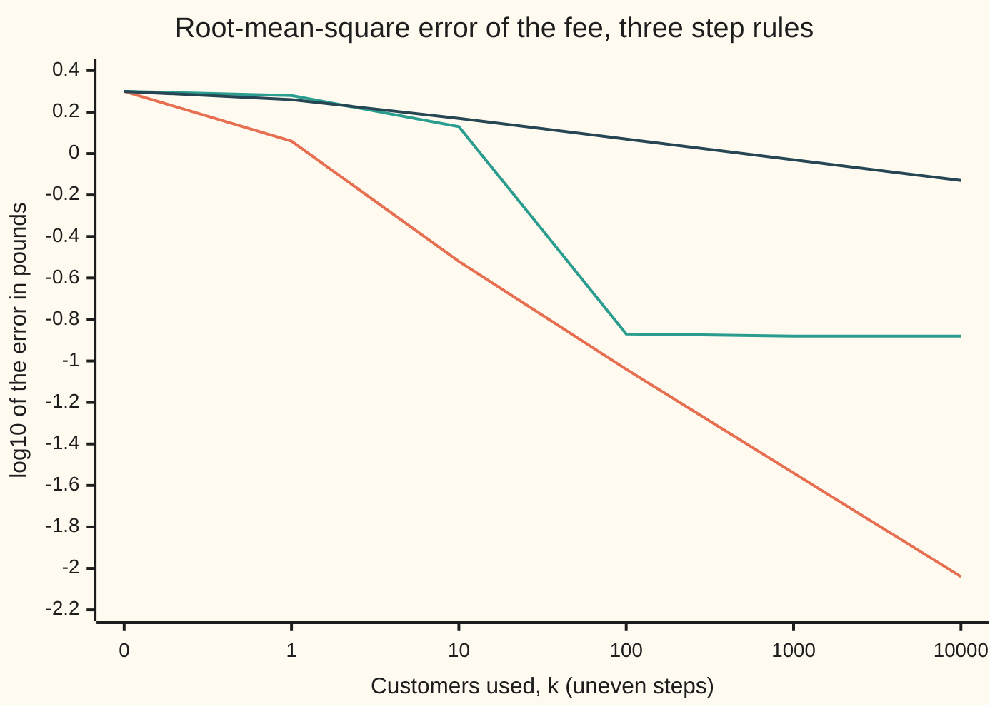

# Stochastic gradient: a noisy step is cheap enough to take many times

[Syllabus](../../../SYLLABUS.md) → [Optimization](../README.md) → [Conic, Quadratic and Stochastic Programs](../README.md#s06) → Stochastic gradient

---

## General Overview

An online grocer has 200,000 customers and charges one delivery fee, now £2. Each customer books fewer deliveries as the fee rises, and each has their own line for how fast: the grocer's records give every customer a fitted demand line. Each delivery costs the grocer £1 in driver time. The grocer chooses the fee to make the average monthly delivery profit per customer as large as possible. The card writes that as **minimising** minus the profit, and there is no other limit on the fee.

Reading all 200,000 records gives the answer: about £4.00, which earns £8.9880 per customer a month against £4.9938 at £2. That is £1,797,591 a month across the base. But a full read is one pass over every record for every step. The **stochastic gradient** method takes a different road. It pulls up one customer at random, asks which way that one customer's profit tilts at the current fee, and nudges the fee a little that way. Then it pulls up another.

One customer is a poor guide. The first customer drawn at random moves the fee from £2 to £3.2423 in a single step.

But on average the nudges point the right way, because a random customer is a fair sample of the whole base. The noise cancels only if the nudges shrink to zero, so that the noise dies, but slowly enough that the fee can still travel all the way. After 10,000 customers, one twentieth of the file, this run's fee is £4.0106. Over all possible runs the typical miss is £0.0092, under a penny.

The same question has a second answer. Draw a sample of customers, solve their average exactly, and ask how far that answer can sit from the real one. That is **sample average approximation** (SAA), and this card bounds its error.

**A step along one random customer's slope is a fair but noisy copy of the full step; with steps whose sum is unlimited and whose squares add to a finite total, the noise averages away and the fee settles at the best one, and a sample of n customers solved exactly misses the best fee, typically, by at most the noise in one customer's slope divided by the least curvature and by √n.**

**What kind of fact this is:** a method plus two theorems. The sample-average error bound and the mean-square form of the Robbins-Monro theorem are proved on this card in Why it works. The 1/k rate for steps a/(k+1) is stated, with its source.

### The picture: how far off the fee is, step by step



The error plotted is the root-mean-square (RMS) error: the typical size of the miss over all random draws.

Orange: steps 0.5/(k+1), the Robbins-Monro rule (steps that shrink, but not too fast). The error falls tenfold for every hundredfold more customers, to £0.0092. Green: a fixed step of 0.02. It drops fast, then sticks at £0.1310. Dark: steps 0.05/(k+1), which meet the Robbins-Monro conditions but are too timid. After 10,000 customers the fee is still £0.7458 off on average.

The values are the exact root-mean-square errors over all random draws, from the recursion in Why it works; the code checks them against 200 simulated runs.

---

## The formula

Notation first, in words. Customer $i$ books $b_i(m_i - p)$ deliveries a month at fee $p$. Here $m_i$ is the fee at which they stop booking, and $b_i$ is how many deliveries a month they drop per £1 of fee. One customer's **loss** (minus their monthly profit to the grocer) and its slope are

$$F(p, i) = -(p - c)\,b_i\,(m_i - p), \qquad F'(p, i) = b_i\,(2p - m_i - c).$$

The grocer minimises the average loss over all $N$ customers, $f(p) = \frac{1}{N}\sum_i F(p, i)$. Its minimiser is $p^*$.

The **stochastic gradient** step (the gradient-descent step of [Gradient descent](../../14-Applied%20and%20computational/06-Machine%20Learning%20Mathematics/02-gradient-descent-and-stochastic-gradient.md), with one random customer's slope in place of the average) draws a customer $i_k$ at random and moves the fee:

$$p_{k+1} = p_k - \alpha_k\, g_k, \qquad g_k = F'(p_k, i_k).$$

The **Robbins-Monro conditions** on the step sizes:

$$\sum_{k=0}^{\infty} \alpha_k = \infty, \qquad \sum_{k=0}^{\infty} \alpha_k^2 < \infty.$$

The **sample average approximation** draws $n$ customers, averages their losses into $\hat f_n$, and takes its minimiser $\hat p_n$. Write $E[\cdot]$ for the average over all the random draws. If every customer's loss curves upward by at least $\mu$, then

$$E\big[(\hat p_n - p^*)^2\big] \;\le\; \frac{\sigma^2}{\mu^2\, n}.$$

**Read it aloud:** step against one random customer's slope; let the steps add up to an unlimited distance while their squares add up to a finite total; and a sample of n customers, solved exactly, misses the best fee by a mean square of at most the noise σ² over μ² times n.

| Symbol | Plain meaning | In our example | Push it up and the answer… |
| --- | --- | --- | --- |
| $i$, $N$ | a customer's number; how many customers there are | $N$ = 200,000 | — |
| $b_i$, $m_i$ | deliveries a month lost per £1 of fee; the fee at which the customer stops | first customer drawn: 1.44645 and £4.71773 | larger $m_i$ pulls $p^*$ up |
| $c$ | the grocer's cost per delivery | £1 | $p^*$ rises by half of it |
| $p$, $p^*$ | the fee; the best fee | £2 now; £3.9997 | — |
| $F(p, i)$, $f(p)$, $f''$ | one customer's loss; the average loss; its curvature, twice the average $b_i$ | $f(p^*)$ = −£8.9880; $f''$ = 1.9978 | larger $f''$: a sharper optimum |
| $k$, $p_k$, $e_k$ | step count from $k$ = 0; the fee after $k$ steps; its error $p_k - p^*$ | $p_0$ = £2, $e_0$ = −£1.9997 | — |
| $g_k$ | the drawn customer's slope at $p_k$ | −2.4846 at $k$ = 0 | — |
| $\alpha_k$, $a$ | the step size at step $k$; its multiplier in $a/(k+1)$ | 0.5/(k+1), so $a$ = 0.5 | faster start, more noise |
| $\mu_f$, $A$, $B$, $u_k$ | in the theorem: the least pull of the average loss; the drawn slope's mean square is at most $A + Be_k^2$; $u_k = E[e_k^2]$ | $\mu_f = f''$ = 1.9978; $u_k$ is the RMS error squared | larger $\mu_f$: faster pull-in |
| $\zeta_i$, $\sigma^2$ | customer $i$'s slope at $p^*$; the average of its square: the noise | $\sigma^2$ = 3.3495 | every error grows with it |
| $\mu$, $L$ | the least and greatest curvature $2b_i$ of any one customer's loss | 0.8 and 3.2 | larger $\mu$: a tighter bound |
| $n$, $\hat f_n$, $\hat p_n$ | sample size; the sample's average loss; its minimiser | $n$ = 1,000 | error falls like $1/\sqrt{n}$ |
| $\varepsilon$, $\delta$ | a tolerance on the fee; the chance allowed of missing it | £0.10 and 0.05 | more customers needed |

The **root-mean-square (RMS) error** is the square root of $E[e_k^2]$, the typical size of the miss over all the random draws.

### When it holds

- **The slope is unbiased.** A customer drawn uniformly at random has average slope $f'(p)$. Read only keen customers (those who keep booking up to a fee above £7) in file order, and the fee ends at £4.7519, not £4.00.
- **The steps add up to an unlimited distance.** Steps 0.25/(k+1)² add up to only 0.411, and the fee stops with a mean error of −£0.7174.
- **The steps shrink to zero.** A fixed step 0.02 never stops injecting noise, so the error sticks at £0.1310. Robbins and Monro's finite total of squares is one way to make the steps shrink; Step 3 shows it is more than this problem needs.
- **The objective curves upward everywhere.** Here every $b_i \ge 0.4$, so every customer's loss has curvature at least $\mu$ = 0.8. Without a floor on the curvature, the bound σ²/(μ²n) says nothing and the rate claims below do not apply.
- **Big enough first steps.** The 1/k rate needs $\alpha_k = a/(k+1)$ with $2af'' > 1$. Steps 0.05/(k+1) give 0.2 and crawl.

---

## Why it works

### Step 0: a random slope is right on average

Draw a customer uniformly at random. The expected value of their slope is the average of all 200,000 slopes, which is $f'(p)$, the slope the full read would give. So each stochastic step points, on average, exactly where the full step points. What differs is the scatter around that average. The whole theory is a bookkeeping of two things: how fast the steps remove the starting error, and how much scatter they leave behind.

### Step 1: the best fee, with a certificate

Each customer's loss is a parabola in $p$. So is the average: $f(p) = \bar b\,p^2 - \overline{b(m+c)}\,p + \text{const}$, with bars for averages over the 200,000. Setting $f'(p) = 0$ gives

$$p^* = \frac{\overline{b(m+c)}}{2\,\bar b} = \frac{7.99045}{2 \times 0.99889} = £3.9997.$$

The code reaches the same fee a second way, from the vertex of the parabola through $f$ at £3, £4 and £5. The certificate: $f'(p^*) = 0$ to six decimals and $f'' = 1.9978 > 0$, so $f$ is convex (it curves upward everywhere) and $p^*$ is its global minimum.

### Step 2: one step, squared

Subtract $p^*$ from the update: $e_{k+1} = e_k - \alpha_k g_k$. Square it:

$$e_{k+1}^2 = e_k^2 - 2\alpha_k\, g_k\, e_k + \alpha_k^2\, g_k^2.$$

Take the average over the customer drawn. The middle term becomes $-2\alpha_k f'(p_k)\,e_k$. Here $f'(p_k) = f''\,e_k$, since $f$ is a parabola, so it pulls the error in by $2\alpha_k f'' e_k^2$. The last term pushes out: the drawn slope is never exactly zero, even at $p^*$, where it is $\zeta_i$ with mean square $\sigma^2$. So, roughly,

$$E[e_{k+1}^2] \;\approx\; (1 - 2 f''\alpha_k)\,E[e_k^2] + \alpha_k^2\,\sigma^2.$$

The code does not use "roughly". Because each loss is a parabola, the exact mean and mean square of $e_k$ follow a two-line recursion in the averages of $b_i$, $b_i^2$, $\zeta_i$, $\zeta_i^2$ and $b_i\zeta_i$. That recursion draws the chart. It agrees with 200 simulated runs to within 1.41 standard errors at every checkpoint.

### Step 3: what each condition does

**The sum of the steps must be unlimited.** Without noise, each step multiplies the error by about $1 - f''\alpha_k$. A product of such factors reaches zero exactly when the $\alpha_k$ add up to infinity. If they add up to a finite total, part of the starting error is never removed. Steps 0.25/(k+1)² add up to 0.411, and the mean error freezes at −£0.7174.

**The steps must shrink to zero.** Each step injects scatter $\alpha_k^2\sigma^2$, while the pull removes the fraction $2f''\alpha_k$ of the mean square. The two balance near $E[e_k^2] \approx \alpha_k\sigma^2/(2f'')$, a floor in proportion to the step. A fixed step keeps its floor for ever: RMS £0.1310 at step 0.02, reached by $k$ = 1,000 and never left. Shrinking steps lower the floor as they shrink, so the noise dies.

**A finite total of squares is enough, but not needed.** It is Robbins and Monro's classical condition: it forces the steps to zero, and it keeps the last step of the proof below short. Steps 0.5/√(k+1) shrink to zero with an unlimited sum, but their squares add up to infinity. They still converge, only more slowly: RMS £0.1166 at $k$ = 1,000 and £0.0650 at 10,000, close to the floor formula's £0.0647. The proof below covers them too.

With $\alpha_k = 0.5/(k+1)$ both of Robbins and Monro's conditions hold: the harmonic sum $1 + \tfrac12 + \tfrac13 + \dots$ is unlimited, and the squares add to $0.25 \times \pi^2/6$.

### Step 4: the theorem, and the rate

**Robbins-Monro, mean-square form.** Suppose the slope drawn is unbiased, the average loss pulls the error in at a rate at least $\mu_f > 0$ (here $\mu_f = f''$), and the drawn slope's mean square is at most $A + B\,e_k^2$. If $\alpha_k > 0$, $\sum \alpha_k = \infty$ and $\sum \alpha_k^2 < \infty$, then $E[e_k^2] \to 0$. Robbins and Monro proved this in 1951 for finding a root from noisy measurements; minimising $f$ is finding the root of $f'$.

<details>
<summary>Detailed proof: the mean-square error goes to zero</summary>

From Step 2 with the bounds in place, $u_k = E[e_k^2]$ satisfies

$$u_{k+1} \le (1 - 2\mu_f\alpha_k + B\alpha_k^2)\,u_k + A\alpha_k^2.$$

Because $\sum\alpha_k^2$ is finite, $\alpha_k \to 0$, so from some step $K$ on, $B\alpha_k^2 \le \mu_f\alpha_k$ and $\mu_f\alpha_k < 1$. From there $u_{k+1} \le (1 - \mu_f\alpha_k)\,u_k + A\alpha_k^2$. Unroll from $K$ to $n$:

$$u_n \le u_K \prod_{j=K}^{n-1}(1 - \mu_f\alpha_j) \;+\; A\sum_{j=K}^{n-1}\alpha_j^2 \prod_{i=j+1}^{n-1}(1 - \mu_f\alpha_i).$$

Since $1 - x \le e^{-x}$, each product is at most $e^{-\mu_f\sum\alpha_i}$ over its range. The first term goes to zero because $\sum\alpha_j = \infty$. For the second, fix a tolerance and pick $J$ so that $A\sum_{j \ge J}\alpha_j^2$ is below it; that is possible because $\sum\alpha_j^2$ is finite. The terms with $j \ge J$ add to less than the tolerance, as each product is at most 1. The finitely many terms with $j < J$ each carry a product over $i$ from $J$ to $n - 1$, which goes to zero as $n$ grows. So $\limsup u_n$ is below every tolerance, and $u_n \to 0$.

The square condition is used only for the terms with $j \ge J$, and steps that merely shrink to zero handle them too. Pick $J \ge K$ so that $A\alpha_j$ is at most $\mu_f$ times the tolerance for every $j \ge J$. Those terms then add to at most the tolerance times $\sum_{j \ge J}\mu_f\alpha_j\prod_{i=j+1}^{n-1}(1 - \mu_f\alpha_i)$. Each term of that sum is the difference of two neighbouring products, so the sum collapses to $1 - \prod_{i=J}^{n-1}(1 - \mu_f\alpha_i) \le 1$. So $\alpha_k \to 0$ with $\sum\alpha_k = \infty$ is already enough here.

</details>

**The rate, stated.** With $\alpha_k = a/(k+1)$ and $2af'' > 1$, $E[e_k^2]$ falls like $1/k$. The precise bound is in Nemirovski, Juditsky, Lan and Shapiro (2009, section 2.1), with the same rate for the loss in Bottou, Curtis and Nocedal (2018, Theorem 4.7). For a parabola the constant is $a^2\sigma^2/\big((2af'' - 1)k\big)$, smallest at $a = 1/f''$, where it is $\sigma^2/(f''^2 k)$. Here $a$ = 0.5 is that choice: at $k$ = 10,000, $\sigma/(f''\sqrt k)$ = £0.0092, the exact RMS error.

With $2af'' < 1$ the mean error shrinks only like $k^{-af''}$. Steps 0.05/(k+1) give $af''$ = 0.1, and reaching £0.01 would take about $10^{22.7}$ customers.

### Step 5: the sample average, bounded

Now solve on a sample. Draw $n$ customers at random, average their losses into $\hat f_n$, and take its minimiser $\hat p_n$, so $\hat f_n'(\hat p_n) = 0$. Every customer's loss has curvature at least $\mu$, so the average of any of them does too. A function curving up by at least $\mu$ has slopes that differ by at least $\mu$ times the distance between the points:

$$\mu\,\lvert\hat p_n - p^*\rvert \;\le\; \lvert \hat f_n'(\hat p_n) - \hat f_n'(p^*)\rvert = \lvert \hat f_n'(p^*)\rvert.$$

The right side is an average of $n$ independent slopes at $p^*$, the $\zeta_i$. Their mean is $f'(p^*) = 0$, so the mean square of their average is $\sigma^2/n$, the variance-of-an-average rule from the [Law of large numbers](../../09-Probability%20and%20statistics/06-Limit%20Theorems%20in%20Practice/01-law-of-large-numbers.md). Square, average, divide by $\mu^2$:

$$E\big[(\hat p_n - p^*)^2\big] \le \frac{\sigma^2}{\mu^2 n}.$$

Chebyshev's inequality turns it into a sample size. The chance of missing by $\varepsilon$ or more is at most $\sigma^2/(\mu^2 n\varepsilon^2)$. Keeping that under $\delta$ needs $n \ge \sigma^2/(\mu^2\varepsilon^2\delta)$.

The bound uses the worst curvature, 0.8, while the average curvature is 1.9978. So it is safe but loose. For large $n$ the actual mean square approaches $\sigma^2/(f''^2 n)$, smaller by the factor $(f''/\mu)^2$. The simulation shows both.

---

## Worked numbers, by hand

The first step, then the sample size.

| Step | Arithmetic | Value |
| --- | --- | --- |
| best fee | 7.99045 ÷ (2 × 0.99889) | £3.9997 |
| first customer's slope at £2 | 1.44645 × (2 × 2 − 4.71773 − 1) | −2.4846 |
| first step, $\alpha_0$ = 0.5 | 2 − 0.5 × (−2.4846) | £3.2423 |
| SAA mean-square bound, $n$ = 1,000 | 3.3495 ÷ (0.8² × 1,000) | 0.005234 |
| as an RMS error | √0.005234 | £0.0723 |
| customers for ±£0.10 with 95% | 3.3495 ÷ (0.64 × 0.01 × 0.05), rounded up | **10,468** |

A random sample of 10,468 customers, solved exactly, puts the fee within 10p of the best with at least 95% probability, guaranteed. The simulation says 1,000 customers already miss by only £0.0291 in RMS, against the bound's £0.0723.

### What breaks if you drop a piece

| Mistake | Comes out at | What went wrong |
| --- | --- | --- |
| Fixed step 0.02 | RMS £0.1310 at $k$ = 10,000, the same as at 1,000 | The step never shrinks: the noise floor stays |
| Steps 0.25/(k+1)² | mean error −£0.7174, frozen | Steps add up to only 0.411: the fee runs out of road |
| Steps 0.05/(k+1) | still £0.7458 off on average after 10,000 | Conditions met, but $2af''$ = 0.2 < 1: about $10^{22.7}$ steps to reach £0.01 |
| 10,000 keen customers in file order | fee £4.7519 | The slopes are biased: the method finds the best fee for the wrong customers |

---

## Ten thousand customers, one at a time

The puzzle: each step is a guess from one customer, yet the fee settles to within a penny. Two forces act on every step. The pull towards $p^*$ removes part of the error left from the start. The kick from the drawn customer adds fresh scatter. The step rule sets the balance.

### One story: a single run

The Robbins-Monro run, with its own random customers.

| Customers used, $k$ | 0 | 1 | 10 | 100 | 1,000 | 10,000 |
| --- | ---: | ---: | ---: | ---: | ---: | ---: |
| fee $p_k$ | £2.0000 | £3.2423 | £4.0521 | £3.9106 | £4.0097 | £4.0106 |
| RMS error over all runs | £1.9997 | £1.1465 | £0.3043 | £0.0922 | £0.0290 | £0.0092 |

The first step does most of the travel: $\alpha_0 f''$ is close to 1, so on average one step lands on $p^*$. After that the run wanders inside a band that narrows like $1/\sqrt{k}$.

### One force at a time: what is left at k = 10,000

The mean square error splits into the start's leftover (the mean error, squared) and the noise (the scatter around it). In pounds squared:

```
start's leftover
  Robbins-Monro 0.5/(k+1)  ▏                                         0.000000
  constant 0.02            ▏                                         0.000000
  timid 0.05/(k+1)         ████████████████████████████████████████  0.556173
  summable 0.25/(k+1)^2    █████████████████████████████████████     0.514597
noise
  Robbins-Monro 0.5/(k+1)  ▏                                         0.000084
  constant 0.02            █▏                                        0.017150
  timid 0.05/(k+1)         ▎                                         0.003915
  summable 0.25/(k+1)^2    █████████████                             0.182905
```

The fixed step has forgotten the start but keeps its noise. The timid and summable rules still carry most of the starting error. Of these four, only the Robbins-Monro rule makes both small.

### Both forces in one picture

The chart in the overview is the sum of the two bars at every $k$: the Robbins-Monro line falls steadily, the fixed step flattens at its noise floor, and the timid line barely moves.

---

## Code, from first principles, and it actually runs

The code builds the 200,000 customers from a written-out SplitMix64 generator with seed 2026, so Python and Rust draw the same customers. It takes four roads. The best fee comes from solving $f'(p) = 0$ and, separately, from the vertex of the parabola through three loss values, with a derivative certificate.

The stochastic-gradient error comes from the exact mean-square recursion, from 200 simulated runs, from the $\sigma^2/(f''^2k)$ law and, for the steps 0.5/√(k+1), from the floor $\alpha_k\sigma^2/(2f'')$; the run's first step is checked against the hand calculation. The sample-average error is simulated 200 times at each sample size and checked against both the bound and the large-sample value.

### Python

```python
# Stochastic gradient and sample average approximation -- the check behind the card.
# Standard library only.  An online grocer with 200,000 customers (synthetic, from
# SplitMix64 seed 2026) picks one delivery fee p.  Customer i books b_i (m_i - p)
# deliveries a month; each costs the grocer c = £1.  The card MINIMISES the average
# loss f(p) = minus the average monthly profit per customer, in pounds.
import math
M64 = (1 << 64) - 1
class Rng:                                   # SplitMix64, written out so Rust can match it
    def __init__(self, seed): self.s = seed
    def next(self):
        self.s = (self.s + 0x9E3779B97F4A7C15) & M64
        z = self.s
        z = ((z ^ (z >> 30)) * 0xBF58476D1CE4E5B9) & M64
        z = ((z ^ (z >> 27)) * 0x94D049BB133111EB) & M64
        return z ^ (z >> 31)
    def unif(self): return (self.next() >> 11) * 2.0 ** -53
    def pick(self, n): return self.next() % n

N, C, P0, MU, L = 200_000, 1.0, 2.0, 0.8, 3.2      # every b_i lies in [0.4, 1.6]: curvature 2 b_i in [MU, L]
rng = Rng(2026)
B, M = [], []
for _ in range(N):
    B.append(0.4 + 1.2 * rng.unif()); M.append(4.0 + 6.0 * rng.unif())
def F(p, i): return -(p - C) * B[i] * (M[i] - p)   # one customer's loss, £ a month
def g(p, i): return B[i] * (2.0 * p - M[i] - C)    # its slope in p
def f(p):
    s = 0.0
    for i in range(N): s += F(p, i)
    return s / N
def mean(xs):
    s = 0.0
    for x in xs: s += x
    return s / len(xs)

# ---- the whole-population answer, two roads and a certificate ----
B1 = mean(B)
BMC = mean([b * (m + C) for b, m in zip(B, M)])
pstar = BMC / (2.0 * B1)                                          # road 1: f'(p) = 0, solved
f3, f4, f5 = f(3.0), f(4.0), f(5.0)
curv = f5 - 2.0 * f4 + f3                                         # f'' from three loss values, h = 1
pvert = 4.0 - (f5 - f3) / (2.0 * curv)                            # road 2: vertex of the parabola
fstar = f(pstar)
slope = (f(pstar + 1e-3) - f(pstar - 1e-3)) / 2e-3
print(f"customers {N}; mean b {B1:.5f}; mean b(m+c) {BMC:.5f}; best fee p* = £{pstar:.4f}; parabola vertex £{pvert:.4f}")
print(f"profit a customer a month: at £{P0:.2f} £{-f(P0):.4f}; at p* £{-fstar:.4f}; whole base £{-fstar * N:.0f}")
print(f"certificate: f'(p*) = {slope:.6f}, f'' = {curv:.4f} > 0, so p* is the global minimum")
assert abs(pstar - pvert) < 1e-6 and abs(slope) < 1e-6 and abs(curv - 2.0 * B1) < 1e-6
assert abs(mean([g(P0, i) for i in range(N)]) - (f(P0 + 1e-3) - f(P0 - 1e-3)) / 2e-3) < 1e-6   # g really is F's slope

Z = [g(pstar, i) for i in range(N)]                # each customer's slope at p*: pure noise
Z1, Z2 = mean(Z), mean([z * z for z in Z])
B2, BZ = mean([b * b for b in B]), mean([b * z for b, z in zip(B, Z)])
print(f"noise at p*: sigma^2 = {Z2:.4f}; mu = {MU:.1f}, L = {L:.1f}, f'' = {curv:.4f}")
assert abs(Z1) < 1e-9

# ---- stochastic gradient: one customer per step ----
RULES = [("Robbins-Monro 0.5/(k+1)", lambda k: 0.5 / (k + 1)), ("constant 0.02", lambda k: 0.02),
         ("timid 0.05/(k+1)", lambda k: 0.05 / (k + 1)), ("summable 0.25/(k+1)^2", lambda k: 0.25 / (k + 1) ** 2),
         ("root 0.5/sqrt(k+1)", lambda k: 0.5 / math.sqrt(k + 1))]
MARKS = [0, 1, 10, 100, 1000, 10000]
def exact(step):                                   # road 2: exact mean and mean square of e_k = p_k - p*
    m1, m2, out = P0 - pstar, (P0 - pstar) ** 2, {}
    for k in range(MARKS[-1] + 1):
        if k in MARKS: out[k] = (m1, m2)
        a = step(k)
        m1, m2 = ((1 - 2 * a * B1) * m1 - a * Z1,
                  (1 - 4 * a * B1 + 4 * a * a * B2) * m2 - 2 * a * (Z1 - 2 * a * BZ) * m1 + a * a * Z2)
    return out
def sgd(step, K, r):
    p, out = P0, {}
    for k in range(K + 1):
        if k in MARKS: out[k] = p
        if k < K: p -= step(k) * g(p, r.pick(N))
    return out
EX = [exact(s) for _, s in RULES]
run = sgd(RULES[0][1], 10000, Rng(7))
i0 = Rng(7).pick(N)
assert abs(run[1] - (P0 - RULES[0][1](0) * g(P0, i0))) < 1e-12        # the loop's first step, by hand
print(f"first customer drawn: b {B[i0]:.5f}, m £{M[i0]:.5f}, slope at £2 {g(P0, i0):.4f}, p_1 = 2 - 0.5 x slope = £{P0 - 0.5 * g(P0, i0):.4f}")
print("one run, Robbins-Monro steps, fee p_k at k =", " ".join(f"{k}:£{run[k]:.4f}" for k in MARKS))
print("exact root-mean-square error |p_k - p*| in £, and its split at k = 10000:")
for (name, _), ex in zip(RULES, EX):
    m1, m2 = ex[10000]
    print(f"  {name:24}" + " ".join(f"{math.sqrt(ex[k][1]):.4f}" for k in MARKS),
          f"| mean {m1:+.4f}, start part {m1 * m1:.6f} noise part {m2 - m1 * m1:.6f}")
print("chart, log10 RMS error:", "; ".join(" ".join(f"{math.log10(math.sqrt(ex[k][1])):.2f}" for k in MARKS) for ex in EX[:3]))
R, rs = 200, Rng(11)
sq = {k: [] for k in MARKS[2:]}
for _ in range(R):
    o = sgd(RULES[0][1], 10000, rs)
    for k in sq: sq[k].append((o[k] - pstar) ** 2)
for k in sq:
    mc, se = mean(sq[k]), math.sqrt((mean([x * x for x in sq[k]]) - mean(sq[k]) ** 2) / R)
    print(f"  k = {k:5}: simulated RMS £{math.sqrt(mc):.4f}, exact £{math.sqrt(EX[0][k][1]):.4f}, gap {(mc - EX[0][k][1]) / se:+.2f} se")
    assert abs(mc - EX[0][k][1]) < 4 * se
print(f"  sigma/(f'' sqrt k) at k = 10000: £{math.sqrt(Z2 / (curv * curv * 1e4)):.4f}")
assert abs(EX[0][10000][1] / (Z2 / (curv * curv * 1e4)) - 1) < 0.02     # the 1/k law at step 1/f''
assert EX[1][10000][1] > 50 * EX[0][10000][1] and abs(EX[3][10000][0]) > 0.5 and abs(EX[2][10000][0]) > 0.5
fl = RULES[4][1](10000) * Z2 / (2.0 * curv)                     # floor where pull and kick balance
print(f"root steps, squares not summable: RMS £{math.sqrt(EX[4][10000][1]):.4f} at k = 10000; floor alpha_k sigma^2/(2f'') gives £{math.sqrt(fl):.4f}")
assert abs(EX[4][10000][1] / fl - 1) < 0.02 and EX[4][10000][1] < EX[4][1000][1] / 3
lg = 4 + math.log10(abs(EX[2][10000][0]) / 0.01) / (0.1 * B1)      # mean error shrinks like k^(-0.1 f''/2)
print(f"timid steps: 2af'' = {0.1 * curv:.2f}; mean error still £{abs(EX[2][10000][0]):.4f}; reaching £0.01 takes about 10^{lg:.1f} steps")
print(f"summable steps 0.25/(k+1)^2 add up to {0.25 * math.pi ** 2 / 6:.3f} in all")
p, k, i = P0, 0, 0
while k < 10000:                                   # customers read in file order, keen ones (m > 7) only
    if M[i] > 7.0: p -= RULES[0][1](k) * g(p, i); k += 1
    i += 1
print(f"biased stream, 10000 keen customers in file order: fee ends at £{p:.4f}")
assert p - pstar > 0.5

# ---- sample average approximation: solve exactly on a sample of n customers ----
print("SAA: RMS error of the sample's best fee, against the bound sigma/(mu sqrt n)")
for n in (100, 1000, 10000):
    e2, opt, rs = [], [], Rng(100 + n)
    for _ in range(R):
        sb = sbmc = 0.0
        for _ in range(n):
            i = rs.pick(N); sb += B[i]; sbmc += B[i] * (M[i] + C)
        ph = sbmc / (2.0 * sb)
        e2.append((ph - pstar) ** 2); opt.append(sb / n * (ph - pstar) ** 2)
    mc, se = mean(e2), math.sqrt((mean([x * x for x in e2]) - mean(e2) ** 2) / R)
    bound, asym = Z2 / (MU * MU * n), Z2 / (curv * curv * n)
    print(f"  n = {n:5}: simulated RMS £{math.sqrt(mc):.4f}, asymptotic £{math.sqrt(asym):.4f}, bound £{math.sqrt(bound):.4f} ({bound:.6f});"
          f" claimed profit too high by {100 * mean(opt):.3f}p, real profit short by {100 * B1 * mc:.3f}p")
    assert mc + 4 * se < bound and abs(mc - asym) < 4 * se + 0.1 * asym
need_mu = math.ceil(Z2 / (MU * MU * 0.1 ** 2 * 0.05)); need_f = math.ceil(Z2 / (curv * curv * 0.1 ** 2 * 0.05))
print(f"customers to sample for |p_hat - p*| < £0.10 with 95%: {need_mu} from mu, {need_f} from f''")
print(f"the 200,000 themselves, as a sample of future customers: RMS £{math.sqrt(Z2 / (curv * curv * N)):.4f}")
print("ALL CHECKS PASS")
```

**Ran 2026-11-11 on macOS, Python 3.14.10, standard library only. All checks passed. Output, pasted from the run:**

```
customers 200000; mean b 0.99889; mean b(m+c) 7.99045; best fee p* = £3.9997; parabola vertex £3.9997
profit a customer a month: at £2.00 £4.9938; at p* £8.9880; whole base £1797591
certificate: f'(p*) = 0.000000, f'' = 1.9978 > 0, so p* is the global minimum
noise at p*: sigma^2 = 3.3495; mu = 0.8, L = 3.2, f'' = 1.9978
first customer drawn: b 1.44645, m £4.71773, slope at £2 -2.4846, p_1 = 2 - 0.5 x slope = £3.2423
one run, Robbins-Monro steps, fee p_k at k = 0:£2.0000 1:£3.2423 10:£4.0521 100:£3.9106 1000:£4.0097 10000:£4.0106
exact root-mean-square error |p_k - p*| in £, and its split at k = 10000:
  Robbins-Monro 0.5/(k+1) 1.9997 1.1465 0.3043 0.0922 0.0290 0.0092 | mean -0.0000, start part 0.000000 noise part 0.000084
  constant 0.02           1.9997 1.9203 1.3350 0.1353 0.1310 0.1310 | mean +0.0000, start part 0.000000 noise part 0.017150
  timid 0.05/(k+1)        1.9997 1.8036 1.4851 1.1849 0.9419 0.7484 | mean -0.7458, start part 0.556173 noise part 0.003915
  summable 0.25/(k+1)^2   1.9997 1.1535 0.8758 0.8393 0.8355 0.8352 | mean -0.7174, start part 0.514597 noise part 0.182905
  root 0.5/sqrt(k+1)      1.9997 1.1465 0.4149 0.2132 0.1166 0.0650 | mean +0.0000, start part 0.000000 noise part 0.004226
chart, log10 RMS error: 0.30 0.06 -0.52 -1.04 -1.54 -2.04; 0.30 0.28 0.13 -0.87 -0.88 -0.88; 0.30 0.26 0.17 0.07 -0.03 -0.13
  k =    10: simulated RMS £0.3237, exact £0.3043, gap +1.28 se
  k =   100: simulated RMS £0.0919, exact £0.0922, gap -0.09 se
  k =  1000: simulated RMS £0.0284, exact £0.0290, gap -0.46 se
  k = 10000: simulated RMS £0.0098, exact £0.0092, gap +1.41 se
  sigma/(f'' sqrt k) at k = 10000: £0.0092
root steps, squares not summable: RMS £0.0650 at k = 10000; floor alpha_k sigma^2/(2f'') gives £0.0647
timid steps: 2af'' = 0.20; mean error still £0.7458; reaching £0.01 takes about 10^22.7 steps
summable steps 0.25/(k+1)^2 add up to 0.411 in all
biased stream, 10000 keen customers in file order: fee ends at £4.7519
SAA: RMS error of the sample's best fee, against the bound sigma/(mu sqrt n)
  n =   100: simulated RMS £0.1004, asymptotic £0.0916, bound £0.2288 (0.052335); claimed profit too high by 1.004p, real profit short by 1.007p
  n =  1000: simulated RMS £0.0291, asymptotic £0.0290, bound £0.0723 (0.005234); claimed profit too high by 0.085p, real profit short by 0.085p
  n = 10000: simulated RMS £0.0092, asymptotic £0.0092, bound £0.0229 (0.000523); claimed profit too high by 0.009p, real profit short by 0.009p
customers to sample for |p_hat - p*| < £0.10 with 95%: 10468 from mu, 1679 from f''
the 200,000 themselves, as a sample of future customers: RMS £0.0020
ALL CHECKS PASS
```

### Rust

```rust
// Stochastic gradient and sample average approximation -- the check behind the card.
// std only.  An online grocer with 200,000 customers (synthetic, from SplitMix64
// seed 2026) picks one delivery fee p.  Customer i books b_i (m_i - p) deliveries a
// month; each costs the grocer c = £1.  The card MINIMISES the average loss f(p) =
// minus the average monthly profit per customer, in pounds.
struct Rng { s: u64 }
impl Rng {
    fn next(&mut self) -> u64 {
        self.s = self.s.wrapping_add(0x9E3779B97F4A7C15);
        let mut z = self.s;
        z = (z ^ (z >> 30)).wrapping_mul(0xBF58476D1CE4E5B9);
        z = (z ^ (z >> 27)).wrapping_mul(0x94D049BB133111EB);
        z ^ (z >> 31)
    }
    fn unif(&mut self) -> f64 { (self.next() >> 11) as f64 * 2f64.powi(-53) }
    fn pick(&mut self, n: usize) -> usize { (self.next() % n as u64) as usize }
}
const N: usize = 200_000;
const C: f64 = 1.0;
const P0: f64 = 2.0;
const MU: f64 = 0.8; // every b_i lies in [0.4, 1.6]: curvature 2 b_i in [MU, L]
const L: f64 = 3.2;
const MARKS: [usize; 6] = [0, 1, 10, 100, 1000, 10000];

fn mean(xs: &[f64]) -> f64 {
    let mut s = 0.0;
    for x in xs { s += x; }
    s / xs.len() as f64
}

fn step(r: usize, k: usize) -> f64 {
    match r {
        0 => 0.5 / (k + 1) as f64,
        1 => 0.02,
        2 => 0.05 / (k + 1) as f64,
        3 => 0.25 / ((k + 1) * (k + 1)) as f64,
        _ => 0.5 / ((k + 1) as f64).sqrt(),
    }
}

fn main() {
    let mut rng = Rng { s: 2026 };
    let (mut b, mut m) = (Vec::with_capacity(N), Vec::with_capacity(N));
    for _ in 0..N {
        b.push(0.4 + 1.2 * rng.unif());
        m.push(4.0 + 6.0 * rng.unif());
    }
    let ff = |p: f64, i: usize| -(p - C) * b[i] * (m[i] - p); // one customer's loss, £ a month
    let g = |p: f64, i: usize| b[i] * (2.0 * p - m[i] - C);   // its slope in p
    let f = |p: f64| { let mut s = 0.0; for i in 0..N { s += ff(p, i); } s / N as f64 };

    // ---- the whole-population answer, two roads and a certificate ----
    let b1 = mean(&b);
    let bmc: Vec<f64> = (0..N).map(|i| b[i] * (m[i] + C)).collect();
    let bm = mean(&bmc);
    let pstar = bm / (2.0 * b1); // road 1: f'(p) = 0, solved
    let (f3, f4, f5) = (f(3.0), f(4.0), f(5.0));
    let curv = f5 - 2.0 * f4 + f3; // f'' from three loss values, h = 1
    let pvert = 4.0 - (f5 - f3) / (2.0 * curv); // road 2: vertex of the parabola
    let fstar = f(pstar);
    let slope = (f(pstar + 1e-3) - f(pstar - 1e-3)) / 2e-3;
    println!("customers {}; mean b {:.5}; mean b(m+c) {:.5}; best fee p* = £{:.4}; parabola vertex £{:.4}", N, b1, bm, pstar, pvert);
    println!("profit a customer a month: at £{:.2} £{:.4}; at p* £{:.4}; whole base £{:.0}", P0, -f(P0), -fstar, -fstar * N as f64);
    println!("certificate: f'(p*) = {:.6}, f'' = {:.4} > 0, so p* is the global minimum", slope, curv);
    assert!((pstar - pvert).abs() < 1e-6 && slope.abs() < 1e-6 && (curv - 2.0 * b1).abs() < 1e-6);
    let gm = mean(&(0..N).map(|i| g(P0, i)).collect::<Vec<_>>());
    assert!((gm - (f(P0 + 1e-3) - f(P0 - 1e-3)) / 2e-3).abs() < 1e-6); // g really is F's slope

    let z: Vec<f64> = (0..N).map(|i| g(pstar, i)).collect(); // each customer's slope at p*: pure noise
    let z1 = mean(&z);
    let z2 = mean(&z.iter().map(|x| x * x).collect::<Vec<_>>());
    let b2 = mean(&b.iter().map(|x| x * x).collect::<Vec<_>>());
    let bz = mean(&(0..N).map(|i| b[i] * z[i]).collect::<Vec<_>>());
    println!("noise at p*: sigma^2 = {:.4}; mu = {:.1}, L = {:.1}, f'' = {:.4}", z2, MU, L, curv);
    assert!(z1.abs() < 1e-9);

    // ---- stochastic gradient: one customer per step ----
    let names = ["Robbins-Monro 0.5/(k+1)", "constant 0.02", "timid 0.05/(k+1)", "summable 0.25/(k+1)^2", "root 0.5/sqrt(k+1)"];
    let exact = |r: usize| { // road 2: exact mean and mean square of e_k = p_k - p*
        let (mut m1, mut m2, mut out) = (P0 - pstar, (P0 - pstar).powi(2), Vec::new());
        for k in 0..=10000 {
            if MARKS.contains(&k) { out.push((m1, m2)); }
            let a = step(r, k);
            let n1 = (1.0 - 2.0 * a * b1) * m1 - a * z1;
            let n2 = (1.0 - 4.0 * a * b1 + 4.0 * a * a * b2) * m2 - 2.0 * a * (z1 - 2.0 * a * bz) * m1 + a * a * z2;
            m1 = n1; m2 = n2;
        }
        out
    };
    let sgd = |r: usize, kk: usize, rg: &mut Rng| {
        let (mut p, mut out) = (P0, Vec::new());
        for k in 0..=kk {
            if MARKS.contains(&k) { out.push(p); }
            if k < kk { p -= step(r, k) * g(p, rg.pick(N)); }
        }
        out
    };
    let ex: Vec<Vec<(f64, f64)>> = (0..5).map(|r| exact(r)).collect();
    let run = sgd(0, 10000, &mut Rng { s: 7 });
    let i0 = Rng { s: 7 }.pick(N);
    assert!((run[1] - (P0 - step(0, 0) * g(P0, i0))).abs() < 1e-12); // the loop's first step, by hand
    println!("first customer drawn: b {:.5}, m £{:.5}, slope at £2 {:.4}, p_1 = 2 - 0.5 x slope = £{:.4}", b[i0], m[i0], g(P0, i0), P0 - 0.5 * g(P0, i0));
    let s: Vec<String> = MARKS.iter().zip(&run).map(|(k, p)| format!("{}:£{:.4}", k, p)).collect();
    println!("one run, Robbins-Monro steps, fee p_k at k = {}", s.join(" "));
    println!("exact root-mean-square error |p_k - p*| in £, and its split at k = 10000:");
    for r in 0..5 {
        let (m1, m2) = ex[r][5];
        let s: Vec<String> = ex[r].iter().map(|e| format!("{:.4}", e.1.sqrt())).collect();
        println!("  {:24}{} | mean {:+.4}, start part {:.6} noise part {:.6}", names[r], s.join(" "), m1, m1 * m1, m2 - m1 * m1);
    }
    let ch: Vec<String> = (0..3).map(|r| ex[r].iter().map(|e| format!("{:.2}", e.1.sqrt().log10())).collect::<Vec<_>>().join(" ")).collect();
    println!("chart, log10 RMS error: {}", ch.join("; "));
    let (rr, mut rs) = (200usize, Rng { s: 11 });
    let mut sq = vec![Vec::new(); 4];
    for _ in 0..rr {
        let o = sgd(0, 10000, &mut rs);
        for j in 0..4 { sq[j].push((o[j + 2] - pstar).powi(2)); }
    }
    for j in 0..4 {
        let mc = mean(&sq[j]);
        let se = ((mean(&sq[j].iter().map(|x| x * x).collect::<Vec<_>>()) - mean(&sq[j]).powi(2)) / rr as f64).sqrt();
        let e = ex[0][j + 2].1;
        println!("  k = {:5}: simulated RMS £{:.4}, exact £{:.4}, gap {:+.2} se", MARKS[j + 2], mc.sqrt(), e.sqrt(), (mc - e) / se);
        assert!((mc - e).abs() < 4.0 * se);
    }
    println!("  sigma/(f'' sqrt k) at k = 10000: £{:.4}", (z2 / (curv * curv * 1e4)).sqrt());
    assert!((ex[0][5].1 / (z2 / (curv * curv * 1e4)) - 1.0).abs() < 0.02); // the 1/k law, step 1/f''
    assert!(ex[1][5].1 > 50.0 * ex[0][5].1 && ex[3][5].0.abs() > 0.5 && ex[2][5].0.abs() > 0.5);
    let fl = step(4, 10000) * z2 / (2.0 * curv); // floor where pull and kick balance
    println!("root steps, squares not summable: RMS £{:.4} at k = 10000; floor alpha_k sigma^2/(2f'') gives £{:.4}", ex[4][5].1.sqrt(), fl.sqrt());
    assert!((ex[4][5].1 / fl - 1.0).abs() < 0.02 && ex[4][5].1 < ex[4][4].1 / 3.0);
    let lg = 4.0 + (ex[2][5].0.abs() / 0.01).log10() / (0.1 * b1); // mean error shrinks like k^(-0.1 f''/2)
    println!("timid steps: 2af'' = {:.2}; mean error still £{:.4}; reaching £0.01 takes about 10^{:.1} steps", 0.1 * curv, ex[2][5].0.abs(), lg);
    println!("summable steps 0.25/(k+1)^2 add up to {:.3} in all", 0.25 * std::f64::consts::PI.powi(2) / 6.0);
    let (mut p, mut k, mut i) = (P0, 0usize, 0usize);
    while k < 10000 { // customers read in file order, keen ones (m > 7) only
        if m[i] > 7.0 { p -= step(0, k) * g(p, i); k += 1; }
        i += 1;
    }
    println!("biased stream, 10000 keen customers in file order: fee ends at £{:.4}", p);
    assert!(p - pstar > 0.5);

    // ---- sample average approximation: solve exactly on a sample of n customers ----
    println!("SAA: RMS error of the sample's best fee, against the bound sigma/(mu sqrt n)");
    for n in [100usize, 1000, 10000] {
        let (mut e2, mut opt, mut rs) = (Vec::new(), Vec::new(), Rng { s: 100 + n as u64 });
        for _ in 0..rr {
            let (mut sb, mut sbmc) = (0.0, 0.0);
            for _ in 0..n { let i = rs.pick(N); sb += b[i]; sbmc += b[i] * (m[i] + C); }
            let ph = sbmc / (2.0 * sb);
            e2.push((ph - pstar).powi(2));
            opt.push(sb / n as f64 * (ph - pstar).powi(2));
        }
        let mc = mean(&e2);
        let se = ((mean(&e2.iter().map(|x| x * x).collect::<Vec<_>>()) - mc.powi(2)) / rr as f64).sqrt();
        let (bound, asym) = (z2 / (MU * MU * n as f64), z2 / (curv * curv * n as f64));
        println!("  n = {:5}: simulated RMS £{:.4}, asymptotic £{:.4}, bound £{:.4} ({:.6}); claimed profit too high by {:.3}p, real profit short by {:.3}p",
                 n, mc.sqrt(), asym.sqrt(), bound.sqrt(), bound, 100.0 * mean(&opt), 100.0 * b1 * mc);
        assert!(mc + 4.0 * se < bound && (mc - asym).abs() < 4.0 * se + 0.1 * asym);
    }
    let need_mu = (z2 / (MU * MU * 0.1f64.powi(2) * 0.05)).ceil();
    let need_f = (z2 / (curv * curv * 0.1f64.powi(2) * 0.05)).ceil();
    println!("customers to sample for |p_hat - p*| < £0.10 with 95%: {} from mu, {} from f''", need_mu, need_f);
    println!("the 200,000 themselves, as a sample of future customers: RMS £{:.4}", (z2 / (curv * curv * N as f64)).sqrt());
    println!("ALL CHECKS PASS");
}
```

**Ran 2026-11-11 on macOS, rustc 1.98.1, no crates. All checks passed. Output, pasted from the run:**

```
customers 200000; mean b 0.99889; mean b(m+c) 7.99045; best fee p* = £3.9997; parabola vertex £3.9997
profit a customer a month: at £2.00 £4.9938; at p* £8.9880; whole base £1797591
certificate: f'(p*) = 0.000000, f'' = 1.9978 > 0, so p* is the global minimum
noise at p*: sigma^2 = 3.3495; mu = 0.8, L = 3.2, f'' = 1.9978
first customer drawn: b 1.44645, m £4.71773, slope at £2 -2.4846, p_1 = 2 - 0.5 x slope = £3.2423
one run, Robbins-Monro steps, fee p_k at k = 0:£2.0000 1:£3.2423 10:£4.0521 100:£3.9106 1000:£4.0097 10000:£4.0106
exact root-mean-square error |p_k - p*| in £, and its split at k = 10000:
  Robbins-Monro 0.5/(k+1) 1.9997 1.1465 0.3043 0.0922 0.0290 0.0092 | mean -0.0000, start part 0.000000 noise part 0.000084
  constant 0.02           1.9997 1.9203 1.3350 0.1353 0.1310 0.1310 | mean +0.0000, start part 0.000000 noise part 0.017150
  timid 0.05/(k+1)        1.9997 1.8036 1.4851 1.1849 0.9419 0.7484 | mean -0.7458, start part 0.556173 noise part 0.003915
  summable 0.25/(k+1)^2   1.9997 1.1535 0.8758 0.8393 0.8355 0.8352 | mean -0.7174, start part 0.514597 noise part 0.182905
  root 0.5/sqrt(k+1)      1.9997 1.1465 0.4149 0.2132 0.1166 0.0650 | mean +0.0000, start part 0.000000 noise part 0.004226
chart, log10 RMS error: 0.30 0.06 -0.52 -1.04 -1.54 -2.04; 0.30 0.28 0.13 -0.87 -0.88 -0.88; 0.30 0.26 0.17 0.07 -0.03 -0.13
  k =    10: simulated RMS £0.3237, exact £0.3043, gap +1.28 se
  k =   100: simulated RMS £0.0919, exact £0.0922, gap -0.09 se
  k =  1000: simulated RMS £0.0284, exact £0.0290, gap -0.46 se
  k = 10000: simulated RMS £0.0098, exact £0.0092, gap +1.41 se
  sigma/(f'' sqrt k) at k = 10000: £0.0092
root steps, squares not summable: RMS £0.0650 at k = 10000; floor alpha_k sigma^2/(2f'') gives £0.0647
timid steps: 2af'' = 0.20; mean error still £0.7458; reaching £0.01 takes about 10^22.7 steps
summable steps 0.25/(k+1)^2 add up to 0.411 in all
biased stream, 10000 keen customers in file order: fee ends at £4.7519
SAA: RMS error of the sample's best fee, against the bound sigma/(mu sqrt n)
  n =   100: simulated RMS £0.1004, asymptotic £0.0916, bound £0.2288 (0.052335); claimed profit too high by 1.004p, real profit short by 1.007p
  n =  1000: simulated RMS £0.0291, asymptotic £0.0290, bound £0.0723 (0.005234); claimed profit too high by 0.085p, real profit short by 0.085p
  n = 10000: simulated RMS £0.0092, asymptotic £0.0092, bound £0.0229 (0.000523); claimed profit too high by 0.009p, real profit short by 0.009p
customers to sample for |p_hat - p*| < £0.10 with 95%: 10468 from mu, 1679 from f''
the 200,000 themselves, as a sample of future customers: RMS £0.0020
ALL CHECKS PASS
```

The two outputs match line for line.

### Lean

Lean proves the card's three theorems for any customers and losses that meet their conditions, and checks the card's sample sizes.

- Each draw picks one of the $N$ customers, every customer equally likely, independently of the other draws. So $E[\cdot]$ averages over all lists of draws.
- Let every customer's loss curve upward by at least $\mu > 0$. Solve a sample of $n$ customers exactly. Then $E\big[(\hat p_n - p^*)^2\big] \le \sigma^2/(\mu^2 n)$.
- Here $\sigma^2$ is the average square of each customer's slope at the best fee $p^*$.
- Under the same conditions, a sample of $n \ge \sigma^2/(\mu^2\varepsilon^2\delta)$ customers misses $p^*$ by $\varepsilon$ or more with chance at most $\delta$.
- Robbins-Monro: let the slope drawn be unbiased, and let the average loss pull the error in at a rate at least $\mu_f > 0$.
- Let the drawn slope's mean square be at most $A + B\,e_k^2$. If $\alpha_k > 0$, $\sum \alpha_k = \infty$ and $\sum \alpha_k^2 < \infty$, then $E[e_k^2] \to 0$ from any starting fee.
- 3.3495 ÷ (0.8² × 1,000) is 0.005234 to six places, and 3.3495 ÷ (0.64 × 0.01 × 0.05), rounded up, is 10,468.
- With $\mu$ = 0.4, or with ±£0.05 in place of ±£0.10, the sample size is 41,869.

The 200,000 customers, $p^*$ = £3.9997, $\sigma^2$ = 3.3495, the 1/k rate and the simulations are left to the Python and Rust checks.

```lean
-- Stochastic gradient: a sample of n customers solved exactly misses the best fee by a mean square of at most σ²/(μ²n), which sets the sample size by Chebyshev, and stochastic gradient steps whose sum is unlimited and whose squares add to a finite total drive the mean-square error to zero.
import Mathlib.Analysis.Convex.Strong
import Mathlib.Analysis.Calculus.Deriv.Basic
import Mathlib.Analysis.Calculus.Deriv.Pow
import Mathlib.Analysis.Convex.Deriv
import Mathlib.Analysis.SpecificLimits.Basic
import Mathlib.Data.Fintype.Pi
import Mathlib.Algebra.Order.Floor.Semiring
import Mathlib.Tactic.NormNum

open Filter Topology

/-! ### How the card's objects are written here

The population is `N` customers, numbered by `Fin N`. Customer `i` has a loss `F i : ℝ → ℝ` in
the fee `p` (minus their monthly profit to the grocer), and its slope is `deriv (F i) p`. The
average loss is `f p = (∑ i, F i p) / N`, and `pstar` is a fee where it is smallest.

"Draw `n` customers at random" means: each of the `n` draws picks one of the `N` customers
uniformly, independently, with replacement. A sample is a list `s : Fin n → Fin N`, and all
`N ^ n` lists are equally likely. So the average `E[·]` over the random draws is the sum over all
lists divided by `N ^ n`, and the chance of an event is the number of lists in it divided by
`N ^ n`.

"Curves upward by at least `μ`" is Mathlib's `StrongConvexOn Set.univ μ`: for a twice
differentiable loss, the curvature is at least `μ` everywhere (here `2 b_i ≥ 0.8`).

The noise `σ²` is the average over the population of the square of each customer's slope at the
best fee, `(∑ i, (deriv (F i) pstar) ^ 2) / N`. -/

/-- The sample's average loss at the fee `q`: `f̂_n q = (∑ j, F (s j) q) / n`. -/
noncomputable def sampleLoss {N n : ℕ} (F : Fin N → ℝ → ℝ) (s : Fin n → Fin N) (q : ℝ) : ℝ :=
  (∑ j, F (s j) q) / n

theorem sc_first_order {F : ℝ → ℝ} {μ : ℝ} (hc : StrongConvexOn Set.univ μ F)
    (hd : Differentiable ℝ F) (x y : ℝ) :
    F x + deriv F x * (y - x) + μ / 2 * (y - x) ^ 2 ≤ F y := by
  have hconv := strongConvexOn_iff_convex.mp hc
  have heq : (fun x : ℝ ↦ F x - μ / (2 : ℝ) * ‖x‖ ^ 2) = fun x ↦ F x - μ / 2 * x ^ 2 := by
    funext z; simp [Real.norm_eq_abs, sq_abs]
  rw [heq] at hconv
  have hder : ∀ z, HasDerivAt (fun x : ℝ ↦ F x - μ / 2 * x ^ 2) (deriv F z - μ * z) z := by
    intro z
    have := (hd z).hasDerivAt.sub ((hasDerivAt_pow 2 z).const_mul (μ / 2))
    convert this using 1; push_cast; ring
  rcases lt_trichotomy x y with hxy | rfl | hxy
  · have h := hconv.le_slope_of_hasDerivAt (Set.mem_univ x) (Set.mem_univ y) hxy (hder x)
    rw [slope_def_field, le_div_iff₀ (by linarith)] at h
    nlinarith
  · simp
  · have h := hconv.slope_le_of_hasDerivAt (Set.mem_univ y) (Set.mem_univ x) hxy (hder x)
    rw [slope_def_field, div_le_iff₀ (by linarith)] at h
    nlinarith

#print axioms sc_first_order

theorem sum_sq_sample {N : ℕ} (g : Fin N → ℝ) (hg : ∑ i, g i = 0) (n : ℕ) :
    ∑ s : Fin n → Fin N, (∑ j, g (s j)) ^ 2 = n * (N : ℝ) ^ (n - 1) * ∑ i, g i ^ 2 := by
  induction n with
  | zero => simp
  | succ n ih =>
    rw [← (Fin.snocEquiv (fun _ => Fin N)).sum_comp, Fintype.sum_prod_type]
    simp only [Fin.snocEquiv_apply, Fin.sum_univ_castSucc, Fin.snoc_castSucc, Fin.snoc_last]
    have h1 : ∀ a : Fin N, ∑ t : Fin n → Fin N, (∑ j, g (t j) + g a) ^ 2
        = ∑ t : Fin n → Fin N, (∑ j, g (t j)) ^ 2
          + 2 * g a * ∑ t : Fin n → Fin N, ∑ j, g (t j) + (N : ℝ) ^ n * g a ^ 2 := by
      intro a
      have : ∀ t : Fin n → Fin N, (∑ j, g (t j) + g a) ^ 2
          = (∑ j, g (t j)) ^ 2 + 2 * g a * (∑ j, g (t j)) + g a ^ 2 := fun t => by ring
      simp only [this, Finset.sum_add_distrib, ← Finset.mul_sum, Finset.sum_const,
        Finset.card_univ, Fintype.card_fun, Fintype.card_fin, nsmul_eq_mul]
      push_cast; ring
    simp only [h1, Finset.sum_add_distrib, ← Finset.sum_mul, ih, hg, ← Finset.mul_sum]
    simp only [Finset.sum_const, Finset.card_univ, Fintype.card_fin, nsmul_eq_mul,
      Nat.add_sub_cancel]
    rcases n with _ | n
    · simp
    · simp only [Nat.add_sub_cancel]; push_cast; ring

#print axioms sum_sq_sample

theorem saa_pointwise {N n : ℕ} (F : Fin N → ℝ → ℝ) (μ : ℝ) (hμ : 0 < μ)
    (hconvex : ∀ i, StrongConvexOn Set.univ μ (F i)) (hslope : ∀ i, Differentiable ℝ (F i))
    (pstar : ℝ) (hn : 0 < n) (s : Fin n → Fin N) (ph : ℝ)
    (hph : ∀ q, sampleLoss F s ph ≤ sampleLoss F s q) :
    (n * μ * (ph - pstar)) ^ 2 ≤ (∑ j, deriv (F (s j)) pstar) ^ 2 := by
  have hnr : (0 : ℝ) < n := by exact_mod_cast hn
  have hmin : IsLocalMin (fun q => ∑ j, F (s j) q) ph := by
    refine Filter.Eventually.of_forall (fun q => ?_)
    have := hph q
    unfold sampleLoss at this
    exact (div_le_div_iff_of_pos_right hnr).mp this
  have hd0 := hmin.deriv_eq_zero
  rw [deriv_fun_sum (fun j _ => (hslope (s j)) ph)] at hd0
  have h1 : ∀ j, F (s j) pstar + deriv (F (s j)) pstar * (ph - pstar) + μ / 2 * (ph - pstar) ^ 2
      ≤ F (s j) ph := fun j => sc_first_order (hconvex _) (hslope _) _ _
  have h2 : ∀ j, F (s j) ph + deriv (F (s j)) ph * (pstar - ph) + μ / 2 * (pstar - ph) ^ 2
      ≤ F (s j) pstar := fun j => sc_first_order (hconvex _) (hslope _) _ _
  have s1 := Finset.sum_le_sum (fun j (_ : j ∈ Finset.univ) => h1 j)
  have s2 := Finset.sum_le_sum (fun j (_ : j ∈ Finset.univ) => h2 j)
  simp only [Finset.sum_add_distrib, ← Finset.sum_mul, Finset.sum_const, Finset.card_univ,
    Fintype.card_fin, nsmul_eq_mul, hd0] at s1 s2
  set T := ∑ j, deriv (F (s j)) pstar
  set d := ph - pstar
  have key : (n : ℝ) * μ * d ^ 2 ≤ - (T * d) := by
    have : (pstar - ph) ^ 2 = d ^ 2 := by simp only [d]; ring
    rw [this] at s2
    nlinarith
  have hc : 0 < (n : ℝ) * μ := mul_pos hnr hμ
  nlinarith [sq_nonneg (T + n * μ * d), mul_nonneg hc.le (sq_nonneg d)]

#print axioms saa_pointwise

/-- **Sample average approximation, the card's bound (Step 5).** Every customer's loss curves
upward by at least `μ > 0` and has a slope, `pstar` is the best fee for the whole population,
and for each sample `s` of `n ≥ 1` customers drawn at random, `phat s` is a best fee for the
sample's average loss. Then the sample's fee misses the best fee by a mean square of at most the
noise over `μ²` times `n`: `E[(p̂_n - p*)²] ≤ σ² / (μ² n)`. -/
theorem saa_mean_square_error_le {N n : ℕ} (F : Fin N → ℝ → ℝ) (μ : ℝ) (hμ : 0 < μ)
    (hconvex : ∀ i, StrongConvexOn Set.univ μ (F i)) (hslope : ∀ i, Differentiable ℝ (F i))
    (pstar : ℝ) (hpstar : ∀ q, (∑ i, F i pstar) / N ≤ (∑ i, F i q) / N)
    (hn : 0 < n) (phat : (Fin n → Fin N) → ℝ)
    (hphat : ∀ s q, sampleLoss F s (phat s) ≤ sampleLoss F s q) :
    (∑ s : Fin n → Fin N, (phat s - pstar) ^ 2) / (N : ℝ) ^ n ≤
      ((∑ i, (deriv (F i) pstar) ^ 2) / N) / (μ ^ 2 * n) := by
  rcases Nat.eq_zero_or_pos N with hN | hN
  · subst hN
    simp [zero_pow hn.ne']
  have hNr : (0 : ℝ) < N := by exact_mod_cast hN
  have hnr : (0 : ℝ) < n := by exact_mod_cast hn
  have hg : ∑ i, deriv (F i) pstar = 0 := by
    have hmin : IsLocalMin (fun q => ∑ i, F i q) pstar := by
      refine Filter.Eventually.of_forall (fun q => ?_)
      exact (div_le_div_iff_of_pos_right hNr).mp (hpstar q)
    have := hmin.deriv_eq_zero
    rwa [deriv_fun_sum (fun i _ => (hslope i) pstar)] at this
  have hb : ∀ s : Fin n → Fin N, (phat s - pstar) ^ 2
      ≤ (∑ j, deriv (F (s j)) pstar) ^ 2 / (n * μ) ^ 2 := by
    intro s
    rw [le_div_iff₀ (by positivity)]
    have := saa_pointwise F μ hμ hconvex hslope pstar hn s (phat s) (hphat s)
    nlinarith [this]
  have hsum := Finset.sum_le_sum (fun s (_ : s ∈ Finset.univ) => hb s)
  rw [← Finset.sum_div, sum_sq_sample (fun i => deriv (F i) pstar) hg n] at hsum
  have hpow : (N : ℝ) ^ n = N * N ^ (n - 1) := by
    rw [← pow_succ']; congr 1; omega
  rw [div_le_iff₀ (by positivity)]
  calc ∑ s : Fin n → Fin N, (phat s - pstar) ^ 2
      ≤ n * (N : ℝ) ^ (n - 1) * (∑ i, deriv (F i) pstar ^ 2) / (n * μ) ^ 2 := hsum
    _ = ((∑ i, (deriv (F i) pstar) ^ 2) / N) / (μ ^ 2 * n) * (N : ℝ) ^ n := by
      rw [hpow]; field_simp

/-- **Sample average approximation, the sample size (Step 5, by Chebyshev).** Under the same
conditions, take a tolerance `ε > 0` on the fee and an allowed chance `δ > 0` of missing it. If
the sample has `n ≥ σ² / (μ² ε² δ)` customers, then the chance that the sample's best fee misses
the best fee by `ε` or more is at most `δ`. (With `σ² = 3.3495`, `μ = 0.8`, `ε = £0.10` and
`δ = 0.05` this is the card's 10,468 customers.) -/
theorem saa_sample_size_guarantee {N n : ℕ} (F : Fin N → ℝ → ℝ) (μ : ℝ) (hμ : 0 < μ)
    (hconvex : ∀ i, StrongConvexOn Set.univ μ (F i)) (hslope : ∀ i, Differentiable ℝ (F i))
    (pstar : ℝ) (hpstar : ∀ q, (∑ i, F i pstar) / N ≤ (∑ i, F i q) / N)
    (hn : 0 < n) (phat : (Fin n → Fin N) → ℝ)
    (hphat : ∀ s q, sampleLoss F s (phat s) ≤ sampleLoss F s q)
    (ε δ : ℝ) (hε : 0 < ε) (hδ : 0 < δ)
    (hsize : ((∑ i, (deriv (F i) pstar) ^ 2) / N) / (μ ^ 2 * ε ^ 2 * δ) ≤ n) :
    ((Finset.univ.filter (fun s : Fin n → Fin N => ε ≤ |phat s - pstar|)).card : ℝ) /
      (N : ℝ) ^ n ≤ δ := by
  rcases Nat.eq_zero_or_pos N with hN | hN
  · subst hN
    simp [zero_pow hn.ne', hδ.le]
  have hNr : (0 : ℝ) < N := by exact_mod_cast hN
  have hnr : (0 : ℝ) < n := by exact_mod_cast hn
  have h1 := saa_mean_square_error_le F μ hμ hconvex hslope pstar hpstar hn phat hphat
  set σ := (∑ i, (deriv (F i) pstar) ^ 2) / N with hσ
  set S := ∑ s : Fin n → Fin N, (phat s - pstar) ^ 2
  set C := ((Finset.univ.filter (fun s : Fin n → Fin N => ε ≤ |phat s - pstar|)).card : ℝ)
  have hcheb : C * ε ^ 2 ≤ S := by
    calc C * ε ^ 2
        = ∑ s ∈ Finset.univ.filter (fun s : Fin n → Fin N => ε ≤ |phat s - pstar|), ε ^ 2 := by
          simp [C, Finset.sum_const, nsmul_eq_mul]
      _ ≤ ∑ s ∈ Finset.univ.filter (fun s : Fin n → Fin N => ε ≤ |phat s - pstar|),
            (phat s - pstar) ^ 2 := by
          apply Finset.sum_le_sum
          intro s hs
          rw [Finset.mem_filter] at hs
          have := pow_le_pow_left₀ hε.le hs.2 2
          rwa [sq_abs] at this
      _ ≤ S := Finset.sum_le_sum_of_subset_of_nonneg (Finset.filter_subset _ _)
            (fun _ _ _ => sq_nonneg _)
  have hpos : (0 : ℝ) < (N : ℝ) ^ n := by positivity
  have hS : S ≤ σ / (μ ^ 2 * n) * (N : ℝ) ^ n := (div_le_iff₀ hpos).mp h1
  have hsz : σ ≤ n * (μ ^ 2 * ε ^ 2 * δ) := (div_le_iff₀ (by positivity)).mp hsize
  rw [div_le_iff₀ hpos]
  have hε2 : 0 < ε ^ 2 := by positivity
  have : C * ε ^ 2 ≤ δ * (N : ℝ) ^ n * ε ^ 2 := by
    calc C * ε ^ 2 ≤ S := hcheb
      _ ≤ σ / (μ ^ 2 * n) * (N : ℝ) ^ n := hS
      _ ≤ (n * (μ ^ 2 * ε ^ 2 * δ)) / (μ ^ 2 * n) * (N : ℝ) ^ n := by
          gcongr
      _ = δ * (N : ℝ) ^ n * ε ^ 2 := by field_simp
  exact le_of_mul_le_mul_right this hε2

/-- The stochastic gradient fee after `k` steps, when the customers drawn at steps
`0, 1, …, k - 1` are `s 0, s 1, …, s (k - 1)`: start at `p₀`, and at step `k` move the fee by
`p_{k+1} = p_k - α_k g_k`, where `g_k = G (s k) p_k` is the drawn customer's slope at `p_k`. -/
noncomputable def sgdFee {N : ℕ} (G : Fin N → ℝ → ℝ) (α : ℕ → ℝ) (p₀ : ℝ) :
    (k : ℕ) → (Fin k → Fin N) → ℝ
  | 0, _ => p₀
  | k + 1, s =>
    let q := sgdFee G α p₀ k (fun j => s j.castSucc)
    q - α k * G (s (Fin.last k)) q

theorem det_upper {E α : ℕ → ℝ} {μ A : ℝ} (hμ : 0 < μ) (hE : ∀ k, 0 ≤ E k)
    (hα : ∀ k, 0 < α k)
    (hrec : ∀ k, E (k + 1) ≤ E k - μ * α k * E k + A * α k ^ 2) (k m : ℕ) :
    E (k + m) ≤ E k + A * ∑ j ∈ Finset.range m, α (j + k) ^ 2 := by
  induction m with
  | zero => simp
  | succ m ih =>
    rw [Finset.sum_range_succ, ← add_assoc]
    have := hrec (k + m)
    have h2 : 0 ≤ μ * α (k + m) * E (k + m) := by
      have := hα (k + m); have := hE (k + m); positivity
    rw [add_comm m k]
    nlinarith

#print axioms det_upper

theorem det_frequently {E α : ℕ → ℝ} {μ A : ℝ} (hμ : 0 < μ) (hA : 0 ≤ A) (hE : ∀ k, 0 ≤ E k)
    (hα : ∀ k, 0 < α k) (hsum : ¬ Summable α) (hsq : Summable (fun k => α k ^ 2))
    (hrec : ∀ k, E (k + 1) ≤ E k - μ * α k * E k + A * α k ^ 2) (ε : ℝ) (hε : 0 < ε) (K : ℕ) :
    ∃ k, K ≤ k ∧ E k < ε := by
  by_contra hcon
  push Not at hcon
  apply hsum
  rw [← summable_nat_add_iff K]
  have hsq' : Summable (fun j => α (j + K) ^ 2) := (summable_nat_add_iff K).mpr hsq
  set T := ∑' j, α (j + K) ^ 2
  have step : ∀ j, α (j + K) * (μ * ε) ≤ E (j + K) - E (j + 1 + K) + A * α (j + K) ^ 2 := by
    intro j
    have h1 := hrec (j + K)
    have h2 := hcon (j + K) (by omega)
    have h3 := hα (j + K)
    rw [show j + 1 + K = j + K + 1 by omega]
    nlinarith [mul_le_mul_of_nonneg_left h2 (mul_pos hμ h3).le]
  refine summable_of_sum_range_le (c := (E K + A * T) / (μ * ε)) (fun j => (hα _).le) ?_
  intro m
  rw [le_div_iff₀ (mul_pos hμ hε), Finset.sum_mul]
  have hs := Finset.sum_le_sum (fun j (_ : j ∈ Finset.range m) => step j)
  rw [Finset.sum_add_distrib, Finset.sum_range_sub' (fun j => E (j + K)), ← Finset.mul_sum] at hs
  have hT : ∑ j ∈ Finset.range m, α (j + K) ^ 2 ≤ T :=
    hsq'.sum_le_tsum _ (fun j _ => sq_nonneg _)
  have := hE (m + K)
  simp only [zero_add] at hs
  nlinarith [mul_le_mul_of_nonneg_left hT hA]

#print axioms det_frequently

theorem det_tendsto {E α : ℕ → ℝ} {μ A : ℝ} (hμ : 0 < μ) (hA : 0 ≤ A) (hE : ∀ k, 0 ≤ E k)
    (hα : ∀ k, 0 < α k) (hsum : ¬ Summable α) (hsq : Summable (fun k => α k ^ 2))
    (hrec : ∀ k, E (k + 1) ≤ E k - μ * α k * E k + A * α k ^ 2) :
    Tendsto E atTop (𝓝 0) := by
  rw [Metric.tendsto_atTop]
  intro ε hε
  have htail := tendsto_sum_nat_add (fun j => α j ^ 2)
  have hev : ∀ᶠ k in atTop, A * ∑' j, α (j + k) ^ 2 < ε / 2 := by
    have : Tendsto (fun k => A * ∑' j, α (j + k) ^ 2) atTop (𝓝 (A * 0)) :=
      htail.const_mul A
    rw [mul_zero] at this
    exact this.eventually (gt_mem_nhds (by linarith))
  obtain ⟨K, hK⟩ := eventually_atTop.mp hev
  obtain ⟨k, hkK, hk⟩ := det_frequently hμ hA hE hα hsum hsq hrec (ε / 2) (by linarith) K
  refine ⟨k, fun m hm => ?_⟩
  have hup := det_upper hμ hE hα hrec k (m - k)
  rw [show k + (m - k) = m by omega] at hup
  have hsq' : Summable (fun j => α (j + k) ^ 2) := (summable_nat_add_iff k).mpr hsq
  have hT : ∑ j ∈ Finset.range (m - k), α (j + k) ^ 2 ≤ ∑' j, α (j + k) ^ 2 :=
    hsq'.sum_le_tsum _ (fun j _ => sq_nonneg _)
  have h3 := hK k hkK
  rw [Real.dist_eq, sub_zero, abs_of_nonneg (hE m)]
  nlinarith [mul_le_mul_of_nonneg_left hT hA]

#print axioms det_tendsto

theorem sgd_sum_succ {N : ℕ} (G : Fin N → ℝ → ℝ) (α : ℕ → ℝ) (p₀ pstar : ℝ) (k : ℕ) :
    ∑ s : Fin (k + 1) → Fin N, (sgdFee G α p₀ (k + 1) s - pstar) ^ 2 =
      ∑ t : Fin k → Fin N, ∑ a : Fin N,
        (sgdFee G α p₀ k t - α k * G a (sgdFee G α p₀ k t) - pstar) ^ 2 := by
  rw [← (Fin.snocEquiv (fun _ => Fin N)).sum_comp, Fintype.sum_prod_type, Finset.sum_comm]
  simp [sgdFee, Fin.snoc_castSucc, Fin.snoc_last]

#print axioms sgd_sum_succ

theorem sgd_inner {N : ℕ} (G : Fin N → ℝ → ℝ) (f : ℝ → ℝ)
    (pstar μf A B : ℝ)
    (hunbiased : ∀ p, (∑ i, G i p) / N = deriv f p)
    (hpull : ∀ p, μf * (p - pstar) ^ 2 ≤ deriv f p * (p - pstar))
    (hnoise : ∀ p, (∑ i, (G i p) ^ 2) / N ≤ A + B * (p - pstar) ^ 2)
    (hN : 0 < N) (a q : ℝ) (ha : 0 < a) :
    ∑ i : Fin N, (q - a * G i q - pstar) ^ 2 ≤
      N * ((1 - 2 * a * μf + a ^ 2 * max B 0) * (q - pstar) ^ 2 + a ^ 2 * A) := by
  have hNr : (0 : ℝ) < N := by exact_mod_cast hN
  have h1 : ∑ i, G i q = N * deriv f q := by
    have := hunbiased q; field_simp at this; linarith
  have h2 : ∑ i, (G i q) ^ 2 ≤ N * (A + B * (q - pstar) ^ 2) := by
    have := hnoise q; rw [div_le_iff₀ hNr] at this; linarith
  have h3 := hpull q
  have hexp : ∑ i : Fin N, (q - a * G i q - pstar) ^ 2 =
      N * (q - pstar) ^ 2 - 2 * a * (q - pstar) * ∑ i, G i q + a ^ 2 * ∑ i, (G i q) ^ 2 := by
    have : ∀ i : Fin N, (q - a * G i q - pstar) ^ 2 =
        (q - pstar) ^ 2 - 2 * a * (q - pstar) * G i q + a ^ 2 * (G i q) ^ 2 := fun i => by ring
    simp only [this, Finset.sum_add_distrib, Finset.sum_sub_distrib, ← Finset.mul_sum,
      Finset.sum_const, Finset.card_univ, Fintype.card_fin, nsmul_eq_mul]
  rw [hexp, h1]
  have hB : B * (q - pstar) ^ 2 ≤ max B 0 * (q - pstar) ^ 2 :=
    mul_le_mul_of_nonneg_right (le_max_left _ _) (sq_nonneg _)
  have ha2 : 0 ≤ a ^ 2 := sq_nonneg a
  nlinarith [mul_le_mul_of_nonneg_left h3 (mul_pos hNr ha).le, mul_le_mul_of_nonneg_left h2 ha2,
    mul_le_mul_of_nonneg_left hB (mul_nonneg hNr.le ha2)]

#print axioms sgd_inner

/-- **Robbins-Monro, mean-square form (Step 4).** Each step draws one of `N` customers uniformly
at random, independently, and `G i p` is customer `i`'s slope at the fee `p`. Suppose:
* the slope drawn is unbiased: its average over the customers is the slope `f' p` of the
  average loss `f`;
* the average loss pulls the error in at a rate at least `μf > 0`:
  `f' p · (p - p*) ≥ μf (p - p*)²`;
* the drawn slope's mean square is at most `A + B (p - p*)²`;
* the steps are positive, add up to an unlimited distance (`∑ α_k = ∞`, so not summable), and
  their squares add up to a finite total.
Then from any starting fee `p₀`, the mean-square error `E[(p_k - p*)²]`, averaged over all
`N ^ k` equally likely lists of the first `k` draws, tends to zero. -/
theorem robbins_monro_mean_square_tendsto_zero {N : ℕ} (G : Fin N → ℝ → ℝ) (f : ℝ → ℝ)
    (pstar μf A B : ℝ) (hμf : 0 < μf)
    (hunbiased : ∀ p, (∑ i, G i p) / N = deriv f p)
    (hpull : ∀ p, μf * (p - pstar) ^ 2 ≤ deriv f p * (p - pstar))
    (hnoise : ∀ p, (∑ i, (G i p) ^ 2) / N ≤ A + B * (p - pstar) ^ 2)
    (α : ℕ → ℝ) (hpos : ∀ k, 0 < α k) (hsum : ¬ Summable α)
    (hsq : Summable (fun k => α k ^ 2)) (p₀ : ℝ) :
    Tendsto (fun k => (∑ s : Fin k → Fin N, (sgdFee G α p₀ k s - pstar) ^ 2) / (N : ℝ) ^ k)
      atTop (𝓝 0) := by
  have hN : 0 < N := by
    rcases Nat.eq_zero_or_pos N with h | h
    · subst h
      have h1 := hunbiased (pstar + 1)
      have h2 := hpull (pstar + 1)
      simp at h1
      rw [← h1] at h2
      norm_num at h2
      linarith
    · exact h
  have hNr : (0 : ℝ) < N := by exact_mod_cast hN
  have hA : 0 ≤ A := by
    have h := hnoise pstar
    simp only [sub_self, ne_eq, OfNat.ofNat_ne_zero, not_false_eq_true, zero_pow, mul_zero,
      add_zero] at h
    exact le_trans (by positivity) h
  set E : ℕ → ℝ := fun k =>
    (∑ s : Fin k → Fin N, (sgdFee G α p₀ k s - pstar) ^ 2) / (N : ℝ) ^ k with hEdef
  set B' := max B 0 with hB'
  have hB'0 : 0 ≤ B' := le_max_right _ _
  have hE0 : ∀ k, 0 ≤ E k := fun k => by
    simp only [hEdef]; positivity
  have hrec : ∀ k, E (k + 1) ≤ (1 - 2 * α k * μf + α k ^ 2 * B') * E k + α k ^ 2 * A := by
    intro k
    simp only [hEdef]
    rw [sgd_sum_succ]
    have hin := fun t : Fin k → Fin N =>
      sgd_inner G f pstar μf A B hunbiased hpull hnoise hN (α k) (sgdFee G α p₀ k t) (hpos k)
    have hs := Finset.sum_le_sum (fun t (_ : t ∈ Finset.univ) => hin t)
    rw [← Finset.mul_sum, Finset.sum_add_distrib, ← Finset.mul_sum, Finset.sum_const,
      Finset.card_univ, Fintype.card_fun, Fintype.card_fin, nsmul_eq_mul] at hs
    have hpk : (0 : ℝ) < (N : ℝ) ^ k := by positivity
    rw [div_le_iff₀ (by positivity)]
    simp only [Fintype.card_fin, ← hB'] at hs
    generalize (∑ s : Fin k → Fin N, (sgdFee G α p₀ k s - pstar) ^ 2) = S at hs ⊢
    calc _ ≤ _ := hs
      _ = _ := by push_cast; field_simp; ring
  -- eventually the step is small
  have hev : ∀ᶠ k in atTop, α k ^ 2 < μf ^ 2 / (B' + 1) ^ 2 :=
    hsq.tendsto_atTop_zero.eventually (gt_mem_nhds (by positivity))
  obtain ⟨K, hK⟩ := eventually_atTop.mp hev
  have hsmall : ∀ k, K ≤ k → α k * B' ≤ μf := by
    intro k hk
    have h := hK k hk
    rw [lt_div_iff₀ (by positivity)] at h
    have hak := hpos k
    have : α k * (B' + 1) < μf := by nlinarith [mul_pos hak (by linarith : (0:ℝ) < B' + 1)]
    nlinarith
  rw [← tendsto_add_atTop_iff_nat K]
  refine det_tendsto (E := fun j => E (j + K)) (α := fun j => α (j + K)) (μ := μf) (A := A)
    hμf hA (fun j => hE0 _) (fun j => hpos _) ?_ ?_ ?_
  · rwa [summable_nat_add_iff K]
  · exact (summable_nat_add_iff K).mpr hsq
  · intro j
    have h1 := hrec (j + K)
    have h2 := hsmall (j + K) (by omega)
    have h3 := hE0 (j + K)
    have h4 := hpos (j + K)
    rw [show j + 1 + K = j + K + 1 by omega]
    have : α (j + K) ^ 2 * B' * E (j + K) ≤ α (j + K) * μf * E (j + K) := by
      have := mul_le_mul_of_nonneg_left h2 (mul_nonneg h4.le h3)
      nlinarith
    nlinarith

/-! ### The card's worked numbers, checked exactly

The card's inputs `σ² = 3.3495`, `μ = 0.8`, `ε = £0.10`, `δ = 0.05` are written as exact
fractions. -/

/-- The SAA bound at `n = 1,000`: `3.3495 ÷ (0.8² × 1,000) = 0.0052336 (to 7 places)`, which the
card rounds to 0.005234. -/
example : (33495 / 10000 : ℚ) / ((8 / 10) ^ 2 * 1000) = 33495 / 6400000 ∧
    (33495 / 6400000 : ℚ) - 5234 / 1000000 < 1 / 2000000 ∧
    5234 / 1000000 - (33495 / 6400000 : ℚ) < 1 / 2000000 := by
  norm_num

/-- Customers for ±£0.10 with 95%: `3.3495 ÷ (0.64 × 0.01 × 0.05) = 10,467.1875`, rounded up to
10,468. -/
example : (33495 / 10000 : ℚ) / ((8 / 10) ^ 2 * (1 / 10) ^ 2 * (5 / 100)) = 167475 / 16 ∧
    ⌈(33495 / 10000 : ℚ) / ((8 / 10) ^ 2 * (1 / 10) ^ 2 * (5 / 100))⌉ = 10468 := by
  norm_num [Int.ceil_eq_iff]

/-- Try changing: with `μ = 0.4`, or with `ε = £0.05`, the sample size grows to 41,869. -/
example : ⌈(33495 / 10000 : ℚ) / ((4 / 10) ^ 2 * (1 / 10) ^ 2 * (5 / 100))⌉ = 41869 ∧
    ⌈(33495 / 10000 : ℚ) / ((8 / 10) ^ 2 * (5 / 100) ^ 2 * (5 / 100))⌉ = 41869 := by
  norm_num [Int.ceil_eq_iff]

#print axioms saa_mean_square_error_le
#print axioms saa_sample_size_guarantee
#print axioms robbins_monro_mean_square_tendsto_zero
```

**Checked 2026-11-12 on macOS, Lean 4.36.0-rc2, Mathlib v4.36.0-rc2. Every proof is complete and uses only Lean's standard axioms. Output, pasted from the run:**

```
'sc_first_order' depends on axioms: [propext, Classical.choice, Quot.sound]
'sum_sq_sample' depends on axioms: [propext, Classical.choice, Quot.sound]
'saa_pointwise' depends on axioms: [propext, Classical.choice, Quot.sound]
'det_upper' depends on axioms: [propext, Classical.choice, Quot.sound]
'det_frequently' depends on axioms: [propext, Classical.choice, Quot.sound]
'det_tendsto' depends on axioms: [propext, Classical.choice, Quot.sound]
'sgd_sum_succ' depends on axioms: [propext, Classical.choice, Quot.sound]
'sgd_inner' depends on axioms: [propext, Classical.choice, Quot.sound]
'saa_mean_square_error_le' depends on axioms: [propext, Classical.choice, Quot.sound]
'saa_sample_size_guarantee' depends on axioms: [propext, Classical.choice, Quot.sound]
'robbins_monro_mean_square_tendsto_zero' depends on axioms: [propext, Classical.choice, Quot.sound]
```

> [!TIP]
> **Try changing**
> - Guess first: what does a step of 1.0/(k+1) do? Change `0.5 / (k + 1)` in `RULES`. Now $2af''$ is about 4 and the 1/k-law constant $a^2\sigma^2/(2af''-1)$ is a third larger than at the best $a$, so the assert on the 1/k law stops the run.
> - Guess first: does halving the fixed step halve its error? Set `0.02` to `0.01` in `RULES`. The floor falls from £0.1310 to £0.0921: the mean square halves, so the RMS falls by about √2, not 2.
> - Guess first: what happens to the bound if all you knew was that every $b_i \ge 0.2$? Set `MU` to `0.4`. The bound doubles to £0.1447 RMS at $n$ = 1,000, and the sample size for ±£0.10 grows to 41,869; the simulated error does not change, because the customers did not.
> - Guess first: how many customers does the sample need for ±£0.05? Change `0.1 ** 2` to `0.05 ** 2` on the `need_mu` line. Four times as many: 41,869 from μ.

---

## The usual mistake

> [!warning]
> **Keeping a fixed step and calling it converged.** With step 0.02 the error drops from £2 to £0.1353 in 100 customers and looks finished. It is not: it stays at £0.1310 for ever, ten times the Robbins-Monro error at 10,000. A fixed step reaches a noise floor whose height scales with the step. For an exact answer the steps must shrink, slowly enough that they still add up to an unlimited distance.
>
> - **Shrinking too fast.** Steps 0.25/(k+1)² look careful but add up to 0.411, and the fee stops £0.7174 short on average.
> - **Shrinking from too small a start.** Steps 0.05/(k+1) satisfy both conditions and still leave £0.7458 of error after 10,000 customers. The 1/k rate needs $2af'' > 1$.
> - **Feeding the customers in file order.** If the file holds keen customers first, the slopes are biased, and 10,000 of them push the fee to £4.7519. Draw at random, or shuffle.
> - **Quoting the sample's own best profit.** The sample's optimum is fitted to that sample, so its profit is too high on average: by 1.004p a customer a month at $n$ = 100, and the fee it picks earns 1.007p less than the best. Check a sample's answer on fresh customers.

---

## Where you meet it in real life

- **Training neural networks.** Every large model is fitted by stochastic gradient steps on small random batches of data, with a step schedule that shrinks; [Gradient descent](../../14-Applied%20and%20computational/06-Machine%20Learning%20Mathematics/02-gradient-descent-and-stochastic-gradient.md) runs it on a shop's orders.
- **Pricing and stock under uncertain demand.** Retailers set prices, order sizes and capacity by solving the problem on sampled demand scenarios: sample average approximation, with the sample size set by bounds like the one on this card.
- **Portfolios from simulated scenarios.** A fund chooses weights to minimise an average loss over thousands of simulated market paths. The answer is a sample average approximation, and its error shrinks like one over the square root of the number of paths.
- **Echo cancellers.** The least-mean-squares filter takes one stochastic gradient step per sound sample ([Wiener and LMS](../../13-Engineering%20mathematics/05-Signals/07-adaptive-and-optimal-filters.md)).

> **Say it back**
> One random customer's slope is right on average, so stepping along it is a cheap, noisy copy of the full step. The steps must shrink to zero so the noise dies, but slowly enough that their total is unlimited, so the start is forgotten; Robbins and Monro's finite total of squares is the classical way to ask for both. With steps 0.5/(k+1) the fee is within £0.0092 of the best after 10,000 customers. Solving exactly on a sample of n customers misses by a mean square of at most σ²/(μ²n), which sets how many customers to sample. The 200,000 records are themselves a sample, good to about £0.0020, so reading every one of them buys little.

---

## What this builds on

- [Gradient descent](../02-Unconstrained%20Methods/02-gradient-descent-and-its-rate.md): the optimisation wing's card on the fixed-step method, with the iterate, step and direction notation $x_k$, $\alpha_k$, $d_k$ used here as $p_k$ and $\alpha_k$.
- [Law of large numbers](../../09-Probability%20and%20statistics/06-Limit%20Theorems%20in%20Practice/01-law-of-large-numbers.md): the average of $n$ draws has variance $\sigma^2/n$, and Chebyshev turns that into a sample size.
- [Gradient descent](../../14-Applied%20and%20computational/06-Machine%20Learning%20Mathematics/02-gradient-descent-and-stochastic-gradient.md): the computing wing's card, which runs the stochastic gradient method itself with mini-batches on a large data sum.

## Where this goes next

- [Momentum and Adam](09-momentum-adam-and-step-size-schedules.md): step schedules in practice, and methods that carry speed between noisy steps.
- [Robust and chance constraints](10-robust-and-chance-constrained-optimisation.md): when the uncertainty sits in the limits, not only in the average cost.

The bound here needs every customer's loss to curve upward; what can a sample guarantee when the loss is only convex, or has more than one dip?

---

## Sources

Verified 2026-11-11: every link below resolves to the publisher's page.

- Robbins, Herbert, and Sutton Monro. "A Stochastic Approximation Method." *The Annals of Mathematical Statistics* 22, no. 3 (1951): 400–407. [doi:10.1214/aoms/1177729586](https://doi.org/10.1214/aoms/1177729586). The step conditions and the mean-square convergence theorem of Step 4.
- Nemirovski, A., A. Juditsky, G. Lan, and A. Shapiro. "Robust Stochastic Approximation Approach to Stochastic Programming." *SIAM Journal on Optimization* 19, no. 4 (2009): 1574–1609. [doi:10.1137/070704277](https://doi.org/10.1137/070704277). The 1/k rate for steps a/k when 2a times the curvature exceeds 1, the slow crawl when it does not, and stochastic gradient against sample averages.
- Bottou, Léon, Frank E. Curtis, and Jorge Nocedal. "Optimization Methods for Large-Scale Machine Learning." *SIAM Review* 60, no. 2 (2018): 223–311. [doi:10.1137/16M1080173](https://doi.org/10.1137/16M1080173). The fixed-step noise floor and the diminishing-step rate (Theorem 4.7).
- Shapiro, Alexander, Darinka Dentcheva, and Andrzej Ruszczyński. *Lectures on Stochastic Programming: Modeling and Theory.* SIAM, 2009. [doi:10.1137/1.9780898718751](https://doi.org/10.1137/1.9780898718751). Sample average approximation, its consistency and its sample-size estimates.
- Mak, Wai-Kei, David P. Morton, and R. Kevin Wood. "Monte Carlo Bounding Techniques for Determining Solution Quality in Stochastic Programs." *Operations Research Letters* 24, no. 1–2 (1999): 47–56. [doi:10.1016/S0167-6377(98)00054-6](https://doi.org/10.1016/S0167-6377(98)00054-6). Why a sample's own optimal value is too optimistic on average.
