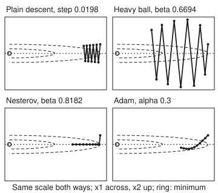
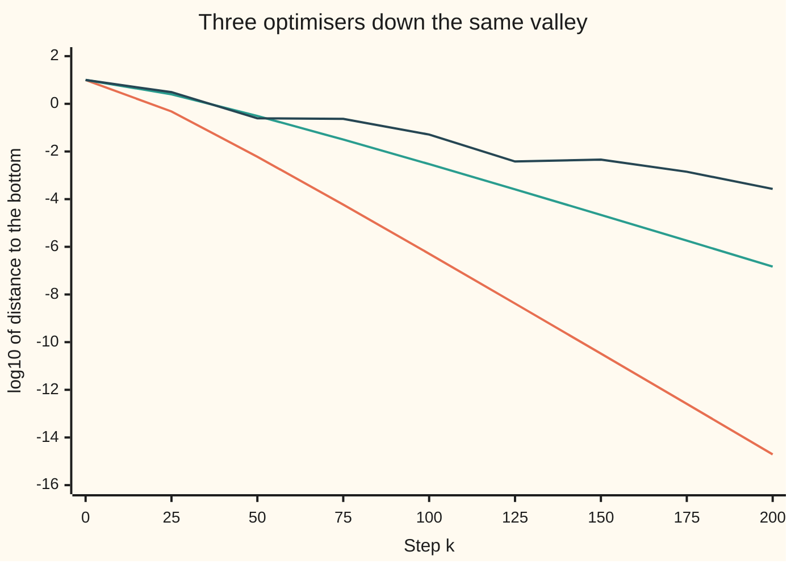

# Momentum and Adam: inertia, and a step size per variable

[Syllabus](../../../SYLLABUS.md) → [Optimization](../README.md) → [Conic, Quadratic and Stochastic Programs](../README.md#s06) → Momentum and Adam

---

## General Overview

A courier fits delivery times with two weights (multipliers): one on the number of parcels on the van, one on the distance driven in kilometres. The distances run ten times larger than the parcel counts, so the squared error of the fit bends 100 times more sharply in the distance weight than in the parcel weight. Measure each weight from its best value, strip the fit to its shape, and the job is: choose two numbers, $x_1$ and $x_2$, to **minimise**

$$f(x_1, x_2) = \tfrac12\left(x_1^2 + 100\,x_2^2\right),$$

with no limits on either number, starting from $(10, 1)$. The bottom is $(0, 0)$, where $f = 0$. That is certain, not found: $f$ is a sum of squares, so it is never below 0. The surface is a long narrow valley: 10 units to walk along the floor, between walls that curve 100 times more sharply than the floor.

Plain gradient descent (step downhill, a fixed distance per unit of slope) needs **576 steps** to come within 0.0001 of the bottom, even with its best fixed step. The steep walls force a short step, and the short step crawls along the gentle floor while it zigzags from wall to wall.

Three repairs race down the same valley from the same start, under the same stopping test. **Heavy ball** adds a fraction of the last move to each new move: 73 steps. **Nesterov's method** does the same but measures the slope at the point the momentum is carrying it to: 135 steps. **Adam** gives each variable its own step, scaled by that variable's typical slope: 192 steps, and the same 192 however steep the walls are. Each step reads the courier's whole delivery log once to get its slope, so every count is a number of passes over the data.

**Momentum lets pushes that agree from step to step pile up along the valley floor while pushes that flip across it cancel, which cuts the step count from about the stretch ratio κ to about its square root; Adam instead divides each variable's step by that variable's own typical slope, so no single step size has to suit both walls and floor.**

**What kind of fact this is:** three methods. On a quadratic bowl the rates of plain descent, heavy ball and Nesterov are theorems, proved on this card in Why it works. Nesterov's rate on every smooth, strongly convex function, and the matching lower bound, are stated with a source. Adam carries no such promise, and the card shows a convex problem where it settles at the worst point.

### The picture: the first ten steps of each

<p align="center"></p>

Every panel is drawn to the same scale in both directions, from the printed coordinates. **Plain descent** bounces between the walls, crossing the floor every step, and has moved only from 10 to 8.19 along it. **Heavy ball** swings far up the walls, to 3.71 above the floor, but has covered the most ground: it is at 3.79. **Nesterov** drops onto the floor in its first step and stays there, reaching 6.97. **Adam** moves each variable 0.3 per step at first, so it heads diagonally, overshoots the floor slightly, and reaches 7.04.

---

## The formula

Notation first, in words. $x_k$ is the point after $k$ steps and $\alpha$ is the step size, as on [Gradient descent](../02-Unconstrained%20Methods/02-gradient-descent-and-its-rate.md). This card introduces $\beta$, the **momentum fraction**: how much of the last move is carried into the next. It also introduces $\beta_1$ and $\beta_2$, Adam's two memory fractions. Write $g = \nabla f$ for the slope (gradient).

**Heavy ball** (Polyak, 1964):

$$x_{k+1} = x_k - \alpha\,\nabla f(x_k) + \beta\,(x_k - x_{k-1})$$

**Read it aloud:** step downhill from where you are, then keep going a fraction β of the way you just came.

**Nesterov's method** (1983) moves first, then looks:

$$y_k = x_k + \beta\,(x_k - x_{k-1}), \qquad x_{k+1} = y_k - \alpha\,\nabla f(y_k)$$

**Read it aloud:** coast a fraction β of the last move to a look-ahead point, then step downhill using the slope measured there.

**Adam** (Kingma and Ba, 2014) works on each variable separately. Step $k = 1, 2, \dots$ takes the slope $g_k$ at $x_{k-1}$ and keeps two running averages, of the slope and of its square:

$$m_k = \beta_1 m_{k-1} + (1-\beta_1)\,g_k, \qquad v_k = \beta_2 v_{k-1} + (1-\beta_2)\,g_k^2, \qquad m_0 = v_0 = 0$$

$$x_k = x_{k-1} - \alpha_k\,\frac{\hat m_k}{\sqrt{\hat v_k} + \epsilon}, \qquad \hat m_k = \frac{m_k}{1-\beta_1^{\,k}}, \quad \hat v_k = \frac{v_k}{1-\beta_2^{\,k}}$$

**Read it aloud:** move each variable by the step size times its recent average slope divided by its recent typical slope size.

The settings tuned to this valley, from Why it works: heavy ball takes $\alpha = 4/(\sqrt L + \sqrt\mu)^2$ and $\beta = \big((\sqrt\kappa - 1)/(\sqrt\kappa + 1)\big)^2$; Nesterov takes $\alpha = 1/L$ and $\beta = (\sqrt\kappa - 1)/(\sqrt\kappa + 1)$.

| Symbol | Plain meaning | In our example | Push it up and the answer… |
| --- | --- | --- | --- |
| $f$, $x = (x_1, x_2)$ | the cost being minimised; the two numbers chosen | $(x_1^2 + 100x_2^2)/2$ | — |
| $x_k$, $x^*$ | the point after k steps; the minimiser | $x_0 = (10, 1)$; $x^* = (0, 0)$ | — |
| $g_k$, $\nabla f$ | the slope, one entry per variable | $(10, 100)$ at the start | longer steps for the same α |
| $\alpha$, $\alpha_k$ | step size, fixed or by schedule | 0.0198 plain; 0.0331 heavy; 0.0100 Nesterov; 0.3 Adam | faster, until a wall throws the walk out |
| $\beta$ | momentum fraction | 0.6694 heavy; 0.8182 Nesterov | more carry along the floor, more swing up the walls |
| $y_k$ | Nesterov's look-ahead point | $y_0 = x_0 = (10, 1)$ | — |
| $\mu$, $L$, $\kappa$ | gentlest and steepest curvature; their ratio L/μ | 1, 100, 100 | larger κ, slower for every method but Adam here |
| $\lambda$, $s$, $e_k$, $c$ | one direction's curvature; $s = \alpha\lambda$; the error along it; a factor scaling one variable's slopes | λ = 1 along the floor, 100 across | — |
| $r$, $\rho$ | rate: the error's shrink factor per step; a double root of the recurrence | 0.98020 plain; 0.81818 heavy; 0.90000 Nesterov | slower |
| $\beta_1$, $\beta_2$ | Adam's memories for slope and squared slope | 0.9, 0.999 | longer memory, smoother but laggier steps |
| $m_k$, $v_k$, $\hat m_k$, $\hat v_k$ | Adam's averages; the same, corrected for starting at zero | $\hat m_1 = g_1$, $\hat v_1 = g_1^2$ | — |
| $\epsilon$ | a guard against dividing by zero | $10^{-8}$ | — |

### When it holds

- **The tuning needs the true μ and L.** Heavy ball's settings come from the curvatures. Tune for 100 on a valley whose walls curve at 150 and the walk is $7.076 \times 10^{48}$ from the bottom after 100 steps.
- **The step must stay inside the momentum's stable range**, $\alpha L < 2(1 + \beta)$. Heavy ball's step is longer than plain descent could survive. Remove the momentum and keep the step, and the walk is $1.383 \times 10^{18}$ away after 50 steps.
- **The rates proved here are for quadratic bowls.** Nesterov's rate is a theorem for every smooth, strongly convex function (a bowl whose curvature stays between μ and L everywhere). Polyak's heavy-ball tuning is proved for quadratics and near a minimum.
- **Adam's per-variable step helps when the stretch lines up with the variables.** Turn the same bowl 45 degrees and Adam needs 223 steps instead of 192; the other three methods need exactly what they did.
- **Adam has no general convergence promise, and noisy slopes need a falling step.** Both are shown below, with numbers.

---

## Why it works

### Step 0: one direction at a time

On a quadratic bowl the slope along each main direction of the bowl is that direction's curvature λ times the error $e_k$ along it. Here the main directions are the two axes, with λ = 1 along the floor and λ = 100 across it. Every method on this card except Adam is built from slopes and past moves added together. So each direction runs its own one-number walk, untouched by the other.

### Step 1: plain descent is held back by the walls

One plain step multiplies the error along a direction by $1 - \alpha\lambda$. As [Convergence rates](../02-Unconstrained%20Methods/03-rates-of-convergence-and-conditioning.md) shows, the best fixed step balances the two ends, $\alpha = 2/(\mu + L) = 0.0198$: the factors are $+0.98020$ along the floor and $-0.98020$ across it, and the minus sign is the zigzag in the picture. So the error shrinks by only

$$r = \frac{\kappa - 1}{\kappa + 1} = 0.98020$$

per step. Each tenfold cut costs about $(\kappa/2)\ln 10$ steps. The distance is exactly $\sqrt{101}\,(0.98020)^k$, and the first $k$ that puts it under 0.0001 is 576, the count the loop reaches too.

### Step 2: heavy ball turns each direction into a two-step recurrence

Put $e_k$ into the heavy-ball update along one direction, with $s = \alpha\lambda$:

$$e_{k+1} = (1 + \beta - s)\,e_k - \beta\,e_{k-1}.$$

Each new error depends on the last two. Try $e_k = r^k$, and $r$ must solve $r^2 - (1 + \beta - s)\,r + \beta = 0$. The two roots multiply to β. When they are complex (a pair with a rotation in them), they share one size, $\sqrt\beta$. Every direction whose roots are complex then shrinks at the same rate, $\sqrt\beta$, whatever its curvature.

That is the whole trick. Polyak chose α and β so that the gentlest and steepest curvatures both sit exactly at the edge of the complex range. Then every curvature in between has complex roots too, and the rate is

$$r = \sqrt\beta = \frac{\sqrt\kappa - 1}{\sqrt\kappa + 1} = \frac{9}{11} = 0.81818.$$

A tenfold cut now costs about $(\sqrt\kappa/2)\ln 10$ steps: the square root of the stretch ratio, not the ratio.

<details>
<summary>Detailed proof: Polyak's settings, and the stability limit</summary>

The roots are complex when the discriminant is negative: $(1 + \beta - s)^2 < 4\beta$, that is, $(1 - \sqrt\beta)^2 < s < (1 + \sqrt\beta)^2$. Put the two ends of the curvature range on the two edges: $\alpha\mu = (1 - \sqrt\beta)^2$ and $\alpha L = (1 + \sqrt\beta)^2$. Dividing, $\sqrt\kappa = (1 + \sqrt\beta)/(1 - \sqrt\beta)$, so $\sqrt\beta = (\sqrt\kappa - 1)/(\sqrt\kappa + 1)$. Adding the square roots, $\sqrt\alpha(\sqrt L + \sqrt\mu) = 2$, so $\alpha = 4/(\sqrt L + \sqrt\mu)^2$. With μ = 1 and L = 100: α = 4/121 = 0.0331 and β = 81/121 = 0.6694.

At the two edges the discriminant is zero and the two roots coincide. A recurrence with a double root $\rho$ has solutions $(A + Bk)\rho^k$. The start $x_{-1} = x_0$ gives $e_1 = (1 - s)e_0$, so $A = e_0$ and $B = e_1/\rho - e_0$. Along the floor ρ = 0.8182 and B = 1.8182: $x_{1,k} = (10 + 1.8182k)(0.8182)^k$. Across it ρ = −0.8182 and B = 1.8182 again. At step 20 this gives (0.837865, 0.675221), the loop's point to six decimals. The extra factor $k$ is why the count is 73, a little more than the rate alone suggests.

Stability, roots inside the unit circle, needs $\beta < 1$ and $0 < s < 2(1 + \beta)$: at $s = 2(1+\beta)$ one root reaches −1. Here $\alpha L = 3.3058 < 2(1 + \beta) = 3.3388$. Plain descent needs $\alpha L < 2$, so momentum is what lets this long step survive.

</details>

Momentum works for a reason visible in the recurrence. Across the valley the slope flips sign every step, so the carried moves cancel. Along the floor the slope keeps one sign, so the carried moves add up, to as much as $1/(1 - \beta)$ times one step. The price is the swing up the walls in the picture: heavy ball climbs to 3.71 above the floor before the rotation in its roots brings it back.

### Step 3: Nesterov measures the slope where it is going

Along one direction Nesterov's update reads

$$e_{k+1} = (1 + \beta)(1 - s)\,e_k - \beta(1 - s)\,e_{k-1}.$$

Take α = 1/L and β = (√κ − 1)/(√κ + 1). Along the floor, s = 1/κ, and a line of algebra shows the two roots coincide at

$$r = 1 - \frac{1}{\sqrt\kappa} = 0.90000.$$

So $x_{1,k} = (10 + k)(0.9)^k$, coefficient 1.0000, and the count is 135. Across the floor, s = αL = 1, so $1 - s = 0$ and the error is wiped out in one step. That is the drop onto the floor in the picture.

On this bowl Nesterov is slower than heavy ball. It matters because its promise is wider. For every smooth, strongly convex function, with curvature between μ and L everywhere, Nesterov's method shrinks a bound on the cost gap $f(x_k) - f(x^*)$ by a factor $1 - 1/\sqrt\kappa$ per step. Heavy ball with Polyak's settings has no such guarantee away from quadratics. The same source proves a floor: no method that moves only along combinations of past slopes can beat $\big((\sqrt\kappa - 1)/(\sqrt\kappa + 1)\big)^k$ on every such problem. Heavy ball meets that floor on this bowl. Both results are stated here, not proved; they are in Nesterov's *Lectures on Convex Optimization*, chapter 2.

<details>
<summary>Detailed proof: Nesterov's double root along the floor</summary>

With $s = 1/\kappa$ and $\beta = (\sqrt\kappa - 1)/(\sqrt\kappa + 1)$, the product of the roots is $\beta(1 - 1/\kappa) = \frac{\sqrt\kappa - 1}{\sqrt\kappa + 1}\cdot\frac{(\sqrt\kappa - 1)(\sqrt\kappa + 1)}{\kappa} = (1 - 1/\sqrt\kappa)^2$. Their sum is $(1 + \beta)(1 - 1/\kappa) = \frac{2\sqrt\kappa}{\sqrt\kappa + 1}\cdot\frac{(\sqrt\kappa - 1)(\sqrt\kappa + 1)}{\kappa} = 2(1 - 1/\sqrt\kappa)$. Two numbers whose sum is $2\rho$ and product is $\rho^2$ are both $\rho$, so the double root is $1 - 1/\sqrt\kappa$. With κ = 100 the recurrence is $r^2 - 1.8r + 0.81 = 0$, which is $(r - 0.9)^2$. The start gives $B = e_1/\rho - e_0 = 9.9/0.9 - 10 = 1$.

</details>

### Step 4: Adam gives each variable its own step

Adam looks at each variable on its own. The ratio $\hat m_k / \sqrt{\hat v_k}$ is the recent average slope divided by the recent typical slope size. If the slope keeps one sign, it is near 1. If the slope flips back and forth, it is near 0. So each variable moves at most about α per step, whatever the size of its slope.

The first step shows it exactly. With $m_0 = v_0 = 0$, the corrected averages are $\hat m_1 = g_1$ and $\hat v_1 = g_1^2$. The step is α times the sign of the slope, in each variable: from (10, 1) to (9.7000, 0.7000). The slope across the valley was 100 and along it 10, yet both moved 0.3. The corrections $1 - \beta_1^{\,k}$ and $1 - \beta_2^{\,k}$ exist because both averages start at zero: without them the early averages are too small, and the two are too small by different amounts.

Multiply every slope of one variable by a constant $c$. Then $m$ grows by $c$, $v$ by $c^2$, and the ratio does not change. So the path of $x_2$ is the same whether the walls curve at 100, 150 or 10,000, apart from the tiny ε: 192 steps each time. That is the "step size per variable" in the title. AdaGrad (2011) divided by the square root of each variable's summed squared slopes; Adam keeps a fading average of them instead, as RMSProp did, and adds momentum through $m_k$.

The scale-blindness is per variable, not per direction. Turned 45 degrees, the valley's steep direction mixes both variables, and Adam's division no longer separates walls from floor: 223 steps. Plain descent, heavy ball and Nesterov use only slopes and past moves, which turn with the bowl, so they take exactly 576, 73 and 135 again.

### Step 5: noisy slopes need a falling step

When each slope comes from a sample of data, as on [Stochastic gradient](08-stochastic-gradient-and-sample-average-approximation.md), it carries noise. The code adds noise to every slope entry, drawn evenly between −√3 and √3 so its standard deviation is 1, and runs Adam 20 times, with different random seeds, for 1,000 steps. The table gives the root-mean-square distance from the bottom: the square root of the average squared distance across the 20 runs.

| Schedule for α | step 100 | 200 | 400 | 600 | 800 | 1000 |
| --- | ---: | ---: | ---: | ---: | ---: | ---: |
| constant 0.3 | 0.2036 | 0.1857 | 0.1985 | 0.3491 | 0.3146 | 0.3579 |
| constant 0.03 | 7.1820 | 4.8613 | 1.8212 | 0.5080 | 0.1041 | 0.0579 |
| halve every 200 steps | 0.2036 | 0.1857 | 0.1786 | 0.1705 | 0.1157 | 0.0655 |
| cosine from 0.3 to 0 | 0.2001 | 0.1785 | 0.1976 | 0.1904 | 0.1144 | 0.0770 |

A constant step of 0.3 gets near the bottom in 100 steps and then hovers. Each step adds a noise kick roughly as long as the step itself, and the walk settles where the pull towards the bottom balances the kicks. A step of 0.03 hovers much closer, 0.0579 at step 1,000, but is still 1.8212 away at step 400. A **schedule**, a step size that changes with $k$ by a fixed rule, gets most of both: long steps while far away, short steps once close. Halving every 200 steps matches the fast start, is ten times closer than the slow step at step 400, and ends at 0.0655, near the slow step's 0.0579 and against 0.3579 for the constant 0.3. The cosine schedule, $\alpha_k = 0.15\,(1 + \cos(\pi k / 1000))$, slides smoothly from 0.3 to 0 and ends at 0.0770.

The rule behind this is on [Stochastic gradient](08-stochastic-gradient-and-sample-average-approximation.md), proved there for plain stochastic steps: the steps must shrink to zero, so the noise dies down, but their sum must grow without limit, so the walk can still travel any distance. The two schedules here fit a fixed budget of 1,000 steps and meet only the first half: halving forever gives steps whose sum stays finite. A step such as $0.3/\sqrt k$ meets both halves. The Robbins–Monro condition stated on that card asks for more: the sum of the steps unlimited and the sum of their squares finite. $0.3/\sqrt k$ fails the second part, because its squares are $0.09/k$ and add up without limit; a step such as $0.3/k^{0.75}$ meets both.

### Step 6: what Adam does not promise

Reddi, Kale and Kumar (2018) built a one-variable convex problem where Adam settles at the worst point. Choose $x$ between −1 and 1. Every third round the cost is $3x$; the other two rounds it is $-x$. Over three rounds the total is $x$, so the best choice is $x = -1$, with an average cost of −0.3333 per round. Run Adam as in their first theorem, with $\beta_1 = 0$, $\beta_2 = 1/(1 + 3^2) = 0.1$ and steps $0.5/\sqrt k$.

The rare large slope (3) is forgotten almost at once by the short memory $\beta_2 = 0.1$. So each of the two small slopes (−1) is divided by a small typical size and pushes hard towards +1, while the large slope is divided by a large one and pushes back only weakly. After 3,000 rounds Adam sits at x = 1.0000, average cost 0.3390 per round. Their repair keeps the largest $v$ seen so far, so the divisor never shrinks; it ends at x = −0.9936, average −0.3209.

---

## Worked numbers, by hand

| Step | Arithmetic | Value |
| --- | --- | --- |
| slope at the start | $(1 \times 10,\ 100 \times 1)$ | (10, 100) |
| plain step size | 2/(1 + 100) | 0.0198 |
| first plain step | $10 - 0.0198 \times 10$; $1 - 0.0198 \times 100$ | (9.80, −0.98) |
| plain rate | (100 − 1)/(100 + 1) | 0.98020 |
| heavy-ball settings | α = 4/(10 + 1)²; β = (9/11)² | 0.0331; 0.6694 |
| heavy-ball stability | αL = 400/121 against 2(1 + 81/121) | 3.3058 < 3.3388 |
| first heavy-ball step | no past move yet; $10 - 0.0331 \times 10$; $1 - 3.3058$ | (9.67, −2.31) |
| heavy-ball rate | √0.6694 = 9/11 | 0.81818 |
| Nesterov settings | α = 1/100; β = 9/11 | 0.0100; 0.8182 |
| Nesterov's first step | across: $1 - (1/100) \times 100 = 0$ | (9.90, 0.00) |
| Nesterov rate | 1 − 1/10 | 0.90000 |
| Adam's first step | $\hat m_1/\sqrt{\hat v_1}$ is the sign of the slope; 0.3 each way | (9.7000, 0.7000) |
| steps to within 0.0001 | plain; heavy ball; Nesterov; Adam | **576; 73; 135; 192** |

Heavy ball reaches the bottom in an eighth of plain descent's steps, because its rate depends on √κ = 10 instead of κ = 100.

### What breaks if you drop a piece

| Mistake | Comes out at | What went wrong |
| --- | --- | --- |
| Settings tuned for curvature 100 on walls that curve at 150 | heavy ball $7.076 \times 10^{48}$ away after 100 steps; plain $2.839 \times 10^{29}$; Nesterov $1.091 \times 10^{9}$ | αL passes the stability limit; Adam, blind to scale, still takes 192 steps |
| Heavy ball's step kept, momentum dropped (β = 0) | $1.383 \times 10^{18}$ away after 50 steps | αL = 3.3058 is above plain descent's limit of 2 |
| Adam on the Reddi–Kale–Kumar problem | x = 1.0000, cost 0.3390 a round; best is x = −1, −0.3333 | a short memory forgets the rare large slope |
| Constant step 0.3 with noisy slopes | 0.3579 from the bottom at step 1,000; halving gives 0.0655 | the noise kicks never shrink |

The code prints all four.

---

## The race, step by step

The puzzle: all four walks start at (10, 1) and use one slope per step. Heavy ball spends its early steps swinging up the walls, yet it wins. Adam ignores the curvature entirely, yet it beats plain descent threefold.

### One story: distance from the bottom

The table writes distances as the code prints them: 1.84e-01 means $1.84 \times 10^{-1}$.

| Step k | 0 | 1 | 2 | 5 | 10 | 25 | 50 | 100 | 200 |
| --- | ---: | ---: | ---: | ---: | ---: | ---: | ---: | ---: | ---: |
| plain | 1.00e+01 | 9.85e+00 | 9.66e+00 | 9.09e+00 | 8.23e+00 | 6.10e+00 | 3.70e+00 | 1.36e+00 | 1.84e-01 |
| heavy ball | 1.00e+01 | 9.94e+00 | 9.64e+00 | 7.92e+00 | 4.58e+00 | 4.79e-01 | 5.99e-03 | 5.11e-07 | 1.94e-15 |
| Nesterov | 1.00e+01 | 9.90e+00 | 9.72e+00 | 8.86e+00 | 6.97e+00 | 2.51e+00 | 3.09e-01 | 2.92e-03 | 1.48e-07 |
| Adam | 1.00e+01 | 9.73e+00 | 9.41e+00 | 8.51e+00 | 7.05e+00 | 3.12e+00 | 2.43e-01 | 5.13e-02 | 2.67e-04 |

For five steps all four look alike. By step 25 heavy ball is five times closer than Nesterov, and by step 100 it is more than a million times closer than plain descent.

### One force at a time: steps to within 0.0001

```
plain descent   ████████████████████████████████████████  576 steps
heavy ball      █████                                     73 steps
Nesterov        █████████▍                                135 steps
Adam            █████████████▎                            192 steps
```

### The combined picture



Orange: heavy ball, a straight fall of about two powers of ten per 25 steps, the rate 0.81818. Green: Nesterov, a shallower straight fall, the rate 0.9. Dark blue: Adam, fast at first, then uneven, because its step depends on its averages, not on a fixed rate. Plain descent, not drawn, falls from 1.00 to −0.74 over the same 200 steps. Each unit down the axis is a tenfold drop.

---

## Code, from first principles, and it actually runs

The script writes out all four methods and runs them on the bowl. It takes three roads. Road 1 runs the loops. Road 2 solves each direction's recurrence in closed form, from the plain factor or the double root, and counts steps from that formula alone; for plain descent, heavy ball and Nesterov the counts agree. Road 3 checks Adam's first step by hand: exactly 0.3 in each variable. Adam's count, 192, comes from the loop alone; the same loop gives 192 again on walls of 150 and 10,000, as the scale argument of Step 4 predicts. It then turns the bowl, runs the noisy schedules with a SplitMix64 generator written out in both languages (seeds 0 to 19), and runs the Reddi–Kale–Kumar problem.

### Python

```python
# Momentum, Nesterov and Adam racing down f(x) = (x1^2 + 100 x2^2)/2 from (10, 1).
# Minimum: f >= 0 everywhere and f(0, 0) = 0, so x* = (0, 0) and the distance to it is the error.
import math
MU, L, X0, TOL = 1.0, 100.0, (10.0, 1.0), 1e-4
BOWL = ((MU, 0.0), (0.0, L))

def grad(A, x):
    return (A[0][0] * x[0] + A[0][1] * x[1], A[1][0] * x[0] + A[1][1] * x[1])

def momentum(A, a, b, n, nesterov=False, x0=X0):
    # y = x_k + b (x_k - x_{k-1}); heavy ball steps from y with the slope at x_k, Nesterov with the slope at y
    xp = x = x0
    path = [x]
    for _ in range(n):
        y = (x[0] + b * (x[0] - xp[0]), x[1] + b * (x[1] - xp[1]))
        g = grad(A, y if nesterov else x)
        xp, x = x, (y[0] - a * g[0], y[1] - a * g[1])
        path.append(x)
    return path

def adam(A, step, n, b1=0.9, b2=0.999, rng=None, x0=X0):
    x, m, v, p1, p2 = list(x0), [0.0, 0.0], [0.0, 0.0], 1.0, 1.0
    path = [tuple(x)]
    for k in range(1, n + 1):
        g = grad(A, x)
        p1, p2 = p1 * b1, p2 * b2
        for i in (0, 1):
            gi = g[i] + (math.sqrt(3.0) * (2.0 * rng() - 1.0) if rng else 0.0)  # noise of standard deviation 1
            m[i] = b1 * m[i] + (1 - b1) * gi
            v[i] = b2 * v[i] + (1 - b2) * gi * gi
            x[i] -= step(k) * (m[i] / (1 - p1)) / (math.sqrt(v[i] / (1 - p2)) + 1e-8)
        path.append(tuple(x))
    return path

dist = lambda p: math.hypot(p[0], p[1])
steps = lambda path: next((k for k, p in enumerate(path) if dist(p) <= TOL), None)

def splitmix(seed):
    s = [seed]
    def nxt():
        s[0] = (s[0] + 0x9E3779B97F4A7C15) % 2**64
        z = s[0]
        z = ((z ^ (z >> 30)) * 0xBF58476D1CE4E5B9) % 2**64
        z = ((z ^ (z >> 27)) * 0x94D049BB133111EB) % 2**64
        return ((z ^ (z >> 31)) >> 11) / 2.0**53
    return nxt

def double_root(e0, e1, rho, k):
    # a two-term recurrence whose two roots coincide at rho: e_k = (e0 + (e1/rho - e0) k) rho^k
    return 0.0 if rho == 0.0 else (e0 + (e1 / rho - e0) * k) * rho ** k

kap, sk = L / MU, math.sqrt(L / MU)
a_gd = 2 / (MU + L)
a_hb, b_hb = 4 / (math.sqrt(L) + math.sqrt(MU)) ** 2, ((sk - 1) / (sk + 1)) ** 2
a_ns, b_ns = 1 / L, (sk - 1) / (sk + 1)
N = 800
gd, hb = momentum(BOWL, a_gd, 0.0, N), momentum(BOWL, a_hb, b_hb, N)
ns, ad = momentum(BOWL, a_ns, b_ns, N, True), adam(BOWL, lambda k: 0.3, N)

def closed(kind, k):
    out = []
    for lam, e0 in zip((MU, L), X0):
        if kind == "gd":
            out.append(e0 * (1 - a_gd * lam) ** k)
            continue
        s = (a_hb if kind == "hb" else a_ns) * lam
        tr = 1 + b_hb - s if kind == "hb" else (1 + b_ns) * (1 - s)
        out.append(double_root(e0, (1 - s) * e0, tr / 2, k))
    return tuple(out)

cl = {kind: steps([closed(kind, k) for k in range(N + 1)]) for kind in ("gd", "hb", "ns")}
print(f"bowl (x1^2 + {L:.0f} x2^2)/2 from (10, 1); kappa {kap:.0f}; stop when distance to (0, 0) <= {TOL}")
print(f"plain     alpha {a_gd:.4f}               rate {(kap - 1) / (kap + 1):.5f}  steps {steps(gd)}, closed form {cl['gd']}")
print(f"heavy     alpha {a_hb:.4f} beta {b_hb:.4f}   rate {math.sqrt(b_hb):.5f}  steps {steps(hb)}, closed form {cl['hb']}")
print(f"nesterov  alpha {a_ns:.4f} beta {b_ns:.4f}   rate {1 - 1 / sk:.5f}  steps {steps(ns)}, closed form {cl['ns']}")
print(f"adam      alpha 0.3 beta1 0.9 beta2 0.999   steps {steps(ad)}; first step to ({ad[1][0]:.4f}, {ad[1][1]:.4f})")
print(f"heavy, step 20: loop ({hb[20][0]:.6f}, {hb[20][1]:.6f}), closed form ({closed('hb', 20)[0]:.6f}, {closed('hb', 20)[1]:.6f})")
cof = lambda e0, s, tr: f"({tr / 2:.4f}, {(1 - s) * e0 / (tr / 2) - e0:.4f})"  # (double root, coefficient of k)
print(f"double roots and k-coefficients: heavy x1 {cof(10, a_hb, 1 + b_hb - a_hb)}, x2 {cof(1, a_hb * L, 1 + b_hb - a_hb * L)}; nesterov x1 {cof(10, a_ns, (1 + b_ns) * (1 - a_ns))}")
print(f"heavy stability: alpha L = {a_hb * L:.4f} < 2(1 + beta) = {2 * (1 + b_hb):.4f}; plain needs alpha L < 2")
KS = (0, 1, 2, 5, 10, 25, 50, 100, 200)
print("race, distance at k " + " ".join(f"{k:>9}" for k in KS))
for name, p in (("plain", gd), ("heavy ball", hb), ("nesterov", ns), ("adam", ad)):
    print(f"  {name:<18}" + " ".join(f"{dist(p[k]):9.2e}" for k in KS))
for name, p in (("plain", gd), ("heavy ball", hb), ("nesterov", ns), ("adam", ad)):
    print(f"chart log10, {name:<10} " + " ".join(f"{math.log10(dist(p[k])):.2f}" for k in range(0, 201, 25)))
for name, p in (("plain", gd), ("heavy ball", hb), ("nesterov", ns), ("adam", ad)):
    print(f"figure, {name:<10} " + " ".join(f"{q[0]:.2f},{q[1]:.2f}" for q in p[:11]))

# Step-size schedules: the same Adam with noisy slopes, root-mean-square distance over 20 seeds
SCHED = (("constant 0.3", lambda k: 0.3), ("constant 0.03", lambda k: 0.03),
         ("halve every 200", lambda k: 0.3 * 0.5 ** ((k - 1) // 200)),
         ("cosine 0.3 to 0", lambda k: 0.15 * (1 + math.cos(math.pi * k / 1000))))
KN, rms = (100, 200, 400, 600, 800, 1000), {}
for name, sch in SCHED:
    sq = [0.0] * len(KN)
    for seed in range(20):
        p = adam(BOWL, sch, 1000, rng=splitmix(seed))
        for j, k in enumerate(KN):
            sq[j] += dist(p[k]) ** 2 / 20
    rms[name] = [math.sqrt(s) for s in sq]
    print(f"noisy adam, {name:<16}" + " ".join(f"{r:7.4f}" for r in rms[name]))

# What breaks, then the Try-changing experiments
STEEP = ((MU, 0.0), (0.0, 150.0))
br = [dist(momentum(STEEP, a, b, 100, nv)[-1]) for a, b, nv in ((a_gd, 0, 0), (a_hb, b_hb, 0), (a_ns, b_ns, 1))]
print(f"breaks: curvature 150, tuned for 100, distance after 100: plain {br[0]:.3e}, heavy {br[1]:.3e}, nesterov {br[2]:.3e}; adam steps {steps(adam(STEEP, lambda k: 0.3, N))}")
print(f"breaks: heavy ball's alpha with beta 0, curvature 100, distance after 50: {dist(momentum(BOWL, a_hb, 0.0, 50)[-1]):.3e}")
def reddi(ams, T=3000, C=3.0):
    # f_k(x) = C x when k leaves remainder 1 on division by 3, else -x; x kept in [-1, 1]
    x, v, vmax, loss = 0.0, 0.0, 0.0, 0.0
    for k in range(1, T + 1):
        g = C if k % 3 == 1 else -1.0
        loss += g * x / T
        v = 0.1 * v + 0.9 * g * g                   # beta1 = 0, beta2 = 1/(1 + C^2) = 0.1
        vmax = max(vmax, v)
        x = max(-1.0, min(1.0, x - 0.5 / math.sqrt(k) * g / math.sqrt(vmax if ams else v)))
    return x, loss
(xa, la), (xm, lm) = reddi(False), reddi(True)
print(f"breaks: Reddi example, 3000 rounds: adam ends at x = {xa:.4f}, average loss {la:.4f}; max-memory variant x = {xm:.4f}, {lm:.4f}; best x = -1, {-(3.0 - 2.0) / 3:.4f}")
ROT = ((50.5, -49.5), (-49.5, 50.5))          # the same bowl turned 45 degrees
r0 = ((X0[0] + X0[1]) / math.sqrt(2.0), (X0[0] - X0[1]) / math.sqrt(2.0))  # the start, turned too
rot = [steps(momentum(ROT, a_gd, 0.0, N, x0=r0)), steps(momentum(ROT, a_hb, b_hb, N, x0=r0)),
       steps(momentum(ROT, a_ns, b_ns, N, True, x0=r0)), steps(adam(ROT, lambda k: 0.3, 3000, x0=r0))]
print(f"try: bowl turned 45 degrees: plain {rot[0]}, heavy {rot[1]}, nesterov {rot[2]}, adam {rot[3]} steps")
tries = [steps(adam(BOWL, lambda k: 0.03, 3000)), steps(adam(((MU, 0.0), (0.0, 1e4)), lambda k: 0.3, N))]
a4, b4 = 4 / (100 + 1) ** 2, (99 / 101) ** 2
hb4 = momentum(((MU, 0.0), (0.0, 1e4)), a4, b4, 3000)
gd4 = next(k for k in range(10 ** 6) if math.hypot(10 * (9999 / 10001) ** k, (9999 / 10001) ** k) <= TOL)
print(f"try: adam alpha 0.03: {tries[0]} steps; curvature 10000: adam {tries[1]}, heavy ball retuned {steps(hb4)}, plain retuned (closed form) {gd4}")

assert (steps(gd), steps(hb), steps(ns)) == (cl["gd"], cl["hb"], cl["ns"]), "loop and closed form disagree"
assert max(abs(hb[20][i] - closed("hb", 20)[i]) for i in (0, 1)) < 1e-9, "heavy ball off its double root"
assert abs(ad[1][0] - 9.7) < 1e-6 and abs(ad[1][1] - 0.7) < 1e-6, "Adam's first step is alpha per variable"
assert steps(hb) < steps(ns) < steps(ad) < steps(gd), "the race order"
assert rot[0:3] == [steps(gd), steps(hb), steps(ns)] and rot[3] > steps(ad), "turning the bowl changes only Adam"
assert xa > 0.99 and xm < -0.99, "Reddi: Adam settles at the worst point, the max-memory variant near the best"
assert rms["halve every 200"][-1] < rms["constant 0.3"][-1] / 3, "a falling schedule beats the constant step"
print("ALL CHECKS PASS")
```

**Ran 2026-11-11 on macOS, Python 3.14.10, standard library only. All checks passed. Output, pasted from the run:**

```
bowl (x1^2 + 100 x2^2)/2 from (10, 1); kappa 100; stop when distance to (0, 0) <= 0.0001
plain     alpha 0.0198               rate 0.98020  steps 576, closed form 576
heavy     alpha 0.0331 beta 0.6694   rate 0.81818  steps 73, closed form 73
nesterov  alpha 0.0100 beta 0.8182   rate 0.90000  steps 135, closed form 135
adam      alpha 0.3 beta1 0.9 beta2 0.999   steps 192; first step to (9.7000, 0.7000)
heavy, step 20: loop (0.837865, 0.675221), closed form (0.837865, 0.675221)
double roots and k-coefficients: heavy x1 (0.8182, 1.8182), x2 (-0.8182, 1.8182); nesterov x1 (0.9000, 1.0000)
heavy stability: alpha L = 3.3058 < 2(1 + beta) = 3.3388; plain needs alpha L < 2
race, distance at k         0         1         2         5        10        25        50       100       200
  plain              1.00e+01  9.85e+00  9.66e+00  9.09e+00  8.23e+00  6.10e+00  3.70e+00  1.36e+00  1.84e-01
  heavy ball         1.00e+01  9.94e+00  9.64e+00  7.92e+00  4.58e+00  4.79e-01  5.99e-03  5.11e-07  1.94e-15
  nesterov           1.00e+01  9.90e+00  9.72e+00  8.86e+00  6.97e+00  2.51e+00  3.09e-01  2.92e-03  1.48e-07
  adam               1.00e+01  9.73e+00  9.41e+00  8.51e+00  7.05e+00  3.12e+00  2.43e-01  5.13e-02  2.67e-04
chart log10, plain      1.00 0.79 0.57 0.35 0.13 -0.08 -0.30 -0.52 -0.74
chart log10, heavy ball 1.00 -0.32 -2.22 -4.23 -6.29 -8.38 -10.48 -12.59 -14.71
chart log10, nesterov   1.00 0.40 -0.51 -1.50 -2.53 -3.59 -4.66 -5.74 -6.83
chart log10, adam       1.00 0.49 -0.61 -0.63 -1.29 -2.42 -2.34 -2.85 -3.57
figure, plain      10.00,1.00 9.80,-0.98 9.61,0.96 9.42,-0.94 9.23,0.92 9.05,-0.90 8.87,0.89 8.69,-0.87 8.52,0.85 8.35,-0.84 8.19,0.82
figure, heavy ball 10.00,1.00 9.67,-2.31 9.13,3.10 8.46,-3.54 7.74,3.71 7.00,-3.70 6.27,3.57 5.58,-3.37 4.93,3.12 4.33,-2.85 3.79,2.58
figure, nesterov   10.00,1.00 9.90,0.00 9.72,0.00 9.48,0.00 9.19,0.00 8.86,0.00 8.50,0.00 8.13,0.00 7.75,0.00 7.36,0.00 6.97,0.00
figure, adam       10.00,1.00 9.70,0.70 9.40,0.41 9.10,0.13 8.80,-0.11 8.50,-0.30 8.21,-0.42 7.91,-0.48 7.62,-0.48 7.33,-0.43 7.04,-0.36
noisy adam, constant 0.3     0.2036  0.1857  0.1985  0.3491  0.3146  0.3579
noisy adam, constant 0.03    7.1820  4.8613  1.8212  0.5080  0.1041  0.0579
noisy adam, halve every 200  0.2036  0.1857  0.1786  0.1705  0.1157  0.0655
noisy adam, cosine 0.3 to 0  0.2001  0.1785  0.1976  0.1904  0.1144  0.0770
breaks: curvature 150, tuned for 100, distance after 100: plain 2.839e+29, heavy 7.076e+48, nesterov 1.091e+09; adam steps 192
breaks: heavy ball's alpha with beta 0, curvature 100, distance after 50: 1.383e+18
breaks: Reddi example, 3000 rounds: adam ends at x = 1.0000, average loss 0.3390; max-memory variant x = -0.9936, -0.3209; best x = -1, -0.3333
try: bowl turned 45 degrees: plain 576, heavy 73, nesterov 135, adam 223 steps
try: adam alpha 0.03: 1354 steps; curvature 10000: adam 192, heavy ball retuned 832, plain retuned (closed form) 57590
ALL CHECKS PASS
```

### Rust

```rust
// Momentum, Nesterov and Adam racing down f(x) = (x1^2 + 100 x2^2)/2 from (10, 1).
// Minimum: f >= 0 everywhere and f(0, 0) = 0, so x* = (0, 0) and the distance to it is the error.
type M2 = [[f64; 2]; 2];
type P = [f64; 2];
const MU: f64 = 1.0; const L: f64 = 100.0; const X0: P = [10.0, 1.0]; const TOL: f64 = 1e-4;
const BOWL: M2 = [[MU, 0.0], [0.0, L]];

fn grad(a: &M2, x: &P) -> P { [a[0][0] * x[0] + a[0][1] * x[1], a[1][0] * x[0] + a[1][1] * x[1]] }

// y = x_k + b (x_k - x_{k-1}); heavy ball steps from y with the slope at x_k, Nesterov with the slope at y
fn momentum(m: &M2, a: f64, b: f64, n: usize, nesterov: bool, x0: P) -> Vec<P> {
    let (mut xp, mut x) = (x0, x0);
    let mut path = vec![x];
    for _ in 0..n {
        let y = [x[0] + b * (x[0] - xp[0]), x[1] + b * (x[1] - xp[1])];
        let g = grad(m, if nesterov { &y } else { &x });
        xp = x; x = [y[0] - a * g[0], y[1] - a * g[1]];
        path.push(x);
    }
    path
}

fn adam(a: &M2, step: &dyn Fn(usize) -> f64, n: usize, mut rng: Option<&mut u64>, x0: P) -> Vec<P> {
    let (b1, b2) = (0.9_f64, 0.999_f64);
    let (mut x, mut m, mut v, mut p1, mut p2) = (x0, [0.0; 2], [0.0; 2], 1.0, 1.0);
    let mut path = vec![x];
    for k in 1..=n {
        let g = grad(a, &x);
        p1 *= b1; p2 *= b2;
        for i in 0..2 {
            let gi = g[i] + match rng.as_deref_mut() { Some(s) => 3.0_f64.sqrt() * (2.0 * splitmix(s) - 1.0), None => 0.0 }; // noise of standard deviation 1
            m[i] = b1 * m[i] + (1.0 - b1) * gi;
            v[i] = b2 * v[i] + (1.0 - b2) * gi * gi;
            x[i] -= step(k) * (m[i] / (1.0 - p1)) / ((v[i] / (1.0 - p2)).sqrt() + 1e-8);
        }
        path.push(x);
    }
    path
}

fn dist(p: &P) -> f64 { p[0].hypot(p[1]) }
fn steps(path: &[P]) -> Option<usize> { path.iter().position(|p| dist(p) <= TOL) }
fn show(s: Option<usize>) -> String { s.map_or("None".to_string(), |k| k.to_string()) }

fn splitmix(s: &mut u64) -> f64 {
    *s = s.wrapping_add(0x9E3779B97F4A7C15);
    let mut z = *s;
    z = (z ^ (z >> 30)).wrapping_mul(0xBF58476D1CE4E5B9);
    z = (z ^ (z >> 27)).wrapping_mul(0x94D049BB133111EB);
    ((z ^ (z >> 31)) >> 11) as f64 / 9007199254740992.0
}

// Python-style scientific format: 1.00e+01
fn sci(x: f64, prec: usize) -> String {
    let s = format!("{:.*e}", prec, x);
    let (m, e) = s.split_once('e').unwrap();
    let e: i32 = e.parse().unwrap();
    format!("{}e{}{:02}", m, if e < 0 { '-' } else { '+' }, e.abs())
}

// a two-term recurrence whose two roots coincide at rho: e_k = (e0 + (e1/rho - e0) k) rho^k
fn double_root(e0: f64, e1: f64, rho: f64, k: usize) -> f64 {
    if rho == 0.0 { 0.0 } else { (e0 + (e1 / rho - e0) * k as f64) * rho.powf(k as f64) }
}

fn main() {
    let (kap, sk) = (L / MU, (L / MU).sqrt());
    let a_gd = 2.0 / (MU + L);
    let (a_hb, b_hb) = (4.0 / (L.sqrt() + MU.sqrt()).powf(2.0), ((sk - 1.0) / (sk + 1.0)).powf(2.0));
    let (a_ns, b_ns) = (1.0 / L, (sk - 1.0) / (sk + 1.0));
    let n = 800;
    let c03 = |_k: usize| 0.3;
    let (gd, hb) = (momentum(&BOWL, a_gd, 0.0, n, false, X0), momentum(&BOWL, a_hb, b_hb, n, false, X0));
    let (ns, ad) = (momentum(&BOWL, a_ns, b_ns, n, true, X0), adam(&BOWL, &c03, n, None, X0));
    let closed = |kind: &str, k: usize| -> P {
        let mut out = [0.0; 2];
        for (i, (lam, e0)) in [MU, L].iter().zip(X0.iter()).enumerate() {
            if kind == "gd" { out[i] = e0 * (1.0 - a_gd * lam).powf(k as f64); continue; }
            let s = if kind == "hb" { a_hb } else { a_ns } * lam;
            let tr = if kind == "hb" { 1.0 + b_hb - s } else { (1.0 + b_ns) * (1.0 - s) };
            out[i] = double_root(*e0, (1.0 - s) * e0, tr / 2.0, k);
        }
        out
    };
    let cl: Vec<Option<usize>> = ["gd", "hb", "ns"].iter().map(|kd| steps(&(0..=n).map(|k| closed(kd, k)).collect::<Vec<P>>())).collect();
    println!("bowl (x1^2 + {:.0} x2^2)/2 from (10, 1); kappa {:.0}; stop when distance to (0, 0) <= {}", L, kap, TOL);
    println!("plain     alpha {:.4}               rate {:.5}  steps {}, closed form {}", a_gd, (kap - 1.0) / (kap + 1.0), show(steps(&gd)), show(cl[0]));
    println!("heavy     alpha {:.4} beta {:.4}   rate {:.5}  steps {}, closed form {}", a_hb, b_hb, b_hb.sqrt(), show(steps(&hb)), show(cl[1]));
    println!("nesterov  alpha {:.4} beta {:.4}   rate {:.5}  steps {}, closed form {}", a_ns, b_ns, 1.0 - 1.0 / sk, show(steps(&ns)), show(cl[2]));
    println!("adam      alpha 0.3 beta1 0.9 beta2 0.999   steps {}; first step to ({:.4}, {:.4})", show(steps(&ad)), ad[1][0], ad[1][1]);
    let h20 = closed("hb", 20); println!("heavy, step 20: loop ({:.6}, {:.6}), closed form ({:.6}, {:.6})", hb[20][0], hb[20][1], h20[0], h20[1]);
    let cof = |e0: f64, s: f64, tr: f64| format!("({:.4}, {:.4})", tr / 2.0, (1.0 - s) * e0 / (tr / 2.0) - e0); // (double root, coefficient of k)
    println!("double roots and k-coefficients: heavy x1 {}, x2 {}; nesterov x1 {}", cof(10.0, a_hb, 1.0 + b_hb - a_hb), cof(1.0, a_hb * L, 1.0 + b_hb - a_hb * L), cof(10.0, a_ns, (1.0 + b_ns) * (1.0 - a_ns)));
    println!("heavy stability: alpha L = {:.4} < 2(1 + beta) = {:.4}; plain needs alpha L < 2", a_hb * L, 2.0 * (1.0 + b_hb));
    let ks = [0, 1, 2, 5, 10, 25, 50, 100, 200];
    println!("race, distance at k {}", ks.iter().map(|k| format!("{:>9}", k)).collect::<Vec<_>>().join(" "));
    let runs: [(&str, &Vec<P>); 4] = [("plain", &gd), ("heavy ball", &hb), ("nesterov", &ns), ("adam", &ad)];
    for (name, p) in runs.iter() {
        println!("  {:<18}{}", name, ks.iter().map(|&k| format!("{:>9}", sci(dist(&p[k]), 2))).collect::<Vec<_>>().join(" "));
    }
    for (name, p) in runs.iter() {
        println!("chart log10, {:<10} {}", name, (0..=200).step_by(25).map(|k| format!("{:.2}", dist(&p[k]).log10())).collect::<Vec<_>>().join(" "));
    }
    for (name, p) in runs.iter() {
        println!("figure, {:<10} {}", name, p[..11].iter().map(|q| format!("{:.2},{:.2}", q[0], q[1])).collect::<Vec<_>>().join(" "));
    }

    // Step-size schedules: the same Adam with noisy slopes, root-mean-square distance over 20 seeds
    let sched: [(&str, Box<dyn Fn(usize) -> f64>); 4] = [
        ("constant 0.3", Box::new(|_k| 0.3)), ("constant 0.03", Box::new(|_k| 0.03)),
        ("halve every 200", Box::new(|k| 0.3 * 0.5_f64.powf(((k - 1) / 200) as f64))),
        ("cosine 0.3 to 0", Box::new(|k| 0.15 * (1.0 + (std::f64::consts::PI * k as f64 / 1000.0).cos()))),
    ];
    let kn = [100, 200, 400, 600, 800, 1000];
    let mut rms: Vec<Vec<f64>> = Vec::new();
    for (name, sch) in sched.iter() {
        let mut sq = [0.0; 6];
        for seed in 0..20u64 {
            let mut s = seed;
            let p = adam(&BOWL, sch.as_ref(), 1000, Some(&mut s), X0);
            for (j, &k) in kn.iter().enumerate() { sq[j] += dist(&p[k]).powf(2.0) / 20.0; }
        }
        let r: Vec<f64> = sq.iter().map(|s| s.sqrt()).collect();
        println!("noisy adam, {:<16}{}", name, r.iter().map(|x| format!("{:7.4}", x)).collect::<Vec<_>>().join(" "));
        rms.push(r);
    }

    // What breaks, then the Try-changing experiments
    let steep: M2 = [[MU, 0.0], [0.0, 150.0]]; let br: Vec<f64> = [(a_gd, 0.0, false), (a_hb, b_hb, false), (a_ns, b_ns, true)].iter()
        .map(|&(a, b, nv)| dist(momentum(&steep, a, b, 100, nv, X0).last().unwrap())).collect();
    println!("breaks: curvature 150, tuned for 100, distance after 100: plain {}, heavy {}, nesterov {}; adam steps {}",
        sci(br[0], 3), sci(br[1], 3), sci(br[2], 3), show(steps(&adam(&steep, &c03, n, None, X0))));
    println!("breaks: heavy ball's alpha with beta 0, curvature 100, distance after 50: {}", sci(dist(momentum(&BOWL, a_hb, 0.0, 50, false, X0).last().unwrap()), 3));
    // f_k(x) = C x when k leaves remainder 1 on division by 3, else -x; x kept in [-1, 1]
    let reddi = |ams: bool| -> (f64, f64) {
        let (t, c) = (3000usize, 3.0_f64);
        let (mut x, mut v, mut vmax, mut loss) = (0.0_f64, 0.0_f64, 0.0_f64, 0.0_f64);
        for k in 1..=t {
            let g = if k % 3 == 1 { c } else { -1.0 };
            loss += g * x / t as f64;
            v = 0.1 * v + 0.9 * g * g; // beta1 = 0, beta2 = 1/(1 + C^2) = 0.1
            vmax = vmax.max(v);
            x = (x - 0.5 / (k as f64).sqrt() * g / (if ams { vmax } else { v }).sqrt()).min(1.0).max(-1.0);
        }
        (x, loss)
    };
    let ((xa, la), (xm, lm)) = (reddi(false), reddi(true));
    println!("breaks: Reddi example, 3000 rounds: adam ends at x = {:.4}, average loss {:.4}; max-memory variant x = {:.4}, {:.4}; best x = -1, {:.4}", xa, la, xm, lm, -(3.0 - 2.0) / 3.0);
    let rot: M2 = [[50.5, -49.5], [-49.5, 50.5]]; // the same bowl turned 45 degrees
    let r0 = [(X0[0] + X0[1]) / 2.0_f64.sqrt(), (X0[0] - X0[1]) / 2.0_f64.sqrt()]; // the start, turned too
    let rt = [steps(&momentum(&rot, a_gd, 0.0, n, false, r0)), steps(&momentum(&rot, a_hb, b_hb, n, false, r0)),
              steps(&momentum(&rot, a_ns, b_ns, n, true, r0)), steps(&adam(&rot, &c03, 3000, None, r0))];
    println!("try: bowl turned 45 degrees: plain {}, heavy {}, nesterov {}, adam {} steps", show(rt[0]), show(rt[1]), show(rt[2]), show(rt[3]));
    let big: M2 = [[MU, 0.0], [0.0, 1e4]]; let tries = [steps(&adam(&BOWL, &|_k| 0.03, 3000, None, X0)), steps(&adam(&big, &c03, n, None, X0))];
    let (a4, b4) = (4.0 / (100.0_f64 + 1.0).powf(2.0), (99.0_f64 / 101.0).powf(2.0));
    let (hb4, q) = (momentum(&big, a4, b4, 3000, false, X0), 9999.0_f64 / 10001.0);
    let gd4 = (0..1_000_000).find(|&k| (10.0 * q.powf(k as f64)).hypot(q.powf(k as f64)) <= TOL).unwrap();
    println!("try: adam alpha 0.03: {} steps; curvature 10000: adam {}, heavy ball retuned {}, plain retuned (closed form) {}", show(tries[0]), show(tries[1]), show(steps(&hb4)), gd4);

    assert!(steps(&gd) == cl[0] && steps(&hb) == cl[1] && steps(&ns) == cl[2], "loop and closed form disagree");
    assert!((0..2).map(|i| (hb[20][i] - h20[i]).abs()).fold(0.0, f64::max) < 1e-9, "heavy ball off its double root");
    assert!((ad[1][0] - 9.7).abs() < 1e-6 && (ad[1][1] - 0.7).abs() < 1e-6, "Adam's first step is alpha per variable");
    assert!(steps(&hb) < steps(&ns) && steps(&ns) < steps(&ad) && steps(&ad) < steps(&gd), "the race order");
    assert!(rt[0] == steps(&gd) && rt[1] == steps(&hb) && rt[2] == steps(&ns) && rt[3] > steps(&ad), "turning the bowl changes only Adam");
    assert!(xa > 0.99 && xm < -0.99, "Reddi: Adam settles at the worst point, the max-memory variant near the best");
    assert!(rms[2][5] < rms[0][5] / 3.0, "a falling schedule beats the constant step");
    println!("ALL CHECKS PASS");
}
```

**Ran 2026-11-11 on macOS, rustc 1.98.1, no crates. All checks passed. Output, pasted from the run:**

```
bowl (x1^2 + 100 x2^2)/2 from (10, 1); kappa 100; stop when distance to (0, 0) <= 0.0001
plain     alpha 0.0198               rate 0.98020  steps 576, closed form 576
heavy     alpha 0.0331 beta 0.6694   rate 0.81818  steps 73, closed form 73
nesterov  alpha 0.0100 beta 0.8182   rate 0.90000  steps 135, closed form 135
adam      alpha 0.3 beta1 0.9 beta2 0.999   steps 192; first step to (9.7000, 0.7000)
heavy, step 20: loop (0.837865, 0.675221), closed form (0.837865, 0.675221)
double roots and k-coefficients: heavy x1 (0.8182, 1.8182), x2 (-0.8182, 1.8182); nesterov x1 (0.9000, 1.0000)
heavy stability: alpha L = 3.3058 < 2(1 + beta) = 3.3388; plain needs alpha L < 2
race, distance at k         0         1         2         5        10        25        50       100       200
  plain              1.00e+01  9.85e+00  9.66e+00  9.09e+00  8.23e+00  6.10e+00  3.70e+00  1.36e+00  1.84e-01
  heavy ball         1.00e+01  9.94e+00  9.64e+00  7.92e+00  4.58e+00  4.79e-01  5.99e-03  5.11e-07  1.94e-15
  nesterov           1.00e+01  9.90e+00  9.72e+00  8.86e+00  6.97e+00  2.51e+00  3.09e-01  2.92e-03  1.48e-07
  adam               1.00e+01  9.73e+00  9.41e+00  8.51e+00  7.05e+00  3.12e+00  2.43e-01  5.13e-02  2.67e-04
chart log10, plain      1.00 0.79 0.57 0.35 0.13 -0.08 -0.30 -0.52 -0.74
chart log10, heavy ball 1.00 -0.32 -2.22 -4.23 -6.29 -8.38 -10.48 -12.59 -14.71
chart log10, nesterov   1.00 0.40 -0.51 -1.50 -2.53 -3.59 -4.66 -5.74 -6.83
chart log10, adam       1.00 0.49 -0.61 -0.63 -1.29 -2.42 -2.34 -2.85 -3.57
figure, plain      10.00,1.00 9.80,-0.98 9.61,0.96 9.42,-0.94 9.23,0.92 9.05,-0.90 8.87,0.89 8.69,-0.87 8.52,0.85 8.35,-0.84 8.19,0.82
figure, heavy ball 10.00,1.00 9.67,-2.31 9.13,3.10 8.46,-3.54 7.74,3.71 7.00,-3.70 6.27,3.57 5.58,-3.37 4.93,3.12 4.33,-2.85 3.79,2.58
figure, nesterov   10.00,1.00 9.90,0.00 9.72,0.00 9.48,0.00 9.19,0.00 8.86,0.00 8.50,0.00 8.13,0.00 7.75,0.00 7.36,0.00 6.97,0.00
figure, adam       10.00,1.00 9.70,0.70 9.40,0.41 9.10,0.13 8.80,-0.11 8.50,-0.30 8.21,-0.42 7.91,-0.48 7.62,-0.48 7.33,-0.43 7.04,-0.36
noisy adam, constant 0.3     0.2036  0.1857  0.1985  0.3491  0.3146  0.3579
noisy adam, constant 0.03    7.1820  4.8613  1.8212  0.5080  0.1041  0.0579
noisy adam, halve every 200  0.2036  0.1857  0.1786  0.1705  0.1157  0.0655
noisy adam, cosine 0.3 to 0  0.2001  0.1785  0.1976  0.1904  0.1144  0.0770
breaks: curvature 150, tuned for 100, distance after 100: plain 2.839e+29, heavy 7.076e+48, nesterov 1.091e+09; adam steps 192
breaks: heavy ball's alpha with beta 0, curvature 100, distance after 50: 1.383e+18
breaks: Reddi example, 3000 rounds: adam ends at x = 1.0000, average loss 0.3390; max-memory variant x = -0.9936, -0.3209; best x = -1, -0.3333
try: bowl turned 45 degrees: plain 576, heavy 73, nesterov 135, adam 223 steps
try: adam alpha 0.03: 1354 steps; curvature 10000: adam 192, heavy ball retuned 832, plain retuned (closed form) 57590
ALL CHECKS PASS
```

The two outputs match line for line.

> [!TIP]
> **Try changing**
> - **Adam with a tenth of the step.** Guess first: how many steps? Run Adam with α = 0.03 instead of 0.3, as the `tries` line does. It is 1,354 steps, seven times as many, because Adam's step is a distance, not a multiple of the slope.
> - **A valley 100 times sharper.** Guess first: which method slows least? Set the steep curvature to 10,000 and retune α and β for κ = 10,000. Plain descent needs 57,590 steps, heavy ball 832, and Adam the same 192: κ grew a hundredfold, √κ tenfold.
> - **Turn the bowl 45 degrees.** Guess first: which method notices? Plain, heavy ball and Nesterov take 576, 73 and 135 steps again; Adam takes 223.

---

## The usual mistake

> [!warning]
> **Copying momentum settings from one problem to another.** Heavy ball's speed comes from tuning α and β to the exact curvatures μ and L. The tuned step is longer than plain descent could survive, and only the momentum keeps it stable. If the walls are steeper than assumed, 150 instead of 100, the walk is $7.076 \times 10^{48}$ from the bottom after 100 steps. Estimate L first, or use a method that adapts.
>
> - **Dropping β but keeping α.** Without momentum the long step is unstable: $1.383 \times 10^{18}$ away after 50 steps.
> - **Reading Adam's α as a slope multiplier.** It is close to a distance per step. An α of 0.03 on a valley 10 units long needs 1,354 steps.
> - **Trusting Adam to converge because it adapts.** On the Reddi–Kale–Kumar problem it settles at x = 1.0000, the worst point.
> - **Keeping the step constant on noisy slopes.** Adam with 0.3 hovers at 0.3579 from the bottom after 1,000 steps; halving every 200 steps ends at 0.0655.

---

## Where you meet it in real life

- **Training neural networks.** Adam, with $\beta_1 = 0.9$ and $\beta_2 = 0.999$, is the default way to fit networks whose slopes come from [Backpropagation](../../14-Applied%20and%20computational/06-Machine%20Learning%20Mathematics/04-backpropagation.md). The step usually rises for a short warm-up, then falls on a cosine or stepped schedule, for the reason in Step 5.
- **Image deblurring and the lasso.** Nesterov's look-ahead, added to a gradient step and a shrink, is FISTA on [Proximal gradient](06-proximal-methods-ista-fista-and-the-lasso.md).
- **Large linear systems.** Conjugate gradient is heavy ball with α and β re-chosen at every step from the bowl itself, so it needs no estimate of μ or L.
- **A ball rolling in a bowl.** The name is literal: heavy ball is a mass with friction, sampled at fixed times, and 1 − β is the share of its speed lost to friction each step.

> **Say it back**
> Plain gradient descent on a stretched bowl must keep its step short for the steep walls, so it crawls along the floor: 576 steps here. Heavy ball adds a fraction β of the last move, which piles up along the floor and cancels across it; tuned to μ and L it shrinks the error by (√κ − 1)/(√κ + 1) per step and takes 73. Nesterov measures the slope after coasting, takes 135 here, and keeps its rate on every smooth strongly convex function. Adam divides each variable's step by that variable's typical slope, so it takes 192 steps however steep the walls, but it has no general guarantee. With noisy slopes the step must fall on a schedule, or the walk hovers.

---

## What this builds on

- [Stochastic gradient](08-stochastic-gradient-and-sample-average-approximation.md): noisy slopes, and the step rules, Robbins–Monro's among them, that Step 5 measures its schedules against.
- [Convergence rates](../02-Unconstrained%20Methods/03-rates-of-convergence-and-conditioning.md): what a rate per step means, and why the stretch ratio κ sets plain descent's pace.
- [Gradient descent](../../14-Applied%20and%20computational/06-Machine%20Learning%20Mathematics/02-gradient-descent-and-stochastic-gradient.md): the step limit 2/L, momentum in outline, and the choice of step size on a real data fit.

## Where this goes next

- [Proximal gradient](06-proximal-methods-ista-fista-and-the-lasso.md), earlier on this shelf: Nesterov's look-ahead carried onto non-smooth problems such as the lasso, as FISTA.
- [Backpropagation](../../14-Applied%20and%20computational/06-Machine%20Learning%20Mathematics/04-backpropagation.md), on the computing wing: the slopes that Adam consumes when a network is trained.
- [Conjugate gradient](../02-Unconstrained%20Methods/07-conjugate-gradient-method.md), on the shelf of unconstrained methods: momentum whose α and β are chosen afresh each step, finishing a quadratic in as many steps as it has variables.

Adam is the method most often used and the least often guaranteed: which schedules and settings make it provably converge on the problems it is used for remains an open question.

---

## Sources

Verified 2026-11-11: every link below resolves to the publisher's page.

- Polyak, B. T. "Some methods of speeding up the convergence of iteration methods." *USSR Computational Mathematics and Mathematical Physics* 4(5), 1964. [DOI 10.1016/0041-5553(64)90137-5](https://doi.org/10.1016/0041-5553(64)90137-5). The heavy-ball method and its tuned rate.
- Nesterov, Yurii. *Lectures on Convex Optimization*, 2nd ed. Springer, 2018. [DOI 10.1007/978-3-319-91578-4](https://doi.org/10.1007/978-3-319-91578-4). The accelerated method, its rate on smooth strongly convex functions, and the lower bound for first-order methods.
- Kingma, Diederik P., and Jimmy Ba. "Adam: A Method for Stochastic Optimization." 2014. [arXiv 1412.6980](https://arxiv.org/abs/1412.6980). The update, the bias correction and the default settings; its section 5 sets Adam beside AdaGrad's update and RMSProp's fading average.
- Reddi, Sashank J., Satyen Kale, and Sanjiv Kumar. "On the Convergence of Adam and Beyond." ICLR 2018. [arXiv 1904.09237](https://arxiv.org/abs/1904.09237). The convex problem where Adam fails (Theorem 1, used in Step 6), and the repair that keeps the largest average.
- Goh, Gabriel. "Why Momentum Really Works." *Distill*, 2017. [DOI 10.23915/distill.00006](https://doi.org/10.23915/distill.00006). Momentum on quadratics, direction by direction, with the two-root analysis.
