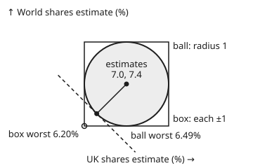

# Robust and chance constraints: answers that survive the data being wrong

[Syllabus](../../../SYLLABUS.md) → [Optimization](../README.md) → [Conic, Quadratic and Stochastic Programs](../README.md#s06) → Robust and chance constraints

---

## General Overview

A pension fund splits its money across five assets: UK shares, world shares, property, gilts (UK government bonds) and gold. Its analysts estimate each asset's expected return for the year: 7.00%, 7.40%, 6.80%, 4.00% and 5.00%.

The fund wants the split with the largest expected return. One rule limits it: in at least 95 years out of 100, the fund must not lose more than 10%. That rule is a **chance constraint**, a limit that must hold with a stated probability rather than always. This card **maximises**.

Trust the estimates and the best split is 53.82% world shares, 8.53% property, 26.54% gilts and 11.11% gold, with an expected 6.1796%. But estimates of expected return are among the least reliable inputs a fund has.

If every estimate may be a full point out at once, the cure is dull: every fully invested plan loses exactly 1 point, so no weight moves and the promise drops to 5.1796%.

A sharper doubt lets the errors have a combined size (the square root of the sum of their squares) of up to 1 point: one estimate a full point out, or several out by less. Then the plan's real expected return may be as low as 5.5635%. The plan leaned hardest on world shares, so an error in that one estimate does the most damage.

This card picks the split whose **worst case** is best instead. It names the set of estimates it is willing to believe (the **uncertainty set**), works out the worst return inside that set in closed form, and maximises that.

The answer is 11.84% UK shares, 38.11% world shares, 10.53% property, 22.52% gilts and 16.99% gold. It promises 5.6159% for every set of estimates in the uncertainty set, an expected £56,159 a year on the fund's £1,000,000, and it meets the loss rule at the analysts' estimates. A printed certificate proves no split does better by more than 0.0000006.

**Robust optimisation replaces "the data are right" with "the data lie in a stated set" and optimises the worst case. For a ball of errors, the worst case of a return is the estimate minus the radius times the length of the weight list. For normal returns, a chance constraint has exactly the same shape: it is the worst case over an ellipsoid (a stretched ball) shaped by the risk.**

**What kind of fact this is:** two theorems and a model. That the worst case over a ball is "estimate minus radius times length" is proved on this card in Why it works. So is the reduction of a normal chance constraint to the same form. Which uncertainty set to believe, and whether returns are normal, are modelling choices, not facts.

### The picture: a box of errors against a ball of errors

<p align="center"></p>

Two of the assets, drawn to scale: UK shares across, world shares up, 1 point of return per 60 drawing units. The centre dot is the pair of estimates, 7.0 and 7.4.

The square is the **box**: each estimate may be up to 1 point out, all at the same time. The circle is the **ball**: errors whose combined length is at most 1 point.

Take a plan with half its money in each asset. Its worst point in the box is the corner, where both estimates are a full point low, and it returns 6.2000%. Its worst point on the ball is where the dashed line of equal return just touches the circle, and it returns 6.4929%. The ball is the milder set, because it does not let every error go against the plan at full size at once.

---

## The formula

Notation first, in words. The weights are a list $w$; $w_i$ is the fraction in asset $i$. The raised $\mathsf T$ turns a column into a row, so $\hat\mu^{\mathsf T} w$ means "multiply estimate by weight, asset by asset, and add". $\lVert w\rVert$ is the length of $w$: the square root of the sum of squared weights. The uncertainty set is a ball of radius $\delta$ (delta) around the estimates:

$$\mathcal U = \{\,\hat\mu + \delta u \;:\; \lVert u\rVert \le 1\,\}.$$

**Robust counterpart.** The worst expected return of a plan over every $\mu$ in $\mathcal U$ has a closed form:

$$\min_{\mu \in \mathcal U}\; \mu^{\mathsf T} w \;=\; \hat\mu^{\mathsf T} w \;-\; \delta\,\lVert w\rVert.$$

**Read it aloud:** the worst the plan can expect is what the estimates promise, minus the radius of doubt times the length of the weight list.

**Chance constraint.** If the year's returns $\xi$ are normal (bell-curve shaped) with mean $\hat\mu$ and covariance matrix $\Sigma$ (the table of how each pair of returns moves together), and $C$ is any matrix with $C C^{\mathsf T} = \Sigma$, then

$$\Pr\big(\xi^{\mathsf T} w < -\ell\big) \le \varepsilon \quad\Longleftrightarrow\quad \hat\mu^{\mathsf T} w \;-\; z\,\lVert C^{\mathsf T} w\rVert \;\ge\; -\ell, \qquad z = N^{-1}(1 - \varepsilon).$$

**Read it aloud:** the chance of losing more than $\ell$ is at most $\varepsilon$ exactly when the expected return, less $z$ standard deviations, still sits above a loss of $\ell$.

The card's problem puts the two together:

$$\text{maximise } \hat\mu^{\mathsf T} w - \delta\lVert w\rVert \quad\text{subject to}\quad \hat\mu^{\mathsf T} w - z\lVert C^{\mathsf T} w\rVert \ge -\ell,\quad \mathbf 1^{\mathsf T} w = 1,\quad w \ge 0.$$

The contrast, in one line: for the box $\{\mu : |\mu_i - \hat\mu_i| \le \delta \text{ for every } i\}$, the worst case is $\hat\mu^{\mathsf T} w - \delta(|w_1| + \dots + |w_5|)$, and with no shorting (no negative weights, $w \ge 0$) the bracket is 1. So the box's counterpart is "subtract 1 point from every estimate". It moves no weight and only lowers the promise.

| Symbol | Plain meaning | In our example | Push it up and the answer… |
| --- | --- | --- | --- |
| $w$, $v$, $\mathbf 1$ | the weights, the fraction of money in each asset ($v$: any other plan); a list of ones, so $\mathbf 1^{\mathsf T} w = 1$ says "fully invested" | 11.84, 38.11, 10.53, 22.52, 16.99 (%) | — |
| $\hat\mu$ | the analysts' estimates of expected return, % a year | 7.00, 7.40, 6.80, 4.00, 5.00 | money moves toward the asset raised |
| $\mu$ | the true expected returns, unknown, assumed to lie in $\mathcal U$ | — | — |
| $\mathcal U$, $\delta$, $u$ | the uncertainty set; its radius in points of return; a direction of error with $\lVert u\rVert \le 1$ | ball of radius 1 | larger $\delta$: the plan spreads out and promises less |
| $\lVert w\rVert$ | length of the weight list: 1 if all money sits in one asset, smaller when spread | 0.5000 | — |
| $\mu^*$ | the worst-case estimates for the chosen plan, $\hat\mu - \delta w/\lVert w\rVert$ | 6.7632, 6.6377, 6.5894, 3.5495, 4.6601 | — |
| $\xi$ | the five returns the year actually delivers, random | — | — |
| $\Sigma$, $C$, $\mathcal E$ | the covariance matrix of the returns (the shelf's house figures); a factor with $C C^{\mathsf T} = \Sigma$, so $\lVert C^{\mathsf T} w\rVert$ is the plan's standard deviation; the ellipsoid $\hat\mu + zCu$ the chance constraint guards | standard deviation 9.7977% | more risk: money moves to gilts and gold |
| $\varepsilon$, $z$, $N$, $\Pr$ | the allowed chance of a bad year; the point on the bell curve with $1 - \varepsilon$ of the area to its left; $N$, the bell-curve area left of a point, and $N^{-1}$ its inverse; $\Pr$, "the chance that" | 0.05; 1.644854 | smaller $\varepsilon$: larger $z$, a safer and lower-return plan |
| $\ell$ | the loss limit, % of the fund | 10 | looser limit: more return, worth 0.2096 points per point at the margin |
| $t$, $\lambda$ | the barrier weight in the solving method; the price on the loss rule it reports | $\lambda$ = 0.2096 | — |
| $\nu$, $c$ | with no loss rule, the level every held asset's worst-case estimate is pushed down to; $c$, the total that scales the water-filling weights to add to 1 | 6.5460 | — |

### When it holds

- **The true expected returns lie in $\mathcal U$.** The promise of 5.6159% is a guarantee only inside the set. Outside it, nothing is promised. The set is a judgement about how wrong the analysts can be; a radius of 1 point is a choice, not a fact.
- **The set is round (or an ellipsoid).** Then the worst case is a length, and the problem stays a second-order cone program (a problem whose limits say that the length of a list is at most a straight-line expression). A box gives a sum of absolute values, which with no shorting collapses to a constant shift. A set of finitely many scenarios gives one straight-line limit per scenario.
- **The returns are normal, for the chance constraint.** Then $z$ comes from the bell curve. If they are not, the same mean and standard deviation can hide a 25.80% chance of a 10.50% loss, as the checks print. Guarding against every law (probability distribution of the returns) with that mean and spread needs $z$ = 4.3589 instead of 1.644854.
- **$\varepsilon$ is below one half.** Then $z > 0$ and the chance constraint is a cone constraint, so the allowed set is convex (any mix of two allowed plans is allowed). Above one half, $z$ turns negative, the constraint rewards risk, and the allowed set has dents.
- **The chance constraint uses the same estimates.** It is evaluated at $\hat\mu$. At the ball's worst estimates (errors of combined size 1 point), the plan's 95% loss level is 10.49997%, not 10%.

---

## Why it works

### Step 0: infinitely many limits become one

"The plan must earn at least a given return for every $\mu$ in the set" is one limit per point of the ball, infinitely many. But a return is a straight-line function of $\mu$, and the lowest value of a straight-line function over a ball sits on its edge, straight against the direction the plan points. That point can be written down. So the infinitely many limits are equivalent to one: the limit at the worst point. That single limit is the **robust counterpart**.

### Step 1: the worst point on the ball

Write $\mu = \hat\mu + \delta u$. Then $\mu^{\mathsf T} w = \hat\mu^{\mathsf T} w + \delta\,u^{\mathsf T} w$. The Cauchy–Schwarz inequality (a list's product with another is at least minus the product of their lengths) gives $u^{\mathsf T} w \ge -\lVert u\rVert\,\lVert w\rVert \ge -\lVert w\rVert$. The choice $u = -w/\lVert w\rVert$ has length 1 and reaches it. So

$$\min_{\mu\in\mathcal U} \mu^{\mathsf T} w = \hat\mu^{\mathsf T} w - \delta\lVert w\rVert, \qquad \text{reached at } \mu^* = \hat\mu - \delta\,\frac{w}{\lVert w\rVert}.$$

The worst estimates cut each asset in proportion to how much the plan holds of it; for the robust plan, world shares, the largest holding, lose the most.

For the box, each error is chosen separately, $\mu_i = \hat\mu_i - \delta$ wherever $w_i > 0$, which gives the one-line contrast under The formula. In the figure, the box's worst point is the corner and the ball's is where the dashed line touches.

### Step 2: why the ball rewards spreading the money

$\lVert w\rVert$ is 1 when all the money sits in one asset and shrinks as the money spreads. So the ball's penalty $\delta\lVert w\rVert$ is a charge for concentration.

The reason is the shape of the set. The ball allows one estimate to be a full point out, but if several are out together, each must be out by less. A spread plan is exposed to several errors at once, so to each only partly.

The trusting plan has $\lVert w\rVert$ = 0.6162 and loses 0.6162 points in its worst case; the robust plan has 0.5000 and loses half a point.

The box lets all five errors be a full point at once, so spreading earns nothing there.

### Step 3: the chance constraint is a worst case too

The plan's return for the year, $\xi^{\mathsf T} w$, is a sum of normal returns, so it is normal. Its mean is $\hat\mu^{\mathsf T} w$; its variance is $w^{\mathsf T}\Sigma w = \lVert C^{\mathsf T} w\rVert^2$. The chance of falling below $-\ell$ is the bell-curve area $N\big((-\ell - \hat\mu^{\mathsf T}w)/\lVert C^{\mathsf T}w\rVert\big)$. That is at most $\varepsilon$ exactly when the argument is at most $-z$, which rearranges to the formula.

Read as a loss, it says the plan's 95% value at risk (the loss exceeded with only a 5% chance) is at most $\ell$; the normal closed form is on [Value at risk](../../12-Financial%20mathematics/39-Value%20at%20Risk%20and%20Expected%20Shortfall/01-profit-and-loss-distribution-and-var.md).

Now run Step 1 backwards. With $\mathcal E = \{\hat\mu + zCu : \lVert u\rVert \le 1\}$, the lowest return over $\mathcal E$ is $\hat\mu^{\mathsf T} w - z\lVert C^{\mathsf T}w\rVert$. So the chance constraint says: **the plan loses at most $\ell$ for every outcome in an ellipsoid of size $z$ shaped by the risk**. Both constraints are robust constraints. They differ in what they doubt:

| | Robust constraint | Chance constraint |
| --- | --- | --- |
| What is uncertain | the expected returns themselves | the year's outcome, with the expected returns taken as known |
| The set | ball of radius 1 point | ellipsoid $\hat\mu + zCu$, $z$ = 1.644854 |
| The guarantee | certain, if the truth is in the set | 95%, if the returns are normal with these figures |
| For the robust plan | worst expected return 5.6159% | 95% value at risk 10.0000% |

### Step 4: solving it, and the certificate

The objective is a straight line minus a length, so it is concave (it bends downward, so any local best is the overall best); the loss rule is a cone constraint, so the allowed set is convex. The whole problem is a second-order cone program, the class on [Second-order cone programs](04-second-order-cone-programs.md).

The code solves it with a **log-barrier method**: for a weight $t$ it maximises $t$ times the objective plus the logarithms of every slack (each weight, and the room left under the loss rule), by Newton steps (each heads for the best point of a quadratic fitted to the cost at the current split) on four free weights (the fifth is one minus the rest). Then $t$ grows tenfold, and the rounds stop once 6/$t$ is below 0.000001.

At each centred point the method hands back prices: $\lambda = 1/(t \times \text{room under the loss rule})$ on the loss rule and $1/(t\,w_i)$ on each weight's floor. These prices satisfy the KKT (Karush–Kuhn–Tucker) conditions (the slope of the objective is balanced by priced limits) exactly except that each price times its slack is $1/t$ instead of 0.

The barrier-method theorem (stated here, with its source, not proved) says this gives a dual bound: no allowed split beats the current one by more than (number of slacks)/$t$ = 6/$t$.

The code asserts the balance holds to 0.000001 and prints the gap: at most 0.0000006, after 43 Newton steps from a start of 10% in each of UK shares, world shares and property, 50% gilts and 20% gold.

### Step 5: with no loss rule, a closed form

Drop the loss rule and the robust problem solves by hand. Every held asset's worst-case estimate is pushed down to one common level $\nu$, and assets whose estimate is already below $\nu$ are left out:

$$w_i \propto \max(\hat\mu_i - \nu,\, 0), \qquad \textstyle\sum_i \max(\hat\mu_i - \nu, 0)^2 = \delta^2.$$

This is **water-filling**: lower the level $\nu$ until the parts of the estimates above it have combined length $\delta$.

Here $\nu$ = 6.5460 and the plan is 29.07% UK shares, 54.67% world shares and 16.26% property. It ignores risk entirely, and its 95% value at risk is 16.6024%, far over the limit, which is why the card's problem needs the loss rule too.

<details>
<summary>Detailed proof: water-filling is the best worst case, with a certificate</summary>

Let $w$ be the water-filling plan and $c = \sum_i \max(\hat\mu_i - \nu, 0)$, so $w_i = \max(\hat\mu_i - \nu, 0)/c$. Then $\lVert w\rVert = \delta/c$, so $\delta w_i/\lVert w\rVert = \max(\hat\mu_i - \nu, 0)$.

Take $\mu^* = \hat\mu - \delta w/\lVert w\rVert$, the worst point for $w$ from Step 1. It lies in $\mathcal U$. Its entries are $\nu$ for every held asset and $\hat\mu_i \le \nu$ for every asset left out.

1. **No plan beats $\nu$.** For any long-only, fully invested $v$, its worst case is at most its return at $\mu^*$, and $\mu^{*\mathsf T} v$ is an average of numbers that are all at most $\nu$. So $\min_{\mu\in\mathcal U}\mu^{\mathsf T}v \le \nu$.
2. **$w$ reaches $\nu$.** By Step 1, $w$'s worst case is $\mu^{*\mathsf T} w$, an average of entries that all equal $\nu$, so it is exactly $\nu$.

So $w$ is optimal, and $\mu^*$ is the certificate: the checks print it as 6.5460, 6.5460, 6.5460, 4.0000, 5.0000. The pair ($w$, $\mu^*$) is a saddle point: neither the fund nor an adversary choosing the estimates can gain by moving alone.

</details>

---

## Worked numbers, by hand

The robust plan, as fractions to five places: 0.11841 UK shares, 0.38112 world shares, 0.10530 property, 0.22523 gilts, 0.16994 gold.

| Step | Arithmetic | Value |
| --- | --- | --- |
| $\lVert w\rVert^2$ | 0.11841² + 0.38112² + 0.10530² + 0.22523² + 0.16994² | 0.24997 |
| $\lVert w\rVert$ | square root | 0.49997 |
| promised return, $\hat\mu^{\mathsf T}w$ | 7.00 × 0.11841 + 7.40 × 0.38112 + 6.80 × 0.10530 + 4.00 × 0.22523 + 5.00 × 0.16994 | 6.11583 |
| worst case over the ball | 6.11583 − 1 × 0.49997 | **5.61586** |
| worst estimates, $\hat\mu - w/\lVert w\rVert$ | UK: 7.00 − 0.11841/0.49997, and so on | 6.7632, 6.6377, 6.5894, 3.5495, 4.6601 |
| check | return at those estimates | 5.6159 |
| standard deviation, $\lVert C^{\mathsf T}w\rVert$ | from the covariance matrix | 9.79773 |
| $z$ standard deviations | 1.644854 × 9.79773 | 16.11583 |
| 95% value at risk | 16.11583 − 6.11583 | 10.00000 |

So the plan promises 5.62% a year whichever estimates in the ball turn out true, and its loss rule is met exactly, with no room to spare: the rule binds, which is why it carries a price. That price, 0.2096, says that allowing a little more loss raises the guaranteed return by about 0.2096 points per point of loss allowed.

Against the trusting plan, in the world that is worst for the trusting plan, the trusting plan earns 5.5635% and the robust plan 5.6407%.

### What breaks if you drop a piece

| Mistake | Comes out at | What went wrong |
| --- | --- | --- |
| Trust the estimates ($\delta$ = 0) | promises 6.1796%, can earn 5.5635% | the promise holds only if every estimate is right |
| Use the box instead of the ball | the trusting plan again, promise 5.1796% | with no shorting, the box's counterpart is a constant: it can never move a weight |
| Drop the loss rule | 95% value at risk 16.6024% | robust about the mean, blind to the year's risk |
| Assume normal when the year is crash-or-calm | 25.80% chance of losing 10.50%, else a gain of 11.8932% | the same mean and spread, a different law: the $z$ of the bell curve no longer applies |
| Check the loss rule at the estimates only | 95% value at risk 10.49997% at the worst estimates | the chance constraint trusted the same means the robust part doubts |

The fourth row is a modelling assumption failing: a two-point year with the robust plan's mean and standard deviation. Guarding against every law with a given mean and spread needs $z$ = 4.3589 instead of 1.644854 (Cantelli's inequality), which is the price of doubting the bell curve too.

---

## Code, from first principles, and it actually runs

The code builds the covariance matrix from the shelf's house figures, finds $z$ by bisection on a bell-curve area it integrates itself, and reaches the answer by **four independent roads**:

1. Road 1 is the log-barrier method with its gap certificate and KKT balance.
2. Road 2 tries every split in steps of 2% and checks that none beats the barrier.
3. Road 3 checks the closed-form worst case by sampling 20,000 points on the ball, and checks water-filling by its saddle certificate.
4. Road 4 simulates 200,000 years of correlated normal returns with a SplitMix64 generator and counts the bad ones.

Nothing imported knows the answer; Python and Rust print the same lines.

### Python

```python
# Robust and chance constraints -- the check behind the card.  Standard library only.
# Five assets, returns in % a year.  Maximise the worst-case expected return over a ball
# of radius DELTA = 1 point around the estimates, with a 95% chance of losing at most ELL = 10%.
# Roads: log-barrier Newton with a gap certificate, a 2% grid, water-filling, the ball sampled, simulated years.
import math, functools
NAMES = ["UK", "World", "Prop", "Gilts", "Gold"]
MU = [7.0, 7.4, 6.8, 4.0, 5.0]                     # estimated expected return, %
SD = [16.0, 15.0, 18.0, 8.0, 14.0]                 # yearly standard deviation, %
RHO = {(0, 1): 0.9, (0, 2): 0.7, (1, 2): 0.5, (1, 4): 0.2, (2, 3): 0.3, (2, 4): 0.2, (3, 4): 0.3}
N, DELTA, ELL, EPS = 5, 1.0, 10.0, 0.05
SIG = [[SD[i] * SD[j] * (1.0 if i == j else RHO.get((min(i, j), max(i, j)), 0.0)) for j in range(N)] for i in range(N)]
def add(xs): return functools.reduce(lambda a, b: a + b, xs, 0.0)   # left-to-right sum, as Rust
def dot(a, b): return add(x * y for x, y in zip(a, b))
def pc(w): return " ".join(f"{100 * v:6.2f}" for v in w)
def ncdf(x, n=2000):                               # bell-curve area left of x, Simpson's rule
    h = x / n; s = 1.0 + math.exp(-0.5 * x * x)
    for k in range(1, n): s += (4 if k % 2 else 2) * math.exp(-0.5 * (k * h) * (k * h))
    return 0.5 + s * h / 3 / math.sqrt(2 * math.pi)
lo, hi = 0.0, 4.0
for _ in range(60):
    mid = 0.5 * (lo + hi); lo, hi = (mid, hi) if ncdf(mid) < 1 - EPS else (lo, mid)
Z = lo                                             # z: N(z) = 0.95
def stats(w, delta):                               # |w|, Sigma w, sd, worst mean, VaR slack
    nw = math.sqrt(dot(w, w)); Sw = [dot(r, w) for r in SIG]; sd = math.sqrt(dot(w, Sw)); m = dot(MU, w)
    return nw, Sw, sd, m - delta * nw, m + ELL - Z * sd
def solve(M, b):                                   # Gaussian elimination, partial pivoting
    n = len(b); R = [M[i][:] + [b[i]] for i in range(n)]
    for c in range(n):
        p = max(range(c, n), key=lambda r: abs(R[r][c])); R[c], R[p] = R[p], R[c]
        for r in range(n):
            if r != c:
                f = R[r][c] / R[c][c]; R[r] = [a - f * q for a, q in zip(R[r], R[c])]
    return [R[i][n] / R[i][i] for i in range(n)]
def phi(x, t, delta):                              # barrier cost on the first four weights
    w = x + [1.0 - add(x)]; nw, Sw, sd, f, s = stats(w, delta)
    if min(w) <= 0 or s <= 0: return math.inf
    return -t * f - add(math.log(v) for v in w) - math.log(s)
def barrier(delta):                                # road 1: start at a feasible split, t = 1
    x, t, newton = [0.1, 0.1, 0.1, 0.5], 1.0, 0
    while 6.0 / t >= 1e-6:
        t *= 10.0
        while True:
            w = x + [1.0 - add(x)]; nw, Sw, sd, f, s = stats(w, delta)
            gf = [MU[i] - delta * w[i] / nw for i in range(N)]
            gs = [MU[i] - Z * Sw[i] / sd for i in range(N)]
            g = [-t * gf[i] - 1 / w[i] - gs[i] / s for i in range(N)]
            H = [[t * delta * ((i == j) - w[i] * w[j] / (nw * nw)) / nw + (i == j) / (w[i] * w[i])
                  + gs[i] * gs[j] / (s * s) + Z * (SIG[i][j] - Sw[i] * Sw[j] / (sd * sd)) / (sd * s)
                  for j in range(N)] for i in range(N)]
            gx = [g[i] - g[4] for i in range(4)]
            Hx = [[H[i][j] - H[i][4] - H[4][j] + H[4][4] for j in range(4)] for i in range(4)]
            d = solve(Hx, [-v for v in gx]); dec = -dot(gx, d)
            a, p0 = 1.0, phi(x, t, delta)
            while a > 1e-9 and phi([x[i] + a * d[i] for i in range(4)], t, delta) > p0 - 0.25 * a * dec: a *= 0.5
            if dec < 1e-10 or a <= 1e-9: break     # centred, or rounding stops progress
            x = [x[i] + a * d[i] for i in range(4)]; newton += 1
    w = x + [1.0 - add(x)]; nw, Sw, sd, f, s = stats(w, delta)
    lam, lb = 1.0 / (t * s), [1.0 / (t * v) for v in w]   # prices on the VaR limit and on w_i >= 0
    gr = [MU[i] - delta * w[i] / nw + lam * (MU[i] - Z * Sw[i] / sd) + lb[i] for i in range(N)]
    nu = add(gr) / N                               # KKT: every entry of gr equals nu
    assert max(abs(v - nu) for v in gr) < 1e-6 and min(lb) > 0 and lam > 0
    return w, lam, nu, 6.0 / t, newton
print(f"z for chance {EPS:.2f}: {Z:.6f}, N(z) = {ncdf(Z):.6f}")
print("assets      " + " ".join(f"{n:>6}" for n in NAMES))
print("estimates % " + " ".join(f"{m:6.2f}" for m in MU))
# ---- no VaR limit: water-filling, certified by its worst-case estimates ----
order = sorted(range(N), key=lambda i: -MU[i])
for k in range(1, N + 1):
    top = [MU[i] for i in order[:k]]; m = add(top) / k; ss = add((v - m) * (v - m) for v in top)
    if ss > DELTA * DELTA: continue
    nu = m - math.sqrt((DELTA * DELTA - ss) / k)
    if k == N or MU[order[k]] <= nu: break
wf = [max(MU[i] - nu, 0.0) for i in range(N)]; wf = [v / add(wf) for v in wf]
nf = stats(wf, DELTA)
mf = [MU[i] - DELTA * wf[i] / nf[0] for i in range(N)]
print(f"no VaR limit: {pc(wf)}  worst {nf[3]:.4f}, VaR95 {ELL - nf[4]:.4f}")
print("  its worst estimates " + " ".join(f"{v:.4f}" for v in mf))
assert abs(nf[3] - nu) < 1e-12 and max(mf) <= nu + 1e-12
# ---- the card's problem: nominal (radius 0) and robust (radius 1) ----
print("plan        " + " ".join(f"{n:>6}" for n in NAMES) + "  est.   |w|    worst  sd     VaR95")
plans = {}
for name, dl in (("nominal", 0.0), ("robust", DELTA)):
    w, lam, nuk, gap, newton = barrier(dl); plans[name] = w
    nw, Sw, sd, worst, s = stats(w, DELTA)
    print(f"{name:11} {pc(w)}  {dot(MU, w):.4f} {nw:.4f} {worst:.4f} {sd:.4f} {ELL - s:.4f}")
    print(f"  certificate: {newton} Newton steps, gap at most {gap:.7f}, VaR price {lam:.4f}")
    assert abs(s) < 1e-5                           # the VaR limit binds
wn, wr = plans["nominal"], plans["robust"]
(nr, _, sdr, best, _), nn = stats(wr, DELTA), stats(wn, DELTA)
# ---- road 2: every split on a 2% grid that meets the VaR limit ----
gbest, gw = -math.inf, None
for a in range(51):
    for b in range(51 - a):
        for c in range(51 - a - b):
            for d in range(51 - a - b - c):
                w = [a / 50, b / 50, c / 50, d / 50, (50 - a - b - c - d) / 50]
                st = stats(w, DELTA)
                if st[4] >= 0 and st[3] > gbest: gbest, gw = st[3], w
print(f"2% grid best: {pc(gw)}  worst {gbest:.4f}, below the barrier by {best - gbest:.4f}")
assert gbest <= best + 1e-9 and best - gbest < 0.02
# ---- road 3: the worst case by Cauchy-Schwarz, against 20,000 points on the ball ----
mstar = [MU[i] - DELTA * wr[i] / nr for i in range(N)]
print("robust plan's worst estimates " + " ".join(f"{v:.4f}" for v in mstar) + f", earns {dot(mstar, wr):.4f}")
S64 = [0x2026111100000001]                         # seed
def rnd():                                         # SplitMix64, a uniform in [0, 1)
    S64[0] = (S64[0] + 0x9E3779B97F4A7C15) & 0xFFFFFFFFFFFFFFFF; z = S64[0]
    z = ((z ^ (z >> 30)) * 0xBF58476D1CE4E5B9) & 0xFFFFFFFFFFFFFFFF
    z = ((z ^ (z >> 27)) * 0x94D049BB133111EB) & 0xFFFFFFFFFFFFFFFF
    return ((z ^ (z >> 31)) >> 11) / 9007199254740992.0
def gauss(): return math.sqrt(-2.0 * math.log(1.0 - rnd())) * math.cos(2.0 * math.pi * rnd())
smin = math.inf
for _ in range(20000):
    u = [gauss() for _ in range(N)]; r = math.sqrt(dot(u, u))
    smin = min(smin, dot([MU[i] + DELTA * u[i] / r for i in range(N)], wr))
print(f"20,000 points on the ball: lowest {smin:.4f}, never below {best:.4f}")
assert best - 1e-12 <= smin < best + 0.05
mn = [MU[i] - DELTA * wn[i] / nn[0] for i in range(N)]
print(f"in the nominal plan's worst world: nominal earns {dot(mn, wn):.4f}, robust {dot(mn, wr):.4f}")
# ---- road 4: the chance constraint, 200,000 simulated years (C with C C^T = Sigma) ----
C = [[0.0] * N for _ in range(N)]
for i in range(N):
    for j in range(i + 1):
        v = SIG[i][j] - add(C[i][k] * C[j][k] for k in range(j))
        C[i][j] = math.sqrt(v) if i == j else v / C[j][j]
cw = [add(C[i][j] * wr[i] for i in range(N)) for j in range(N)]   # C^T w
YEARS, bad, se = 200000, 0, math.sqrt(EPS * (1 - EPS) / 200000)
for _ in range(YEARS):
    if dot(MU, wr) + dot(cw, [gauss() for _ in range(N)]) < -ELL: bad += 1
print(f"simulated years losing over {ELL:.0f}%: {bad} of {YEARS} = {bad / YEARS:.4f} (target {EPS:.4f}, se {se:.4f})")
assert abs(bad / YEARS - EPS) < 4 * se and abs(math.sqrt(dot(cw, cw)) - sdr) < 1e-9
# ---- what breaks ----
m = dot(MU, wr); kk = (m + 10.5) / sdr; p2 = 1 / (1 + kk * kk)
print(f"two-point year, same mean and sd: lose 10.50% with chance {p2:.4f}, else gain {m + sdr / kk:.4f}")
assert abs(p2 * -10.5 + (1 - p2) * (m + sdr / kk) - m) < 1e-9 and p2 > 5 * EPS
print(f"any-law z (Cantelli): {math.sqrt((1 - EPS) / EPS):.4f}")
print(f"nominal promises {dot(MU, wn):.4f}, can earn {nn[3]:.4f}; box promise {dot(MU, wn) - DELTA:.4f}; robust worst case on £1,000,000: £{1e4 * best:.0f} a year")
print(f"by hand, robust: w {' '.join(f'{v:.5f}' for v in wr)}, |w|^2 {nr * nr:.5f}, |w| {nr:.5f}, est {dot(MU, wr):.5f}, worst {best:.5f}, sd {sdr:.5f}, z*sd {Z * sdr:.5f}, VaR95 at worst estimates {ELL + DELTA * nr:.5f}")
r2 = DELTA / math.sqrt(2)                          # figure: half in each of two assets, 1 point = 60
print(f"figure, centre 180 120, radius 60, box corner 120 180, worst point {180 - 60 * r2:.1f} {120 + 60 * r2:.1f}, ball worst {7.2 - r2:.4f}, box worst {7.2 - DELTA:.4f}")
print("ALL CHECKS PASS")
```

**Ran 2026-11-11 on macOS, Python 3.14.10, standard library only. All checks passed. Output, pasted from the run:**

```
z for chance 0.05: 1.644854, N(z) = 0.950000
assets          UK  World   Prop  Gilts   Gold
estimates %   7.00   7.40   6.80   4.00   5.00
no VaR limit:  29.07  54.67  16.26   0.00   0.00  worst 6.5460, VaR95 16.6024
  its worst estimates 6.5460 6.5460 6.5460 4.0000 5.0000
plan            UK  World   Prop  Gilts   Gold  est.   |w|    worst  sd     VaR95
nominal       0.00  53.82   8.53  26.54  11.11  6.1796 0.6162 5.5635 9.8365 10.0000
  certificate: 44 Newton steps, gap at most 0.0000006, VaR price 0.2197
robust       11.84  38.11  10.53  22.52  16.99  6.1158 0.5000 5.6159 9.7977 10.0000
  certificate: 43 Newton steps, gap at most 0.0000006, VaR price 0.2096
2% grid best:  14.00  36.00  10.00  22.00  18.00  worst 5.6141, below the barrier by 0.0018
robust plan's worst estimates 6.7632 6.6377 6.5894 3.5495 4.6601, earns 5.6159
20,000 points on the ball: lowest 5.6183, never below 5.6159
in the nominal plan's worst world: nominal earns 5.5635, robust 5.6407
simulated years losing over 10%: 10038 of 200000 = 0.0502 (target 0.0500, se 0.0005)
two-point year, same mean and sd: lose 10.50% with chance 0.2580, else gain 11.8932
any-law z (Cantelli): 4.3589
nominal promises 6.1796, can earn 5.5635; box promise 5.1796; robust worst case on £1,000,000: £56159 a year
by hand, robust: w 0.11841 0.38112 0.10530 0.22523 0.16994, |w|^2 0.24997, |w| 0.49997, est 6.11583, worst 5.61586, sd 9.79773, z*sd 16.11583, VaR95 at worst estimates 10.49997
figure, centre 180 120, radius 60, box corner 120 180, worst point 137.6 162.4, ball worst 6.4929, box worst 6.2000
ALL CHECKS PASS
```

### Rust

```rust
// Robust and chance constraints -- the check behind the card.  std only, no crates.
// Five assets, returns in % a year.  Maximise the worst-case expected return over a ball
// of radius DELTA = 1 point around the estimates, with a 95% chance of losing at most ELL = 10%.
// Roads: log-barrier Newton with a gap certificate, a 2% grid, water-filling, the ball sampled, simulated years.
const N: usize = 5;
const NAMES: [&str; N] = ["UK", "World", "Prop", "Gilts", "Gold"];
const MU: [f64; N] = [7.0, 7.4, 6.8, 4.0, 5.0]; // estimated expected return, %
const SD: [f64; N] = [16.0, 15.0, 18.0, 8.0, 14.0]; // yearly standard deviation, %
const DELTA: f64 = 1.0; const ELL: f64 = 10.0; const EPS: f64 = 0.05;
type V = Vec<f64>;
fn add(xs: impl Iterator<Item = f64>) -> f64 { xs.fold(0.0, |a, b| a + b) } // left-to-right sum
fn dot(a: &[f64], b: &[f64]) -> f64 { add(a.iter().zip(b).map(|(x, y)| x * y)) }
fn pc(w: &[f64]) -> String { w.iter().map(|v| format!("{:6.2}", 100.0 * v)).collect::<Vec<_>>().join(" ") }
fn f4(w: &[f64]) -> String { w.iter().map(|v| format!("{:.4}", v)).collect::<Vec<_>>().join(" ") }
fn ncdf(x: f64) -> f64 { // bell-curve area left of x, Simpson's rule
    let (n, mut s) = (2000, 1.0 + (-0.5 * x * x).exp());
    let h = x / n as f64;
    for k in 1..n { let kh = k as f64 * h; s += (if k % 2 == 1 { 4.0 } else { 2.0 }) * (-0.5 * kh * kh).exp(); }
    0.5 + s * h / 3.0 / (2.0 * std::f64::consts::PI).sqrt()
}
struct P { sig: Vec<V>, z: f64 }
impl P {
    fn stats(&self, w: &[f64], delta: f64) -> (f64, V, f64, f64, f64) { // |w|, Sigma w, sd, worst mean, VaR slack
        let sw: V = self.sig.iter().map(|r| dot(r, w)).collect();
        let (nw, sd, m) = (dot(w, w).sqrt(), dot(w, &sw).sqrt(), dot(&MU, w));
        (nw, sw, sd, m - delta * nw, m + ELL - self.z * sd)
    }
    fn phi(&self, x: &[f64], t: f64, delta: f64) -> f64 { // barrier cost on four weights
        let w = full(x); let (_, _, _, f, s) = self.stats(&w, delta);
        if w.iter().cloned().fold(f64::INFINITY, f64::min) <= 0.0 || s <= 0.0 { return f64::INFINITY; }
        -t * f - add(w.iter().map(|v| v.ln())) - s.ln()
    }
    fn barrier(&self, delta: f64) -> (V, f64, f64, i32) { // road 1: feasible start, t = 1
        let (mut x, mut t, mut newton, z) = (vec![0.1, 0.1, 0.1, 0.5], 1.0f64, 0, self.z);
        while 6.0 / t >= 1e-6 {
            t *= 10.0;
            loop {
                let w = full(&x); let (nw, sw, sd, _, s) = self.stats(&w, delta);
                let gf: V = (0..N).map(|i| MU[i] - delta * w[i] / nw).collect();
                let gs: V = (0..N).map(|i| MU[i] - z * sw[i] / sd).collect();
                let g: V = (0..N).map(|i| -t * gf[i] - 1.0 / w[i] - gs[i] / s).collect();
                let h: Vec<V> = (0..N).map(|i| (0..N).map(|j| {
                    let e = if i == j { 1.0 } else { 0.0 };
                    t * delta * (e - w[i] * w[j] / (nw * nw)) / nw + e / (w[i] * w[i])
                        + gs[i] * gs[j] / (s * s) + z * (self.sig[i][j] - sw[i] * sw[j] / (sd * sd)) / (sd * s)
                }).collect()).collect();
                let gx: V = (0..4).map(|i| g[i] - g[4]).collect();
                let hx: Vec<V> = (0..4).map(|i| (0..4).map(|j| h[i][j] - h[i][4] - h[4][j] + h[4][4]).collect()).collect();
                let d = solve(&hx, &gx.iter().map(|v| -v).collect::<V>()); let dec = -dot(&gx, &d);
                let (mut a, p0) = (1.0, self.phi(&x, t, delta));
                while a > 1e-9 && self.phi(&(0..4).map(|i| x[i] + a * d[i]).collect::<V>(), t, delta) > p0 - 0.25 * a * dec { a *= 0.5; }
                if dec < 1e-10 || a <= 1e-9 { break; } // centred, or rounding stops progress
                x = (0..4).map(|i| x[i] + a * d[i]).collect(); newton += 1;
            }
        }
        let w = full(&x); let (nw, sw, sd, _, s) = self.stats(&w, delta);
        let (lam, lb): (f64, V) = (1.0 / (t * s), w.iter().map(|v| 1.0 / (t * v)).collect()); // prices: VaR, w_i >= 0
        let gr: V = (0..N).map(|i| MU[i] - delta * w[i] / nw + lam * (MU[i] - z * sw[i] / sd) + lb[i]).collect();
        let nu = add(gr.iter().cloned()) / N as f64; // KKT: every entry of gr equals nu
        assert!(gr.iter().all(|v| (v - nu).abs() < 1e-6) && lb.iter().all(|&v| v > 0.0) && lam > 0.0);
        (w, lam, 6.0 / t, newton)
    }
}
fn full(x: &[f64]) -> V { let mut w = x.to_vec(); w.push(1.0 - add(x.iter().cloned())); w }
fn solve(m: &[V], b: &[f64]) -> V { // Gaussian elimination, partial pivoting
    let n = b.len();
    let mut r: Vec<V> = (0..n).map(|i| { let mut row = m[i].clone(); row.push(b[i]); row }).collect();
    for c in 0..n {
        let p = (c..n).fold(c, |p, i| if r[i][c].abs() > r[p][c].abs() { i } else { p });
        r.swap(c, p);
        let rc = r[c].clone();
        for i in (0..n).filter(|&i| i != c) { let f = r[i][c] / rc[c]; for j in 0..=n { r[i][j] -= f * rc[j]; } }
    }
    (0..n).map(|i| r[i][n] / r[i][i]).collect()
}
struct Rng(u64);
impl Rng {
    fn rnd(&mut self) -> f64 { // SplitMix64, a uniform in [0, 1)
        self.0 = self.0.wrapping_add(0x9E3779B97F4A7C15);
        let mut z = (self.0 ^ (self.0 >> 30)).wrapping_mul(0xBF58476D1CE4E5B9);
        z = (z ^ (z >> 27)).wrapping_mul(0x94D049BB133111EB);
        ((z ^ (z >> 31)) >> 11) as f64 / 9007199254740992.0
    }
    fn gauss(&mut self) -> f64 { let u1 = self.rnd(); let u2 = self.rnd();
        (-2.0 * (1.0 - u1).ln()).sqrt() * (2.0 * std::f64::consts::PI * u2).cos() }
}
fn main() {
    let rho = |i: usize, j: usize| match (i.min(j), i.max(j)) {
        (0, 1) => 0.9, (0, 2) => 0.7, (1, 2) => 0.5, (1, 4) => 0.2, (2, 3) => 0.3, (2, 4) => 0.2, (3, 4) => 0.3, _ => 0.0 };
    let sig: Vec<V> = (0..N).map(|i| (0..N).map(|j| SD[i] * SD[j] * if i == j { 1.0 } else { rho(i, j) }).collect()).collect();
    let (mut lo, mut hi) = (0.0f64, 4.0f64);
    for _ in 0..60 { let mid = 0.5 * (lo + hi); if ncdf(mid) < 1.0 - EPS { lo = mid } else { hi = mid } }
    let p = P { sig: sig.clone(), z: lo };
    println!("z for chance {:.2}: {:.6}, N(z) = {:.6}", EPS, p.z, ncdf(p.z));
    println!("assets      {}", NAMES.iter().map(|n| format!("{:>6}", n)).collect::<Vec<_>>().join(" "));
    println!("estimates % {}", MU.iter().map(|m| format!("{:6.2}", m)).collect::<Vec<_>>().join(" "));
    // ---- no VaR limit: water-filling, certified by its worst-case estimates ----
    let mut order: Vec<usize> = (0..N).collect();
    order.sort_by(|&a, &b| MU[b].partial_cmp(&MU[a]).unwrap());
    let mut nu = 0.0;
    for k in 1..=N {
        let top: V = order[..k].iter().map(|&i| MU[i]).collect(); let m = add(top.iter().cloned()) / k as f64;
        let ss = add(top.iter().map(|v| (v - m) * (v - m)));
        if ss > DELTA * DELTA { continue; }
        nu = m - ((DELTA * DELTA - ss) / k as f64).sqrt();
        if k == N || MU[order[k]] <= nu { break; }
    }
    let wf0: V = (0..N).map(|i| (MU[i] - nu).max(0.0)).collect();
    let wf: V = wf0.iter().map(|v| v / add(wf0.iter().cloned())).collect();
    let nf = p.stats(&wf, DELTA); let mf: V = (0..N).map(|i| MU[i] - DELTA * wf[i] / nf.0).collect();
    println!("no VaR limit: {}  worst {:.4}, VaR95 {:.4}", pc(&wf), nf.3, ELL - nf.4);
    println!("  its worst estimates {}", f4(&mf));
    assert!((nf.3 - nu).abs() < 1e-12 && mf.iter().all(|&v| v <= nu + 1e-12));
    // ---- the card's problem: nominal (radius 0) and robust (radius 1) ----
    println!("plan        {}  est.   |w|    worst  sd     VaR95", NAMES.iter().map(|n| format!("{:>6}", n)).collect::<Vec<_>>().join(" "));
    let mut plans = vec![];
    for (name, dl) in [("nominal", 0.0), ("robust", DELTA)] {
        let (w, lam, gap, newton) = p.barrier(dl); let (nw, _, sd, worst, s) = p.stats(&w, DELTA);
        println!("{:11} {}  {:.4} {:.4} {:.4} {:.4} {:.4}", name, pc(&w), dot(&MU, &w), nw, worst, sd, ELL - s);
        println!("  certificate: {} Newton steps, gap at most {:.7}, VaR price {:.4}", newton, gap, lam);
        assert!(s.abs() < 1e-5); // the VaR limit binds
        plans.push(w);
    }
    let (wn, wr) = (plans[0].clone(), plans[1].clone());
    let ((nr, _, sdr, best, _), nn) = (p.stats(&wr, DELTA), p.stats(&wn, DELTA));
    // ---- road 2: every split on a 2% grid that meets the VaR limit ----
    let (mut gbest, mut gw) = (f64::NEG_INFINITY, vec![]);
    for a in 0..51 { for b in 0..51 - a { for c in 0..51 - a - b { for d in 0..51 - a - b - c {
        let w = vec![a as f64 / 50.0, b as f64 / 50.0, c as f64 / 50.0, d as f64 / 50.0, (50 - a - b - c - d) as f64 / 50.0];
        let st = p.stats(&w, DELTA);
        if st.4 >= 0.0 && st.3 > gbest { gbest = st.3; gw = w; }
    } } } }
    println!("2% grid best: {}  worst {:.4}, below the barrier by {:.4}", pc(&gw), gbest, best - gbest);
    assert!(gbest <= best + 1e-9 && best - gbest < 0.02);
    // ---- road 3: the worst case by Cauchy-Schwarz, against 20,000 points on the ball ----
    let mstar: V = (0..N).map(|i| MU[i] - DELTA * wr[i] / nr).collect();
    println!("robust plan's worst estimates {}, earns {:.4}", f4(&mstar), dot(&mstar, &wr));
    let (mut g, mut smin) = (Rng(0x2026111100000001), f64::INFINITY); // seed
    for _ in 0..20000 {
        let u: V = (0..N).map(|_| g.gauss()).collect(); let r = dot(&u, &u).sqrt();
        smin = smin.min(dot(&(0..N).map(|i| MU[i] + DELTA * u[i] / r).collect::<V>(), &wr));
    }
    println!("20,000 points on the ball: lowest {:.4}, never below {:.4}", smin, best);
    assert!(best - 1e-12 <= smin && smin < best + 0.05);
    let mn: V = (0..N).map(|i| MU[i] - DELTA * wn[i] / nn.0).collect();
    println!("in the nominal plan's worst world: nominal earns {:.4}, robust {:.4}", dot(&mn, &wn), dot(&mn, &wr));
    // ---- road 4: the chance constraint, 200,000 simulated years (C with C C^T = Sigma) ----
    let mut cm = vec![vec![0.0; N]; N];
    for i in 0..N { for j in 0..=i {
        let v = sig[i][j] - add((0..j).map(|k| cm[i][k] * cm[j][k]));
        cm[i][j] = if i == j { v.sqrt() } else { v / cm[j][j] };
    } }
    let cw: V = (0..N).map(|j| add((0..N).map(|i| cm[i][j] * wr[i]))).collect(); // C^T w
    let (years, mut bad, se) = (200000, 0, (EPS * (1.0 - EPS) / 200000.0).sqrt());
    for _ in 0..years {
        let e: V = (0..N).map(|_| g.gauss()).collect(); if dot(&MU, &wr) + dot(&cw, &e) < -ELL { bad += 1; }
    }
    println!("simulated years losing over {:.0}%: {} of {} = {:.4} (target {:.4}, se {:.4})", ELL, bad, years, bad as f64 / years as f64, EPS, se);
    assert!((bad as f64 / years as f64 - EPS).abs() < 4.0 * se && (dot(&cw, &cw).sqrt() - sdr).abs() < 1e-9);
    // ---- what breaks ----
    let m = dot(&MU, &wr); let kk = (m + 10.5) / sdr; let p2 = 1.0 / (1.0 + kk * kk);
    println!("two-point year, same mean and sd: lose 10.50% with chance {:.4}, else gain {:.4}", p2, m + sdr / kk);
    assert!((p2 * -10.5 + (1.0 - p2) * (m + sdr / kk) - m).abs() < 1e-9 && p2 > 5.0 * EPS);
    println!("any-law z (Cantelli): {:.4}", ((1.0 - EPS) / EPS).sqrt());
    println!("nominal promises {:.4}, can earn {:.4}; box promise {:.4}; robust worst case on £1,000,000: £{:.0} a year", dot(&MU, &wn), nn.3, dot(&MU, &wn) - DELTA, 1e4 * best);
    println!("by hand, robust: w {}, |w|^2 {:.5}, |w| {:.5}, est {:.5}, worst {:.5}, sd {:.5}, z*sd {:.5}, VaR95 at worst estimates {:.5}", wr.iter().map(|v| format!("{:.5}", v)).collect::<Vec<_>>().join(" "), nr * nr, nr, dot(&MU, &wr), best, sdr, p.z * sdr, ELL + DELTA * nr);
    let r2 = DELTA / 2f64.sqrt(); // figure: half in each of two assets, 1 point = 60
    println!("figure, centre 180 120, radius 60, box corner 120 180, worst point {:.1} {:.1}, ball worst {:.4}, box worst {:.4}", 180.0 - 60.0 * r2, 120.0 + 60.0 * r2, 7.2 - r2, 7.2 - DELTA);
    println!("ALL CHECKS PASS");
}
```

**Ran 2026-11-11 on macOS, rustc 1.98.1, no crates. All checks passed. Output, pasted from the run:**

```
z for chance 0.05: 1.644854, N(z) = 0.950000
assets          UK  World   Prop  Gilts   Gold
estimates %   7.00   7.40   6.80   4.00   5.00
no VaR limit:  29.07  54.67  16.26   0.00   0.00  worst 6.5460, VaR95 16.6024
  its worst estimates 6.5460 6.5460 6.5460 4.0000 5.0000
plan            UK  World   Prop  Gilts   Gold  est.   |w|    worst  sd     VaR95
nominal       0.00  53.82   8.53  26.54  11.11  6.1796 0.6162 5.5635 9.8365 10.0000
  certificate: 44 Newton steps, gap at most 0.0000006, VaR price 0.2197
robust       11.84  38.11  10.53  22.52  16.99  6.1158 0.5000 5.6159 9.7977 10.0000
  certificate: 43 Newton steps, gap at most 0.0000006, VaR price 0.2096
2% grid best:  14.00  36.00  10.00  22.00  18.00  worst 5.6141, below the barrier by 0.0018
robust plan's worst estimates 6.7632 6.6377 6.5894 3.5495 4.6601, earns 5.6159
20,000 points on the ball: lowest 5.6183, never below 5.6159
in the nominal plan's worst world: nominal earns 5.5635, robust 5.6407
simulated years losing over 10%: 10038 of 200000 = 0.0502 (target 0.0500, se 0.0005)
two-point year, same mean and sd: lose 10.50% with chance 0.2580, else gain 11.8932
any-law z (Cantelli): 4.3589
nominal promises 6.1796, can earn 5.5635; box promise 5.1796; robust worst case on £1,000,000: £56159 a year
by hand, robust: w 0.11841 0.38112 0.10530 0.22523 0.16994, |w|^2 0.24997, |w| 0.49997, est 6.11583, worst 5.61586, sd 9.79773, z*sd 16.11583, VaR95 at worst estimates 10.49997
figure, centre 180 120, radius 60, box corner 120 180, worst point 137.6 162.4, ball worst 6.4929, box worst 6.2000
ALL CHECKS PASS
```

The grid's best split, 14%, 36%, 10%, 22%, 18%, guarantees 5.6141%, 0.0018 below the barrier's answer, as a coarse grid should. The simulation counts 10,038 bad years in 200,000, a rate of 0.0502 against the target 0.0500, well inside four standard errors of 0.0005.

### Lean

Lean proves the card's three exact results for any number of assets, any weights and any radius $\delta \ge 0$, plus the figure's sums.

- For the ball of radius $\delta$ around the estimates, the worst expected return exists and equals $\hat\mu^{\mathsf T} w - \delta\lVert w\rVert$.
- For the box, where every estimate may be up to $\delta$ out at once, the worst case is $\hat\mu^{\mathsf T} w - \delta(|w_1| + |w_2| + \dots)$.
- Let the returns be normal with mean $\hat\mu$ and covariance matrix $\Sigma$, with $C C^{\mathsf T} = \Sigma$ and $\varepsilon$ between 0 and 1.
- Then the chance of losing more than $\ell$ is at most $\varepsilon$ exactly when $\hat\mu^{\mathsf T} w - z\lVert C^{\mathsf T} w\rVert \ge -\ell$.
- In the figure, the half-and-half plan's worst point in the box returns 6.2.
- The same plan's weight list has squared length 1/2, so the ball charges only $1/\sqrt 2$ of a point.
- With no shorting, the box's bracket is 1, for example for the even split of 1/5 in each asset.

The best plans, the barrier certificate, water-filling, the 2% grid and the simulated years are left to the Python and Rust checks.

```lean
-- Robust and chance constraints: the worst return over a ball of estimates is the estimate minus the radius times the length of the weights, a box of errors instead costs the radius times the sum of the absolute weights, and a normal chance constraint is exactly the same kind of worst case shaped by the risk.
import Mathlib.Analysis.InnerProductSpace.PiL2
import Mathlib.Probability.Distributions.Gaussian.Multivariate
import Mathlib.Tactic.NormNum

open MeasureTheory ProbabilityTheory Matrix
open scoped RealInnerProductSpace

/-- The standard normal distribution function is strictly increasing. -/
lemma gaussianReal_Iic_lt_of_lt {a b : ℝ} (hab : a < b) :
    gaussianReal 0 1 (Set.Iic a) < gaussianReal 0 1 (Set.Iic b) := by
  have hpos : 0 < gaussianReal 0 1 (Set.Ioc a b) := by
    rw [pos_iff_ne_zero]
    intro h
    have := gaussianReal_absolutelyContinuous' (0 : ℝ) (v := 1) one_ne_zero h
    simp [Real.volume_Ioc] at this
    linarith
  rw [← Set.Iic_union_Ioc_eq_Iic hab.le, measure_union (Set.Iic_disjoint_Ioc le_rfl)
    measurableSet_Ioc]
  exact ENNReal.lt_add_right (measure_ne_top _ _) hpos.ne'

lemma gaussianReal_Iic_le_iff (a b : ℝ) :
    gaussianReal 0 1 (Set.Iic a) ≤ gaussianReal 0 1 (Set.Iic b) ↔ a ≤ b := by
  constructor
  · intro h
    by_contra hc
    exact absurd h (not_le.mpr (gaussianReal_Iic_lt_of_lt (not_le.mp hc)))
  · intro h
    exact measure_mono (Set.Iic_subset_Iic.mpr h)

lemma gaussianReal_Iio_le_iff {ε z : ℝ} (hε1 : ε < 1)
    (hz : gaussianReal 0 1 (Set.Iic z) = ENNReal.ofReal (1 - ε)) (t : ℝ) :
    gaussianReal 0 1 (Set.Iio t) ≤ ENNReal.ofReal ε ↔ t ≤ -z := by
  have hneg : gaussianReal 0 1 (Set.Iio t) = gaussianReal 0 1 (Set.Ioi (-t)) := by
    conv_lhs => rw [← neg_zero, ← gaussianReal_map_neg (μ := (0:ℝ)) (v := 1)]
    rw [Measure.map_apply measurable_neg measurableSet_Iio]
    congr 1
    ext x; simp
  rw [hneg, ← Set.compl_Iic, prob_compl_eq_one_sub measurableSet_Iic]
  have hε : ENNReal.ofReal ε = 1 - ENNReal.ofReal (1 - ε) := by
    rw [← ENNReal.ofReal_one, ← ENNReal.ofReal_sub _ (by linarith)]
    congr 1; ring
  rw [hε, ← hz, ENNReal.sub_le_sub_iff_left prob_le_one ENNReal.one_ne_top,
    gaussianReal_Iic_le_iff]
  constructor <;> intro h <;> linarith

#print axioms gaussianReal_Iic_lt_of_lt
#print axioms gaussianReal_Iic_le_iff
#print axioms gaussianReal_Iio_le_iff

/-- Robust counterpart for a ball. Let the uncertainty set be every estimate list
`μ̂ + δ • u` with `‖u‖ ≤ 1`, a ball of radius `δ ≥ 0` around the analysts' estimates `μ̂`.
For any weight list `w`, the worst expected return `μᵀw` over that set exists and equals the
estimate's return minus the radius times the length of the weights:
`min over μ in U of μᵀw = μ̂ᵀw - δ‖w‖`. -/
theorem worst_case_over_ball_eq_estimate_minus_radius_times_length
    {ι : Type*} [Fintype ι] (μhat w : EuclideanSpace ℝ ι) {δ : ℝ} (hδ : 0 ≤ δ) :
    IsLeast ((fun μ => ⟪μ, w⟫) '' {μ | ∃ u : EuclideanSpace ℝ ι, ‖u‖ ≤ 1 ∧ μ = μhat + δ • u})
      (⟪μhat, w⟫ - δ * ‖w‖) := by
  constructor
  · by_cases hw : w = 0
    · refine ⟨μhat, ⟨0, by simp, by simp⟩, by simp [hw]⟩
    · have hn : ‖w‖ ≠ 0 := norm_ne_zero_iff.mpr hw
      refine ⟨μhat + δ • (-(‖w‖⁻¹ • w)), ⟨-(‖w‖⁻¹ • w), ?_, rfl⟩, ?_⟩
      · rw [norm_neg, norm_smul, norm_inv, norm_norm, inv_mul_cancel₀ hn]
      · simp only [inner_add_left, inner_smul_left, inner_neg_left, real_inner_self_eq_norm_sq,
          RCLike.conj_to_real]
        field_simp
        ring
  · rintro _ ⟨μ, ⟨u, hu, rfl⟩, rfl⟩
    simp only [inner_add_left, real_inner_smul_left]
    have h1 : -(‖u‖ * ‖w‖) ≤ ⟪u, w⟫ := by
      have := abs_real_inner_le_norm u w
      linarith [neg_abs_le ⟪u, w⟫]
    have h2 : ‖u‖ * ‖w‖ ≤ ‖w‖ := by
      have := norm_nonneg w
      nlinarith
    nlinarith

/-- The box contrast. If each estimate may be out by up to `δ ≥ 0`, all at the same time
(the set of `μ` with `|μ i - μ̂ i| ≤ δ` for every asset `i`), the worst expected return exists and
equals the estimate's return minus `δ` times the sum of the absolute weights. With no shorting and
full investment that sum is 1, so the box only subtracts `δ` from every plan and moves no weight. -/
theorem worst_case_over_box_eq_estimate_minus_radius_times_sum_abs
    {ι : Type*} [Fintype ι] (μhat w : ι → ℝ) {δ : ℝ} (hδ : 0 ≤ δ) :
    IsLeast ((fun μ : ι → ℝ => ∑ i, μ i * w i) '' {μ | ∀ i, |μ i - μhat i| ≤ δ})
      (∑ i, μhat i * w i - δ * ∑ i, |w i|) := by
  constructor
  · refine ⟨fun i => μhat i - δ * SignType.sign (w i), fun i => ?_, ?_⟩
    · simp only [sub_sub_cancel_left, abs_neg, abs_mul, abs_of_nonneg hδ]
      rcases lt_trichotomy (w i) 0 with h | h | h <;> simp [h, hδ]
    · simp only [Finset.mul_sum, ← Finset.sum_sub_distrib]
      refine Finset.sum_congr rfl fun i _ => ?_
      rcases lt_trichotomy (w i) 0 with h | h | h
      · simp [h, abs_of_neg h]; ring
      · simp [h]
      · simp [h, abs_of_pos h]; ring
  · rintro _ ⟨μ, hμ, rfl⟩
    simp only [Finset.mul_sum, ← Finset.sum_sub_distrib]
    refine Finset.sum_le_sum fun i _ => ?_
    have h := hμ i
    have : |(μ i - μhat i) * w i| ≤ δ * |w i| := by
      rw [abs_mul]; exact mul_le_mul_of_nonneg_right h (abs_nonneg _)
    have := neg_abs_le ((μ i - μhat i) * w i)
    nlinarith

/-- The normal chance constraint. Let the year's returns `ξ` be normal with mean `μ̂` and
covariance matrix `S`, and let `C` be any matrix with `C Cᵀ = S`. Let `0 < ε < 1` and let `z`
be the point with `1 - ε` of the standard bell-curve area to its left, `z = N⁻¹(1 - ε)`.
Then for any weights `w` and loss limit `ℓ`, the chance of losing more than `ℓ` is at most `ε`
exactly when the expected return, less `z` standard deviations `‖Cᵀw‖`, is at least `-ℓ`:
`Pr(ξᵀw < -ℓ) ≤ ε ↔ μ̂ᵀw - z‖Cᵀw‖ ≥ -ℓ`. -/
theorem normal_chance_constraint_iff_worst_case_over_ellipsoid
    {ι κ : Type*} [Fintype ι] [DecidableEq ι] [Fintype κ]
    (μhat w : EuclideanSpace ℝ ι) (S : Matrix ι ι ℝ) (C : Matrix ι κ ℝ) (hC : C * Cᵀ = S)
    {ε z ℓ : ℝ} (hε0 : 0 < ε) (hε1 : ε < 1)
    (hz : gaussianReal 0 1 (Set.Iic z) = ENNReal.ofReal (1 - ε)) :
    multivariateGaussian μhat S {ξ | ⟪ξ, w⟫ < -ℓ} ≤ ENNReal.ofReal ε ↔
      -ℓ ≤ ⟪μhat, w⟫ - z * ‖Matrix.toEuclideanLin Cᵀ w‖ := by
  have hS : S.PosSemidef := by
    rw [← hC]
    simpa [conjTranspose_eq_transpose_of_trivial] using posSemidef_self_mul_conjTranspose C
  set P := multivariateGaussian μhat S with hP
  set σ := ‖Matrix.toEuclideanLin Cᵀ w‖ with hσ
  set m := ⟪μhat, w⟫ with hm
  let L : StrongDual ℝ (EuclideanSpace ℝ ι) := innerSL ℝ w
  have hL : ∀ x, L x = ⟪x, w⟫ := fun x => by simp [L, real_inner_comm]
  have hmean : P[L] = m := by
    rw [L.integral_comp_id_comm IsGaussian.integrable_id, hP, integral_id_multivariateGaussian,
      hL]
  have hvar : Var[L; P] = σ ^ 2 := by
    have h1 := covarianceBilin_self (μ := P) IsGaussian.memLp_two_id w
    rw [hP, covarianceBilin_multivariateGaussian hS] at h1
    have h2 : (L : EuclideanSpace ℝ ι → ℝ) = fun u => ⟪w, u⟫ := by
      funext u; simp [L]
    rw [h2, ← h1, hσ, EuclideanSpace.norm_eq, Real.sq_sqrt (by positivity), ← hC]
    rw [← mulVec_mulVec, dotProduct_mulVec, ← mulVec_transpose]
    simp [Real.norm_eq_abs, dotProduct, pow_two]
  have hmap : P.map L = gaussianReal m (σ ^ 2).toNNReal := by
    rw [IsGaussian.map_eq_gaussianReal L, hmean, hvar]
  have hset : P {ξ | ⟪ξ, w⟫ < -ℓ} = gaussianReal m (σ ^ 2).toNNReal (Set.Iio (-ℓ)) := by
    rw [← hmap, Measure.map_apply L.continuous.measurable measurableSet_Iio]
    congr 1
    ext x; simp [hL]
  rw [hset]
  rcases (norm_nonneg (Matrix.toEuclideanLin Cᵀ w)).eq_or_lt with h0 | hpos
  · rw [← hσ] at h0
    have : ((σ ^ 2).toNNReal : NNReal) = 0 := by ext; simp [← h0]
    rw [this, gaussianReal_zero_var, Measure.dirac_apply' _ measurableSet_Iio, ← h0]
    by_cases hlt : m < -ℓ
    · simp only [Set.indicator_of_mem (Set.mem_Iio.mpr hlt), Pi.one_apply]
      constructor
      · intro h
        exfalso
        rw [← ENNReal.ofReal_one, ENNReal.ofReal_le_ofReal_iff hε0.le] at h
        linarith
      · intro h; linarith
    · simp only [Set.indicator_of_notMem (fun h => hlt (Set.mem_Iio.mp h)), zero_le, true_iff]
      linarith
  · rw [← hσ] at hpos
    have hg : gaussianReal m (σ ^ 2).toNNReal =
        ((gaussianReal 0 1).map (σ * ·)).map (m + ·) := by
      rw [gaussianReal_map_const_mul, gaussianReal_map_const_add]
      congr 1
      · simp
      · ext; simp [sq_nonneg]
    rw [hg, Measure.map_apply (measurable_const_add m) measurableSet_Iio,
      Measure.map_apply (measurable_const_mul σ) (measurableSet_Iio.preimage
        (measurable_const_add m))]
    have hpre : (σ * ·) ⁻¹' ((m + ·) ⁻¹' Set.Iio (-ℓ)) = Set.Iio ((-ℓ - m) / σ) := by
      ext x
      simp only [Set.mem_preimage, Set.mem_Iio]
      rw [lt_div_iff₀ hpos]
      constructor <;> intro h <;> linarith
    rw [hpre, gaussianReal_Iio_le_iff hε1 hz, div_le_iff₀ hpos]
    constructor <;> intro h <;> linarith

-- The card's figure: half the money in UK shares (estimate 7.0) and half in world shares
-- (estimate 7.4). The box's worst point is the corner, both a full point low: 6.2.
example : (7 : ℚ) * (1 / 2) + (37 / 5) * (1 / 2) - 1 * (|(1 / 2 : ℚ)| + |(1 / 2 : ℚ)|) = 31 / 5 := by
  norm_num
-- The same plan's squared length is 1/2, so the ball charges only 1/√2 of a point, not 1.
example : (1 / 2 : ℚ) ^ 2 + (1 / 2) ^ 2 = 1 / 2 := by norm_num
-- With no shorting and full investment, the box's bracket |w₁| + ... + |w₅| is 1, for example
-- for the even split of 1/5 in each asset.
example : 5 * |(1 / 5 : ℚ)| = 1 := by norm_num

#print axioms worst_case_over_ball_eq_estimate_minus_radius_times_length
#print axioms worst_case_over_box_eq_estimate_minus_radius_times_sum_abs
#print axioms normal_chance_constraint_iff_worst_case_over_ellipsoid
```

**Checked 2026-11-12 on macOS, Lean 4.36.0-rc2, Mathlib v4.36.0-rc2. Every proof is complete and uses only Lean's standard axioms. Output, pasted from the run:**

```
'gaussianReal_Iic_lt_of_lt' depends on axioms: [propext, Classical.choice, Quot.sound]
'gaussianReal_Iic_le_iff' depends on axioms: [propext, Classical.choice, Quot.sound]
'gaussianReal_Iio_le_iff' depends on axioms: [propext, Classical.choice, Quot.sound]
'worst_case_over_ball_eq_estimate_minus_radius_times_length' depends on axioms: [propext, Classical.choice, Quot.sound]
'worst_case_over_box_eq_estimate_minus_radius_times_sum_abs' depends on axioms: [propext, Classical.choice, Quot.sound]
'normal_chance_constraint_iff_worst_case_over_ellipsoid' depends on axioms: [propext, Classical.choice, Quot.sound]
```

> [!TIP]
> **Try changing**
> - Guess first: loosen the loss limit to 12% (`ELL = 12.0`). Will the guarantee rise by twice the price of 0.2096, or by less? By less: the plan moves to 13.55%, 44.15%, 15.60%, 10.18%, 16.53% and guarantees 5.9848%, up from 5.6159%, because the price itself falls, to 0.1644.
> - Guess first: double the doubt (`DELTA = 2.0`). The robust plan spreads further, to 16.59%, 31.18%, 11.78%, 21.75%, 18.70%, with $\lVert w\rVert$ = 0.4700, guaranteeing 5.1347%. The trusting plan's worst case drops to 4.9473%.
> - Guess first: change the seed to `0x2026111100000002`. The simulation counts 9,866 bad years, 0.0493, still within four standard errors of 0.05; the ball's lowest sampled return becomes 5.6178, still above 5.6159.

---

## The usual mistake

> [!warning]
> **Doubting the data with a box and calling it robust.** With no shorting, "every estimate 1 point out" subtracts 1 point from every plan's return. The best plan is unchanged and only its promise falls, from 6.1796% to 5.1796%. Nothing about the decision became safer. Robustness changes the decision only when the set is shaped so that errors cannot all be large at once, as a ball or an ellipsoid is.
>
> Smaller traps:
> - **Reading a chance constraint as a guarantee.** A 95% limit allows a loss beyond 10% in one year in twenty. The simulation found 10,038 such years in 200,000.
> - **Trusting $z$ = 1.644854 without normality.** A crash-or-calm year with the same mean and spread reaches a 10.50% loss with chance 25.80%, more than five times the allowance.
> - **Mixing the two kinds of doubt.** The chance constraint uses the estimates as if exact; at the robust plan's worst estimates, its 95% value at risk is 10.49997%.
> - **Calling the grid's answer optimal.** The 2% grid's 5.6141% is a best found. Only the barrier's gap bound, 0.0000006, certifies the 5.6159%.

---

## Where you meet it in real life

- **Fund management.** Mean estimates are noisy enough that trusting plans swing wildly when an estimate moves; robust portfolio models with an ellipsoid around the estimates are one standard repair.
- **Bank risk limits.** A desk's 99% value at risk limit is a chance constraint. Under normal returns it is the cone constraint of this card; see [Parametric VaR](../../12-Financial%20mathematics/39-Value%20at%20Risk%20and%20Expected%20Shortfall/02-parametric-var-and-delta-normal.md) for the covariance version.
- **Power grids.** Operators schedule generators so that lines stay within limits for every wind forecast error in a set, or with 99% chance.
- **Supply chains.** Stock levels are set so that demand is met with 95% chance: a chance constraint on a sum of uncertain demands.

> **Say it back**
> Estimates are wrong, so robust optimisation names a set of values it is willing to believe and optimises the worst case. For a ball of errors, the worst return is the estimate minus the radius times the length of the weight list, by Cauchy–Schwarz, and that length rewards spreading the money. A box of errors gives a constant penalty that moves nothing. A chance constraint on normal returns turns into the same shape, a worst case over an ellipsoid sized by the bell curve, and reads as a value-at-risk limit. Both are cone constraints, so the combined problem is a second-order cone program with a certificate.

---

## What this builds on

- [Second-order cone programs](04-second-order-cone-programs.md): the problem class both constraints fall into, and the barrier method and conic dual that solve and certify it.
- [Stochastic gradient](08-stochastic-gradient-and-sample-average-approximation.md): sample average approximation, which replaces an expectation by an average over draws; road 4 replaces a probability by a count over 200,000 drawn years in the same spirit.
- [Value at risk](../../12-Financial%20mathematics/39-Value%20at%20Risk%20and%20Expected%20Shortfall/01-profit-and-loss-distribution-and-var.md): the loss level exceeded with a given small chance, and its normal closed form, mean less $z$ standard deviations.

## Where this goes next

- [Two-stage stochastic programming](../07-Dynamic%20Programming%20and%20Learning/07-stochastic-programming-with-recourse.md): instead of guarding a decision against the worst case, decide now and adjust after the uncertainty is revealed, optimising the average.
- [Expected shortfall](../../12-Financial%20mathematics/39-Value%20at%20Risk%20and%20Expected%20Shortfall/05-expected-shortfall-and-coherence.md), on the finance wing: the average loss beyond value at risk, a limit that stays convex for any law of returns, not only the normal one.
- [Semidefinite programs](05-semidefinite-programs-and-relaxations.md), earlier on this shelf: when the uncertain data are a matrix rather than a list, the robust counterpart becomes a constraint on a matrix staying positive.

The question left open is how large the uncertainty set should be: this card took a radius of 1 point as given, and choosing it from data, so that the guarantee holds with a stated confidence, is where robust and chance constraints meet.

---

## Sources

Verified 2026-11-11: every link below resolves to the publisher's page.

- Ben-Tal, Aharon, and Arkadi Nemirovski. "Robust Convex Optimization." *Mathematics of Operations Research* 23, no. 4 (1998): 769–805. [doi:10.1287/moor.23.4.769](https://doi.org/10.1287/moor.23.4.769). Uncertainty sets and robust counterparts; the ellipsoid case as a cone constraint.
- Charnes, A., and W. W. Cooper. "Chance-Constrained Programming." *Management Science* 6, no. 1 (1959): 73–79. [doi:10.1287/mnsc.6.1.73](https://doi.org/10.1287/mnsc.6.1.73). The original chance constraint and its reduction for normal data.
- Goldfarb, D., and G. Iyengar. "Robust Portfolio Selection Problems." *Mathematics of Operations Research* 28, no. 1 (2003): 1–38. [doi:10.1287/moor.28.1.1.14260](https://doi.org/10.1287/moor.28.1.1.14260). Robust portfolios with ellipsoidal sets around the mean estimates, solved as second-order cone programs.
- El Ghaoui, Laurent, Maksim Oks, and Francois Oustry. "Worst-Case Value-at-Risk and Robust Portfolio Optimization: A Conic Programming Approach." *Operations Research* 51, no. 4 (2003): 543–556. [doi:10.1287/opre.51.4.543.16101](https://doi.org/10.1287/opre.51.4.543.16101). Value at risk over every law with a given mean and covariance: the $z = \sqrt{(1-\varepsilon)/\varepsilon}$ of the What breaks table.
- Boyd, Stephen, and Lieven Vandenberghe. *Convex Optimization*. Cambridge University Press, 2004. [Publisher page](https://www.cambridge.org/core/books/convex-optimization/17D2FAA54F641A2F62C7CCD01DFA97C4). Linear programs with random and ellipsoidal data as cone programs (section 4.4.2), and the barrier method's gap bound $m/t$ (section 11.2), stated on this card.
