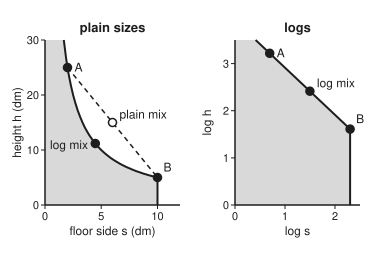

# Geometric programs: posynomials become convex after taking logs, and the exponential cone

[Syllabus](../../../SYLLABUS.md) → [Optimization](../README.md) → [Conic, Quadratic and Stochastic Programs](../README.md#s06) → Geometric programs

---

## General Overview

A workshop builds a plywood storage crate. It has 200 dm² of plywood for the four walls (a decimetre, dm, is 10 cm). The crate must fit a bay that takes a floor of at most 100 dm². The workshop chooses the height h, width w and depth d, in dm, and **maximises** the volume h × w × d. One cubic decimetre is one litre.

The goal and the limits are all products of the sizes. In plain sizes the problem is not convex: two crates that both fit the plywood can average to one that does not.

Take logs of the sizes and every product becomes a sum. The goal and both limits turn convex, so a solver finds the best crate and proves it best: **10 × 10 × 5 dm, holding 500 litres**. A two-line inequality shows that no crate inside the limits holds more.

A problem built from products and powers of positive numbers, added with positive coefficients, is a **geometric program** (GP; "program" means an optimisation problem, not computer code). The same log trick, packaged as a cone, also handles entropy and growth, and the card ends with the growth-fastest (Kelly) mix of the shelf's five assets.

**Products and powers of positive numbers become sums in logs, so a geometric program becomes a convex problem in the log variables; the exponential cone, the limit "an exponential is at most a bound" in a scaled form, is the shape a solver accepts for log-sum-exp and for any log, entropy or growth objective.**

**What kind of fact this is:** definitions (the geometric program, log-concave functions, the exponential cone) and theorems proved on this card in Why it works: log-sum-exp is convex, the crate's 500-litre ceiling, and the state-price ceiling on Kelly growth. The log-concavity of the normal cumulative probability is stated with its source.

### The picture: the same limit in plain sizes and in logs

<p align="center"></p>

Both panels show crates with a square floor; the shaded region is every crate that fits. Crate A is 2 × 2 × 25 dm and crate B is 10 × 10 × 5 dm; both use all 200 dm² of plywood.

In plain sizes (left) the boundary bends inward, and the midpoint of A and B, 6 × 6 × 15, needs 360 dm². In logs (right) the boundary is straight, and the log midpoint, the geometric mean 4.4721 × 4.4721 × 11.1803, uses exactly 200 dm².

---

## The formula

A **monomial** is a positive number times a product of powers of positive variables $`x_1, \dots, x_n`$; a **posynomial** is a sum of monomials:

```math
m(x) = k\,x_1^{\alpha_1} x_2^{\alpha_2} \cdots x_n^{\alpha_n}, \quad k > 0, \qquad f(x) = \sum_{j} k_j\,x_1^{\alpha_{1j}} \cdots x_n^{\alpha_{nj}}, \quad \text{every } k_j > 0
```

**Read it aloud:** a monomial is a positive number times powers of the variables, with any real powers; a posynomial adds several.

A **geometric program** minimises a posynomial $`f_0`$, keeps posynomials $`f_i`$ at most 1 and holds monomials $`g_j`$ at exactly 1. The crate, with the volume flipped into its reciprocal:

```math
\text{minimise } h^{-1}w^{-1}d^{-1} \quad\text{subject to}\quad 0.01\,hw + 0.01\,hd \le 1, \qquad 0.01\,wd \le 1
```

**Read it aloud:** make one over the volume smallest, with wall area over 200 and floor area over 100 at most 1.

In the log variables $`u_h = \log h`$, $`u_w = \log w`$, $`u_d = \log d`$ (natural logs throughout), taking the log of each piece gives:

```math
\text{minimise } -(u_h + u_w + u_d) \quad\text{subject to}\quad \log\!\big(e^{u_h + u_w} + e^{u_h + u_d}\big) - \log 100 \le 0, \qquad u_w + u_d - \log 100 \le 0
```

**Read it aloud:** make minus the log volume smallest, with a log of two exponentials and a straight-line limit kept at most 0.

The wall limit is **log-sum-exp**, $`\mathrm{lse}(z_1, \dots, z_n) = \log(e^{z_1} + \dots + e^{z_n})`$, a smooth version of the largest $`z_j`$, which Step 2 proves convex. The rest is straight lines, so this is a convex problem in standard form ([The standard convex problem](../01-Convexity/10-the-convex-problem-in-standard-form.md)).

The **exponential cone** is the set of points $`(a, b, c)`$ with

```math
K_{\exp} = \mathrm{closure}\,\{(a, b, c) : b > 0,\ b\,e^{a/b} \le c\}
```

**Read it aloud:** b is positive and b times e to the a over b is at most c, plus the edge points these approach.

| Symbol | Plain meaning | In our example | Push it up and the answer… |
| --- | --- | --- | --- |
| $`h, w, d`$ | height, width and depth of the crate, dm | 5, 10, 10 at the best | — |
| $`x`$, $`x_i`$, $`\mathbf 1`$ | the decision: the crate's sizes, or the Kelly shares of wealth, with $`n`$ the number of variables; a list of ones, so $`\mathbf 1^{\mathsf T}x`$ is the total | $`(5, 10, 10)`$ | — |
| $`m`$, $`f`$, $`k`$, $`\alpha_i`$, $`q_j`$ | a monomial, a posynomial, a coefficient, the powers, a posynomial's terms | $`0.01\,hw`$: $`k = 0.01`$, powers 1, 1, 0 | — |
| $`f_0`$, $`f_i`$, $`g_j`$ | the goal, the limits at most 1, the equalities | $`1/(hwd)`$; wall, floor; none | — |
| $`u_h`$, $`u_w`$, $`u_d`$ | the log variables | 1.6094, 2.3026, 2.3026 | — |
| $`\mathrm{lse}`$, $`z_j`$, $`\theta_j`$, $`\delta`$ | log-sum-exp of numbers $`z_j`$; its **softmax weights** $`\theta_j = e^{z_j} / \sum_l e^{z_l}`$, each term's share; a direction (Step 2) | wall: 0.5, 0.5 | — |
| $`\lambda_1`$, $`\lambda_2`$ | multipliers on wall and floor in logs: percent more volume per percent more limit | 1 and 0.5 | wall +1% gives +1.0000% volume; floor +1% gives +0.4988% |
| $`t`$ | the barrier weight (Step 4) | 1, then ×10 | the answer nears the best |
| $`K_{\exp}`$, $`(a, b, c)`$, $`r`$, $`r_s`$, $`v_j`$ | the exponential cone, a point of it, helper variables (Steps 6, 7) | $`(\log W_s, 1, W_s)`$ | — |
| $`\varphi`$, $`\Phi`$ | normal density and cumulative probability | log-concave | — |
| $`p_s`$, $`R_{si}`$, $`W_s`$ | scenario $`s`$'s probability, asset $`i`$'s multiplier in it, the mix's multiplier $`\sum_i R_{si} x_i`$ ($`W^\star_s`$ at the best) | crash: 0.10, 0.61, 0.7835 | a harsher EM crash pushes EM out of the mix (Try changing) |
| $`G(x)`$, $`y_s`$ | growth $`\sum_s p_s \log W_s`$; state prices | 0.068485; 0.242272, 0.363423, 0.209830, 0.127626 | — |

### Recognising a geometric program

| Shape | Test | Examples here |
| --- | --- | --- |
| Monomial | positive number times powers; a straight line in logs | $`hwd`$, $`wd`$, $`h^{-1}w^{-1}d^{-1}`$ |
| Posynomial | monomials added, all coefficients positive; log-sum-exp in logs | wall $`2hw + 2hd`$ |
| Not a GP | a minus sign between terms (a **signomial**), or a sum held equal to a number | $`w - d \le 2`$; $`hw + hd = 100`$ |

### When it holds

- **Every coefficient is positive.** A signomial's log is not log-sum-exp, and the problem in logs can have several local optima.
- **Every variable is positive.** A size of 0 has no log. A portfolio weight can be 0, which is why Kelly is written below as an exponential-cone program in the plain weights, not as a GP.
- **Limits are posynomials at most 1, or monomials equal to 1.** A posynomial held equal to a number is a curved surface in logs, not a convex set.
- **Something bounds the problem.** Drop the floor limit and a square-floored crate holds 1,000 litres at side 20, 2,000 at side 40, with no maximum.

---

## Why it works

### Step 0: logs turn products into sums

The log of a product is the sum of the logs, and the log of a power is the power times the log ([Log laws and log scales](../../01-Foundations/03-Powers%2C%20Roots%20and%20Logarithms/06-log-laws-and-log-scales.md)). Every monomial is a product of powers, so in log variables it becomes a sum. That is the whole idea; the rest checks that the sums are convex.

### Step 1: monomials become straight lines, posynomials become log-sum-exp

Write $`u_i = \log x_i`$, so $`x_i = e^{u_i}`$. A monomial becomes

```math
\log m = \log k + \alpha_1 u_1 + \dots + \alpha_n u_n
```

which is affine (a straight-line expression plus a constant). A monomial limit $`m \le 1`$ is a half-space and a monomial equality is a flat plane.

A posynomial is a sum of such exponentials, $`f = \sum_j e^{z_j}`$ with each $`z_j = \log k_j + \alpha_j^{\mathsf T} u`$ affine in $`u`$. So $`\log f = \mathrm{lse}(z_1, z_2, \dots)`$: log-sum-exp of affine functions. For the crate's wall, $`z_1 = u_h + u_w - \log 100`$ and $`z_2 = u_h + u_d - \log 100`$.

### Step 2: log-sum-exp is convex, because its curvature is a variance

The slope of lse in direction $`z_j`$ is the softmax weight $`\theta_j`$. Its matrix of second derivatives, the Hessian, is $`\mathrm{diag}(\theta) - \theta\theta^{\mathsf T}`$, where $`\mathrm{diag}(\theta)`$ has the weights on its diagonal and zeros elsewhere. Along any direction $`\delta`$ its curvature is

```math
\delta^{\mathsf T}\big(\mathrm{diag}(\theta) - \theta\theta^{\mathsf T}\big)\delta = \sum_j \theta_j \delta_j^2 - \Big(\sum_j \theta_j \delta_j\Big)^2
```

The weights $`\theta_j`$ are positive and add to 1, so this is the variance of the numbers $`\delta_j`$ under those weights: never negative. A function with no negative curvature in any direction is convex. Composing it with the affine $`z = z(u)`$ keeps it convex ([Building convex functions](../01-Convexity/09-operations-that-preserve-convexity.md)). So every posynomial limit becomes a convex limit in $`u`$, and the GP becomes a convex problem.

The plain sizes do not have this property. The picture's plain mix needs 360 dm² of plywood; the log mix needs exactly 200 dm², on the boundary, because in logs that boundary is straight.

### Step 3: the best crate, and the proof that nothing holds more

In logs the KKT conditions apply (the stationarity, feasibility and complementary-slackness checklist of [KKT conditions](../03-Constrained%20Optimisation/02-kkt-conditions.md)). Both limits bind. Stationarity says the slope of minus the log volume, $`(-1, -1, -1)`$, plus $`\lambda_1`$ times the wall limit's slope $`(1, \theta_1, \theta_2)`$, plus $`\lambda_2`$ times the floor limit's slope $`(0, 1, 1)`$, is zero.

At $`w = d`$ the two wall terms are equal, so $`\theta_1 = \theta_2 = 0.5`$. The $`u_h`$ row gives $`\lambda_1 = 1`$, the $`u_w`$ row gives $`\lambda_2 = 0.5`$, and the $`u_d`$ row then holds too. Both are at least 0, so in this convex problem the point is optimal.

The AM-GM inequality (the mean of two positive numbers is at least their geometric mean, $`w + d \ge 2\sqrt{wd}`$) gives the same answer as a ceiling on every allowed crate:

```math
hwd = \frac{2h(w + d)}{2(w + d)}\,wd \;\le\; \frac{200}{4\sqrt{wd}}\,wd = 50\sqrt{wd} \;\le\; 50\sqrt{100} = 500
```

**Read it aloud:** the volume is at most 200 over four root-floor, times the floor, which is 50 root-floor, at most 500.

Equality needs $`w = d`$ and $`wd = 100`$, so $`w = d = 10`$ and $`h = 200 / (2 \times 20) = 5`$. In general the best volume is (wall area / 4) × √(floor area). So the multipliers are powers: volume grows like the wall area to the power 1 and the floor area to the power 0.5. The code confirms it: 202 dm² of plywood gives 505.0000 litres (+1.0000%), a 101 dm² floor gives 502.4938 litres (+0.4988%).

<details>
<summary>Detailed proof: the AM-GM ceiling as a dual bound</summary>

A geometric program's dual bounds a posynomial from below by the weighted AM-GM inequality. For positive terms $`q_j`$ and positive weights $`\theta_j`$ adding to 1:

$`\displaystyle \sum_j q_j \;\ge\; \prod_j \Big(\frac{q_j}{\theta_j}\Big)^{\theta_j}`$

On the wall, with weights 0.5 and 0.5: $`200 \ge 2hw + 2hd \ge (4hw)^{0.5}(4hd)^{0.5} = 4h\sqrt{wd}`$. These are the softmax weights at the best crate, which is why the bound is tight there. Multiply by $`\sqrt{wd}/4`$ to get $`hwd \le 50\sqrt{wd}`$, and the floor limit gives $`hwd \le 500`$ for every allowed crate.

</details>

### Step 4: the method, a barrier and Newton's method in logs

A solver does not need the AM-GM trick. It runs an **interior-point method** ([Interior point methods](../03-Constrained%20Optimisation/08-interior-point-methods.md)) on the convex problem in logs. Each limit, written in logs as $`\log f_i \le 0`$, becomes a penalty $`-\log(-\log f_i)`$ that rises to infinity at the edge. Newton's method then minimises $`-t(u_h + u_w + u_d)`$ plus the two penalties, with a backtracking step (a full Newton step, halved until the cost falls enough), for $`t`$ = 1, 10, 100 and so on.

At the exact minimiser for a given $`t`$, the log volume is within (number of limits)/$`t`$ = $`2/t`$ of the best. The code starts at a 1 dm cube ($`u = 0`$), stops when $`2/t`$ is below $`10^{-10}`$, and takes 165 Newton steps in total. That count is measured, not promised; the proved bound on steps is in the interior-point card.

### Step 5: log-concave functions, the mirror image

A positive function $`f`$ is **log-concave** when $`\log f`$ is concave. Posynomials are the opposite case, log-convex in the log variables. Log-concave functions matter when the goal is to make something large, such as a probability or a likelihood (the probability of the data under a model): maximising a concave $`\log f`$ is a convex problem.

- **The normal density.** $`\log\varphi(x) = -x^2/2 - \log\sqrt{2\pi}`$, a downward parabola.
- **The normal cumulative probability $`\Phi`$.** Log-concave; stated here, as in Boyd and Vandenberghe, section 3.5, which leaves the proof as Exercise 3.54 (Sources).
- **Products.** Logs of a product add, and a sum of concave functions is concave, so $`2\varphi(x)\Phi(x)`$, the skew normal density, is log-concave.
- **Sums can fail.** An even mix of two normal bumps at −3 and 3 dips in the middle.

The code's midpoint test, $`\log f(0)`$ minus the mean of $`\log f(-3)`$ and $`\log f(3)`$, must be at least 0 for a concave $`\log f`$. It prints 4.5000, 2.6114 and 7.1114 (the sum of the first two, as the product rule says) for the first three, and −3.8069 for the two bumps. One test can rule log-concavity out, never prove it.

### Step 6: the exponential cone, the third standard cone

Solvers accept three curved cones beside the non-negative numbers of linear programs: the second-order cone ([Second-order cone programs](04-second-order-cone-programs.md)) for lengths, the positive semidefinite cone ([Semidefinite programs](05-semidefinite-programs-and-relaxations.md)) for variances, and the **exponential cone** $`K_{\exp}`$ for logs and exponentials.

It is convex. For $`b > 0`$, $`b\,e^{a/b} \le c`$ says the point $`(a/b, c/b)`$ lies on or above the graph of $`e^x`$, a convex region. So $`K_{\exp}`$ is made of rays from the origin through a convex set, which is a convex cone.

With $`b = 1`$ the condition reads $`e^a \le c`$, that is $`a \le \log c`$, and that writes all of these as cone constraints:

| Wanted | Exponential-cone form |
| --- | --- |
| $`e^a \le c`$, or $`a \le \log c`$ | $`(a, 1, c) \in K_{\exp}`$ |
| $`\mathrm{lse}(z_1, \dots, z_n) \le r`$ | $`v_1 + \dots + v_n \le 1`$ and $`(z_j - r, 1, v_j) \in K_{\exp}`$ for each $`j`$ |
| $`r \le -x\log x`$ (entropy) | $`(r, x, 1) \in K_{\exp}`$ |
| $`r_s \le \log W_s`$ (Kelly growth) | $`(r_s, 1, W_s) \in K_{\exp}`$ |

For the crate's wall the two $`v_j`$ at the best are 0.5 and 0.5, adding to exactly 1, so the limit is tight. For entropy at $`x = 0.3`$, $`r = -0.3\log 0.3 = 0.361192`$ gives $`x\,e^{r/x} = 1.000000`$, on the cone's edge. Unlike the other two curved cones, the exponential cone is not its own dual cone (the cone of prices that are never negative on it); for Kelly its dual prices are the state prices of Step 7.

### Step 7: the Kelly mix as an exponential-cone program

The house example: five assets, UK shares, US shares, emerging-market (EM) shares, gilts (UK government bonds) and corporate bonds. A year ends in one of four scenarios, and each asset multiplies its value by a known amount in each.

| Scenario | Probability | UK | US | EM | Gilts | Corp |
| --- | --- | --- | --- | --- | --- | --- |
| Boom | 30% | 1.20 | 1.24 | 1.36 | 1.02 | 1.05 |
| Steady | 40% | 1.08 | 1.09 | 1.14 | 1.05 | 1.07 |
| Slump | 20% | 0.94 | 0.99 | 0.85 | 1.07 | 1.06 |
| Crash | 10% | 0.72 | 0.75 | 0.61 | 1.15 | 0.97 |

Mean returns are 5.20%, 8.10%, 9.50%, 5.50% and 5.20% a year. The scenarios are this card's own model of the five assets, so these means differ from the estimates on [Second-order cone programs](04-second-order-cone-programs.md). Reinvested year after year, wealth grows at the mean log multiplier $`G(x)`$ ([Kelly](../../12-Financial%20mathematics/36-Returns%20and%20Utility/05-kelly-criterion-and-growth.md)). The investor chooses shares $`x_i \ge 0`$ adding to 1 and **maximises** $`G`$:

```math
\text{maximise } \sum_s p_s r_s \quad\text{subject to}\quad \Big(r_s,\ 1,\ \sum_i R_{si} x_i\Big) \in K_{\exp} \text{ for each } s, \qquad \mathbf 1^{\mathsf T}x = 1, \quad x \ge 0
```

**Read it aloud:** make the probability-weighted sum of the $`r_s`$ as large as possible, each $`r_s`$ at most the log of that scenario's wealth multiplier, fully invested and never short.

The answer: **39.12% US, 38.89% EM, 22.00% gilts**, nothing in UK shares or corporate bonds. Growth is 0.068485 a year in logs: median wealth (the middle outcome over many years) multiplies by 1.070885 a year.

The certificate is a set of **state prices** $`y_s = p_s / W_s`$: the price today of £1 paid only in scenario $`s`$. At these prices each held asset costs exactly 1 per £1 invested, and each one left out costs less (UK 0.972355, corporate bonds 0.989466). Then the ceiling $`\sum_s p_s \log(p_s / y_s)`$ bounds the growth of every long-only mix, and here it equals 0.068485.

<details>
<summary>Detailed proof: state prices bound the growth of every mix</summary>

Take positive prices $`y_s`$ with $`\sum_s y_s R_{si} \le 1`$ for every asset $`i`$. Any long-only mix with shares adding to 1 then has

$`\displaystyle \sum_s y_s W_s = \sum_i x_i \sum_s y_s R_{si} \;\le\; 1`$

Write $`\log W_s = \log(y_s W_s / p_s) + \log(p_s / y_s)`$. The log is concave, so [Jensen's inequality](../../09-Probability%20and%20statistics/02-Random%20Variables/06-jensens-inequality.md) gives

$`\displaystyle \sum_s p_s \log\frac{y_s W_s}{p_s} \;\le\; \log \sum_s y_s W_s \;\le\; 0`$

so $`G(x) \le \sum_s p_s \log(p_s / y_s)`$. With $`y_s = p_s / W^\star_s`$ from the best mix, both inequalities are equalities for that mix. The prices are feasible exactly when the KKT condition holds: asset $`i`$'s price $`\sum_s p_s R_{si} / W^\star_s`$ is the slope of $`G`$ toward it. The ceiling is a relative entropy, so the dual is itself an exponential-cone program.

</details>

---

## Worked numbers, by hand

| Step | Arithmetic | Value |
| --- | --- | --- |
| wall limit as a posynomial | $`2h(w + d) \le 200`$, divided by 200 | $`0.01\,hw + 0.01\,hd \le 1`$ |
| AM-GM on the floor sides | $`w + d \ge 2\sqrt{wd}`$, so the wall is at least $`4h\sqrt{wd}`$ | $`h \le 50/\sqrt{wd}`$ |
| volume ceiling | $`h \cdot wd \le 50\sqrt{wd} \le 50 \times \sqrt{100}`$ | 500 litres |
| sizes that meet it | $`w = d`$, $`wd = 100`$; $`h = 200 / (2 \times 20)`$ | 10, 10, 5 dm |
| log variables | $`(\log 5, \log 10, \log 10)`$ | (1.6094, 2.3026, 2.3026) |
| softmax weights of the wall terms | $`50 / (50 + 50)`$ each | 0.5, 0.5 |
| multipliers | $`\lambda_1 = 1`$ from the $`u_h`$ row; $`\lambda_2 = 1 - 0.5`$ | 1 and 0.5 |
| check by the method | barrier and Newton in logs, 165 steps | 500.0000 litres |
| check by the grid | 40,000 floors in 0.1 dm steps, 23,716 of them within the floor limit, height filling the wall | best 10.0 × 10.0 × 5.0000 |
| **best crate** | 10 × 10 × 5 | **500 litres** |

The workshop builds a 10 × 10 dm crate, 5 dm tall, using all the plywood and all the bay; the AM-GM line proves no allowed crate holds more than its 500 litres.

### What breaks if you drop a piece

| Mistake | Comes out at | What went wrong |
| --- | --- | --- |
| Averaging crates A (2 × 2 × 25) and B (10 × 10 × 5) in plain sizes | 6 × 6 × 15, needing 360 dm² of plywood | not convex in plain sizes; the log mix uses exactly 200 dm² |
| Dropping the floor limit | 1,000 litres at side 20, 2,000 at side 40 | unbounded: nothing stops a flatter, wider crate |
| Assuming a cube is best | side 7.0711 dm, 353.5534 litres | the limits treat height differently from width and depth |
| Calling a sum of log-concave functions log-concave | midpoint test −3.8069 for two bumps at −3 and 3 | logs split products, not sums |
| Kelly: all in EM, the largest mean | growth 0.062723, not 0.068485; a crash leaves 0.61 | the largest mean is not the fastest growth |

The code prints all five. Equal weights grow at 0.060057, also below the Kelly mix.

---

## Code, from first principles, and it actually runs

Nothing imported holds the answer: there is no optimisation or linear-algebra library, and each Newton system is solved by Gaussian elimination written out. One barrier routine serves both problems. The crate is reached by three roads: the barrier method in logs, the multipliers with the AM-GM ceiling, and a grid of 40,000 floors in 0.1 dm steps, 23,716 of them within the floor limit. The Kelly mix is reached by three more: the barrier method, the state prices with their ceiling, and every mix in 2% steps. A plain left-to-right sum replaces Python's built-in `sum`, which adds with extra precision, so both languages do the same arithmetic.

### Python

```python
# Geometric programs and the exponential cone -- the check behind the card.  Standard library only.
# Box: largest volume h*w*d (dm, so litres) with wall 2h(w + d) <= 200 dm^2 and floor w*d <= 100 dm^2.
# In logs u = (log h, log w, log d) it is convex.  Road 1: log-barrier Newton in logs.  Road 2: the
# multipliers and the AM-GM ceiling.  Road 3: a grid of boxes.  Then log-concave tests, the
# exponential cone, and a growth-optimal (Kelly) mix of five assets, solved and certified the same way.
import math
def add(xs):                                       # plain left-to-right sum, as in Rust
    s = 0.0
    for v in xs:
        s += v
    return s
dot = lambda x, y: add(a * b for a, b in zip(x, y))
def solve(M, b):                                   # Gaussian elimination, partial pivoting
    n = len(b)
    R = [M[i][:] + [b[i]] for i in range(n)]
    for c in range(n):
        p = max(range(c, n), key=lambda r: abs(R[r][c]))
        R[c], R[p] = R[p], R[c]
        for r in range(c + 1, n):
            f = R[r][c] / R[c][c]
            R[r] = [a - f * q for a, q in zip(R[r], R[c])]
    x = [0.0] * n
    for i in range(n - 1, -1, -1):
        x[i] = (R[i][n] - add(R[i][j] * x[j] for j in range(i + 1, n))) / R[i][i]
    return x
def barrier(F, x, m):                              # minimise t*cost + barrier, t = 1, 10, 100, ...
    t, steps = 1.0, 0
    while True:
        for _ in range(100):
            v, g, H = F(x, t)
            dx = solve(H, [-a for a in g])
            dec = -dot(g, dx)                      # Newton decrement squared
            if dec / 2.0 < 1e-12:
                break
            s = 1.0
            while F([a + s * b for a, b in zip(x, dx)], t)[0] > v - 0.25 * s * dec and s > 1e-12:
                s *= 0.5
            x, steps = [a + s * b for a, b in zip(x, dx)], steps + 1
        if m / t < 1e-10:                          # m barrier terms: gap at most m / t
            return x, steps, m / t
        t *= 10.0
def box_F(wall, floor):                            # cost -(x + y + z); two log-convex limits
    def F(u, t):
        x, y, z = u
        e1, e2 = math.exp(x + y), math.exp(x + z)
        c1, c2 = math.log(e1 + e2) - math.log(wall / 2.0), y + z - math.log(floor)
        if c1 >= 0.0 or c2 >= 0.0:
            return math.inf, None, None
        ab = e1 * e2 / ((e1 + e2) * (e1 + e2))     # Hessian of log-sum-exp: ab times (0, 1, -1)(0, 1, -1)'
        g1, g2, d1 = [1.0, e1 / (e1 + e2), e2 / (e1 + e2)], [0.0, 1.0, 1.0], [0.0, 1.0, -1.0]
        g = [-t + g1[i] / -c1 + g2[i] / -c2 for i in range(3)]
        H = [[ab * d1[i] * d1[j] / -c1 + g1[i] * g1[j] / (c1 * c1) + g2[i] * g2[j] / (c2 * c2)
              for j in range(3)] for i in range(3)]
        return -t * (x + y + z) - math.log(-c1) - math.log(-c2), g, H
    return F
vol = lambda u: math.exp(u[0] + u[1] + u[2])     # volume in litres from the logs
u, steps, gap = barrier(box_F(200.0, 100.0), [0.0, 0.0, 0.0], 2.0)
h, w, d = (math.exp(v) for v in u)
print(f"road 1 barrier in logs: h {h:.6f}  w {w:.6f}  d {d:.6f} dm  volume {vol(u):.4f} L  Newton steps {steps}  gap bound {gap:.0e}")
a = h * w / (h * w + h * d)
lam1, lam2 = 1.0, 1.0 - a                          # stationarity rows x and y; row z is the residual
print(f"road 2 wall-term weights {a:.4f} {1 - a:.4f}  multipliers wall {lam1:.4f} floor {lam2:.4f}  z-row residual below 1e-6: {'yes' if abs(lam1 * (1 - a) + lam2 - 1) < 1e-6 else 'no'}")
ceiling = 200.0 / 4.0 * math.sqrt(100.0)
print(f"road 2 AM-GM ceiling (wall / 4) x sqrt(floor) = {ceiling:.4f} L  wall used {2 * h * (w + d):.4f}  floor used {w * d:.4f}")
best = max((100.0 / (i / 10 + j / 10) * (i / 10) * (j / 10), i, j)   # w = i/10, d = j/10; h fills the wall
           for i in range(1, 201) for j in range(1, 201) if i * j <= 10000)
print(f"road 3 grid of 40000 floors in 0.1 dm steps, {sum(i * j <= 10000 for i in range(1, 201) for j in range(1, 201))} within the floor limit: best w {best[1] / 10:.1f} d {best[2] / 10:.1f} h {100 / (best[1] / 10 + best[2] / 10):.4f}  volume {best[0]:.4f} L")
vw, vf = vol(barrier(box_F(202.0, 100.0), [0.0] * 3, 2.0)[0]), vol(barrier(box_F(200.0, 101.0), [0.0] * 3, 2.0)[0])
print(f"sensitivity: wall 202 -> {vw:.4f} L (+{100 * (vw / 500 - 1):.4f}%)  floor 101 -> {vf:.4f} L (+{100 * (vf / 500 - 1):.4f}%)")
A, B = (2.0, 2.0, 25.0), (10.0, 10.0, 5.0)         # (w, d, h): both use the full 200 dm^2 of wall
walls = []
for name, bx in (("plain mix", [(p + q) / 2 for p, q in zip(A, B)]), ("log mix", [math.sqrt(p * q) for p, q in zip(A, B)])):
    walls.append(2 * bx[2] * (bx[0] + bx[1]))
    print(f"{name}: {bx[0]:.4f} x {bx[1]:.4f} x {bx[2]:.4f}  wall {walls[-1]:.4f} dm^2  floor {bx[0] * bx[1]:.4f}  volume {bx[0] * bx[1] * bx[2]:.4f} L")
print(f"figure, A (2, 25) B (10, 5) plain mix (6, 15) log mix ({math.sqrt(20):.4f}, {math.sqrt(125):.4f}); "
      f"logs A ({math.log(2):.4f}, {math.log(25):.4f}) B ({math.log(10):.4f}, {math.log(5):.4f}) mix ({math.log(20) / 2:.4f}, {math.log(125) / 2:.4f})")
for s in (20.0, 40.0):                             # mistake: no floor limit, h = 50/s on a square floor
    print(f"wrong: floor limit dropped, side {s:.0f} dm: volume {50 * s:.4f} L")
print(f"wrong: assume a cube: side {math.sqrt(50.0):.4f} dm  volume {math.sqrt(50.0) ** 3:.4f} L")
phi = lambda x: math.exp(-x * x / 2) / math.sqrt(2 * math.pi)   # normal density
def Phi(x):                                        # Simpson's rule from -12 to x, 2000 panels
    n, lo = 2000, -12.0
    hs = (x - lo) / n
    return hs / 3 * add((1 if k in (0, n) else 4 if k % 2 else 2) * phi(lo + k * hs) for k in range(n + 1))
tests = [("normal density", phi), ("normal CDF", Phi), ("skew normal 2 phi Phi", lambda x: 2 * phi(x) * Phi(x)),
         ("two-bump mixture", lambda x: (phi(x - 3) + phi(x + 3)) / 2)]
mid = [math.log(f(0)) - (math.log(f(-3)) + math.log(f(3))) / 2 for _, f in tests]
for (name, _), m in zip(tests, mid):               # midpoint test of log f between -3 and 3
    print(f"log-concave test {name}: log f(0) - mean(log f(-3), log f(3)) = {m:.4f}")
te = -0.3 * math.log(0.3)
print(f"exp cone, entropy: x 0.3  r = -x log x = {te:.6f}  x e^(r/x) = {0.3 * math.exp(te / 0.3):.6f} (<= 1 means in the cone)")
print(f"exp cone, wall: v = {h * w / 100:.4f} {h * d / 100:.4f}  sum {(h * w + h * d) / 100:.6f} (<= 1)")

NAMES = ["UK", "US", "EM", "gilts", "corp"]
P = [0.30, 0.40, 0.20, 0.10]                       # boom, steady, slump, crash
R = [[1.20, 1.24, 1.36, 1.02, 1.05], [1.08, 1.09, 1.14, 1.05, 1.07],
     [0.94, 0.99, 0.85, 1.07, 1.06], [0.72, 0.75, 0.61, 1.15, 0.97]]   # wealth multiplier a year
growth = lambda wt: add(p * math.log(dot(r, wt)) for p, r in zip(P, R))   # mean log of wealth
def kelly_F(x, t):                                 # cost -t * growth - sum log w_i, w5 = 1 - sum
    wt = x + [1.0 - add(x)]
    if min(wt) <= 0.0:
        return math.inf, None, None
    W = [dot(r, wt) for r in R]
    gw = [-t * add(p * r[i] / Ws for p, r, Ws in zip(P, R, W)) - 1.0 / wt[i] for i in range(5)]
    hw = [[t * add(p * r[i] * r[j] / (Ws * Ws) for p, r, Ws in zip(P, R, W)) + (1.0 / (wt[i] * wt[i]) if i == j else 0.0)
           for j in range(5)] for i in range(5)]
    g = [gw[i] - gw[4] for i in range(4)]
    H = [[hw[i][j] - hw[i][4] - hw[4][j] + hw[4][4] for j in range(4)] for i in range(4)]
    return -t * growth(wt) - add(math.log(v) for v in wt), g, H
pct = lambda wt: "  ".join(f"{n} {100 * v:.2f}" for n, v in zip(NAMES, wt))
print("kelly mean return %  " + "  ".join(f"{n} {100 * (add(p * r[i] for p, r in zip(P, R)) - 1):.2f}" for i, n in enumerate(NAMES)))
x, ksteps, kgap = barrier(kelly_F, [0.2] * 4, 5.0)
wk = x + [1.0 - add(x)]
Gk, W = growth(wk), [dot(r, wk) for r in R]
print(f"road 1 barrier weights %  {pct(wk)}  Newton steps {ksteps}  gap bound {kgap:.0e}")
print(f"road 1 growth {Gk:.6f} a year in logs, median wealth x{math.exp(Gk):.6f}")
y = [p / Ws for p, Ws in zip(P, W)]                # road 2: state prices, the dual point
gk = [dot(y, [r[i] for r in R]) for i in range(5)]
dual = add(p * math.log(p / v) for p, v in zip(P, y))
print("road 2 state prices y_s = p_s / W_s:  " + "  ".join(f"{v:.6f}" for v in y))
print("road 2 price of each asset, sum y_s R_si (<= 1):  " + "  ".join(f"{n} {v:.6f}" for n, v in zip(NAMES, gk)))
print(f"road 2 dual ceiling sum p_s log(p_s / y_s) = {dual:.6f}  gap to road 1 below 1e-9: {'yes' if abs(dual - Gk) < 1e-9 else 'no'}")
mixes = ([i / 50, j / 50, k / 50, l / 50, (50 - i - j - k - l) / 50] for i in range(51) for j in range(51 - i)
         for k in range(51 - i - j) for l in range(51 - i - j - k))   # road 3: every mix in 2% steps
grid = max((growth(m), m) for m in mixes)
print(f"road 3 grid in 2% steps (316251 mixes): best {pct(grid[1])}  growth {grid[0]:.6f}")
print("cone points (log W, 1, W) by scenario: " + "  ".join(f"({math.log(v):.4f}, 1, {v:.4f})" for v in W))
em = [0.0, 0.0, 1.0, 0.0, 0.0]
print(f"wrong: all in EM, the largest mean: growth {growth(em):.6f}  crash wealth x{R[3][2]:.2f}")
print(f"wrong: equal weights: growth {growth([0.2] * 5):.6f}")
assert abs(vol(u) - ceiling) < 1e-6 and abs(lam1 * (1 - a) + lam2 - 1) < 1e-6, "barrier meets the AM-GM ceiling and the KKT rows"
assert best[0] <= ceiling + 1e-9 and abs(best[0] - vol(u)) < 1e-6, "no grid box beats the ceiling"
assert abs(vw / vol(u) - 1.01) < 1e-6 and abs(vf / vol(u) - math.sqrt(1.01)) < 1e-6, "multipliers are the elasticities"
assert max(gk) < 1 + 1e-9 and abs(dual - Gk) < 1e-9, "state prices: feasible dual meets the growth"
assert grid[0] <= dual + 1e-12 and Gk - grid[0] < 1e-3 and growth(em) < Gk, "nothing on the grid grows faster"
assert min(mid[:3]) > 0 > mid[3] and abs(mid[0] - 4.5) < 1e-12 and abs(mid[1] - (math.log(0.5) - (math.log(1.3498980316301e-3) + math.log(1 - 1.3498980316301e-3)) / 2)) < 1e-9, "log-concave tests; Phi(-3) = 0.0013498980316301"
print("ALL CHECKS PASS")
```

**Ran 2026-11-24 on macOS, Python 3.14.10, standard library only. All checks passed. Output, pasted from the run:**

```
road 1 barrier in logs: h 5.000000  w 10.000000  d 10.000000 dm  volume 500.0000 L  Newton steps 165  gap bound 2e-11
road 2 wall-term weights 0.5000 0.5000  multipliers wall 1.0000 floor 0.5000  z-row residual below 1e-6: yes
road 2 AM-GM ceiling (wall / 4) x sqrt(floor) = 500.0000 L  wall used 200.0000  floor used 100.0000
road 3 grid of 40000 floors in 0.1 dm steps, 23716 within the floor limit: best w 10.0 d 10.0 h 5.0000  volume 500.0000 L
sensitivity: wall 202 -> 505.0000 L (+1.0000%)  floor 101 -> 502.4938 L (+0.4988%)
plain mix: 6.0000 x 6.0000 x 15.0000  wall 360.0000 dm^2  floor 36.0000  volume 540.0000 L
log mix: 4.4721 x 4.4721 x 11.1803  wall 200.0000 dm^2  floor 20.0000  volume 223.6068 L
figure, A (2, 25) B (10, 5) plain mix (6, 15) log mix (4.4721, 11.1803); logs A (0.6931, 3.2189) B (2.3026, 1.6094) mix (1.4979, 2.4142)
wrong: floor limit dropped, side 20 dm: volume 1000.0000 L
wrong: floor limit dropped, side 40 dm: volume 2000.0000 L
wrong: assume a cube: side 7.0711 dm  volume 353.5534 L
log-concave test normal density: log f(0) - mean(log f(-3), log f(3)) = 4.5000
log-concave test normal CDF: log f(0) - mean(log f(-3), log f(3)) = 2.6114
log-concave test skew normal 2 phi Phi: log f(0) - mean(log f(-3), log f(3)) = 7.1114
log-concave test two-bump mixture: log f(0) - mean(log f(-3), log f(3)) = -3.8069
exp cone, entropy: x 0.3  r = -x log x = 0.361192  x e^(r/x) = 1.000000 (<= 1 means in the cone)
exp cone, wall: v = 0.5000 0.5000  sum 1.000000 (<= 1)
kelly mean return %  UK 5.20  US 8.10  EM 9.50  gilts 5.50  corp 5.20
road 1 barrier weights %  UK 0.00  US 39.12  EM 38.89  gilts 22.00  corp 0.00  Newton steps 158  gap bound 5e-11
road 1 growth 0.068485 a year in logs, median wealth x1.070885
road 2 state prices y_s = p_s / W_s:  0.242272  0.363423  0.209830  0.127626
road 2 price of each asset, sum y_s R_si (<= 1):  UK 0.972355  US 1.000000  EM 1.000000  gilts 1.000000  corp 0.989466
road 2 dual ceiling sum p_s log(p_s / y_s) = 0.068485  gap to road 1 below 1e-9: yes
road 3 grid in 2% steps (316251 mixes): best UK 0.00  US 40.00  EM 38.00  gilts 22.00  corp 0.00  growth 0.068485
cone points (log W, 1, W) by scenario: (0.2137, 1, 1.2383)  (0.0959, 1, 1.1006)  (-0.0480, 1, 0.9532)  (-0.2439, 1, 0.7835)
wrong: all in EM, the largest mean: growth 0.062723  crash wealth x0.61
wrong: equal weights: growth 0.060057
ALL CHECKS PASS
```

### Rust

Same numbers, same labels, built with `rustc --edition 2021 -O`.

```rust
// Geometric programs and the exponential cone -- the same check as the Python, in Rust.  No crates.
// Box: largest volume h*w*d (dm, so litres) with wall 2h(w + d) <= 200 dm^2 and floor w*d <= 100 dm^2.
// In logs u = (log h, log w, log d) it is convex.  Road 1: log-barrier Newton in logs.  Road 2: the
// multipliers and the AM-GM ceiling.  Road 3: a grid of boxes.  Then log-concave tests, the
// exponential cone, and a growth-optimal (Kelly) mix of five assets, solved and certified the same way.
type Eval = (f64, Vec<f64>, Vec<Vec<f64>>);
const NAMES: [&str; 5] = ["UK", "US", "EM", "gilts", "corp"];
const P: [f64; 4] = [0.30, 0.40, 0.20, 0.10]; // boom, steady, slump, crash
const R: [[f64; 5]; 4] = [[1.20, 1.24, 1.36, 1.02, 1.05], [1.08, 1.09, 1.14, 1.05, 1.07],
    [0.94, 0.99, 0.85, 1.07, 1.06], [0.72, 0.75, 0.61, 1.15, 0.97]]; // wealth multiplier a year

fn add<I: IntoIterator<Item = f64>>(xs: I) -> f64 { let mut s = 0.0; for v in xs { s += v; } s }
fn dot(x: &[f64], y: &[f64]) -> f64 { add(x.iter().zip(y).map(|(a, b)| a * b)) }

fn solve(m: &[Vec<f64>], b: &[f64]) -> Vec<f64> { // Gaussian elimination, partial pivoting
    let n = b.len();
    let mut r: Vec<Vec<f64>> = (0..n).map(|i| { let mut row = m[i].clone(); row.push(b[i]); row }).collect();
    for c in 0..n {
        let mut p = c;
        for k in c..n { if r[k][c].abs() > r[p][c].abs() { p = k; } }
        r.swap(c, p);
        for k in c + 1..n {
            let f = r[k][c] / r[c][c];
            for j in 0..=n { r[k][j] -= f * r[c][j]; }
        }
    }
    let mut x = vec![0.0; n];
    for i in (0..n).rev() {
        x[i] = (r[i][n] - add((i + 1..n).map(|j| r[i][j] * x[j]))) / r[i][i];
    }
    x
}

fn barrier(f: &dyn Fn(&[f64], f64) -> Eval, x0: Vec<f64>, m: f64) -> (Vec<f64>, usize, f64) {
    let (mut x, mut t, mut steps) = (x0, 1.0, 0); // minimise t*cost + barrier, t = 1, 10, 100, ...
    loop {
        for _ in 0..100 {
            let (v, g, h) = f(&x, t);
            let dx = solve(&h, &g.iter().map(|a| -a).collect::<Vec<_>>());
            let dec = -dot(&g, &dx); // Newton decrement squared
            if dec / 2.0 < 1e-12 { break; }
            let mut s = 1.0;
            let step = |s: f64| x.iter().zip(&dx).map(|(a, b)| a + s * b).collect::<Vec<f64>>();
            while f(&step(s), t).0 > v - 0.25 * s * dec && s > 1e-12 { s *= 0.5; }
            x = step(s);
            steps += 1;
        }
        if m / t < 1e-10 { return (x, steps, m / t); } // m barrier terms: gap at most m / t
        t *= 10.0;
    }
}

fn box_f(wall: f64, floor: f64) -> impl Fn(&[f64], f64) -> Eval {
    move |u: &[f64], t: f64| {
        let (x, y, z) = (u[0], u[1], u[2]);
        let (e1, e2) = ((x + y).exp(), (x + z).exp());
        let (c1, c2) = ((e1 + e2).ln() - (wall / 2.0).ln(), y + z - floor.ln());
        if c1 >= 0.0 || c2 >= 0.0 { return (f64::INFINITY, vec![], vec![]); }
        let ab = e1 * e2 / ((e1 + e2) * (e1 + e2)); // Hessian of log-sum-exp: ab times (0, 1, -1)(0, 1, -1)'
        let (g1, g2, d1) = ([1.0, e1 / (e1 + e2), e2 / (e1 + e2)], [0.0, 1.0, 1.0], [0.0, 1.0, -1.0]);
        let g: Vec<f64> = (0..3).map(|i| -t + g1[i] / -c1 + g2[i] / -c2).collect();
        let h: Vec<Vec<f64>> = (0..3).map(|i| (0..3).map(|j| ab * d1[i] * d1[j] / -c1
            + g1[i] * g1[j] / (c1 * c1) + g2[i] * g2[j] / (c2 * c2)).collect()).collect();
        (-t * (x + y + z) - (-c1).ln() - (-c2).ln(), g, h)
    }
}

fn vol(u: &[f64]) -> f64 { (u[0] + u[1] + u[2]).exp() } // volume in litres from the logs
fn phi(x: f64) -> f64 { (-x * x / 2.0).exp() / (2.0 * std::f64::consts::PI).sqrt() } // normal density
fn big_phi(x: f64) -> f64 { // Simpson's rule from -12 to x, 2000 panels
    let (n, lo) = (2000, -12.0);
    let hs = (x - lo) / n as f64;
    hs / 3.0 * add((0..=n).map(|k| (if k == 0 || k == n { 1.0 } else if k % 2 == 1 { 4.0 } else { 2.0 }) * phi(lo + k as f64 * hs)))
}
fn growth(wt: &[f64]) -> f64 { add((0..4).map(|s| P[s] * dot(&R[s], wt).ln())) } // mean log of wealth
fn pct(wt: &[f64]) -> String { (0..5).map(|i| format!("{} {:.2}", NAMES[i], 100.0 * wt[i])).collect::<Vec<_>>().join("  ") }
fn full(x: &[f64]) -> Vec<f64> { let mut w = x.to_vec(); w.push(1.0 - add(x.iter().copied())); w }

fn kelly_f(x: &[f64], t: f64) -> Eval { // cost -t * growth - sum log w_i, w5 = 1 - sum
    let wt = full(x);
    if wt.iter().any(|&v| v <= 0.0) { return (f64::INFINITY, vec![], vec![]); }
    let w: Vec<f64> = R.iter().map(|r| dot(r, &wt)).collect();
    let gw: Vec<f64> = (0..5).map(|i| -t * add((0..4).map(|s| P[s] * R[s][i] / w[s])) - 1.0 / wt[i]).collect();
    let hw: Vec<Vec<f64>> = (0..5).map(|i| (0..5).map(|j| t * add((0..4).map(|s| P[s] * R[s][i] * R[s][j] / (w[s] * w[s])))
        + if i == j { 1.0 / (wt[i] * wt[i]) } else { 0.0 }).collect()).collect();
    let g: Vec<f64> = (0..4).map(|i| gw[i] - gw[4]).collect();
    let h: Vec<Vec<f64>> = (0..4).map(|i| (0..4).map(|j| hw[i][j] - hw[i][4] - hw[4][j] + hw[4][4]).collect()).collect();
    (-t * growth(&wt) - add(wt.iter().map(|v| v.ln())), g, h)
}

fn main() {
    let yn = |b: bool| if b { "yes" } else { "no" };
    let (u, steps, gap) = barrier(&box_f(200.0, 100.0), vec![0.0; 3], 2.0);
    let (h, w, d) = (u[0].exp(), u[1].exp(), u[2].exp());
    println!("road 1 barrier in logs: h {:.6}  w {:.6}  d {:.6} dm  volume {:.4} L  Newton steps {}  gap bound {:.0e}", h, w, d, vol(&u), steps, gap);
    let a = h * w / (h * w + h * d);
    let (lam1, lam2) = (1.0, 1.0 - a); // stationarity rows x and y; row z is the residual
    println!("road 2 wall-term weights {:.4} {:.4}  multipliers wall {:.4} floor {:.4}  z-row residual below 1e-6: {}", a, 1.0 - a, lam1, lam2, yn((lam1 * (1.0 - a) + lam2 - 1.0).abs() < 1e-6));
    let ceiling = 200.0 / 4.0 * 100.0f64.sqrt();
    println!("road 2 AM-GM ceiling (wall / 4) x sqrt(floor) = {:.4} L  wall used {:.4}  floor used {:.4}", ceiling, 2.0 * h * (w + d), w * d);
    let (mut best, mut nfl) = ((0.0, 0, 0), 0); // w = i/10, d = j/10; h fills the wall
    for i in 1..=200 { for j in 1..=200 { if i * j <= 10000 {
        let (wi, dj) = (i as f64 / 10.0, j as f64 / 10.0);
        let v = 100.0 / (wi + dj) * wi * dj; nfl += 1;
        if v > best.0 { best = (v, i, j); }
    } } }
    let (bw, bd) = (best.1 as f64 / 10.0, best.2 as f64 / 10.0);
    println!("road 3 grid of 40000 floors in 0.1 dm steps, {} within the floor limit: best w {:.1} d {:.1} h {:.4}  volume {:.4} L", nfl, bw, bd, 100.0 / (bw + bd), best.0);
    let vw = vol(&barrier(&box_f(202.0, 100.0), vec![0.0; 3], 2.0).0);
    let vf = vol(&barrier(&box_f(200.0, 101.0), vec![0.0; 3], 2.0).0);
    println!("sensitivity: wall 202 -> {:.4} L (+{:.4}%)  floor 101 -> {:.4} L (+{:.4}%)", vw, 100.0 * (vw / 500.0 - 1.0), vf, 100.0 * (vf / 500.0 - 1.0));
    let (ba, bb) = ([2.0, 2.0, 25.0], [10.0, 10.0, 5.0]); // (w, d, h): both use the full 200 dm^2 of wall
    let mut walls = vec![];
    for (name, bx) in [("plain mix", (0..3).map(|i| (ba[i] + bb[i]) / 2.0).collect::<Vec<f64>>()),
                       ("log mix", (0..3).map(|i| f64::sqrt(ba[i] * bb[i])).collect())] {
        walls.push(2.0 * bx[2] * (bx[0] + bx[1]));
        println!("{}: {:.4} x {:.4} x {:.4}  wall {:.4} dm^2  floor {:.4}  volume {:.4} L", name, bx[0], bx[1], bx[2], walls[walls.len() - 1], bx[0] * bx[1], bx[0] * bx[1] * bx[2]);
    }
    println!("figure, A (2, 25) B (10, 5) plain mix (6, 15) log mix ({:.4}, {:.4}); logs A ({:.4}, {:.4}) B ({:.4}, {:.4}) mix ({:.4}, {:.4})",
        20f64.sqrt(), 125f64.sqrt(), 2f64.ln(), 25f64.ln(), 10f64.ln(), 5f64.ln(), 20f64.ln() / 2.0, 125f64.ln() / 2.0);
    for s in [20.0, 40.0] { println!("wrong: floor limit dropped, side {:.0} dm: volume {:.4} L", s, 50.0 * s); } // h = 50/s
    println!("wrong: assume a cube: side {:.4} dm  volume {:.4} L", 50f64.sqrt(), 50f64.sqrt().powf(3.0));
    let tests: [(&str, Box<dyn Fn(f64) -> f64>); 4] = [("normal density", Box::new(phi)), ("normal CDF", Box::new(big_phi)),
        ("skew normal 2 phi Phi", Box::new(|x| 2.0 * phi(x) * big_phi(x))), ("two-bump mixture", Box::new(|x| (phi(x - 3.0) + phi(x + 3.0)) / 2.0))];
    let mid: Vec<f64> = tests.iter().map(|(_, f)| f(0.0).ln() - (f(-3.0).ln() + f(3.0).ln()) / 2.0).collect();
    for (k, (name, _)) in tests.iter().enumerate() { // midpoint test of log f between -3 and 3
        println!("log-concave test {}: log f(0) - mean(log f(-3), log f(3)) = {:.4}", name, mid[k]);
    }
    let te = -0.3 * 0.3f64.ln();
    println!("exp cone, entropy: x 0.3  r = -x log x = {:.6}  x e^(r/x) = {:.6} (<= 1 means in the cone)", te, 0.3 * (te / 0.3).exp());
    println!("exp cone, wall: v = {:.4} {:.4}  sum {:.6} (<= 1)", h * w / 100.0, h * d / 100.0, (h * w + h * d) / 100.0);
    let means: Vec<String> = (0..5).map(|i| format!("{} {:.2}", NAMES[i], 100.0 * (add((0..4).map(|s| P[s] * R[s][i])) - 1.0))).collect();
    println!("kelly mean return %  {}", means.join("  "));
    let (x, ksteps, kgap) = barrier(&kelly_f, vec![0.2; 4], 5.0);
    let wk = full(&x);
    let (gk_val, wv): (f64, Vec<f64>) = (growth(&wk), R.iter().map(|r| dot(r, &wk)).collect());
    println!("road 1 barrier weights %  {}  Newton steps {}  gap bound {:.0e}", pct(&wk), ksteps, kgap);
    println!("road 1 growth {:.6} a year in logs, median wealth x{:.6}", gk_val, gk_val.exp());
    let y: Vec<f64> = (0..4).map(|s| P[s] / wv[s]).collect(); // road 2: state prices, the dual point
    let gk: Vec<f64> = (0..5).map(|i| dot(&y, &R.iter().map(|r| r[i]).collect::<Vec<_>>())).collect();
    let dual = add((0..4).map(|s| P[s] * (P[s] / y[s]).ln()));
    println!("road 2 state prices y_s = p_s / W_s:  {}", y.iter().map(|v| format!("{:.6}", v)).collect::<Vec<_>>().join("  "));
    println!("road 2 price of each asset, sum y_s R_si (<= 1):  {}", (0..5).map(|i| format!("{} {:.6}", NAMES[i], gk[i])).collect::<Vec<_>>().join("  "));
    println!("road 2 dual ceiling sum p_s log(p_s / y_s) = {:.6}  gap to road 1 below 1e-9: {}", dual, yn((dual - gk_val).abs() < 1e-9));
    let mut grid = (-1.0, vec![]); // road 3: every mix in 2% steps
    for i in 0..51 { for j in 0..51 - i { for k in 0..51 - i - j { for l in 0..51 - i - j - k {
        let m: Vec<f64> = [i, j, k, l, 50 - i - j - k - l].iter().map(|&v| v as f64 / 50.0).collect();
        let gm = growth(&m);
        if gm > grid.0 { grid = (gm, m); }
    } } } }
    println!("road 3 grid in 2% steps (316251 mixes): best {}  growth {:.6}", pct(&grid.1), grid.0);
    println!("cone points (log W, 1, W) by scenario: {}", wv.iter().map(|v| format!("({:.4}, 1, {:.4})", v.ln(), v)).collect::<Vec<_>>().join("  "));
    let em = [0.0, 0.0, 1.0, 0.0, 0.0];
    println!("wrong: all in EM, the largest mean: growth {:.6}  crash wealth x{:.2}", growth(&em), R[3][2]);
    println!("wrong: equal weights: growth {:.6}", growth(&[0.2; 5]));
    let gmax = gk.iter().cloned().fold(f64::MIN, f64::max);
    assert!((vol(&u) - ceiling).abs() < 1e-6 && (lam1 * (1.0 - a) + lam2 - 1.0).abs() < 1e-6, "barrier meets the AM-GM ceiling and the KKT rows");
    assert!(best.0 <= ceiling + 1e-9 && (best.0 - vol(&u)).abs() < 1e-6, "no grid box beats the ceiling");
    assert!((vw / vol(&u) - 1.01).abs() < 1e-6 && (vf / vol(&u) - 1.01f64.sqrt()).abs() < 1e-6, "multipliers are the elasticities");
    assert!(gmax < 1.0 + 1e-9 && (dual - gk_val).abs() < 1e-9, "state prices: feasible dual meets the growth");
    assert!(grid.0 <= dual + 1e-12 && gk_val - grid.0 < 1e-3 && growth(&em) < gk_val, "nothing on the grid grows faster");
    assert!(mid[..3].iter().all(|&v| v > 0.0) && mid[3] < 0.0 && (mid[0] - 4.5).abs() < 1e-12
        && (mid[1] - (0.5f64.ln() - (1.3498980316301e-3f64.ln() + (1.0 - 1.3498980316301e-3f64).ln()) / 2.0)).abs() < 1e-9, "log-concave tests; Phi(-3) = 0.0013498980316301");
    println!("ALL CHECKS PASS");
}
```

**Ran 2026-11-24 on macOS, rustc 1.98.1, no crates. All checks passed. Output, pasted from the run:**

```
road 1 barrier in logs: h 5.000000  w 10.000000  d 10.000000 dm  volume 500.0000 L  Newton steps 165  gap bound 2e-11
road 2 wall-term weights 0.5000 0.5000  multipliers wall 1.0000 floor 0.5000  z-row residual below 1e-6: yes
road 2 AM-GM ceiling (wall / 4) x sqrt(floor) = 500.0000 L  wall used 200.0000  floor used 100.0000
road 3 grid of 40000 floors in 0.1 dm steps, 23716 within the floor limit: best w 10.0 d 10.0 h 5.0000  volume 500.0000 L
sensitivity: wall 202 -> 505.0000 L (+1.0000%)  floor 101 -> 502.4938 L (+0.4988%)
plain mix: 6.0000 x 6.0000 x 15.0000  wall 360.0000 dm^2  floor 36.0000  volume 540.0000 L
log mix: 4.4721 x 4.4721 x 11.1803  wall 200.0000 dm^2  floor 20.0000  volume 223.6068 L
figure, A (2, 25) B (10, 5) plain mix (6, 15) log mix (4.4721, 11.1803); logs A (0.6931, 3.2189) B (2.3026, 1.6094) mix (1.4979, 2.4142)
wrong: floor limit dropped, side 20 dm: volume 1000.0000 L
wrong: floor limit dropped, side 40 dm: volume 2000.0000 L
wrong: assume a cube: side 7.0711 dm  volume 353.5534 L
log-concave test normal density: log f(0) - mean(log f(-3), log f(3)) = 4.5000
log-concave test normal CDF: log f(0) - mean(log f(-3), log f(3)) = 2.6114
log-concave test skew normal 2 phi Phi: log f(0) - mean(log f(-3), log f(3)) = 7.1114
log-concave test two-bump mixture: log f(0) - mean(log f(-3), log f(3)) = -3.8069
exp cone, entropy: x 0.3  r = -x log x = 0.361192  x e^(r/x) = 1.000000 (<= 1 means in the cone)
exp cone, wall: v = 0.5000 0.5000  sum 1.000000 (<= 1)
kelly mean return %  UK 5.20  US 8.10  EM 9.50  gilts 5.50  corp 5.20
road 1 barrier weights %  UK 0.00  US 39.12  EM 38.89  gilts 22.00  corp 0.00  Newton steps 158  gap bound 5e-11
road 1 growth 0.068485 a year in logs, median wealth x1.070885
road 2 state prices y_s = p_s / W_s:  0.242272  0.363423  0.209830  0.127626
road 2 price of each asset, sum y_s R_si (<= 1):  UK 0.972355  US 1.000000  EM 1.000000  gilts 1.000000  corp 0.989466
road 2 dual ceiling sum p_s log(p_s / y_s) = 0.068485  gap to road 1 below 1e-9: yes
road 3 grid in 2% steps (316251 mixes): best UK 0.00  US 40.00  EM 38.00  gilts 22.00  corp 0.00  growth 0.068485
cone points (log W, 1, W) by scenario: (0.2137, 1, 1.2383)  (0.0959, 1, 1.1006)  (-0.0480, 1, 0.9532)  (-0.2439, 1, 0.7835)
wrong: all in EM, the largest mean: growth 0.062723  crash wealth x0.61
wrong: equal weights: growth 0.060057
ALL CHECKS PASS
```

### Lean

Lean proves the card's three theorems for every case they cover, and checks the crate's arithmetic exactly.

- Take any posynomial with positive coefficients and any real powers. Then its log, written in the log variables, is convex.
- No crate with at most 200 dm² of wall and 100 dm² of floor holds more than 500 litres. The 10 × 10 × 5 dm crate holds exactly 500.
- Take probabilities adding to 1, positive multipliers $`R_{si}`$, and positive state prices $`y_s`$ that price every asset at most 1. Then every long-only mix has growth $`G(x)`$ at most $`\sum_s p_s \log(p_s / y_s)`$.
- The arithmetic for the best crate, the plain mix, the multipliers and the crates without a floor limit matches the card exactly.

The barrier runs, the Kelly mix, the log-concave tests and the grids are left to the Python and Rust checks.

```lean
-- Geometric programs: a posynomial with positive coefficients becomes a convex function after a log change of variables, the best crate holds 500 litres, and state prices cap Kelly growth.
import Mathlib.Analysis.MeanInequalities
import Mathlib.Analysis.Convex.SpecificFunctions.Basic

open Real

/-- A posynomial is a sum of monomials `k j * x 1 ^ α j 1 * ... * x n ^ α j n` with every
coefficient `k j` positive and any real powers. Substitute `x i = exp (u i)` and take the log:
the result, a log-sum-exp of affine functions of `u`, is convex on all of `ℝⁿ`. So a geometric
program becomes a convex problem in the log variables. -/
theorem log_posynomial_exp_convex {n : ℕ} {ι : Type*} [Fintype ι]
    (k : ι → ℝ) (α : ι → Fin n → ℝ) (hk : ∀ j, 0 < k j) :
    ConvexOn ℝ Set.univ
      (fun u : Fin n → ℝ => Real.log (∑ j, k j * ∏ i, Real.exp (u i) ^ α j i)) := by
  set g : ι → (Fin n → ℝ) → ℝ := fun j u => Real.log (k j) + ∑ i, u i * α j i with hgdef
  have hfun : (fun u : Fin n → ℝ => Real.log (∑ j, k j * ∏ i, Real.exp (u i) ^ α j i))
      = fun u => Real.log (∑ j, Real.exp (g j u)) := by
    funext u
    congr 1
    refine Finset.sum_congr rfl fun j _ => ?_
    simp only [hgdef, Real.exp_add, Real.exp_log (hk j), Real.exp_sum, ← Real.exp_mul]
  rw [hfun]
  rcases isEmpty_or_nonempty ι with hι | hι
  · simp only [Finset.univ_eq_empty, Finset.sum_empty, Real.log_zero]
    exact convexOn_const 0 convex_univ
  refine ⟨convex_univ, ?_⟩
  intro x _ y _ a b ha hb hab
  have hg : ∀ j, g j (a • x + b • y) = a * g j x + b * g j y := by
    intro j
    have hs : ∑ i, (a • x + b • y) i * α j i
        = a * ∑ i, x i * α j i + b * ∑ i, y i * α j i := by
      rw [Finset.mul_sum, Finset.mul_sum, ← Finset.sum_add_distrib]
      refine Finset.sum_congr rfl fun i _ => ?_
      simp only [Pi.add_apply, Pi.smul_apply, smul_eq_mul]
      ring
    simp only [hgdef]
    rw [hs]
    linear_combination (-(Real.log (k j))) * hab
  set P : ι → ℝ := fun j => Real.exp (g j x) with hP
  set Q : ι → ℝ := fun j => Real.exp (g j y) with hQ
  have hPpos : ∀ j, 0 < P j := fun j => Real.exp_pos _
  have hQpos : ∀ j, 0 < Q j := fun j => Real.exp_pos _
  set A := ∑ j, P j with hA
  set B := ∑ j, Q j with hB
  have hApos : 0 < A := Finset.sum_pos (fun j _ => hPpos j) Finset.univ_nonempty
  have hBpos : 0 < B := Finset.sum_pos (fun j _ => hQpos j) Finset.univ_nonempty
  have hterm : ∀ j, Real.exp (g j (a • x + b • y)) = P j ^ a * Q j ^ b := by
    intro j
    rw [hg j, Real.exp_add, mul_comm a, mul_comm b, Real.exp_mul, Real.exp_mul]
  have key : ∀ j, P j ^ a * Q j ^ b ≤ A ^ a * B ^ b * (a * (P j / A) + b * (Q j / B)) := by
    intro j
    have h := Real.geom_mean_le_arith_mean2_weighted ha hb
      (div_nonneg (hPpos j).le hApos.le) (div_nonneg (hQpos j).le hBpos.le) hab
    rw [Real.div_rpow (hPpos j).le hApos.le, Real.div_rpow (hQpos j).le hBpos.le] at h
    have hAa : 0 < A ^ a := Real.rpow_pos_of_pos hApos a
    have hBb : 0 < B ^ b := Real.rpow_pos_of_pos hBpos b
    calc P j ^ a * Q j ^ b = A ^ a * B ^ b * (P j ^ a / A ^ a * (Q j ^ b / B ^ b)) := by
          field_simp
      _ ≤ _ := mul_le_mul_of_nonneg_left h (by positivity)
  have hsum : ∑ j, Real.exp (g j (a • x + b • y)) ≤ A ^ a * B ^ b := by
    calc ∑ j, Real.exp (g j (a • x + b • y)) = ∑ j, P j ^ a * Q j ^ b :=
          Finset.sum_congr rfl fun j _ => hterm j
      _ ≤ ∑ j, A ^ a * B ^ b * (a * (P j / A) + b * (Q j / B)) :=
          Finset.sum_le_sum fun j _ => key j
      _ = A ^ a * B ^ b * (a * (A / A) + b * (B / B)) := by
          rw [← Finset.mul_sum, Finset.sum_add_distrib, ← Finset.mul_sum, ← Finset.mul_sum,
            ← Finset.sum_div, ← Finset.sum_div]
      _ = A ^ a * B ^ b := by
          rw [div_self hApos.ne', div_self hBpos.ne', mul_one, mul_one, hab, mul_one]
  have hlpos : 0 < ∑ j, Real.exp (g j (a • x + b • y)) :=
    Finset.sum_pos (fun j _ => Real.exp_pos _) Finset.univ_nonempty
  calc Real.log (∑ j, Real.exp (g j (a • x + b • y))) ≤ Real.log (A ^ a * B ^ b) :=
        Real.log_le_log hlpos hsum
    _ = a • Real.log A + b • Real.log B := by
        rw [Real.log_mul (Real.rpow_pos_of_pos hApos a).ne' (Real.rpow_pos_of_pos hBpos b).ne',
          Real.log_rpow hApos, Real.log_rpow hBpos, smul_eq_mul, smul_eq_mul]

/-- The crate: among all crates with positive height `h`, width `w` and depth `d` (in dm), wall
area `2 h (w + d)` at most 200 and floor area `w d` at most 100, the largest volume `h w d` is
500 litres, reached by the 10 × 10 × 5 crate. -/
theorem crate_max_volume_eq_500 :
    IsGreatest {V : ℝ | ∃ h w d : ℝ, 0 < h ∧ 0 < w ∧ 0 < d ∧
      2 * h * (w + d) ≤ 200 ∧ w * d ≤ 100 ∧ V = h * w * d} 500 := by
  refine ⟨⟨5, 10, 10, by norm_num, by norm_num, by norm_num, by norm_num, by norm_num,
    by norm_num⟩, ?_⟩
  rintro V ⟨h, w, d, hh, hw, hd, hwall, hfloor, rfl⟩
  have hs : h * (w + d) ≤ 100 := by linarith
  have hsq : 4 * (w * d) ≤ (w + d) ^ 2 := by nlinarith [sq_nonneg (w - d)]
  have hV : 0 ≤ h * w * d := by positivity
  have h1 : (h * w * d) ^ 2 * 4 ≤ (w * d) * (h * (w + d)) ^ 2 := by
    have : (h * w * d) ^ 2 * 4 = h ^ 2 * (w * d) * (4 * (w * d)) := by ring
    rw [this]
    have : (w * d) * (h * (w + d)) ^ 2 = h ^ 2 * (w * d) * (w + d) ^ 2 := by ring
    rw [this]
    exact mul_le_mul_of_nonneg_left hsq (by positivity)
  have h2 : (h * (w + d)) ^ 2 ≤ 100 ^ 2 := by
    have : 0 ≤ h * (w + d) := by positivity
    nlinarith
  have h3 : (w * d) * (h * (w + d)) ^ 2 ≤ 100 * 100 ^ 2 := by
    have : 0 ≤ w * d := by positivity
    have : 0 ≤ (h * (w + d)) ^ 2 := by positivity
    nlinarith
  nlinarith

/-- State prices cap Kelly growth: take scenario probabilities `p s` (at least 0, adding to 1),
positive wealth multipliers `R s i` for asset `i` in scenario `s`, and positive prices `y s` with
`∑ s, y s * R s i ≤ 1` for every asset. Then every long-only mix `x` (shares at least 0, adding
to 1) has growth `∑ s, p s * log W s`, where `W s = ∑ i, R s i * x i`, at most
`∑ s, p s * log (p s / y s)`. -/
theorem kelly_growth_le_state_price_bound {S A : Type*} [Fintype S] [Fintype A]
    (p y : S → ℝ) (R : S → A → ℝ) (x : A → ℝ)
    (hp : ∀ s, 0 ≤ p s) (hp1 : ∑ s, p s = 1) (hR : ∀ s i, 0 < R s i)
    (hy : ∀ s, 0 < y s) (hprice : ∀ i, ∑ s, y s * R s i ≤ 1)
    (hx : ∀ i, 0 ≤ x i) (hx1 : ∑ i, x i = 1) :
    ∑ s, p s * Real.log (∑ i, R s i * x i) ≤ ∑ s, p s * Real.log (p s / y s) := by
  obtain ⟨i0, hi0⟩ : ∃ i, 0 < x i := by
    by_contra hcon
    push Not at hcon
    have : ∑ i, x i ≤ 0 := Finset.sum_nonpos fun i _ => hcon i
    linarith
  have hW : ∀ s, 0 < ∑ i, R s i * x i := fun s =>
    Finset.sum_pos' (fun i _ => mul_nonneg (hR s i).le (hx i))
      ⟨i0, Finset.mem_univ _, mul_pos (hR s i0) hi0⟩
  have hterm : ∀ s, p s * Real.log (∑ i, R s i * x i) - p s * Real.log (p s / y s)
      ≤ y s * (∑ i, R s i * x i) - p s := by
    intro s
    rcases (hp s).lt_or_eq with hps | hps
    · have hlog : Real.log (∑ i, R s i * x i) - Real.log (p s / y s)
          = Real.log (y s * (∑ i, R s i * x i) / p s) := by
        rw [Real.log_div (mul_pos (hy s) (hW s)).ne' hps.ne', Real.log_mul (hy s).ne' (hW s).ne',
          Real.log_div hps.ne' (hy s).ne']
        ring
      have hle := Real.log_le_sub_one_of_pos (div_pos (mul_pos (hy s) (hW s)) hps)
      have : p s * (Real.log (∑ i, R s i * x i) - Real.log (p s / y s))
          ≤ p s * (y s * (∑ i, R s i * x i) / p s - 1) := by
        rw [hlog]; exact mul_le_mul_of_nonneg_left hle hps.le
      have hpe : p s * (y s * (∑ i, R s i * x i) / p s - 1) = y s * (∑ i, R s i * x i) - p s := by
        field_simp
      linarith
    · rw [← hps]
      simp only [zero_mul, sub_zero]
      exact (mul_pos (hy s) (hW s)).le
  have hswap : ∑ s, y s * (∑ i, R s i * x i) = ∑ i, x i * ∑ s, y s * R s i := by
    simp only [Finset.mul_sum]
    rw [Finset.sum_comm]
    refine Finset.sum_congr rfl fun i _ => Finset.sum_congr rfl fun s _ => ?_
    ring
  have hle1 : ∑ i, x i * ∑ s, y s * R s i ≤ 1 := by
    calc ∑ i, x i * ∑ s, y s * R s i ≤ ∑ i, x i * 1 :=
          Finset.sum_le_sum fun i _ => mul_le_mul_of_nonneg_left (hprice i) (hx i)
      _ = 1 := by simp [hx1]
  have htot := Finset.sum_le_sum fun s (_ : s ∈ Finset.univ) => hterm s
  rw [Finset.sum_sub_distrib, Finset.sum_sub_distrib, hswap, hp1] at htot
  linarith

-- The best crate 10 × 10 × 5 uses all 200 dm² of wall and all 100 dm² of floor, and holds 500 L.
example : (2 : ℚ) * 5 * (10 + 10) = 200 ∧ (10 : ℚ) * 10 = 100 ∧ (5 : ℚ) * 10 * 10 = 500 := by
  norm_num

-- Crates A (2 × 2 × 25) and B (10 × 10 × 5) both use 200 dm² of wall; their plain mix
-- 6 × 6 × 15 needs 360 dm², more than the plywood allows.
example : (2 : ℚ) * 25 * (2 + 2) = 200 ∧ (2 : ℚ) * 5 * (10 + 10) = 200 ∧
    (2 : ℚ) * 15 * (6 + 6) = 360 ∧ (200 : ℚ) < 360 := by
  norm_num

-- Multipliers in logs: λ₁ = 1 and λ₂ = 1/2 with softmax weights 1/2, 1/2 make all three
-- stationarity rows zero.
example : (-1 : ℚ) + 1 * 1 + (1 / 2) * 0 = 0 ∧ (-1 : ℚ) + 1 * (1 / 2) + (1 / 2) * 1 = 0 := by
  norm_num

-- Drop the floor limit: a square floor of side 20 or 40 with height 50 / side uses all the wall
-- and holds 1,000 or 2,000 litres.
example : (2 : ℚ) * (50 / 20) * (20 + 20) = 200 ∧ (50 / 20 : ℚ) * 20 * 20 = 1000 ∧
    (2 : ℚ) * (50 / 40) * (40 + 40) = 200 ∧ (50 / 40 : ℚ) * 40 * 40 = 2000 := by
  norm_num

#print axioms log_posynomial_exp_convex
#print axioms crate_max_volume_eq_500
#print axioms kelly_growth_le_state_price_bound
```

**Checked 2026-11-24 on macOS, Lean 4.36.0-rc2, Mathlib v4.36.0-rc2. Every proof is complete and uses only Lean's standard axioms. Output, pasted from the run:**

```
'log_posynomial_exp_convex' depends on axioms: [propext, Classical.choice, Quot.sound]
'crate_max_volume_eq_500' depends on axioms: [propext, Classical.choice, Quot.sound]
'kelly_growth_le_state_price_bound' depends on axioms: [propext, Classical.choice, Quot.sound]
```

> [!TIP]
> **Try changing**
> - Guess first: what does a smaller bay do? In `barrier(box_F(200.0, 100.0), ...)` on the road 1 line, set the floor to `64.0`. Road 1 builds 8 × 8 × 6.25 dm, 400.0000 litres; the multipliers stay 1 and 0.5. The first assert stops the run, because the ceiling line still uses 100.
> - Guess first: make EM fall harder in a crash. Change its crash multiplier from `0.61` to `0.50`. The Kelly mix drops EM: 95.94% US and 4.06% gilts, growth 0.068258. All checks still pass.
> - Guess first: make crashes rarer. Set the probabilities to `[0.35, 0.40, 0.20, 0.05]`. The Kelly mix goes 100.00% EM, growth 0.102812. The assert that all-in EM grows more slowly stops the run, because now it is the Kelly mix.
> - Guess first: move the two bumps to −1 and 1. The midpoint test turns positive, 2.1907, and the last assert stops the run.

---

## The usual mistake

> [!warning]
> **Optimising in the plain sizes.** There the crate problem is not convex: the average of two allowed crates can need 360 dm² of plywood against 200. Change to log variables first; then a local answer is the global one, and the multipliers certify it.
>
> - **A minus sign in a "posynomial".** $`w - d \le 2`$ is a signomial limit, and moving the term across, $`w \le 2 + d`$, bounds a posynomial from below, which is not convex in logs either.
> - **Forgetting a limit that bounds the problem.** Without the floor limit there is no maximum: 2,000 litres at side 40, and more beyond.
> - **Trusting a symmetric guess.** A cube with 200 dm² of wall holds 353.5534 litres; the best crate holds 500.
> - **Maximising the mean when the goal is growth.** All in EM grows at 0.062723 against the Kelly mix's 0.068485.

---

## Where you meet it in real life

- **Chip design.** Gate sizing in digital circuits is a GP: delay, power and area are posynomials in the gate sizes (the 2007 tutorial in Sources).
- **Engineering design.** Crates, tanks and structures whose weight, cost and strength are products of powers of their dimensions.
- **Portfolio growth.** Growth-optimal portfolios over scenarios are exponential-cone programs; the finance wing derives the one-bet rule in [Kelly](../../12-Financial%20mathematics/36-Returns%20and%20Utility/05-kelly-criterion-and-growth.md).
- **Machine learning.** Logistic regression and softmax classification minimise sums of log-sum-exp terms ([Softmax and cross-entropy](../../14-Applied%20and%20computational/06-Machine%20Learning%20Mathematics/05-softmax-and-cross-entropy-for-classification.md)).
- **Chance constraints.** With normal returns, "a loss above £X at most 5% of the time" becomes "mean return minus a fixed number of standard deviations at least −£X", a second-order cone limit that is convex because that number is positive while the allowed chance is below one half ([Robust and chance constraints](10-robust-and-chance-constrained-optimisation.md)). Log-concavity of $`\Phi`$ covers another case: several limits with independent normal bounds that must all hold have a joint chance that is a product of $`\Phi`$ terms of straight-line expressions, whose log is concave, so the allowed set is convex.

> **Say it back**
> A monomial is a positive number times powers of positive variables; a posynomial is a sum of them. In logs a monomial is a straight line and a posynomial is a log-sum-exp, which is convex because its curvature is a variance, so a geometric program becomes a convex problem. The crate's best answer is 10 × 10 × 5 dm, 500 litres, and AM-GM proves nothing holds more. Log-concave functions, such as the normal density and products of such functions, are the mirror case for things to maximise. The exponential cone, $`b\,e^{a/b} \le c`$, carries logs, entropy and growth to a solver, and gives the Kelly mix of 39.12% US, 38.89% EM and 22.00% gilts, proved best by state prices.

---

## What this builds on

- [Second-order cone programs](04-second-order-cone-programs.md): the first curved cone, its dual prices and the barrier method that this card reuses with a different cone.
- [Building convex functions](../01-Convexity/09-operations-that-preserve-convexity.md): an affine change of variables inside a convex function keeps it convex, which turns log-sum-exp into a convex limit in Step 2.
- [The standard convex problem](../01-Convexity/10-the-convex-problem-in-standard-form.md): the form the crate takes in logs, with convex limits at most 0.
- [Log laws and log scales](../../01-Foundations/03-Powers%2C%20Roots%20and%20Logarithms/06-log-laws-and-log-scales.md): the log of a product is a sum of logs, the fact Step 0 runs on.

## Where this goes next

- [Sums of squares](12-sum-of-squares-polynomial-optimisation.md): the next card, which certifies lower bounds on polynomials whose coefficients have any signs, by turning "never negative" into a semidefinite program.
- [Matrix completion](13-matrix-completion-and-the-nuclear-norm.md): another problem that is not convex as posed; there the rank is replaced by a convex stand-in, the nuclear norm, which returns the exact answer only under stated conditions.

A geometric program with even one minus sign loses convexity in logs; how close a convex method can get to the best answer of such a signomial program is the question this card leaves open.

---

## Sources

Verified 2026-11-24: every link below resolves to the publisher's page.

- Boyd, Stephen, Seung-Jean Kim, Lieven Vandenberghe, and Arash Hassibi. "A Tutorial on Geometric Programming." *Optimization and Engineering* 8 (2007): 67–127. [doi:10.1007/s11081-007-9001-7](https://doi.org/10.1007/s11081-007-9001-7). Monomials, posynomials, the log change of variables, the box-design example of section 2.4, on which the crate is modelled, and digital-circuit gate sizing (section 6.2).
- Boyd, Stephen, and Lieven Vandenberghe. *Convex Optimization*. Cambridge University Press, 2004. [Publisher page](https://www.cambridge.org/core/books/convex-optimization/17D2FAA54F641A2F62C7CCD01DFA97C4). Log-concave functions and the log-concavity of $`\Phi`$ (section 3.5, which states it and sets the proof as Exercise 3.54), geometric programming in convex form (section 4.5), and the barrier method.
- Chandrasekaran, Venkat, and Parikshit Shah. "Relative Entropy Optimization and Its Applications." *Mathematical Programming* 161 (2017): 1–32. [doi:10.1007/s10107-016-0998-2](https://doi.org/10.1007/s10107-016-0998-2). Relative-entropy (exponential-cone) programs, with geometric programs as a special case.
- Kelly, John L. "A New Interpretation of Information Rate." *Bell System Technical Journal* 35, no. 4 (1956): 917–926. [doi:10.1002/j.1538-7305.1956.tb03809.x](https://doi.org/10.1002/j.1538-7305.1956.tb03809.x). Growth as the mean log of the wealth multiplier.
- Cover, Thomas M. "An Algorithm for Maximizing Expected Log Investment Return." *IEEE Transactions on Information Theory* 30, no. 2 (1984): 369–373. [doi:10.1109/TIT.1984.1056869](https://doi.org/10.1109/TIT.1984.1056869). The optimality condition of the growth-optimal portfolio: every held asset's mean ratio $`\sum_s p_s R_{si}/W_s`$ equals 1, and every other is at most 1.
