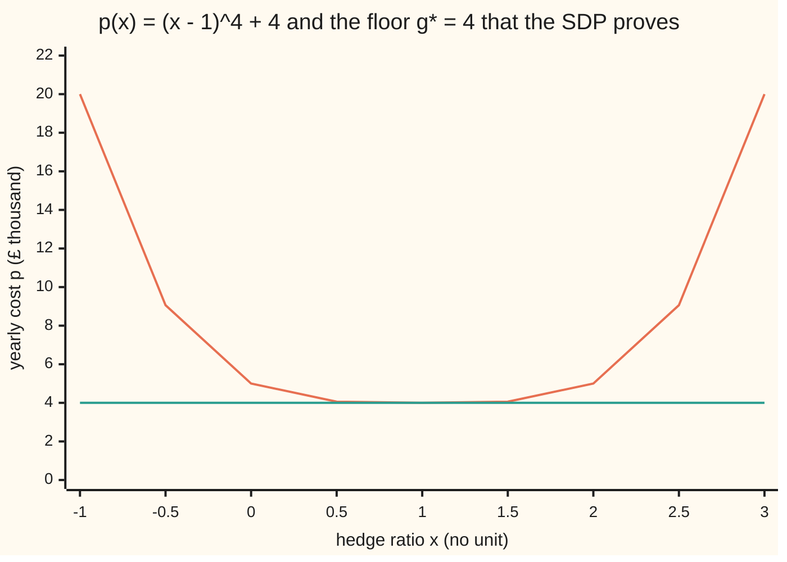

# Sums of squares: prove a polynomial is never negative by finding a positive semidefinite matrix

[Syllabus](../../../SYLLABUS.md) → [Optimization](../README.md) → [Conic, Quadratic and Stochastic Programs](../README.md#s06) → Sums of squares

---

## General Overview

A fund holds the shelf's five-asset portfolio and hedges its currency exposure. It chooses the **hedge ratio** x, the share of the exposure covered: x = 1 covers it exactly, and any real x is allowed (below 0 adds exposure, above 1 over-hedges). Its risk model puts the yearly cost of the hedge plus a charge for the risk left open, in £ thousand, at

```math
p(x) = x^4 - 4x^3 + 6x^2 - 4x + 5 .
```

The fund **minimises** this cost over x, and it wants proof that no ratio costs less than the one it picks. Try a few ratios: p(0) = 5, p(1) = 4, p(2) = 5, p(3) = 20, in £ thousand. A grid of 60,001 ratios between −2 and 4 finds nothing below 4.000000. But a grid only checks the points it visits. It cannot rule out a dip between two of them, or far outside the range.

A proof that covers every real x at once is a rewrite as a square plus a constant:

```math
p(x) = (x^2 - 2x + 1)^2 + 4 = (x - 1)^4 + 4 .
```

A square is never negative, so the cost is at least 4, that is £4,000 a year, at every ratio, and x = 1 reaches it. Anyone can check the rewrite by multiplying it out.

This card turns the search for such a rewrite into one of the [Semidefinite programs](05-semidefinite-programs-and-relaxations.md) (SDPs: optimisations over a symmetric matrix that must stay positive semidefinite). The least cost is the highest floor under p, so the task is to **maximise** a floor g: find the largest g for which p − g is a **sum of squares** (SOS), a sum of squared polynomials. Here the floor is g* = 4, carried by one 3 by 3 matrix: hedge fully, at x = 1, and no ratio costs less than £4,000 a year. The same test, whether a polynomial is never negative, also underlies many safety proofs in control and robotics. The card also shows where the method stops: Motzkin's polynomial is never negative, yet no sum of squares equals it.

**A polynomial is a sum of squares exactly when a positive semidefinite matrix, sandwiched between two copies of its monomial list, reproduces it; so the best provable floor is a semidefinite program, which finds the true minimum in one variable but can fail from two variables at degree 6, or three variables at degree 4.**

**What kind of fact this is:** a theorem, proved on this card in Why it works: the sum-of-squares test is the same as a positive semidefinite matrix, so the best floor is an SDP. Two further results are proved here too: the one-variable case, where never negative and SOS agree, and Motzkin's polynomial, where they do not. Hilbert's full list of the cases where they agree (1888) is stated, with its source.

### The picture: the polynomial and its proved floor



The curved line is the cost p; the flat line is the floor g* = 4, £4,000 a year. They touch only at x = 1. The certificate proves the curve never crosses the floor, between the plotted points and beyond them.

---

## The formula

Collect the monomials (single powers of x) up to half of p's degree in a list, $`m(x) = (1, x, x^2)`$. The SOS question becomes a question about a symmetric 3 by 3 matrix Q, the **Gram matrix**:

```math
\max_{g,\ Q}\ g \quad \text{subject to}\quad p(x) - g = m(x)^T Q\, m(x)\ \text{for every } x, \qquad Q \succeq 0 .
```

**Read it aloud:** find the largest floor g such that p minus g equals the monomial list, times a positive semidefinite matrix, times the monomial list again.

"For every x" means the coefficients of each power of x agree on both sides. Each coefficient of $`m^T Q m`$ is a sum of entries of Q, so these are linear equations in g and Q. With the rule $`Q \succeq 0`$, that is a semidefinite program. For this p, the equations leave one entry free, called t:

```math
Q(g, t) = \begin{pmatrix} 5 - g & -2 & t \\ -2 & 6 - 2t & -2 \\ t & -2 & 1 \end{pmatrix}, \qquad g^* = 4 \text{ at } t = 1 .
```

**Read it aloud:** the top-left entry is p's constant minus the floor, the bottom-right is the coefficient of $`x^4`$, the −2 entries are half the coefficients of $`x`$ and $`x^3`$, and t shifts weight between the centre entry and the two far corners, which all produce $`x^2`$.

| Symbol | Plain meaning | In our example | Push it up and the answer… |
| --- | --- | --- | --- |
| $`p(x)`$, $`x`$ | the polynomial to bound from below, here the yearly hedge cost in £ thousand; its variable, the hedge ratio, any real number | $`x^4 - 4x^3 + 6x^2 - 4x + 5`$ | raising the constant 5 raises the floor by the same amount |
| $`g`$, $`g^*`$ | a proposed floor; the largest floor with an SOS proof | $`g^* = 4.000000`$ | a g above 4 has no PSD Gram matrix |
| $`m(x)`$ | the monomial list, powers up to half the degree | $`(1, x, x^2)`$ | a longer list allows higher-degree polynomials |
| $`Q`$, $`q_{ij}`$ | the Gram matrix and its entry in row i, column j, rows counted from 0 | `[[1, -2, 1], [-2, 4, -2], [1, -2, 1]]` at the optimum | — |
| $`t`$ | the one free entry, $`q_{02}`$ (not the barrier weight t of the interior-point card) | $`t = 1`$ at the optimum, the only choice there | above 1, the minor on rows 1 and 2 turns negative |
| $`Q \succeq 0`$, $`w`$, $`\lambda_{\min}`$, $`\lambda_i`$, $`u_i`$ | positive semidefinite: $`w^T Q w \ge 0`$ for every vector w; the smallest eigenvalue, which is then zero or more; each eigenvalue and its unit eigenvector | eigenvalues 6, 0, 0 at the optimum | — |
| $`v`$, $`s_k`$, $`c_k`$ | a vector with $`Q = v v^T`$; in general, the k-th square's polynomial $`s_k`$ and its coefficient vector $`c_k`$ | $`v = (1, -2, 1)`$, the square $`(1 - 2x + x^2)^2`$ | — |
| $`y_k`$, $`Y`$, $`L`$, $`x_0`$ | the dual: a number $`y_k`$ standing in for each power $`x^k`$ (for a single point $`x_0`$, $`y_k = x_0^k`$), its moment matrix $`Y`$ with entry $`y_{i+j}`$, and $`L`$, which replaces every $`x^k`$ in a polynomial by $`y_k`$ (not a smoothness constant) | $`y_k = 1^k = 1`$, so $`Y`$ is all ones and $`L(p) = p(1) = 4`$ | — |
| $`\langle Q, Y \rangle`$ | the entry-by-entry product of two matrices, added up | 0 at the optimum: the gap | — |
| $`M(x, y)`$ | Motzkin's polynomial, in two variables x and y | $`x^4 y^2 + x^2 y^4 - 3x^2y^2 + 1`$ | — |
| $`r(x)`$ | a second test quartic with two valleys | $`x^4 - 4x^2 + x`$, least value −5.444192 | — |
| $`f_i`$, $`\sigma_i`$, $`d`$ | Lasserre: the constraints $`f_i(x) \le 0`$, the SOS multiplier on each, and the level, half the largest degree allowed | not needed: p has no constraints | a higher level d gives a floor at least as high |

### When it holds

- **The certificate needs Q positive semidefinite, not only matching coefficients.** Without that rule any floor matches. At g = 10 and t = 1 the coefficients match, but the smallest eigenvalue is −5.477226, and p(1) = 4 is below 10.
- **The monomial list must reach half the degree.** Squaring a polynomial doubles its degree, and top terms of squares never cancel. So degree 4 needs powers up to $`x^2`$, and $`(1, x)`$ alone cannot produce $`x^4`$.
- **SOS proves "never negative"; the converse can fail.** In one variable, every polynomial that is never negative is a sum of squares, so the SDP floor is the true minimum. With two variables at degree 6, or three at degree 4, it can fail. Motzkin's polynomial has least value 0, yet the SDP finds no floor at all.
- **A numerical solver returns a nearly PSD matrix.** Its floor is a proof only after an exact check. Here the exact check is the integer square $`(x^2 - 2x + 1)^2`$, multiplied out.
- **The floor is a lower bound, proved optimal only by the dual.** The moment matrix of the point x = 1 gives $`L(p) = 4`$. A floor and a dual value that meet prove no larger floor exists.

---

## Why it works

### Step 0: a square cannot be negative, and that check is mechanical

A square of a real number is zero or more, so a sum of squared polynomials is zero or more at every x. Writing p − g as such a sum proves p ≥ g everywhere, with no search over x. The hard part is finding the squares, and a positive semidefinite matrix is exactly a bundle of squares.

### Step 1: a sum of squares is a positive semidefinite Gram matrix

**From a PSD matrix to squares.** Say Q is positive semidefinite. By [The spectral theorem](../../03-Algebra/07-Eigenvalues%20and%20Symmetric%20Matrices/04-spectral-theorem.md), Q is a sum of stretches along perpendicular unit vectors $`u_i`$, each by an eigenvalue $`\lambda_i \ge 0`$:

```math
m^T Q\, m = \sum_i \lambda_i \, (u_i \cdot m)^2 .
```

Each $`u_i \cdot m`$ is a polynomial, and each $`\lambda_i`$ is zero or more. So $`m^T Q m`$ is a sum of squares.

**From squares to a PSD matrix.** Say $`p - g = \sum_k s_k(x)^2`$. Each $`s_k`$ has degree at most 2, because the top terms of squares add and cannot cancel. So $`s_k = c_k \cdot m`$ for a coefficient vector $`c_k`$. Then $`Q = \sum_k c_k c_k^T`$ works, and it is positive semidefinite: $`w^T Q w = \sum_k (c_k \cdot w)^2 \ge 0`$ ([Quadratic forms](../../03-Algebra/07-Eigenvalues%20and%20Symmetric%20Matrices/05-quadratic-forms-and-positive-definite.md)).

So "p − g is SOS" and "some Gram matrix of p − g is PSD" are the same statement.

### Step 2: matching coefficients gives linear equations, so the floor is an SDP

Multiply out $`m^T Q m`$ with $`m = (1, x, x^2)`$ and match each power of x with p − g:

| Power | Entries of Q that produce it | Coefficient of p − g | So |
| --- | --- | --- | --- |
| $`x^4`$ | $`q_{22}`$ | 1 | $`q_{22} = 1`$ |
| $`x^3`$ | $`2 q_{12}`$ | −4 | $`q_{12} = -2`$ |
| $`x^2`$ | $`q_{11} + 2 q_{02}`$ | 6 | $`q_{11} = 6 - 2t`$, with $`t = q_{02}`$ free |
| $`x`$ | $`2 q_{01}`$ | −4 | $`q_{01} = -2`$ |
| 1 | $`q_{00}`$ | 5 − g | $`q_{00} = 5 - g`$ |

Five equations, linear in g and the entries of Q. Add $`Q \succeq 0`$ and maximise g: an SDP, as in [Semidefinite programs](05-semidefinite-programs-and-relaxations.md). It has two unknowns left, g and t.

### Step 3: solving it by hand, with principal minors

A **principal minor** is the determinant of the square block kept by choosing the same rows and columns. If Q is PSD, each such block is PSD too, so its eigenvalues are zero or more, and its determinant, their product, is zero or more.

Three facts about $`Q(g, t)`$ settle the problem:

1. The block on rows 1 and 2 has determinant $`(6 - 2t) - 4 = 2 - 2t`$. So $`t \le 1`$.
2. The block on rows 0 and 1 has determinant $`4(5 - g) - 4`$ when $`t = 1`$, which is $`4(4 - g)`$.
3. The full determinant, by cofactors, factors as $`\det Q = 2(1 - t)(4 - g - (t - 1)^2)`$. At g = 4.01 and t = 0.5 both ways give −0.260000.

Now take any floor g above 4. If t < 1, the second factor of the determinant is negative and the first positive, so $`\det Q < 0`$. If t = 1, fact 2 gives $`4(4 - g) < 0`$. If t > 1, fact 1 fails. No t works, so **no floor above 4 has an SOS proof**.

At g = 4 the same argument leaves only t = 1. There

```math
Q(4, 1) = \begin{pmatrix} 1 & -2 & 1 \\ -2 & 4 & -2 \\ 1 & -2 & 1 \end{pmatrix} = v v^T, \qquad v = (1, -2, 1) .
```

Its eigenvalues are 6, 0 and 0, so it is PSD. Reading $`m^T v v^T m = (v \cdot m)^2`$ gives the single square $`(1 - 2x + x^2)^2`$. So $`p - 4 = (x - 1)^4`$ and g* = 4.

A floor below 4 has many Gram matrices. At g = 3, t = 1 gives $`p - 3 = (x^2 - 2x + 1)^2 + 1^2`$.

### Step 4: the dual, and why it proves "largest"

The dual replaces each power $`x^k`$ by an unknown number $`y_k`$, with $`y_0 = 1`$; call this replacing map L. The **moment matrix** Y holds $`y_{i+j}`$ in row i, column j. For a real point $`x_0`$, take $`y_k = x_0^k`$. Then $`Y = m(x_0)\, m(x_0)^T`$, which is PSD, and $`L(p) = p(x_0)`$.

Apply L to the identity $`p - g = m^T Q m`$. The left side gives $`L(p) - g`$. The right side gives $`\langle Q, Y \rangle`$, because each entry $`q_{ij}`$ multiplies $`x^{i+j}`$, which L turns into $`y_{i+j}`$. So

```math
L(p) - g = \langle Q, Y \rangle \ \ge\ 0 ,
```

since the entry-by-entry product of two PSD matrices, added up, is never negative. That is weak duality, as on [Lagrangian duality](../03-Constrained%20Optimisation/04-lagrangian-duality-weak-and-strong.md): every dual Y caps every floor g.

At $`x_0 = 1`$, Y is all ones and $`L(p) = p(1) = 4`$. So no floor exceeds 4. The SOS floor 4 meets this cap, and $`\langle Q, Y\rangle`$ prints as 0.000000: the gap is zero, and g* = 4 is proved optimal. The dual also locates the minimiser: when Y has rank one, $`x^* = y_1 = 1`$.

### Step 5: where never negative and SOS agree, and where they do not

In 1888 Hilbert settled when every polynomial that is never negative is a sum of squares of polynomials. Stated without its full proof, with the source below:

| Variables | Degree | Never negative ⇒ SOS? |
| --- | --- | --- |
| 1 | any even degree | yes (proved in the fold below) |
| any number | 2 | yes: a quadratic that is never negative has a PSD matrix, which is a sum of squares by Step 1 |
| 2 | 4 | yes |
| 2 | 6 or more | no: Motzkin's polynomial |
| 3 or more | 4 or more | no |

So for this card's p the SDP floor is the true minimum, guaranteed in advance.

<details>
<summary>Detailed proof: in one variable, never negative means a sum of two squares</summary>

Let p have real coefficients and be never negative. Factor it over the complex numbers.

A real root must have even multiplicity, or p would change sign there. So real roots give a factor $`(x - a)^{2k}`$, a square.

Complex roots come in conjugate pairs $`b \pm ci`$. Each pair gives $`(x - b)^2 + c^2`$, a sum of two squares.

The leading coefficient is positive, so it is a square of a real number.

The product of two sums of two squares is again a sum of two squares:

$`\displaystyle (a^2 + b^2)(c^2 + d^2) = (ac - bd)^2 + (ad + bc)^2 .`$

Multiplying the factors one at a time therefore gives $`p = s_1^2 + s_2^2`$ for two real polynomials $`s_1`$ and $`s_2`$.

</details>

### Step 6: Motzkin's polynomial is never negative but not a sum of squares

Motzkin's polynomial is

```math
M(x, y) = x^4 y^2 + x^2 y^4 - 3x^2 y^2 + 1 .
```

**It is never negative.** The three terms $`x^4y^2`$, $`x^2y^4`$ and 1 have product $`x^6y^6`$. The arithmetic mean of three numbers that are zero or more is at least their geometric mean (the cube root of their product). So their sum is at least $`3x^2y^2`$, and M ≥ 0. At (1, 1) it equals 0.

**It is not a sum of squares, for any floor g.** In words: set y = 0, and M − g becomes the constant 1 − g. A sum of squares that is constant along that line forces every square to drop its pure powers of x. The same holds for y. What remains in each square can make $`x^2y^2`$ only one way, as $`(xy)^2`$, with a coefficient that is a sum of squares. But M asks for −3. The check prints this as a Gram matrix diagonal entry forced to −3.

<details>
<summary>Detailed proof: the Gram matrix of M − g cannot be positive semidefinite</summary>

M has degree 6, so each square $`s_k^2`$ has $`s_k`$ of degree at most 3. The monomial list holds the ten monomials $`x^a y^b`$ with $`a + b \le 3`$.

The power $`x^6`$ arises only as $`x^3 \cdot x^3`$. Its coefficient in M − g is 0, so the diagonal entry for $`x^3`$ is 0. A PSD matrix with a zero diagonal entry has that whole row zero (otherwise a 2 by 2 principal minor is negative). So $`x^3`$ drops out.

Next, $`x^4`$ arises as $`x^2 \cdot x^2`$ or from $`x^3`$, which is gone. Its coefficient is 0, so $`x^2`$ drops out. Then $`x^2`$ in M arises as $`x \cdot x`$ or $`1 \cdot x^2`$, and $`x^2`$ is gone, so $`x`$ drops out. The same steps remove $`y^3`$, $`y^2`$ and $`y`$.

The power $`x^2y^2`$ could arise as $`xy \cdot xy`$, $`x^2 \cdot y^2`$, $`x \cdot xy^2`$ or $`y \cdot x^2y`$. Every pair but the first uses a monomial that dropped out. So the diagonal entry for $`xy`$ equals the coefficient of $`x^2y^2`$, which is −3.

A PSD matrix has every diagonal entry zero or more. So no Gram matrix of M − g is PSD, whatever g is, and M − g is never a sum of squares.

</details>

### Step 7: what to do when SOS falls short: multipliers and the Lasserre hierarchy

Motzkin's polynomial does have a certificate, one step removed. Multiply it by $`1 + x^2 + y^2`$, which is always positive:

```math
(1 + x^2 + y^2)\, M = (x^2y - y)^2 + (xy^2 - x)^2 + (x^2y^2 - 1)^2 + \tfrac14 (xy^3 - x^3y)^2 + \tfrac34 (xy^3 + x^3y - 2xy)^2 .
```

The right side is never negative, and the multiplier is positive, so M is never negative. The checks confirm the identity exactly, coefficient by coefficient. Allowing such multipliers is the idea behind the **Positivstellensatz** (German for "theorem on positive places"), the theory of certificates for polynomial inequalities.

The **Lasserre hierarchy** applies the idea to a constrained problem: minimise p over the points x with $`f_i(x) \le 0`$. At level d it asks for

```math
p - g = \sigma_0 - \sum_i \sigma_i\, f_i , \qquad \text{each } \sigma_i \text{ a sum of squares}, \quad \sigma_0 \text{ and every } \sigma_i f_i \text{ of degree at most } 2d .
```

Each level is an SDP, and each level's floor is at least the last. Lasserre (2001) proved that when the allowed set is bounded in a stated algebraic sense, the floors rise to the true minimum. The dual of each level is a moment matrix, the Y of Step 4, made larger. The price is size: the level-d Gram matrix has one row per monomial of degree up to d, a number that grows fast with the count of variables.

---

## Worked numbers, by hand

| Step | Arithmetic | Value |
| --- | --- | --- |
| match $`x^4`$, $`x^3`$, $`x`$ | $`q_{22} = 1`$, $`2q_{12} = -4`$, $`2q_{01} = -4`$ | 1, −2, −2 |
| match $`x^2`$ and 1 | $`q_{11} + 2t = 6`$; $`q_{00} = 5 - g`$ | $`6 - 2t`$; $`5 - g`$ |
| minor on rows 1, 2 | $`(6 - 2t) \times 1 - (-2)^2`$ | $`2 - 2t`$, so t ≤ 1 |
| full determinant at g = 4.01, t = 0.5 | 2 × 0.5 × (4 − 4.01 − 0.25) | −0.260000: not PSD |
| Gram matrix at g = 4, t = 1 | `[[1, -2, 1], [-2, 4, -2], [1, -2, 1]]` = $`v v^T`$ | eigenvalues 6, 0, 0 |
| the square | $`(1 - 2x + x^2)^2 + 4`$, multiplied out | 5, −4, 6, −4, 1: matches p |
| dual value at x = 1 | 1 − 4 + 6 − 4 + 5 | 4 |
| **certified floor** | SOS floor meets dual value | **g\* = 4, at x = 1** |

Hedge fully, at x = 1, for £4,000 a year: the 3 by 3 matrix together with the point x = 1 proves that no hedge ratio costs less.

### What breaks if you drop a piece

| Mistake | Comes out at | What went wrong |
| --- | --- | --- |
| Match coefficients, skip the PSD rule | "floor 10", smallest eigenvalue −5.477226 | any floor matches without the rule; p(1) = 4 refutes 10 |
| Trust a local search on $`r(x) = x^4 - 4x^2 + x`$ | descent from x = 2 stops at x = 1.346997, r = −2.618556 | that is a local minimum; the SOS floor is −5.444192, the grid minimum |
| Run SOS on Motzkin's polynomial | Gram entry for $`xy`$ forced to −3: no floor at all | M is never negative (least value 0) but not SOS; the method needs a multiplier |

---

## Code, from first principles, and it actually runs

Both programs compute every eigenvalue by Jacobi rotations (turning the matrix one pair of axes at a time until the off-diagonal entries vanish; why that works belongs to numerical methods). The floor g* = 4 is reached by **four independent roads**:

1. **Road 1, the SDP solved numerically.** Bisection on g over [−100, 5]. Each test runs golden-section search on t to make the smallest eigenvalue of $`Q(g, t)`$ as large as possible. That search is safe because the smallest eigenvalue is the least of $`w^T Q w`$ over unit vectors w, each linear in t, so it is concave in t: it rises, then falls, with no second peak. Lowering g only adds to the corner entry, so feasible floors form an interval.
2. **Road 2, exact algebra.** The cofactor determinant against the factored formula, and the integer square $`(1 - 2x + x^2)^2 + 4`$ multiplied out against p.
3. **Road 3, the dual.** The moment matrix of x = 1, its eigenvalues, and the gap $`\langle Q, Y\rangle`$.
4. **Road 4, a grid.** p on 60,001 points from −2 to 4, as a cross-check only.

Bisection stops when the g-interval is below $`10^{-12}`$, after 47 halvings. Each feasibility test takes 120 golden-section steps on t, each shrinking the interval by a factor of 0.618. The Motzkin part runs the forced-zero argument of Step 6 on the ten monomials and checks the multiplier identity in integers, scaled by 4 to clear the fractions.

### Python

```python
# Sums of squares -- the check behind the card.  Standard library only.
# Eigenvalues come from Jacobi rotations written out below; no linear-algebra or optimisation library.
from math import sqrt, cos, acos

def eig(A):                                   # Jacobi: rotate away off-diagonal entries; eigenvalues, sorted
    n = len(A); A = [r[:] for r in A]
    for _ in range(60):
        if sum(A[i][j] ** 2 for i in range(n) for j in range(n) if i != j) < 1e-30: break
        for p in range(n):
            for q in range(p + 1, n):
                if A[p][q] == 0.0: continue
                th = (A[q][q] - A[p][p]) / (2 * A[p][q])
                t = (1.0 if th >= 0 else -1.0) / (abs(th) + sqrt(th * th + 1)); c = 1 / sqrt(t * t + 1); s = t * c
                for k in range(n): a, b = A[k][p], A[k][q]; A[k][p], A[k][q] = c * a - s * b, s * a + c * b
                for k in range(n): a, b = A[p][k], A[q][k]; A[p][k], A[q][k] = c * a - s * b, s * a + c * b
    return sorted(A[i][i] for i in range(n))

def show(label, v): print(f"{label:<46} {0.0 if abs(v) < 5e-10 else v:.6f}")   # specks below 5e-10 print as 0
def gram(c, g, t):                            # c = (c0..c4) of a quartic; Gram matrix of p - g on (1, x, x^2)
    return [[c[0] - g, c[1] / 2, t], [c[1] / 2, c[2] - 2 * t, c[3] / 2], [t, c[3] / 2, c[4]]]
def best_t(c, g):                             # golden section: the t that makes the smallest eigenvalue largest
    lo, hi, r = -50.0, 50.0, (sqrt(5) - 1) / 2
    for _ in range(120):
        a, b = hi - r * (hi - lo), lo + r * (hi - lo)
        if eig(gram(c, g, a))[0] < eig(gram(c, g, b))[0]: lo = a
        else: hi = b
    t = (lo + hi) / 2
    return t, eig(gram(c, g, t))[0]
def sos_bound(c):                             # bisection on g: largest g whose Gram matrix can be made PSD
    lo, hi, k = -100.0, c[0], 0               # g = p(0) = c0 is never beaten by a lower bound
    while hi - lo > 1e-12:
        mid = (lo + hi) / 2; k += 1
        if best_t(c, mid)[1] >= -1e-12: lo = mid
        else: hi = mid
    return lo, k
def pv(c, x): return c[0] + c[1] * x + c[2] * x ** 2 + c[3] * x ** 3 + c[4] * x ** 4

# ---- the example: p(x) = x^4 - 4x^3 + 6x^2 - 4x + 5, minimised over every real x ----
P = (5.0, -4.0, 6.0, -4.0, 1.0)
for x in (0, 1, 2, 3): show(f"p({x})", pv(P, x))
print("chart p(x) at x = -1, -0.5, ..., 3:", ", ".join(f"{pv(P, i / 2 - 1):.4f}" for i in range(9)))
g1, k1 = sos_bound(P); t1, l1 = best_t(P, g1)
print(f"road 1 bisection on g with golden section on t: {k1} halvings")
show("  SOS lower bound g*", g1); show("  free Gram entry t at g*", t1); show("  smallest eigenvalue there", l1)
show("  g = 4.01: best smallest eigenvalue", best_t(P, 4.01)[1])
show("  g = 3: best smallest eigenvalue", best_t(P, 3.0)[1])
# road 2: exact algebra.  det Q(g, t) = 2(1 - t)(4 - g - (t - 1)^2); minors force t <= 1, det forces t >= 1 when g >= 4
det = lambda g, t: (lambda Q: Q[0][0] * (Q[1][1] * Q[2][2] - Q[1][2] ** 2) - Q[0][1] * (Q[0][1] * Q[2][2] - Q[1][2] * Q[0][2])
                    + Q[0][2] * (Q[0][1] * Q[1][2] - Q[1][1] * Q[0][2]))(gram(P, g, t))
show("road 2 det Q(4.01, 0.5) by cofactors", det(4.01, 0.5)); show("  formula 2(1-t)(4-g-(t-1)^2)", 2 * 0.5 * (4 - 4.01 - 0.25))
Qs = gram(P, 4.0, 1.0); ev = eig(Qs)
print("  Q at g = 4, t = 1:", [[int(v) for v in r] for r in Qs])
show("  its eigenvalues: largest", ev[2]); show("  middle", ev[1]); show("  smallest", ev[0])
v = (1, -2, 1)                                # Q = v v^T, so p - 4 = (1 - 2x + x^2)^2 = (x - 1)^4
sq = [sum(v[i] * v[k - i] for i in range(3) if 0 <= k - i <= 2) for k in range(5)]
print("  coefficients of (1 - 2x + x^2)^2 + 4:", [sq[0] + 4] + sq[1:])
# road 3: the dual.  The point mass at x = 1 has moment matrix Y = all ones; <Q, Y> = L(p) - g for every Gram Q
Y = [[1.0] * 3 for _ in range(3)]
show("road 3 dual value L(p) = p(1)", pv(P, 1.0)); show("  smallest eigenvalue of Y", eig(Y)[0])
show("  <Q, Y> at g = 4, t = 1 (the gap)", sum(Qs[i][j] * Y[i][j] for i in range(3) for j in range(3)))
gm = min(pv(P, -2 + i / 10000) for i in range(60001))
show("road 4 grid on [-2, 4], step 0.0001: min p", gm)

# ---- what breaks ----
Qb = gram(P, 10.0, 1.0); show("wrong: match coefficients only, g = 10, eig", eig(Qb)[0])
R = (0.0, 1.0, -4.0, 0.0, 1.0)                # r(x) = x^4 - 4x^2 + x, two valleys
def descend(x, k=0):
    while abs(4 * x ** 3 - 8 * x + 1) > 1e-10 and k < 10000: x -= 0.05 * (4 * x ** 3 - 8 * x + 1); k += 1
    return x, k
xd, kd = descend(2.0); print(f"wrong: descent on r from x = 2, step 0.05: {kd} steps")
show("  lands at x", xd); show("  r there", pv(R, xd))
gr, _ = sos_bound(R); show("  SOS lower bound on r", gr); show("  grid min of r on [-3, 3]", min(pv(R, -3 + i / 10000) for i in range(60001)))

# ---- Motzkin: M = x^4 y^2 + x^2 y^4 - 3 x^2 y^2 + 1 ----
def motzkin_forced(cxy):                      # Gram rows on monomials of degree <= 3 forced to zero, then the first forced entry
    B = [(a, b) for a in range(4) for b in range(4 - a)]; C = {(4, 2): 1, (2, 4): 1, (2, 2): cxy}
    zero, changed = set(), True
    while changed:
        changed = False
        for m in B:
            e = (2 * m[0], 2 * m[1])
            pairs = [(a, b) for a in B for b in B if a not in zero and b not in zero and (a[0] + b[0], a[1] + b[1]) == e]
            if m in zero or pairs != [(m, m)] or e == (0, 0): continue
            if C.get(e, 0) == 0: zero.add(m); changed = True
            elif C[e] < 0: return zero, m, C[e]
    return zero, None, 0
name = lambda m: "*".join(s + ("^" + str(k) if k > 1 else "") for s, k in (("x", m[0]), ("y", m[1])) if k) or "1"
z, m, cm = motzkin_forced(-3)
print("Motzkin: Gram rows forced to zero:", ", ".join(sorted(name(u) for u in z)))
print(f"Motzkin: diagonal entry ({name(m)}, {name(m)}) forced to {cm}: no Gram matrix is PSD, for any g")
Mz = lambda x, y, c=-3: x ** 4 * y ** 2 + x ** 2 * y ** 4 + c * x ** 2 * y ** 2 + 1
show("Motzkin at (1, 1)", Mz(1, 1)); show("  grid min on [-2, 2]^2, step 0.01", min(Mz(i / 100, j / 100) for i in range(-200, 201) for j in range(-200, 201)))
def pmul(a, b):
    r = {}
    for ea, ca in a.items():
        for eb, cb in b.items(): e = (ea[0] + eb[0], ea[1] + eb[1]); r[e] = r.get(e, 0) + ca * cb
    return {e: c for e, c in r.items() if c != 0}
def padd(*ps):
    r = {}
    for w, p in ps:
        for e, c in p.items(): r[e] = r.get(e, 0) + w * c
    return {e: c for e, c in r.items() if c != 0}
Mp = {(4, 2): 1, (2, 4): 1, (2, 2): -3, (0, 0): 1}
lhs = pmul({(0, 0): 4, (2, 0): 4, (0, 2): 4}, Mp)       # 4 (1 + x^2 + y^2) M, all integers
sqs = [(4, {(2, 1): 1, (0, 1): -1}), (4, {(1, 2): 1, (1, 0): -1}), (4, {(2, 2): 1, (0, 0): -1}),
       (1, {(1, 3): 1, (3, 1): -1}), (3, {(1, 3): 1, (3, 1): 1, (1, 1): -2})]
rhs = padd(*[(w, pmul(q, q)) for w, q in sqs])
print(f"(1 + x^2 + y^2) M = five squares, exact: {'yes' if lhs == rhs else 'no'}, {len(lhs)} coefficients matched")
gt, _ = sos_bound((7.0, -4.0, 6.0, -4.0, 1.0)); show("try: constant 7, SOS bound", gt)
xt, kt = descend(-2.0); show("try: descent on r from x = -2, lands at", xt); show("  r there", pv(R, xt))
print(f"try: Motzkin with -2: entry forced to {motzkin_forced(-2)[2]}")
show("  grid min on [-2, 2]^2", min(Mz(i / 100, j / 100, -2) for i in range(-200, 201) for j in range(-200, 201))); show("  19/27", 19 / 27)

assert abs(g1 - 4) < 1e-6 and abs(t1 - 1) < 1e-4                 # road 1 against the exact square
assert abs(g1 - gm) < 1e-6 and abs(pv(P, 1.0) - g1) < 1e-6         # road 1 against grid and dual value
assert abs(det(4.01, 0.5) - 2 * 0.5 * (4 - 4.01 - 0.25)) < 1e-12 and ev[0] > -1e-12 and abs(ev[2] - 6) < 1e-12
assert [sq[0] + 4] + sq[1:] == [5, -4, 6, -4, 1] and best_t(P, 4.01)[1] < 0
assert abs(gr - min(pv(R, -3 + i / 10000) for i in range(60001))) < 1e-6 and pv(R, xd) > gr + 1
assert abs(xd - 2 * sqrt(2 / 3) * cos(acos(-0.1875 * sqrt(1.5)) / 3)) < 1e-9 and abs(R[1] + 2 * R[2] * xd + 4 * R[4] * xd ** 3) < 1e-8  # root of r', by the cosine formula
assert cm == -3 and m == (1, 1) and lhs == rhs and z == {(1, 0), (2, 0), (3, 0), (0, 1), (0, 2), (0, 3)}   # Step 6: x, x^2, x^3, y, y^2, y^3 drop out
print("ALL CHECKS PASS")
```

**Ran 2026-11-24 on macOS, Python 3.14.10, standard library only. All checks passed. Output, pasted from the run:**

```
p(0)                                           5.000000
p(1)                                           4.000000
p(2)                                           5.000000
p(3)                                           20.000000
chart p(x) at x = -1, -0.5, ..., 3: 20.0000, 9.0625, 5.0000, 4.0625, 4.0000, 4.0625, 5.0000, 9.0625, 20.0000
road 1 bisection on g with golden section on t: 47 halvings
  SOS lower bound g*                           4.000000
  free Gram entry t at g*                      1.000000
  smallest eigenvalue there                    0.000000
  g = 4.01: best smallest eigenvalue           -0.004241
  g = 3: best smallest eigenvalue              0.093871
road 2 det Q(4.01, 0.5) by cofactors           -0.260000
  formula 2(1-t)(4-g-(t-1)^2)                  -0.260000
  Q at g = 4, t = 1: [[1, -2, 1], [-2, 4, -2], [1, -2, 1]]
  its eigenvalues: largest                     6.000000
  middle                                       0.000000
  smallest                                     0.000000
  coefficients of (1 - 2x + x^2)^2 + 4: [5, -4, 6, -4, 1]
road 3 dual value L(p) = p(1)                  4.000000
  smallest eigenvalue of Y                     0.000000
  <Q, Y> at g = 4, t = 1 (the gap)             0.000000
road 4 grid on [-2, 4], step 0.0001: min p     4.000000
wrong: match coefficients only, g = 10, eig    -5.477226
wrong: descent on r from x = 2, step 0.05: 23 steps
  lands at x                                   1.346997
  r there                                      -2.618556
  SOS lower bound on r                         -5.444192
  grid min of r on [-3, 3]                     -5.444192
Motzkin: Gram rows forced to zero: x, x^2, x^3, y, y^2, y^3
Motzkin: diagonal entry (x*y, x*y) forced to -3: no Gram matrix is PSD, for any g
Motzkin at (1, 1)                              0.000000
  grid min on [-2, 2]^2, step 0.01             0.000000
(1 + x^2 + y^2) M = five squares, exact: yes, 9 coefficients matched
try: constant 7, SOS bound                     6.000000
try: descent on r from x = -2, lands at        -1.472998
  r there                                      -5.444192
try: Motzkin with -2: entry forced to -2
  grid min on [-2, 2]^2                        0.703760
  19/27                                        0.703704
ALL CHECKS PASS
```

Four roads land on 4. The dual value meeting the floor is the proof that no floor above 4 exists.

### Rust

Same numbers, same labels, built with `rustc --edition 2021 -O`.

```rust
// Sums of squares -- the same check as the Python, in Rust.  No crates.
// Eigenvalues come from Jacobi rotations written out below; no linear-algebra or optimisation library.
use std::collections::{BTreeMap, BTreeSet};
type M = Vec<Vec<f64>>;
type Poly = BTreeMap<(i32, i32), i64>;

fn eig(a0: &M) -> Vec<f64> {                      // Jacobi: rotate away off-diagonal entries; eigenvalues, sorted
    let n = a0.len();
    let mut a = a0.clone();
    for _ in 0..60 {
        let mut off = 0.0;
        for i in 0..n { for j in 0..n { if i != j { off += a[i][j] * a[i][j]; } } }
        if off < 1e-30 { break; }
        for p in 0..n {
            for q in p + 1..n {
                if a[p][q] == 0.0 { continue; }
                let th = (a[q][q] - a[p][p]) / (2.0 * a[p][q]);
                let t = (if th >= 0.0 { 1.0 } else { -1.0 }) / (th.abs() + (th * th + 1.0).sqrt());
                let c = 1.0 / (t * t + 1.0).sqrt();
                let s = t * c;
                for k in 0..n { let (x, y) = (a[k][p], a[k][q]); a[k][p] = c * x - s * y; a[k][q] = s * x + c * y; }
                for k in 0..n { let (x, y) = (a[p][k], a[q][k]); a[p][k] = c * x - s * y; a[q][k] = s * x + c * y; }
            }
        }
    }
    let mut w: Vec<f64> = (0..n).map(|i| a[i][i]).collect();
    w.sort_by(|x, y| x.partial_cmp(y).unwrap());
    w
}

fn show(label: &str, v: f64) { println!("{:<46} {:.6}", label, if v.abs() < 5e-10 { 0.0 } else { v }); }
fn gram(c: &[f64; 5], g: f64, t: f64) -> M {      // Gram matrix of p - g on (1, x, x^2)
    vec![vec![c[0] - g, c[1] / 2.0, t], vec![c[1] / 2.0, c[2] - 2.0 * t, c[3] / 2.0], vec![t, c[3] / 2.0, c[4]]]
}
fn best_t(c: &[f64; 5], g: f64) -> (f64, f64) {   // golden section: the t that makes the smallest eigenvalue largest
    let (mut lo, mut hi, r) = (-50.0f64, 50.0f64, (5.0f64.sqrt() - 1.0) / 2.0);
    for _ in 0..120 {
        let (a, b) = (hi - r * (hi - lo), lo + r * (hi - lo));
        if eig(&gram(c, g, a))[0] < eig(&gram(c, g, b))[0] { lo = a; } else { hi = b; }
    }
    let t = (lo + hi) / 2.0;
    (t, eig(&gram(c, g, t))[0])
}
fn sos_bound(c: &[f64; 5]) -> (f64, usize) {     // bisection on g: largest g whose Gram matrix can be made PSD
    let (mut lo, mut hi, mut k) = (-100.0f64, c[0], 0);
    while hi - lo > 1e-12 {
        let mid = (lo + hi) / 2.0; k += 1;
        if best_t(c, mid).1 >= -1e-12 { lo = mid; } else { hi = mid; }
    }
    (lo, k)
}
fn pv(c: &[f64; 5], x: f64) -> f64 { c[0] + c[1] * x + c[2] * x.powi(2) + c[3] * x.powi(3) + c[4] * x.powi(4) }
fn det3(q: &M) -> f64 {
    q[0][0] * (q[1][1] * q[2][2] - q[1][2] * q[1][2]) - q[0][1] * (q[0][1] * q[2][2] - q[1][2] * q[0][2])
        + q[0][2] * (q[0][1] * q[1][2] - q[1][1] * q[0][2])
}
fn descend(mut x: f64) -> (f64, usize) {
    let mut k = 0;
    while (4.0 * x.powi(3) - 8.0 * x + 1.0).abs() > 1e-10 && k < 10000 { x -= 0.05 * (4.0 * x.powi(3) - 8.0 * x + 1.0); k += 1; }
    (x, k)
}
fn motzkin_forced(cxy: i64) -> (BTreeSet<(i32, i32)>, Option<(i32, i32)>, i64) {
    let b: Vec<(i32, i32)> = (0..4).flat_map(|a| (0..4 - a).map(move |c| (a, c))).collect();
    let coef = |e: (i32, i32)| -> i64 { if e == (4, 2) || e == (2, 4) { 1 } else if e == (2, 2) { cxy } else { 0 } };
    let mut zero = BTreeSet::new();
    let mut changed = true;
    while changed {
        changed = false;
        for &m in &b {
            let e = (2 * m.0, 2 * m.1);
            let pairs: Vec<((i32, i32), (i32, i32))> = b.iter().flat_map(|&x| b.iter().map(move |&y| (x, y)))
                .filter(|&(x, y)| !zero.contains(&x) && !zero.contains(&y) && (x.0 + y.0, x.1 + y.1) == e).collect();
            if zero.contains(&m) || pairs != vec![(m, m)] || e == (0, 0) { continue; }
            if coef(e) == 0 { zero.insert(m); changed = true; } else if coef(e) < 0 { return (zero, Some(m), coef(e)); }
        }
    }
    (zero, None, 0)
}
fn name(m: (i32, i32)) -> String {
    let parts: Vec<String> = [("x", m.0), ("y", m.1)].iter().filter(|(_, k)| *k > 0)
        .map(|(s, k)| if *k > 1 { format!("{}^{}", s, k) } else { s.to_string() }).collect();
    if parts.is_empty() { "1".to_string() } else { parts.join("*") }
}
fn mz(x: f64, y: f64, c: f64) -> f64 { x.powi(4) * y.powi(2) + x.powi(2) * y.powi(4) + c * x.powi(2) * y.powi(2) + 1.0 }
fn grid_mz(c: f64) -> f64 {
    let mut m = f64::INFINITY;
    for i in -200..=200 { for j in -200..=200 { m = m.min(mz(i as f64 / 100.0, j as f64 / 100.0, c)); } }
    m
}
fn pmul(a: &Poly, b: &Poly) -> Poly {
    let mut r = Poly::new();
    for (ea, ca) in a { for (eb, cb) in b { *r.entry((ea.0 + eb.0, ea.1 + eb.1)).or_insert(0) += ca * cb; } }
    r.retain(|_, c| *c != 0);
    r
}
fn poly(t: &[((i32, i32), i64)]) -> Poly { t.iter().cloned().collect() }

fn main() {
    // ---- the example: p(x) = x^4 - 4x^3 + 6x^2 - 4x + 5, minimised over every real x ----
    let p = [5.0, -4.0, 6.0, -4.0, 1.0];
    for x in 0..4 { show(&format!("p({})", x), pv(&p, x as f64)); }
    let pts: Vec<String> = (0..9).map(|i| format!("{:.4}", pv(&p, i as f64 / 2.0 - 1.0))).collect();
    println!("chart p(x) at x = -1, -0.5, ..., 3: {}", pts.join(", "));
    let (g1, k1) = sos_bound(&p); let (t1, l1) = best_t(&p, g1);
    println!("road 1 bisection on g with golden section on t: {} halvings", k1);
    show("  SOS lower bound g*", g1); show("  free Gram entry t at g*", t1); show("  smallest eigenvalue there", l1);
    show("  g = 4.01: best smallest eigenvalue", best_t(&p, 4.01).1);
    show("  g = 3: best smallest eigenvalue", best_t(&p, 3.0).1);
    // road 2: exact algebra.  det Q(g, t) = 2(1 - t)(4 - g - (t - 1)^2); minors force t <= 1, det forces t >= 1 when g >= 4
    let d = det3(&gram(&p, 4.01, 0.5));
    show("road 2 det Q(4.01, 0.5) by cofactors", d); show("  formula 2(1-t)(4-g-(t-1)^2)", 2.0 * 0.5 * (4.0 - 4.01 - 0.25));
    let qs = gram(&p, 4.0, 1.0); let ev = eig(&qs);
    let qi: Vec<Vec<i64>> = qs.iter().map(|r| r.iter().map(|v| *v as i64).collect()).collect();
    println!("  Q at g = 4, t = 1: {:?}", qi);
    show("  its eigenvalues: largest", ev[2]); show("  middle", ev[1]); show("  smallest", ev[0]);
    let v = [1i64, -2, 1];                        // Q = v v^T, so p - 4 = (1 - 2x + x^2)^2 = (x - 1)^4
    let sq: Vec<i64> = (0..5i64).map(|k| (0..3i64).filter(|i| k - i >= 0 && k - i <= 2).map(|i| v[i as usize] * v[(k - i) as usize]).sum()).collect();
    let shown: Vec<i64> = (0..5).map(|k| if k == 0 { sq[0] + 4 } else { sq[k] }).collect();
    println!("  coefficients of (1 - 2x + x^2)^2 + 4: {:?}", shown);
    // road 3: the dual.  The point mass at x = 1 has moment matrix Y = all ones; <Q, Y> = L(p) - g for every Gram Q
    let y = vec![vec![1.0; 3]; 3];
    show("road 3 dual value L(p) = p(1)", pv(&p, 1.0)); show("  smallest eigenvalue of Y", eig(&y)[0]);
    let gap: f64 = (0..3).flat_map(|i| (0..3).map(move |j| (i, j))).map(|(i, j)| qs[i][j] * y[i][j]).sum();
    show("  <Q, Y> at g = 4, t = 1 (the gap)", gap);
    let gm = (0..60001).map(|i| pv(&p, -2.0 + i as f64 / 10000.0)).fold(f64::INFINITY, f64::min);
    show("road 4 grid on [-2, 4], step 0.0001: min p", gm);

    // ---- what breaks ----
    show("wrong: match coefficients only, g = 10, eig", eig(&gram(&p, 10.0, 1.0))[0]);
    let r = [0.0, 1.0, -4.0, 0.0, 1.0];           // r(x) = x^4 - 4x^2 + x, two valleys
    let (xd, kd) = descend(2.0);
    println!("wrong: descent on r from x = 2, step 0.05: {} steps", kd);
    show("  lands at x", xd); show("  r there", pv(&r, xd));
    let (gr, _) = sos_bound(&r);
    let grm = (0..60001).map(|i| pv(&r, -3.0 + i as f64 / 10000.0)).fold(f64::INFINITY, f64::min);
    show("  SOS lower bound on r", gr); show("  grid min of r on [-3, 3]", grm);

    // ---- Motzkin: M = x^4 y^2 + x^2 y^4 - 3 x^2 y^2 + 1 ----
    let (z, m, cm) = motzkin_forced(-3);
    let mut zn: Vec<String> = z.iter().map(|u| name(*u)).collect(); zn.sort();
    println!("Motzkin: Gram rows forced to zero: {}", zn.join(", "));
    let mn = name(m.unwrap());
    println!("Motzkin: diagonal entry ({}, {}) forced to {}: no Gram matrix is PSD, for any g", mn, mn, cm);
    show("Motzkin at (1, 1)", mz(1.0, 1.0, -3.0)); show("  grid min on [-2, 2]^2, step 0.01", grid_mz(-3.0));
    let mp = poly(&[((4, 2), 1), ((2, 4), 1), ((2, 2), -3), ((0, 0), 1)]);
    let lhs = pmul(&poly(&[((0, 0), 4), ((2, 0), 4), ((0, 2), 4)]), &mp);   // 4 (1 + x^2 + y^2) M, all integers
    let sqs: Vec<(i64, Poly)> = vec![(4, poly(&[((2, 1), 1), ((0, 1), -1)])), (4, poly(&[((1, 2), 1), ((1, 0), -1)])),
        (4, poly(&[((2, 2), 1), ((0, 0), -1)])), (1, poly(&[((1, 3), 1), ((3, 1), -1)])), (3, poly(&[((1, 3), 1), ((3, 1), 1), ((1, 1), -2)]))];
    let mut rhs = Poly::new();
    for (w, q) in &sqs { for (e, c) in pmul(q, q) { *rhs.entry(e).or_insert(0) += w * c; } }
    rhs.retain(|_, c| *c != 0);
    println!("(1 + x^2 + y^2) M = five squares, exact: {}, {} coefficients matched", if lhs == rhs { "yes" } else { "no" }, lhs.len());
    let (gt, _) = sos_bound(&[7.0, -4.0, 6.0, -4.0, 1.0]); show("try: constant 7, SOS bound", gt);
    let (xt, _) = descend(-2.0); show("try: descent on r from x = -2, lands at", xt); show("  r there", pv(&r, xt));
    println!("try: Motzkin with -2: entry forced to {}", motzkin_forced(-2).2);
    show("  grid min on [-2, 2]^2", grid_mz(-2.0)); show("  19/27", 19.0 / 27.0);

    assert!((g1 - 4.0).abs() < 1e-6 && (t1 - 1.0).abs() < 1e-4);              // road 1 against the exact square
    assert!((g1 - gm).abs() < 1e-6 && (pv(&p, 1.0) - g1).abs() < 1e-6);         // road 1 against grid and dual value
    assert!((d - 2.0 * 0.5 * (4.0 - 4.01 - 0.25)).abs() < 1e-12 && ev[0] > -1e-12 && (ev[2] - 6.0).abs() < 1e-12);
    assert!(shown == vec![5, -4, 6, -4, 1] && best_t(&p, 4.01).1 < 0.0);
    assert!((gr - grm).abs() < 1e-6 && pv(&r, xd) > gr + 1.0);
    assert!((xd - 2.0 * (2.0f64 / 3.0).sqrt() * ((-0.1875 * 1.5f64.sqrt()).acos() / 3.0).cos()).abs() < 1e-9 && (r[1] + 2.0 * r[2] * xd + 4.0 * r[4] * xd.powi(3)).abs() < 1e-8);
    assert!(cm == -3 && m == Some((1, 1)) && lhs == rhs && z == BTreeSet::from([(1, 0), (2, 0), (3, 0), (0, 1), (0, 2), (0, 3)]));
    println!("ALL CHECKS PASS");
}
```

**Ran 2026-11-24 on macOS, rustc 1.98.1, no crates. All checks passed. Output, pasted from the run:**

```
p(0)                                           5.000000
p(1)                                           4.000000
p(2)                                           5.000000
p(3)                                           20.000000
chart p(x) at x = -1, -0.5, ..., 3: 20.0000, 9.0625, 5.0000, 4.0625, 4.0000, 4.0625, 5.0000, 9.0625, 20.0000
road 1 bisection on g with golden section on t: 47 halvings
  SOS lower bound g*                           4.000000
  free Gram entry t at g*                      1.000000
  smallest eigenvalue there                    0.000000
  g = 4.01: best smallest eigenvalue           -0.004241
  g = 3: best smallest eigenvalue              0.093871
road 2 det Q(4.01, 0.5) by cofactors           -0.260000
  formula 2(1-t)(4-g-(t-1)^2)                  -0.260000
  Q at g = 4, t = 1: [[1, -2, 1], [-2, 4, -2], [1, -2, 1]]
  its eigenvalues: largest                     6.000000
  middle                                       0.000000
  smallest                                     0.000000
  coefficients of (1 - 2x + x^2)^2 + 4: [5, -4, 6, -4, 1]
road 3 dual value L(p) = p(1)                  4.000000
  smallest eigenvalue of Y                     0.000000
  <Q, Y> at g = 4, t = 1 (the gap)             0.000000
road 4 grid on [-2, 4], step 0.0001: min p     4.000000
wrong: match coefficients only, g = 10, eig    -5.477226
wrong: descent on r from x = 2, step 0.05: 23 steps
  lands at x                                   1.346997
  r there                                      -2.618556
  SOS lower bound on r                         -5.444192
  grid min of r on [-3, 3]                     -5.444192
Motzkin: Gram rows forced to zero: x, x^2, x^3, y, y^2, y^3
Motzkin: diagonal entry (x*y, x*y) forced to -3: no Gram matrix is PSD, for any g
Motzkin at (1, 1)                              0.000000
  grid min on [-2, 2]^2, step 0.01             0.000000
(1 + x^2 + y^2) M = five squares, exact: yes, 9 coefficients matched
try: constant 7, SOS bound                     6.000000
try: descent on r from x = -2, lands at        -1.472998
  r there                                      -5.444192
try: Motzkin with -2: entry forced to -2
  grid min on [-2, 2]^2                        0.703760
  19/27                                        0.703704
ALL CHECKS PASS
```

### Lean

Lean proves Step 1's Gram-matrix test in one variable at every degree, the one-variable fold, Motzkin's result and the hedge cost's worked numbers.

- Take any polynomial p in one variable, with the monomial list reaching half its degree. Then p is a sum of squares exactly when some positive semidefinite Gram matrix gives $`p = m(x)^T Q\, m(x)`$.
- A polynomial in one variable that is never negative is a sum of two squares of polynomials.
- Motzkin's polynomial M is never negative. Yet $`M - g`$ is not a sum of squares, for any floor g.
- The hedge cost is $`(x^2 - 2x + 1)^2 + 4`$, which equals $`(x - 1)^4 + 4`$.
- The sample costs are p(0) = 5, p(1) = 4, p(2) = 5 and p(3) = 20.
- Take g = 4 and t = 1. Then the Gram matrix is $`v v^T`$ with $`v = (1, -2, 1)`$, and it gives p − 4.
- The full determinant of $`Q(g, t)`$ factors as $`2(1 - t)(4 - g - (t - 1)^2)`$.
- At g = 10 and t = 1 the corner entry is −5, so Q is not positive semidefinite.
- Below the best floor, $`p - 3 = (x^2 - 2x + 1)^2 + 1^2`$.
- The gap $`\langle Q, Y \rangle`$ is 0, and the dual value is $`L(p) = p(1) = 4`$.
- A product of two sums of two squares is again a sum of two squares, by the fold's identity.
- Motzkin's polynomial equals 0 at (1, 1).
- Multiplied by $`1 + x^2 + y^2`$, M equals the five weighted squares of Step 7, exactly.
- Take the constant 7 in place of 5. Then $`p - 6 = (x - 1)^4`$, so the floor is 6.

Bisection on the SDP, the eigenvalues, the grids, descent on r and Motzkin's −2 variant are left to the Python and Rust checks.

```lean
-- Sums of squares: a real polynomial of degree at most 2d is a sum of squares exactly when a positive semidefinite Gram matrix on the monomials 1, x, ..., x^d reproduces it, every never-negative polynomial in one variable is a sum of two squares, and Motzkin's polynomial is never negative yet no floor shift of it is a sum of squares.
import Mathlib.Algebra.Ring.SumsOfSquares
import Mathlib.LinearAlgebra.Matrix.PosDef
import Mathlib.LinearAlgebra.Matrix.Determinant.Basic
import Mathlib.Algebra.Polynomial.Eval.Defs
import Mathlib.Algebra.MvPolynomial.Basic
import Mathlib.Tactic
import Mathlib.RingTheory.MvPolynomial.MonomialOrder.DegLex
import Mathlib.Algebra.MvPolynomial.NoZeroDivisors
import Mathlib.Analysis.InnerProductSpace.Positive
import Mathlib.Algebra.Order.Star.Real
import Mathlib.Analysis.Complex.Polynomial.Basic
import Mathlib.RingTheory.Polynomial.SmallDegreeVieta

open Polynomial

/-! The card's notation.
* `p : ℝ[X]` is a polynomial in one real variable `x`; `d` is half its degree, so the monomial
  list is `m(x) = (1, x, ..., x^d)`, indexed by `Fin (d + 1)`.
* `Q` is the Gram matrix, rows and columns counted from 0. The sandwich `m(x)ᵀ Q m(x)` is
  `∑ i, ∑ j, Q i j * x^i * x^j`.
* "Sum of squares" is Mathlib's `IsSumSq`; "positive semidefinite" is `Matrix.PosSemidef`.
* Motzkin's polynomial lives in `MvPolynomial (Fin 2) ℝ`, with `X 0` for `x` and `X 1` for `y`. -/

theorem isSumSq_map_ringHom {R S F : Type*} [Semiring R] [Semiring S] [FunLike F R S]
    [RingHomClass F R S] (φ : F) {s : R} (hs : IsSumSq s) : IsSumSq (φ s) := by
  induction hs with
  | zero => simp [IsSumSq.zero]
  | sq_add a _ ih => simpa [map_add, map_mul] using IsSumSq.sq_add (φ a) ih

theorem poly_sos_step (a t : ℝ[X]) (ht : t = 0 ∨ 0 < t.leadingCoeff) :
    (a * a + t = 0 ∨ 0 < (a * a + t).leadingCoeff) ∧
      (a * a).natDegree ≤ (a * a + t).natDegree ∧ t.natDegree ≤ (a * a + t).natDegree := by
  by_cases ha : a = 0
  · subst ha; simpa using ht
  have hA : a * a ≠ 0 := mul_ne_zero ha ha
  have hlcA : 0 < (a * a).leadingCoeff := by
    rw [leadingCoeff_mul]; exact mul_self_pos.mpr (leadingCoeff_ne_zero.mpr ha)
  rcases ht with rfl | ht
  · simp [ha]
  have ht0 : t ≠ 0 := by rintro rfl; simp at ht
  rcases lt_trichotomy (a * a).natDegree t.natDegree with h | h | h
  · have hd : (a * a).degree < t.degree := degree_lt_degree h
    rw [natDegree_add_eq_right_of_natDegree_lt h, leadingCoeff_add_of_degree_lt hd]
    exact ⟨Or.inr ht, h.le, le_rfl⟩
  · have hd : (a * a).degree = t.degree := by
      rw [degree_eq_natDegree hA, degree_eq_natDegree ht0, h]
    have hne : (a * a).leadingCoeff + t.leadingCoeff ≠ 0 := by linarith
    have hdeg := degree_add_eq_of_leadingCoeff_add_ne_zero hne
    rw [hd, max_self] at hdeg
    have hn : (a * a + t).natDegree = t.natDegree := natDegree_eq_of_degree_eq hdeg
    rw [hn, leadingCoeff_add_of_degree_eq hd hne]
    exact ⟨Or.inr (by linarith), h.le, le_rfl⟩
  · have hd : t.degree < (a * a).degree := degree_lt_degree h
    rw [natDegree_add_eq_left_of_natDegree_lt h, leadingCoeff_add_of_degree_lt' hd]
    exact ⟨Or.inr hlcA, le_rfl, h.le⟩

theorem poly_sos_lc {t : ℝ[X]} (ht : IsSumSq t) : t = 0 ∨ 0 < t.leadingCoeff := by
  induction ht with
  | zero => exact Or.inl rfl
  | sq_add a _ ih => exact (poly_sos_step a _ ih).1

theorem mv_sos_step {σ : Type*} (m : MonomialOrder σ) (a t : MvPolynomial σ ℝ)
    (ht : t = 0 ∨ 0 < m.leadingCoeff t) :
    (a * a + t = 0 ∨ 0 < m.leadingCoeff (a * a + t)) ∧
      m.toSyn (m.degree (a * a)) ≤ m.toSyn (m.degree (a * a + t)) ∧
      m.toSyn (m.degree t) ≤ m.toSyn (m.degree (a * a + t)) := by
  by_cases ha : a = 0
  · subst ha; simpa [m.zero_le] using ht
  have hA : a * a ≠ 0 := mul_ne_zero ha ha
  have hlcA : 0 < m.leadingCoeff (a * a) := by
    rw [m.leadingCoeff_mul]; exact mul_self_pos.mpr (m.leadingCoeff_ne_zero_iff.mpr ha)
  rcases ht with rfl | ht
  · simp [ha, m.zero_le]
  rcases lt_trichotomy (m.toSyn (m.degree (a * a))) (m.toSyn (m.degree t)) with h | h | h
  · rw [m.degree_add_eq_right_of_lt h, add_comm, m.leadingCoeff_add_of_lt h]
    exact ⟨Or.inr ht, h.le, le_rfl⟩
  · have hd : m.degree (a * a) = m.degree t := m.toSyn.injective h
    have hc : (a * a + t).coeff (m.degree (a * a)) = m.leadingCoeff (a * a) + m.leadingCoeff t := by
      rw [AddMonoidAlgebra.coeff_add, Finsupp.add_apply]; unfold MonomialOrder.leadingCoeff; rw [← hd]
    have hpos : 0 < (a * a + t).coeff (m.degree (a * a)) := by rw [hc]; linarith
    have hle : m.toSyn (m.degree (a * a)) ≤ m.toSyn (m.degree (a * a + t)) :=
      m.le_degree (MvPolynomial.mem_support_iff.mpr hpos.ne')
    have hge : m.toSyn (m.degree (a * a + t)) ≤ m.toSyn (m.degree (a * a)) := by
      have := m.degree_add_le (f := a * a) (g := t); rwa [h, max_self, ← h] at this
    have heq : m.degree (a * a + t) = m.degree (a * a) := m.toSyn.injective (le_antisymm hge hle)
    refine ⟨Or.inr ?_, hle, h ▸ hle⟩
    rw [MonomialOrder.leadingCoeff, heq]; exact hpos
  · rw [m.degree_add_of_lt h, m.leadingCoeff_add_of_lt h]
    exact ⟨Or.inr hlcA, le_rfl, h.le⟩

theorem mv_sos_lc {σ : Type*} (m : MonomialOrder σ) {t : MvPolynomial σ ℝ} (ht : IsSumSq t) :
    t = 0 ∨ 0 < m.leadingCoeff t := by
  induction ht with
  | zero => exact Or.inl rfl
  | sq_add a _ ih => exact (mv_sos_step m a _ ih).1

theorem coeff_aeval_y_zero (f : MvPolynomial (Fin 2) ℝ) (k : ℕ) :
    (MvPolynomial.aeval ![(X : ℝ[X]), 0] f).coeff k = f.coeff (Finsupp.single 0 k) := by
  induction f using MvPolynomial.induction_on' with
  | monomial u c =>
    rw [MvPolynomial.aeval_monomial, Finsupp.prod_fintype _ _ (by simp), Fin.prod_univ_two,
      MvPolynomial.coeff_monomial, Polynomial.algebraMap_eq]
    have hu : u = Finsupp.single 0 k ↔ u 0 = k ∧ u 1 = 0 := by
      rw [Finsupp.ext_iff, Fin.forall_fin_two]; simp
    simp only [hu]
    rcases Nat.eq_zero_or_pos (u 1) with h1 | h1
    · simp [h1, eq_comm]
    · simp [h1.ne', zero_pow h1.ne']
  | add p q hp hq => simp [hp, hq]

theorem coeff_aeval_x_zero (f : MvPolynomial (Fin 2) ℝ) (k : ℕ) :
    (MvPolynomial.aeval ![0, (X : ℝ[X])] f).coeff k = f.coeff (Finsupp.single 1 k) := by
  induction f using MvPolynomial.induction_on' with
  | monomial u c =>
    rw [MvPolynomial.aeval_monomial, Finsupp.prod_fintype _ _ (by simp), Fin.prod_univ_two,
      MvPolynomial.coeff_monomial, Polynomial.algebraMap_eq]
    have hu : u = Finsupp.single 1 k ↔ u 0 = 0 ∧ u 1 = k := by
      rw [Finsupp.ext_iff, Fin.forall_fin_two]; simp
    simp only [hu]
    rcases Nat.eq_zero_or_pos (u 0) with h0 | h0
    · simp [h0, eq_comm]
    · simp [h0.ne', zero_pow h0.ne']
  | add p q hp hq => simp [hp, hq]

theorem motzkin_good_support (a : MvPolynomial (Fin 2) ℝ) (hdeg : a.totalDegree ≤ 3)
    (hx : (MvPolynomial.aeval ![0, (X : ℝ[X])] a).natDegree = 0)
    (hy : (MvPolynomial.aeval ![(X : ℝ[X]), 0] a).natDegree = 0)
    (u : Fin 2 →₀ ℕ) (hu : a.coeff u ≠ 0) :
    (u 0 = 0 ∧ u 1 = 0) ∨ (u 0 = 1 ∧ u 1 = 1) ∨ (u 0 = 2 ∧ u 1 = 1) ∨ (u 0 = 1 ∧ u 1 = 2) := by
  have h1 : u 0 + u 1 ≤ 3 := by
    have := MvPolynomial.le_totalDegree (MvPolynomial.mem_support_iff.mpr hu)
    rw [Finsupp.sum_fintype _ _ (by simp), Fin.sum_univ_two] at this
    exact this.trans hdeg
  have h2 : u 1 = 0 → u 0 = 0 := by
    intro h
    by_contra h0
    have hu' : u = Finsupp.single 0 (u 0) := by
      ext i; fin_cases i <;> simp [h]
    have hc := coeff_aeval_y_zero a (u 0)
    rw [← hu', Polynomial.coeff_eq_zero_of_natDegree_lt (by omega)] at hc
    exact hu hc.symm
  have h3 : u 0 = 0 → u 1 = 0 := by
    intro h
    by_contra h0
    have hu' : u = Finsupp.single 1 (u 1) := by
      ext i; fin_cases i <;> simp [h]
    have hc := coeff_aeval_x_zero a (u 1)
    rw [← hu', Polynomial.coeff_eq_zero_of_natDegree_lt (by omega)] at hc
    exact hu hc.symm
  omega

theorem motzkin_coeff_mul_self_nonneg (a : MvPolynomial (Fin 2) ℝ)
    (hgood : ∀ u : Fin 2 →₀ ℕ, a.coeff u ≠ 0 →
      (u 0 = 0 ∧ u 1 = 0) ∨ (u 0 = 1 ∧ u 1 = 1) ∨ (u 0 = 2 ∧ u 1 = 1) ∨ (u 0 = 1 ∧ u 1 = 2)) :
    0 ≤ (a * a).coeff (Finsupp.single 0 2 + Finsupp.single 1 2) := by
  classical
  set c : Fin 2 →₀ ℕ := Finsupp.single 0 1 + Finsupp.single 1 1 with hc
  rw [MvPolynomial.coeff_mul, Finset.sum_eq_single (c, c)]
  · exact mul_self_nonneg _
  · intro b hb hne
    rw [Finset.mem_antidiagonal] at hb
    have e0 := congrArg (fun f => f 0) hb
    have e1 := congrArg (fun f => f 1) hb
    simp only [Finsupp.add_apply, Finsupp.single_apply] at e0 e1
    norm_num at e0 e1
    by_contra hprod
    rcases mul_ne_zero_iff.mp hprod with ⟨hb1, hb2⟩
    have g1 := hgood _ hb1
    have g2 := hgood _ hb2
    apply hne
    have : b.1 0 = 1 ∧ b.1 1 = 1 ∧ b.2 0 = 1 ∧ b.2 1 = 1 := by omega
    ext i <;> fin_cases i <;> simp [hc, this]
  · intro h
    exfalso; apply h
    rw [Finset.mem_antidiagonal, hc]
    ext i; fin_cases i <;> simp

theorem motzkin_aux {s : MvPolynomial (Fin 2) ℝ} (hs : IsSumSq s) :
    s.totalDegree ≤ 6 → (MvPolynomial.aeval ![0, (X : ℝ[X])] s).natDegree = 0 →
      (MvPolynomial.aeval ![(X : ℝ[X]), 0] s).natDegree = 0 →
      0 ≤ s.coeff (Finsupp.single 0 2 + Finsupp.single 1 2) := by
  induction hs with
  | zero => intros; simp
  | @sq_add a t ht ih =>
    intro hd hx hy
    have hT := mv_sos_step MonomialOrder.degLex a t (mv_sos_lc _ ht)
    have hdA : (a * a).totalDegree ≤ 6 :=
      (MvPolynomial.degLex_totalDegree_monotone hT.2.1).trans hd
    have hdt : t.totalDegree ≤ 6 := (MvPolynomial.degLex_totalDegree_monotone hT.2.2).trans hd
    have key : ∀ φ : MvPolynomial (Fin 2) ℝ →ₐ[ℝ] ℝ[X], (φ (a * a + t)).natDegree = 0 →
        (φ a).natDegree = 0 ∧ (φ t).natDegree = 0 := by
      intro φ h0
      have hP := poly_sos_step (φ a) (φ t) (poly_sos_lc (isSumSq_map_ringHom φ ht))
      rw [map_add, map_mul] at h0
      rw [h0] at hP
      refine ⟨?_, Nat.le_zero.mp hP.2.2⟩
      by_cases hz : φ a = 0
      · simp [hz]
      have := hP.2.1
      rw [natDegree_mul hz hz] at this
      omega
    obtain ⟨hxa, hxt⟩ := key _ hx
    obtain ⟨hya, hyt⟩ := key _ hy
    have hda : a.totalDegree ≤ 3 := by
      by_cases ha : a = 0
      · simp [ha]
      rw [MvPolynomial.totalDegree_mul_of_isDomain ha ha] at hdA
      omega
    rw [AddMonoidAlgebra.coeff_add, Finsupp.add_apply]
    exact add_nonneg (motzkin_coeff_mul_self_nonneg a (motzkin_good_support a hda hxa hya))
      (ih hdt hxt hyt)

theorem gram_add {d : ℕ} (Q R : Matrix (Fin (d + 1)) (Fin (d + 1)) ℝ) :
    ∑ i : Fin (d + 1), ∑ j : Fin (d + 1), C ((Q + R) i j) * X ^ (i : ℕ) * X ^ (j : ℕ) =
      (∑ i : Fin (d + 1), ∑ j : Fin (d + 1), C (Q i j) * X ^ (i : ℕ) * X ^ (j : ℕ)) +
      ∑ i : Fin (d + 1), ∑ j : Fin (d + 1), C (R i j) * X ^ (i : ℕ) * X ^ (j : ℕ) := by
  simp only [Matrix.add_apply, C_add, add_mul, Finset.sum_add_distrib]

theorem gram_vecMulVec {d : ℕ} (v : Fin (d + 1) → ℝ) :
    ∑ i : Fin (d + 1), ∑ j : Fin (d + 1), C (Matrix.vecMulVec v v i j) * X ^ (i : ℕ) * X ^ (j : ℕ) =
      (∑ i : Fin (d + 1), C (v i) * X ^ (i : ℕ)) * (∑ j : Fin (d + 1), C (v j) * X ^ (j : ℕ)) := by
  rw [Finset.sum_mul_sum]
  refine Finset.sum_congr rfl fun i _ => Finset.sum_congr rfl fun j _ => ?_
  rw [Matrix.vecMulVec_apply, C_mul]; ring

theorem poly_eq_sum_fin {d : ℕ} (a : ℝ[X]) (ha : a.natDegree ≤ d) :
    a = ∑ i : Fin (d + 1), C (a.coeff i) * X ^ (i : ℕ) := by
  rw [Fin.sum_univ_eq_sum_range (fun i => C (a.coeff i) * X ^ i)]
  conv_lhs => rw [a.as_sum_range' (d + 1) (by omega)]
  simp [C_mul_X_pow_eq_monomial]

theorem poly_eval_nonneg_of_right {q : ℝ[X]} {r : ℝ} (h : ∀ x, r < x → 0 ≤ q.eval x) :
    0 ≤ q.eval r :=
  ge_of_tendsto ((q.continuous.tendsto r).mono_left nhdsWithin_le_nhds)
    (eventually_nhdsWithin_of_forall (s := Set.Ioi r) h)

theorem poly_eval_nonpos_of_left {q : ℝ[X]} {r : ℝ} (h : ∀ x, x < r → q.eval x ≤ 0) :
    q.eval r ≤ 0 :=
  le_of_tendsto ((q.continuous.tendsto r).mono_left nhdsWithin_le_nhds)
    (eventually_nhdsWithin_of_forall (s := Set.Iio r) h)

#print axioms isSumSq_map_ringHom
#print axioms poly_sos_step
#print axioms poly_sos_lc
#print axioms mv_sos_step
#print axioms mv_sos_lc
#print axioms coeff_aeval_y_zero
#print axioms coeff_aeval_x_zero
#print axioms motzkin_good_support
#print axioms motzkin_coeff_mul_self_nonneg
#print axioms motzkin_aux
#print axioms gram_add
#print axioms gram_vecMulVec
#print axioms poly_eq_sum_fin
#print axioms poly_eval_nonneg_of_right
#print axioms poly_eval_nonpos_of_left

/-- Step 1 of the card: let `p` be a real polynomial of degree at most `2d`. Then `p` is a sum of
squares of polynomials exactly when some positive semidefinite matrix `Q`, sandwiched between two
copies of the monomial list `(1, x, ..., x^d)`, reproduces it: `p = m(x)ᵀ Q m(x)`. -/
theorem isSumSq_iff_exists_posSemidef_gram (p : ℝ[X]) (d : ℕ) (hdeg : p.natDegree ≤ 2 * d) :
    IsSumSq p ↔ ∃ Q : Matrix (Fin (d + 1)) (Fin (d + 1)) ℝ, Q.PosSemidef ∧
      p = ∑ i : Fin (d + 1), ∑ j : Fin (d + 1), C (Q i j) * X ^ (i : ℕ) * X ^ (j : ℕ) := by
  constructor
  · intro hp
    revert hdeg
    induction hp with
    | zero =>
      intro _
      exact ⟨0, Matrix.PosSemidef.zero, by simp⟩
    | @sq_add a t ht ih =>
      intro hdeg
      have hs := poly_sos_step a t (poly_sos_lc ht)
      obtain ⟨Q, hQ, hQt⟩ := ih (hs.2.2.trans hdeg)
      have hda : a.natDegree ≤ d := by
        by_cases ha : a = 0
        · simp [ha]
        have := hs.2.1.trans hdeg
        rw [natDegree_mul ha ha] at this
        omega
      let v : Fin (d + 1) → ℝ := fun i => a.coeff i
      refine ⟨Matrix.vecMulVec v v + Q, ?_, ?_⟩
      · have h1 := Matrix.posSemidef_vecMulVec_self_star v
        simp only [star_trivial] at h1
        exact h1.add hQ
      · rw [gram_add, gram_vecMulVec, ← hQt, ← poly_eq_sum_fin a hda]
  · rintro ⟨Q, hQ, rfl⟩
    obtain ⟨m, v, rfl⟩ := Matrix.posSemidef_iff_eq_sum_vecMulVec.mp hQ
    have : ∑ i : Fin (d + 1), ∑ j : Fin (d + 1),
        C ((∑ k, Matrix.vecMulVec (v k) (star (v k))) i j) * X ^ (i : ℕ) * X ^ (j : ℕ) =
        ∑ k, (∑ i : Fin (d + 1), C (v k i) * X ^ (i : ℕ)) *
          (∑ i : Fin (d + 1), C (v k i) * X ^ (i : ℕ)) := by
      simp_rw [← gram_vecMulVec, Matrix.sum_apply, star_trivial, map_sum, Finset.sum_mul]
      conv_rhs => rw [Finset.sum_comm]
      refine Finset.sum_congr rfl fun i _ => ?_
      rw [Finset.sum_comm]
    rw [this]
    exact IsSumSq.sum_mul_self _ _

/-- Hilbert's one-variable case, proved in the card's fold: a real polynomial that is never
negative is a sum of two squares of real polynomials. -/
theorem exists_sq_add_sq_of_eval_nonneg (p : ℝ[X]) (hp : ∀ x : ℝ, 0 ≤ p.eval x) :
    ∃ a b : ℝ[X], p = a ^ 2 + b ^ 2 := by
  induction hn : p.natDegree using Nat.strong_induction_on generalizing p with
  | _ n ih =>
  by_cases hp0 : p = 0
  · exact ⟨0, 0, by simp [hp0]⟩
  by_cases hroot : ∃ r, p.IsRoot r
  · obtain ⟨r, hr⟩ := hroot
    set q := p /ₘ (X - C r) with hq
    have hpq : p = (X - C r) * q := (mul_divByMonic_eq_iff_isRoot.mpr hr).symm
    have hqr : q.IsRoot r := by
      have h1 : 0 ≤ q.eval r := poly_eval_nonneg_of_right fun x hx => by
        have := hp x
        rw [hpq, eval_mul] at this
        simp only [eval_sub, eval_X, eval_C] at this
        exact (mul_nonneg_iff_of_pos_left (sub_pos.mpr hx)).mp this
      have h2 : q.eval r ≤ 0 := poly_eval_nonpos_of_left fun x hx => by
        have := hp x
        rw [hpq, eval_mul] at this
        simp only [eval_sub, eval_X, eval_C] at this
        by_contra hc
        push Not at hc
        have : (x - r) * q.eval x < 0 := mul_neg_of_neg_of_pos (sub_neg.mpr hx) hc
        linarith
      exact le_antisymm h2 h1
    set s := q /ₘ (X - C r) with hs
    have hqs : q = (X - C r) * s := (mul_divByMonic_eq_iff_isRoot.mpr hqr).symm
    have hps : p = (X - C r) ^ 2 * s := by rw [hpq, hqs]; ring
    have hne : ∀ x, x ≠ r → 0 ≤ s.eval x := fun x hx => by
      have := hp x
      rw [hps] at this
      simp only [eval_mul, eval_pow, eval_sub, eval_X, eval_C] at this
      have hpos : 0 < (x - r) ^ 2 := by
        have : x - r ≠ 0 := sub_ne_zero.mpr hx
        positivity
      exact (mul_nonneg_iff_of_pos_left hpos).mp this
    have hs_nonneg : ∀ x, 0 ≤ s.eval x := by
      intro x
      by_cases hx : x = r
      · subst hx; exact poly_eval_nonneg_of_right fun y hy => hne y hy.ne'
      · exact hne x hx
    have hs0 : s ≠ 0 := by
      rintro h0
      rw [h0, mul_zero] at hps
      exact hp0 hps
    have hdeg : s.natDegree < n := by
      rw [← hn, hps, natDegree_mul (pow_ne_zero 2 (X_sub_C_ne_zero r)) hs0, natDegree_pow,
        natDegree_X_sub_C]
      omega
    obtain ⟨a, b, hab⟩ := ih _ hdeg s hs_nonneg rfl
    exact ⟨(X - C r) * a, (X - C r) * b, by rw [hps, hab]; ring⟩
  push Not at hroot
  by_cases hn0 : p.natDegree = 0
  · have hpC := eq_C_of_natDegree_eq_zero hn0
    have hc : 0 ≤ p.coeff 0 := by have := hp 0; rwa [hpC, eval_C] at this
    refine ⟨C (Real.sqrt (p.coeff 0)), 0, ?_⟩
    rw [← C_pow, Real.sq_sqrt hc]
    simpa using hpC
  have hnu : ¬ IsUnit p := fun hu => hn0 (natDegree_eq_zero_of_isUnit hu)
  obtain ⟨f, hf, hfp⟩ := WfDvdMonoid.exists_irreducible_factor hnu hp0
  obtain ⟨k, hk⟩ := hfp
  have hf_noroot : ∀ x, ¬ f.IsRoot x := fun x hx => hroot x (by
    rw [hk, IsRoot, eval_mul, hx.eq_zero, zero_mul])
  have hf0 : f ≠ 0 := hf.ne_zero
  have hfpos : 0 < f.natDegree := natDegree_pos_iff_degree_pos.mpr (degree_pos_of_irreducible hf)
  have hf1 : f.natDegree ≠ 1 := by
    intro h1
    obtain ⟨x, hx⟩ := exists_root_of_degree_eq_one (by rw [degree_eq_natDegree hf0, h1]; rfl)
    exact hf_noroot x hx
  have hf2 : f.natDegree = 2 := by have := hf.natDegree_le_two; omega
  have hquad := eq_quadratic_of_degree_le_two (p := f) (by rw [degree_eq_natDegree hf0, hf2]; rfl)
  set c2 := f.coeff 2
  set c1 := f.coeff 1
  set c0 := f.coeff 0
  have hc2 : c2 ≠ 0 := by
    have : f.leadingCoeff ≠ 0 := leadingCoeff_ne_zero.mpr hf0
    rwa [leadingCoeff, hf2] at this
  set u : ℝ := -c1 / (2 * c2) with hu
  set w : ℝ := c0 / c2 - u ^ 2 with hw
  have e1 : c1 = c2 * (-(2 * u)) := by rw [hu]; field_simp
  have e0 : c0 = c2 * (u ^ 2 + w) := by rw [hw]; field_simp; ring
  have hfg : f = C c2 * ((X - C u) ^ 2 + C w) := by
    rw [hquad, e1, e0]
    simp only [map_mul, map_neg, map_add, map_pow, map_ofNat]
    ring
  have hwpos : 0 < w := by
    by_contra hw0
    push Not at hw0
    apply hf_noroot (u + Real.sqrt (-w))
    rw [IsRoot, hfg]
    simp only [eval_mul, eval_add, eval_pow, eval_sub, eval_X, eval_C]
    rw [add_sub_cancel_left, Real.sq_sqrt (neg_nonneg.mpr hw0)]
    ring
  set g : ℝ[X] := (X - C u) ^ 2 + C w with hg
  set s : ℝ[X] := C c2 * k with hs
  have hps : p = g * s := by rw [hk, hfg, hs]; ring
  have hgpos : ∀ x, 0 < g.eval x := fun x => by
    simp only [hg, eval_add, eval_pow, eval_sub, eval_X, eval_C]
    positivity
  have hs_nonneg : ∀ x, 0 ≤ s.eval x := fun x => by
    have := hp x
    rw [hps, eval_mul] at this
    exact (mul_nonneg_iff_of_pos_left (hgpos x)).mp this
  have hs0 : s ≠ 0 := by
    rintro h0
    rw [h0, mul_zero] at hps
    exact hp0 hps
  have hgdeg : g.natDegree = 2 := by
    rw [hg, natDegree_add_C, natDegree_pow, natDegree_X_sub_C]
  have hg0 : g ≠ 0 := by
    intro h0; rw [h0] at hgdeg; simp at hgdeg
  have hdeg : s.natDegree < n := by
    rw [← hn, hps, natDegree_mul hg0 hs0, hgdeg]
    omega
  obtain ⟨a, b, hab⟩ := ih _ hdeg s hs_nonneg rfl
  have hw' : C (Real.sqrt w) ^ 2 = C w := by rw [← C_pow, Real.sq_sqrt hwpos.le]
  refine ⟨(X - C u) * a - C (Real.sqrt w) * b, (X - C u) * b + C (Real.sqrt w) * a, ?_⟩
  rw [hps, hab, hg, ← hw']
  ring

/-- Step 6 of the card: Motzkin's polynomial `M(x, y) = x⁴y² + x²y⁴ - 3x²y² + 1` is never
negative, yet for every floor `g` the polynomial `M - g` is not a sum of squares. -/
theorem motzkin_nonneg_and_not_isSumSq :
    let M : MvPolynomial (Fin 2) ℝ :=
      MvPolynomial.X 0 ^ 4 * MvPolynomial.X 1 ^ 2 + MvPolynomial.X 0 ^ 2 * MvPolynomial.X 1 ^ 4
        - 3 * MvPolynomial.X 0 ^ 2 * MvPolynomial.X 1 ^ 2 + 1
    (∀ v : Fin 2 → ℝ, 0 ≤ MvPolynomial.eval v M) ∧
      ∀ g : ℝ, ¬ IsSumSq (M - MvPolynomial.C g) := by
  intro M
  refine ⟨fun v => ?_, fun g hg => ?_⟩
  · simp only [M, map_add, map_sub, map_mul, map_pow, MvPolynomial.eval_X, map_one, map_ofNat]
    have key : (1 + v 0 ^ 2 + v 1 ^ 2) *
        (v 0 ^ 4 * v 1 ^ 2 + v 0 ^ 2 * v 1 ^ 4 - 3 * v 0 ^ 2 * v 1 ^ 2 + 1)
      = (v 0 ^ 2 * v 1 - v 1) ^ 2 + (v 0 * v 1 ^ 2 - v 0) ^ 2 + (v 0 ^ 2 * v 1 ^ 2 - 1) ^ 2
        + 1 / 4 * (v 0 * v 1 ^ 3 - v 0 ^ 3 * v 1) ^ 2
        + 3 / 4 * (v 0 * v 1 ^ 3 + v 0 ^ 3 * v 1 - 2 * v 0 * v 1) ^ 2 := by ring
    have hpos : 0 < 1 + v 0 ^ 2 + v 1 ^ 2 := by positivity
    have hprod : 0 ≤ (1 + v 0 ^ 2 + v 1 ^ 2) *
        (v 0 ^ 4 * v 1 ^ 2 + v 0 ^ 2 * v 1 ^ 4 - 3 * v 0 ^ 2 * v 1 ^ 2 + 1) := by
      rw [key]; positivity
    exact (mul_nonneg_iff_of_pos_left hpos).mp hprod
  · have h3 : (3 : MvPolynomial (Fin 2) ℝ) = MvPolynomial.C 3 := (map_ofNat MvPolynomial.C 3).symm
    have hdeg : (M - MvPolynomial.C g).totalDegree ≤ 6 := by
      simp only [M]
      rw [h3]
      refine (MvPolynomial.totalDegree_sub _ _).trans (max_le ?_ (by simp))
      refine (MvPolynomial.totalDegree_add _ _).trans (max_le ?_ (by simp))
      refine (MvPolynomial.totalDegree_sub _ _).trans (max_le ?_ ?_)
      · refine (MvPolynomial.totalDegree_add _ _).trans (max_le ?_ ?_) <;>
          exact (MvPolynomial.totalDegree_mul _ _).trans (by simp [MvPolynomial.totalDegree_X_pow])
      · refine (MvPolynomial.totalDegree_mul _ _).trans ?_
        refine (Nat.add_le_add_right (MvPolynomial.totalDegree_mul _ _) _).trans ?_
        simp [MvPolynomial.totalDegree_X_pow]
    have hx : (MvPolynomial.aeval ![0, (X : ℝ[X])] (M - MvPolynomial.C g)).natDegree = 0 := by
      simp [M, MvPolynomial.aeval_X]
    have hy : (MvPolynomial.aeval ![(X : ℝ[X]), 0] (M - MvPolynomial.C g)).natDegree = 0 := by
      simp [M, MvPolynomial.aeval_X]
    have hc : (M - MvPolynomial.C g).coeff (Finsupp.single 0 2 + Finsupp.single 1 2) = -3 := by
      simp only [M]
      rw [h3, ← MvPolynomial.C_1]
      simp only [MvPolynomial.X_pow_eq_monomial, MvPolynomial.monomial_mul_monomial,
        MvPolynomial.C_mul_monomial, MvPolynomial.coeff_sub, AddMonoidAlgebra.coeff_add, Finsupp.add_apply,
        MvPolynomial.coeff_monomial, MvPolynomial.coeff_C]
      simp [Finsupp.ext_iff, Fin.forall_fin_two, Finsupp.single_apply]
    have := motzkin_aux hg hdeg hx hy
    linarith

-- The hedge cost p(x) = x⁴ - 4x³ + 6x² - 4x + 5 is (x - 1)⁴ + 4, so it is never below 4.
example : (X ^ 4 - 4 * X ^ 3 + 6 * X ^ 2 - 4 * X + 5 : ℝ[X]) = (X ^ 2 - 2 * X + 1) ^ 2 + 4 ∧
    (X ^ 2 - 2 * X + 1 : ℝ[X]) ^ 2 = (X - 1) ^ 4 := by
  constructor <;> ring

-- Sample ratios: p(0) = 5, p(1) = 4, p(2) = 5, p(3) = 20 (£ thousand).
example : (fun x : ℤ => x ^ 4 - 4 * x ^ 3 + 6 * x ^ 2 - 4 * x + 5) 0 = 5 ∧
    (fun x : ℤ => x ^ 4 - 4 * x ^ 3 + 6 * x ^ 2 - 4 * x + 5) 1 = 4 ∧
    (fun x : ℤ => x ^ 4 - 4 * x ^ 3 + 6 * x ^ 2 - 4 * x + 5) 2 = 5 ∧
    (fun x : ℤ => x ^ 4 - 4 * x ^ 3 + 6 * x ^ 2 - 4 * x + 5) 3 = 20 := by
  norm_num

-- The Gram matrix at g = 4, t = 1 is v vᵀ with v = (1, -2, 1), and m(x)ᵀ Q m(x) = p - 4.
example : (!![1, -2, 1; -2, 4, -2; 1, -2, 1] : Matrix (Fin 3) (Fin 3) ℤ)
    = Matrix.vecMulVec ![1, -2, 1] ![1, -2, 1] := by
  ext i j; fin_cases i <;> fin_cases j <;> rfl

example : (X ^ 4 - 4 * X ^ 3 + 6 * X ^ 2 - 4 * X + 5 - 4 : ℝ[X]) =
    ∑ i : Fin 3, ∑ j : Fin 3,
      C ((!![1, -2, 1; -2, 4, -2; 1, -2, 1] : Matrix (Fin 3) (Fin 3) ℝ) i j)
        * X ^ (i : ℕ) * X ^ (j : ℕ) := by
  simp [Fin.sum_univ_three, map_ofNat]; ring

-- Step 3: the full determinant of Q(g, t) factors as 2(1 - t)(4 - g - (t - 1)²).
example (g t : ℝ) :
    (!![5 - g, -2, t; -2, 6 - 2 * t, -2; t, -2, 1] : Matrix (Fin 3) (Fin 3) ℝ).det
      = 2 * (1 - t) * (4 - g - (t - 1) ^ 2) := by
  simp [Matrix.det_fin_three]; ring

-- Without the PSD rule: at g = 10, t = 1 the corner entry 5 - 10 = -5 is negative, so Q is not PSD.
example : ¬ (!![5 - 10, -2, 1; -2, 6 - 2 * 1, -2; 1, -2, 1] : Matrix (Fin 3) (Fin 3) ℝ).PosSemidef := by
  intro h
  have := h.diag_nonneg (i := 0)
  norm_num at this

-- Below the best floor: p - 3 = (x² - 2x + 1)² + 1².
example : (X ^ 4 - 4 * X ^ 3 + 6 * X ^ 2 - 4 * X + 5 - 3 : ℝ[X]) = (X ^ 2 - 2 * X + 1) ^ 2 + 1 ^ 2 := by
  ring

-- Step 4, the dual: the moment matrix of x = 1 is all ones, so ⟨Q, Y⟩ is the sum of Q's entries, 0,
-- and the dual value L(p) = p(1) = 1 - 4 + 6 - 4 + 5 = 4.
example : (1 : ℤ) - 2 + 1 - 2 + 4 - 2 + 1 - 2 + 1 = 0 ∧ (1 : ℤ) - 4 + 6 - 4 + 5 = 4 := by
  norm_num

-- The fold: a product of two sums of two squares is a sum of two squares.
example (a b c d : ℝ) : (a ^ 2 + b ^ 2) * (c ^ 2 + d ^ 2) = (a * c - b * d) ^ 2 + (a * d + b * c) ^ 2 := by
  ring

-- Motzkin's polynomial is 0 at (1, 1).
example : (1 : ℤ) ^ 4 * 1 ^ 2 + 1 ^ 2 * 1 ^ 4 - 3 * 1 ^ 2 * 1 ^ 2 + 1 = 0 := by
  norm_num

-- Step 7: (1 + x² + y²) M is a sum of five squares, exactly.
example (x y : ℚ) :
    (1 + x ^ 2 + y ^ 2) * (x ^ 4 * y ^ 2 + x ^ 2 * y ^ 4 - 3 * x ^ 2 * y ^ 2 + 1)
      = (x ^ 2 * y - y) ^ 2 + (x * y ^ 2 - x) ^ 2 + (x ^ 2 * y ^ 2 - 1) ^ 2
        + 1 / 4 * (x * y ^ 3 - x ^ 3 * y) ^ 2 + 3 / 4 * (x * y ^ 3 + x ^ 3 * y - 2 * x * y) ^ 2 := by
  ring

-- Try changing: with constant 7 in place of 5, p - 6 = (x - 1)⁴, so the floor is 6.
example : (X ^ 4 - 4 * X ^ 3 + 6 * X ^ 2 - 4 * X + 7 - 6 : ℝ[X]) = (X - 1) ^ 4 := by
  ring

#print axioms isSumSq_iff_exists_posSemidef_gram
#print axioms exists_sq_add_sq_of_eval_nonneg
#print axioms motzkin_nonneg_and_not_isSumSq
```

**Checked 2026-11-24 on macOS, Lean 4.36.0-rc2, Mathlib v4.36.0-rc2. Every proof is complete and uses only Lean's standard axioms. Output, pasted from the run:**

```
'isSumSq_map_ringHom' depends on axioms: [propext]
'poly_sos_step' depends on axioms: [propext, Classical.choice, Quot.sound]
'poly_sos_lc' depends on axioms: [propext, Classical.choice, Quot.sound]
'mv_sos_step' depends on axioms: [propext, Classical.choice, Quot.sound]
'mv_sos_lc' depends on axioms: [propext, Classical.choice, Quot.sound]
'coeff_aeval_y_zero' depends on axioms: [propext, Classical.choice, Quot.sound]
'coeff_aeval_x_zero' depends on axioms: [propext, Classical.choice, Quot.sound]
'motzkin_good_support' depends on axioms: [propext, Classical.choice, Quot.sound]
'motzkin_coeff_mul_self_nonneg' depends on axioms: [propext, Classical.choice, Quot.sound]
'motzkin_aux' depends on axioms: [propext, Classical.choice, Quot.sound]
'gram_add' depends on axioms: [propext, Classical.choice, Quot.sound]
'gram_vecMulVec' depends on axioms: [propext, Classical.choice, Quot.sound]
'poly_eq_sum_fin' depends on axioms: [propext, Classical.choice, Quot.sound]
'poly_eval_nonneg_of_right' depends on axioms: [propext, Classical.choice, Quot.sound]
'poly_eval_nonpos_of_left' depends on axioms: [propext, Classical.choice, Quot.sound]
'isSumSq_iff_exists_posSemidef_gram' depends on axioms: [propext, Classical.choice, Quot.sound]
'exists_sq_add_sq_of_eval_nonneg' depends on axioms: [propext, Classical.choice, Quot.sound]
'motzkin_nonneg_and_not_isSumSq' depends on axioms: [propext, Classical.choice, Quot.sound]
```

> [!TIP]
> **Try changing**
> - Guess first: what floor does the SDP give if the constant 5 in p becomes 7? Call `sos_bound((7.0, -4.0, 6.0, -4.0, 1.0))`. It prints **6.000000**: the square is unchanged and the constant rises by 2.
> - Guess first: does descent on r find the true minimum from the other side? Call `descend(-2.0)`. It lands at x = **−1.472998**, r = **−5.444192**, the global minimum, by luck of the start. Nothing in the run says so; the SOS floor does.
> - Guess first: if Motzkin's −3 becomes −2, the polynomial stays above zero. Is it a sum of squares now? Call `motzkin_forced(-2)`. The entry is forced to **−2**: still not SOS, although the grid's least value is **0.703760**, near the exact least value 19/27 = **0.703704**, reached where $`x^2 = y^2 = 2/3`$.
> - Guess first: is there room to spare below the best floor? At g = 3, `best_t(P, 3.0)` gives a smallest eigenvalue of **0.093871**: strictly PSD.

---

## The usual mistake

> [!warning]
> **Reading "no SOS certificate" as "the polynomial goes negative".** SOS is a sufficient test, not a necessary one. Motzkin's polynomial has least value 0 and no SOS proof for any floor: its Gram entry for $`xy`$ is forced to −3. A failed SDP means "not proved this way", never "false".
>
> - **Dropping the PSD rule.** Coefficient matching alone accepts any floor. At g = 10 it fits with a smallest eigenvalue of −5.477226, while p(1) = 4.
> - **Trusting a local method for a global floor.** Descent on r from x = 2 stops at −2.618556. The true least value is −5.444192, which the SOS floor finds and proves.
> - **Taking a solver's floating-point matrix as the proof.** A floor printed as 4.000000 by bisection is evidence. The proof is an exact square, here $`(x - 1)^4 + 4`$, or a dual value that meets it.
> - **Expecting the one-variable guarantee in two variables.** Motzkin's −2 variant has least value 0.703704, above zero, and is still not SOS.

---

## Where you meet it in real life

- **Control engineering.** A Lyapunov function, an energy-like polynomial that must be positive and fall along every motion, proves a system is stable. Finding one is an SOS program, solved for models of aircraft and power converters.
- **Robot and vehicle safety.** A barrier certificate is a polynomial that is never negative on safe states and cannot be crossed. SOS programs find it and so prove a robot never enters a forbidden region.
- **Power grids.** Optimal power flow, the cheapest way to meet demand under the network's physics, is a polynomial problem. Low levels of the Lasserre hierarchy give global lower bounds and often the exact optimum.
- **Portfolios with skew and fat tails.** Adding skewness and kurtosis to the mean–variance problem of [Quadratic programs](01-quadratic-programs-and-markowitz.md) makes the risk a polynomial of degree 3 or 4 in the weights. SOS bounds certify how good a chosen mix is.

> **Say it back**
> A sum of squared polynomials is never negative, so writing p − g as one proves p ≥ g at every point. The squares are exactly a positive semidefinite Gram matrix between two copies of the monomial list, and matching coefficients is linear, so the largest provable floor is a semidefinite program. For the hedge cost $`x^4 - 4x^3 + 6x^2 - 4x + 5`$, in £ thousand, the matrix is $`vv^T`$ with $`v = (1, -2, 1)`$, giving $`(x - 1)^4 + 4`$: no hedge ratio costs less than £4,000 a year, and x = 1 reaches it. The moment matrix of the point x = 1 gives the matching cap, so 4 is the best floor. In one variable SOS and never negative agree, but Motzkin's polynomial is never negative and no sum of squares, so larger problems need multipliers and the Lasserre hierarchy.

---

## What this builds on

- [Semidefinite programs](05-semidefinite-programs-and-relaxations.md): the problem class, positive semidefinite matrices as a convex set, and the dual bound that proves an answer best.
- [Quadratic forms](../../03-Algebra/07-Eigenvalues%20and%20Symmetric%20Matrices/05-quadratic-forms-and-positive-definite.md): $`w^T Q w`$ and what positive semidefinite means, used to read a Gram matrix as squares.
- [The spectral theorem](../../03-Algebra/07-Eigenvalues%20and%20Symmetric%20Matrices/04-spectral-theorem.md): a symmetric matrix is stretches along perpendicular axes, which splits a PSD Gram matrix into squares.
- [Lagrangian duality](../03-Constrained%20Optimisation/04-lagrangian-duality-weak-and-strong.md): weak duality, the reason every moment matrix caps every floor.

## Where this goes next

- [Matrix completion](13-matrix-completion-and-the-nuclear-norm.md): the next card, another semidefinite program, which fills in a matrix's missing entries by keeping its rank low.
- Lyapunov functions by sums of squares (planned): the SOS program of this card, used to prove a control system is stable.
- The Positivstellensatz (planned): the full theory of certificates with multipliers, of which the Motzkin identity is one case.
- [Sums of squares and the Positivstellensatz](../../22-Algebraic%20geometry/01-Polynomial%20Systems/11-sums-of-squares-and-the-positivstellensatz.md): certificates that a polynomial is never negative, or that a system has no real point.

How large the Lasserre level must be before its floor equals the true minimum, for a given problem, is the question this card leaves open.

---

## Sources

Verified 2026-11-24: every link below resolves to the publisher's page.

- Hilbert, David. "Ueber die Darstellung definiter Formen als Summe von Formenquadraten." *Mathematische Annalen* 32 (1888): 342–350. [doi:10.1007/BF01443605](https://doi.org/10.1007/BF01443605). The list of cases where never negative and sum of squares agree.
- Parrilo, Pablo A. "Semidefinite Programming Relaxations for Semialgebraic Problems." *Mathematical Programming* 96, no. 2 (2003): 293–320. [doi:10.1007/s10107-003-0387-5](https://doi.org/10.1007/s10107-003-0387-5). Sums of squares as semidefinite programs, and certificates with multipliers.
- Lasserre, Jean B. "Global Optimization with Polynomials and the Problem of Moments." *SIAM Journal on Optimization* 11, no. 3 (2001): 796–817. [doi:10.1137/S1052623400366802](https://doi.org/10.1137/S1052623400366802). The hierarchy of SDP floors, its moment-matrix dual and its convergence.
- Blekherman, Grigoriy, Pablo A. Parrilo, and Rekha R. Thomas, eds. *Semidefinite Optimization and Convex Algebraic Geometry*. SIAM, 2013. [doi:10.1137/1.9781611972290](https://doi.org/10.1137/1.9781611972290). Chapter 3 covers polynomial optimisation by sums of squares, with Gram matrices and worked examples.
