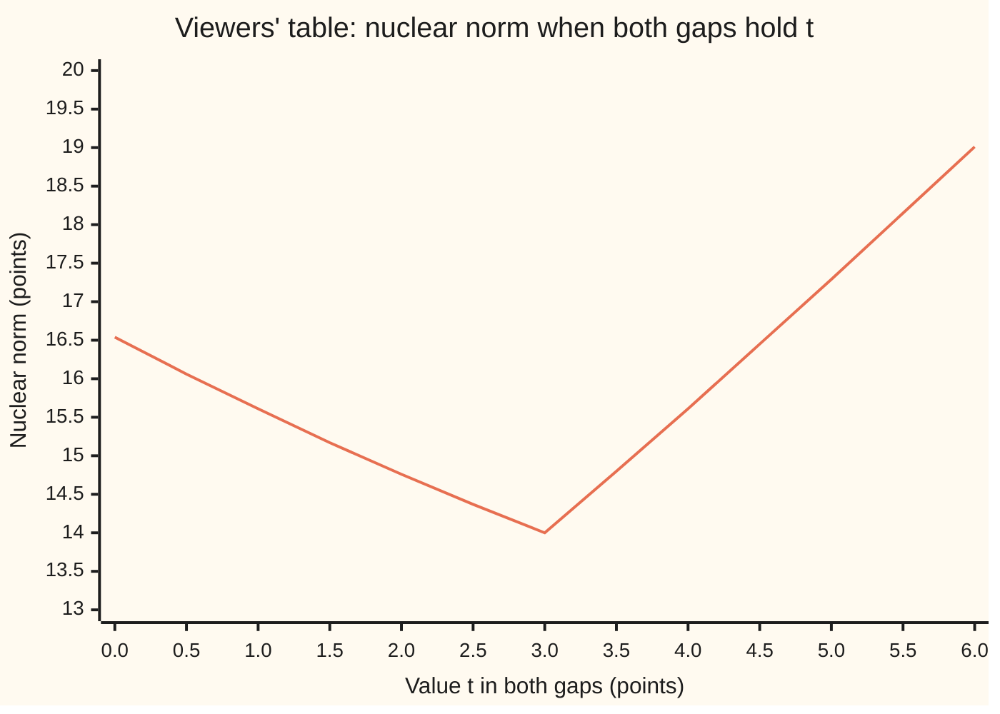
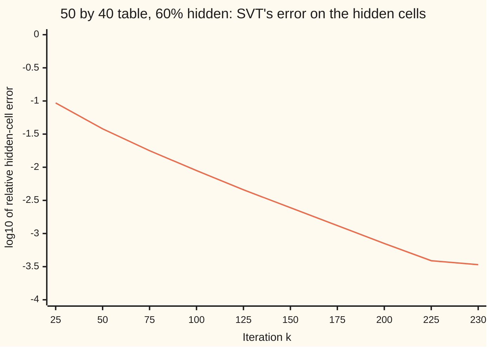

# Matrix completion: fill the missing entries with the table of lowest nuclear norm

[Syllabus](../../../SYLLABUS.md) → [Optimization](../README.md) → [Conic, Quadratic and Stochastic Programs](../README.md#s06) → Matrix completion

---

## General Overview

A small streaming service has three viewers and three films. Each viewer scores the films they watched, on a scale of points. Viewer 1 has not watched film 3, and viewer 3 has not watched film 1:

| | Film 1 | Film 2 | Film 3 |
| --- | ---: | ---: | ---: |
| Viewer 1 | 1 | 2 | ? |
| Viewer 2 | 2 | 4 | 6 |
| Viewer 3 | ? | 6 | 9 |

The service wants to guess the two missing scores. Any two numbers fit the seen scores, so the guess needs a rule. The rule here: taste has few ingredients. Every row seen so far is a multiple of (1, 2, 3): viewer 2 is twice as keen as viewer 1, and viewer 3 three times. A table built from one such pattern has **rank** 1 (its rows are all multiples of one row). Keeping that pattern fills both gaps with 3.

Searching for the lowest rank is hard in general: rank is a count, counts make bumpy, non-convex problems, and no fast method is known for them. This card replaces the count by a sum. The **nuclear norm** of a table is the sum of its singular values, the stretch factors of [The singular value decomposition](../../03-Algebra/07-Eigenvalues%20and%20Symmetric%20Matrices/06-singular-value-decomposition.md). It is convex, and minimising it is a semidefinite program, the problem class of [Semidefinite programs](05-semidefinite-programs-and-relaxations.md). For the viewers it picks the same fill, 3 and 3, with nuclear norm 1 + 4 + 9 = 14, and a dual certificate (a separate calculation that puts a floor under every possible fill) proves that no fill does better.

The same idea scales. The checks hide 60% of a 50 by 40 table of rank 2 and recover the hidden cells to a relative error of 0.000342, by **singular value thresholding** (SVT): shrink every singular value by a fixed amount, put the seen entries back, repeat.

**Matrix completion minimises the nuclear norm, the sum of singular values, over all tables that agree with the seen entries; it is the convex stand-in for the lowest rank, as the lasso's sum of sizes stands in for the count of nonzeros, and when the table is low rank, incoherent (its pattern spread over many rows and columns) and sampled at random it returns the exact table.**

**What kind of fact this is:** a convex model and a method. The semidefinite form, the dual certificate for the viewers' table and the threshold the method needs (8.296693) are proved on this card in Why it works. The convex-envelope property, singular value thresholding as a proximal step, the method's convergence and the exact-recovery theorem are stated, with their sources.

### The picture: the nuclear norm along one line of fills

Fill both gaps with the same value t and compute the nuclear norm of the full table.



Orange: the nuclear norm of the filled table. It falls to 14.00 at t = 3 and rises after, with a corner at the bottom, like the size of a number at zero. The corner is the rank-1 fill.

---

## The formula

Notation first, in words. The table $`M`$ has $`m`$ rows (viewers) and $`n`$ columns (films). $`\Omega`$ is the set of seen cells, and $`P_\Omega(X)`$ keeps a table's entries on the seen cells and puts 0 elsewhere. A candidate fill is $`X`$; $`\sigma_i(X)`$ are its singular values, largest first. This card **minimises**.

```math
\min_X\ \lVert X\rVert_* = \sum_i \sigma_i(X) \quad \text{subject to} \quad P_\Omega(X) = P_\Omega(M)
```

**Read it aloud:** among all tables that agree with every seen score, find the one whose singular values add up to the least.

The same problem as a semidefinite program, with helper blocks $`P`$ and $`Q`$ and $`\mathrm{tr}`$ the trace (the sum of the diagonal):

```math
\min_{X,\,P,\,Q}\ \tfrac12\big(\mathrm{tr}\,P + \mathrm{tr}\,Q\big) \quad \text{subject to} \quad \begin{pmatrix} P & X \\ X^T & Q \end{pmatrix} \succeq 0, \quad P_\Omega(X) = P_\Omega(M)
```

**Read it aloud:** wrap the fill in a larger symmetric matrix that must stay positive semidefinite, and make the wrapper's diagonal as small as possible.

The dual certificate. $`\langle W, X\rangle`$ is the sum of $`W_{ij} X_{ij}`$ over all cells, and $`\lVert W\rVert_2`$ is the largest singular value of $`W`$. If $`W`$ is zero on every gap and $`\lVert W\rVert_2 \le 1`$, then for every fill $`X`$:

```math
\lVert X\rVert_* \ \ge\ \langle W, X\rangle = \langle W, P_\Omega(M)\rangle
```

**Read it aloud:** a table that ignores the gaps and stretches nothing by more than 1 sets a floor under every fill, and the floor is computed from the seen scores alone.

Singular value thresholding. Write $`Y = U S V^T`$ as in the SVD card. The shrink by $`\tau`$ is

```math
D_\tau(Y) = U\,(S - \tau I)_+\,V^T, \qquad X_k = D_\tau(Y_{k-1}), \qquad Y_k = Y_{k-1} + \delta\, P_\Omega(M - X_k), \qquad Y_0 = 0
```

**Read it aloud:** reduce every singular value by tau and stop at zero; then add a step delta times the misses on the seen cells to the running table Y, and repeat.

| Symbol | Plain meaning | In our example | Push it up and the answer… |
| --- | --- | --- | --- |
| $`M`$, $`m`$, $`n`$, $`m_\Omega`$ | the true table; its rows and columns; the number of seen cells | 3 by 3 viewers' table; 50 by 40 with 800 seen | a bigger table needs more seen cells, but not in proportion |
| $`\Omega`$, $`P_\Omega`$ | the seen cells; keep seen entries, zero the rest (the other cells are the gaps, or hidden cells) | 7 of 9 cells; 800 of 2000 | more seen cells: recovery is easier |
| $`X`$, $`X^*`$, $`X_{ij}`$, $`t`$ | a candidate fill; the minimiser; the entry in row i, column j; one value put in both gaps (the first chart) | $`X^* = u u^T`$; t from 0 to 6 | — |
| $`\sigma_i`$, $`r`$ | singular values, largest first; the rank, the count of those above zero | 14, 0, 0; rank 1 | — |
| $`\lVert X\rVert_*`$, $`\lVert X\rVert_2`$, $`\lVert X\rVert_F`$ | nuclear norm (sum of $`\sigma_i`$); spectral norm (largest $`\sigma_i`$); Frobenius norm (root of the sum of squared entries); $`\lVert x\rVert_1`$ is the lasso's sum of sizes of a list | 14; 14; 14 for $`u u^T`$ | — |
| $`U`$, $`S`$, $`V`$, $`a_i`$, $`b_i`$, $`I`$, $`e_i`$ | the SVD pieces: output axes, stretch factors on a diagonal, input axes; one output and one input axis; the identity table; the axis vector that picks row i | $`S`$ has 14, 0, 0 for $`u u^T`$ | — |
| $`u`$, $`\hat u`$, $`w`$, $`z`$ | the taste pattern; the same scaled to length 1; a direction perpendicular to it; $`u`$ stacked on $`u`$ | (1, 2, 3); $`u/\sqrt{14}`$; (1, 1, −1) | — |
| $`W`$, $`\langle W, X\rangle`$ | the certificate table; the sum of entry-by-entry products | rows (4, 5, 0), (5, 7, 3), (0, 3, 12), all over 14; floor 14 | — |
| $`P`$, $`Q`$, $`\mathrm{tr}`$, $`\succeq 0`$ | helper blocks of the SDP; trace; positive semidefinite (no direction gets a negative value) | $`P = Q = u u^T`$, trace 14 each | — |
| $`D_\tau`$, $`(\cdot)_+`$, $`\tau`$, $`\tau_0`$ | the shrink; negative entries set to 0; the threshold; the least threshold that gives the exact fill | 20 and 8.4 work; $`\tau_0`$ = 8.296693; 300 for the 50 by 40 | larger τ: closer to the least nuclear norm; just above $`\tau_0`$ SVT is slow (390 iterations at 8.4, 121 at 20) |
| $`Y_k`$, $`X_k`$, $`k`$, $`\delta`$; $`G`$, $`Z`$, $`p`$, $`q`$ | SVT's running table; its fill at iteration k, from $`Y_0 = 0`$; the step; in the threshold proof, a subgradient, its part off the pattern, and two axis vectors with their $`u`$ part removed | δ = 1 (viewers), 3 (50 by 40) | above 2 the convergence proof no longer covers it |
| $`\mu`$, $`C`$ | incoherence, from 1 (spread out) to $`m/r`$ (piled on one row); the theorem's constant | 1.928571 for $`u`$; 4.882 for the 50 by 40 | higher μ: more seen cells needed |

Four letters mean other things elsewhere in this wing. Here μ is incoherence, not strong convexity; δ is SVT's step, written $`\alpha_k`$ on the gradient cards; t is a gap value, not a barrier weight; Q is a helper block, not a QP matrix.

### When it holds

- **The true table is low rank.** The nuclear norm favours few large singular values. A table of full rank has no short description, and nothing fills its gaps.
- **Every row and column has seen cells.** Hide the whole third column and the least nuclear norm fills it with 0, 0, 0 against a truth of 3, 6, 9: nothing seen connects that column to the pattern.
- **The table is incoherent.** Its pattern is spread over many rows and columns, not piled on one. If viewer 1 alone has scores (5, 4, 3) and the 3 is hidden, every other row is zero, and the fill is 0.
- **The seen cells are chosen at random.** The exact-recovery theorem assumes uniformly random cells. Viewers who rate only what they like break this, and the theorem then promises nothing.
- **For SVT, the threshold is large enough.** With τ = 1 the viewers' gaps come out at 0.466277, not 3. Below $`\tau_0`$ = 8.296693 the method solves a slightly different problem.

---

## Why it works

### Step 0: rank counts the singular values, the nuclear norm adds them

The rank is the number of singular values above zero. That count behaves like the number of nonzero coefficients in a regression: minimising it directly means trying patterns one by one.

The lasso's fix was to replace the count by the sum of sizes, $`\lVert x\rVert_1`$ ([Proximal gradient](06-proximal-methods-ista-fista-and-the-lasso.md)). The matrix version replaces the count of singular values by their sum. Singular values are never negative, so their sum is the sum of sizes of the list of singular values. This is why the nuclear norm is called the matrix lasso.

Fazel proved that the swap is the best convex one: on tables with $`\lVert X\rVert_2 \le 1`$, the nuclear norm is the largest convex function that never exceeds the rank (stated here; source: Recht, Fazel and Parrilo, 2010).

### Step 1: any table that stretches nothing by more than 1 gives a floor

Write the fill as $`X = \sum_i \sigma_i\, a_i b_i^T`$, its SVD in pieces, with unit vectors $`a_i`$ and $`b_i`$. Then for any $`W`$:

```math
\langle W, X\rangle = \sum_i \sigma_i\, a_i^T W b_i \ \le\ \sum_i \sigma_i\, \lVert W\rVert_2 .
```

Each $`a_i^T W b_i`$ is at most $`\lVert W\rVert_2`$, because $`W`$ stretches no unit vector by more than that. So $`\lVert W\rVert_2 \le 1`$ gives $`\langle W, X\rangle \le \lVert X\rVert_*`$.

Now make $`W`$ zero on both gaps. The gaps then drop out of $`\langle W, X\rangle`$, and the floor is the same number for every fill.

### Step 2: the floor meets the rank-1 fill, so 14 is the minimum

For the viewers, take

```math
W = \frac{1}{14}\begin{pmatrix} 4 & 5 & 0 \\ 5 & 7 & 3 \\ 0 & 3 & 12 \end{pmatrix} = \hat u \hat u^T + \frac{3}{14}\, w w^T, \qquad w = (1, 1, -1)
```

- It is zero on cells (1, 3) and (3, 1), the two gaps.
- Its singular values are 1, 0.642857 and 0: it stretches $`u`$ by 1, stretches $`w`$, which is perpendicular to $`u`$, by 9/14 = 0.642857, and flattens the third direction.
- On the seen cells, $`\langle W, M\rangle = 196/14 = 14`$.

So every fill has nuclear norm at least 14. The rank-1 fill $`u u^T`$ has nuclear norm 14: one singular value, $`\lVert u\rVert^2 = 1 + 4 + 9`$. It is the minimum, certified.

It is also the only minimiser. A fill with nuclear norm 14 must meet the floor, so every piece $`a_i^T W b_i`$ must equal 1. Only the direction $`\hat u`$ achieves that, because $`W`$'s other singular values are below 1. So the fill is a multiple of $`u u^T`$, and the seen 4 fixes the multiple at 1.

### Step 3: the same pair is a semidefinite program and its dual

The second formula is the nuclear norm written as an SDP: $`\lVert X\rVert_*`$ equals the least $`\tfrac12(\mathrm{tr}\,P + \mathrm{tr}\,Q)`$ over blocks that make the wrapper positive semidefinite.

<details>
<summary>Detailed proof: the nuclear norm is the least half-trace of a positive semidefinite wrapper</summary>

Write $`X = \sum_i \sigma_i a_i b_i^T`$ with orthonormal $`a_i`$ and orthonormal $`b_i`$.

**The wrapper's half-trace is at least the nuclear norm.** Suppose the wrapper is positive semidefinite. Test it on the vector made of $`a_i`$ on top and $`-b_i`$ below. The value must be zero or more:

$`\displaystyle a_i^T P a_i + b_i^T Q b_i - 2\sigma_i \ge 0 .`$

Add over $`i`$. Because $`P`$ and $`Q`$ are positive semidefinite, $`\mathrm{tr}\,P`$ is at least $`\sum_i a_i^T P a_i`$ over any orthonormal $`a_i`$, and the same for $`Q`$. So $`\mathrm{tr}\,P + \mathrm{tr}\,Q \ge 2\sum_i \sigma_i`$.

**Equality is reached.** Take $`P = \sum_i \sigma_i a_i a_i^T`$ and $`Q = \sum_i \sigma_i b_i b_i^T`$. The wrapper is then $`\sum_i \sigma_i z_i z_i^T`$ with $`z_i`$ made of $`a_i`$ on top and $`b_i`$ below, a sum of positive semidefinite pieces. Its half-trace is $`\tfrac12 \sum_i \sigma_i (1 + 1) = \sum_i \sigma_i`$.

</details>

For the viewers, $`P = Q = X = u u^T`$ makes the wrapper $`z z^T`$ with $`z = (u, u)`$. Its eigenvalues are 28 and five zeros, so it is positive semidefinite, and the half-trace is (14 + 14)/2 = 14.

The dual of this SDP maximises $`\langle W, P_\Omega(M)\rangle`$ over tables zero on the gaps with $`\begin{pmatrix} I & -W \\ -W^T & I \end{pmatrix} \succeq 0`$. By the Schur complement test of the SDP card, that block condition is $`I - W^T W \succeq 0`$, the same as $`\lVert W\rVert_2 \le 1`$. For our $`W`$ the block's eigenvalues are $`1 \pm \sigma_i(W)`$: 2, 1.642857, 1, 1, 0.357143 and 0, all zero or more. Primal 14, dual 14, gap 0. An interior-point solver would find this pair; the checks verify it.

### Step 4: the shrink of singular values is the proximal step of the nuclear norm

An interior-point solver stores the whole wrapper, which is too big for a very large table. A first-order method needs the proximal step of the nuclear norm, the matrix version of the soft thresholding on the [Proximal gradient](06-proximal-methods-ista-fista-and-the-lasso.md) card:

```math
D_\tau(Y) = \arg\min_X \Big( \tau \lVert X\rVert_* + \tfrac12 \lVert X - Y\rVert_F^2 \Big)
```

**Read it aloud:** shrinking every singular value of Y by tau gives the table that best trades a small nuclear norm against staying close to Y.

Cai, Candès and Shen proved this (stated here). The idea, in short: the nuclear norm sees only the singular values of $`X`$, and for given singular values $`\lVert X - Y\rVert_F`$ is least when $`\langle X, Y\rangle`$ is largest. Von Neumann's trace inequality, $`\langle X, Y\rangle \le \sum_i \sigma_i(X)\,\sigma_i(Y)`$ with equality on shared axes, then says the best $`X`$ shares $`Y`$'s axes. Along those axes the problem splits into one soft threshold per singular value. The checks test it on the zero-filled viewers' table with τ = 2: the shrink beats 300 random nearby tables, the closest by 0.020290.

### Step 5: SVT climbs a dual, and the threshold must be large

SVT solves a blended problem: minimise $`\tau\lVert X\rVert_* + \tfrac12\lVert X\rVert_F^2`$ subject to the seen cells. The running table $`Y_k`$ holds prices on the seen cells, and each round is a price update on the dual, the same climb as the price updates on the SDP card. Cai, Candès and Shen proved convergence for any step $`0 < \delta < 2`$ (stated here).

The Frobenius term is a tie-breaker. Divide by τ and it weighs $`1/(2\tau)`$, so a large τ makes the blended answer the least-nuclear-norm answer. How large is computable for the viewers:

<details>
<summary>Detailed proof: for the viewers, SVT returns the exact fill exactly when τ ≥ 42/(√65 − 3)</summary>

The blended problem is strongly convex with linear limits, so $`X`$ is its answer exactly when $`X + \tau G`$ is zero on both gaps for some subgradient $`G`$ of the nuclear norm at $`X`$. The multipliers on the seen cells absorb everything else.

At $`X = u u^T`$ the subgradients are $`G = \hat u \hat u^T + Z`$, where $`Z`$ acts only in the plane perpendicular to $`u`$ and $`\lVert Z\rVert_2 \le 1`$ (Candès and Recht, 2009). Cell (1, 3) of $`u u^T`$ is 3 and of $`\hat u \hat u^T`$ is 3/14, so the gap condition is

$`\displaystyle 3 + \tau\Big(\frac{3}{14} + Z_{13}\Big) = 0 .`$

Let $`p`$ and $`q`$ be the first and third axis vectors with their $`u`$ part removed. Then $`Z_{13} = p^T Z q`$, and $`\lVert p\rVert^2 = 1 - 1/14`$ and $`\lVert q\rVert^2 = 1 - 9/14`$. Cauchy–Schwarz gives $`|Z_{13}| \le \lVert p\rVert\lVert q\rVert = \sqrt{65}/14`$, and a reflection in the plane reaches $`-\sqrt{65}/14`$. Cell (3, 1) gives the same condition, because the reflection is symmetric. So the condition can be met exactly when

$`\displaystyle \frac{3}{\tau} + \frac{3}{14} \le \frac{\sqrt{65}}{14}, \quad\text{that is}\quad \tau \ge \frac{42}{\sqrt{65} - 3} = 8.296693 .`$

</details>

The checks run SVT with step δ = 1:

| Threshold τ | Gap (1, 3) | Gap (3, 1) | Iterations |
| ---: | ---: | ---: | ---: |
| 1 | 0.466277 | 0.466277 | 22 |
| 5 | 2.006991 | 2.006991 | 163 |
| 8 | 2.918273 | 2.918273 | 2499 |
| 8.4 | 3.000000 | 3.000000 | 390 |
| 20 | 3.000000 | 3.000000 | 121 |

Below 8.296693 the answer is a compromise; above it, it is the exact fill. Iterations stop when the seen-cell miss, relative to the seen scores, is below $`10^{-10}`$.

### Step 6: when the answer is the true table

The viewers' table is small enough to certify. For a large table, the question is whether the least-nuclear-norm fill equals the truth. Two conditions decide it.

1. **Incoherence.** For the left singular vectors $`U`$ of a rank-$`r`$ table with $`m`$ rows, $`\mu = (m/r)\max_i \lVert U^T e_i\rVert^2`$, where $`e_i`$ picks row $`i`$. It is 1 when the pattern is spread evenly over the rows and $`m/r`$ when it sits on one row. For $`u = (1, 2, 3)`$ it is 3 × 9/14 = 1.928571, out of a possible 3.
2. **Enough random cells.** A rank-$`r`$ table with $`m`$ rows and $`n`$ columns has $`r(m + n - r)`$ free numbers. No method can do with fewer seen cells than that.

**The exact-recovery theorem** (Candès and Recht, 2009; stated here). Take an $`n`$ by $`n`$ table of rank $`r`$ that is incoherent, and see $`m_\Omega`$ cells chosen uniformly at random. If $`m_\Omega \ge C\, n^{1.2}\, r \log n`$ for a numerical constant $`C`$, and the rank is small ($`r \le n^{0.2}`$; the power 1.25 in place of 1.2 covers any rank), then with very high probability the least-nuclear-norm fill is exactly the true table. Candès and Tao (2010) lowered the count to about $`n r`$ times a power of $`\log n`$, and showed that about $`n r \log n`$ cells are needed by any method.

The theorem gives no value for $`C`$, so it does not say whether 800 cells are enough for a 50 by 40 table. The run is the evidence:

- **The table.** 50 viewers, 40 films, two taste patterns, entries drawn at random (seed 4). Scores are measured from an average score, so some are negative. Singular values 55.510399 and 49.540658; free numbers $`r(m + n - r)`$ = 176; $`n r \log n`$ = 391.2 with $`n`$ = 50, the larger side; μ = 4.882 out of 25.
- **The cells.** 800 of 2000 seen, chosen at random; 60% hidden.
- **The method.** SVT with τ = 6 × 50 = 300 and step δ = 1.2/0.4 = 3. The step is the practical rule of Cai, Candès and Shen, 1.2 divided by the seen fraction, and it lies outside the proved range below 2. It stops at iteration 230, with a seen-cell miss of 0.000098 and a hidden-cell error of 0.000342, both relative.



Orange: log10 of the hidden-cell error. It falls along a near-straight line: a fixed factor per iteration. The recovered table has singular values 55.507963 and 49.540705 and a third of 0.000000, rank 2. Its nuclear norm is 105.049 against the truth's 105.051. It is slightly lower because the seen cells are matched only to a relative 0.000098, so it is not yet an exact fill.

---

## Worked numbers, by hand

The viewers' table, from the seen scores to the certified minimum.

| Step | Arithmetic | Value |
| --- | --- | --- |
| rank 1: row 1 is half of row 2 | gap (1, 3) = 6 ÷ 2 | 3 |
| rank 1: row 3 is 3/2 of row 2 | gap (3, 1) = 2 × 3/2 | 3 |
| the pattern | $`u = (1, 2, 3)`$, full table $`u u^T`$ | rows (1, 2, 3), (2, 4, 6), (3, 6, 9) |
| its one singular value | $`\lVert u\rVert^2`$ = 1 + 4 + 9 | 14 |
| the zero fill, for contrast | singular values 13.103494 + 2.165311 + 1.268805 | 16.537611 |
| certificate on the seen cells | (4×1 + 5×2 + 5×2 + 7×4 + 3×6 + 3×6 + 12×9) / 14 = 196/14 | 14 |
| certificate's stretch on $`u`$ | $`14 W u = (14, 28, 42) = 14u`$, so $`Wu = u`$ | 1 |
| certificate's stretch on $`w = (1, 1, -1)`$ | $`14 W w = (9, 9, -9)`$ | 9/14 = 0.642857 |
| floor against the rank-1 fill | 14 − 14 | **0: the fill 3, 3 is the minimum, 14** |

The grid search agrees: over all 14,641 fills with both gaps from 0 to 6 in steps of 0.05, the least nuclear norm is 14.000000 at (3.00, 3.00). The answer means viewer 1 should score film 3 at 3 points and viewer 3 should score film 1 at 3 points, if taste really has one ingredient.

### What breaks if you drop a piece

| Mistake | Comes out at | What went wrong |
| --- | --- | --- |
| SVT threshold 1 instead of above 8.30 | both gaps 0.466277 | A small τ lets the Frobenius tie-breaker win: small entries beat low rank |
| Hide the whole third column | fill 0, 0, 0; truth 3, 6, 9 | Sampling fails: no seen cell ties that column to the pattern, and adding a column never lowers the nuclear norm |
| A coherent table: viewer 1 alone scores (5, 4, 3), hide the 3 | fill 0; truth 3 | Incoherence fails: μ is 3, the maximum, because the pattern lives in the hidden cell's row only |
| Treat the gaps as zeros, one SVD, keep rank 1 | gaps 1.000223; seen (1, 1) becomes 0.113037 | The zeros are counted as scores, and the seen cells are no longer kept |

---

## Code, from first principles, and it actually runs

Both programs build every piece from loops. Singular values come from a short one-sided Jacobi routine: it turns pairs of columns until all are perpendicular, and their lengths are then the singular values (why that converges belongs to numerical methods). The viewers' fill is reached **four independent ways**: the rank-1 ratios, a grid search over 14,641 fills, the dual certificate with both SDP blocks, and SVT. A fifth check tests the shrink against 300 random tables. The 50 by 40 run is checked against the planted truth. Random numbers come from SplitMix64, a short generator written out in both languages, so the two outputs match.

### Python

```python
# Matrix completion by the nuclear norm -- the check behind the card; only math is imported.
# Part 1 fills the gaps of [[1, 2, ?], [2, 4, 6], [?, 6, 9]] with the table of least nuclear norm (sum of
# singular values) by ratios, grid search, a dual certificate and singular value thresholding (SVT).
# Part 2 hides 60% of a 50 by 40 rank-2 table and recovers it by SVT.  A table is a list of its columns.
import math

M64, state = (1 << 64) - 1, 2026
def uniform():                                    # SplitMix64: a draw in (0, 1]
    global state
    state = (state + 0x9E3779B97F4A7C15) & M64
    z = ((state ^ (state >> 30)) * 0xBF58476D1CE4E5B9) & M64
    z = ((z ^ (z >> 27)) * 0x94D049BB133111EB) & M64
    return (((z ^ (z >> 31)) >> 11) + 1) * 2.0 ** -53
def normal():                                     # Box-Muller, cosine half only
    u = uniform()
    return math.sqrt(-2.0 * math.log(u)) * math.cos(2.0 * math.pi * uniform())
def total(xs):                                    # left-to-right sum, so Python and Rust agree exactly
    s = 0.0
    for x in xs: s += x
    return s
def dot(u, v): return total(a * b for a, b in zip(u, v))
def cl(x): return 0.0 if abs(x) < 5e-7 else x     # print a rounding-level number as 0
def svd(cols, V=None):                            # one-sided Jacobi: turn column pairs of A V until all
    n = len(cols)                                 # are perpendicular; returns sigma_k, sigma_k u_k, v_k
    V = [[float(i == j) for i in range(n)] for j in range(n)] if V is None else V
    G = []
    for v in V:
        g = [0.0] * len(cols[0])
        for w, c in zip(v, cols):
            if w != 0.0: g = [a + w * b for a, b in zip(g, c)]
        G.append(g)
    V = [v[:] for v in V]
    for sweep in range(60):
        turns = 0
        for i in range(n - 1):
            for j in range(i + 1, n):
                a, b, g = dot(G[i], G[i]), dot(G[j], G[j]), dot(G[i], G[j])
                if abs(g) <= 1e-15 * math.sqrt(a * b): continue
                turns += 1; z = (b - a) / (2 * g)
                t = math.copysign(1.0, z) / (abs(z) + math.sqrt(1 + z * z)); c = 1 / math.sqrt(1 + t * t); s = c * t
                for P in (G, V):
                    P[i], P[j] = [c * x - s * y for x, y in zip(P[i], P[j])], [s * x + c * y for x, y in zip(P[i], P[j])]
        if turns == 0: break
    return [math.sqrt(dot(g, g)) for g in G], G, V
def sv(A): return sorted(svd(A)[0], reverse=True)
def nuc(A): return total(sv(A))
def eig(A): _, G, V = svd(A); return sorted((dot(g, v) for g, v in zip(G, V)), reverse=True)  # A symmetric
def f6(xs): return " ".join(f"{cl(x):.6f}" for x in xs)
def svt(M, mask, tau, delta, K, tol, truth=None, every=0):
    n, m = len(M), len(M[0]); Y, V, hist = [[0.0] * m for _ in range(n)], None, []
    obs = math.sqrt(total(M[j][i] ** 2 for j in range(n) for i in range(m) if mask[j][i]))
    for k in range(1, K + 1):
        sig, G, V = svd(Y, V)                     # X_k = D_tau(Y_{k-1}): shrink every singular value by tau
        X, rank = [[0.0] * m for _ in range(n)], 0
        for s, g, v in zip(sig, G, V):
            if s > tau:
                rank += 1; f = 1 - tau / s
                for j in range(n): X[j] = [a + f * v[j] * b for a, b in zip(X[j], g)]
        res = 0.0
        for j in range(n):
            for i in range(m):
                if mask[j][i]: d = M[j][i] - X[j][i]; Y[j][i] += delta * d; res += d * d
        res = math.sqrt(res) / obs
        if every and (k % every == 0 or res < tol): hist.append((k, res, hidden_err(X, truth, mask), rank))
        if res < tol: break
    return X, k, rank, res, hist
def hidden_err(X, T, mask):
    cells = [(j, i) for j in range(len(T)) for i in range(len(T[0])) if not mask[j][i]]
    return math.sqrt(total((X[j][i] - T[j][i]) ** 2 for j, i in cells) / total(T[j][i] ** 2 for j, i in cells))
def table(x, y): return [[1.0, 2.0, y], [2.0, 4.0, 6.0], [x, 6.0, 9.0]]   # x = entry (1,3), y = entry (3,1)
gap = [[1, 1, 0], [1, 1, 1], [0, 1, 1]]
x = 2.0 * 6.0 / 4.0                               # road 1: rank 1 makes row 1 half of row 2
print("table [[1, 2, ?], [2, 4, 6], [?, 6, 9]]; rank-1 fill by ratios: both gaps", f"{x:.6f}")
R1 = table(x, x); s1 = sv(R1)
print(f"u = (1, 2, 3): u u^T has trace 1 + 4 + 9 = {1.0 + 4.0 + 9.0:.6f}; singular values {f6(s1)}; nuclear norm {nuc(R1):.6f}")
best = min((nuc(table(i / 20, j / 20)), i / 20, j / 20) for i in range(121) for j in range(121))
print(f"grid search, both gaps 0 to 6 in steps of 0.05: best ({best[1]:.2f}, {best[2]:.2f}), nuclear norm {best[0]:.6f}")
line = [nuc(table(t / 2, t / 2)) for t in range(13)]
print("chart, gap t  ", " ".join(f"{t / 2:5.1f}" for t in range(13)))
print("chart, norm   ", " ".join(f"{v:5.2f}" for v in line))
Z0 = table(0.0, 0.0)
print(f"zero fill: singular values {f6(sv(Z0))}, nuclear norm {nuc(Z0):.6f}, rank {sum(s > 1e-9 for s in sv(Z0))}")
W = [[c / 14.0 for c in col] for col in ([4.0, 5.0, 0.0], [5.0, 7.0, 3.0], [0.0, 3.0, 12.0])]
sW = sv(W); floor = total(W[j][i] * R1[j][i] for j in range(3) for i in range(3) if gap[j][i]) / sW[0]
print(f"certificate W = [[4, 5, 0], [5, 7, 3], [0, 3, 12]] / 14: zero on both gaps; singular values {f6(sW)}")
print(f"floor <W, seen entries> / largest singular value of W = {floor:.6f}; rank-1 fill minus floor {cl(nuc(R1) - floor):.6f}")
B = [R1[j] + R1[j] for j in range(3)] * 2                     # [[P, X], [X^T, Q]] with P = Q = X = u u^T
D = [[float(i == j) - (W[j % 3][i % 3] if (i < 3) != (j < 3) else 0.0) for i in range(6)] for j in range(6)]  # [[I, -W], [-W, I]]
print(f"SDP primal: eigenvalues of [[P, X], [X^T, Q]] {f6(eig(B))}; (tr P + tr Q) / 2 = {(14.0 + 14.0) / 2:.6f}")
print(f"SDP dual:   eigenvalues of [[I, -W], [-W, I]] {f6(eig(D))}")
Y0, tau = Z0, 2.0                                             # road 3: D_tau is the prox of tau |.|_*
def phi(X): return tau * nuc(X) + 0.5 * total((a - b) ** 2 for c, d in zip(X, Y0) for a, b in zip(c, d))
sig, G, V = svd(Y0); P = [[total(max(s - tau, 0.0) / s * g[i] * v[j] for s, g, v in zip(sig, G, V)) for i in range(3)] for j in range(3)]
excess = min(phi([[a + 0.1 * normal() for a in col] for col in P]) - phi(P) for _ in range(300))
print(f"prox check, tau 2 on the zero fill: D_tau beats 300 random nearby tables; smallest excess {excess:.6f}")
tau0 = 42.0 / (math.sqrt(65.0) - 3.0)
print(f"threshold needed for the exact fill: 42 / (sqrt 65 - 3) = {tau0:.6f}")
runs = {}
for tau in (1.0, 5.0, 8.0, 8.4, 20.0):
    X, k, rank, res, _ = svt(table(x, x), gap, tau, 1.0, 5000, 1e-10)
    runs[tau] = (X[2][0], X[0][2])
    print(f"SVT tau {tau:4.1f}, step 1: gaps {X[2][0]:.6f} {X[0][2]:.6f}, rank {rank}, iteration {k}, seen-entry miss {res:.1e}")
print(f"incoherence mu of u: 3 x max(u_i^2) / |u|^2 = {3 * 9.0 / 14.0:.6f} (range 1 to 3)")
col_gap = [[1, 1, 1], [1, 1, 1], [0, 0, 0]]
Xc = svt(table(x, x), col_gap, 20.0, 1.0, 5000, 1e-10)[0]
print(f"mistake, whole third column hidden: SVT fills {f6(Xc[2])}; truth 3 6 9")
spike = [[5.0, 0.0, 0.0], [4.0, 0.0, 0.0], [3.0, 0.0, 0.0]]       # only viewer 1 rates (5, 4, 3); mu = 3
Xs = svt(spike, [[1, 1, 1], [1, 1, 1], [0, 1, 1]], 20.0, 1.0, 5000, 1e-10)[0]
print(f"mistake, coherent table, viewer 1 alone rates (5, 4, 3), the 3 hidden: SVT fills {cl(Xs[2][0]):.6f}")
sig, G, V = svd(Z0); k1 = max(range(3), key=lambda k: sig[k])
print(f"mistake, one SVD of the zero fill, keep rank 1: gaps {G[k1][0] * V[k1][2]:.6f} {G[k1][2] * V[k1][0]:.6f}, seen (1,1) {G[k1][0] * V[k1][0]:.6f}")

state, m, n, r = 4, 50, 40, 2                     # part 2, seed 4: 50 viewers, 40 films, two tastes
Lf = [[normal() for _ in range(r)] for _ in range(m)]; Rf = [[normal() for _ in range(r)] for _ in range(n)]
T = [[dot(Lf[i], Rf[j]) for i in range(m)] for j in range(n)]
order = list(range(m * n))
for i in range(m * n - 1, 0, -1):                 # Fisher-Yates shuffle; the first 800 cells are seen
    j = int(uniform() * (i + 1)) % (i + 1); order[i], order[j] = order[j], order[i]
mask = [[0] * m for _ in range(n)]
for c in order[:800]: mask[c // m][c % m] = 1
sT, GT, _ = svd(T); top = sorted(range(n), key=lambda k: -sT[k])[:r]
muU = m / r * max(total((GT[k][i] / sT[k]) ** 2 for k in top) for i in range(m))
print(f"50 x 40 rank-2 table: 800 of 2000 seen (40%), degrees of freedom r(m + n - r) = {r * (m + n - r)}, n r log n = {m * r * math.log(m):.1f}")
print(f"truth: singular values {f6(sv(T)[:3])}, viewer-side incoherence mu {muU:.3f} (range 1 to 25)")
X, k, rank, res, hist = svt(T, mask, 6.0 * m, 1.2 / 0.4, 1000, 1e-4, T, 25)
print(f"SVT tau 6 x 50 = {6.0 * m:.0f}, step 1.2 / 0.4 = {1.2 / 0.4:.1f}; stop when the seen-entry miss < 1e-4")
print("     k   seen-entry miss   hidden error   rank")
for kk, rr, hh, rk in hist: print(f"{kk:6d} {rr:17.6f} {hh:14.6f} {rk:6d}")
print(f"recovered: singular values {f6(sv(X)[:3])}; nuclear norm {nuc(X):.3f} against the truth's {nuc(T):.3f}")
print("chart, k      ", " ".join(f"{kk:5d}" for kk, _, _, _ in hist))
print("chart, log10  ", " ".join(f"{math.log10(hh):5.2f}" for _, _, hh, _ in hist))
assert abs(best[0] - floor) < 1e-9 and (best[1], best[2]) == (x, x)   # grid search meets the dual floor
assert abs(sW[0] - 1.0) < 1e-12                                          # W is a valid certificate
assert min(eig(D)) > -1e-12 and min(eig(B)) > -1e-12                     # both SDP blocks are PSD
assert excess > 0.0                                                      # D_tau minimises the prox target
assert abs(runs[20.0][0] - 3.0) < 1e-6 and abs(runs[8.4][1] - 3.0) < 1e-6  # threshold above tau0: exact
assert abs(runs[8.0][0] - 3.0) > 0.05 and abs(runs[1.0][0] - 3.0) > 2.0  # threshold below tau0: not exact
assert max(map(abs, Xc[2])) < 1e-9 and abs(Xs[2][0]) < 1e-9             # the two broken hypotheses
assert hist[-1][2] < 1e-3 and rank == 2                                  # the 50 x 40 table is recovered
print("ALL CHECKS PASS")
```

**Ran 2026-11-24 on macOS, Python 3.14.10, standard library only. All checks passed. Output, pasted from the run:**

```
table [[1, 2, ?], [2, 4, 6], [?, 6, 9]]; rank-1 fill by ratios: both gaps 3.000000
u = (1, 2, 3): u u^T has trace 1 + 4 + 9 = 14.000000; singular values 14.000000 0.000000 0.000000; nuclear norm 14.000000
grid search, both gaps 0 to 6 in steps of 0.05: best (3.00, 3.00), nuclear norm 14.000000
chart, gap t     0.0   0.5   1.0   1.5   2.0   2.5   3.0   3.5   4.0   4.5   5.0   5.5   6.0
chart, norm    16.54 16.06 15.61 15.17 14.76 14.37 14.00 14.80 15.61 16.45 17.29 18.15 19.01
zero fill: singular values 13.103494 2.165311 1.268805, nuclear norm 16.537611, rank 3
certificate W = [[4, 5, 0], [5, 7, 3], [0, 3, 12]] / 14: zero on both gaps; singular values 1.000000 0.642857 0.000000
floor <W, seen entries> / largest singular value of W = 14.000000; rank-1 fill minus floor 0.000000
SDP primal: eigenvalues of [[P, X], [X^T, Q]] 28.000000 0.000000 0.000000 0.000000 0.000000 0.000000; (tr P + tr Q) / 2 = 14.000000
SDP dual:   eigenvalues of [[I, -W], [-W, I]] 2.000000 1.642857 1.000000 1.000000 0.357143 0.000000
prox check, tau 2 on the zero fill: D_tau beats 300 random nearby tables; smallest excess 0.020290
threshold needed for the exact fill: 42 / (sqrt 65 - 3) = 8.296693
SVT tau  1.0, step 1: gaps 0.466277 0.466277, rank 3, iteration 22, seen-entry miss 4.1e-11
SVT tau  5.0, step 1: gaps 2.006991 2.006991, rank 3, iteration 163, seen-entry miss 9.8e-11
SVT tau  8.0, step 1: gaps 2.918273 2.918273, rank 3, iteration 2499, seen-entry miss 9.9e-11
SVT tau  8.4, step 1: gaps 3.000000 3.000000, rank 2, iteration 390, seen-entry miss 9.6e-11
SVT tau 20.0, step 1: gaps 3.000000 3.000000, rank 1, iteration 121, seen-entry miss 8.4e-11
incoherence mu of u: 3 x max(u_i^2) / |u|^2 = 1.928571 (range 1 to 3)
mistake, whole third column hidden: SVT fills 0.000000 0.000000 0.000000; truth 3 6 9
mistake, coherent table, viewer 1 alone rates (5, 4, 3), the 3 hidden: SVT fills 0.000000
mistake, one SVD of the zero fill, keep rank 1: gaps 1.000223 1.000223, seen (1,1) 0.113037
50 x 40 rank-2 table: 800 of 2000 seen (40%), degrees of freedom r(m + n - r) = 176, n r log n = 391.2
truth: singular values 55.510399 49.540658 0.000000, viewer-side incoherence mu 4.882 (range 1 to 25)
SVT tau 6 x 50 = 300, step 1.2 / 0.4 = 3.0; stop when the seen-entry miss < 1e-4
     k   seen-entry miss   hidden error   rank
    25          0.036894       0.092693      2
    50          0.012861       0.037808      2
    75          0.005679       0.017816      2
   100          0.002728       0.008912      2
   125          0.001376       0.004615      2
   150          0.000715       0.002442      2
   175          0.000379       0.001310      2
   200          0.000204       0.000709      2
   225          0.000110       0.000386      2
   230          0.000098       0.000342      2
recovered: singular values 55.507963 49.540705 0.000000; nuclear norm 105.049 against the truth's 105.051
chart, k          25    50    75   100   125   150   175   200   225   230
chart, log10   -1.03 -1.42 -1.75 -2.05 -2.34 -2.61 -2.88 -3.15 -3.41 -3.47
ALL CHECKS PASS
```

### Rust

Same numbers, same labels, built with `rustc --edition 2021 -O`.

```rust
// Matrix completion by the nuclear norm -- the check behind the card; std only.
// Part 1 fills the gaps of [[1, 2, ?], [2, 4, 6], [?, 6, 9]] with the table of least nuclear norm (sum of
// singular values) by ratios, grid search, a dual certificate and singular value thresholding (SVT).
// Part 2 hides 60% of a 50 by 40 rank-2 table and recovers it by SVT.  A table is a list of its columns.
type Mat = Vec<Vec<f64>>;
struct Rng(u64);
impl Rng {
    fn uniform(&mut self) -> f64 { // SplitMix64: a draw in (0, 1]
        self.0 = self.0.wrapping_add(0x9E3779B97F4A7C15);
        let mut z = (self.0 ^ (self.0 >> 30)).wrapping_mul(0xBF58476D1CE4E5B9);
        z = (z ^ (z >> 27)).wrapping_mul(0x94D049BB133111EB);
        (((z ^ (z >> 31)) >> 11) + 1) as f64 * 2f64.powi(-53)
    }
    fn normal(&mut self) -> f64 { // Box-Muller, cosine half only
        let u = self.uniform();
        (-2.0 * u.ln()).sqrt() * (2.0 * std::f64::consts::PI * self.uniform()).cos()
    }
}
fn dot(u: &[f64], v: &[f64]) -> f64 { let mut s = 0.0; for (a, b) in u.iter().zip(v) { s += a * b; } s }
fn cl(x: f64) -> f64 { if x.abs() < 5e-7 { 0.0 } else { x } }
fn eye(n: usize) -> Mat { (0..n).map(|j| (0..n).map(|i| if i == j { 1.0 } else { 0.0 }).collect()).collect() }
fn svd(cols: &Mat, v0: Option<&Mat>) -> (Vec<f64>, Mat, Mat) { // one-sided Jacobi
    let n = cols.len();
    let mut v = match v0 { Some(w) => w.clone(), None => eye(n) };
    let mut g: Mat = Vec::new();
    for vk in &v {
        let mut gk = vec![0.0; cols[0].len()];
        for (w, c) in vk.iter().zip(cols) {
            if *w != 0.0 { gk = gk.iter().zip(c).map(|(a, b)| a + w * b).collect(); }
        }
        g.push(gk);
    }
    for _ in 0..60 {
        let mut turns = 0;
        for i in 0..n - 1 {
            for j in i + 1..n {
                let (a, b, gg) = (dot(&g[i], &g[i]), dot(&g[j], &g[j]), dot(&g[i], &g[j]));
                if gg.abs() <= 1e-15 * (a * b).sqrt() { continue; }
                turns += 1; let z = (b - a) / (2.0 * gg);
                let t = 1f64.copysign(z) / (z.abs() + (1.0 + z * z).sqrt());
                let c = 1.0 / (1.0 + t * t).sqrt(); let s = c * t;
                for p in [&mut g, &mut v] {
                    let ni: Vec<f64> = p[i].iter().zip(&p[j]).map(|(x, y)| c * x - s * y).collect();
                    let nj: Vec<f64> = p[i].iter().zip(&p[j]).map(|(x, y)| s * x + c * y).collect();
                    p[i] = ni; p[j] = nj;
                }
            }
        }
        if turns == 0 { break; }
    }
    (g.iter().map(|x| dot(x, x).sqrt()).collect(), g, v)
}
fn desc(mut x: Vec<f64>) -> Vec<f64> { x.sort_by(|a, b| b.partial_cmp(a).unwrap()); x }
fn sv(a: &Mat) -> Vec<f64> { desc(svd(a, None).0) }
fn nuc(a: &Mat) -> f64 { let mut s = 0.0; for x in sv(a) { s += x; } s }
fn eig(a: &Mat) -> Vec<f64> { let (_, g, v) = svd(a, None); desc(g.iter().zip(&v).map(|(x, y)| dot(x, y)).collect()) }
fn f6(xs: &[f64]) -> String { xs.iter().map(|x| format!("{:.6}", cl(*x))).collect::<Vec<_>>().join(" ") }
fn hidden_err(x: &Mat, t: &Mat, mask: &Vec<Vec<u8>>) -> f64 {
    let (mut num, mut den) = (0.0, 0.0);
    for j in 0..t.len() { for i in 0..t[0].len() { if mask[j][i] == 0 { let d = x[j][i] - t[j][i]; num += d * d; } } }
    for j in 0..t.len() { for i in 0..t[0].len() { if mask[j][i] == 0 { den += t[j][i] * t[j][i]; } } }
    (num / den).sqrt()
}
fn svt(mm: &Mat, mask: &Vec<Vec<u8>>, tau: f64, delta: f64, kmax: usize, tol: f64, truth: Option<&Mat>, every: usize)
    -> (Mat, usize, usize, f64, Vec<(usize, f64, f64, usize)>) {
    let (n, m) = (mm.len(), mm[0].len());
    let (mut y, mut v, mut hist): (Mat, Option<Mat>, Vec<(usize, f64, f64, usize)>) = (vec![vec![0.0; m]; n], None, vec![]);
    let mut obs = 0.0; for j in 0..n { for i in 0..m { if mask[j][i] == 1 { obs += mm[j][i] * mm[j][i]; } } }
    let obs = f64::sqrt(obs);
    let (mut x, mut rank, mut res, mut kk) = (vec![vec![0.0; m]; n], 0, 0.0, 0);
    for k in 1..=kmax {
        kk = k; let (sig, g, vn) = svd(&y, v.as_ref());
        x = vec![vec![0.0; m]; n]; rank = 0;
        for ((s, gk), vk) in sig.iter().zip(&g).zip(&vn) {
            if *s > tau {
                rank += 1; let f = 1.0 - tau / s;
                for j in 0..n { x[j] = x[j].iter().zip(gk).map(|(a, b)| a + f * vk[j] * b).collect(); }
            }
        }
        v = Some(vn); res = 0.0;
        for j in 0..n { for i in 0..m { if mask[j][i] == 1 { let d = mm[j][i] - x[j][i]; y[j][i] += delta * d; res += d * d; } } }
        res = res.sqrt() / obs;
        if every > 0 && (k % every == 0 || res < tol) { hist.push((k, res, hidden_err(&x, truth.unwrap(), mask), rank)); }
        if res < tol { break; }
    }
    (x, kk, rank, res, hist)
}
fn table(x: f64, y: f64) -> Mat { vec![vec![1.0, 2.0, y], vec![2.0, 4.0, 6.0], vec![x, 6.0, 9.0]] }
fn main() {
    let mut rng = Rng(2026);
    let gap: Vec<Vec<u8>> = vec![vec![1, 1, 0], vec![1, 1, 1], vec![0, 1, 1]];
    let x = 2.0 * 6.0 / 4.0; // road 1: rank 1 makes row 1 half of row 2
    println!("table [[1, 2, ?], [2, 4, 6], [?, 6, 9]]; rank-1 fill by ratios: both gaps {:.6}", x);
    let (r1, s1) = (table(x, x), sv(&table(x, x)));
    println!("u = (1, 2, 3): u u^T has trace 1 + 4 + 9 = {:.6}; singular values {}; nuclear norm {:.6}", 1.0 + 4.0 + 9.0, f6(&s1), nuc(&r1));
    let mut best = (f64::INFINITY, 0.0, 0.0);
    for i in 0..121 { for j in 0..121 {
        let c = (nuc(&table(i as f64 / 20.0, j as f64 / 20.0)), i as f64 / 20.0, j as f64 / 20.0);
        if c.partial_cmp(&best) == Some(std::cmp::Ordering::Less) { best = c; }
    } }
    println!("grid search, both gaps 0 to 6 in steps of 0.05: best ({:.2}, {:.2}), nuclear norm {:.6}", best.1, best.2, best.0);
    let line: Vec<f64> = (0..13).map(|t| nuc(&table(t as f64 / 2.0, t as f64 / 2.0))).collect();
    println!("chart, gap t   {}", (0..13).map(|t| format!("{:5.1}", t as f64 / 2.0)).collect::<Vec<_>>().join(" "));
    println!("chart, norm    {}", line.iter().map(|v| format!("{:5.2}", v)).collect::<Vec<_>>().join(" "));
    let z0 = table(0.0, 0.0);
    println!("zero fill: singular values {}, nuclear norm {:.6}, rank {}", f6(&sv(&z0)), nuc(&z0), sv(&z0).iter().filter(|s| **s > 1e-9).count());
    let w: Mat = [[4.0, 5.0, 0.0], [5.0, 7.0, 3.0], [0.0, 3.0, 12.0]].iter().map(|c| c.iter().map(|e| e / 14.0).collect()).collect();
    let (sw, mut fl) = (sv(&w), 0.0);
    for j in 0..3 { for i in 0..3 { if gap[j][i] == 1 { fl += w[j][i] * r1[j][i]; } } }
    let floor = fl / sw[0];
    println!("certificate W = [[4, 5, 0], [5, 7, 3], [0, 3, 12]] / 14: zero on both gaps; singular values {}", f6(&sw));
    println!("floor <W, seen entries> / largest singular value of W = {:.6}; rank-1 fill minus floor {:.6}", floor, cl(nuc(&r1) - floor));
    let bcol: Mat = (0..3).map(|j| [r1[j].clone(), r1[j].clone()].concat()).collect();
    let b: Mat = [bcol.clone(), bcol].concat(); // [[P, X], [X^T, Q]] with P = Q = X = u u^T
    let d: Mat = (0..6).map(|j| (0..6).map(|i| (if i == j { 1.0 } else { 0.0 }) - (if (i < 3) != (j < 3) { w[j % 3][i % 3] } else { 0.0 })).collect()).collect();
    println!("SDP primal: eigenvalues of [[P, X], [X^T, Q]] {}; (tr P + tr Q) / 2 = {:.6}", f6(&eig(&b)), (14.0 + 14.0) / 2.0);
    println!("SDP dual:   eigenvalues of [[I, -W], [-W, I]] {}", f6(&eig(&d)));
    let tau = 2.0; // road 3: D_tau is the prox of tau |.|_*
    let phi = |xm: &Mat| { let mut s = 0.0; for (c, dd) in xm.iter().zip(&z0) { for (a, bb) in c.iter().zip(dd) { s += (a - bb) * (a - bb); } } tau * nuc(xm) + 0.5 * s };
    let (sig, g, v) = svd(&z0, None);
    let p: Mat = (0..3).map(|j| (0..3).map(|i| { let mut s = 0.0; for k in 0..3 { s += f64::max(sig[k] - tau, 0.0) / sig[k] * g[k][i] * v[k][j]; } s }).collect()).collect();
    let mut excess = f64::INFINITY; for _ in 0..300 {
        let q: Mat = p.iter().map(|c| c.iter().map(|a| a + 0.1 * rng.normal()).collect()).collect();
        excess = excess.min(phi(&q) - phi(&p));
    }
    println!("prox check, tau 2 on the zero fill: D_tau beats 300 random nearby tables; smallest excess {:.6}", excess);
    println!("threshold needed for the exact fill: 42 / (sqrt 65 - 3) = {:.6}", 42.0 / (65f64.sqrt() - 3.0));
    let mut runs = std::collections::HashMap::new();
    for (key, tau) in [(10, 1.0), (50, 5.0), (80, 8.0), (84, 8.4), (200, 20.0)] {
        let (xx, k, rank, res, _) = svt(&r1, &gap, tau, 1.0, 5000, 1e-10, None, 0);
        runs.insert(key, (xx[2][0], xx[0][2]));
        println!("SVT tau {:4.1}, step 1: gaps {:.6} {:.6}, rank {}, iteration {}, seen-entry miss {:.1e}", tau, xx[2][0], xx[0][2], rank, k, res);
    }
    println!("incoherence mu of u: 3 x max(u_i^2) / |u|^2 = {:.6} (range 1 to 3)", 3.0 * 9.0 / 14.0);
    let col_gap: Vec<Vec<u8>> = vec![vec![1, 1, 1], vec![1, 1, 1], vec![0, 0, 0]];
    let xc = svt(&r1, &col_gap, 20.0, 1.0, 5000, 1e-10, None, 0).0;
    println!("mistake, whole third column hidden: SVT fills {}; truth 3 6 9", f6(&xc[2]));
    let spike: Mat = vec![vec![5.0, 0.0, 0.0], vec![4.0, 0.0, 0.0], vec![3.0, 0.0, 0.0]]; // only viewer 1 rates (5, 4, 3); mu = 3
    let xs = svt(&spike, &vec![vec![1, 1, 1], vec![1, 1, 1], vec![0, 1, 1]], 20.0, 1.0, 5000, 1e-10, None, 0).0;
    println!("mistake, coherent table, viewer 1 alone rates (5, 4, 3), the 3 hidden: SVT fills {:.6}", cl(xs[2][0]));
    let (sig, g, v) = svd(&z0, None); let mut k1 = 0; for k in 1..3 { if sig[k] > sig[k1] { k1 = k; } } // the largest singular value
    println!("mistake, one SVD of the zero fill, keep rank 1: gaps {:.6} {:.6}, seen (1,1) {:.6}", g[k1][0] * v[k1][2], g[k1][2] * v[k1][0], g[k1][0] * v[k1][0]);
    let (mut rng, m, n, r) = (Rng(4), 50usize, 40usize, 2usize); // part 2, seed 4: 50 viewers, 40 films, two tastes
    let lf: Mat = (0..m).map(|_| (0..r).map(|_| rng.normal()).collect()).collect();
    let rf: Mat = (0..n).map(|_| (0..r).map(|_| rng.normal()).collect()).collect();
    let t: Mat = (0..n).map(|j| (0..m).map(|i| dot(&lf[i], &rf[j])).collect()).collect();
    let mut order: Vec<usize> = (0..m * n).collect(); for i in (1..m * n).rev() { let j = ((rng.uniform() * (i + 1) as f64) as usize) % (i + 1); order.swap(i, j); }
    let mut mask = vec![vec![0u8; m]; n]; for &c in &order[..800] { mask[c / m][c % m] = 1; }
    let (st, gt, _) = svd(&t, None); let mut top: Vec<usize> = (0..n).collect(); top.sort_by(|a, b| (-st[*a]).partial_cmp(&-st[*b]).unwrap());
    let mut mu = f64::NEG_INFINITY; for i in 0..m { let mut s = 0.0; for &k in &top[..r] { let e = gt[k][i] / st[k]; s += e * e; } mu = mu.max(s); }
    let mu_u = m as f64 / r as f64 * mu;
    println!("50 x 40 rank-2 table: 800 of 2000 seen (40%), degrees of freedom r(m + n - r) = {}, n r log n = {:.1}", r * (m + n - r), (m * r) as f64 * (m as f64).ln());
    println!("truth: singular values {}, viewer-side incoherence mu {:.3} (range 1 to 25)", f6(&sv(&t)[..3]), mu_u);
    let (x2, _k, rank, _res, hist) = svt(&t, &mask, 6.0 * m as f64, 1.2 / 0.4, 1000, 1e-4, Some(&t), 25);
    println!("SVT tau 6 x 50 = {:.0}, step 1.2 / 0.4 = {:.1}; stop when the seen-entry miss < 1e-4", 6.0 * m as f64, 1.2 / 0.4);
    println!("     k   seen-entry miss   hidden error   rank");
    for (kk, rr, hh, rk) in &hist { println!("{:6} {:17.6} {:14.6} {:6}", kk, rr, hh, rk); }
    println!("recovered: singular values {}; nuclear norm {:.3} against the truth's {:.3}", f6(&sv(&x2)[..3]), nuc(&x2), nuc(&t));
    println!("chart, k       {}", hist.iter().map(|h| format!("{:5}", h.0)).collect::<Vec<_>>().join(" "));
    println!("chart, log10   {}", hist.iter().map(|h| format!("{:5.2}", h.2.log10())).collect::<Vec<_>>().join(" "));
    assert!((best.0 - floor).abs() < 1e-9 && (best.1, best.2) == (x, x)); // grid search meets the dual floor
    assert!((sw[0] - 1.0).abs() < 1e-12); // W is a valid certificate
    assert!(eig(&d).iter().cloned().fold(f64::INFINITY, f64::min) > -1e-12 && eig(&b).iter().cloned().fold(f64::INFINITY, f64::min) > -1e-12); // PSD
    assert!(excess > 0.0); // D_tau minimises the prox target
    assert!((runs[&200].0 - 3.0).abs() < 1e-6 && (runs[&84].1 - 3.0).abs() < 1e-6); // threshold above tau0: exact
    assert!((runs[&80].0 - 3.0).abs() > 0.05 && (runs[&10].0 - 3.0).abs() > 2.0); // threshold below tau0: not exact
    assert!(xc[2].iter().all(|e| e.abs() < 1e-9) && xs[2][0].abs() < 1e-9); // the two broken hypotheses
    assert!(hist.last().unwrap().2 < 1e-3 && rank == 2); // the 50 x 40 table is recovered
    println!("ALL CHECKS PASS");
}
```

**Ran 2026-11-24 on macOS, rustc 1.98.1, no crates. All checks passed. Output, pasted from the run:**

```
table [[1, 2, ?], [2, 4, 6], [?, 6, 9]]; rank-1 fill by ratios: both gaps 3.000000
u = (1, 2, 3): u u^T has trace 1 + 4 + 9 = 14.000000; singular values 14.000000 0.000000 0.000000; nuclear norm 14.000000
grid search, both gaps 0 to 6 in steps of 0.05: best (3.00, 3.00), nuclear norm 14.000000
chart, gap t     0.0   0.5   1.0   1.5   2.0   2.5   3.0   3.5   4.0   4.5   5.0   5.5   6.0
chart, norm    16.54 16.06 15.61 15.17 14.76 14.37 14.00 14.80 15.61 16.45 17.29 18.15 19.01
zero fill: singular values 13.103494 2.165311 1.268805, nuclear norm 16.537611, rank 3
certificate W = [[4, 5, 0], [5, 7, 3], [0, 3, 12]] / 14: zero on both gaps; singular values 1.000000 0.642857 0.000000
floor <W, seen entries> / largest singular value of W = 14.000000; rank-1 fill minus floor 0.000000
SDP primal: eigenvalues of [[P, X], [X^T, Q]] 28.000000 0.000000 0.000000 0.000000 0.000000 0.000000; (tr P + tr Q) / 2 = 14.000000
SDP dual:   eigenvalues of [[I, -W], [-W, I]] 2.000000 1.642857 1.000000 1.000000 0.357143 0.000000
prox check, tau 2 on the zero fill: D_tau beats 300 random nearby tables; smallest excess 0.020290
threshold needed for the exact fill: 42 / (sqrt 65 - 3) = 8.296693
SVT tau  1.0, step 1: gaps 0.466277 0.466277, rank 3, iteration 22, seen-entry miss 4.1e-11
SVT tau  5.0, step 1: gaps 2.006991 2.006991, rank 3, iteration 163, seen-entry miss 9.8e-11
SVT tau  8.0, step 1: gaps 2.918273 2.918273, rank 3, iteration 2499, seen-entry miss 9.9e-11
SVT tau  8.4, step 1: gaps 3.000000 3.000000, rank 2, iteration 390, seen-entry miss 9.6e-11
SVT tau 20.0, step 1: gaps 3.000000 3.000000, rank 1, iteration 121, seen-entry miss 8.4e-11
incoherence mu of u: 3 x max(u_i^2) / |u|^2 = 1.928571 (range 1 to 3)
mistake, whole third column hidden: SVT fills 0.000000 0.000000 0.000000; truth 3 6 9
mistake, coherent table, viewer 1 alone rates (5, 4, 3), the 3 hidden: SVT fills 0.000000
mistake, one SVD of the zero fill, keep rank 1: gaps 1.000223 1.000223, seen (1,1) 0.113037
50 x 40 rank-2 table: 800 of 2000 seen (40%), degrees of freedom r(m + n - r) = 176, n r log n = 391.2
truth: singular values 55.510399 49.540658 0.000000, viewer-side incoherence mu 4.882 (range 1 to 25)
SVT tau 6 x 50 = 300, step 1.2 / 0.4 = 3.0; stop when the seen-entry miss < 1e-4
     k   seen-entry miss   hidden error   rank
    25          0.036894       0.092693      2
    50          0.012861       0.037808      2
    75          0.005679       0.017816      2
   100          0.002728       0.008912      2
   125          0.001376       0.004615      2
   150          0.000715       0.002442      2
   175          0.000379       0.001310      2
   200          0.000204       0.000709      2
   225          0.000110       0.000386      2
   230          0.000098       0.000342      2
recovered: singular values 55.507963 49.540705 0.000000; nuclear norm 105.049 against the truth's 105.051
chart, k          25    50    75   100   125   150   175   200   225   230
chart, log10   -1.03 -1.42 -1.75 -2.05 -2.34 -2.61 -2.88 -3.15 -3.41 -3.47
ALL CHECKS PASS
```

### Lean

Lean proves the certificate floor and the semidefinite form for every real table, and the least nuclear norm 14 for the viewers' table.

- Take a table $`W`$ that is zero on every gap, with $`\lVert W\rVert_2 \le 1`$. Then every fill $`X`$ has $`\lVert X\rVert_* \ge \langle W, X\rangle`$. This floor equals $`\langle W, P_\Omega(M)\rangle`$, the same for every fill.
- Every fill of the viewers' two gaps has nuclear norm at least 14.
- Take $`u = (1, 2, 3)`$. Then $`u u^T`$ is the table with 3 in both gaps, and its nuclear norm is exactly 14.
- Take any table $`X`$ and blocks $`P`$, $`Q`$ making the wrapper positive semidefinite. Then $`\tfrac12(\mathrm{tr}\,P + \mathrm{tr}\,Q) \ge \lVert X\rVert_*`$, and some such blocks give equality.
- The hand arithmetic holds: both gaps are 3 by ratios, and the certificate's sum on the seen cells is 196/14 = 14.
- The certificate has $`14W = u u^T + 3 w w^T`$ and is zero on both gaps. It stretches $`u`$ by 1 and $`w`$ by 9/14.
- The counts hold: μ = 27/14 for $`u`$, 176 free numbers, 1,200 of 2,000 cells hidden, and 14,641 grid fills.

The grid search, the SVT runs and their threshold, and the 50 by 40 recovery are left to the Python and Rust checks.

```lean
-- Matrix completion: a certificate table that ignores the gaps and stretches nothing by more than 1 puts a floor under the nuclear norm of every fill, the viewers' rank-1 fill reaches the floor 14, and the nuclear norm is the least half-trace of a positive semidefinite wrapper.
import Mathlib.Analysis.InnerProductSpace.SingularValues
import Mathlib.Analysis.CStarAlgebra.Matrix
import Mathlib.LinearAlgebra.Matrix.PosDef
import Mathlib.Data.Matrix.Block
import Mathlib.LinearAlgebra.Matrix.Notation
import Mathlib.Algebra.Order.Star.Real

open Matrix
open scoped Matrix.Norms.L2Operator

/-- The nuclear norm of a real table: the sum of its singular values, the singular values being
Mathlib's `LinearMap.singularValues` of the table acting on Euclidean space. -/
noncomputable def nuclearNorm {m n : Type*} [Fintype m] [Fintype n] [DecidableEq n]
    (X : Matrix m n ℝ) : ℝ :=
  (Matrix.toEuclideanLin X).singularValues.sum fun _ s => s

theorem svd_aux {m n : Type*} [Fintype m] [Fintype n] [DecidableEq m] [DecidableEq n]
    (X : Matrix m n ℝ) :
    ∃ (d : ℕ) (V : Matrix n (Fin d) ℝ) (U : Matrix m (Fin d) ℝ) (σ e : Fin d → ℝ),
      (∀ k, 0 ≤ σ k) ∧ (∀ k, e k ≤ 1) ∧ (∀ k, e k * σ k = σ k) ∧
      Vᵀ * V = 1 ∧ V * Vᵀ = 1 ∧ Uᵀ * U = diagonal e ∧ U * diagonal e = U ∧
      X = U * diagonal σ * Vᵀ ∧ nuclearNorm X = ∑ k, σ k := by
  set T := toEuclideanLin X with hTdef
  have hT := T.isSymmetric_adjoint_comp_self
  set d := Module.finrank ℝ (EuclideanSpace ℝ n) with hd
  set b := hT.eigenvectorBasis rfl with hb
  set lam := hT.eigenvalues rfl with hlamdef
  have hlam : ∀ k, 0 ≤ lam k := T.isPositive_adjoint_comp_self.nonneg_eigenvalues rfl
  let V : Matrix n (Fin d) ℝ := Matrix.of fun a k => b k a
  have hAV : Xᵀ * X * V = V * diagonal lam := by
    ext a k
    have key : ∀ w : EuclideanSpace ℝ n,
        (LinearMap.adjoint T ∘ₗ T) w = WithLp.toLp 2 ((Xᵀ * X) *ᵥ WithLp.ofLp w) := by
      intro w
      rw [hTdef, ← Matrix.toEuclideanLin_conjTranspose_eq_adjoint]
      simp [toLpLin_apply, Matrix.mulVec_mulVec]
    have h : (LinearMap.adjoint T ∘ₗ T) (b k) = (lam k : ℝ) • b k := hT.apply_eigenvectorBasis rfl k
    rw [key] at h
    have h2 := congrArg (fun v : EuclideanSpace ℝ n => v a) h
    simp only [PiLp.smul_apply, smul_eq_mul, mulVec, dotProduct] at h2
    rw [Matrix.mul_apply, Matrix.mul_diagonal]
    simpa [V, mul_comm] using h2
  have hnuc : nuclearNorm X = ∑ k, Real.sqrt (lam k) := by
    unfold nuclearNorm
    rw [Finsupp.sum_of_support_subset _ (s := Finset.range d)]
    · rw [Finset.sum_range]
      refine Finset.sum_congr rfl fun k _ => ?_
      exact T.singularValues_fin rfl k
    · rw [LinearMap.support_singularValues]
      exact Finset.range_subset_range.mpr (LinearMap.finrank_range_le T)
    · intros; rfl
  have hVV : Vᵀ * V = 1 := by
    ext k l
    have := b.inner_eq_ite k l
    rw [EuclideanSpace.inner_eq_star_dotProduct] at this
    simpa [V, Matrix.mul_apply, dotProduct, Matrix.one_apply, mul_comm] using this
  have hVV' : V * Vᵀ = 1 := by
    ext a c
    have h := congrArg (fun v : EuclideanSpace ℝ n => v c) (b.sum_repr' (EuclideanSpace.single a 1))
    simp only [EuclideanSpace.inner_eq_star_dotProduct] at h
    simpa [V, Matrix.mul_apply, dotProduct, Matrix.one_apply, Finset.sum_apply, eq_comm] using h
  set σ : Fin d → ℝ := fun k => Real.sqrt (lam k) with hσ
  set σi : Fin d → ℝ := fun k => (σ k)⁻¹ with hσi
  set e : Fin d → ℝ := fun k => if σ k = 0 then 0 else 1 with he
  have hlamσ : ∀ k, lam k = σ k * σ k := fun k => (Real.mul_self_sqrt (hlam k)).symm
  have hΛ : (X * V)ᵀ * (X * V) = diagonal lam := by
    rw [transpose_mul, Matrix.mul_assoc, ← Matrix.mul_assoc Xᵀ, hAV,
      ← Matrix.mul_assoc, hVV, Matrix.one_mul]
  refine ⟨d, V, X * V * diagonal σi, σ, e, fun k => Real.sqrt_nonneg _, ?_, ?_, hVV, hVV', ?_, ?_,
    ?_, ?_⟩
  · intro k; simp only [he]; split_ifs <;> norm_num
  · intro k; simp only [he]; split_ifs with h <;> simp [h]
  · rw [transpose_mul, diagonal_transpose, Matrix.mul_assoc, ← Matrix.mul_assoc (X * V)ᵀ, hΛ,
      diagonal_mul_diagonal, diagonal_mul_diagonal]
    congr 1; ext k
    simp only [he, hσi, hlamσ]
    split_ifs with h
    · simp [h]
    · field_simp
  · rw [Matrix.mul_assoc, diagonal_mul_diagonal]
    congr 2; ext k
    simp only [he, hσi]
    split_ifs with h <;> simp [h]
  · have hY : X * V * diagonal (fun k => 1 - e k) = 0 := by
      rw [← Matrix.conjTranspose_mul_self_eq_zero, conjTranspose_eq_transpose_of_trivial,
        transpose_mul, diagonal_transpose, Matrix.mul_assoc, ← Matrix.mul_assoc (X * V)ᵀ, hΛ,
        diagonal_mul_diagonal, diagonal_mul_diagonal]
      rw [← diagonal_zero]
      congr 1; ext k
      simp only [he, hlamσ]
      split_ifs with h <;> simp [h]
    have hXV : X * V * diagonal e = X * V := by
      have : diagonal e = 1 - diagonal (fun k => 1 - e k) := by
        ext k l; by_cases hkl : k = l <;> simp [diagonal, hkl]
      rw [this, Matrix.mul_sub, hY, Matrix.mul_one, sub_zero]
    have hσσ : diagonal σi * diagonal σ = diagonal e := by
      rw [diagonal_mul_diagonal]; congr 1; ext k
      simp only [he, hσi]
      split_ifs with h
      · simp [h]
      · field_simp
    rw [Matrix.mul_assoc (X * V), hσσ, hXV, Matrix.mul_assoc, hVV', Matrix.mul_one]
  · rw [hnuc]

theorem sum_mul_sum_eq_trace {m n : Type*} [Fintype m] [Fintype n] (W X : Matrix m n ℝ) :
    ∑ i, ∑ j, W i j * X i j = trace (Wᵀ * X) := by
  simp only [trace, diag, Matrix.mul_apply, transpose_apply]
  exact Finset.sum_comm

theorem col_norm_le {m n : Type*} [Fintype m] [Fintype n] [DecidableEq m] [DecidableEq n]
    (W : Matrix m n ℝ) (hW : ‖W‖ ≤ 1) (v : n → ℝ) (hv : ∑ j, v j ^ 2 ≤ 1) :
    ∑ i, (W *ᵥ v) i ^ 2 ≤ 1 := by
  have h1 := W.l2_opNorm_mulVec (WithLp.toLp 2 v)
  have hv' : ‖(WithLp.toLp 2 v : EuclideanSpace ℝ n)‖ ≤ 1 := by
    rw [EuclideanSpace.norm_eq]
    simp only [Real.norm_eq_abs, sq_abs]
    rw [Real.sqrt_le_one]
    simpa using hv
  have h2 : ‖(EuclideanSpace.equiv m ℝ).symm (W *ᵥ v)‖ ≤ 1 := by
    refine h1.trans ?_
    calc ‖W‖ * ‖(WithLp.toLp 2 v : EuclideanSpace ℝ n)‖ ≤ 1 * 1 :=
          mul_le_mul hW hv' (norm_nonneg _) zero_le_one
      _ = 1 := one_mul 1
  have h3 := EuclideanSpace.real_norm_sq_eq ((EuclideanSpace.equiv m ℝ).symm (W *ᵥ v))
  have h4 : ‖(EuclideanSpace.equiv m ℝ).symm (W *ᵥ v)‖ ^ 2 ≤ 1 := by
    have := norm_nonneg ((EuclideanSpace.equiv m ℝ).symm (W *ᵥ v))
    nlinarith
  rw [h3] at h4
  simpa using h4

theorem inner_le_nuclearNorm {m n : Type*} [Fintype m] [Fintype n] [DecidableEq m]
    [DecidableEq n] (W X : Matrix m n ℝ) (hW : ‖W‖ ≤ 1) :
    ∑ i, ∑ j, W i j * X i j ≤ nuclearNorm X := by
  obtain ⟨d, V, U, σ, e, hσ, he1, -, hVV, -, hUU, -, hX, hnuc⟩ := svd_aux X
  rw [sum_mul_sum_eq_trace, hnuc, hX, ← Matrix.mul_assoc, ← Matrix.mul_assoc,
    Matrix.trace_mul_comm, ← Matrix.mul_assoc, ← Matrix.mul_assoc]
  simp only [trace, diag, Matrix.mul_diagonal]
  refine Finset.sum_le_sum fun k _ => ?_
  refine mul_le_of_le_one_left (hσ k) ?_
  set a : m → ℝ := W *ᵥ (fun j => V j k) with ha
  set c : m → ℝ := fun i => U i k with hc
  have hrow : (Vᵀ * Wᵀ * U) k k = ∑ i, a i * c i := by
    simp only [Matrix.mul_apply, transpose_apply, ha, hc, mulVec, dotProduct, Finset.sum_mul]
    exact Finset.sum_congr rfl fun i _ => Finset.sum_congr rfl fun j _ => by ring
  have hv : ∑ j, V j k ^ 2 ≤ 1 := by
    have := congrFun (congrFun hVV k) k
    simp only [Matrix.mul_apply, transpose_apply, Matrix.one_apply_eq] at this
    simp only [sq]; rw [this]
  have ha1 := col_norm_le W hW _ hv
  have hc1 : ∑ i, c i ^ 2 ≤ 1 := by
    have := congrFun (congrFun hUU k) k
    simp only [Matrix.mul_apply, transpose_apply, diagonal_apply_eq] at this
    simp only [hc, sq]; rw [this]; exact he1 k
  rw [hrow]
  calc ∑ i, a i * c i ≤ ∑ i, (a i ^ 2 + c i ^ 2) / 2 :=
        Finset.sum_le_sum fun i _ => by nlinarith [sq_nonneg (a i - c i)]
    _ = (∑ i, a i ^ 2 + ∑ i, c i ^ 2) / 2 := by rw [← Finset.sum_div, Finset.sum_add_distrib]
    _ ≤ 1 := by linarith

theorem trace_fromBlocks_aux {m n : Type*} [Fintype m] [Fintype n] (A : Matrix m m ℝ)
    (B : Matrix m n ℝ) (C : Matrix n m ℝ) (D : Matrix n n ℝ) :
    trace (fromBlocks A B C D) = trace A + trace D := by
  simp [trace, Fintype.sum_sum_type]

theorem psd_wrapper_mem {m n : Type*} [Fintype m] [Fintype n]
    [DecidableEq m] [DecidableEq n] (X : Matrix m n ℝ) :
    ∃ (P : Matrix m m ℝ) (Q : Matrix n n ℝ),
      (fromBlocks P X Xᵀ Q).PosSemidef ∧ nuclearNorm X = (trace P + trace Q) / 2 := by
  obtain ⟨d, V, U, σ, e, hσ, -, heσ, hVV, -, hUU, -, hX, hnuc⟩ := svd_aux X
  refine ⟨U * diagonal σ * Uᵀ, V * diagonal σ * Vᵀ, ?_, ?_⟩
  · have hD : (diagonal (Sum.elim σ (0 : Fin d → ℝ))).PosSemidef := by
      refine PosSemidef.diagonal fun i => ?_
      cases i with
      | inl k => exact hσ k
      | inr k => exact le_rfl
    have h := hD.mul_mul_conjTranspose_same (fromBlocks U (0 : Matrix m (Fin d) ℝ) V 0)
    convert h using 1
    rw [conjTranspose_eq_transpose_of_trivial, fromBlocks_transpose, ← fromBlocks_diagonal,
      fromBlocks_multiply, fromBlocks_multiply]
    simp only [Matrix.mul_zero, Matrix.zero_mul, add_zero, transpose_zero]
    congr 1
    · rw [hX, transpose_mul, transpose_mul, diagonal_transpose, transpose_transpose,
        Matrix.mul_assoc]
  · have hP : trace (U * diagonal σ * Uᵀ) = ∑ k, σ k := by
      rw [Matrix.trace_mul_comm, ← Matrix.mul_assoc, hUU, diagonal_mul_diagonal, trace_diagonal]
      exact Finset.sum_congr rfl fun k _ => heσ k
    have hQ : trace (V * diagonal σ * Vᵀ) = ∑ k, σ k := by
      rw [Matrix.trace_mul_comm, ← Matrix.mul_assoc, hVV, Matrix.one_mul, trace_diagonal]
    rw [hP, hQ, hnuc]; ring

theorem psd_wrapper_lower {m n : Type*} [Fintype m] [Fintype n]
    [DecidableEq m] [DecidableEq n] (X : Matrix m n ℝ) (P : Matrix m m ℝ) (Q : Matrix n n ℝ)
    (hM : (fromBlocks P X Xᵀ Q).PosSemidef) :
    nuclearNorm X ≤ (trace P + trace Q) / 2 := by
  obtain ⟨d, V, U, σ, e, hσ, -, heσ, hVV, hVV', hUU, hUe, hX, hnuc⟩ := svd_aux X
  have hP : P.PosSemidef := by
    have := hM.submatrix (Sum.inl : m → m ⊕ n)
    convert this using 1
    ext i j; simp
  -- the projection onto the range
  set Pr := U * Uᵀ with hPr
  have hPrPr : Pr * Pr = Pr := by
    rw [hPr, Matrix.mul_assoc, ← Matrix.mul_assoc Uᵀ, hUU, ← Matrix.mul_assoc, hUe]
  have hPrt : Prᵀ = Pr := by rw [hPr, transpose_mul, transpose_transpose]
  have hPPr : trace (Uᵀ * P * U) ≤ trace P := by
    have h1 := (hP.conjTranspose_mul_mul_same (1 - Pr)).trace_nonneg
    rw [conjTranspose_eq_transpose_of_trivial, transpose_sub, transpose_one, hPrt] at h1
    have h2 : trace ((1 - Pr) * P * (1 - Pr)) = trace P - trace (Uᵀ * P * U) := by
      rw [Matrix.trace_mul_comm, ← Matrix.mul_assoc]
      have h3 : (1 - Pr) * (1 - Pr) = 1 - Pr := by
        rw [Matrix.sub_mul, Matrix.mul_sub, Matrix.mul_sub, hPrPr]; simp
      rw [h3, Matrix.sub_mul, Matrix.one_mul, trace_sub, hPr, Matrix.mul_assoc,
        Matrix.trace_mul_comm U (Uᵀ * P), Matrix.mul_assoc]
    linarith
  have hB := (hM.conjTranspose_mul_mul_same
    (fromBlocks U (0 : Matrix m (Fin d) ℝ) (-V) 0)).trace_nonneg
  rw [conjTranspose_eq_transpose_of_trivial, fromBlocks_transpose, fromBlocks_multiply,
    fromBlocks_multiply, trace_fromBlocks_aux] at hB
  simp only [Matrix.mul_zero, Matrix.zero_mul, add_zero, transpose_zero, trace_zero,
    transpose_neg, Matrix.neg_mul, Matrix.mul_neg, Matrix.add_mul,
    trace_add, trace_neg] at hB
  have hUXV : trace (Uᵀ * X * V) = ∑ k, σ k := by
    rw [hX, ← Matrix.mul_assoc, ← Matrix.mul_assoc, hUU, Matrix.mul_assoc, hVV, Matrix.mul_one,
      diagonal_mul_diagonal, trace_diagonal]
    exact Finset.sum_congr rfl fun k _ => heσ k
  have hVXU : trace (Vᵀ * Xᵀ * U) = ∑ k, σ k := by
    rw [← hUXV, ← trace_transpose, transpose_mul, transpose_mul, transpose_transpose,
      transpose_transpose, Matrix.mul_assoc]
  have hVQV : trace (Vᵀ * Q * V) = trace Q := by
    rw [Matrix.trace_mul_comm, ← Matrix.mul_assoc, hVV', Matrix.one_mul]
  rw [hnuc]
  linarith

theorem opNorm_le_one_of_sq {m n : Type*} [Fintype m] [Fintype n] [DecidableEq m]
    [DecidableEq n] (W : Matrix m n ℝ) (h : ∀ v : n → ℝ, ∑ i, (W *ᵥ v) i ^ 2 ≤ ∑ j, v j ^ 2) :
    ‖W‖ ≤ 1 := by
  rw [l2_opNorm_def]
  refine ContinuousLinearMap.opNorm_le_bound _ zero_le_one fun x => ?_
  rw [one_mul, EuclideanSpace.norm_eq, EuclideanSpace.norm_eq]
  refine Real.sqrt_le_sqrt ?_
  simpa [Real.norm_eq_abs, sq_abs, toLpLin_apply] using h (WithLp.ofLp x)

theorem certificate_norm_le_one :
    ‖!![(4 / 14 : ℝ), 5 / 14, 0; 5 / 14, 7 / 14, 3 / 14; 0, 3 / 14, 12 / 14]‖ ≤ 1 := by
  refine opNorm_le_one_of_sq _ fun v => ?_
  simp [Fin.sum_univ_three, mulVec, dotProduct]
  nlinarith [sq_nonneg (v 0 + v 1 - v 2), sq_nonneg (-5 * v 0 + 4 * v 1 - v 2)]

#print axioms svd_aux
#print axioms sum_mul_sum_eq_trace
#print axioms col_norm_le
#print axioms inner_le_nuclearNorm
#print axioms trace_fromBlocks_aux
#print axioms psd_wrapper_mem
#print axioms psd_wrapper_lower
#print axioms opNorm_le_one_of_sq
#print axioms certificate_norm_le_one

/-- The dual certificate. Let `Ω` be the seen cells and `M` the true table. If a table `W` is zero
on every gap (every cell outside `Ω`) and its spectral norm (largest singular value) is at most 1,
then every fill `X` that agrees with `M` on the seen cells has nuclear norm at least
`⟨W, X⟩ = Σ W_ij X_ij`, and `⟨W, X⟩ = ⟨W, P_Ω(M)⟩` is the same number for every such fill:
a floor computed from the seen entries alone. -/
theorem nuclearNorm_ge_certificate_floor {m n : Type*} [Fintype m] [Fintype n]
    [DecidableEq m] [DecidableEq n]
    (Ω : Set (m × n)) [DecidablePred (· ∈ Ω)] (M W X : Matrix m n ℝ)
    (hW_gaps : ∀ i j, (i, j) ∉ Ω → W i j = 0) (hW_norm : ‖W‖ ≤ 1)
    (hX_seen : ∀ i j, (i, j) ∈ Ω → X i j = M i j) :
    ∑ i, ∑ j, W i j * X i j = ∑ i, ∑ j, W i j * (if (i, j) ∈ Ω then M i j else 0) ∧
    ∑ i, ∑ j, W i j * X i j ≤ nuclearNorm X := by
  refine ⟨?_, inner_le_nuclearNorm W X hW_norm⟩
  refine Finset.sum_congr rfl fun i _ => Finset.sum_congr rfl fun j _ => ?_
  split_ifs with h
  · rw [hX_seen i j h]
  · rw [hW_gaps i j h, zero_mul, zero_mul]

/-- The viewers' table [[1, 2, ?], [2, 4, 6], [?, 6, 9]]: every fill of the two gaps has nuclear
norm at least 14, and the rank-1 fill u uᵀ with u = (1, 2, 3), which puts 3 in both gaps,
has nuclear norm exactly 14. So 14 is the least nuclear norm and the fill 3, 3 reaches it. -/
theorem viewers_least_nuclear_norm_is_14 :
    (∀ a b : ℝ, 14 ≤ nuclearNorm !![1, 2, a; 2, 4, 6; b, 6, 9]) ∧
    vecMulVec ![(1 : ℝ), 2, 3] ![1, 2, 3] = !![1, 2, 3; 2, 4, 6; 3, 6, 9] ∧
    nuclearNorm !![(1 : ℝ), 2, 3; 2, 4, 6; 3, 6, 9] = 14 := by
  have h1 : ∀ a b : ℝ, 14 ≤ nuclearNorm !![1, 2, a; 2, 4, 6; b, 6, 9] := by
    intro a b
    have := inner_le_nuclearNorm _ !![1, 2, a; 2, 4, 6; b, 6, 9] certificate_norm_le_one
    simp [Fin.sum_univ_three] at this
    linarith
  have h2 : vecMulVec ![(1 : ℝ), 2, 3] ![1, 2, 3] = !![1, 2, 3; 2, 4, 6; 3, 6, 9] := by
    ext i j
    fin_cases i <;> fin_cases j <;> simp [vecMulVec] <;> norm_num
  refine ⟨h1, h2, le_antisymm ?_ (h1 3 3)⟩
  rw [← h2]
  set u : Fin 3 → ℝ := ![1, 2, 3]
  have hpsd : (fromBlocks (vecMulVec u u) (vecMulVec u u) (vecMulVec u u)ᵀ
      (vecMulVec u u)).PosSemidef := by
    have := posSemidef_vecMulVec_self_star (Sum.elim u u)
    rw [star_trivial] at this
    convert this using 1
    ext (i | i) (j | j) <;> simp [vecMulVec_apply]
  refine (psd_wrapper_lower _ _ _ hpsd).trans (le_of_eq ?_)
  simp [u, trace, Fin.sum_univ_three]
  norm_num

/-- The semidefinite form: the nuclear norm of `X` is the least value of `(tr P + tr Q) / 2`
over all blocks `P`, `Q` that make the wrapper [[P, X], [Xᵀ, Q]] positive semidefinite. -/
theorem nuclearNorm_eq_least_half_trace_of_psd_wrapper {m n : Type*} [Fintype m] [Fintype n]
    [DecidableEq m] [DecidableEq n] (X : Matrix m n ℝ) :
    IsLeast {s : ℝ | ∃ (P : Matrix m m ℝ) (Q : Matrix n n ℝ),
      (fromBlocks P X Xᵀ Q).PosSemidef ∧ s = (trace P + trace Q) / 2} (nuclearNorm X) := by
  refine ⟨?_, ?_⟩
  · obtain ⟨P, Q, hPQ, h⟩ := psd_wrapper_mem X
    exact ⟨P, Q, hPQ, h⟩
  · rintro s ⟨P, Q, hPQ, rfl⟩
    exact psd_wrapper_lower X P Q hPQ

-- Rank 1 fills both gaps by ratios: row 1 is half of row 2, row 3 is 3/2 of row 2.
example : (6 : ℚ) / 2 = 3 ∧ (2 : ℚ) * (3 / 2) = 3 := by norm_num

-- The rank-1 fill is u uᵀ with u = (1, 2, 3), and its trace is 1 + 4 + 9 = 14.
example : vecMulVec ![(1 : ℤ), 2, 3] ![1, 2, 3] = !![1, 2, 3; 2, 4, 6; 3, 6, 9] := by decide
example : trace !![(1 : ℤ), 2, 3; 2, 4, 6; 3, 6, 9] = 14 := by decide

-- The certificate 14 W = [[4, 5, 0], [5, 7, 3], [0, 3, 12]] is u uᵀ + 3 w wᵀ with w = (1, 1, -1),
-- it is zero on both gaps, and 14 W u = 14 u, 14 W w = 9 w.
example : !![(4 : ℤ), 5, 0; 5, 7, 3; 0, 3, 12] =
    vecMulVec ![1, 2, 3] ![1, 2, 3] + 3 • vecMulVec ![1, 1, -1] ![1, 1, -1] := by decide
example : !![(4 : ℤ), 5, 0; 5, 7, 3; 0, 3, 12] 0 2 = 0 ∧
    !![(4 : ℤ), 5, 0; 5, 7, 3; 0, 3, 12] 2 0 = 0 := by decide
example : !![(4 : ℤ), 5, 0; 5, 7, 3; 0, 3, 12] *ᵥ ![1, 2, 3] = ![14, 28, 42] := by decide
example : !![(4 : ℤ), 5, 0; 5, 7, 3; 0, 3, 12] *ᵥ ![1, 1, -1] = ![9, 9, -9] := by decide

-- The certificate on the seen cells: 196 / 14 = 14, the floor.
example : (4 * 1 + 5 * 2 + 5 * 2 + 7 * 4 + 3 * 6 + 3 * 6 + 12 * 9 : ℤ) = 196 ∧
    (196 : ℚ) / 14 = 14 := by norm_num

-- Incoherence of u = (1, 2, 3): 3 × 9/14 = 27/14, out of a possible 3.
example : (3 : ℚ) * (9 / 14) = 27 / 14 := by norm_num

-- The 50 by 40 table of rank 2 has r (m + n - r) = 176 free numbers; 800 of 2000 cells seen.
example : 2 * (50 + 40 - 2) = 176 ∧ 2000 - 800 = 1200 ∧ 50 * 40 = 2000 := by norm_num

-- The grid search tries 121 × 121 = 14,641 fills.
example : 121 * 121 = 14641 := by norm_num

#print axioms nuclearNorm_ge_certificate_floor
#print axioms viewers_least_nuclear_norm_is_14
#print axioms nuclearNorm_eq_least_half_trace_of_psd_wrapper
```

**Checked 2026-11-24 on macOS, Lean 4.36.0-rc2, Mathlib v4.36.0-rc2. Every proof is complete and uses only Lean's standard axioms. Output, pasted from the run:**

```
'svd_aux' depends on axioms: [propext, Classical.choice, Quot.sound]
'sum_mul_sum_eq_trace' depends on axioms: [propext, Classical.choice, Quot.sound]
'col_norm_le' depends on axioms: [propext, Classical.choice, Quot.sound]
'inner_le_nuclearNorm' depends on axioms: [propext, Classical.choice, Quot.sound]
'trace_fromBlocks_aux' depends on axioms: [propext, Classical.choice, Quot.sound]
'psd_wrapper_mem' depends on axioms: [propext, Classical.choice, Quot.sound]
'psd_wrapper_lower' depends on axioms: [propext, Classical.choice, Quot.sound]
'opNorm_le_one_of_sq' depends on axioms: [propext, Classical.choice, Quot.sound]
'certificate_norm_le_one' depends on axioms: [propext, Classical.choice, Quot.sound]
'nuclearNorm_ge_certificate_floor' depends on axioms: [propext, Classical.choice, Quot.sound]
'viewers_least_nuclear_norm_is_14' depends on axioms: [propext, Classical.choice, Quot.sound]
'nuclearNorm_eq_least_half_trace_of_psd_wrapper' depends on axioms: [propext, Classical.choice, Quot.sound]
```

> [!TIP]
> **Try changing**
> - Guess first: use Cai, Candès and Shen's square-table rule τ = 5n, with n = 50. Set the 50 by 40 run's `6.0 * m` to `5.0 * m`, so τ = 250. SVT stops sooner, at iteration 197, with a hidden-cell error of 0.000346.
> - Guess first: hide 70% instead of 60%. Change `order[:800]` to `order[:600]`. After 1000 iterations SVT has not met its tolerance: seen-cell miss 0.083689, hidden-cell error 0.127039, and the last assert fails.
> - Guess first: draw another table. Set the part-2 seed from 4 to 6. Its μ is 6.250. After 1000 iterations the seen-cell miss is 0.071632 and the hidden-cell error 0.085799, and the last assert fails. Success on one draw is evidence, not a guarantee.

---

## The usual mistake

> [!warning]
> **Treating the missing scores as zeros.** A zero is a score of 0, not "unknown". The zero-filled viewers' table has rank 3 and nuclear norm 16.537611. One SVD of it, cut to rank 1, guesses both gaps at 1.000223 and changes the seen score at (1, 1) from 1 to 0.113037. Completion fixes the seen cells and lets only the gaps move.
>
> - **A threshold that is too small.** SVT then solves the blended problem, not the nuclear-norm problem: τ = 1 gives 0.466277 and τ = 8 gives 2.918273, against 3.
> - **Judging the fill by the seen cells.** At iteration 25 the seen-cell miss is 0.036894 but the hidden-cell error is 0.092693. A fit to the seen cells says nothing about the gaps unless the hypotheses hold.
> - **Quoting the theorem for any table.** A coherent table breaks it: viewer 1's hidden 3 comes back as 0. Ratings chosen by the viewers, not at random, break it too.

---

## Where you meet it in real life

- **Recommender systems.** A film service's ratings table is almost entirely empty, and recommending a film means guessing a missing score. Cai, Candès and Shen name this as the motivating case for SVT.
- **Sensor positions.** The squared distances between points in space form a low-rank table: its rank is at most the dimension plus two. Filling a partly measured distance table locates the sensors.
- **System identification.** A linear system's order is the rank of a table built from its impulse response. Minimising the nuclear norm fits the simplest model to the data, one of the uses that Recht, Fazel and Parrilo list.
- **Finance.** Daily returns of many assets driven by a few factors form a nearly low-rank table; gaps from missing quotes can be filled the same way, and a correlation table that comes out invalid is repaired as on [Semidefinite programs](05-semidefinite-programs-and-relaxations.md).

> **Say it back**
> Matrix completion guesses missing entries by assuming the table has few ingredients, that is, low rank. Rank counts singular values, which makes a hard problem, so the card minimises their sum, the nuclear norm, the matrix version of the lasso. For the viewers' table the least nuclear norm fill puts 3 in both gaps, with nuclear norm 14, and a certificate table W proves no fill does better. Singular value thresholding reaches the same table by shrinking singular values and putting the seen entries back, provided the threshold exceeds 8.296693. When the table is low rank, incoherent and sampled at random, the fill is exact, as the 50 by 40 run shows with 60% hidden.

---

## What this builds on

- [Semidefinite programs](05-semidefinite-programs-and-relaxations.md): positive semidefinite blocks, the Schur complement test used in Step 3, and the price-update method that SVT mirrors.
- [Proximal gradient](06-proximal-methods-ista-fista-and-the-lasso.md): the lasso, soft thresholding as a proximal step, and the swap from counting nonzeros to summing sizes that Step 0 repeats for matrices.
- [The singular value decomposition](../../03-Algebra/07-Eigenvalues%20and%20Symmetric%20Matrices/06-singular-value-decomposition.md): every table is rotate, stretch, rotate, and the stretch factors are the singular values the nuclear norm adds up.
- [Compressed sensing](../../13-Engineering%20mathematics/05-Signals/10-compressed-sensing-in-outline.md): exact recovery of a sparse signal from few random measurements, the vector result that matrix completion extends from sparse lists to low-rank tables.

## Where this goes next

- [Frank-Wolfe](../08-First-Order%20Methods%20at%20Scale/01-frank-wolfe-conditional-gradient.md): minimises over a nuclear-norm ball with one top singular pair per step instead of a full decomposition, so large tables stay cheap and the iterate stays low rank.
- [Riemannian Hessian](../../23-Differential%20geometry%20and%20Lie%20groups/07-Geometric%20Analysis%20and%20Physics/06-riemannian-hessian-and-trust-regions.md): fixes the rank in advance and searches the curved set of fixed-rank tables with second-order steps.

The 50 by 40 run recovered one draw and stalled on another; how many random cells a given table of known size and incoherence needs, with a constant small enough to use, is the question this card leaves open.

---

## Sources

Verified 2026-11-24: every link below resolves to the publisher's page. Each DOI was checked on Crossref for its title and first author.

- Candès, Emmanuel J., and Benjamin Recht. "Exact Matrix Completion via Convex Optimization." *Foundations of Computational Mathematics* 9, no. 6 (2009): 717–772. [doi:10.1007/s10208-009-9045-5](https://doi.org/10.1007/s10208-009-9045-5). The exact-recovery theorem with $`C n^{1.2} r \log n`$ random cells, incoherence, and the subgradients of the nuclear norm used in Step 5.
- Candès, Emmanuel J., and Terence Tao. "The Power of Convex Relaxation: Near-Optimal Matrix Completion." *IEEE Transactions on Information Theory* 56, no. 5 (2010): 2053–2080. [doi:10.1109/TIT.2010.2044061](https://doi.org/10.1109/TIT.2010.2044061). The lower bound of about $`n r \log n`$ cells for any method, and nuclear-norm success near it.
- Recht, Benjamin, Maryam Fazel, and Pablo A. Parrilo. "Guaranteed Minimum-Rank Solutions of Linear Matrix Equations via Nuclear Norm Minimization." *SIAM Review* 52, no. 3 (2010): 471–501. [doi:10.1137/070697835](https://doi.org/10.1137/070697835). The nuclear norm as the convex envelope of rank, its semidefinite form, and its uses in control and embedding.
- Cai, Jian-Feng, Emmanuel J. Candès, and Zuowei Shen. "A Singular Value Thresholding Algorithm for Matrix Completion." *SIAM Journal on Optimization* 20, no. 4 (2010): 1956–1982. [doi:10.1137/080738970](https://doi.org/10.1137/080738970). Singular value thresholding as the proximal step, the SVT iteration, its convergence for steps below 2, and the practical settings τ = 5n and δ = 1.2/p.
