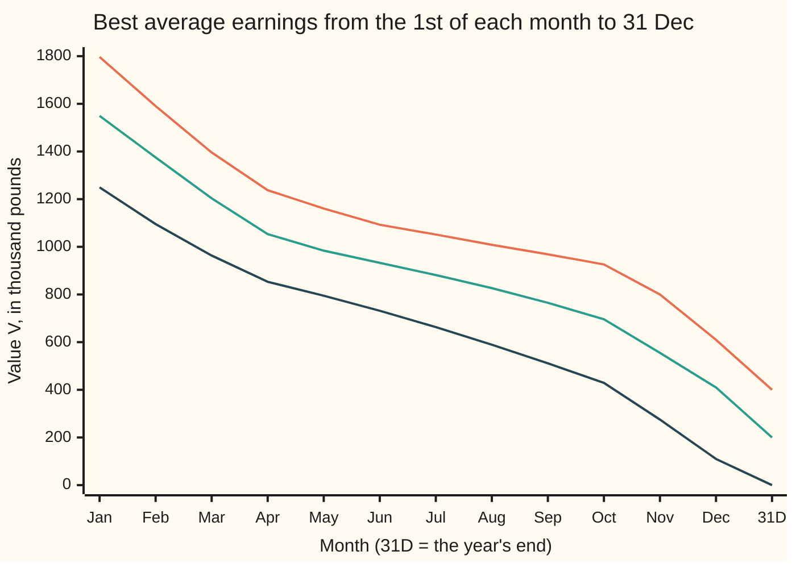

# Backward induction: solve the last decision first, then work back

[Syllabus](../../../SYLLABUS.md) → [Optimization](../README.md) → [Dynamic Programming and Learning](../README.md#s07) → Backward induction

---

## General Overview

A hydro dam sits on a hill river. Its reservoir holds at most 40 million cubic metres (m³), and on 1 January it holds 20 million. Its turbine can pass at most 20 million m³ a month. On the first of each month the operator picks a release: 0, 10 or 20 million m³. Water released makes electricity, and a block of 10 million m³ sells for £150,000 in January but only £80,000 in June, when demand is low.

Rain is the problem. Each month the river brings 0, 10 or 20 million m³, and nobody knows which in advance. From October to March the chances are 20, 50 and 30 percent. From April to September they are 50, 40 and 10 percent. Water above the 40 million m³ limit spills over the dam and earns nothing. Water still in store on 31 December is worth £100,000 a block, because next year will use it.

The operator wants the most money on average: income through the year plus the water left at the end. That makes this a **maximisation**. No fixed list of twelve releases can be best, because the right March release depends on how much rain fell in January and February. What the operator needs is a **rule**: for each month and each storage level, how much to let go.

Backward induction builds that rule from December back. In December only one month is left, so the best release at each level is plain arithmetic. In November each choice leads to an already-solved December, so November only weighs its own income against the *average* December value the rain will deliver. Twelve such steps give the whole rule. From 20 million m³ it earns on average **£1,549,340**, and no other rule does better.

**Solve the last month first for every storage level; then each earlier month only weighs its own income against the average of next month's solved values, so twelve small steps give the best rule for every month and every level.**

**What kind of fact this is:** a theorem, proved on this card in Why it works: the table gives the best average over every possible rule, even one that remembers the whole past. The code also certifies it on this reservoir without reusing the table's maximising: changing any one month's release, at any storage level, and then following the rule never gains.

### The picture: what a level of storage is worth, month by month



Top line: the reservoir full, 40 million m³, on the first of the month. Middle: 20 million m³. Bottom: empty. Each point is the best average still to be earned from that month to the year's end, water left on 31 December included. The points are filled right to left.

---

## The formula

The general fact comes from an earlier card, [Dynamic programming](../../08-Differential%20equations%20and%20dynamics/12-Calculus%20of%20Variations%20and%20Optimal%20Control/07-dynamic-programming-and-the-bellman-equation.md): any tail of a best plan is itself a best plan. So the best value from each stage and state obeys the Bellman equation and can be solved from the finish backwards. That card has no chance in it. New here is the rain: the value of a choice is an average over what the rain might do.

Count water in blocks of 10 million m³, so storage runs 0 to 4 blocks and the turbine passes at most 2. Money is in thousands of pounds.

$$V_k(x) = \max_{0 \,\le\, u \,\le\, \min(x,\,2)} \Big( c_k\,u \;+\; \sum_{w=0}^{2} P_k(w)\; V_{k+1}\big(\min(x - u + w,\ 4)\big) \Big), \qquad V_{12}(x) = 100\,x$$

**Read it aloud:** the best this month can do from storage $x$ is the largest, over the releases allowed, of this month's income plus the average, over the rain, of the best next month can do from wherever the water ends up.

The release $u$ that wins the maximum is the rule, written $u_k^*(x)$. Solving from $k = 11$ (December) down to $k = 0$ (January) is **backward induction**.

| Symbol | Plain meaning | In our example | Push it up and the answer… |
| --- | --- | --- | --- |
| $k$ | the month, counted from 0 (January) to 11 (December); $k = 12$ is 31 December | 0 to 12 | fewer months left, smaller $V_k$ |
| $x$ | storage on the 1st of the month, in blocks of 10 million m³ | 0 to 4; 2 on 1 January | more to sell or keep: $V_k$ rises |
| $u$ | release this month, in blocks, chosen before the rain | 0, 1 or 2, never more than $x$ | more income now, less water later |
| $w$ | rain inflow this month, in blocks, unknown when $u$ is chosen | 0, 1 or 2 | — |
| $P_k(w)$ | chance of $w$ blocks of rain in month $k$ | wet months 0.2, 0.5, 0.3; dry months 0.5, 0.4, 0.1 | more weight on wet: $V_k$ rises |
| $c_k$ | price of one block released in month $k$, thousand pounds | 150 in January, 80 in June | releases shift towards that month |
| $\min(x - u + w,\ 4)$ | next month's storage; anything above 4 blocks spills | from 4, release 0, rain 2: back to 4, 2 spilled | — |
| $V_k(x)$ | value function: the best average earnings from month $k$ to 31 December, starting at storage $x$, thousand pounds | $V_0(2)$ = 1549.34 | — |
| $V_{12}(x) = 100\,x$ | the end value: water left on 31 December, £100,000 a block | $V_{12}(3)$ = 300 | holding water late pays more |
| $u_k^*(x)$ | the rule: the best release in month $k$ at storage $x$ | $u_{11}^*(2)$ = 2 | — |
| $h$ | the history: every storage level, release and rain seen before month $k$'s release (used in the proof) | Jan to Oct of the traced year below | — |
| $J_k(h)$ | the average earnings from month $k$ to 31 December under some other rule, given history $h$, thousand pounds (used in the proof) | at most $V_k(x)$ | — |

### When it holds

- **The release is chosen before the rain falls.** That is why the maximum sits outside the average. Choose after seeing the month's rain and the maximum moves inside, a different problem with a bigger number (What breaks shows 1574.70).
- **This month's rain does not depend on last month's.** Then storage alone says everything that matters about the future. If wet months tend to follow wet months, the state must also carry "is this a wet spell", or the table is wrong.
- **Income adds month by month, and the year's end is given a value.** Leave out the end value and the rule treats water left on 31 December as worthless and lets too much go in autumn.
- **Finitely many months, levels and releases.** Then every maximum exists and the table is finite. Continuous storage needs a grid, as here, or a formula for $V_k$.
- **The target is the average.** An operator who must avoid a disastrous dry year needs a different objective, and a different table.

---

## Why it works

### Step 0: the future depends on the storage, not on how it got there

On 1 November with 20 million m³ in store, the rest of the year looks the same whether January was wet or dry: future rain ignores past rain, and prices are fixed. So the best average from here is one number, $V_{10}(2)$, and the whole problem is a table of such numbers, twelve months by five levels.

### Step 1: December is a one-month problem

With one month left there is no future to plan, only 31 December's value. From 2 blocks, releasing 2 earns 300 now and leaves only the rain, worth on average 100 × (0.5 × 1 + 0.3 × 2) = 110 more. Releasing 1 or 0 keeps water worth 100 a block, but December's price of 150 beats that. So $V_{11}(2) = 410$ and $u_{11}^*(2) = 2$. Every December cell is this small sum.

### Step 2: one month earlier, average then maximise

In November, the choice $u$ earns $c_{10}\,u$ now. Then the rain sends the reservoir to one of three December levels, each already solved. The rain is not chosen, so the operator gets the average of those three values, weighted by their chances. The best November release has the largest income-plus-average.

The order matters. The operator **maximises over releases, then nature averages over rain**, so the average sits inside the maximum. Peeking at the rain first would swap them.

### Step 3: the principle of optimality, with chance

Any rule, even one that remembers every past month, picks a release now and then follows some plan for each rain outcome. Whatever storage next month brings, that plan cannot average more than next month's table value $V_{k+1}$ at that storage. So the rule averages at most this month's income plus the average of $V_{k+1}$, which is at most $V_k(x)$. The table's own rule reaches that bound exactly. The fold writes this out.

<details>
<summary>Detailed proof: no rule, however much it remembers, beats the table</summary>

A rule may choose the release in month $k$ from everything seen so far: all past storage levels, releases and rain. Call that record the history $h$. It may not see this month's rain, which has not fallen. Write $J_k(h)$ for the average earnings from month $k$ to 31 December under the rule, given history $h$ that ends at storage $x$.

Claim: $J_k(h) \le V_k(x)$ for every rule, every $k$ from 12 down to 0, and every history.

Base, $k = 12$: nothing is left but the end value, so $J_{12}(h) = 100\,x = V_{12}(x)$.

Step: assume the claim at $k + 1$. The rule releases some $u$ at history $h$, allowed at storage $x$. Rain $w$ then arrives with chance $P_k(w)$, whatever the history, because rain does not depend on the past. The new history ends at storage $\min(x - u + w, 4)$. Income adds, so

$$J_k(h) = c_k\,u + \sum_w P_k(w)\, J_{k+1}(h, u, w) \;\le\; c_k\,u + \sum_w P_k(w)\, V_{k+1}\big(\min(x - u + w, 4)\big) \;\le\; V_k(x).$$

The first inequality uses the claim at $k + 1$ and the fact that every $P_k(w) \ge 0$. The second holds because $V_k(x)$ is the maximum of that expression over all allowed $u$. Induction downward ([Induction](../../01-Foundations/06-Proof/04-proof-by-induction.md)) gives the claim at $k = 0$.

Equality: the table's rule picks, at each step, a $u$ that attains the maximum. With that rule both inequalities are equalities at every step, so its average is exactly $V_0(x)$. It is a best rule, and it needs only the current month and storage, not the history.

</details>

### Step 4: what it costs, and what it saves

The table has twelve columns of five cells, and each cell compares at most three releases. Searching over rules instead is hopeless. Even rules that look only at the month and the storage come in 54 kinds per month, so a year has 54 to the twelfth power: 614787626176508399616 rule tables. Backward induction beats all of them, and every history-using rule too, in a few hundred multiplications.

The algorithmic side of this saving, solving each small subproblem once and storing it, is the computing wing's [Dynamic programming](../../14-Applied%20and%20computational/01-Algorithms%20and%20Growth/07-dynamic-programming.md). The catch is the same as there: the table grows with the number of states. Add a second reservoir and every storage level of one pairs with every level of the other, so the states multiply.

---

## Worked numbers, by hand

Water in blocks of 10 million m³, money in thousands of pounds. December first, from $V_{12}(x) = 100\,x$.

| Step | Arithmetic | Value |
| --- | --- | --- |
| December, storage 2, release 0 | 0 + 100 × (0.2 × 2 + 0.5 × 3 + 0.3 × 4) | 310.00 |
| December, storage 2, release 1 | 150 + 100 × (0.2 × 1 + 0.5 × 2 + 0.3 × 3) | 360.00 |
| December, storage 2, release 2 | 300 + 100 × (0.2 × 0 + 0.5 × 1 + 0.3 × 2) | 410.00: $V_{11}(2)$, release 2 |
| December, storage 4, release 0 | 400; every drop of rain spills | 400.00 |
| December, storage 4, release 2 | 300 + 100 × (0.2 × 2 + 0.5 × 3 + 0.3 × 4) | 610.00: $V_{11}(4)$, release 2 |
| December, storage 0, 1, 3 | the same sums | 110.00, 260.00, 510.00 |
| November, storage 2, release 0 | 0 + 0.2 × 410 + 0.5 × 510 + 0.3 × 610 | 520.00 |
| November, storage 2, release 1 | 140 + 0.2 × 260 + 0.5 × 410 + 0.3 × 510 | 550.00 |
| November, storage 2, release 2 | 280 + 0.2 × 110 + 0.5 × 260 + 0.3 × 410 | 555.00: $V_{10}(2)$, release 2 |
| October back to January | the same step, ten more times | see the table below |
| **1 January, storage 2** | $V_0(2)$ | **1549.34** |

Starting the year with 20 million m³ and following the rule, the dam earns on average £1,549,340, counting the water left on 31 December.

### What breaks if you drop a piece

The right answer is 1549.34, in thousands of pounds.

| Mistake | Comes out at | What went wrong |
| --- | --- | --- |
| Release all the turbine takes, every month | 1461.00 | Sells summer water at £80,000 a block and arrives at the dear autumn with too little |
| Choose each release after seeing that month's rain | 1574.70 | A promise no operator can keep: the maximum moved inside the average, as if the rain were known in advance |
| Count water left on 31 December as worth nothing | 1536.36 | The rule lets too much go in September and October, then that water is worth £100,000 a block after all |
| Plan as if each month brings its most likely rain | promises 1120.00, delivers 1393.92 | Drops the chance. Dry months then look rainless, so the rule hoards all summer; both the forecast and the result are wrong |

The second row breaks the first condition in When it holds: the release no longer comes before the rain. The fourth breaks the model itself: the rain is treated as known.

---

## How the rule moves through the year

The puzzle: prices and rain are both high in winter and low in summer. Release early and autumn may find the reservoir empty; hold back and a wet spell may spill water that could have been sold. Here is the rule read off the table, in blocks to release on the first of the month:

| Month | Price | Storage 0 | 1 | 2 | 3 | 4 |
| --- | ---: | ---: | ---: | ---: | ---: | ---: |
| Jan | 150 | 0 | 1 | 2 | 2 | 2 |
| Feb | 140 | 0 | 1 | 2 | 2 | 2 |
| Mar | 120 | 0 | 1 | 2 | 2 | 2 |
| Apr | 100 | 0 | 1 | 2 | 2 | 2 |
| May | 90 | 0 | 0 | 1 | 2 | 2 |
| Jun | 80 | 0 | 0 | 0 | 1 | 2 |
| Jul | 85 | 0 | 0 | 0 | 1 | 2 |
| Aug | 90 | 0 | 0 | 0 | 0 | 1 |
| Sep | 100 | 0 | 0 | 0 | 0 | 1 |
| Oct | 115 | 0 | 0 | 0 | 1 | 2 |
| Nov | 140 | 0 | 1 | 2 | 2 | 2 |
| Dec | 150 | 0 | 1 | 2 | 2 | 2 |

Winter and spring: run the turbine flat out, because winter rain will refill the reservoir and a full reservoir spills. Summer and early autumn: hold back unless nearly full, saving water for the high November and December prices. A full reservoir still releases in summer, because another wet month would only spill.

One year traced through the rule, starting at 2 blocks:

| | Jan | Feb | Mar | Apr | May | Jun | Jul | Aug | Sep | Oct | Nov | Dec |
| --- | ---: | ---: | ---: | ---: | ---: | ---: | ---: | ---: | ---: | ---: | ---: | ---: |
| Storage on the 1st | 2 | 2 | 1 | 0 | 0 | 1 | 1 | 1 | 1 | 2 | 3 | 3 |
| Release | 2 | 2 | 1 | 0 | 0 | 0 | 0 | 0 | 0 | 0 | 2 | 2 |
| Rain that month | 2 | 1 | 0 | 0 | 1 | 0 | 0 | 0 | 1 | 1 | 2 | 2 |

This year earned 1280 from sales and ended with 3 blocks, worth 300. The rule never needed the rain in advance: each month it looked up the current storage. Over every possible year it averages 1549.34.

---

## Code, from first principles, and it actually runs

The script fills the table from December back and reads the rule off it: road 1. Three more roads share none of its maximising:

- Road 2 runs the rule forward from 1 January, carrying the chance of each storage level month by month, and must land on $V_0(2)$.
- Road 3 scores every rule table for October to December, 157464 of them, and checks the best equals the table's $V_9$ at every level.
- Road 4 covers the whole year: for every month and storage level it tries each allowed release, follows the rule afterwards, and scores the result by running forward. No such change gains: the largest gain is 0.0000. That is the certificate.

The rule's own values then obey the formula month by month from 31 December, so they are the table, and the proof shows no rule beats the table. Two hand-computed December values, one where all the rain spills, and the four mistakes are checked too. Both languages add in the same order, so their outputs match to the last digit.

### Python

```python
# Backward induction on a hydro reservoir -- the check behind the card.  Standard library only.
# Water in units of 10 million m3, money in GBP thousand.  Months k = 0 (Jan) .. 11 (Dec); k = 12 is 31 Dec.
# Roads: (1) backward induction; (2) the read-off rule run forward over every rain outcome;
# (3) every storage-to-release rule for Oct-Dec listed and scored, the best compared with the table;
# (4) every one-month change to the rule, followed by the rule, scored by running forward: none may gain.
from itertools import product

MONTHS = "Jan Feb Mar Apr May Jun Jul Aug Sep Oct Nov Dec".split()
PRICE = [150, 140, 120, 100, 90, 80, 85, 90, 100, 115, 140, 150]  # GBP thousand per unit released
WET, DRY = (0.2, 0.5, 0.3), (0.5, 0.4, 0.1)                        # chance of 0, 1, 2 units of rain
RAIN = [WET] * 3 + [DRY] * 6 + [WET] * 3
CAP, TURBINE, END_VALUE, START = 4, 2, 100, 2                      # units, units a month, GBP k a unit, units

def total(terms):                       # plain left-to-right sum, the same order as the Rust check
    s = 0.0
    for t in terms:
        s += t
    return s

def nxt(x, u, w):                       # storage next month; anything above CAP spills
    return min(x - u + w, CAP)

def backup(V1, k, x, u, rain, price):   # this month's income plus the average value of next month's storage
    return price[k] * u + total(p * V1[nxt(x, u, w)] for w, p in enumerate(rain[k]))

def solve(price=PRICE, rain=RAIN, end=END_VALUE, turbine=TURBINE, see_rain=False):
    V = [[0.0] * (CAP + 1) for _ in range(13)]
    rule = [[0] * (CAP + 1) for _ in range(12)]
    V[12] = [float(end * x) for x in range(CAP + 1)]
    for k in range(11, -1, -1):                       # December first, then back
        for x in range(CAP + 1):
            choices = range(min(x, turbine) + 1)
            if see_rain:                              # wrong: choose after the rain is known
                V[k][x] = total(p * max(price[k] * u + V[k + 1][nxt(x, u, w)] for u in choices)
                              for w, p in enumerate(rain[k]))
                continue
            best, best_u = -1.0, 0
            for u in choices:                         # ties keep the smaller release
                q = backup(V[k + 1], k, x, u, rain, price)
                if q > best + 1e-9:
                    best, best_u = q, u
            V[k][x], rule[k][x] = best, best_u
    return V, rule

def run_forward(rule, x0, first=0, end=END_VALUE):    # road 2: carry the storage distribution forward
    dist, income = [1.0 if x == x0 else 0.0 for x in range(CAP + 1)], 0.0
    for k in range(first, 12):
        new = [0.0] * (CAP + 1)
        for x in range(CAP + 1):
            u = rule[k][x]
            income += dist[x] * PRICE[k] * u
            for w, p in enumerate(RAIN[k]):
                new[nxt(x, u, w)] += dist[x] * p
        dist = new
    return income + total(dist[x] * end * x for x in range(CAP + 1))

V, rule = solve()
print("December backups, 31 Dec water worth 100 a unit:")
for x in range(CAP + 1):
    qs = "  ".join(f"u={u}: {backup(V[12], 11, x, u, RAIN, PRICE):6.2f}" for u in range(min(x, TURBINE) + 1))
    print(f"  x={x}  {qs}")
qs = "  ".join(f"u={u}: {backup(V[11], 10, 2, u, RAIN, PRICE):6.2f}" for u in range(3))
print(f"November, x=2  {qs}")
print("month price | release for x=0..4 | value V_k(x) for x=0..4")
for k in range(12):
    print(f"{MONTHS[k]} {PRICE[k]:5d} | {' '.join(str(u) for u in rule[k])} | "
          + " ".join(f"{v:7.2f}" for v in V[k]))
print("31 Dec      |           | " + " ".join(f"{v:7.2f}" for v in V[12]))

best = V[0][START]
forward = run_forward(rule, START)
print(f"road 1, backward induction, V_0(2)      {best:9.2f}")
print(f"road 2, rule run forward over the rain  {forward:9.2f}")
assert abs(best - forward) < 1e-6
gain = 0.0                                        # road 4: change one month's release, then follow the rule
for k, x in product(range(12), range(CAP + 1)):
    for u in range(min(x, TURBINE) + 1):
        dev = PRICE[k] * u + total(p * run_forward(rule, nxt(x, u, w), first=k + 1) for w, p in enumerate(RAIN[k]))
        gain = max(gain, dev - run_forward(rule, x, first=k))
print(f"road 4, largest gain, one-month change  {gain:9.4f}")
assert gain < 1e-6

tables = list(product(*[range(min(x, TURBINE) + 1) for x in range(CAP + 1)]))
print(f"rules per month {len(tables)}; whole-year rule tables {len(tables) ** 12}")
top = [-1.0] * (CAP + 1)
for r9, r10, r11 in product(tables, repeat=3):  # road 3: score every Oct-Dec rule table
    W = [float(END_VALUE * x) for x in range(CAP + 1)]
    for k, r in ((11, r11), (10, r10), (9, r9)):
        W = [backup(W, k, x, r[x], RAIN, PRICE) for x in range(CAP + 1)]
    top = [max(a, b) for a, b in zip(top, W)]
print(f"road 3, best of {len(tables) ** 3} Oct-Dec tables: " + " ".join(f"{v:.2f}" for v in top))
assert all(abs(top[x] - V[9][x]) < 1e-6 for x in range(CAP + 1))
assert abs(V[11][2] - (300 + 100 * (0.5 * 1 + 0.3 * 2))) < 1e-9   # December by hand: release 2, keep the rain
assert abs(backup(V[12], 11, 4, 0, RAIN, PRICE) - 400) < 1e-9     # December by hand: full, release 0, all rain spills

story_rain = [2, 1, 0, 0, 1, 0, 0, 0, 1, 1, 2, 2]
x, income, line_x, line_u = START, 0, [], []
for k in range(12):
    u = rule[k][x]
    line_x.append(x); line_u.append(u); income += PRICE[k] * u
    x = nxt(x, u, story_rain[k])
print("story rain    " + " ".join(map(str, story_rain)))
print("story storage " + " ".join(map(str, line_x)) + f"  -> {x} on 31 Dec")
print("story release " + " ".join(map(str, line_u)) + f"  income {income}, plus {END_VALUE * x} in store")

greedy = run_forward([[min(x, TURBINE) for x in range(CAP + 1)] for _ in range(12)], START)
see, _ = solve(see_rain=True)
_, rule0 = solve(end=0)
mode = [tuple(1.0 if w == max(range(3), key=lambda i: r[i]) else 0.0 for w in range(3)) for r in RAIN]
Vm, rule_m = solve(rain=mode)
rows = [("wrong: release all the turbine takes", greedy),
        ("wrong: choose after seeing the rain", see[0][START]),
        ("wrong: water left on 31 Dec worth 0", run_forward(rule0, START)),
        ("wrong: most likely rain, promised", Vm[0][START]),
        ("wrong: most likely rain, delivered", run_forward(rule_m, START))]
for name, v in rows:
    print(f"{name:<40}{v:9.2f}")
assert greedy < best - 1
assert see[0][START] > best + 1
assert rows[2][1] < best - 1
assert rows[4][1] < best - 1

tries = [("try: end value 0, plan and score", solve(end=0)[0][0][START]),
         ("try: turbine 1 unit a month", solve(turbine=1)[0][0][START]),
         ("try: every month wet", solve(rain=[WET] * 12)[0][0][START]),
         ("try: July price 200", solve(price=PRICE[:6] + [200] + PRICE[7:])[0][0][START])]
for name, v in tries:
    print(f"{name:<40}{v:9.2f}")
print("end value 0, Sep and Oct release for x=0..4: " + " ".join(map(str, rule0[8])) + " | " + " ".join(map(str, rule0[9])))
print("ALL CHECKS PASS")
```

**Ran 2026-11-11 on macOS, Python 3.14.10, standard library only. All checks passed. Output, pasted from the run:**

```
December backups, 31 Dec water worth 100 a unit:
  x=0  u=0: 110.00
  x=1  u=0: 210.00  u=1: 260.00
  x=2  u=0: 310.00  u=1: 360.00  u=2: 410.00
  x=3  u=0: 380.00  u=1: 460.00  u=2: 510.00
  x=4  u=0: 400.00  u=1: 530.00  u=2: 610.00
November, x=2  u=0: 520.00  u=1: 550.00  u=2: 555.00
month price | release for x=0..4 | value V_k(x) for x=0..4
Jan   150 | 0 1 2 2 2 | 1249.34 1399.34 1549.34 1681.40 1796.58
Feb   140 | 0 1 2 2 2 | 1095.34 1235.34 1375.34 1488.85 1590.30
Mar   120 | 0 1 2 2 2 |  963.34 1083.34 1203.34 1301.71 1395.90
Apr   100 | 0 1 2 2 2 |  853.34  953.34 1053.34 1147.92 1237.59
May    90 | 0 0 1 2 2 |  794.77  893.92  983.92 1073.92 1160.63
Jun    80 | 0 0 0 1 2 |  731.65  839.21  932.63 1012.63 1092.62
Jul    85 | 0 0 0 1 2 |  663.14  779.79  881.63  966.63 1051.62
Aug    90 | 0 0 0 0 1 |  589.35  714.48  826.75  918.50 1008.50
Sep   100 | 0 0 0 0 1 |  511.10  643.25  765.00  868.50  968.50
Oct   115 | 0 0 0 1 2 |  429.00  567.50  696.00  811.00  926.00
Nov   140 | 0 1 2 2 2 |  275.00  415.00  555.00  690.00  800.00
Dec   150 | 0 1 2 2 2 |  110.00  260.00  410.00  510.00  610.00
31 Dec      |           |    0.00  100.00  200.00  300.00  400.00
road 1, backward induction, V_0(2)        1549.34
road 2, rule run forward over the rain    1549.34
road 4, largest gain, one-month change     0.0000
rules per month 54; whole-year rule tables 614787626176508399616
road 3, best of 157464 Oct-Dec tables: 429.00 567.50 696.00 811.00 926.00
story rain    2 1 0 0 1 0 0 0 1 1 2 2
story storage 2 2 1 0 0 1 1 1 1 2 3 3  -> 3 on 31 Dec
story release 2 2 1 0 0 0 0 0 0 0 2 2  income 1280, plus 300 in store
wrong: release all the turbine takes      1461.00
wrong: choose after seeing the rain       1574.70
wrong: water left on 31 Dec worth 0       1536.36
wrong: most likely rain, promised         1120.00
wrong: most likely rain, delivered        1393.92
try: end value 0, plan and score          1414.23
try: turbine 1 unit a month               1383.85
try: every month wet                      1840.99
try: July price 200                       1724.83
end value 0, Sep and Oct release for x=0..4: 0 0 0 1 2 | 0 0 1 2 2
ALL CHECKS PASS
```

### Rust

```rust
// Backward induction on a hydro reservoir -- the check behind the card.  std only, no crates.
// Water in units of 10 million m3, money in GBP thousand.  Months k = 0 (Jan) .. 11 (Dec); k = 12 is 31 Dec.
// Roads: (1) backward induction; (2) the read-off rule run forward over every rain outcome;
// (3) every storage-to-release rule for Oct-Dec listed and scored, the best compared with the table;
// (4) every one-month change to the rule, followed by the rule, scored by running forward: none may gain.
const MONTHS: [&str; 12] = ["Jan", "Feb", "Mar", "Apr", "May", "Jun", "Jul", "Aug", "Sep", "Oct", "Nov", "Dec"];
const PRICE: [f64; 12] = [150.0, 140.0, 120.0, 100.0, 90.0, 80.0, 85.0, 90.0, 100.0, 115.0, 140.0, 150.0];
const WET: [f64; 3] = [0.2, 0.5, 0.3];
const DRY: [f64; 3] = [0.5, 0.4, 0.1];
const CAP: usize = 4;
const TURBINE: usize = 2;
const END_VALUE: f64 = 100.0;
const START: usize = 2;
type Rule = Vec<[usize; CAP + 1]>;
type Table = Vec<[f64; CAP + 1]>;

fn nxt(x: usize, u: usize, w: usize) -> usize { (x - u + w).min(CAP) }

fn backup(v1: &[f64; CAP + 1], k: usize, x: usize, u: usize, rain: &[[f64; 3]], price: &[f64]) -> f64 {
    let mut s = 0.0;
    for w in 0..3 { s += rain[k][w] * v1[nxt(x, u, w)]; }
    price[k] * u as f64 + s
}

fn solve(price: &[f64], rain: &[[f64; 3]], end: f64, turbine: usize, see_rain: bool) -> (Table, Rule) {
    let mut v: Table = vec![[0.0; CAP + 1]; 13];
    let mut rule: Rule = vec![[0; CAP + 1]; 12];
    for x in 0..=CAP { v[12][x] = end * x as f64; }
    for k in (0..12).rev() {
        for x in 0..=CAP {
            let top = x.min(turbine);
            if see_rain {
                let mut s = 0.0;
                for w in 0..3 {
                    let mut m = f64::NEG_INFINITY;
                    for u in 0..=top { m = m.max(price[k] * u as f64 + v[k + 1][nxt(x, u, w)]); }
                    s += rain[k][w] * m;
                }
                v[k][x] = s;
                continue;
            }
            let (mut best, mut best_u) = (-1.0, 0);
            for u in 0..=top {
                let q = backup(&v[k + 1], k, x, u, rain, price);
                if q > best + 1e-9 { best = q; best_u = u; }
            }
            v[k][x] = best;
            rule[k][x] = best_u;
        }
    }
    (v, rule)
}

fn run_forward(rule: &Rule, rain: &[[f64; 3]], x0: usize, first: usize, end: f64) -> f64 {
    let mut dist = [0.0; CAP + 1];
    dist[x0] = 1.0;
    let mut income = 0.0;
    for k in first..12 {
        let mut new = [0.0; CAP + 1];
        for x in 0..=CAP {
            let u = rule[k][x];
            income += dist[x] * PRICE[k] * u as f64;
            for w in 0..3 { new[nxt(x, u, w)] += dist[x] * rain[k][w]; }
        }
        dist = new;
    }
    let mut s = 0.0;
    for x in 0..=CAP { s += dist[x] * end * x as f64; }
    income + s
}

fn row(v: &[f64; CAP + 1]) -> String { v.iter().map(|a| format!("{:7.2}", a)).collect::<Vec<_>>().join(" ") }
fn ints(v: &[usize]) -> String { v.iter().map(|a| a.to_string()).collect::<Vec<_>>().join(" ") }

fn main() {
    let rain: Vec<[f64; 3]> = (0..12).map(|k| if k < 3 || k > 8 { WET } else { DRY }).collect();
    let (v, rule) = solve(&PRICE, &rain, END_VALUE, TURBINE, false);
    let qline = |v1: &[f64; CAP + 1], k: usize, x: usize| -> String {
        (0..=x.min(TURBINE)).map(|u| format!("u={}: {:6.2}", u, backup(v1, k, x, u, &rain, &PRICE)))
            .collect::<Vec<_>>().join("  ")
    };
    println!("December backups, 31 Dec water worth 100 a unit:");
    for x in 0..=CAP { println!("  x={}  {}", x, qline(&v[12], 11, x)); }
    println!("November, x=2  {}", qline(&v[11], 10, 2));
    println!("month price | release for x=0..4 | value V_k(x) for x=0..4");
    for k in 0..12 { println!("{} {:5} | {} | {}", MONTHS[k], PRICE[k] as i64, ints(&rule[k]), row(&v[k])); }
    println!("31 Dec      |           | {}", row(&v[12]));

    let best = v[0][START];
    let forward = run_forward(&rule, &rain, START, 0, END_VALUE);
    println!("road 1, backward induction, V_0(2)      {:9.2}", best);
    println!("road 2, rule run forward over the rain  {:9.2}", forward);
    assert!((best - forward).abs() < 1e-6);
    let mut gain = 0.0f64;                            // road 4: change one month's release, then follow the rule
    for k in 0..12 { for x in 0..=CAP { for u in 0..=x.min(TURBINE) {
        let mut s = 0.0;
        for w in 0..3 { s += rain[k][w] * run_forward(&rule, &rain, nxt(x, u, w), k + 1, END_VALUE); }
        gain = gain.max(PRICE[k] * u as f64 + s - run_forward(&rule, &rain, x, k, END_VALUE));
    } } }
    println!("road 4, largest gain, one-month change  {:9.4}", gain);
    assert!(gain < 1e-6);

    let mut tables: Vec<[usize; CAP + 1]> = Vec::new();
    for u1 in 0..=1 { for u2 in 0..=2 { for u3 in 0..=2 { for u4 in 0..=2 {   // x = 0 can only release 0
        tables.push([0, u1, u2, u3, u4]);
    } } } }
    let n = tables.len() as u128;
    println!("rules per month {}; whole-year rule tables {}", n, n.pow(12));
    let mut top = [-1.0f64; CAP + 1];
    for r9 in &tables { for r10 in &tables { for r11 in &tables {
        let mut w = [0.0; CAP + 1];
        for x in 0..=CAP { w[x] = END_VALUE * x as f64; }
        for (k, r) in [(11usize, r11), (10, r10), (9, r9)] {
            let mut nw = [0.0; CAP + 1];
            for x in 0..=CAP { nw[x] = backup(&w, k, x, r[x], &rain, &PRICE); }
            w = nw;
        }
        for x in 0..=CAP { top[x] = top[x].max(w[x]); }
    } } }
    println!("road 3, best of {} Oct-Dec tables: {}", n * n * n,
             top.iter().map(|a| format!("{:.2}", a)).collect::<Vec<_>>().join(" "));
    for x in 0..=CAP { assert!((top[x] - v[9][x]).abs() < 1e-6); }
    assert!((v[11][2] - (300.0 + 100.0 * (0.5 * 1.0 + 0.3 * 2.0))).abs() < 1e-9);
    assert!((backup(&v[12], 11, 4, 0, &rain, &PRICE) - 400.0).abs() < 1e-9);   // full, release 0: all rain spills

    let story_rain = [2usize, 1, 0, 0, 1, 0, 0, 0, 1, 1, 2, 2];
    let (mut x, mut income) = (START, 0i64);
    let (mut lx, mut lu) = (Vec::new(), Vec::new());
    for k in 0..12 {
        let u = rule[k][x];
        lx.push(x); lu.push(u); income += PRICE[k] as i64 * u as i64;
        x = nxt(x, u, story_rain[k]);
    }
    println!("story rain    {}", ints(&story_rain));
    println!("story storage {}  -> {} on 31 Dec", ints(&lx), x);
    println!("story release {}  income {}, plus {} in store", ints(&lu), income, END_VALUE as i64 * x as i64);

    let greedy_rule: Rule = (0..12).map(|_| { let mut t = [0; CAP + 1]; for x in 0..=CAP { t[x] = x.min(TURBINE); } t }).collect();
    let greedy = run_forward(&greedy_rule, &rain, START, 0, END_VALUE);
    let (see, _) = solve(&PRICE, &rain, END_VALUE, TURBINE, true);
    let (_, rule0) = solve(&PRICE, &rain, 0.0, TURBINE, false);
    let mode: Vec<[f64; 3]> = rain.iter().map(|r| {
        let mut m = 0;
        for w in 1..3 { if r[w] > r[m] { m = w; } }
        let mut t = [0.0; 3]; t[m] = 1.0; t
    }).collect();
    let (vm, rule_m) = solve(&PRICE, &mode, END_VALUE, TURBINE, false);
    let rows = [("wrong: release all the turbine takes", greedy),
                ("wrong: choose after seeing the rain", see[0][START]),
                ("wrong: water left on 31 Dec worth 0", run_forward(&rule0, &rain, START, 0, END_VALUE)),
                ("wrong: most likely rain, promised", vm[0][START]),
                ("wrong: most likely rain, delivered", run_forward(&rule_m, &rain, START, 0, END_VALUE))];
    for (name, val) in rows.iter() { println!("{:<40}{:9.2}", name, val); }
    assert!(greedy < best - 1.0);
    assert!(see[0][START] > best + 1.0);
    assert!(rows[2].1 < best - 1.0);
    assert!(rows[4].1 < best - 1.0);

    let mut july = PRICE;
    july[6] = 200.0;
    let wet: Vec<[f64; 3]> = vec![WET; 12];
    let tries = [("try: end value 0, plan and score", solve(&PRICE, &rain, 0.0, TURBINE, false).0[0][START]),
                 ("try: turbine 1 unit a month", solve(&PRICE, &rain, END_VALUE, 1, false).0[0][START]),
                 ("try: every month wet", solve(&PRICE, &wet, END_VALUE, TURBINE, false).0[0][START]),
                 ("try: July price 200", solve(&july, &rain, END_VALUE, TURBINE, false).0[0][START])];
    for (name, val) in tries.iter() { println!("{:<40}{:9.2}", name, val); }
    println!("end value 0, Sep and Oct release for x=0..4: {} | {}", ints(&rule0[8]), ints(&rule0[9]));
    println!("ALL CHECKS PASS");
}
```

**Ran 2026-11-11 on macOS, rustc 1.98.1, no crates. All checks passed. Output, pasted from the run:**

```
December backups, 31 Dec water worth 100 a unit:
  x=0  u=0: 110.00
  x=1  u=0: 210.00  u=1: 260.00
  x=2  u=0: 310.00  u=1: 360.00  u=2: 410.00
  x=3  u=0: 380.00  u=1: 460.00  u=2: 510.00
  x=4  u=0: 400.00  u=1: 530.00  u=2: 610.00
November, x=2  u=0: 520.00  u=1: 550.00  u=2: 555.00
month price | release for x=0..4 | value V_k(x) for x=0..4
Jan   150 | 0 1 2 2 2 | 1249.34 1399.34 1549.34 1681.40 1796.58
Feb   140 | 0 1 2 2 2 | 1095.34 1235.34 1375.34 1488.85 1590.30
Mar   120 | 0 1 2 2 2 |  963.34 1083.34 1203.34 1301.71 1395.90
Apr   100 | 0 1 2 2 2 |  853.34  953.34 1053.34 1147.92 1237.59
May    90 | 0 0 1 2 2 |  794.77  893.92  983.92 1073.92 1160.63
Jun    80 | 0 0 0 1 2 |  731.65  839.21  932.63 1012.63 1092.62
Jul    85 | 0 0 0 1 2 |  663.14  779.79  881.63  966.63 1051.62
Aug    90 | 0 0 0 0 1 |  589.35  714.48  826.75  918.50 1008.50
Sep   100 | 0 0 0 0 1 |  511.10  643.25  765.00  868.50  968.50
Oct   115 | 0 0 0 1 2 |  429.00  567.50  696.00  811.00  926.00
Nov   140 | 0 1 2 2 2 |  275.00  415.00  555.00  690.00  800.00
Dec   150 | 0 1 2 2 2 |  110.00  260.00  410.00  510.00  610.00
31 Dec      |           |    0.00  100.00  200.00  300.00  400.00
road 1, backward induction, V_0(2)        1549.34
road 2, rule run forward over the rain    1549.34
road 4, largest gain, one-month change     0.0000
rules per month 54; whole-year rule tables 614787626176508399616
road 3, best of 157464 Oct-Dec tables: 429.00 567.50 696.00 811.00 926.00
story rain    2 1 0 0 1 0 0 0 1 1 2 2
story storage 2 2 1 0 0 1 1 1 1 2 3 3  -> 3 on 31 Dec
story release 2 2 1 0 0 0 0 0 0 0 2 2  income 1280, plus 300 in store
wrong: release all the turbine takes      1461.00
wrong: choose after seeing the rain       1574.70
wrong: water left on 31 Dec worth 0       1536.36
wrong: most likely rain, promised         1120.00
wrong: most likely rain, delivered        1393.92
try: end value 0, plan and score          1414.23
try: turbine 1 unit a month               1383.85
try: every month wet                      1840.99
try: July price 200                       1724.83
end value 0, Sep and Oct release for x=0..4: 0 0 0 1 2 | 0 0 1 2 2
ALL CHECKS PASS
```

### Lean

Lean proves the theorem for every problem that meets When it holds, with any number of months, levels, releases and rain amounts.

- No rule, even one that remembers every past month, averages more than the table value $V_k(x)$, from any month and any storage.
- Some rule that looks only at the month and the storage averages exactly $V_k(x)$, from every month and storage.
- Any rule read off the table, a release that wins the maximum at every month and level, earns exactly $V_k(x)$, whatever happened before.
- Choosing each release after seeing that month's rain never gives a smaller number than the table.
- The hand arithmetic holds exactly: the December and November cells, 54 rules a month, and 157464 rule tables for October to December.
- The traced year, run through the rule table, ends with 3 blocks in store and 1280 from sales.

The reservoir's own table, including $V_0(2)$ = 1549.34, the rule table's correctness and the four mistakes, is left to the Python and Rust checks.

```lean
-- Backward induction: in a finite-horizon problem where each choice comes before the chance outcome, the table solved from the last stage back is the best average any rule can earn, even one that remembers the whole past, and the table's own rule earns it.
import Mathlib.Algebra.Order.BigOperators.Group.Finset
import Mathlib.Data.Fintype.BigOperators
import Mathlib.Data.Finset.Lattice.Fold
import Mathlib.Basic.Real.Basic
import Mathlib.Tactic.NormNum
import Mathlib.Data.Finset.Max
import Mathlib.Algebra.BigOperators.Ring.Finset
import Mathlib.Tactic.GCongr

open Finset

/-- A finite-horizon decision problem with chance, as on the card.
Stages (months) are `k = 0, …, N - 1`; stage `N` is the end (31 December).
At stage `k` and state `x` the controller picks an allowed action `u` (a finite, nonempty set),
earns `reward k x u`, and then a chance outcome `w` (the rain) arrives with probability `P k w`,
which depends on the stage only, not on the past; the next state is `next k x u w`.
A state still held at the end is worth `endValue x`. -/
structure DecisionProblem (S A W : Type*) [Fintype W] where
  N : ℕ
  allowed : ℕ → S → Finset A
  allowed_nonempty : ∀ k x, (allowed k x).Nonempty
  P : ℕ → W → ℝ
  P_nonneg : ∀ k w, 0 ≤ P k w
  P_sum : ∀ k, ∑ w, P k w = 1
  reward : ℕ → S → A → ℝ
  next : ℕ → S → A → W → S
  endValue : S → ℝ

namespace DecisionProblem

variable {S A W : Type*} [Fintype W] (D : DecisionProblem S A W)

/-- The table `V_k(x)`, filled by backward induction:
`V_N(x) = endValue x` and `V_k(x) = max_u (reward + Σ_w P_k(w) V_{k+1}(next))`.
The maximum sits outside the average: the action is chosen before the chance outcome. -/
noncomputable def V (k : ℕ) (x : S) : ℝ :=
  if D.N ≤ k then D.endValue x
  else (D.allowed k x).sup' (D.allowed_nonempty k x)
    fun u => D.reward k x u + ∑ w, D.P k w * V (k + 1) (D.next k x u w)
termination_by D.N - k

/-- The quantity maximised at stage `k`: this stage's reward for `u` plus the average of
next stage's table value. -/
noncomputable def Q (k : ℕ) (x : S) (u : A) : ℝ :=
  D.reward k x u + ∑ w, D.P k w * D.V (k + 1) (D.next k x u w)

/-- The average earnings from stage `k` to the end under a rule `π` that may use the whole
history `h` (every past state, action and outcome) and the current state `x`, but not the
current stage's outcome, which has not happened yet. -/
noncomputable def J (π : ℕ → List (S × A × W) → S → A) (k : ℕ) (h : List (S × A × W)) (x : S) : ℝ :=
  if D.N ≤ k then D.endValue x
  else D.reward k x (π k h x) +
    ∑ w, D.P k w * J π (k + 1) (h ++ [(x, π k h x, w)]) (D.next k x (π k h x) w)
termination_by D.N - k

/-- The wrong table from the card's "What breaks": choose each action after seeing the stage's
outcome, so the maximum moves inside the average. -/
noncomputable def Vpeek (k : ℕ) (x : S) : ℝ :=
  if D.N ≤ k then D.endValue x
  else ∑ w, D.P k w * (D.allowed k x).sup' (D.allowed_nonempty k x)
    fun u => D.reward k x u + Vpeek (k + 1) (D.next k x u w)
termination_by D.N - k

end DecisionProblem

variable {S A W : Type*} [Fintype W]

/-- Helper: a rule that wins the maximum of `Q` at every stage and state earns the table value. -/
theorem table_rule_helper {S A W : Type*} [Fintype W] (D : DecisionProblem S A W)
    (μ : ℕ → S → A) (hμ : ∀ k x, μ k x ∈ D.allowed k x)
    (hmax : ∀ k x, ∀ u ∈ D.allowed k x, D.Q k x u ≤ D.Q k x (μ k x)) :
    ∀ k h x, D.J (fun k _ x => μ k x) k h x = D.V k x := by
  have key : ∀ n k, D.N ≤ k + n → ∀ h x, D.J (fun k _ x => μ k x) k h x = D.V k x := by
    intro n
    induction n with
    | zero =>
      intro k hk h x
      have hN : D.N ≤ k := by omega
      simp only [DecisionProblem.J.eq_1, DecisionProblem.V.eq_1, hN, ↓reduceIte]
    | succ n ih =>
      intro k hk h x
      by_cases hN : D.N ≤ k
      · rw [DecisionProblem.J.eq_1, DecisionProblem.V.eq_1]; simp only [hN, ↓reduceIte]
      · rw [DecisionProblem.J.eq_1, DecisionProblem.V.eq_1]; simp only [hN, ↓reduceIte]
        apply le_antisymm
        · refine le_trans (le_of_eq ?_) (Finset.le_sup' (fun u => D.reward k x u +
            ∑ w, D.P k w * D.V (k + 1) (D.next k x u w)) (hμ k x))
          congr 1
          refine Finset.sum_congr rfl fun w _ => ?_
          rw [ih (k + 1) (by omega)]
        · refine Finset.sup'_le _ _ fun u hu => ?_
          have := hmax k x u hu
          simp only [DecisionProblem.Q] at this
          refine this.trans (le_of_eq ?_)
          congr 1
          refine Finset.sum_congr rfl fun w _ => ?_
          rw [ih (k + 1) (by omega)]
  intro k h x
  exact key (D.N - k) k (by omega) h x

#print axioms table_rule_helper

/-- Backward induction gives the best rule. With finitely many stages, states, actions and
outcomes, the action chosen before the outcome, outcomes whose chances do not depend on the
past, rewards that add stage by stage plus an end value, and the average as the target:
no rule, even one that remembers the whole history, averages more than the table `V_k(x)`
from any stage and state; and a rule that looks only at the current stage and state averages
exactly `V_k(x)` from every stage and state. -/
theorem backward_induction_gives_best_rule [Fintype S] (D : DecisionProblem S A W) :
    (∀ π : ℕ → List (S × A × W) → S → A, (∀ k h x, π k h x ∈ D.allowed k x) →
      ∀ k h x, D.J π k h x ≤ D.V k x) ∧
    ∃ μ : ℕ → S → A, (∀ k x, μ k x ∈ D.allowed k x) ∧
      ∀ k h x, D.J (fun k _ x => μ k x) k h x = D.V k x := by
  classical
  have hex : ∀ k x, ∃ u ∈ D.allowed k x, ∀ v ∈ D.allowed k x, D.Q k x v ≤ D.Q k x u :=
    fun k x => Finset.exists_max_image _ _ (D.allowed_nonempty k x)
  refine ⟨?_, fun k x => Classical.choose (hex k x),
    fun k x => (Classical.choose_spec (hex k x)).1, ?_⟩
  · intro π hπ
    have key : ∀ n k, D.N ≤ k + n → ∀ h x, D.J π k h x ≤ D.V k x := by
      intro n
      induction n with
      | zero =>
        intro k hk h x
        have hN : D.N ≤ k := by omega
        simp only [DecisionProblem.J.eq_1, DecisionProblem.V.eq_1, hN, ↓reduceIte, le_refl]
      | succ n ih =>
        intro k hk h x
        by_cases hN : D.N ≤ k
        · rw [DecisionProblem.J.eq_1, DecisionProblem.V.eq_1]; simp only [hN, ↓reduceIte, le_refl]
        · rw [DecisionProblem.J.eq_1, DecisionProblem.V.eq_1]; simp only [hN, ↓reduceIte]
          refine le_trans ?_ (Finset.le_sup' (fun u => D.reward k x u +
            ∑ w, D.P k w * D.V (k + 1) (D.next k x u w)) (hπ k h x))
          gcongr with w _
          · exact D.P_nonneg k w
          · exact ih (k + 1) (by omega) _ _
    intro k h x
    exact key (D.N - k) k (by omega) h x
  · exact table_rule_helper D _ (fun k x => (Classical.choose_spec (hex k x)).1)
      (fun k x => (Classical.choose_spec (hex k x)).2)

/-- The rule read off the table, a release that wins the maximum at every stage and state,
earns exactly the table value from every stage and state, whatever the past. -/
theorem table_rule_earns_table_value (D : DecisionProblem S A W) (μ : ℕ → S → A)
    (hμ : ∀ k x, μ k x ∈ D.allowed k x)
    (hmax : ∀ k x, ∀ u ∈ D.allowed k x, D.Q k x u ≤ D.Q k x (μ k x)) :
    ∀ k h x, D.J (fun k _ x => μ k x) k h x = D.V k x := by
  exact table_rule_helper D μ hμ hmax

/-- Peeking at the rain: choosing each action after seeing the outcome (maximum inside the
average) never gives a smaller number than the true table (maximum outside the average). -/
theorem peeking_at_outcome_never_lowers_value (D : DecisionProblem S A W) : ∀ k x, D.V k x ≤ D.Vpeek k x := by
  have key : ∀ n k, D.N ≤ k + n → ∀ x, D.V k x ≤ D.Vpeek k x := by
    intro n
    induction n with
    | zero =>
      intro k hk x
      have hN : D.N ≤ k := by omega
      simp only [DecisionProblem.Vpeek.eq_1, DecisionProblem.V.eq_1, hN, ↓reduceIte, le_refl]
    | succ n ih =>
      intro k hk x
      by_cases hN : D.N ≤ k
      · rw [DecisionProblem.V.eq_1, DecisionProblem.Vpeek.eq_1]; simp only [hN, ↓reduceIte, le_refl]
      · rw [DecisionProblem.V.eq_1, DecisionProblem.Vpeek.eq_1]; simp only [hN, ↓reduceIte]
        refine Finset.sup'_le _ _ fun u hu => ?_
        have hr : D.reward k x u = ∑ w, D.P k w * D.reward k x u := by
          rw [← Finset.sum_mul, D.P_sum, one_mul]
        rw [hr, ← Finset.sum_add_distrib]
        gcongr with w _
        rw [← mul_add]
        apply mul_le_mul_of_nonneg_left _ (D.P_nonneg k w)
        refine le_trans ?_ (Finset.le_sup' (fun u => D.reward k x u +
            D.Vpeek (k + 1) (D.next k x u w)) hu)
        gcongr
        exact ih (k + 1) (by omega) _
  intro k x
  exact key (D.N - k) k (by omega) x

/-! The card's own whole-number arithmetic: water in blocks of 10 million m³, money in
thousands of pounds, wet-month rain chances 2/10, 5/10, 3/10, 31 December water worth 100 a block. -/

-- December, storage 2: releases 0, 1, 2 give 310, 360, 410, so V₁₁(2) = 410 with release 2.
example : (0 : ℚ) + 100 * (2/10 * 2 + 5/10 * 3 + 3/10 * 4) = 310 := by norm_num
example : (150 : ℚ) + 100 * (2/10 * 1 + 5/10 * 2 + 3/10 * 3) = 360 := by norm_num
example : (300 : ℚ) + 100 * (2/10 * 0 + 5/10 * 1 + 3/10 * 2) = 410 := by norm_num
-- December, storage 4: release 0 spills all the rain (400); release 2 gives 610.
example : (0 : ℚ) + 100 * (2/10 * 4 + 5/10 * 4 + 3/10 * 4) = 400 := by norm_num
example : (300 : ℚ) + 100 * (2/10 * 2 + 5/10 * 3 + 3/10 * 4) = 610 := by norm_num
-- December, storage 0, 1, 3: 110, 260, 510.
example : (0 : ℚ) + 100 * (2/10 * 0 + 5/10 * 1 + 3/10 * 2) = 110 := by norm_num
example : (150 : ℚ) + 100 * (2/10 * 0 + 5/10 * 1 + 3/10 * 2) = 260 := by norm_num
example : (300 : ℚ) + 100 * (2/10 * 1 + 5/10 * 2 + 3/10 * 3) = 510 := by norm_num
-- November, storage 2, price 140: releases 0, 1, 2 give 520, 550, 555, so V₁₀(2) = 555.
example : (0 : ℚ) + 2/10 * 410 + 5/10 * 510 + 3/10 * 610 = 520 := by norm_num
example : (140 : ℚ) + 2/10 * 260 + 5/10 * 410 + 3/10 * 510 = 550 := by norm_num
example : (280 : ℚ) + 2/10 * 110 + 5/10 * 260 + 3/10 * 410 = 555 := by norm_num

-- Rules per month: storage 0..4 allows 1, 2, 3, 3, 3 releases, so 54 rule tables a month,
-- 157464 for October to December, and 614787626176508399616 for the year.
example : 1 * 2 * 3 * 3 * 3 = 54 := by norm_num
example : 54 ^ 3 = 157464 := by norm_num
example : 54 ^ 12 = 614787626176508399616 := by norm_num

/-- The card's rule table: blocks to release at storage 0..4, January to December. -/
def cardRule : List (List ℕ) :=
  [[0,1,2,2,2], [0,1,2,2,2], [0,1,2,2,2], [0,1,2,2,2], [0,0,1,2,2], [0,0,0,1,2],
   [0,0,0,1,2], [0,0,0,0,1], [0,0,0,0,1], [0,0,0,1,2], [0,1,2,2,2], [0,1,2,2,2]]

/-- Prices per block, January to December, thousand pounds. -/
def cardPrice : List ℕ := [150, 140, 120, 100, 90, 80, 85, 90, 100, 115, 140, 150]

/-- Run one year under a rule table, month by month: returns (storage on 31 Dec, income). -/
def runYear : List (List ℕ) → List ℕ → List ℕ → ℕ → ℕ → ℕ × ℕ
  | r :: rs, c :: cs, w :: ws, x, inc =>
      runYear rs cs ws (min (x - r.getD x 0 + w) 4) (inc + c * r.getD x 0)
  | _, _, _, x, inc => (x, inc)

-- The traced year: rain 2 1 0 0 1 0 0 0 1 1 2 2 from 2 blocks ends with 3 blocks and income 1280.
example : runYear cardRule cardPrice [2, 1, 0, 0, 1, 0, 0, 0, 1, 1, 2, 2] 2 0 = (3, 1280) := by
  decide

#print axioms backward_induction_gives_best_rule
#print axioms table_rule_earns_table_value
#print axioms peeking_at_outcome_never_lowers_value
```

**Checked 2026-11-12 on macOS, Lean 4.36.0-rc2, Mathlib v4.36.0-rc2. Every proof is complete and uses only Lean's standard axioms. Output, pasted from the run:**

```
'table_rule_helper' depends on axioms: [propext, Classical.choice, Quot.sound]
'backward_induction_gives_best_rule' depends on axioms: [propext, Classical.choice, Quot.sound]
'table_rule_earns_table_value' depends on axioms: [propext, Classical.choice, Quot.sound]
'peeking_at_outcome_never_lowers_value' depends on axioms: [propext, Classical.choice, Quot.sound]
```

> [!TIP]
> **Try changing**
> - Guess first: if water left on 31 December were worthless, would the year be worth much less? Set `end=0` in `solve`. The best average falls to **1414.23**, and the rule lets more go in autumn: September becomes `0 0 0 1 2` and October `0 0 1 2 2`.
> - Guess first: how much is a bigger turbine worth? Shrink it instead: `turbine=1`. The average drops to **1383.85**: the turbine can no longer keep up with winter rain, so more water spills.
> - Guess first: a year of wet months, `rain=[WET] * 12`. The average climbs to **1840.99**.
> - Guess first: a July heatwave pushes the price to 200. Set `PRICE[6] = 200`. The average rises to **1724.83**, and the rule now holds water back through spring to sell in July.

---

## The usual mistake

> [!warning]
> **Planning for the forecast instead of for the spread.** Replace each month's rain by its most likely value and dry months bring nothing, so the plan hoards every drop all summer. It promises 1120.00 and, in the real random weather, delivers 1393.92, against 1549.34 for the true rule. The chance is the problem, not a detail to round away.
>
> Three smaller traps:
> - **Peeking at the rain.** Putting the average outside the maximum, as if the release came after the rain, gives 1574.70: better looking, never achievable.
> - **Forgetting the year's end.** With no value on water left at 31 December, the rule drains too much in autumn and earns 1536.36.
> - **Being greedy.** Running the turbine flat out every month gives 1461.00. The best release now depends on what water will be worth later.

---

## Where you meet it in real life

- **Hydro power scheduling.** Grids with large reservoirs plan releases from "water values", the worth of one more block of stored water, computed by this backward recursion on far larger models. Little's 1955 study of a hydro dam was one of its first uses.
- **Shop stock and spare parts.** Weekly ordering under uncertain demand is the same table: stock in hand is the state, the order is the choice.
- **American options.** Deciding at each date whether to exercise an option or keep it is backward induction on a price tree: [Early exercise](../../12-Financial%20mathematics/04-Binomial%20Trees/05-american-exercise-on-a-tree.md), built on [Many steps](../../12-Financial%20mathematics/04-Binomial%20Trees/03-multi-step-trees-and-backward-induction.md).
- **Control engineering.** The optimal feedback for a linear system with a quadratic cost comes from the same backward pass, done with matrices: [The LQR](../../13-Engineering%20mathematics/04-State%20Space%20and%20Optimal%20Control/06-linear-quadratic-regulator.md). [Predictive control](../../13-Engineering%20mathematics/04-State%20Space%20and%20Optimal%20Control/10-model-predictive-control.md) re-solves a short horizon at every tick.
- **Games with a last move.** Chess endgame tables work back from the final positions in the same way.

> **Say it back**
> A reservoir must choose each month's release before the rain is known, so what it needs is a rule, not a list. Backward induction solves December first for every storage level, then each earlier month weighs its own income against the rain-weighted average of next month's solved values. The maximum sits outside the average because the release comes before the rain. The resulting table gives the best average over every rule, even those that remember the past, and on this reservoir it is £1,549,340 from a half-full start. Dropping the chance, the year-end value or the order of deciding and averaging each gives a wrong number.

---

## What this builds on

- [Local and global minima](../01-Convexity/01-local-and-global-minima.md): the language of a best point and a best value. Here the best is a largest average, and the table certifies it is global.
- [Dynamic programming](../../08-Differential%20equations%20and%20dynamics/12-Calculus%20of%20Variations%20and%20Optimal%20Control/07-dynamic-programming-and-the-bellman-equation.md): the principle of optimality, the value function and the Bellman equation, proved for plans without chance. This card adds the average over rain.
- [Dynamic programming](../../14-Applied%20and%20computational/01-Algorithms%20and%20Growth/07-dynamic-programming.md): the algorithmic idea: optimal substructure, overlapping subproblems and filling a table.

## Where this goes next

- [Markov decision processes](02-markov-decision-processes.md): the same setting written in general, with states, actions, rewards, transition chances and a discount, and no last month.
- [Optimal stopping](06-optimal-stopping-as-a-dynamic-program.md): a backward induction whose only choice is "stop now or carry on", as in selling a house or exercising an option.

This reservoir has a December; the question it leaves open is what to do when the horizon never ends and there is no last month to start from.

---

## Sources

Verified 2026-11-11: every link below resolves to the publisher's page.

- Bellman, Richard. "On the Theory of Dynamic Programming." *Proceedings of the National Academy of Sciences* 38, no. 8 (1952): 716–719. [doi:10.1073/pnas.38.8.716](https://doi.org/10.1073/pnas.38.8.716). An early statement of the principle of optimality and the functional equation that backward induction solves.
- Little, John D. C. "The Use of Storage Water in a Hydroelectric System." *Journal of the Operations Research Society of America* 3, no. 2 (1955): 187–197. [doi:10.1287/opre.3.2.187](https://doi.org/10.1287/opre.3.2.187). An early release rule for a hydro dam found by backward induction over random inflows: the setting of this card.
- Stedinger, Jery R., Bola F. Sule, and Daniel P. Loucks. "Stochastic Dynamic Programming Models for Reservoir Operation Optimization." *Water Resources Research* 20, no. 11 (1984): 1499–1505. [doi:10.1029/WR020i011p01499](https://doi.org/10.1029/WR020i011p01499). Reservoir release rules whose state carries last month's inflow or an inflow forecast, the fix when rain is persistent.
- Puterman, Martin L. *Markov Decision Processes: Discrete Stochastic Dynamic Programming*. Wiley, 1994. [doi:10.1002/9780470316887](https://doi.org/10.1002/9780470316887). Chapter 4: finite-horizon backward induction, and the proof that a rule using only the current state does as well as any history-dependent rule.
- Bertsekas, Dimitri P. *Dynamic Programming and Optimal Control*, Vol. I, 4th ed. Athena Scientific, 2017. [Publisher page](http://www.athenasc.com/dpbook.html). The finite-horizon algorithm with random disturbances, and inventory control as its standard example.
