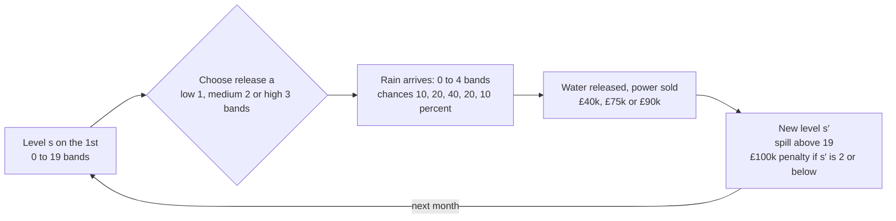
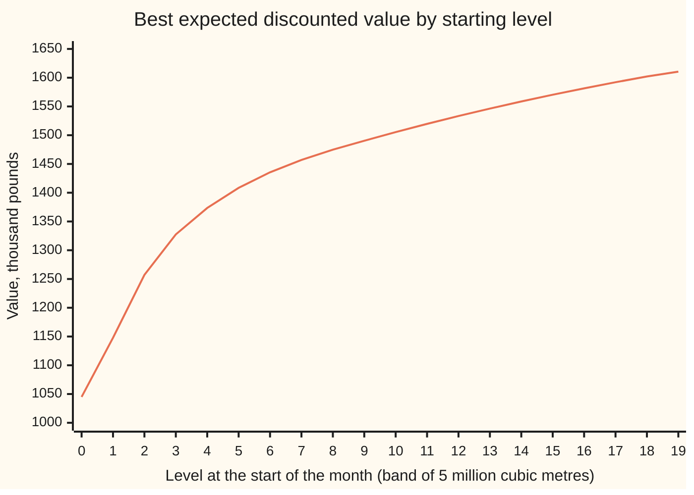

# Markov decision processes: states, actions, rewards and a transition rule

[Syllabus](../../../SYLLABUS.md) → [Optimization](../README.md) → [Dynamic Programming and Learning](../README.md#s07) → Markov decision processes

---

## General Overview

A hydro reservoir holds up to 100 million cubic metres of water. Its operator tracks the level in 20 bands of 5 million cubic metres each: level 0 is the bottom band, nearly empty, and level 19 is the top band, full. On the first of each month the operator picks one of three releases through the turbines: low (1 band, 5 million cubic metres), medium (2 bands) or high (3 bands). The power sells for £40,000, £75,000 or £90,000. Each extra band earns less, because the extra power goes into cheaper hours.

Then the month's rain arrives, and nobody knows how much. Inflow is 0, 1, 2, 3 or 4 bands, with chances 10%, 20%, 40%, 20% and 10%. Water above the top band spills and earns nothing. If the month ends at level 2 or below (under 15 million cubic metres), the town the reservoir also supplies must buy emergency water, at a cost of £100,000.

So every month is a trade. A big release earns now but drains the store, and a dry spell then brings the £100,000 penalty. A small release protects the store but earns less, and may waste water by spilling in a wet month. The operator wants the release rule that **maximises** the expected total of revenue minus penalties, with next month's pound worth 95p today.

A problem of this shape is a **Markov decision process**, MDP for short: a state (the level), a choice in each state (the release), a reward for the choice (revenue minus penalty), and a transition rule that gives the chance of each next state (the rain). For this reservoir the best rule is: low at levels 0 to 4, medium at 5 to 9, high at 10 to 19. Started half full, at level 10, it is worth £1,505,370 in today's money, and a certificate printed by the code shows no rule does better.

**A Markov decision process is a state, a set of actions, a reward and a chance of each next state that depend only on the present state and action; its best expected discounted value obeys one equation, the Bellman optimality equation, and any policy whose value satisfies that equation is optimal.**

**What kind of fact this is:** a definition, then a theorem. The definition sets up the model. The theorem has two halves. That a solution of the equation certifies a policy as best is proved on this card in Why it works. That the equation has exactly one solution is stated here and proved on [The Bellman operator contracts](04-the-bellman-operator-as-a-contraction.md). The reservoir's numbers are a model, invented for this card.

### The picture: one month of the reservoir



The operator controls one box, the release. The rain box is chance. Everything else follows from the two. The next level depends only on this month's level, release and rain: that is what makes the process Markov.

### The picture: what each level is worth



The line is the best value $V^*(s)$ at each level. It climbs steeply at the bottom, where each band keeps the town out of the penalty zone. It flattens near the top, where an extra band mostly risks a spill. The best release is low at levels 0 to 4, medium at 5 to 9 and high at 10 to 19.

---

## The formula

Notation first, in words. This shelf writes the state as $s$ and the action as $a$: they are the $x$ and $u$ of [Dynamic programming](../../08-Differential%20equations%20and%20dynamics/12-Calculus%20of%20Variations%20and%20Optimal%20Control/07-dynamic-programming-and-the-bellman-equation.md). An MDP is five pieces:

1. **States** $s$: here the level, 0 to 19.
2. **Actions** $a$ allowed in each state: here 1, 2 or 3 bands released.
3. **Transition chances** $p(s' \mid s, a)$, read "p of s-prime given s and a": the chance that the next state is $s'$ when action $a$ is taken in state $s$. For each $s$ and $a$ they add to 1, a row of a transition matrix as on [Markov chains](../../11-Stochastic%20processes%20and%20calculus/03-Markov%20Chains/01-markov-chains.md).
4. **Reward** $r(s, a)$: the expected payoff this month, averaged over the rain.
5. **Discount factor** $\gamma$ (Greek "gamma"), between 0 and 1: what one pound next month is worth today.

For the reservoir, with rain $w$ bands, the water actually released is $\min(a, s + w)$, since the turbines cannot release water that is not there. The next level is

$$s' = \min\big(19,\; s + w - \min(a, s + w)\big),$$

and $p(s' \mid s, a)$ adds up the rain chances of every $w$ that lands on $s'$.

A **policy** $\pi$ (Greek "pi") is a rule giving one action in each state: $\pi(s)$. Its **value** $V_\pi(s)$ is the expected total of discounted rewards when the process starts in $s$ and follows $\pi$ for ever. With $\pi$ fixed, the levels form a Markov chain; the long-run share of months it spends at each level, its stationary law, is written $d_\pi$. The best value is $V^*(s)$, the largest $V_\pi(s)$ over all policies. It obeys the **Bellman optimality equation**:

$$V^*(s) = \max_{a \in \{1, 2, 3\}} \Big[\, r(s, a) + \gamma \sum_{s'} p(s' \mid s, a)\, V^*(s') \Big] \quad\text{for every state } s.$$

**Read it aloud:** the best value from a level is the largest, over this month's three releases, of this month's expected reward plus the discounted average of the best value from wherever the rain leaves the reservoir.

The quantity in square brackets is called the **bracket** below: the worth of taking $a$ now and acting best afterwards. A policy that picks, in each state, an action with the largest bracket is optimal.

| Symbol | Plain meaning | In our example | Push it up and the answer… |
| --- | --- | --- | --- |
| $s$, $s'$ | state now, state next month: the level, in bands of 5 million cubic metres | 10, and 7 to 13 next month | higher levels are worth more: $V^*(19)$ = 1610.52 |
| $a$ | action: bands released this month | 1 low, 2 medium, 3 high | more revenue now, a lower level next month |
| $w$ | rain inflow this month, in bands | 0 to 4; chances 10, 20, 40, 20, 10 percent | wetter months favour bigger releases |
| $p(s' \mid s, a)$ | chance of level $s'$ next month after action $a$ at level $s$ | $p(9 \mid 10, \text{high})$ = 40% | — |
| $r(s, a)$ | expected reward this month, thousand pounds | $r(2, \text{high})$ = −1.50 | — |
| $\gamma$ | discount factor: next month's pound in today's pounds | 0.95 | the future counts more; values and the medium zone grow |
| $\pi$, $\pi(s)$, $d_\pi$ | a policy; the action it takes at level $s$; the long-run share of months at each level under it | best: low at 0–4, medium at 5–9, high at 10–19 | — |
| $V_\pi(s)$ | expected discounted total from $s$ following $\pi$, thousand pounds | the policy that takes this month's biggest reward: 809.43 at level 10 | — |
| $V^*(s)$ | best value over all policies, thousand pounds | $V^*(10)$ = 1505.37 | — |
| $n$, $m$ | number of states, actions per state | 20, 3 | table of $n \cdot m \cdot n$ = 1,200 chances |
| $d$ | reservoirs on one river, each tracked in 20 levels | 1 | states $20^d$, actions $3^d$ |
| $\sigma$, $D$, $D_{\min}$ | in the proof: any rival policy, the gap $V - V_\sigma$ level by level, and its smallest entry | the reward-chasing policy | — |

### When it holds

- **The state carries all the memory that matters.** Rain here is independent from month to month. If wet months tend to follow wet months, the level alone no longer predicts next month, and the state must grow to include last month's rain, multiplying the 20 states by 5.
- **Discounting, $\gamma < 1$.** At $\gamma = 1$ the total over an endless future is infinite. A sweep puts the current values into the right side of the equation to get new values for every level. Sweeps of the equation from zero then climb by 74.01 a month for ever, through 7468.00, 14868.23 and 29669.93 after 100, 200 and 400 sweeps, and never settle.
- **The model is known.** The equation needs every $p(s' \mid s, a)$ and $r(s, a)$. When the rain chances are unknown and must be learned from experience, the tool is [Q-learning](05-q-learning-and-temporal-differences.md).
- **The same rules every month.** The chances and rewards do not depend on the date. Seasons break this; the repair is to put the month in the state, multiplying the states by 12.
- **Finitely many states and actions, bounded rewards.** Then each maximum exists and every value is finite.

---

## Why it works

### Step 0: the level is all the future needs

Two operators who both stand at level 10 on 1 March face the same future: the same choices, the same rain chances, the same prices. How each got there makes no difference. So the best that can be done from here is one number per level, $V^*(s)$, and the whole problem is 20 unknown numbers.

### Step 1: the value of one policy is twenty linear equations

Fix a policy $\pi$. From level $s$ the total is this month's reward plus everything after. Everything after starts at the next level $s'$, a month later, so it is worth $\gamma$ times the value from $s'$. Averaging over the rain:

$$V_\pi(s) = r(s, \pi(s)) + \gamma \sum_{s'} p(s' \mid s, \pi(s))\, V_\pi(s').$$

One equation per level, 20 equations in 20 unknowns, all straight-line. They have exactly one solution: if two lists both solved them, their difference $D$ would satisfy $D(s) = \gamma \sum_{s'} p(s' \mid s, \pi(s)) D(s')$, an average shrunk by $\gamma$, so the largest $|D(s)|$ is at most $\gamma$ times itself, which forces 0. The code solves the 20 equations by Gaussian elimination: use one equation to remove one unknown from the rest, repeat, then solve backwards.

### Step 2: the best value takes the best first action

Any plan from level $s$ is a first release $a$ followed by a plan from wherever the rain lands. Fix $a$. The best that can follow is $V^*(s')$ from each possible $s'$, so the best plan starting with $a$ is worth the bracket, $r(s, a) + \gamma \sum_{s'} p(s' \mid s, a) V^*(s')$. Taking the best $a$ covers every plan. That is the Bellman optimality equation. It is the principle of optimality from [Backward induction](01-finite-horizon-dynamic-programming-and-backward-induction.md), with no last month to start from.

### Step 3: a solution certifies the policy

The equation is useful in reverse. Suppose a list of numbers $V$ satisfies it, and $\pi$ takes, at each level, an action with the largest bracket. Then:

1. $V$ satisfies Step 1's equations for $\pi$, so $V = V_\pi$.
2. Any other policy $\sigma$ (Greek "sigma") does no better at any level: $V_\sigma(s) \le V(s)$ for every $s$.

<details>
<summary>Detailed proof: a solution of the optimality equation beats every policy</summary>

Part 1. At each $s$, $\pi(s)$ attains the maximum, so $V(s) = r(s, \pi(s)) + \gamma \sum_{s'} p(s' \mid s, \pi(s)) V(s')$. These are Step 1's equations for $\pi$, whose only solution is $V_\pi$. So $V = V_\pi$.

Part 2. Let $\sigma$ be any policy that takes one action per state. The maximum is at least the bracket of $\sigma(s)$:

$$V(s) \ge r(s, \sigma(s)) + \gamma \sum_{s'} p(s' \mid s, \sigma(s))\, V(s').$$

$V_\sigma$ satisfies the same line with equality. Subtract, and write $D(s) = V(s) - V_\sigma(s)$:

$$D(s) \ge \gamma \sum_{s'} p(s' \mid s, \sigma(s))\, D(s').$$

Let $D_{\min}$ be the smallest $D(s)$, reached at some state $s_0$. The average on the right is at least $D_{\min}$, so $D_{\min} \ge \gamma D_{\min}$, that is $(1 - \gamma) D_{\min} \ge 0$. With $\gamma < 1$ this gives $D_{\min} \ge 0$, so $V(s) \ge V_\sigma(s)$ at every level.

Policies that look back over the history, or toss a coin to choose, do no better either; Puterman (Sources) proves it, in his chapter 6. If $V_\pi$ misses the equation by at most a small residual, the same argument shows no policy beats $\pi$ by more than the residual divided by $1 - \gamma$.

</details>

This is the certificate the code prints. It values the policy exactly by Step 1, then checks every level and every action: no single switch of action raises a bracket above $V_\pi(s)$ by more than $10^{-9}$. That a solution exists at all, and only one, is the contraction fact proved on [The Bellman operator contracts](04-the-bellman-operator-as-a-contraction.md). The code finds it by repeated sweeps of the equation, starting from $V = 0$ and stopping when no level changes by more than $10^{-6}$: 354 sweeps. Why sweeps converge, and a faster method, are the subject of [Value and policy iteration](03-value-and-policy-iteration.md).

### Step 4: counting what the equation asks for

The [Dynamic programming](../../08-Differential%20equations%20and%20dynamics/12-Calculus%20of%20Variations%20and%20Optimal%20Control/07-dynamic-programming-and-the-bellman-equation.md) card already shows the curse of dimensionality: the state count explodes with every quantity the state must track. Here is the count for an MDP.

One reservoir needs $n \cdot m \cdot n$ = 20 × 3 × 20 = 1,200 transition chances, of which 280 are not zero: each release has only five rain outcomes, and near the top and bottom some of them land on the same level. One sweep of the equation costs about that many multiply-adds. The policies number $3^{20}$ = 3,486,784,401. Valuing each one separately is hopeless; the equation instead does about 1,200 multiply-adds a sweep.

Now put $d$ reservoirs in a chain on one river. Each release feeds the next reservoir down, so the levels cannot be planned one at a time. The state is the list of all $d$ levels and the action the list of all $d$ releases:

| Reservoirs $d$ | States $20^d$ | Actions $3^d$ | Multiply-adds per sweep | Digits in the number of policies |
| ---: | ---: | ---: | ---: | ---: |
| 1 | 20 | 3 | 1,200 | 10 |
| 2 | 400 | 9 | 1,440,000 | 382 |
| 3 | 8,000 | 27 | 1,728,000,000 | 11,451 |
| 10 | 10,240,000,000,000 | 59,049 | 6,191,736,422,400,000,000,000,000,000,000 | 48,857,216,483,294 |

The states grow as $20^d$, the cost of one sweep as $20^d \cdot 3^d \cdot 20^d$. Three reservoirs are routine. Ten are far beyond any computer, although they are only ten numbers. That is why real river systems with many linked reservoirs approximate the values instead of storing one number per state.

---

## Worked numbers, by hand

At level 10, compare the three releases. From level 10 the month cannot end below level 7, so no penalty is possible and the rewards are the plain revenues. The best values the brackets need are $V^*(7)$ to $V^*(13)$: 1457.02, 1474.82, 1490.37, 1505.37, 1519.73, 1533.33, 1546.29.

| Step | Arithmetic | Value |
| --- | --- | --- |
| rewards at level 10 | low, medium, high: no penalty reachable | 40.00, 75.00, 90.00 |
| next levels after low | 10 + rain − 1 = 9, 10, 11, 12, 13 | chances 0.1, 0.2, 0.4, 0.2, 0.1 |
| average next value, low | 0.1 × 1490.37 + 0.2 × 1505.37 + 0.4 × 1519.73 + 0.2 × 1533.33 + 0.1 × 1546.29 | 1519.30 |
| average next value, medium | the same weights on levels 8 to 12 | 1504.98 |
| average next value, high | 0.1 × 1457.02 + 0.2 × 1474.82 + 0.4 × 1490.37 + 0.2 × 1505.37 + 0.1 × 1519.73 | 1489.86 |
| bracket, low | 40 + 0.95 × 1519.30 | 1483.33 |
| bracket, medium | 75 + 0.95 × 1504.98 | 1504.73 |
| bracket, high | 90 + 0.95 × 1489.86 | 1505.37 |
| largest bracket | high | **1505.37 = $V^*(10)$** |

Half full, the operator should release high, and the reservoir is worth £1,505,370 in today's money. The call is close: medium's bracket, 1504.73, is less than one thousand pounds behind. Level 10 is exactly where the best rule switches from medium to high.

One reward with a penalty in it, at level 2 with a high release. Rain of 0 lets out only 2 bands, earning 75; every rain of 3 bands or less ends the month at level 2 or below.

| Step | Arithmetic | Value |
| --- | --- | --- |
| rain 0, 1, 2, 3, 4 | rewards 75 − 100, 90 − 100, 90 − 100, 90 − 100, 90 | −25, −10, −10, −10, 90 |
| average | 0.1 × (−25) + 0.2 × (−10) + 0.4 × (−10) + 0.2 × (−10) + 0.1 × 90 | **$r(2, \text{high})$ = −1.50** |

Low releases the least but is the best of the three at level 2 on average: $r(2, \text{low})$ = 10.00 against 5.00 for medium.

### What breaks if you drop a piece

| Mistake | Comes out at | What went wrong |
| --- | --- | --- |
| Pick the release with the biggest reward this month, ignoring the future (policy 33122333333333333333) | 809.43 at level 10, against 1505.37 | mostly high releases drain the store into the penalty zone; the bracket's second term is missing |
| Plan as if every month brought exactly 2 bands of rain (policy 11123333333333333333) | promises 1590.50, delivers 1022.64 at level 10 | the average rain never causes a drought, so the plan runs the store low; a dry spell then costs £100,000 a month |
| Set $\gamma = 1$ | 7468.00, 14868.23, 29669.93 after 100, 200, 400 sweeps, rising 74.01 a sweep | an endless undiscounted total is infinite; the equation has no finite solution |

---

## Code, from first principles, and it actually runs

The script builds the reservoir's transition chances and rewards from the rain table, then takes four roads to the answer.

1. Road 1 sweeps the Bellman optimality equation from $V = 0$ until no level changes by more than $10^{-6}$, a tolerance far above rounding error so the count does not depend on it, and reads off the best release at each level.
2. Road 2 values that policy exactly by solving Step 1's 20 linear equations by Gaussian elimination, and prints the certificate: no single change of action, at any level, raises a bracket by more than $10^{-9}$.
3. Road 3 shrinks the reservoir to 6 levels, lists all $3^6$ = 729 policies, values each exactly, and confirms that the one the equation picks is at least as good as every other at every level.
4. Road 4 runs the policy 4,000 times for 300 months with rain drawn from SplitMix64 (a small random-number generator written out in the code), seed 2026. It checks the average discounted reward (revenue minus penalties) against $V^*(10)$ within 4 standard errors (the standard error is the typical gap between a simulated mean and the true one).

Python's `sum()` adds floating-point numbers with a correction step, so the script uses a plain running sum to match Rust to the last digit. The `try:` lines at the end run the experiments in the Try-changing box.

### Python

```python
# Markov decision processes: states, actions, rewards and a transition rule -- the check behind the card.
# A reservoir in 20 levels, three releases, random rain. Roads: Bellman sweeps; exact policy value by
# elimination, with a certificate; every policy of a 6-level reservoir listed; a seeded simulation.
from functools import reduce
RAIN = [0.1, 0.2, 0.4, 0.2, 0.1]   # chance of 0, 1, 2, 3, 4 bands of inflow in a month
PAY = [0.0, 40.0, 75.0, 90.0]      # revenue, thousand pounds, for 0, 1, 2, 3 bands actually released
PENALTY, LOW, G, ACTS = 100.0, 2, 0.95, (1, 2, 3)   # penalty if the month ends at level 2 or below

def model(n, rain):                # p[s][a-1] = chances of next level s'; r[s][a-1] = expected reward
    p, r = [], []
    for s in range(n):
        prow, rrow = [], []
        for a in ACTS:
            row, rew = [0.0] * n, 0.0
            for w, q in enumerate(rain):
                if q == 0.0: continue
                out = min(a, s + w)            # cannot release water that is not there
                t = min(n - 1, s + w - out)    # anything above the top level spills
                row[t] += q
                rew += q * (PAY[out] - (PENALTY if t <= LOW else 0.0))
            prow.append(row); rrow.append(rew)
        p.append(prow); r.append(rrow)
    return p, r

def add(xs): return reduce(lambda t, x: t + x, xs, 0.0)   # plain left-to-right sum, as in Rust (sum() compensates)

def bracket(p, r, V, s, a, g):     # r(s,a) + g * sum over s' of p(s'|s,a) V(s')
    return r[s][a - 1] + g * add(x * v for x, v in zip(p[s][a - 1], V))

def argmax(p, r, V, s, g):          # the first best action
    b = [bracket(p, r, V, s, a, g) for a in ACTS]; return b.index(max(b)) + 1

def sweeps(p, r, n, g, tol, kmax):  # Bellman optimality sweeps from V = 0
    V, k = [0.0] * n, 0
    while k < kmax:
        W = [max(bracket(p, r, V, s, a, g) for a in ACTS) for s in range(n)]
        k, change, V = k + 1, max(abs(x - y) for x, y in zip(V, W)), W
        if change < tol: break
    return V, k

def evaluate(p, r, n, pol, g):     # solve (I - g P_pi) V = r_pi by Gaussian elimination
    M = [[(1.0 if i == j else 0.0) - g * p[i][pol[i] - 1][j] for j in range(n)] + [r[i][pol[i] - 1]] for i in range(n)]
    for c in range(n):
        piv = max(range(c, n), key=lambda i: abs(M[i][c]))
        M[c], M[piv] = M[piv], M[c]
        for i in range(c + 1, n):
            f = M[i][c] / M[c][c]
            M[i][c:] = [x - f * y for x, y in zip(M[i][c:], M[c][c:])]
    V = [0.0] * n
    for i in range(n - 1, -1, -1):
        V[i] = (M[i][n] - add(M[i][j] * V[j] for j in range(i + 1, n))) / M[i][i]
    return V

def splitmix(state):               # SplitMix64: the next state and a 64-bit random number
    state = (state + 0x9E3779B97F4A7C15) & 0xFFFFFFFFFFFFFFFF
    z = ((state ^ (state >> 30)) * 0xBF58476D1CE4E5B9) & 0xFFFFFFFFFFFFFFFF
    z = ((z ^ (z >> 27)) * 0x94D049BB133111EB) & 0xFFFFFFFFFFFFFFFF
    return state, z ^ (z >> 31)

RAINMAP = [0, 1, 1, 2, 2, 2, 2, 3, 3, 4]   # a digit 0-9 gives rain with chances 0.1 0.2 0.4 0.2 0.1
def simulate(pol, g, months, seed):  # RUNS runs from S0: mean and standard error of the discounted total
    state, totals = seed, []
    for _ in range(RUNS):
        s, disc, tot = S0, 1.0, 0.0
        for _ in range(months):
            state, z = splitmix(state)
            w = RAINMAP[z % 10]
            out = min(pol[s], s + w); t = min(N - 1, s + w - out)
            tot += disc * (PAY[out] - (PENALTY if t <= LOW else 0.0))
            disc, s = disc * g, t
        totals.append(tot)
    mean = add(totals) / RUNS
    return mean, (add((x - mean) ** 2 for x in totals) / (RUNS - 1) / RUNS) ** 0.5

show, yn = (lambda V: " ".join(f"{v:.2f}" for v in V)), (lambda b: "yes" if b else "no")

N, S0 = 20, 10
p, r = model(N, RAIN)
nonzero = sum(1 for s in range(N) for a in ACTS for x in p[s][a - 1] if x > 0.0)
assert all(abs(sum(p[s][a - 1]) - 1.0) < 1e-12 for s in range(N) for a in ACTS)
print(f"model: {N} levels x {len(ACTS)} releases, table {N * len(ACTS) * N} entries, {nonzero} not zero, rows sum to 1; {3 ** N:,} policies")
print(f"rain 0-4 bands, chances {show(RAIN)}; r(2,a) for low, medium, high: {show(r[2])}")
assert abs(r[2][2] - (0.1 * -25 + 0.2 * -10 + 0.4 * -10 + 0.2 * -10 + 0.1 * 90)) < 1e-12
V, k = sweeps(p, r, N, G, 1e-6, 10000)
pol = [argmax(p, r, V, s, G) for s in range(N)]
print(f"road 1: {k} sweeps from V = 0 until no level changes by 1e-6")
print(f"V* levels 0-9:   {show(V[:10])}")
print(f"V* levels 10-19: {show(V[10:])}")
print("best release (1 low, 2 medium, 3 high) by level 0-19: " + "".join(map(str, pol)))
VP = evaluate(p, r, N, pol, G)
gain = max(bracket(p, r, VP, s, a, G) - VP[s] for s in range(N) for a in ACTS)
print(f"road 2: exact value of that policy differs from road 1 by under 1e-4: {yn(max(abs(x - y) for x, y in zip(V, VP)) < 1e-4)}")
print(f"certificate: no switch of one action gains over 1e-9 anywhere: {yn(gain < 1e-9)}")
assert max(abs(x - y) for x, y in zip(V, VP)) < 1e-4 and gain < 1e-9
nxt = [add(x * v for x, v in zip(p[S0][a - 1], VP)) for a in ACTS]
print(f"level {S0}: V*(7..13) = {show(VP[7:14])}")
print(f"level {S0}: r = {show(r[S0])}; average next V* = {show(nxt)}")
print(f"level {S0}: brackets = {show([bracket(p, r, VP, S0, a, G) for a in ACTS])}")
assert abs(nxt[2] - (0.1 * VP[7] + 0.2 * VP[8] + 0.4 * VP[9] + 0.2 * VP[10] + 0.1 * VP[11])) < 1e-9
n6 = 6                             # road 3: a 6-level reservoir, every one of 3^6 policies valued exactly
p6, r6 = model(n6, RAIN)
pols6 = [[c // 3 ** i % 3 + 1 for i in range(n6)] for c in range(3 ** n6)]
vals6 = [evaluate(p6, r6, n6, pl, G) for pl in pols6]
i6 = max(range(len(pols6)), key=lambda i: add(vals6[i]))   # the first policy with the largest total
dominates = all(vals6[i6][s] >= w[s] - 1e-9 for w in vals6 for s in range(n6))
V6, _ = sweeps(p6, r6, n6, G, 1e-10, 10000)
pol6 = [argmax(p6, r6, V6, s, G) for s in range(n6)]
print(f"road 3: 6 levels, {len(pols6)} policies listed; best {''.join(map(str, pols6[i6]))} beats or ties all at every level: {yn(dominates)}; Bellman picks {''.join(map(str, pol6))}")
assert dominates and pols6[i6] == pol6 and max(abs(x - y) for x, y in zip(vals6[i6], V6)) < 1e-8
RUNS, MONTHS, SEED = 4000, 300, 2026   # road 4: simulate the policy with SplitMix64
mean, se = simulate(pol, G, MONTHS, SEED)
print(f"road 4: {RUNS} runs of {MONTHS} months from level {S0}: mean {mean:.2f}, standard error {se:.2f}")
assert abs(mean - VP[S0]) < 4 * se
# what breaks
myo = [max(ACTS, key=lambda a: r[s][a - 1]) for s in range(N)]
pc, rc = model(N, [0.0, 0.0, 1.0, 0.0, 0.0])
Vc, _ = sweeps(pc, rc, N, G, 1e-10, 10000)
cert = [argmax(pc, rc, Vc, s, G) for s in range(N)]
vm, vc = evaluate(p, r, N, myo, G)[S0], evaluate(p, r, N, cert, G)[S0]
print(f"breaks: this month's reward only {''.join(map(str, myo))}: {vm:.2f}")
print(f"breaks: rain always 2 bands {''.join(map(str, cert))}: promises {Vc[S0]:.2f}, delivers {vc:.2f}")
g1 = [sweeps(p, r, N, 1.0, 0.0, k)[0][S0] for k in (100, 200, 400)]
print(f"breaks: gamma = 1, V(10) after 100, 200, 400 sweeps: {show(g1)}; rise per sweep {(g1[2] - g1[1]) / 200:.2f}")
assert vm < VP[S0] and vc < VP[S0] < Vc[S0] and g1[2] - g1[1] > 0.9 * (g1[1] - g1[0])
# counting: d linked reservoirs on one river, each with 20 levels and 3 releases
print("reservoirs  states  actions  sweep cost  policy digits")
for d in (1, 2, 3, 10):
    st, ac = N ** d, 3 ** d
    digits = int(d * N ** d * 0.47712125471966244) + 1   # digits of 3^(d * 20^d), log10(3) written out
    print(f"{d} {st:,} {ac:,} {st * ac * st:,} {digits:,}")
    assert d > 2 or digits == len(str(3 ** (d * N ** d)))
# the Try-changing box: other discount factors, one year of months, another seed
for g in (0.8, 0.99):
    Vg, kg = sweeps(p, r, N, g, 1e-6, 100000)
    pg = [argmax(p, r, Vg, s, g) for s in range(N)]
    mg, sg = simulate(pg, g, MONTHS, SEED)
    print(f"try: gamma {g}: {kg} sweeps, best release {''.join(map(str, pg))}, V*(10) {Vg[S0]:.2f}, simulated {mg:.2f} (se {sg:.2f})")
(m12, s12), (m7, s7) = simulate(pol, G, 12, SEED), simulate(pol, G, MONTHS, 7)
print(f"try: 12 months: simulated mean {m12:.2f} (se {s12:.2f}); seed 7: mean {m7:.2f} (se {s7:.2f})")
print("ALL CHECKS PASS")
```

**Ran 2026-11-11 on macOS, Python 3.14.10, standard library only. All checks passed. Output, pasted from the run:**

```
model: 20 levels x 3 releases, table 1200 entries, 280 not zero, rows sum to 1; 3,486,784,401 policies
rain 0-4 bands, chances 0.10 0.20 0.40 0.20 0.10; r(2,a) for low, medium, high: 10.00 5.00 -1.50
road 1: 354 sweeps from V = 0 until no level changes by 1e-6
V* levels 0-9:   1044.92 1147.76 1257.12 1327.56 1373.45 1408.45 1435.53 1457.02 1474.82 1490.37
V* levels 10-19: 1505.37 1519.73 1533.33 1546.29 1558.62 1570.34 1581.50 1592.10 1602.06 1610.52
best release (1 low, 2 medium, 3 high) by level 0-19: 11111222223333333333
road 2: exact value of that policy differs from road 1 by under 1e-4: yes
certificate: no switch of one action gains over 1e-9 anywhere: yes
level 10: V*(7..13) = 1457.02 1474.82 1490.37 1505.37 1519.73 1533.33 1546.29
level 10: r = 40.00 75.00 90.00; average next V* = 1519.30 1504.98 1489.86
level 10: brackets = 1483.33 1504.73 1505.37
road 3: 6 levels, 729 policies listed; best 111112 beats or ties all at every level: yes; Bellman picks 111112
road 4: 4000 runs of 300 months from level 10: mean 1505.59, standard error 1.14
breaks: this month's reward only 33122333333333333333: 809.43
breaks: rain always 2 bands 11123333333333333333: promises 1590.50, delivers 1022.64
breaks: gamma = 1, V(10) after 100, 200, 400 sweeps: 7468.00 14868.23 29669.93; rise per sweep 74.01
reservoirs  states  actions  sweep cost  policy digits
1 20 3 1,200 10
2 400 9 1,440,000 382
3 8,000 27 1,728,000,000 11,451
10 10,240,000,000,000 59,049 6,191,736,422,400,000,000,000,000,000,000 48,857,216,483,294
try: gamma 0.8: 82 sweeps, best release 11111223333333333333, V*(10) 410.82, simulated 410.34 (se 0.36)
try: gamma 0.99: 1803 sweeps, best release 11111222222222222333, V*(10) 7388.37, simulated 7026.90 (se 3.00)
try: 12 months: simulated mean 718.00 (se 0.64); seed 7: mean 1506.59 (se 1.12)
ALL CHECKS PASS
```

### Rust

```rust
// Markov decision processes: states, actions, rewards and a transition rule -- the check behind the card.
// A reservoir in 20 levels, three releases, random rain. Roads: Bellman sweeps; exact policy value by
// elimination, with a certificate; every policy of a 6-level reservoir listed; a seeded simulation.
const RAIN: [f64; 5] = [0.1, 0.2, 0.4, 0.2, 0.1]; // chance of 0, 1, 2, 3, 4 bands of inflow in a month
const PAY: [f64; 4] = [0.0, 40.0, 75.0, 90.0]; // revenue, thousand pounds, for 0..3 bands actually released
const PENALTY: f64 = 100.0; const LOW: usize = 2; const G: f64 = 0.95; // penalty if the month ends at level 2 or below
const RUNS: usize = 4000; const S0: usize = 10; // road 4: runs simulated, each from level 10

struct Mdp { n: usize, p: Vec<Vec<Vec<f64>>>, r: Vec<Vec<f64>> } // p[s][a-1][s'], r[s][a-1]

fn model(n: usize, rain: &[f64]) -> Mdp {
    let (mut p, mut r) = (vec![], vec![]);
    for s in 0..n {
        let (mut prow, mut rrow) = (vec![], vec![]);
        for a in 1..=3usize {
            let (mut row, mut rew) = (vec![0.0; n], 0.0);
            for (w, &q) in rain.iter().enumerate() {
                if q == 0.0 { continue; }
                let out = a.min(s + w); // cannot release water that is not there
                let t = (n - 1).min(s + w - out); // anything above the top level spills
                row[t] += q;
                rew += q * (PAY[out] - if t <= LOW { PENALTY } else { 0.0 });
            }
            prow.push(row); rrow.push(rew);
        }
        p.push(prow); r.push(rrow);
    }
    Mdp { n, p, r }
}

fn dot(x: &[f64], v: &[f64]) -> f64 { x.iter().zip(v).fold(0.0, |acc, (a, b)| acc + a * b) }
fn bracket(m: &Mdp, v: &[f64], s: usize, a: usize, g: f64) -> f64 { m.r[s][a - 1] + g * dot(&m.p[s][a - 1], v) }
fn argmax(m: &Mdp, v: &[f64], s: usize, g: f64) -> usize { // the first best action
    (2..=3).fold(1, |best, a| if bracket(m, v, s, a, g) > bracket(m, v, s, best, g) { a } else { best })
}

fn sweeps(m: &Mdp, g: f64, tol: f64, kmax: usize) -> (Vec<f64>, usize) {
    let (mut v, mut k) = (vec![0.0; m.n], 0);
    while k < kmax {
        let w: Vec<f64> = (0..m.n).map(|s| (1..=3).map(|a| bracket(m, &v, s, a, g)).fold(f64::NEG_INFINITY, f64::max)).collect();
        let change = v.iter().zip(&w).map(|(x, y)| (x - y).abs()).fold(0.0, f64::max);
        k += 1; v = w;
        if change < tol { break; }
    }
    (v, k)
}

fn evaluate(m: &Mdp, pol: &[usize], g: f64) -> Vec<f64> { // (I - g P_pi) V = r_pi by elimination
    let n = m.n;
    let mut a: Vec<Vec<f64>> = (0..n).map(|i| {
        let mut row: Vec<f64> = (0..n).map(|j| (if i == j { 1.0 } else { 0.0 }) - g * m.p[i][pol[i] - 1][j]).collect();
        row.push(m.r[i][pol[i] - 1]); row
    }).collect();
    for c in 0..n {
        let mut piv = c;
        for i in c..n { if a[i][c].abs() > a[piv][c].abs() { piv = i; } } a.swap(c, piv);
        for i in c + 1..n {
            let f = a[i][c] / a[c][c];
            for j in c..=n { let x = a[c][j]; a[i][j] -= f * x; }
        }
    }
    let mut v = vec![0.0; n];
    for i in (0..n).rev() {
        let s = (i + 1..n).fold(0.0, |acc, j| acc + a[i][j] * v[j]);
        v[i] = (a[i][n] - s) / a[i][i];
    }
    v
}

fn show(v: &[f64]) -> String { v.iter().map(|x| format!("{:.2}", x)).collect::<Vec<_>>().join(" ") }
fn yn(b: bool) -> &'static str { if b { "yes" } else { "no" } }
fn code(p: &[usize]) -> String { p.iter().map(|a| a.to_string()).collect() }
fn commas(x: u128) -> String { if x < 1000 { x.to_string() } else { format!("{},{:03}", commas(x / 1000), x % 1000) } }
fn maxdiff(x: &[f64], y: &[f64]) -> f64 { x.iter().zip(y).map(|(a, b)| (a - b).abs()).fold(0.0, f64::max) }

fn splitmix(state: &mut u64) -> u64 { // SplitMix64
    *state = state.wrapping_add(0x9E3779B97F4A7C15);
    let z = (*state ^ (*state >> 30)).wrapping_mul(0xBF58476D1CE4E5B9);
    let z = (z ^ (z >> 27)).wrapping_mul(0x94D049BB133111EB);
    z ^ (z >> 31)
}

const RAINMAP: [usize; 10] = [0, 1, 1, 2, 2, 2, 2, 3, 3, 4]; // a digit 0-9 gives rain with chances 0.1 0.2 0.4 0.2 0.1
fn simulate(pol: &[usize], g: f64, months: usize, seed: u64) -> (f64, f64) { // mean and standard error from S0
    let (n, mut state, mut totals) = (pol.len(), seed, vec![]);
    for _ in 0..RUNS {
        let (mut s, mut disc, mut tot) = (S0, 1.0f64, 0.0f64);
        for _ in 0..months {
            let w = RAINMAP[(splitmix(&mut state) % 10) as usize];
            let out = pol[s].min(s + w); let t = (n - 1).min(s + w - out);
            tot += disc * (PAY[out] - if t <= LOW { PENALTY } else { 0.0 });
            disc *= g; s = t;
        }
        totals.push(tot);
    }
    let mean = totals.iter().fold(0.0, |a, x| a + x) / RUNS as f64;
    let ss = totals.iter().fold(0.0, |a, x| a + (x - mean).powi(2));
    (mean, (ss / (RUNS - 1) as f64 / RUNS as f64).powf(0.5))
}

fn main() {
    let (n, s0) = (20usize, S0);
    let m = model(n, &RAIN);
    let nonzero = m.p.iter().flatten().flatten().filter(|&&x| x > 0.0).count();
    assert!(m.p.iter().flatten().all(|row| (row.iter().sum::<f64>() - 1.0).abs() < 1e-12));
    println!("model: {} levels x 3 releases, table {} entries, {} not zero, rows sum to 1; {} policies", n, n * 3 * n, nonzero, commas(3u128.pow(n as u32)));
    println!("rain 0-4 bands, chances {}; r(2,a) for low, medium, high: {}", show(&RAIN), show(&m.r[2]));
    assert!((m.r[2][2] - (0.1 * -25.0 + 0.2 * -10.0 + 0.4 * -10.0 + 0.2 * -10.0 + 0.1 * 90.0)).abs() < 1e-12);
    let (v, k) = sweeps(&m, G, 1e-6, 10000);
    let pol: Vec<usize> = (0..n).map(|s| argmax(&m, &v, s, G)).collect();
    println!("road 1: {} sweeps from V = 0 until no level changes by 1e-6", k);
    println!("V* levels 0-9:   {}", show(&v[..10]));
    println!("V* levels 10-19: {}", show(&v[10..]));
    println!("best release (1 low, 2 medium, 3 high) by level 0-19: {}", code(&pol));
    let vp = evaluate(&m, &pol, G);
    let mut gain = f64::NEG_INFINITY;
    for s in 0..n { for a in 1..=3 { gain = gain.max(bracket(&m, &vp, s, a, G) - vp[s]); } }
    println!("road 2: exact value of that policy differs from road 1 by under 1e-4: {}", yn(maxdiff(&v, &vp) < 1e-4));
    println!("certificate: no switch of one action gains over 1e-9 anywhere: {}", yn(gain < 1e-9));
    assert!(maxdiff(&v, &vp) < 1e-4 && gain < 1e-9);
    let nxt: Vec<f64> = (1..=3).map(|a| dot(&m.p[s0][a - 1], &vp)).collect();
    let br: Vec<f64> = (1..=3).map(|a| bracket(&m, &vp, s0, a, G)).collect();
    println!("level {}: V*(7..13) = {}", s0, show(&vp[7..14]));
    println!("level {}: r = {}; average next V* = {}", s0, show(&m.r[s0]), show(&nxt));
    println!("level {}: brackets = {}", s0, show(&br));
    assert!((nxt[2] - (0.1 * vp[7] + 0.2 * vp[8] + 0.4 * vp[9] + 0.2 * vp[10] + 0.1 * vp[11])).abs() < 1e-9);
    let (n6, m6) = (6, model(6, &RAIN)); // road 3: a 6-level reservoir, every one of 3^6 policies valued exactly
    let pols6: Vec<Vec<usize>> = (0..729usize).map(|c| (0..n6).map(|i| c / 3usize.pow(i as u32) % 3 + 1).collect()).collect();
    let vals6: Vec<Vec<f64>> = pols6.iter().map(|pl| evaluate(&m6, pl, G)).collect();
    let mut i6 = 0; // the first policy with the largest total
    for i in 1..729 { if vals6[i].iter().fold(0.0, |a, x| a + x) > vals6[i6].iter().fold(0.0, |a, x| a + x) { i6 = i; } }
    let dominates = vals6.iter().all(|w| (0..n6).all(|s| vals6[i6][s] >= w[s] - 1e-9));
    let (v6, _) = sweeps(&m6, G, 1e-10, 10000);
    let pol6: Vec<usize> = (0..n6).map(|s| argmax(&m6, &v6, s, G)).collect();
    println!("road 3: 6 levels, {} policies listed; best {} beats or ties all at every level: {}; Bellman picks {}",
        pols6.len(), code(&pols6[i6]), yn(dominates), code(&pol6));
    assert!(dominates && pols6[i6] == pol6 && maxdiff(&vals6[i6], &v6) < 1e-8);
    let (months, seed) = (300usize, 2026u64); // road 4: simulate the policy with SplitMix64
    let (mean, se) = simulate(&pol, G, months, seed);
    println!("road 4: {} runs of {} months from level {}: mean {:.2}, standard error {:.2}", RUNS, months, s0, mean, se);
    assert!((mean - vp[s0]).abs() < 4.0 * se);
    // what breaks
    let myo: Vec<usize> = (0..n).map(|s| { let mut b = 1; for a in 2..=3 { if m.r[s][a - 1] > m.r[s][b - 1] { b = a; } } b }).collect();
    let mc = model(n, &[0.0, 0.0, 1.0, 0.0, 0.0]);
    let (vc_plan, _) = sweeps(&mc, G, 1e-10, 10000);
    let cert: Vec<usize> = (0..n).map(|s| argmax(&mc, &vc_plan, s, G)).collect();
    let (vm, vc) = (evaluate(&m, &myo, G)[s0], evaluate(&m, &cert, G)[s0]);
    println!("breaks: this month's reward only {}: {:.2}", code(&myo), vm);
    println!("breaks: rain always 2 bands {}: promises {:.2}, delivers {:.2}", code(&cert), vc_plan[s0], vc);
    let g1: Vec<f64> = [100, 200, 400].iter().map(|&k| sweeps(&m, 1.0, 0.0, k).0[s0]).collect();
    println!("breaks: gamma = 1, V(10) after 100, 200, 400 sweeps: {}; rise per sweep {:.2}", show(&g1), (g1[2] - g1[1]) / 200.0);
    assert!(vm < vp[s0] && vc < vp[s0] && vp[s0] < vc_plan[s0] && g1[2] - g1[1] > 0.9 * (g1[1] - g1[0]));
    // counting: d linked reservoirs on one river, each with 20 levels and 3 releases
    println!("reservoirs  states  actions  sweep cost  policy digits");
    for d in [1u32, 2, 3, 10] {
        let (st, ac) = (20u128.pow(d), 3u128.pow(d));
        let digits = ((d as u128 * st) as f64 * 0.47712125471966244) as u128 + 1; // digits of 3^(d * 20^d)
        println!("{} {} {} {} {}", d, commas(st), commas(ac), commas(st * ac * st), commas(digits));
    }
    // the Try-changing box: other discount factors, one year of months, another seed
    for g in [0.8f64, 0.99] {
        let (vg, kg) = sweeps(&m, g, 1e-6, 100000);
        let pg: Vec<usize> = (0..n).map(|s| argmax(&m, &vg, s, g)).collect();
        let (mg, sg) = simulate(&pg, g, months, seed);
        println!("try: gamma {}: {} sweeps, best release {}, V*(10) {:.2}, simulated {:.2} (se {:.2})", g, kg, code(&pg), vg[s0], mg, sg);
    }
    let ((m12, s12), (m7, s7)) = (simulate(&pol, G, 12, seed), simulate(&pol, G, months, 7));
    println!("try: 12 months: simulated mean {:.2} (se {:.2}); seed 7: mean {:.2} (se {:.2})", m12, s12, m7, s7);
    println!("ALL CHECKS PASS");
}
```

**Ran 2026-11-11 on macOS, rustc 1.98.1, no crates. All checks passed. Output, pasted from the run:**

```
model: 20 levels x 3 releases, table 1200 entries, 280 not zero, rows sum to 1; 3,486,784,401 policies
rain 0-4 bands, chances 0.10 0.20 0.40 0.20 0.10; r(2,a) for low, medium, high: 10.00 5.00 -1.50
road 1: 354 sweeps from V = 0 until no level changes by 1e-6
V* levels 0-9:   1044.92 1147.76 1257.12 1327.56 1373.45 1408.45 1435.53 1457.02 1474.82 1490.37
V* levels 10-19: 1505.37 1519.73 1533.33 1546.29 1558.62 1570.34 1581.50 1592.10 1602.06 1610.52
best release (1 low, 2 medium, 3 high) by level 0-19: 11111222223333333333
road 2: exact value of that policy differs from road 1 by under 1e-4: yes
certificate: no switch of one action gains over 1e-9 anywhere: yes
level 10: V*(7..13) = 1457.02 1474.82 1490.37 1505.37 1519.73 1533.33 1546.29
level 10: r = 40.00 75.00 90.00; average next V* = 1519.30 1504.98 1489.86
level 10: brackets = 1483.33 1504.73 1505.37
road 3: 6 levels, 729 policies listed; best 111112 beats or ties all at every level: yes; Bellman picks 111112
road 4: 4000 runs of 300 months from level 10: mean 1505.59, standard error 1.14
breaks: this month's reward only 33122333333333333333: 809.43
breaks: rain always 2 bands 11123333333333333333: promises 1590.50, delivers 1022.64
breaks: gamma = 1, V(10) after 100, 200, 400 sweeps: 7468.00 14868.23 29669.93; rise per sweep 74.01
reservoirs  states  actions  sweep cost  policy digits
1 20 3 1,200 10
2 400 9 1,440,000 382
3 8,000 27 1,728,000,000 11,451
10 10,240,000,000,000 59,049 6,191,736,422,400,000,000,000,000,000,000 48,857,216,483,294
try: gamma 0.8: 82 sweeps, best release 11111223333333333333, V*(10) 410.82, simulated 410.34 (se 0.36)
try: gamma 0.99: 1803 sweeps, best release 11111222222222222333, V*(10) 7388.37, simulated 7026.90 (se 3.00)
try: 12 months: simulated mean 718.00 (se 0.64); seed 7: mean 1506.59 (se 1.12)
ALL CHECKS PASS
```

### Lean

Lean proves Steps 1 and 3 for every MDP with finitely many states and actions and $0 \le \gamma < 1$.

- If the value of a policy $\pi$ satisfies the Bellman optimality equation, no policy $\sigma$ does better than $\pi$ from any state.
- Each policy's value, its endless sum of discounted rewards, is a finite number.
- The value of any fixed policy satisfies Step 1's equations, one per state.
- If a list $V$ satisfies the Bellman optimality equation and $\pi$ takes an action with the largest bracket in every state, then $V = V_\pi$.
- The level 2 rewards hold exactly: $r(2, \text{low})$ = 10, $r(2, \text{medium})$ = 5 and $r(2, \text{high})$ = −1.50.
- The reservoir's table has 1,200 chances, 280 of them not zero, and there are 3,486,784,401 policies.
- The counting table's states, actions and multiply-adds per sweep hold for 2, 3 and 10 reservoirs.
- The number of policies has 10 digits for one reservoir and 382 for two.

The values $V^*(s)$, the best release rule, the simulation and the mistakes table are left to the Python and Rust checks.

```lean
-- Markov decision processes: a policy whose value satisfies the Bellman optimality equation does at least as well as every other policy from every state.
import Mathlib.Data.Matrix.Mul
import Mathlib.Topology.Algebra.InfiniteSum.Real
import Mathlib.Data.Fintype.BigOperators
import Mathlib.Tactic.NormNum
import Mathlib.Analysis.Normed.Group.InfiniteSum
import Mathlib.Analysis.SpecificLimits.Basic

open Finset

/-! A finite Markov decision process: states `S`, actions `A`, transition chances
`p s a s'` (the chance of next state `s'` after action `a` in state `s`), rewards `r s a`
and a discount factor `γ`. A policy is a rule `π : S → A` giving one action per state. -/

variable {S A : Type*} [Fintype S] [DecidableEq S] [Fintype A] [Nonempty A]

/-- The transition matrix of the Markov chain that policy `π` produces:
row `s` holds the chances `p(s' | s, π s)`. -/
def mdpPolicyMatrix (p : S → A → S → ℝ) (π : S → A) : Matrix S S ℝ :=
  fun s s' => p s (π s) s'

/-- The value `V_π(s)` of policy `π`: the expected total of discounted rewards when the process
starts in `s` and follows `π` for ever, `∑ₖ γᵏ (P_πᵏ r_π)(s)`. Month `k`'s expected reward is
`(P_πᵏ r_π)(s)`, because `P_πᵏ` gives the chances of each state after `k` months. -/
noncomputable def mdpPolicyValue (p : S → A → S → ℝ) (r : S → A → ℝ) (γ : ℝ) (π : S → A)
    (s : S) : ℝ :=
  ∑' k : ℕ, γ ^ k * ((mdpPolicyMatrix p π ^ k).mulVec (fun t => r t (π t))) s

/-- The bracket `r(s, a) + γ ∑_{s'} p(s' | s, a) V(s')`: the worth of taking action `a` now
in state `s` and then collecting `V` from wherever the process lands. -/
def mdpBracket (p : S → A → S → ℝ) (r : S → A → ℝ) (γ : ℝ) (V : S → ℝ) (s : S) (a : A) : ℝ :=
  r s a + γ * ∑ s', p s a s' * V s'

/-- `V` satisfies the Bellman optimality equation:
`V(s) = max_a [ r(s, a) + γ ∑_{s'} p(s' | s, a) V(s') ]` for every state `s`. -/
def MdpBellmanOptimal (p : S → A → S → ℝ) (r : S → A → ℝ) (γ : ℝ) (V : S → ℝ) : Prop :=
  ∀ s, V s = univ.sup' univ_nonempty (mdpBracket p r γ V s)

/-- Helper: for a row-stochastic nonnegative `q`, the powers of `q` keep every entry of
`q^k *ᵥ v` within `∑ t, |v t|` in absolute value. -/
theorem mdp_helper_pow_mulVec_bound (q : Matrix S S ℝ) (hq_nonneg : ∀ s t, 0 ≤ q s t)
    (hq_sum : ∀ s, ∑ t, q s t = 1) (v : S → ℝ) (k : ℕ) (s : S) :
    |(q ^ k).mulVec v s| ≤ ∑ t, |v t| := by
  induction k generalizing s with
  | zero =>
    simp only [pow_zero, Matrix.one_mulVec]
    exact Finset.single_le_sum (f := fun t => |v t|) (fun t _ => abs_nonneg _) (Finset.mem_univ s)
  | succ k ih =>
    rw [pow_succ', ← Matrix.mulVec_mulVec]
    simp only [Matrix.mulVec, dotProduct] at ih ⊢
    calc |∑ t, q s t * ∑ u, (q ^ k) t u * v u|
        ≤ ∑ t, |q s t * ∑ u, (q ^ k) t u * v u| := Finset.abs_sum_le_sum_abs _ _
      _ ≤ ∑ t, q s t * ∑ u, |v u| := by
          apply Finset.sum_le_sum
          intro t _
          rw [abs_mul, abs_of_nonneg (hq_nonneg s t)]
          exact mul_le_mul_of_nonneg_left (ih t) (hq_nonneg s t)
      _ = ∑ u, |v u| := by rw [← Finset.sum_mul, hq_sum, one_mul]

omit [Fintype A] [Nonempty A] in
/-- Helper: the series defining a policy value converges from every state. -/
theorem mdp_helper_summable (p : S → A → S → ℝ) (r : S → A → ℝ) (γ : ℝ)
    (hp_nonneg : ∀ s a s', 0 ≤ p s a s') (hp_sum : ∀ s a, ∑ s', p s a s' = 1)
    (hγ0 : 0 ≤ γ) (hγ1 : γ < 1) (π : S → A) (s : S) :
    Summable fun k : ℕ =>
      γ ^ k * ((mdpPolicyMatrix p π ^ k).mulVec (fun t => r t (π t))) s := by
  apply Summable.of_norm_bounded
    ((summable_geometric_of_lt_one hγ0 hγ1).mul_right (∑ t, |r t (π t)|))
  intro k
  rw [Real.norm_eq_abs, abs_mul, abs_of_nonneg (pow_nonneg hγ0 k)]
  exact mul_le_mul_of_nonneg_left
    (mdp_helper_pow_mulVec_bound _ (fun s t => hp_nonneg s (π s) t) (fun s => hp_sum s (π s)) _ k s)
    (pow_nonneg hγ0 k)

omit [DecidableEq S] in
/-- Helper: if `D s ≤ γ ∑ q s s' D s'` for every `s`, with `q` nonnegative rows adding to 1 and
`0 ≤ γ < 1`, then `D ≤ 0` everywhere. -/
theorem mdp_helper_contraction (q : S → S → ℝ) (hq_nonneg : ∀ s t, 0 ≤ q s t)
    (hq_sum : ∀ s, ∑ t, q s t = 1) (γ : ℝ) (hγ0 : 0 ≤ γ) (hγ1 : γ < 1) (D : S → ℝ)
    (hD : ∀ s, D s ≤ γ * ∑ t, q s t * D t) (s : S) : D s ≤ 0 := by
  obtain ⟨s0, -, hs0⟩ := Finset.exists_max_image Finset.univ D ⟨s, Finset.mem_univ s⟩
  have hle : ∑ t, q s0 t * D t ≤ D s0 := by
    calc ∑ t, q s0 t * D t ≤ ∑ t, q s0 t * D s0 :=
          Finset.sum_le_sum fun t _ => mul_le_mul_of_nonneg_left (hs0 t (Finset.mem_univ t))
            (hq_nonneg s0 t)
      _ = D s0 := by rw [← Finset.sum_mul, hq_sum, one_mul]
  have h1 := hD s0
  have h2 : γ * ∑ t, q s0 t * D t ≤ γ * D s0 := mul_le_mul_of_nonneg_left hle hγ0
  have h3 : D s0 ≤ 0 := by nlinarith
  exact le_trans (hs0 s (Finset.mem_univ s)) h3

omit [Fintype A] [Nonempty A] in
/-- Helper: the policy equation `V_π(s) = r(s, π s) + γ ∑_{s'} p(s' | s, π s) V_π(s')`. -/
theorem mdp_helper_policy_equation (p : S → A → S → ℝ) (r : S → A → ℝ) (γ : ℝ)
    (hp_nonneg : ∀ s a s', 0 ≤ p s a s') (hp_sum : ∀ s a, ∑ s', p s a s' = 1)
    (hγ0 : 0 ≤ γ) (hγ1 : γ < 1) (π : S → A) (s : S) :
    mdpPolicyValue p r γ π s
      = r s (π s) + γ * ∑ s', p s (π s) s' * mdpPolicyValue p r γ π s' := by
  have hsum := mdp_helper_summable p r γ hp_nonneg hp_sum hγ0 hγ1 π
  unfold mdpPolicyValue
  rw [(hsum s).tsum_eq_zero_add]
  simp only [pow_zero, one_mul, Matrix.one_mulVec]
  congr 1
  have key : ∀ k : ℕ, γ ^ (k + 1) *
      ((mdpPolicyMatrix p π ^ (k + 1)).mulVec (fun t => r t (π t))) s
      = γ * ∑ s', p s (π s) s' *
        (γ ^ k * ((mdpPolicyMatrix p π ^ k).mulVec (fun t => r t (π t))) s') := by
    intro k
    rw [pow_succ' γ, pow_succ' (mdpPolicyMatrix p π), ← Matrix.mulVec_mulVec]
    generalize (mdpPolicyMatrix p π ^ k).mulVec (fun t => r t (π t)) = w
    simp only [Matrix.mulVec, dotProduct, mdpPolicyMatrix, Finset.mul_sum]
    apply Finset.sum_congr rfl
    intro t _
    ring
  simp_rw [key]
  rw [tsum_mul_left, Summable.tsum_finsetSum (fun s' _ => (hsum s').mul_left _)]
  congr 1
  apply Finset.sum_congr rfl
  intro t _
  rw [tsum_mul_left]

/-- Card's main claim. In a Markov decision process with finitely many states and actions,
transition chances that are nonnegative and add to 1 from each state and action, and a discount
factor `0 ≤ γ < 1`: if the value of policy `π` satisfies the Bellman optimality equation, then
`π` is optimal, meaning no other policy `σ` has a larger value from any state. -/
theorem policy_optimal_of_value_satisfies_bellman (p : S → A → S → ℝ) (r : S → A → ℝ) (γ : ℝ)
    (hp_nonneg : ∀ s a s', 0 ≤ p s a s') (hp_sum : ∀ s a, ∑ s', p s a s' = 1)
    (hγ0 : 0 ≤ γ) (hγ1 : γ < 1) (π : S → A)
    (hπ : MdpBellmanOptimal p r γ (mdpPolicyValue p r γ π)) :
    ∀ (σ : S → A) (s : S), mdpPolicyValue p r γ σ s ≤ mdpPolicyValue p r γ π s := by
  intro σ s
  have hV := mdp_helper_policy_equation p r γ hp_nonneg hp_sum hγ0 hγ1 σ
  apply sub_nonpos.mp
  refine mdp_helper_contraction (fun s t => p s (σ s) t) (fun s t => hp_nonneg s (σ s) t)
    (fun s => hp_sum s (σ s)) γ hγ0 hγ1
    (fun u => mdpPolicyValue p r γ σ u - mdpPolicyValue p r γ π u) ?_ s
  intro u
  have hb : mdpBracket p r γ (mdpPolicyValue p r γ π) u (σ u) ≤ mdpPolicyValue p r γ π u := by
    rw [hπ u]
    exact Finset.le_sup' _ (Finset.mem_univ _)
  unfold mdpBracket at hb
  rw [hV u]
  simp only [mul_sub, Finset.sum_sub_distrib]
  linarith

/-- Step 1: the value of a fixed policy satisfies its own linear equations,
`V_π(s) = r(s, π s) + γ ∑_{s'} p(s' | s, π s) V_π(s')` for every state `s`. -/
theorem policy_value_satisfies_policy_equation (p : S → A → S → ℝ) (r : S → A → ℝ) (γ : ℝ)
    (hp_nonneg : ∀ s a s', 0 ≤ p s a s') (hp_sum : ∀ s a, ∑ s', p s a s' = 1)
    (hγ0 : 0 ≤ γ) (hγ1 : γ < 1) (π : S → A) (s : S) :
    mdpPolicyValue p r γ π s
      = r s (π s) + γ * ∑ s', p s (π s) s' * mdpPolicyValue p r γ π s' := by
  exact mdp_helper_policy_equation p r γ hp_nonneg hp_sum hγ0 hγ1 π s

/-- Step 3, part 1: if a list of numbers `V` satisfies the Bellman optimality equation and `π`
takes, in each state, an action with the largest bracket, then `V` is exactly the value of `π`
(and so, by the main theorem, `π` is optimal). -/
theorem value_eq_of_bellman_solution_and_greedy (p : S → A → S → ℝ) (r : S → A → ℝ) (γ : ℝ)
    (hp_nonneg : ∀ s a s', 0 ≤ p s a s') (hp_sum : ∀ s a, ∑ s', p s a s' = 1)
    (hγ0 : 0 ≤ γ) (hγ1 : γ < 1) (V : S → ℝ) (hV : MdpBellmanOptimal p r γ V) (π : S → A)
    (hπ : ∀ s a, mdpBracket p r γ V s a ≤ mdpBracket p r γ V s (π s)) :
    V = mdpPolicyValue p r γ π := by
  have hW := mdp_helper_policy_equation p r γ hp_nonneg hp_sum hγ0 hγ1 π
  have hVeq : ∀ s, V s = r s (π s) + γ * ∑ s', p s (π s) s' * V s' := by
    intro s
    apply le_antisymm
    · rw [hV s]
      exact Finset.sup'_le _ _ (fun a _ => hπ s a)
    · have : mdpBracket p r γ V s (π s) ≤ V s := by
        rw [hV s]
        exact Finset.le_sup' _ (Finset.mem_univ _)
      exact this
  have hq_nonneg : ∀ s t, 0 ≤ p s (π s) t := fun s t => hp_nonneg s (π s) t
  have hq_sum : ∀ s, ∑ t, p s (π s) t = 1 := fun s => hp_sum s (π s)
  funext s
  apply le_antisymm
  · apply sub_nonpos.mp
    apply mdp_helper_contraction (fun s t => p s (π s) t) hq_nonneg hq_sum γ hγ0 hγ1
      (fun u => V u - mdpPolicyValue p r γ π u)
    intro u
    rw [hVeq u, hW u]
    simp only [mul_sub, Finset.sum_sub_distrib]
    linarith
  · apply sub_nonpos.mp
    apply mdp_helper_contraction (fun s t => p s (π s) t) hq_nonneg hq_sum γ hγ0 hγ1
      (fun u => mdpPolicyValue p r γ π u - V u)
    intro u
    rw [hVeq u, hW u]
    simp only [mul_sub, Finset.sum_sub_distrib]
    linarith

/-! The card's exact worked numbers. -/

-- r(2, high) = -1.50: rewards -25, -10, -10, -10, 90 with chances 0.1, 0.2, 0.4, 0.2, 0.1.
example : (1/10 : ℚ) * (-25) + 2/10 * (-10) + 4/10 * (-10) + 2/10 * (-10) + 1/10 * 90 = -3/2 := by
  norm_num

-- r(2, low) = 10: the month ends at level 2 or below for rain 0 or 1 (40 - 100), otherwise 40.
example : (1/10 : ℚ) * (40 - 100) + 2/10 * (40 - 100) + 4/10 * 40 + 2/10 * 40 + 1/10 * 40 = 10 := by
  norm_num

-- r(2, medium) = 5: the month ends at level 2 or below for rain 0, 1 or 2 (75 - 100), otherwise 75.
example : (1/10 : ℚ) * (75 - 100) + 2/10 * (75 - 100) + 4/10 * (75 - 100) + 2/10 * 75 + 1/10 * 75
    = 5 := by
  norm_num

-- The reservoir model has 280 nonzero transition chances: for each level s (0 to 19) and release
-- a (1 to 3), count the distinct next levels min(19, s + w - min(a, s + w)) over rain w = 0 to 4.
example : (∑ s ∈ range 20, ∑ a ∈ Icc 1 3,
    ((range 5).image fun w => min 19 (s + w - min a (s + w))).card) = 280 := by
  decide

-- One reservoir: a table of 20 × 3 × 20 = 1,200 chances and 3^20 = 3,486,784,401 policies.
example : 20 * 3 * 20 = 1200 ∧ 3 ^ 20 = 3486784401 := by norm_num

-- d linked reservoirs: 20^d states, 3^d actions, 20^d · 3^d · 20^d multiply-adds per sweep.
example : 20 ^ 2 = 400 ∧ 3 ^ 2 = 9 ∧ 20 ^ 2 * 3 ^ 2 * 20 ^ 2 = 1440000 := by norm_num
example : 20 ^ 3 = 8000 ∧ 3 ^ 3 = 27 ∧ 20 ^ 3 * 3 ^ 3 * 20 ^ 3 = 1728000000 := by norm_num
example : 20 ^ 10 = 10240000000000 ∧ 3 ^ 10 = 59049 ∧
    20 ^ 10 * 3 ^ 10 * 20 ^ 10 = 6191736422400000000000000000000 := by norm_num

-- The number of policies for d reservoirs is 3^(d · 20^d): 10 digits for d = 1, 382 for d = 2.
-- A whole number has k digits exactly when it lies in [10^(k-1), 10^k).
example : 10 ^ 9 ≤ 3 ^ (1 * 20 ^ 1) ∧ 3 ^ (1 * 20 ^ 1) < 10 ^ 10 := by norm_num
example : 10 ^ 381 ≤ 3 ^ (2 * 20 ^ 2) ∧ 3 ^ (2 * 20 ^ 2) < 10 ^ 382 := by
  set_option exponentiation.threshold 1000 in norm_num

#print axioms mdp_helper_pow_mulVec_bound
#print axioms mdp_helper_summable
#print axioms mdp_helper_contraction
#print axioms mdp_helper_policy_equation
#print axioms policy_optimal_of_value_satisfies_bellman
#print axioms policy_value_satisfies_policy_equation
#print axioms value_eq_of_bellman_solution_and_greedy
```

**Checked 2026-11-12 on macOS, Lean 4.36.0-rc2, Mathlib v4.36.0-rc2. Every proof is complete and uses only Lean's standard axioms. Output, pasted from the run:**

```
'mdp_helper_pow_mulVec_bound' depends on axioms: [propext, Classical.choice, Quot.sound]
'mdp_helper_summable' depends on axioms: [propext, Classical.choice, Quot.sound]
'mdp_helper_contraction' depends on axioms: [propext, Classical.choice, Quot.sound]
'mdp_helper_policy_equation' depends on axioms: [propext, Classical.choice, Quot.sound]
'policy_optimal_of_value_satisfies_bellman' depends on axioms: [propext, Classical.choice, Quot.sound]
'policy_value_satisfies_policy_equation' depends on axioms: [propext, Classical.choice, Quot.sound]
'value_eq_of_bellman_solution_and_greedy' depends on axioms: [propext, Classical.choice, Quot.sound]
```

> [!TIP]
> **Try changing**
> - **Guess first:** if the operator cares less about the future, $\gamma$ = 0.8 instead of 0.95, does the high zone grow or shrink? Set `0.95` to `0.8` in the line `PENALTY, LOW, G, ACTS`. It grows: the best rule becomes high from level 7, medium only at 5 and 6, and $V^*(10)$ falls to 410.82. The sweeps settle in 82 rounds instead of 354, and every check still passes.
> - **Guess first:** and at $\gamma$ = 0.99? Set `0.95` to `0.99`. Medium now runs from level 5 to 16 and high only from 17. The sweeps take 1,803 rounds. Road 4's assert then stops the run: 300 months no longer reach far enough into a future that counts this much, and the simulated mean, 7026.90, falls short of $V^*(10)$ = 7388.37.
> - **Guess first:** how much of the £1,505,370 comes in the first year? Set `MONTHS` from `300` to `12`. The simulated mean is 718.00, under half, and road 4's assert stops the run, because a year is not the whole future.
> - **Guess first:** does another seed change the answer? Set `SEED` from `2026` to `7`. The mean moves to 1506.59 with standard error 1.12, still within 4 standard errors of 1505.37.

---

## The usual mistake

> [!warning]
> **Planning with the average rain.** Replace the random rain with its average, 2 bands every month, and the plan looks safe: no month ever ends low, so it releases medium at level 3 and high from level 4, and promises 1590.50. Run that plan in the real, random rain and it delivers 1022.64, about a third less than the best rule's 1505.37. The penalty sits at the low end of the levels, and only the spread of the rain ever reaches it. The equation averages the *value* over every possible next level, $\sum_{s'} p(s' \mid s, a) V^*(s')$; it does not take the value at the average level.
>
> - **Chasing this month's revenue.** Releasing for the biggest reward now is worth 809.43 at level 10, barely half the best. The bracket charges each release for the level it leaves behind.
> - **Counting levels instead of policies.** Twenty levels sound small, yet there are 3,486,784,401 policies. The equation never lists them: it needs 20 numbers and about 1,200 multiply-adds a sweep.
> - **Forgetting the discount.** At $\gamma = 1$ sweeps from zero grow by 74.01 a month for ever; there is no finite value to find.
> - **Adding a reservoir and expecting double the work.** Two linked reservoirs have 400 states, not 40, and one sweep costs 1,440,000 multiply-adds, not twice 1,200.

---

## Where you meet it in real life

- **Hydro scheduling.** Reservoir operators have planned releases this way for decades, with storage as the state and the season and inflow forecast often added to it (Stedinger, Sule and Loucks, and Yakowitz, in Sources). Large river systems with many linked reservoirs hit exactly the growth in Step 4 and use approximations.
- **Stock control.** A shop's stock level is the state, the order size the action, random demand the transition. The best rule is often "order up to a level", read off the Bellman equation.
- **Machine maintenance.** A machine's wear is the state; the actions are run, repair or replace; breakdowns are the chances. The equation says when a repair now beats a breakdown later.
- **Games and robots.** Reinforcement learning programs treat a game position or a robot's sensors as the state and learn the values from play, without knowing the transition chances: [Q-learning](05-q-learning-and-temporal-differences.md).
- **When to stop.** Selling a house or exercising an option is an MDP with two actions, stop or wait: [Optimal stopping](06-optimal-stopping-as-a-dynamic-program.md).

> **Say it back**
> A Markov decision process is a state, a choice of action in each state, a reward for each choice and a chance of each next state, all depending only on the present. The best value from a state is the largest, over this step's actions, of the reward plus the discounted average best value of the next state: the Bellman optimality equation. A policy whose exact value satisfies that equation is optimal, which gives a certificate that can be checked level by level. For the reservoir the best rule is low at levels 0 to 4, medium at 5 to 9 and high above, worth £1,505,370 from half full. The work grows with the number of states, and the states multiply with every reservoir added.

---

## What this builds on

- [Backward induction](01-finite-horizon-dynamic-programming-and-backward-induction.md): the same recursion over a fixed number of stages, solved from the last; this card removes the last stage and keeps the averaging over chance.
- [Markov chains](../../11-Stochastic%20processes%20and%20calculus/03-Markov%20Chains/01-markov-chains.md): once a policy is fixed, the levels form a Markov chain, and each $p(\cdot \mid s, \pi(s))$ is a row of its transition matrix.
- [Dynamic programming](../../08-Differential%20equations%20and%20dynamics/12-Calculus%20of%20Variations%20and%20Optimal%20Control/07-dynamic-programming-and-the-bellman-equation.md): the principle of optimality, the Bellman equation without chance, and the curse of dimensionality.

## Where this goes next

- [Value and policy iteration](03-value-and-policy-iteration.md): the two standard ways to solve the Bellman optimality equation, and how many sweeps each takes.
- [Two-stage stochastic programming](07-stochastic-programming-with-recourse.md): decisions under uncertain data when the state is too big to tabulate, with the uncertainty written as a handful of scenarios.

This card writes the equation and certifies a solution, but leaves open why repeated sweeps must reach that solution, and how fast.

---

## Sources

Verified 2026-11-11: every link below resolves to the publisher's page.

- Bellman, Richard. "A Markovian Decision Process." *Journal of Mathematics and Mechanics* (now *Indiana University Mathematics Journal*) 6 (1957): 679–684. [doi:10.1512/iumj.1957.6.56038](https://doi.org/10.1512/iumj.1957.6.56038). The paper that named the model and wrote its optimality equation.
- Puterman, Martin L. *Markov Decision Processes: Discrete Stochastic Dynamic Programming*. Wiley, 1994. [doi:10.1002/9780470316887](https://doi.org/10.1002/9780470316887). The standard reference: the five pieces, the discounted optimality equation, and the proof that one-action-per-state policies are as good as any history-dependent or randomised policy.
- Yakowitz, Sidney. "Dynamic Programming Applications in Water Resources." *Water Resources Research* 18, no. 4 (1982): 673–696. [doi:10.1029/WR018i004p00673](https://doi.org/10.1029/WR018i004p00673). A survey of reservoir models, and of how the state count limits them.
- Stedinger, Jery R., Bola F. Sule, and Daniel P. Loucks. "Stochastic Dynamic Programming Models for Reservoir Operation Optimization." *Water Resources Research* 20, no. 11 (1984): 1499–1505. [doi:10.1029/WR020i011p01499](https://doi.org/10.1029/WR020i011p01499). Monthly reservoir releases as an MDP, and what changes when an inflow forecast joins the state.
