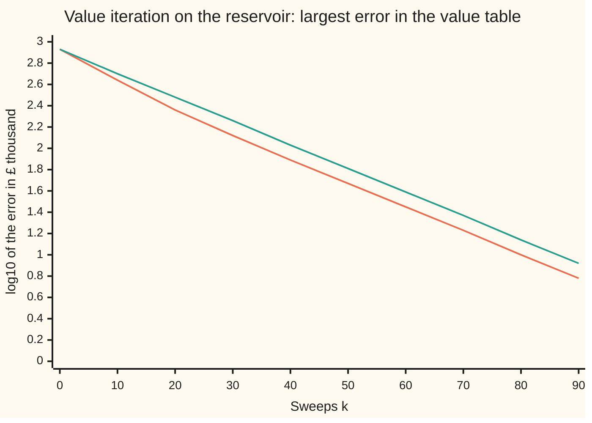
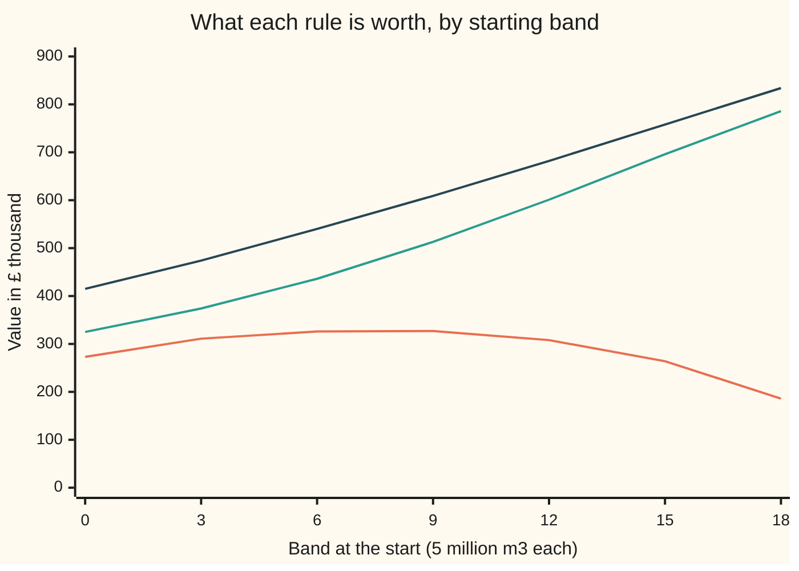

# Value and policy iteration: two ways to settle on the best rule

[Syllabus](../../../SYLLABUS.md) → [Optimization](../README.md) → [Dynamic Programming and Learning](../README.md#s07) → Value and policy iteration

---

## General Overview

A hydro reservoir holds up to 100 million cubic metres of water, logged in 20 bands of 5 million m³: band 0 is the bottom band, nearly empty, and band 19 the top band, full. Once a month the operator releases 0, 5 or 10 million m³ through the turbines, that is 0, 1 or 2 bands, and never more than the water in store: nothing at band 0, at most one band at band 1. Rain then brings 0, 1, 2 or 3 bands, with chances 20, 30, 30 and 20 percent. The numbers are illustrative, not a real dam.

Each band released sells for £(10 + s) thousand when the reservoir stands at band $s$: a fuller lake gives the water more height to fall, so more electricity. Releasing nothing costs a £7,000 fine for a dry river. Water that overflows the top costs £40,000 a band in flood damage. The aim is to maximise the money over all future months, with each month counted at 0.95 of the one before. The thing chosen is a **rule**: one release for each of the 20 bands.

This is a different reservoir from the one on [Markov decision processes](02-markov-decision-processes.md). The 20 bands are the same, but the releases, the rain and the money are not. That card's only cost is a penalty for running low. This one adds what that card leaves out: the price rises with the height of the water, and a dry river and a flood both cost money. So the values, the best zones and the sweep counts here belong to this reservoir; the notation and the two methods carry over unchanged.

The best rule is three zones. Hold everything at bands 0 to 4. Release one band at bands 5 to 14. Release two at bands 15 to 19. Run by that rule, a reservoir standing at band 10 is worth £632.9 thousand.

- **Value iteration** keeps a table of what each band is worth and improves the whole table by one month of look-ahead per pass, called a **sweep**. From a table of zeros it needs **94 sweeps** to prove every entry is within £5,000 of the truth.
- **Policy iteration** guesses a rule, works out exactly what that rule is worth by solving 20 equations, then switches each band to its best release given those worths. From "release one band whenever there is water" it needs **5 rounds**. The fifth changes nothing, and that is the proof the rule is best.

**Value iteration refines the values a little at a time and converges at the discount rate, 0.95 per sweep; policy iteration evaluates a whole rule exactly and improves it, and stops after a handful of rounds with a certificate that no rule does better.**

**What kind of fact this is:** two methods, with three theorems proved on this card in Why it works: the error bound that makes value iteration's stopping test safe, the policy improvement theorem, and the finite termination of policy iteration. The answer is certified three ways: the final values satisfy the Bellman optimality equation (stated in The formula) to a residual of 1.1e-13, meaning one more sweep moves no value by more than that; both methods return the same rule, and on a 6-band version every one of the 162 rules is listed and the rule both methods find is the one that wins.

### The picture: value iteration's error, sweep by sweep



Orange: the largest gap, over the 20 bands, between value iteration's table after $k$ sweeps and the true values, as a power of ten. Green: the guarantee, the starting error times $0.95^k$. Orange stays under green and parallel to it: each sweep removes about 5 percent of the error. The errors of the rules policy iteration evaluates in its five rounds are 690.2, 103.4, 23.7, 0.9 and 0.0, in £ thousand.

---

## The formula

Notation from [Markov decision processes](02-markov-decision-processes.md), in one line each. The state $s$ is the band; the action $a$ is the release; $r(s, a)$ is the expected money this month; $p(s' \mid s, a)$ is the chance of standing at band $s'$ next month; $\gamma$ (gamma) is the discount; a rule $\pi$ (pi, a policy) picks $\pi(s)$ at each band. This card writes $V$ for a value table, one number per band, and $V^*$ for the best one. A rule's own value, $V_\pi$ on that card, is written $V^{\pi}$ here, because the subscript now counts sweeps: $V_k$ is the table after $k$ sweeps. It is a maximisation.

The **Bellman optimality equation**: the best values are the ones that one more month of best choices hands back unchanged.

$$V^*(s) = \max_{a}\Bigl[\, r(s, a) + \gamma \sum_{s'} p(s' \mid s, a)\, V^*(s') \Bigr]\quad\text{for every band } s.$$

**Read it aloud:** a band is worth this month's money plus 0.95 times the average worth of where the water ends up, for the best release.

**Value iteration** turns the equation into an update. Start from $V_0 = 0$ and sweep, for $k = 0, 1, 2, \dots$:

$$V_{k+1}(s) = \max_{a}\Bigl[\, r(s, a) + \gamma \sum_{s'} p(s' \mid s, a)\, V_k(s') \Bigr].$$

Stop at the first sweep whose largest change is below $\varepsilon(1 - \gamma)/(2\gamma)$, with target $\varepsilon$ (epsilon) = £10 thousand. Then the table is within $\varepsilon/2$ of $V^*$ and the rule read off it is within $\varepsilon$ of the best.

**Read it aloud:** replace every value by what one month of look-ahead says it should be, and stop when no value moves by more than 0.2632 thousand pounds.

**Policy iteration** alternates two steps. Evaluate the current rule $\pi$ exactly by solving 20 linear equations,

$$V^{\pi}(s) = r(s, \pi(s)) + \gamma \sum_{s'} p(s' \mid s, \pi(s))\, V^{\pi}(s'),$$

then improve: at each band, switch to the release with the largest right-hand side of the optimality equation, using $V^{\pi}$, and keep the old release on a tie. Stop when no band switches.

**Read it aloud:** find out exactly what this rule is worth, then let every band take the release that looks best given those worths.

| Symbol | Plain meaning | In our example | Push it up and the answer… |
| --- | --- | --- | --- |
| $s$, $s'$ | the band now, the band next month | 0 to 19, each 5 million m³ | — |
| $a$ | the release, in bands; never more than $s$, the water in store | 0, 1 or 2 | — |
| $r(s, a)$ | expected money this month, in £ thousand | 40 at band 10 releasing two; −67 at band 19 holding | — |
| $p(s' \mid s, a)$ | chance of band $s'$ next month | 0.3 from band 10, release 2, to band 9 | — |
| $\gamma$ | weight on next month against this one | 0.95 | more patience, larger values, many more sweeps |
| $\pi$, $\pi(s)$, $\pi'$ | a rule; its release at band $s$; the improved rule | best: hold to band 4, one to 14, two above | — |
| $V$, $V^{\pi}$, $V^*$ | a value table; what rule $\pi$ earns from each band; the best | $V^*(10) = 632.9$ | — |
| $V_k$, $k$, $K$ | the table after $k$ sweeps; the sweep count; where it stops | $K = 94$ | — |
| $\varepsilon$ | the target: the rule found is within this of the best | £10 thousand; stop at a change of 0.2632 | fewer sweeps, looser guarantee |
| $e_k$, $\Vert U - W\Vert_\infty$ | largest error of $V_k$ against $V^*$; the largest gap between two tables $U$, $W$ over the bands | 4.9133 at $k = 94$ | — |
| $P_\pi$, $r_\pi$, $I$, $T_{\pi'}$, $m$ | a rule's table of chances; its column of money; the identity table; one sweep with rule $\pi'$ fixed; a count of such sweeps | row 10 of round 1's table: 0.2, 0.3, 0.3, 0.2 for bands 9 to 12 | — |
| $d_\pi$ | long-run share of months at each band under $\pi$ | 50.16 percent of months release one band | — |

### When it holds

- **A discount below 1.** Every sweep then shrinks the error by at least the factor $\gamma$. At $\gamma = 1$ there is no shrinking: after 400 sweeps the values still change by £39.3193 thousand a sweep, and value iteration never stops.
- **Finitely many bands and releases.** Policy iteration stops because there are only finitely many rules. With a continuous water level the tables become functions and both methods need an approximation.
- **A known model.** Both methods use $r$ and $p$ directly. A reservoir whose rain chances are unknown has to learn them by trying: [Q-learning](05-q-learning-and-temporal-differences.md).
- **Next month depends only on this month.** If a wet month makes the next one wetter, the band alone is not a full state: add last month's rain to it and the table has four times as many rows.
- **The same rules every month.** Real rain is seasonal. Then the calendar month joins the state, 12 times as many rows, and the method is unchanged.

---

## Why it works

### Step 0: both methods chase the same fixed point

The optimality equation says $V^*$ is the one table that a month of best choices leaves unchanged. Value iteration applies "a month of best choices" again and again, and the table drifts towards the fixed point. Policy iteration jumps: it fixes the choices, which turns the hard equation (with a max in it) into a linear one it can solve exactly, then repairs the choices. Both stop at the same table, because there is only one fixed point.

### Step 1: each sweep shrinks the error by the factor γ

Take two value tables that differ by at most $e$ at every band. For a fixed release, the sweep averages next month's values with weights that add to 1 and multiplies by $\gamma$. So the two results differ by at most $\gamma e$. Taking the best release cannot widen the gap, because the largest of several numbers moves by no more than the numbers do. Putting $V^*$ in as the second table, which a sweep leaves unchanged:

$$e_{k+1} \le \gamma\, e_k.$$

This is the contraction proved in full on [The Bellman operator contracts](04-the-bellman-operator-as-a-contraction.md); here it is used. On the reservoir the measured ratios are 0.9406 for the first sweep, 0.9369 for the second, and 0.9500 by sweep 94. The early sweeps beat the bound a little; the late ones run exactly at it.

### Step 2: a small change proves a small error

The error itself is unknown while the method runs, since $V^*$ is unknown. The change between sweeps is known. The two are tied:

$$e_{k+1} \le \frac{\gamma}{1 - \gamma}\,\max_s \bigl|V_{k+1}(s) - V_k(s)\bigr|.$$

At $\gamma = 0.95$ the factor is 19: the error can be 19 times the last change. So the stopping test asks for a change below $\varepsilon(1 - \gamma)/(2\gamma) = 0.2632$, which makes the error below $\varepsilon/2 = 5$. At sweep 94 the change is 0.2586 and the bound gives 4.9133. The true error, measured against policy iteration's answer, is also 4.9133: the bound is tight here, because by sweep 94 every sweep removes exactly 5 percent.

<details>
<summary>Detailed proof: the stopping bound, and why the rule read off is within ε</summary>

Write $\|U - W\|_\infty$ for $\max_s |U(s) - W(s)|$, the largest gap over the bands. Step 1 gives $\|V_{k+1} - V^*\|_\infty \le \gamma\|V_k - V^*\|_\infty$. The triangle inequality splits $\|V_k - V^*\|_\infty \le \|V_k - V_{k+1}\|_\infty + \|V_{k+1} - V^*\|_\infty$. Combine:

$$\|V_{k+1} - V^*\|_\infty \le \gamma\|V_k - V_{k+1}\|_\infty + \gamma\|V_{k+1} - V^*\|_\infty,$$

and move the last term across: $(1 - \gamma)\|V_{k+1} - V^*\|_\infty \le \gamma\|V_{k+1} - V_k\|_\infty$.

Now let $\pi$ be the rule read off $V_{k+1}$: at each band, the release that wins the maximum with $V_{k+1}$ on the right. Fixing a rule gives a sweep too, with no max in it, and it also shrinks gaps by $\gamma$. Rule $\pi$'s own values $V^{\pi}$ are its fixed point. The sweep for $\pi$ and the best-choice sweep agree on $V_{k+1}$, by the choice of $\pi$. So $\|V^{\pi} - V_{k+1}\|_\infty$ is at most $\gamma\|V^{\pi} - V_{k+1}\|_\infty + \|V_{k+2} - V_{k+1}\|_\infty$, and $\|V_{k+2} - V_{k+1}\|_\infty \le \gamma\|V_{k+1} - V_k\|_\infty$. Hence $\|V^{\pi} - V_{k+1}\|_\infty \le \frac{\gamma}{1-\gamma}\|V_{k+1} - V_k\|_\infty$, the same bound as for $V^*$. With the change below $\varepsilon(1-\gamma)/(2\gamma)$ both distances are below $\varepsilon/2$, and the triangle inequality gives $\|V^{\pi} - V^*\|_\infty < \varepsilon$.

</details>

### Step 3: one rule's worth is a linear system

With the rule fixed there is no max: the evaluation equation is 20 linear equations in 20 unknowns, $(I - \gamma P_{\pi})V^{\pi} = r_{\pi}$. Here $P_{\pi}$ is the 20-by-20 table of chances $p(s' \mid s, \pi(s))$, $r_{\pi}$ is the column of $r(s, \pi(s))$, and $I$ is the identity table. Each row of $\gamma P_{\pi}$ adds to 0.95, less than 1, so the diagonal of $I - \gamma P_{\pi}$ outweighs the rest of its row and the system has exactly one solution. The code solves it by [Gaussian elimination](../../03-Algebra/05-Solving%20Systems/02-gaussian-elimination.md), which removes one unknown at a time. For the first rule, release one band whenever there is water, it gives $V^{\pi}(10) = 323.1$: that rule overflows in wet spells and pays the flood damage.

### Step 4: the greedy switch never makes things worse

The **policy improvement theorem**: if $\pi'$ takes, at every band, a release that does at least as well as $\pi(s)$ against the values $V^{\pi}$, then $V^{\pi'}(s) \ge V^{\pi}(s)$ at every band. If it does strictly better at some band, the gain is strict there.

The idea: following $\pi'$ for one month and then $\pi$ for ever after is no worse than $\pi$, by the choice of $\pi'$. Each further month of $\pi'$ helps again or changes nothing, and in the limit that is $\pi'$ for ever, worth $V^{\pi'}$.

<details>
<summary>Detailed proof: the policy improvement theorem</summary>

Write $T_{\pi'}$ for the sweep with the rule $\pi'$ fixed: $(T_{\pi'}W)(s) = r(s, \pi'(s)) + \gamma\sum_{s'} p(s' \mid s, \pi'(s))\,W(s')$. Two facts about it. It is **monotone**: if $W \ge U$ at every band, then $T_{\pi'}W \ge T_{\pi'}U$, because the chances are not negative. And by Step 1 it shrinks gaps by $\gamma$, so $T_{\pi'}^{\,m}W \to V^{\pi'}$ from any start $W$.

By the choice of $\pi'$, $T_{\pi'}V^{\pi} \ge T_{\pi}V^{\pi} = V^{\pi}$. Apply $T_{\pi'}$ to both sides and use monotonicity: $T_{\pi'}^{\,2}V^{\pi} \ge T_{\pi'}V^{\pi} \ge V^{\pi}$. By induction $T_{\pi'}^{\,m}V^{\pi} \ge V^{\pi}$ for every $m$, and letting $m$ grow gives $V^{\pi'} \ge V^{\pi}$. If the first inequality is strict at band $s$, then $V^{\pi'}(s) \ge (T_{\pi'}V^{\pi})(s) > V^{\pi}(s)$.

</details>

### Step 5: it must stop, and where it stops is the best

Keeping the old release on a tie means a round switches a band only when the new release is strictly better. Then Step 4 makes the values strictly higher somewhere and no lower anywhere, so no rule can come round twice. There are finitely many rules, so the rounds end.

They end when no band switches. Then the current release wins the maximum at every band against its own values, so $V^{\pi}$ satisfies the optimality equation. By Step 1 that equation has one solution, so $V^{\pi} = V^*$ and the rule is best from every band at once. The code checks it directly: one best-choice sweep applied to the final table moves no entry by more than 1.1e-13, rounding error.

### Step 6: why five rounds and not ninety-four

Policy iteration is [Newton's method](../../06-Calculus%20and%20analysis/03-What%20Derivatives%20Tell%20You/06-newtons-method.md) on the optimality equation: each round replaces the max by the straight-line model that the current rule gives, and solves that model exactly. This is stated, not proved here; the third source proves it. Near the answer Newton's error roughly squares each round. On the reservoir the error goes 690.2, 103.4, 23.7, 0.9, then 0.0. Value iteration only ever removes 5 percent of its error per sweep.

The price is work per round. A sweep costs 228 multiply-adds: 4 rain outcomes for each allowed release at each band. A policy-iteration round costs 3,288, almost all in the elimination. The totals are 21,432 for value iteration and 16,440 for policy iteration. Elimination grows with the cube of the number of bands and a sweep only in proportion, so on a reservoir with many more bands the comparison turns round.

---

## Worked numbers, by hand

The first two sweeps of value iteration at band 10, then the stopping test.

| Step | Arithmetic | Value |
| --- | --- | --- |
| money at band 10, release 0, 1, 2 | $-7$; $1 \times 20$; $2 \times 20$; no overflow possible from band 10 | −7.0, 20.0, 40.0 |
| sweep 1 at band 10 | $\max(-7, 20, 40)$, with $V_0 = 0$ | 40.0, release 2 |
| sweep 1 at bands 8 to 13 | $2 \times (10 + s)$ at each | 36.0, 38.0, 40.0, 42.0, 44.0, 46.0 |
| sweep 2, release 2 | $40 + 0.95\,(0.2 \times 36 + 0.3 \times 38 + 0.3 \times 40 + 0.2 \times 42) = 40 + 0.95 \times 39$ | 77.05 |
| sweep 2, release 1 | $20 + 0.95\,(0.2 \times 38 + 0.3 \times 40 + 0.3 \times 42 + 0.2 \times 44) = 20 + 0.95 \times 41$ | 58.95 |
| sweep 2, release 0 | $-7 + 0.95\,(0.2 \times 40 + 0.3 \times 42 + 0.3 \times 44 + 0.2 \times 46) = -7 + 0.95 \times 43$ | 33.85 |
| stopping threshold | $10 \times 0.05 \div (2 \times 0.95)$ | 0.2632 |
| change at sweep 94 | largest of the 20 changes | 0.2586, below the threshold |
| error bound | $0.95 \div 0.05 \times 0.2586$ | 4.9133, under 5 |
| answer | value iteration's sweeps, against policy iteration's rounds | **94 sweeps, 5 rounds, same rule** |

Two sweeps in, value iteration still says "release two" at band 10: it sees only two months ahead, too few for the worth of keeping water high to show.

### What breaks if you drop a piece

| Mistake | Comes out at | What went wrong |
| --- | --- | --- |
| Discount $\gamma = 1$ | change still 39.3 at sweep 94 and 39.3193 at sweep 400; never stops | No contraction. The values grow without end, by the long-run monthly money of the rule they settle on |
| Stop when the change is below £10 thousand | stops at sweep 25, true error £171.5 thousand | A change is not an error: the error can be 19 times the change |
| Read the rule off after 10 sweeps | rule 01111112222222222222, losing up to £49.8 thousand | The values have not settled, so the rule releases two bands from band 7 |

---

## Round by round: why five beats ninety-four

The puzzle. Value iteration needs 94 sweeps; policy iteration needs 5 rounds. Each round of policy iteration looks at the same table of rain chances as a sweep does. Where does the speed come from?

### One story: policy iteration's five rounds

Each rule is written as 20 digits, one release per band from band 0 to band 19.

| Round | Rule evaluated | $V^{\pi}(10)$ | Largest error | Bands switched |
| --- | --- | ---: | ---: | ---: |
| 1 | 01111111111111111111 | 323.1 | 690.2 | 18 |
| 2 | 01222222222222222222 | 541.3 | 103.4 | 15 |
| 3 | 01111000000000111222 | 611.1 | 23.7 | 12 |
| 4 | 00011111111111112222 | 632.8 | 0.9 | 3 |
| 5 | 00000111111111122222 | 632.9 | 0.0 | 0 |

Round 1's rule overflows in wet spells, so round 2 releases two everywhere. That lowers the lake and the head (the height the water falls), so round 3 overcorrects to holding in the middle. Round 5 confirms round 4's repair.

### One force at a time: policy iteration

The largest error of the rule evaluated in each round, in £ thousand:

```
round 1   ████████████████████████████████████████  690.2
round 2   ██████                                    103.4
round 3   █▍                                         23.7
round 4   ▏                                           0.9
round 5                                               0.0
```

### One force at a time: value iteration

The same error as a power of ten, every 30 sweeps. After the first stretch each bar loses the same length, because each sweep then removes the same 5 percent:

```
sweep 0    ████████████████████████████████████████  2.93
sweep 30   ████████████████████████████▉             2.12
sweep 60   ███████████████████▊                      1.45
sweep 90   ██████████▋                               0.78
```

### Both in one picture: the values of the rules policy iteration tries



Orange: round 1's rule, release one band whenever possible; its value falls above band 9, where a full lake overflows. Green: round 2's rule. Dark blue: round 5's rule, the best, highest at every band. Each round lifts the whole curve at once, because it solves for the rule's exact long-run worth. A sweep looks only one month further, so news of overflow at band 19 takes many sweeps to reach band 0.

---

## Code, from first principles, and it actually runs

The code builds the reservoir from its rain chances and money rules, then reaches the answer by four independent roads. Value iteration from a table of zeros. Policy iteration with Gaussian elimination written out. The Bellman certificate: one more best-choice sweep must leave policy iteration's table unchanged. And on a 6-band reservoir, every one of the 162 rules is evaluated and the one that is best at every band is found by listing them all. A fifth check uses the stationary distribution $d_\pi$, the long-run share of months at each band, from [Stationary distributions](../../11-Stochastic%20processes%20and%20calculus/03-Markov%20Chains/04-stationary-distributions.md): under any rule, $d_\pi \cdot r_\pi = (1 - \gamma)\, d_\pi \cdot V^{\pi}$, since $d_\pi P_\pi = d_\pi$. The dot means: multiply band by band, then add. The code also counts the multiply-adds of the sweeps and of the elimination, and runs the failures in the table above.

### Python

```python
# Value iteration and policy iteration on a reservoir, checked against each other,
# against the Bellman equation and against every policy of a small reservoir.
import itertools, math

RAIN = [0.2, 0.3, 0.3, 0.2]   # chance of 0, 1, 2, 3 bands of inflow in a month
OPS = [0]                     # multiply-adds, counted as the work is done

def acts(s): return [a for a in (0, 1, 2) if a <= s]   # release 0, 1 or 2 bands
def moves(n, s, a):           # (chance, next band, bands spilled) for each inflow
    return [(p, min(s - a + w, n - 1), max(0, s - a + w - (n - 1))) for w, p in enumerate(RAIN)]
def reward(n, s, a):          # £k: sales at a head that grows with the level, low-flow fine, flood damage
    return a * (10 + s) - (7 if a == 0 else 0) - 40 * sum(p * x for p, _, x in moves(n, s, a))
def q(n, V, s, a, g):
    OPS[0] += 4
    return reward(n, s, a) + g * sum(p * V[t] for p, t, _ in moves(n, s, a))
def greedy(n, V, g, old=None):  # best action at each band; keep the old one on a tie
    out = []
    for s in range(n):
        qs = {a: q(n, V, s, a, g) for a in acts(s)}
        best = max(qs.values())
        out.append(old[s] if old and qs[old[s]] >= best - 1e-9 else max(a for a in qs if qs[a] == best))
    return out
def backup(n, V, g): return [max(q(n, V, s, a, g) for a in acts(s)) for s in range(n)]
def solve(A, b):              # Gaussian elimination with partial pivoting
    n = len(b); M = [row[:] + [b[i]] for i, row in enumerate(A)]
    for i in range(n):
        piv = max(range(i, n), key=lambda r: abs(M[r][i])); M[i], M[piv] = M[piv], M[i]
        for r in range(i + 1, n):
            f = M[r][i] / M[i][i]
            for c in range(i, n + 1): M[r][c] -= f * M[i][c]
            OPS[0] += n + 1 - i
    x = [0.0] * n
    for i in reversed(range(n)):
        x[i] = (M[i][n] - sum(M[i][c] * x[c] for c in range(i + 1, n))) / M[i][i]; OPS[0] += n - i
    return x
def longrun(n, pol):          # stationary distribution d: d P = d, entries add to 1
    P = chain(n, pol)
    A = [[P[j][i] - (1.0 if i == j else 0.0) for j in range(n)] for i in range(n - 1)] + [[1.0] * n]
    d = solve(A, [0.0] * (n - 1) + [1.0])
    return d, sum(d[s] * reward(n, s, pol[s]) for s in range(n))
def chain(n, pol):            # transition table of the reservoir under a fixed rule
    P = [[0.0] * n for _ in range(n)]
    for s in range(n):
        for p, t, _ in moves(n, s, pol[s]): P[s][t] += p
    return P
def evaluate(n, pol, g):      # solve V = r + g P V exactly
    P = chain(n, pol)
    A = [[(1.0 if i == j else 0.0) - g * P[i][j] for j in range(n)] for i in range(n)]
    return solve(A, [reward(n, s, pol[s]) for s in range(n)])
def policy_iteration(n, pol, g):
    rounds = []
    while len(rounds) < 50:                # a cap: a correct method needs far fewer
        V = evaluate(n, pol, g); new = greedy(n, V, g, pol)
        rounds.append((pol, V, sum(1 for s in range(n) if new[s] != pol[s])))
        if new == pol: break
        pol = new
    return rounds
def value_iteration(n, g, tol, cap=5000):
    V, hist = [0.0] * n, [[0.0] * n]
    while len(hist) <= cap:
        V = backup(n, V, g); hist.append(V)
        if max(abs(a - b) for a, b in zip(hist[-1], hist[-2])) < tol: break
    return hist
def gap(U, V): return max(abs(a - b) for a, b in zip(U, V))
def F1(v): return f"{v:.1f}"
def E1(v): m, e = f"{v:.1e}".split("e"); return f"{m}e{int(e)}"
def show(label, *vals): print(f"{label:<46}" + " ".join(vals))
def word(pol): return "".join(str(a) for a in pol)

N, G, EPS = 20, 0.95, 10.0
TOL = EPS * (1 - G) / (2 * G)
for b in (10, 19): show(f"rewards at band {b} for release 0, 1, 2", *[F1(reward(N, b, a)) for a in (0, 1, 2)])

# ---- policy iteration from 'release one band whenever there is water' ----
OPS[0] = 0
rounds = policy_iteration(N, [min(1, s) for s in range(N)], G)
ops_pi = OPS[0]; pol_pi, Vstar = rounds[-1][0], rounds[-1][1]
for k, (pol, V, ch) in enumerate(rounds):
    show(f"PI round {k + 1}: rule, V(10), error, changed", word(pol), F1(V[10]), F1(gap(V, Vstar)), str(ch))
resid = gap(backup(N, Vstar, G), Vstar)
show("PI: Bellman residual max|TV - V|", E1(resid))

# ---- value iteration from V = 0 ----
OPS[0] = 0
hist = value_iteration(N, G, TOL)
ops_vi = OPS[0]; K = len(hist) - 1; Vk = hist[-1]; pol_vi = greedy(N, Vk, G)
show("VI: stop when a sweep changes less than", f"{TOL:.4f}")
show("VI: sweeps, last change, error to V*", str(K), f"{gap(hist[K], hist[K - 1]):.4f}", f"{gap(Vk, Vstar):.4f}")
show("VI: rule after the last sweep", word(pol_vi))
show("VI: bound 0.95/0.05 * last change", f"{G / (1 - G) * gap(hist[K], hist[K - 1]):.4f}")
show("VI sweep 1: V at bands 8 to 13", *[F1(hist[1][s]) for s in range(8, 14)])
show("VI sweep 2 at band 10: q for release 0, 1, 2", *[f"{q(N, hist[1], 10, a, G):.2f}" for a in (0, 1, 2)])
errs = [gap(hist[k], Vstar) for k in range(K + 1)]
show("VI error ratio, sweeps 1/0, 2/1, 94/93", *[f"{errs[k] / errs[k - 1]:.4f}" for k in (1, 2, K)])
marks = [0, 10, 20, 30, 40, 50, 60, 70, 80, 90]
show("log10 VI error at sweeps 0, 10, ..., 90", *[f"{math.log10(errs[k]):.2f}" for k in marks])
show("log10 bound 0.95^k * error(0)", *[f"{math.log10(G ** k * errs[0]):.2f}" for k in marks])
show("work: VI total, per sweep", str(ops_vi), str(ops_vi // K))
show("work: PI total, per round", str(ops_pi), str(ops_pi // len(rounds)))
for k in (0, 1, 4):
    show(f"chart: V, PI round {k + 1}, bands 0-19 by 3", *[f"{rounds[k][1][s]:.0f}" for s in range(0, 20, 3)])

# ---- long run under the best rule: the stationary distribution d ----
d, avg = longrun(N, pol_pi)
show("long run: share of months holding, 1, 2", *[f"{sum(d[s] for s in range(N) if pol_pi[s] == a):.4f}" for a in (0, 1, 2)])
show("long run: £k a month, (1-gamma) d.V*", f"{avg:.4f}", f"{(1 - G) * sum(d[s] * Vstar[s] for s in range(N)):.4f}")

# ---- a 6-band reservoir: every rule listed ----
n6 = 6
allp = list(itertools.product(*[acts(s) for s in range(n6)]))
vals = [evaluate(n6, list(p), G) for p in allp]
top = [i for i, V in enumerate(vals) if all(V[s] >= W[s] - 1e-9 for W in vals for s in range(n6))]
pi6 = policy_iteration(n6, [min(1, s) for s in range(n6)], G)[-1]
vi6 = value_iteration(n6, G, TOL)
show("6 bands: rules listed, best rule", str(len(allp)), word(allp[top[0]]))
show("6 bands: PI rule, VI rule, VI value error", word(pi6[0]), word(greedy(n6, vi6[-1], G)), f"{gap(vals[top[0]], vi6[-1]):.4f}")

# ---- what breaks ----
early = greedy(N, hist[10], G)
show("rule after 10 sweeps, worst loss £k", word(early), F1(gap(evaluate(N, early, G), Vstar)))
naive = value_iteration(N, G, EPS)
show("stop at change < 10: sweeps, true error", str(len(naive) - 1), F1(gap(naive[-1], Vstar)))
h1 = value_iteration(N, 1.0, TOL, cap=400)
ch1 = [gap(h1[k], h1[k - 1]) for k in (94, 400)]
pol1 = greedy(N, h1[-1], 1.0); avg1 = longrun(N, pol1)[1]
show("gamma 1: change at sweeps 94 and 400", F1(ch1[0]), f"{ch1[1]:.4f}")
show("gamma 1: rule, its long-run £k a month", word(pol1), f"{avg1:.4f}")
for g in (0.9, 0.99):
    show(f"try gamma {g}: VI sweeps, PI rounds", str(len(value_iteration(N, g, EPS * (1 - g) / (2 * g))) - 1),
         str(len(policy_iteration(N, [min(1, s) for s in range(N)], g))))
show("try eps 1: VI sweeps", str(len(value_iteration(N, G, 1 * (1 - G) / (2 * G))) - 1))

assert pol_vi == pol_pi and len(rounds) < 50                        # two methods, one rule
assert resid < 1e-9 and gap(Vk, Vstar) < EPS / 2                    # Bellman certificate; VI's bound
assert len(top) == 1 and list(allp[top[0]]) == pi6[0] == greedy(n6, vi6[-1], G)   # enumeration
assert abs(errs[K] / errs[K - 1] - G) < 1e-3                        # contraction rate
assert abs(avg - (1 - G) * sum(d[s] * Vstar[s] for s in range(N))) < 1e-9   # stationary identity
assert gap(naive[-1], Vstar) > EPS and len(h1) == 401                # the two failures happen
assert abs(ch1[1] - avg1) < 1e-6                                     # gamma 1: change = average reward
print("ALL CHECKS PASS")
```

**Ran 2026-11-11 on macOS, Python 3.14.10, standard library only. All checks passed. Output, pasted from the run:**

```
rewards at band 10 for release 0, 1, 2        -7.0 20.0 40.0
rewards at band 19 for release 0, 1, 2        -67.0 1.0 50.0
PI round 1: rule, V(10), error, changed       01111111111111111111 323.1 690.2 18
PI round 2: rule, V(10), error, changed       01222222222222222222 541.3 103.4 15
PI round 3: rule, V(10), error, changed       01111000000000111222 611.1 23.7 12
PI round 4: rule, V(10), error, changed       00011111111111112222 632.8 0.9 3
PI round 5: rule, V(10), error, changed       00000111111111122222 632.9 0.0 0
PI: Bellman residual max|TV - V|              1.1e-13
VI: stop when a sweep changes less than       0.2632
VI: sweeps, last change, error to V*          94 0.2586 4.9133
VI: rule after the last sweep                 00000111111111122222
VI: bound 0.95/0.05 * last change             4.9133
VI sweep 1: V at bands 8 to 13                36.0 38.0 40.0 42.0 44.0 46.0
VI sweep 2 at band 10: q for release 0, 1, 2  33.85 58.95 77.05
VI error ratio, sweeps 1/0, 2/1, 94/93        0.9406 0.9369 0.9500
log10 VI error at sweeps 0, 10, ..., 90       2.93 2.64 2.36 2.12 1.89 1.67 1.45 1.23 1.00 0.78
log10 bound 0.95^k * error(0)                 2.93 2.70 2.48 2.26 2.03 1.81 1.59 1.37 1.14 0.92
work: VI total, per sweep                     21432 228
work: PI total, per round                     16440 3288
chart: V, PI round 1, bands 0-19 by 3         273 311 326 327 308 264 186
chart: V, PI round 2, bands 0-19 by 3         325 374 436 513 601 696 786
chart: V, PI round 5, bands 0-19 by 3         415 474 540 609 682 758 834
long run: share of months holding, 1, 2       0.0000 0.5016 0.4984
long run: £k a month, (1-gamma) d.V*          37.2552 37.2552
6 bands: rules listed, best rule              162 011222
6 bands: PI rule, VI rule, VI value error     011222 011222 4.9093
rule after 10 sweeps, worst loss £k           01111112222222222222 49.8
stop at change < 10: sweeps, true error       25 171.5
gamma 1: change at sweeps 94 and 400          39.3 39.3193
gamma 1: rule, its long-run £k a month        00000000000000111222 39.3193
try gamma 0.9: VI sweeps, PI rounds           37 4
try gamma 0.99: VI sweeps, PI rounds          661 6
try eps 1: VI sweeps                          139
ALL CHECKS PASS
```

### Rust

```rust
// Value iteration and policy iteration on a reservoir, checked against each other,
// against the Bellman equation and against every policy of a small reservoir.
use std::sync::atomic::{AtomicUsize, Ordering::Relaxed};

const RAIN: [f64; 4] = [0.2, 0.3, 0.3, 0.2]; // chance of 0, 1, 2, 3 bands of inflow in a month
static OPS: AtomicUsize = AtomicUsize::new(0); // multiply-adds, counted as the work is done

fn acts(s: usize) -> Vec<usize> { (0..3).filter(|&a| a <= s).collect() } // release 0, 1 or 2 bands
fn moves(n: usize, s: usize, a: usize) -> Vec<(f64, usize, usize)> { // (chance, next band, spilled)
    RAIN.iter().enumerate().map(|(w, &p)| { let t = s - a + w; (p, t.min(n - 1), t.saturating_sub(n - 1)) }).collect()
}
fn reward(n: usize, s: usize, a: usize) -> f64 { // £k: sales, low-flow fine, flood damage
    let spill: f64 = moves(n, s, a).iter().map(|&(p, _, x)| p * x as f64).sum();
    (a * (10 + s)) as f64 - if a == 0 { 7.0 } else { 0.0 } - 40.0 * spill
}
fn q(n: usize, v: &[f64], s: usize, a: usize, g: f64) -> f64 {
    OPS.fetch_add(4, Relaxed);
    reward(n, s, a) + g * moves(n, s, a).iter().map(|&(p, t, _)| p * v[t]).sum::<f64>()
}
fn greedy(n: usize, v: &[f64], g: f64, old: Option<&[usize]>) -> Vec<usize> { // keep old on a tie
    (0..n).map(|s| {
        let qs: Vec<(usize, f64)> = acts(s).into_iter().map(|a| (a, q(n, v, s, a, g))).collect();
        let best = qs.iter().map(|x| x.1).fold(f64::NEG_INFINITY, f64::max);
        match old {
            Some(o) if qs.iter().any(|x| x.0 == o[s] && x.1 >= best - 1e-9) => o[s],
            _ => qs.iter().filter(|x| x.1 == best).map(|x| x.0).max().unwrap(),
        }
    }).collect()
}
fn backup(n: usize, v: &[f64], g: f64) -> Vec<f64> {
    (0..n).map(|s| acts(s).into_iter().map(|a| q(n, v, s, a, g)).fold(f64::NEG_INFINITY, f64::max)).collect()
}
fn solve(a: &[Vec<f64>], b: &[f64]) -> Vec<f64> { // Gaussian elimination with partial pivoting
    let n = b.len();
    let mut m: Vec<Vec<f64>> = a.iter().zip(b).map(|(r, &bi)| { let mut r = r.clone(); r.push(bi); r }).collect();
    for i in 0..n {
        let mut piv = i;
        for r in i..n { if m[r][i].abs() > m[piv][i].abs() { piv = r; } } m.swap(i, piv);
        for r in i + 1..n {
            let f = m[r][i] / m[i][i];
            for c in i..=n { let t = m[i][c]; m[r][c] -= f * t; }
            OPS.fetch_add(n + 1 - i, Relaxed);
        }
    }
    let mut x = vec![0.0; n];
    for i in (0..n).rev() {
        let s: f64 = (i + 1..n).map(|c| m[i][c] * x[c]).sum();
        x[i] = (m[i][n] - s) / m[i][i]; OPS.fetch_add(n - i, Relaxed);
    }
    x
}
fn chain(n: usize, pol: &[usize]) -> Vec<Vec<f64>> { // transition table under a fixed rule
    let mut p = vec![vec![0.0; n]; n];
    for s in 0..n { for (pr, t, _) in moves(n, s, pol[s]) { p[s][t] += pr; } }
    p
}
fn longrun(n: usize, pol: &[usize]) -> (Vec<f64>, f64) { // stationary d: d P = d, adds to 1
    let p = chain(n, pol);
    let mut a: Vec<Vec<f64>> = (0..n - 1).map(|i| (0..n).map(|j| p[j][i] - if i == j { 1.0 } else { 0.0 }).collect()).collect();
    a.push(vec![1.0; n]);
    let mut b = vec![0.0; n]; b[n - 1] = 1.0;
    let d = solve(&a, &b); let avg = (0..n).map(|s| d[s] * reward(n, s, pol[s])).sum();
    (d, avg)
}
fn evaluate(n: usize, pol: &[usize], g: f64) -> Vec<f64> { // solve V = r + g P V exactly
    let p = chain(n, pol);
    let a: Vec<Vec<f64>> = (0..n).map(|i| (0..n).map(|j| (if i == j { 1.0 } else { 0.0 }) - g * p[i][j]).collect()).collect();
    solve(&a, &(0..n).map(|s| reward(n, s, pol[s])).collect::<Vec<_>>())
}
fn policy_iteration(n: usize, start: Vec<usize>, g: f64) -> Vec<(Vec<usize>, Vec<f64>, usize)> {
    let (mut pol, mut rounds) = (start, Vec::new());
    while rounds.len() < 50 { // a cap: a correct method needs far fewer
        let v = evaluate(n, &pol, g); let new = greedy(n, &v, g, Some(&pol));
        let ch = (0..n).filter(|&s| new[s] != pol[s]).count();
        rounds.push((pol.clone(), v, ch));
        if new == pol { break; }
        pol = new;
    }
    rounds
}
fn gap(u: &[f64], v: &[f64]) -> f64 { u.iter().zip(v).map(|(a, b)| (a - b).abs()).fold(0.0, f64::max) }
fn value_iteration(n: usize, g: f64, tol: f64, cap: usize) -> Vec<Vec<f64>> {
    let mut hist = vec![vec![0.0; n]];
    while hist.len() <= cap {
        let v = backup(n, hist.last().unwrap(), g);
        let done = gap(&v, hist.last().unwrap()) < tol;
        hist.push(v);
        if done { break; }
    }
    hist
}
fn f1(v: f64) -> String { format!("{:.1}", v) }
fn show(label: &str, vals: &[String]) { println!("{:<46}{}", label, vals.join(" ")); }
fn word(pol: &[usize]) -> String { pol.iter().map(|a| a.to_string()).collect() }
fn ones(n: usize) -> Vec<usize> { (0..n).map(|s| s.min(1)).collect() }

fn main() {
    let (n, g, eps) = (20usize, 0.95f64, 10.0f64);
    let tol = eps * (1.0 - g) / (2.0 * g);
    for b in [10, 19] { show(&format!("rewards at band {} for release 0, 1, 2", b), &(0..3).map(|a| f1(reward(n, b, a))).collect::<Vec<_>>()); }
    // ---- policy iteration from 'release one band whenever there is water' ----
    OPS.store(0, Relaxed); let rounds = policy_iteration(n, ones(n), g);
    let ops_pi = OPS.load(Relaxed);
    let (pol_pi, vstar) = (rounds.last().unwrap().0.clone(), rounds.last().unwrap().1.clone());
    for (k, (pol, v, ch)) in rounds.iter().enumerate() {
        show(&format!("PI round {}: rule, V(10), error, changed", k + 1), &[word(pol), f1(v[10]), f1(gap(v, &vstar)), ch.to_string()]);
    }
    let resid = gap(&backup(n, &vstar, g), &vstar);
    show("PI: Bellman residual max|TV - V|", &[format!("{:.1e}", resid)]);
    // ---- value iteration from V = 0 ----
    OPS.store(0, Relaxed); let hist = value_iteration(n, g, tol, 5000);
    let ops_vi = OPS.load(Relaxed);
    let kk = hist.len() - 1; let vk = hist[kk].clone(); let pol_vi = greedy(n, &vk, g, None);
    let last = gap(&hist[kk], &hist[kk - 1]);
    show("VI: stop when a sweep changes less than", &[format!("{:.4}", tol)]);
    show("VI: sweeps, last change, error to V*", &[kk.to_string(), format!("{:.4}", last), format!("{:.4}", gap(&vk, &vstar))]);
    show("VI: rule after the last sweep", &[word(&pol_vi)]);
    show("VI: bound 0.95/0.05 * last change", &[format!("{:.4}", g / (1.0 - g) * last)]);
    show("VI sweep 1: V at bands 8 to 13", &(8..14).map(|s| f1(hist[1][s])).collect::<Vec<_>>());
    show("VI sweep 2 at band 10: q for release 0, 1, 2", &(0..3).map(|a| format!("{:.2}", q(n, &hist[1], 10, a, g))).collect::<Vec<_>>());
    let errs: Vec<f64> = (0..=kk).map(|k| gap(&hist[k], &vstar)).collect();
    show("VI error ratio, sweeps 1/0, 2/1, 94/93", &[1, 2, kk].iter().map(|&k| format!("{:.4}", errs[k] / errs[k - 1])).collect::<Vec<_>>());
    let marks: Vec<usize> = (0..10).map(|i| 10 * i).collect();
    show("log10 VI error at sweeps 0, 10, ..., 90", &marks.iter().map(|&k| format!("{:.2}", errs[k].log10())).collect::<Vec<_>>());
    show("log10 bound 0.95^k * error(0)", &marks.iter().map(|&k| format!("{:.2}", (g.powf(k as f64) * errs[0]).log10())).collect::<Vec<_>>());
    show("work: VI total, per sweep", &[ops_vi.to_string(), (ops_vi / kk).to_string()]);
    show("work: PI total, per round", &[ops_pi.to_string(), (ops_pi / rounds.len()).to_string()]);
    for k in [0, 1, 4] {
        show(&format!("chart: V, PI round {}, bands 0-19 by 3", k + 1), &(0..20).step_by(3).map(|s| format!("{:.0}", rounds[k].1[s])).collect::<Vec<_>>());
    }
    // ---- long run under the best rule: the stationary distribution d ----
    let (d, avg) = longrun(n, &pol_pi);
    show("long run: share of months holding, 1, 2", &(0..3).map(|a| format!("{:.4}", (0..n).filter(|&s| pol_pi[s] == a).map(|s| d[s]).sum::<f64>())).collect::<Vec<_>>());
    let dv: f64 = (0..n).map(|s| d[s] * vstar[s]).sum();
    show("long run: £k a month, (1-gamma) d.V*", &[format!("{:.4}", avg), format!("{:.4}", (1.0 - g) * dv)]);
    // ---- a 6-band reservoir: every rule listed ----
    let n6 = 6; let mut allp: Vec<Vec<usize>> = vec![vec![]];
    for s in 0..n6 { allp = allp.iter().flat_map(|p| acts(s).into_iter().map(move |a| { let mut p = p.clone(); p.push(a); p })).collect(); }
    let vals: Vec<Vec<f64>> = allp.iter().map(|p| evaluate(n6, p, g)).collect();
    let top: Vec<usize> = (0..vals.len()).filter(|&i| vals.iter().all(|w| (0..n6).all(|s| vals[i][s] >= w[s] - 1e-9))).collect();
    let pi6 = policy_iteration(n6, ones(n6), g).pop().unwrap();
    let vi6 = value_iteration(n6, g, tol, 5000);
    let vi6pol = greedy(n6, vi6.last().unwrap(), g, None);
    show("6 bands: rules listed, best rule", &[allp.len().to_string(), word(&allp[top[0]])]);
    show("6 bands: PI rule, VI rule, VI value error", &[word(&pi6.0), word(&vi6pol), format!("{:.4}", gap(&vals[top[0]], vi6.last().unwrap()))]);
    // ---- what breaks ----
    let early = greedy(n, &hist[10], g, None);
    show("rule after 10 sweeps, worst loss £k", &[word(&early), f1(gap(&evaluate(n, &early, g), &vstar))]);
    let naive = value_iteration(n, g, eps, 5000);
    show("stop at change < 10: sweeps, true error", &[(naive.len() - 1).to_string(), f1(gap(naive.last().unwrap(), &vstar))]);
    let h1 = value_iteration(n, 1.0, tol, 400);
    let ch1: Vec<f64> = [94, 400].iter().map(|&k| gap(&h1[k], &h1[k - 1])).collect();
    let pol1 = greedy(n, h1.last().unwrap(), 1.0, None); let avg1 = longrun(n, &pol1).1;
    show("gamma 1: change at sweeps 94 and 400", &[f1(ch1[0]), format!("{:.4}", ch1[1])]);
    show("gamma 1: rule, its long-run £k a month", &[word(&pol1), format!("{:.4}", avg1)]);
    for gg in [0.9, 0.99] {
        show(&format!("try gamma {}: VI sweeps, PI rounds", gg), &[(value_iteration(n, gg, eps * (1.0 - gg) / (2.0 * gg), 5000).len() - 1).to_string(),
            policy_iteration(n, ones(n), gg).len().to_string()]);
    }
    show("try eps 1: VI sweeps", &[(value_iteration(n, g, 1.0 * (1.0 - g) / (2.0 * g), 5000).len() - 1).to_string()]);
    assert!(pol_vi == pol_pi && rounds.len() < 50); // two methods, one rule
    assert!(resid < 1e-9 && gap(&vk, &vstar) < eps / 2.0); // Bellman certificate; VI's bound
    assert!(top.len() == 1 && allp[top[0]] == pi6.0 && pi6.0 == vi6pol); // enumeration
    assert!((errs[kk] / errs[kk - 1] - g).abs() < 1e-3); // contraction rate
    assert!((avg - (1.0 - g) * dv).abs() < 1e-9); // stationary identity
    assert!(gap(naive.last().unwrap(), &vstar) > eps && h1.len() == 401); // the two failures happen
    assert!((ch1[1] - avg1).abs() < 1e-6); // gamma 1: change = average reward
    println!("ALL CHECKS PASS");
}
```

**Ran 2026-11-11 on macOS, rustc 1.98.1, no crates. All checks passed. Output, pasted from the run:**

```
rewards at band 10 for release 0, 1, 2        -7.0 20.0 40.0
rewards at band 19 for release 0, 1, 2        -67.0 1.0 50.0
PI round 1: rule, V(10), error, changed       01111111111111111111 323.1 690.2 18
PI round 2: rule, V(10), error, changed       01222222222222222222 541.3 103.4 15
PI round 3: rule, V(10), error, changed       01111000000000111222 611.1 23.7 12
PI round 4: rule, V(10), error, changed       00011111111111112222 632.8 0.9 3
PI round 5: rule, V(10), error, changed       00000111111111122222 632.9 0.0 0
PI: Bellman residual max|TV - V|              1.1e-13
VI: stop when a sweep changes less than       0.2632
VI: sweeps, last change, error to V*          94 0.2586 4.9133
VI: rule after the last sweep                 00000111111111122222
VI: bound 0.95/0.05 * last change             4.9133
VI sweep 1: V at bands 8 to 13                36.0 38.0 40.0 42.0 44.0 46.0
VI sweep 2 at band 10: q for release 0, 1, 2  33.85 58.95 77.05
VI error ratio, sweeps 1/0, 2/1, 94/93        0.9406 0.9369 0.9500
log10 VI error at sweeps 0, 10, ..., 90       2.93 2.64 2.36 2.12 1.89 1.67 1.45 1.23 1.00 0.78
log10 bound 0.95^k * error(0)                 2.93 2.70 2.48 2.26 2.03 1.81 1.59 1.37 1.14 0.92
work: VI total, per sweep                     21432 228
work: PI total, per round                     16440 3288
chart: V, PI round 1, bands 0-19 by 3         273 311 326 327 308 264 186
chart: V, PI round 2, bands 0-19 by 3         325 374 436 513 601 696 786
chart: V, PI round 5, bands 0-19 by 3         415 474 540 609 682 758 834
long run: share of months holding, 1, 2       0.0000 0.5016 0.4984
long run: £k a month, (1-gamma) d.V*          37.2552 37.2552
6 bands: rules listed, best rule              162 011222
6 bands: PI rule, VI rule, VI value error     011222 011222 4.9093
rule after 10 sweeps, worst loss £k           01111112222222222222 49.8
stop at change < 10: sweeps, true error       25 171.5
gamma 1: change at sweeps 94 and 400          39.3 39.3193
gamma 1: rule, its long-run £k a month        00000000000000111222 39.3193
try gamma 0.9: VI sweeps, PI rounds           37 4
try gamma 0.99: VI sweeps, PI rounds          661 6
try eps 1: VI sweeps                          139
ALL CHECKS PASS
```

The two outputs match line for line.

Two lines need reading. The long-run lines say that, run by the best rule, the reservoir spends 50.16 percent of months releasing one band and 49.84 percent releasing two, earning £37.2552 thousand a month on average. Holding rounds to 0.0000: that zone is for recovering from a drought start and is almost never visited again. At $\gamma = 1$ the rule that value iteration drifts towards holds water up to band 13 and earns £39.3193 thousand a month. Without a discount, patience pays more on average.

### Lean

Lean proves the card's three theorems for any money and rain chances, with finitely many bands and releases and a discount below 1.

- Take $V^*$, the table a sweep leaves unchanged. From any starting table, each sweep shrinks the largest error by at least the factor $\gamma$.
- The largest error after a sweep is at most $\gamma/(1 - \gamma)$ times that sweep's largest change.
- If a sweep's largest change is below $\varepsilon(1 - \gamma)/(2\gamma)$, the table is within $\varepsilon/2$ of $V^*$.
- Every rule read off that table then has values within $\varepsilon$ of $V^*$ at every band.
- The policy improvement theorem: if $\pi'$ does at least as well as $\pi$ at every band against $V^{\pi}$, then $V^{\pi'} \ge V^{\pi}$ at every band.
- Where $\pi'$ does strictly better against $V^{\pi}$, the gain is strict there.
- From any starting rule, policy iteration stops in fewer rounds than there are rules, keeping the old release on a tie.
- The rule it stops at satisfies the Bellman optimality equation, and no rule earns more than it from any band.
- The hand arithmetic holds exactly: the money at bands 10 and 19, the first two sweeps at band 10, and the stopping threshold 5/19.
- The counts hold too: 162 rules on the 6-band reservoir, 228 multiply-adds a sweep, and the totals 21,432 and 16,440.

The reservoir's results are left to the Python and Rust checks: the three-zone rule, its values, 94 sweeps, 5 rounds and the residual.

```lean
-- Value and policy iteration: in a finite discounted decision problem, value iteration's stopping test guarantees a rule within ε of the best, the greedy switch never lowers a rule's values, and policy iteration stops after finitely many rounds at a rule no other rule beats.
import Mathlib.Analysis.Normed.Group.Constructions
import Mathlib.Analysis.Normed.Order.Lattice
import Mathlib.Topology.Algebra.InfiniteSum.Real
import Mathlib.Data.Matrix.Mul
import Mathlib.Data.Fintype.BigOperators
import Mathlib.Data.Fintype.Lattice
import Mathlib.Data.Fintype.Pi
import Mathlib.Data.Finset.Lattice.Fold
import Mathlib.Tactic.NormNum
import Mathlib.Analysis.SpecificLimits.Basic
import Mathlib.Analysis.Normed.Group.InfiniteSum

open Finset

/-! A finite discounted decision problem, as on the card: finitely many states `S` (the bands),
in each state `s` a finite nonempty set `A s` of allowed actions (the releases), rewards `r s a`,
transition chances `p s a s'` (the chance of state `s'` next month after action `a` in state `s`)
and a discount `γ`. A rule (policy) `π : (s : S) → A s` picks one allowed action in each state.
Value tables are `S → ℝ`; Mathlib's norm on `S → ℝ` is the sup norm `‖U - W‖ = max_s |U s - W s|`. -/

variable {S : Type*} [Fintype S] [DecidableEq S] {A : S → Type*}
  [∀ s, Fintype (A s)] [∀ s, Nonempty (A s)]

/-- The bracket `r(s, a) + γ ∑_{s'} p(s' | s, a) V(s')`: this month's money for action `a` in
state `s` plus `γ` times the average worth `V` of next month's state. -/
def vpQ (r : (s : S) → A s → ℝ) (p : (s : S) → A s → S → ℝ) (γ : ℝ) (V : S → ℝ) (s : S)
    (a : A s) : ℝ :=
  r s a + γ * ∑ s', p s a s' * V s'

/-- One sweep of value iteration (the Bellman operator): `(T V)(s) = max_a [bracket]`. -/
noncomputable def vpBellman (r : (s : S) → A s → ℝ) (p : (s : S) → A s → S → ℝ) (γ : ℝ)
    (V : S → ℝ) : S → ℝ :=
  fun s => univ.sup' univ_nonempty (vpQ r p γ V s)

/-- The table of chances `P_π` of the chain that rule `π` produces: row `s` holds `p(s' | s, π s)`. -/
def vpPolicyMatrix (p : (s : S) → A s → S → ℝ) (π : (s : S) → A s) : Matrix S S ℝ :=
  fun s s' => p s (π s) s'

/-- A rule's own value `V^π(s)`: the expected total of discounted money when the process starts in
`s` and follows `π` for ever, `∑ₖ γᵏ (P_πᵏ r_π)(s)`. -/
noncomputable def vpPolicyValue (r : (s : S) → A s → ℝ) (p : (s : S) → A s → S → ℝ) (γ : ℝ)
    (π : (s : S) → A s) : S → ℝ :=
  fun s => ∑' k : ℕ, γ ^ k * ((vpPolicyMatrix p π ^ k).mulVec (fun t => r t (π t))) s

/-- One round of policy iteration: evaluate `π` exactly, then at each state switch to an action
with the largest bracket against `V^π`, keeping the old action `π s` on a tie. -/
noncomputable def vpImprove (r : (s : S) → A s → ℝ) (p : (s : S) → A s → S → ℝ) (γ : ℝ)
    (π : (s : S) → A s) : (s : S) → A s := fun s =>
  if ∀ a, vpQ r p γ (vpPolicyValue r p γ π) s a ≤ vpQ r p γ (vpPolicyValue r p γ π) s (π s) then
    π s
  else (Finite.exists_max (vpQ r p γ (vpPolicyValue r p γ π) s)).choose

/-- Helper: a weighted average with nonnegative weights adding to 1 is at most any upper bound. -/
theorem vp_avg_le (q : S → ℝ) (hq0 : ∀ s', 0 ≤ q s') (hq1 : ∑ s', q s' = 1) (D : S → ℝ) (m : ℝ)
    (hm : ∀ s', D s' ≤ m) : ∑ s', q s' * D s' ≤ m := by
  calc ∑ s', q s' * D s' ≤ ∑ s', q s' * m :=
        Finset.sum_le_sum fun s' _ => mul_le_mul_of_nonneg_left (hm s') (hq0 s')
    _ = m := by rw [← Finset.sum_mul, hq1, one_mul]

#print axioms vp_avg_le

/-- Helper: the absolute value of such an average is at most any bound on `|D|`. -/
theorem vp_abs_avg_le (q : S → ℝ) (hq0 : ∀ s', 0 ≤ q s') (hq1 : ∑ s', q s' = 1) (D : S → ℝ)
    (m : ℝ) (hm : ∀ s', |D s'| ≤ m) : |∑ s', q s' * D s'| ≤ m := by
  rw [abs_le]
  constructor
  · have := vp_avg_le q hq0 hq1 (fun s' => - D s') m (fun s' => by
      have := hm s'; rw [abs_le] at this; linarith)
    simp only [mul_neg, Finset.sum_neg_distrib] at this
    linarith
  · exact vp_avg_le q hq0 hq1 D m (fun s' => (le_abs_self _).trans (hm s'))

#print axioms vp_abs_avg_le

/-- Helper: if `D ≤ γ P D` for a stochastic `P` and `0 ≤ γ < 1`, then `D ≤ 0`. -/
theorem vp_nonpos_of_le_disc (q : S → S → ℝ) (hq0 : ∀ s s', 0 ≤ q s s')
    (hq1 : ∀ s, ∑ s', q s s' = 1) (γ : ℝ) (hγ0 : 0 ≤ γ) (hγ1 : γ < 1) (D : S → ℝ)
    (h : ∀ s, D s ≤ γ * ∑ s', q s s' * D s') : ∀ s, D s ≤ 0 := by
  intro s
  have : Nonempty S := ⟨s⟩
  obtain ⟨s0, hs0⟩ := Finite.exists_max D
  have h1 := vp_avg_le (q s0) (hq0 s0) (hq1 s0) D (D s0) hs0
  have h2 := h s0
  have h3 : D s0 ≤ γ * D s0 := h2.trans (mul_le_mul_of_nonneg_left h1 hγ0)
  have h4 : D s0 ≤ 0 := by nlinarith
  exact (hs0 s).trans h4

#print axioms vp_nonpos_of_le_disc

/-- Helper: the rows of `P_π ^ k` applied to a table stay within the table's sup norm. -/
theorem vp_pow_mulVec_abs_le (p : (s : S) → A s → S → ℝ) (hp_nonneg : ∀ s a s', 0 ≤ p s a s')
    (hp_sum : ∀ s a, ∑ s', p s a s' = 1) (π : (s : S) → A s) (R : S → ℝ) (B : ℝ)
    (hB : ∀ s, |R s| ≤ B) (k : ℕ) (s : S) :
    |((vpPolicyMatrix p π ^ k).mulVec R) s| ≤ B := by
  induction k generalizing s with
  | zero => simpa using hB s
  | succ k ih =>
    rw [pow_succ', ← Matrix.mulVec_mulVec]
    exact vp_abs_avg_le (p s (π s)) (hp_nonneg s (π s)) (hp_sum s (π s)) _ B ih

#print axioms vp_pow_mulVec_abs_le

/-- Helper: a rule's value solves `V^π = r_π + γ P_π V^π`. -/
theorem vp_policyValue_eq (r : (s : S) → A s → ℝ) (p : (s : S) → A s → S → ℝ) (γ : ℝ)
    (hp_nonneg : ∀ s a s', 0 ≤ p s a s') (hp_sum : ∀ s a, ∑ s', p s a s' = 1)
    (hγ0 : 0 ≤ γ) (hγ1 : γ < 1) (π : (s : S) → A s) (s : S) :
    vpPolicyValue r p γ π s = vpQ r p γ (vpPolicyValue r p γ π) s (π s) := by
  set M := vpPolicyMatrix p π
  set R : S → ℝ := fun t => r t (π t)
  set g : ℕ → S → ℝ := fun k s => γ ^ k * (M ^ k).mulVec R s with hg
  have hR : ∀ t, |R t| ≤ ∑ u, |R u| := fun t =>
    Finset.single_le_sum (f := fun u => |R u|) (fun u _ => abs_nonneg _) (Finset.mem_univ t)
  have hsum : ∀ t, Summable (fun k => g k t) := by
    intro t
    refine Summable.of_norm_bounded ((summable_geometric_of_lt_one hγ0 hγ1).mul_left
      (∑ u, |R u|)) (fun k => ?_)
    rw [Real.norm_eq_abs, abs_mul, abs_pow, abs_of_nonneg hγ0, mul_comm]
    exact mul_le_mul_of_nonneg_right (vp_pow_mulVec_abs_le p hp_nonneg hp_sum π R _ hR k t)
      (pow_nonneg hγ0 k)
  have hV : ∀ t, vpPolicyValue r p γ π t = ∑' k, g k t := fun t => rfl
  have hshift : ∀ k, g (k + 1) s = γ * ∑ s', p s (π s) s' * g k s' := by
    intro k
    simp only [hg]
    rw [show M ^ (k + 1) = M * M ^ k from pow_succ' M k, ← Matrix.mulVec_mulVec]
    simp only [Matrix.mulVec, dotProduct, M, vpPolicyMatrix, Finset.mul_sum]
    refine Finset.sum_congr rfl fun s' _ => ?_
    ring
  have htail : HasSum (fun k => g (k + 1) s) (γ * ∑ s', p s (π s) s' * vpPolicyValue r p γ π s') := by
    simp only [hshift]
    refine HasSum.mul_left γ ?_
    refine hasSum_sum fun s' _ => ?_
    rw [hV s']
    exact (hsum s').hasSum.mul_left _
  rw [hV s, (hsum s).tsum_eq_zero_add, htail.tsum_eq]
  simp [hg, vpQ, R]

#print axioms vp_policyValue_eq

/-- Helper: the bracket is monotone in the value table. -/
theorem vp_Q_mono (r : (s : S) → A s → ℝ) (p : (s : S) → A s → S → ℝ) (γ : ℝ)
    (hp_nonneg : ∀ s a s', 0 ≤ p s a s') (hγ0 : 0 ≤ γ) (U W : S → ℝ) (hUW : ∀ t, U t ≤ W t)
    (s : S) (a : A s) : vpQ r p γ U s a ≤ vpQ r p γ W s a := by
  unfold vpQ
  have : ∑ s', p s a s' * U s' ≤ ∑ s', p s a s' * W s' :=
    Finset.sum_le_sum fun s' _ => mul_le_mul_of_nonneg_left (hUW s') (hp_nonneg s a s')
  nlinarith

#print axioms vp_Q_mono

/-- Helper: the difference of two brackets. -/
theorem vp_Q_sub (r : (s : S) → A s → ℝ) (p : (s : S) → A s → S → ℝ) (γ : ℝ) (U W : S → ℝ)
    (s : S) (a : A s) :
    vpQ r p γ U s a - vpQ r p γ W s a = γ * ∑ s', p s a s' * (U s' - W s') := by
  unfold vpQ
  simp only [mul_sub, Finset.sum_sub_distrib]
  ring

#print axioms vp_Q_sub

/-- Helper: brackets against two tables differ by at most `γ` times the tables' distance. -/
theorem vp_Q_sub_abs (r : (s : S) → A s → ℝ) (p : (s : S) → A s → S → ℝ) (γ : ℝ)
    (hp_nonneg : ∀ s a s', 0 ≤ p s a s') (hp_sum : ∀ s a, ∑ s', p s a s' = 1) (hγ0 : 0 ≤ γ)
    (U W : S → ℝ) (s : S) (a : A s) :
    |vpQ r p γ U s a - vpQ r p γ W s a| ≤ γ * ‖U - W‖ := by
  rw [vp_Q_sub, abs_mul, abs_of_nonneg hγ0]
  refine mul_le_mul_of_nonneg_left (vp_abs_avg_le (p s a) (hp_nonneg s a) (hp_sum s a) _ _
    fun s' => ?_) hγ0
  have := norm_le_pi_norm (U - W) s'
  rwa [Pi.sub_apply, Real.norm_eq_abs] at this

#print axioms vp_Q_sub_abs

/-- Helper: a sweep shrinks distances by the factor `γ`. -/
theorem vp_bellman_contract (r : (s : S) → A s → ℝ) (p : (s : S) → A s → S → ℝ) (γ : ℝ)
    (hp_nonneg : ∀ s a s', 0 ≤ p s a s') (hp_sum : ∀ s a, ∑ s', p s a s' = 1) (hγ0 : 0 ≤ γ)
    (U W : S → ℝ) : ‖vpBellman r p γ U - vpBellman r p γ W‖ ≤ γ * ‖U - W‖ := by
  refine (pi_norm_le_iff_of_nonneg (mul_nonneg hγ0 (norm_nonneg _))).2 fun s => ?_
  rw [Pi.sub_apply, Real.norm_eq_abs, abs_sub_le_iff]
  have key : ∀ X Y : S → ℝ, ‖X - Y‖ = ‖U - W‖ →
      vpBellman r p γ X s - vpBellman r p γ Y s ≤ γ * ‖U - W‖ := by
    intro X Y hXY
    unfold vpBellman
    rw [sub_le_iff_le_add]
    refine Finset.sup'_le _ _ fun a _ => ?_
    have h1 := vp_Q_sub_abs r p γ hp_nonneg hp_sum hγ0 X Y s a
    have h2 : vpQ r p γ Y s a ≤ univ.sup' univ_nonempty (vpQ r p γ Y s) :=
      Finset.le_sup' _ (Finset.mem_univ a)
    rw [abs_le, hXY] at h1
    linarith
  exact ⟨key U W rfl, key W U (norm_sub_rev W U)⟩

#print axioms vp_bellman_contract

/-- Helper: `x ≤ γ x + γ d` with `γ < 1` gives `x ≤ γ / (1 - γ) * d`. -/
theorem vp_le_of_le_disc (x d γ : ℝ) (hγ1 : γ < 1) (h : x ≤ γ * x + γ * d) :
    x ≤ γ / (1 - γ) * d := by
  rw [div_mul_eq_mul_div, le_div_iff₀ (by linarith)]
  linarith

#print axioms vp_le_of_le_disc

/-- Helper: the improvement step never lowers the bracket against `V^π`. -/
theorem vp_improve_ge (r : (s : S) → A s → ℝ) (p : (s : S) → A s → S → ℝ) (γ : ℝ)
    (π : (s : S) → A s) (s : S) :
    vpQ r p γ (vpPolicyValue r p γ π) s (π s)
      ≤ vpQ r p γ (vpPolicyValue r p γ π) s (vpImprove r p γ π s) := by
  unfold vpImprove
  split_ifs with hc
  · exact le_rfl
  · exact (Finite.exists_max (vpQ r p γ (vpPolicyValue r p γ π) s)).choose_spec (π s)

#print axioms vp_improve_ge

/-- Helper: where the improvement step switches, the bracket rises strictly. -/
theorem vp_improve_gt (r : (s : S) → A s → ℝ) (p : (s : S) → A s → S → ℝ) (γ : ℝ)
    (π : (s : S) → A s) (s : S) (hs : vpImprove r p γ π s ≠ π s) :
    vpQ r p γ (vpPolicyValue r p γ π) s (π s)
      < vpQ r p γ (vpPolicyValue r p γ π) s (vpImprove r p γ π s) := by
  unfold vpImprove at hs ⊢
  split_ifs at hs ⊢ with hc
  · exact absurd rfl hs
  · obtain ⟨a, ha⟩ := not_forall.1 hc
    exact (not_le.1 ha).trans_le ((Finite.exists_max (vpQ r p γ (vpPolicyValue r p γ π) s)).choose_spec a)

#print axioms vp_improve_gt

/-- Helper: a rule the improvement step leaves unchanged is greedy against its own values. -/
theorem vp_improve_fixed (r : (s : S) → A s → ℝ) (p : (s : S) → A s → S → ℝ) (γ : ℝ)
    (π : (s : S) → A s) (hfix : vpImprove r p γ π = π) (s : S) (a : A s) :
    vpQ r p γ (vpPolicyValue r p γ π) s a ≤ vpQ r p γ (vpPolicyValue r p γ π) s (π s) := by
  have h := congrFun hfix s
  by_contra hc
  unfold vpImprove at h
  split_ifs at h with hc'
  · exact hc (hc' a)
  have := (Finite.exists_max (vpQ r p γ (vpPolicyValue r p γ π) s)).choose_spec a
  rw [h] at this
  exact hc this

#print axioms vp_improve_fixed

/-- Helper: the policy improvement theorem, proved here so the main theorem can use it. -/
theorem vp_policy_improvement_aux (r : (s : S) → A s → ℝ) (p : (s : S) → A s → S → ℝ) (γ : ℝ)
    (hp_nonneg : ∀ s a s', 0 ≤ p s a s') (hp_sum : ∀ s a, ∑ s', p s a s' = 1)
    (hγ0 : 0 ≤ γ) (hγ1 : γ < 1) (π π' : (s : S) → A s)
    (h : ∀ s, vpQ r p γ (vpPolicyValue r p γ π) s (π s)
      ≤ vpQ r p γ (vpPolicyValue r p γ π) s (π' s)) :
    (∀ s, vpPolicyValue r p γ π s ≤ vpPolicyValue r p γ π' s) ∧
    ∀ s, vpQ r p γ (vpPolicyValue r p γ π) s (π s) < vpQ r p γ (vpPolicyValue r p γ π) s (π' s) →
      vpPolicyValue r p γ π s < vpPolicyValue r p γ π' s := by
  have hfix := vp_policyValue_eq r p γ hp_nonneg hp_sum hγ0 hγ1
  have hle : ∀ s, vpPolicyValue r p γ π s ≤ vpPolicyValue r p γ π' s := by
    have := vp_nonpos_of_le_disc (fun s s' => p s (π' s) s') (fun s s' => hp_nonneg s _ s')
      (fun s => hp_sum s _) γ hγ0 hγ1
      (fun s => vpPolicyValue r p γ π s - vpPolicyValue r p γ π' s) (fun s => by
        have e := vp_Q_sub r p γ (vpPolicyValue r p γ π) (vpPolicyValue r p γ π') s (π' s)
        have h1 := hfix π s
        have h2 := hfix π' s
        have h3 := h s
        linarith)
    intro s
    linarith [this s]
  refine ⟨hle, fun s hs => ?_⟩
  have h1 := hfix π s
  have h2 := hfix π' s
  have h3 := vp_Q_mono r p γ hp_nonneg hγ0 _ _ hle s (π' s)
  linarith

#print axioms vp_policy_improvement_aux

/-- Card's main claim: policy iteration stops, and where it stops is the best. With finitely many
states and actions, transition chances that are nonnegative and add to 1, and a discount
`0 ≤ γ < 1`: from any starting rule, after fewer rounds than there are rules, a round switches
nothing; the rule reached then satisfies the Bellman optimality equation and no rule earns more
than it from any state. -/
theorem policy_iteration_stops_at_best_rule (r : (s : S) → A s → ℝ) (p : (s : S) → A s → S → ℝ)
    (γ : ℝ) (hp_nonneg : ∀ s a s', 0 ≤ p s a s') (hp_sum : ∀ s a, ∑ s', p s a s' = 1)
    (hγ0 : 0 ≤ γ) (hγ1 : γ < 1) (π₀ : (s : S) → A s) :
    ∃ n < Fintype.card ((s : S) → A s),
      vpImprove r p γ ((vpImprove r p γ)^[n] π₀) = (vpImprove r p γ)^[n] π₀ ∧
      vpBellman r p γ (vpPolicyValue r p γ ((vpImprove r p γ)^[n] π₀))
        = vpPolicyValue r p γ ((vpImprove r p γ)^[n] π₀) ∧
      ∀ (σ : (s : S) → A s) (s : S),
        vpPolicyValue r p γ σ s ≤ vpPolicyValue r p γ ((vpImprove r p γ)^[n] π₀) s := by
  have hval := vp_policyValue_eq r p γ hp_nonneg hp_sum hγ0 hγ1
  have step : ∀ π, vpImprove r p γ π ≠ π →
      vpPolicyValue r p γ π < vpPolicyValue r p γ (vpImprove r p γ π) := by
    intro π hne
    obtain ⟨hle, hlt⟩ := vp_policy_improvement_aux r p γ hp_nonneg hp_sum hγ0 hγ1 π
      (vpImprove r p γ π) (vp_improve_ge r p γ π)
    obtain ⟨s, hs⟩ := Function.ne_iff.1 hne
    exact Pi.lt_def.2 ⟨hle, s, hlt s (vp_improve_gt r p γ π s hs)⟩
  have hex : ∃ n < Fintype.card ((s : S) → A s),
      vpImprove r p γ ((vpImprove r p γ)^[n] π₀) = (vpImprove r p γ)^[n] π₀ := by
    by_contra hcon
    have hcon' : ∀ n < Fintype.card ((s : S) → A s),
        vpImprove r p γ ((vpImprove r p γ)^[n] π₀) ≠ (vpImprove r p γ)^[n] π₀ :=
      fun n hn h => hcon ⟨n, hn, h⟩
    have key : ∀ n < Fintype.card ((s : S) → A s),
        vpPolicyValue r p γ ((vpImprove r p γ)^[n] π₀)
          < vpPolicyValue r p γ ((vpImprove r p γ)^[n + 1] π₀) := by
      intro n hn
      rw [Function.iterate_succ_apply']
      exact step _ (hcon' n hn)
    have chain : ∀ d i, i + d + 1 ≤ Fintype.card ((s : S) → A s) →
        vpPolicyValue r p γ ((vpImprove r p γ)^[i] π₀)
          < vpPolicyValue r p γ ((vpImprove r p γ)^[i + d + 1] π₀) := by
      intro d
      induction d with
      | zero => intro i hi; exact key i (by omega)
      | succ d ih =>
        intro i hi
        have h2 := key (i + d + 1) (by omega)
        rw [show i + d + 1 + 1 = i + (d + 1) + 1 by omega] at h2
        exact (ih i (by omega)).trans h2
    have hinj : Function.Injective
        (fun i : Fin (Fintype.card ((s : S) → A s) + 1) => (vpImprove r p γ)^[i.1] π₀) := by
      have aux : ∀ i j : Fin (Fintype.card ((s : S) → A s) + 1), i.1 < j.1 →
          (vpImprove r p γ)^[i.1] π₀ ≠ (vpImprove r p γ)^[j.1] π₀ := by
        intro i j hij heq
        have := chain (j.1 - i.1 - 1) i.1 (by omega)
        rw [show i.1 + (j.1 - i.1 - 1) + 1 = j.1 by omega, ← heq] at this
        exact lt_irrefl _ this
      intro i j hij
      simp only at hij
      by_contra hne
      rcases lt_or_gt_of_ne (Fin.val_ne_of_ne hne) with h | h
      · exact aux i j h hij
      · exact aux j i h hij.symm
    have := Fintype.card_le_of_injective _ hinj
    simp at this
  obtain ⟨n, hn, hfix⟩ := hex
  have hgreedy := vp_improve_fixed r p γ _ hfix
  refine ⟨n, hn, hfix, ?_, ?_⟩
  · funext s
    unfold vpBellman
    refine le_antisymm (Finset.sup'_le _ _ fun a _ => (hgreedy s a).trans_eq (hval _ s).symm) ?_
    rw [hval _ s]
    exact Finset.le_sup' _ (Finset.mem_univ _)
  · intro σ
    have := vp_nonpos_of_le_disc (fun s s' => p s (σ s) s') (fun s s' => hp_nonneg s _ s')
      (fun s => hp_sum s _) γ hγ0 hγ1
      (fun s => vpPolicyValue r p γ σ s - vpPolicyValue r p γ ((vpImprove r p γ)^[n] π₀) s)
      (fun s => by
        have e := vp_Q_sub r p γ (vpPolicyValue r p γ σ)
          (vpPolicyValue r p γ ((vpImprove r p γ)^[n] π₀)) s (σ s)
        have h1 := hval σ s
        have h2 := hval ((vpImprove r p γ)^[n] π₀) s
        have h3 := hgreedy s (σ s)
        linarith)
    intro s
    linarith [this s]

/-- The policy improvement theorem: if a rule `π'` takes, at every state, an action that does at
least as well as `π s` against the values `V^π`, then `V^{π'}(s) ≥ V^π(s)` at every state; and
where it does strictly better, the gain is strict. -/
theorem policy_improvement (r : (s : S) → A s → ℝ) (p : (s : S) → A s → S → ℝ) (γ : ℝ)
    (hp_nonneg : ∀ s a s', 0 ≤ p s a s') (hp_sum : ∀ s a, ∑ s', p s a s' = 1)
    (hγ0 : 0 ≤ γ) (hγ1 : γ < 1) (π π' : (s : S) → A s)
    (h : ∀ s, vpQ r p γ (vpPolicyValue r p γ π) s (π s)
      ≤ vpQ r p γ (vpPolicyValue r p γ π) s (π' s)) :
    (∀ s, vpPolicyValue r p γ π s ≤ vpPolicyValue r p γ π' s) ∧
    ∀ s, vpQ r p γ (vpPolicyValue r p γ π) s (π s) < vpQ r p γ (vpPolicyValue r p γ π) s (π' s) →
      vpPolicyValue r p γ π s < vpPolicyValue r p γ π' s := by
  exact vp_policy_improvement_aux r p γ hp_nonneg hp_sum hγ0 hγ1 π π' h

/-- Value iteration's error bounds and stopping test. With `V*` the table a sweep leaves unchanged
and `V_k` the table after `k` sweeps from any start: each sweep shrinks the error by `γ`,
`‖V_{k+1} - V*‖ ≤ γ ‖V_k - V*‖`; the error is at most `γ / (1 - γ)` times the last change; and
if the last change is below `ε (1 - γ) / (2γ)`, the table is within `ε / 2` of `V*` and every
rule read off it (an action winning the maximum at each state) has values within `ε` of `V*`. -/
theorem value_iteration_stopping_bound (r : (s : S) → A s → ℝ) (p : (s : S) → A s → S → ℝ)
    (γ : ℝ) (hp_nonneg : ∀ s a s', 0 ≤ p s a s') (hp_sum : ∀ s a, ∑ s', p s a s' = 1)
    (hγ0 : 0 ≤ γ) (hγ1 : γ < 1) (Vstar : S → ℝ) (hfix : vpBellman r p γ Vstar = Vstar)
    (V₀ : S → ℝ) (k : ℕ) (ε : ℝ) :
    ‖(vpBellman r p γ)^[k + 1] V₀ - Vstar‖ ≤ γ * ‖(vpBellman r p γ)^[k] V₀ - Vstar‖ ∧
    ‖(vpBellman r p γ)^[k + 1] V₀ - Vstar‖
      ≤ γ / (1 - γ) * ‖(vpBellman r p γ)^[k + 1] V₀ - (vpBellman r p γ)^[k] V₀‖ ∧
    (‖(vpBellman r p γ)^[k + 1] V₀ - (vpBellman r p γ)^[k] V₀‖ < ε * (1 - γ) / (2 * γ) →
      ‖(vpBellman r p γ)^[k + 1] V₀ - Vstar‖ < ε / 2 ∧
      ∀ π : (s : S) → A s,
        (∀ s a, vpQ r p γ ((vpBellman r p γ)^[k + 1] V₀) s a
          ≤ vpQ r p γ ((vpBellman r p γ)^[k + 1] V₀) s (π s)) →
        ‖vpPolicyValue r p γ π - Vstar‖ < ε) := by
  have hT := vp_bellman_contract r p γ hp_nonneg hp_sum hγ0
  have hsucc : (vpBellman r p γ)^[k + 1] V₀ = vpBellman r p γ ((vpBellman r p γ)^[k] V₀) :=
    Function.iterate_succ_apply' _ _ _
  set Vk := (vpBellman r p γ)^[k] V₀
  set V1 := (vpBellman r p γ)^[k + 1] V₀
  have h1 : ‖V1 - Vstar‖ ≤ γ * ‖Vk - Vstar‖ := by
    have := hT Vk Vstar
    rwa [hfix, ← hsucc] at this
  have htri : ‖Vk - Vstar‖ ≤ ‖V1 - Vk‖ + ‖V1 - Vstar‖ := by
    have := norm_sub_le_norm_sub_add_norm_sub Vk V1 Vstar
    rwa [norm_sub_rev Vk V1] at this
  have h2 : ‖V1 - Vstar‖ ≤ γ / (1 - γ) * ‖V1 - Vk‖ :=
    vp_le_of_le_disc _ _ γ hγ1 (by nlinarith)
  refine ⟨h1, h2, fun hd => ?_⟩
  have hγpos : 0 < γ := by
    rcases hγ0.lt_or_eq with h | h
    · exact h
    · rw [← h] at hd; simp at hd; exact absurd hd (not_lt.2 (norm_nonneg _))
  have hc : γ / (1 - γ) * ‖V1 - Vk‖ < ε / 2 := by
    have h1γ : 0 < 1 - γ := by linarith
    calc γ / (1 - γ) * ‖V1 - Vk‖ < γ / (1 - γ) * (ε * (1 - γ) / (2 * γ)) :=
          mul_lt_mul_of_pos_left hd (div_pos hγpos h1γ)
      _ = ε / 2 := by field_simp
  refine ⟨h2.trans_lt hc, fun π hπ => ?_⟩
  -- the greedy rule's one-step value from `V1` is a sweep of `V1`
  have hgreedy : ∀ s, vpBellman r p γ V1 s = vpQ r p γ V1 s (π s) := by
    intro s
    unfold vpBellman
    exact le_antisymm (Finset.sup'_le _ _ fun a _ => hπ s a) (Finset.le_sup' _ (Finset.mem_univ _))
  have hstep : ‖vpBellman r p γ V1 - V1‖ ≤ γ * ‖V1 - Vk‖ := by
    have := hT V1 Vk
    rwa [← hsucc] at this
  set W := vpPolicyValue r p γ π
  have hW : ‖W - V1‖ ≤ γ * ‖W - V1‖ + γ * ‖V1 - Vk‖ := by
    refine (pi_norm_le_iff_of_nonneg (by positivity)).2 fun s => ?_
    rw [Pi.sub_apply, Real.norm_eq_abs]
    have e1 : W s = vpQ r p γ W s (π s) := vp_policyValue_eq r p γ hp_nonneg hp_sum hγ0 hγ1 π s
    have e2 := vp_Q_sub_abs r p γ hp_nonneg hp_sum hγ0 W V1 s (π s)
    have e3 := norm_le_pi_norm (vpBellman r p γ V1 - V1) s
    rw [Pi.sub_apply, Real.norm_eq_abs, hgreedy s] at e3
    rw [e1]
    calc |vpQ r p γ W s (π s) - V1 s|
        ≤ |vpQ r p γ W s (π s) - vpQ r p γ V1 s (π s)| + |vpQ r p γ V1 s (π s) - V1 s| :=
          abs_sub_le _ _ _
      _ ≤ γ * ‖W - V1‖ + γ * ‖V1 - Vk‖ := add_le_add e2 (e3.trans hstep)
  have hW' := vp_le_of_le_disc _ _ γ hγ1 hW
  calc ‖W - Vstar‖ ≤ ‖W - V1‖ + ‖V1 - Vstar‖ := norm_sub_le_norm_sub_add_norm_sub _ _ _
    _ < ε / 2 + ε / 2 := add_lt_add (hW'.trans_lt hc) (h2.trans_lt hc)
    _ = ε := by ring

/-! The card's exact worked numbers, money in thousand pounds, as fractions. -/

-- Money at band 10 for release 0, 1, 2: -7, 1 × (10 + 10) = 20, 2 × 20 = 40; sweep 1 takes 40.
example : max (max (-7 : ℚ) (1 * (10 + 10))) (2 * (10 + 10)) = 40 := by norm_num
-- Sweep 1 at bands 8 to 13: 2 × (10 + s).
example : (2 * (10 + 8), 2 * (10 + 9), 2 * (10 + 10), 2 * (10 + 11), 2 * (10 + 12), 2 * (10 + 13))
    = (36, 38, 40, 42, 44, 46) := by norm_num
-- Sweep 2 at band 10, releases 2, 1, 0: 77.05, 58.95, 33.85.
example : (40 : ℚ) + 95/100 * (2/10 * 36 + 3/10 * 38 + 3/10 * 40 + 2/10 * 42) = 7705/100 := by
  norm_num
example : (20 : ℚ) + 95/100 * (2/10 * 38 + 3/10 * 40 + 3/10 * 42 + 2/10 * 44) = 5895/100 := by
  norm_num
example : (-7 : ℚ) + 95/100 * (2/10 * 40 + 3/10 * 42 + 3/10 * 44 + 2/10 * 46) = 3385/100 := by
  norm_num
-- Money at band 19 for release 0, 1, 2: -67, 1, 50 (fine, sales and flood damage on overflow).
example : (-7 : ℚ) - 40 * (3/10 * 1 + 3/10 * 2 + 2/10 * 3) = -67 := by norm_num
example : (1 * (10 + 19) : ℚ) - 40 * (3/10 * 1 + 2/10 * 2) = 1 := by norm_num
example : (2 * (10 + 19) : ℚ) - 40 * (2/10 * 1) = 50 := by norm_num
-- Stopping threshold ε(1 - γ)/(2γ) with ε = 10, γ = 0.95 is exactly 5/19 (0.2632 rounded),
-- the factor γ/(1 - γ) is 19, and 19 × 5/19 = 5 = ε/2.
example : (10 : ℚ) * (1 - 95/100) / (2 * (95/100)) = 5/19 := by norm_num
example : (95/100 : ℚ) / (1 - 95/100) = 19 := by norm_num
example : (95/100 : ℚ) / (1 - 95/100) * (5/19) = 10 / 2 := by norm_num
-- Rules on the 6-band reservoir: band 0 allows 1 release, band 1 allows 2, bands 2 to 5 allow 3.
example : ∏ s ∈ range 6, (min s 2 + 1) = 162 := by decide
-- Work: a sweep is 4 rain outcomes per allowed release per band, 4 × (1 + 2 + 18 × 3) = 228;
-- 94 sweeps make 21,432; 5 rounds of 3,288 make 16,440.
example : 4 * ∑ s ∈ range 20, (min s 2 + 1) = 228 := by decide
example : 228 * 94 = 21432 ∧ 3288 * 5 = 16440 := by norm_num

#print axioms policy_iteration_stops_at_best_rule
#print axioms policy_improvement
#print axioms value_iteration_stopping_bound
```

**Checked 2026-11-12 on macOS, Lean 4.36.0-rc2, Mathlib v4.36.0-rc2. Every proof is complete and uses only Lean's standard axioms. Output, pasted from the run:**

```
'vp_avg_le' depends on axioms: [propext, Classical.choice, Quot.sound]
'vp_abs_avg_le' depends on axioms: [propext, Classical.choice, Quot.sound]
'vp_nonpos_of_le_disc' depends on axioms: [propext, Classical.choice, Quot.sound]
'vp_pow_mulVec_abs_le' depends on axioms: [propext, Classical.choice, Quot.sound]
'vp_policyValue_eq' depends on axioms: [propext, Classical.choice, Quot.sound]
'vp_Q_mono' depends on axioms: [propext, Classical.choice, Quot.sound]
'vp_Q_sub' depends on axioms: [propext, Classical.choice, Quot.sound]
'vp_Q_sub_abs' depends on axioms: [propext, Classical.choice, Quot.sound]
'vp_bellman_contract' depends on axioms: [propext, Classical.choice, Quot.sound]
'vp_le_of_le_disc' depends on axioms: [propext, Classical.choice, Quot.sound]
'vp_improve_ge' depends on axioms: [propext, Classical.choice, Quot.sound]
'vp_improve_gt' depends on axioms: [propext, Classical.choice, Quot.sound]
'vp_improve_fixed' depends on axioms: [propext, Classical.choice, Quot.sound]
'vp_policy_improvement_aux' depends on axioms: [propext, Classical.choice, Quot.sound]
'policy_iteration_stops_at_best_rule' depends on axioms: [propext, Classical.choice, Quot.sound]
'policy_improvement' depends on axioms: [propext, Classical.choice, Quot.sound]
'value_iteration_stopping_bound' depends on axioms: [propext, Classical.choice, Quot.sound]
```

> [!TIP]
> **Try changing**
> Guess first, then run it. The last three lines of the output already run these settings; to see the whole output, change `G` or `EPS` in the line `N, G, EPS = 20, 0.95, 10.0`. The asserts are pinned to the settings above, so a change may stop the program.
> - **Guess first: at $\gamma = 0.9$, fewer sweeps or more?** Fewer: 37 sweeps, and policy iteration takes 4 rounds. Each sweep now removes 10 percent of the error.
> - **Guess first: at $\gamma = 0.99$, how many sweeps?** 661. Policy iteration needs only 6 rounds. Value iteration's count grows roughly like $1/(1-\gamma)$; policy iteration's barely moves.
> - **Guess first: what does a ten times tighter target cost?** Set `EPS` to `1.0`: 139 sweeps instead of 94. The extra sweeps are what it takes to cut the error tenfold when each sweep removes only 5 percent.

---

## The usual mistake

> [!warning]
> **Stopping value iteration when the values stop moving much.** A change of £10 thousand per sweep sounds small against values near £600 thousand. Value iteration first reaches it at sweep 25, when the table is still £171.5 thousand off. The error can be $\gamma/(1-\gamma)$ times the last change, 19 times at $\gamma = 0.95$, so the test must be scaled by that factor. Quote the start, the test and its tolerance: here, from zeros, stop when no entry changes by more than 0.2632, after 94 sweeps.
>
> - **Reading the rule off too early.** After 10 sweeps the rule releases two bands from band 7 and loses up to £49.8 thousand against the best.
> - **Running value iteration with no discount.** At $\gamma = 1$ the change settles at £39.3193 thousand a sweep and never falls. The values grow without bound; only their differences between bands settle.
> - **Counting rounds as if they were sweeps.** Five rounds are not 19 times faster than 94 sweeps: a round costs 3,288 multiply-adds against 228 for a sweep, and the totals are 16,440 against 21,432.

---

## Where you meet it in real life

- **Hydro scheduling.** Reservoir operators plan releases against uncertain inflow with stochastic dynamic programming, on state tables much like this one, with the season added to the state.
- **Inventory and replacement.** How much stock to reorder, or when to replace an ageing machine, is a Markov decision process with a handful of states, solved exactly by either method.
- **Reinforcement learning.** Many learning methods are value iteration or policy iteration with the model replaced by samples, alternating "how good is this behaviour" with "do better than it": [Q-learning](05-q-learning-and-temporal-differences.md).

> **Say it back**
> The best value table is the one that a month of best choices leaves unchanged. Value iteration applies that month again and again; each sweep shrinks the error by the discount, 0.95, and a change below ε(1 − γ)/(2γ) proves the rule is within ε. Policy iteration evaluates one rule exactly by solving linear equations, then lets each band switch to its best release; the values never fall, so it stops, and when nothing switches the rule is best. On the reservoir that is 94 sweeps against 5 rounds, the same three-zone rule, and a certificate residual of 1.1e-13.

---

## What this builds on

- [Markov decision processes](02-markov-decision-processes.md): the states, actions, rewards, transition chances and discount, and the Bellman optimality equation this card solves.
- [Stationary distributions](../../11-Stochastic%20processes%20and%20calculus/03-Markov%20Chains/04-stationary-distributions.md): the long-run share of months at each band under a fixed rule, used here to read the best rule back as money per month and to check the values.

## Where this goes next

- [The Bellman operator contracts](04-the-bellman-operator-as-a-contraction.md): the proof that every sweep shrinks the error by the factor 0.95, used in Step 1 here.
- [Q-learning](05-q-learning-and-temporal-differences.md): the same improvement when the rain chances are unknown, learned from simulated months.

Policy iteration's rounds cost the cube of the number of states; is there a method between the two that evaluates each rule only partly, and still converges?

---

## Sources

Verified 2026-11-11: every link below resolves to the publisher's page.

- Bellman, Richard. *Dynamic Programming.* Princeton University Press, 1957; reissued 2010. [Publisher's page](https://press.princeton.edu/books/paperback/9780691146683/dynamic-programming). The principle of optimality and the method of successive approximation that became value iteration.
- Puterman, Martin L. *Markov Decision Processes: Discrete Stochastic Dynamic Programming.* Wiley, 1994. [doi:10.1002/9780470316887](https://doi.org/10.1002/9780470316887). Value iteration with the ε(1 − γ)/(2γ) stopping test, policy iteration and the policy improvement theorem, proved in full.
- Puterman, Martin L., and Shelby L. Brumelle. "On the Convergence of Policy Iteration in Stationary Dynamic Programming." *Mathematics of Operations Research* 4, no. 1 (1979): 60–69. [doi:10.1287/moor.4.1.60](https://doi.org/10.1287/moor.4.1.60). Policy iteration as Newton's method on the optimality equation, behind Step 6.
- Santos, Manuel S., and John Rust. "Convergence Properties of Policy Iteration." *SIAM Journal on Control and Optimization* 42, no. 6 (2004): 2094–2115. [doi:10.1137/S0363012902399824](https://doi.org/10.1137/S0363012902399824). Rates for policy iteration and a comparison of its cost with value iteration's.
