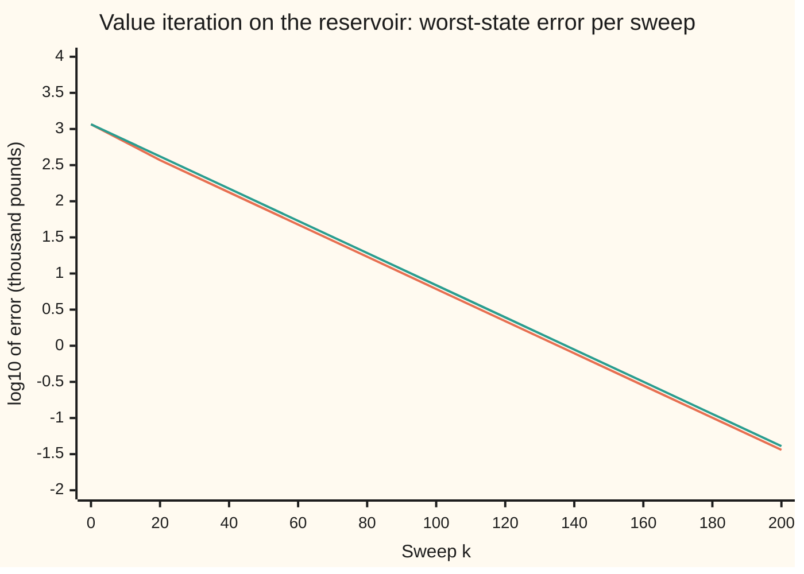

# The Bellman operator contracts: why repeated sweeps must converge

[Syllabus](../../../SYLLABUS.md) → [Optimization](../README.md) → [Dynamic Programming and Learning](../README.md#s07) → The Bellman operator contracts

---

## General Overview

A hydro reservoir holds between 0 and 4 units of water, one unit being 10 million m³. At the start of each month the operator chooses how many units to release through the turbines. Releasing 1, 2, 3 or 4 units earns £60,000, £100,000, £120,000 or £130,000: each extra unit is worth less, because the turbines run less efficiently.

Then rain arrives: no water with probability 30%, 1 unit with 50%, 2 units with 20%. Water above 4 units spills over the dam, unsold. The operator maximises the total revenue, with next month's pound counted as 95p today.

The best plan comes from **value iteration** ([Value and policy iteration](03-value-and-policy-iteration.md)). It keeps a guess of what each storage level is worth, and one **sweep** improves every guess at once: for each level, try every release, add its revenue now to 0.95 times the average guessed worth of next month's level, and keep the best total.

Start from the guess "every level is worth £0". The full reservoir is truly worth £1,163,884, so the first guess is that far off. After one sweep the gap is £1,033,884. After 50 sweeps it is £79,474. After 181 sweeps it is under £100.

The gap falls by at least the factor 0.95 at every sweep, from any starting guess, and it must: the sweep is a **contraction** (a rule that brings any two guesses closer together by a fixed factor below 1). This card proves that, and turns the factor into a stopping rule: from the factor and the first sweep's change of £130,000 alone, 199 sweeps are guaranteed to bring the guess within £100.

**One sweep of value iteration brings any two guesses of the values at least 0.95 times closer in the worst state, because it adds the same revenue to both, averages over the rain, discounts by 0.95 and keeps the best release; so the sweeps converge to the one true set of values, and after k sweeps the error is at most 0.95 to the power k times the starting error.**

**What kind of fact this is:** a theorem, the contraction property of the Bellman operator, proved on this card in Why it works; convergence then follows from Banach's fixed-point theorem, proved on [Fixed points](../../06-Calculus%20and%20analysis/03-What%20Derivatives%20Tell%20You/07-fixed-point-iteration-and-the-contraction-principle.md) and quoted here.

### The picture: the error falls in a straight line on a log scale



Orange line: the true error, the largest gap over the five storage levels between the guess and the true values, in thousand pounds, on a log scale (each unit down is a tenfold fall). Green line: the guarantee, 0.95 to the power k times the starting error. The orange line never rises above the green one. After the first few sweeps the two run parallel, falling by the same amount every sweep: the measured factor is the guaranteed 0.95 exactly.

---

## The formula

Notation from [Markov decision processes](02-markov-decision-processes.md), in one line: $s$ is the state (here the storage level), $a$ the action (the release), $r(s, a)$ the revenue now, $p(s' \mid s, a)$ the probability that next month's state is $s'$, and $\gamma$ (gamma) the discount factor. A **value function** $V$ lists one number per state: what being in that state is worth. This card introduces two pieces of notation. The **Bellman operator** $\mathcal{T}$ ("script T") is one sweep, turning a value function $V$ into a new one, $\mathcal{T}V$:

$$(\mathcal{T}V)(s) = \max_{a}\Bigl[\, r(s, a) + \gamma \sum_{s'} p(s' \mid s, a)\, V(s') \Bigr]$$

**Read it aloud:** the new worth of a state is the best, over releases, of revenue now plus the discounted average worth of where the rain takes you.

The **sup norm** $\|U - W\|_\infty$ ("sup" for supremum, here the largest) is the largest gap between two value functions $U$ and $W$ over all states: $\max_s |U(s) - W(s)|$. The theorem:

$$\|\mathcal{T}U - \mathcal{T}W\|_\infty \;\le\; \gamma\,\|U - W\|_\infty$$

**Read it aloud:** after one sweep, two guesses differ in their worst state by at most gamma times their worst gap before.

Value iteration presses $\mathcal{T}$ again and again: $V_{k+1} = \mathcal{T}V_k$, counting from $k = 0$ at the start $V_0$. ([Backward induction](01-finite-horizon-dynamic-programming-and-backward-induction.md) wrote $V_k$ for the value at stage $k$; here $k$ counts sweeps.) The true values $V^*$ are the one value function the sweep leaves alone, $\mathcal{T}V^* = V^*$. The three error bounds:

$$\|V_k - V^*\|_\infty \le \gamma^k\,\|V_0 - V^*\|_\infty \qquad \|V_k - V^*\|_\infty \le \frac{\gamma^k}{1-\gamma}\,\|V_1 - V_0\|_\infty \qquad \|V_k - V^*\|_\infty \le \frac{\gamma}{1-\gamma}\,\|V_k - V_{k-1}\|_\infty$$

**Read it aloud:** the error shrinks by gamma per sweep; it can be bounded in advance from the first sweep's change, the **first-step bound**; and it can be bounded while running from the latest sweep's change, the **last-step bound**.

| Symbol | Plain meaning | In our example | Push it up and the answer… |
| --- | --- | --- | --- |
| $s$, $s'$, $a$ | storage level this month and next; units released | 0 to 4 units of 10 million m³; release 0 up to $s$ | — |
| $r(s, a)$ | revenue now, thousand pounds | 0, 60, 100, 120, 130 for $a$ = 0 to 4 | values rise |
| $p(s' \mid s, a)$ | chance of reaching $s'$ | rain 0, 1, 2 units with 0.3, 0.5, 0.2; spill above 4 | — |
| $\gamma$ | discount factor: next month's pound in today's pounds | 0.95 | slower sweeps; at 1 no contraction |
| $V$, $U$, $W$ | value functions: one worth per state | any five numbers | — |
| $\mathcal{T}$, $\mathcal{T}_\pi$ | one sweep; the sweep with the release fixed by rule $\pi$ | the bracket above | — |
| $\Vert U - W\Vert_\infty$ | sup norm: the largest gap over states | 1163.8842 between 0 and $V^*$ | — |
| $V^*$ | the true values, the sweep's fixed point | 976.8089 empty to 1163.8842 full | — |
| $V_k$, $k$ | the guess after $k$ sweeps; the sweep count | $V_0 = 0$; $V_1$(full) = 130 | — |
| $\pi$, $V_\pi$ | a release rule; its values if followed for ever | best rule: 0, 1, 1, 1, 2 | — |
| $\varepsilon$, $e$, $\delta$ | stopping tolerance; an error size; the first sweep's change | 0.1 (£100); 1033.8842 after sweep 1; 130 | larger $\varepsilon$, fewer sweeps |
| $f$, $g$, $c$, $a^\dagger$ | in the proof only: two lists over releases, a bound on their gap, the best entry of $f$ | totals at one state | — |

### When it holds

- **A discount factor below 1.** At $\gamma = 1$ the factor is 1, and nothing shrinks: the reservoir's guessed worth grows by £53,158 every sweep for ever, as the check prints. Without discounting, other tools are needed (an average reward per month, or a guaranteed end).
- **Distance measured in the worst state.** The proof uses the largest gap. Measured by the total gap over states, one sweep can make two guesses farther apart: 1.770347 times, in the check.
- **Probabilities that add up to 1, and rewards that are fixed numbers.** The sweep averages next month's worth; an average cannot exceed the largest gap. A "probability" adding to more than 1, say from an estimated model that was never normalised, can break the bound.
- **Finitely many states, or bounded values.** Here five states and five numbers. With infinitely many states the same proof needs the values to stay bounded, so that the largest gap exists.
- **A best action that exists.** Here each state has at most five releases. With a continuum of actions the maximum must be attained or replaced by the supremum; the proof is unchanged.

---

## Why it works

### Step 0: four moves, none of which can widen a gap

Take two guesses, $U$ and $W$, and look at one state. A sweep does four things to each guess.

- It adds the revenue now: the same in both, so it cancels from the gap.
- It averages next month's worth over the rain: an average of gaps is no bigger than the largest gap.
- It multiplies by 0.95: the gap shrinks by that factor.
- It keeps the best release: two lists of totals that differ entry by entry by at most some amount have best entries that differ by at most that amount.

So each state's new gap is at most 0.95 times the old worst gap.

### Step 1: the best of two lists moves no more than the lists do

Let $f(a)$ and $g(a)$ be two lists over the same releases, with $|f(a) - g(a)| \le c$ for every $a$. Let $a^\dagger$ be a release where $f$ is largest. Then

$$\max_a f(a) - \max_a g(a) \;\le\; f(a^\dagger) - g(a^\dagger) \;\le\; c,$$

because $g$'s best is at least $g(a^\dagger)$. Swap the roles of $f$ and $g$ for the other direction. So $|\max_a f(a) - \max_a g(a)| \le \max_a |f(a) - g(a)|$. The best release may switch between the two guesses; the bound does not care.

### Step 2: an average of gaps is no bigger than the largest gap

Fix a state $s$ and a release $a$. The totals for $U$ and $W$ differ by

$$\gamma \sum_{s'} p(s' \mid s, a)\,\bigl(U(s') - W(s')\bigr).$$

Each gap $U(s') - W(s')$ lies between $-\|U - W\|_\infty$ and $+\|U - W\|_\infty$. The probabilities are non-negative and add up to 1, so their weighted sum lies in the same range. The difference is at most $\gamma\,\|U - W\|_\infty$ in size.

### Step 3: put together, one sweep is a contraction

By Step 2, the two lists of totals at state $s$ differ by at most $\gamma\,\|U - W\|_\infty$ for every release. By Step 1, their best entries do too. That holds at every state, so the worst state's gap obeys

$$\|\mathcal{T}U - \mathcal{T}W\|_\infty \le \gamma\,\|U - W\|_\infty.$$

The check tests 20,000 random pairs of guesses, each worth between −£1 million and +£1 million per state. The largest shrink factor it finds is 0.950000, never more.

The factor 0.95 cannot be improved for this reservoir. Add £100,000 to every state's worth: the same revenue now, and next month is worth exactly £100,000 more whatever the rain does, so after discounting the gap is exactly £95,000. The check prints 0.950000 for $V^* + 100$ against $V^*$.

### Step 4: Banach's theorem does the rest

[Fixed points](../../06-Calculus%20and%20analysis/03-What%20Derivatives%20Tell%20You/07-fixed-point-iteration-and-the-contraction-principle.md) proves Banach's fixed-point theorem for a rule on an interval, with distance $|x - y|$. The same proof runs unchanged with the sup norm in place of $|x - y|$. The one place it used a property of the real line, "terms that bunch up have a limit", holds here state by state: if the sweeps bunch up in the worst state, they bunch up in each of the five states, and each state's sequence of numbers has a limit. So:

- **One fixed point.** Exactly one $V^*$ satisfies $\mathcal{T}V^* = V^*$.
- **Reached from any start.** $V_k \to V^*$ whatever $V_0$ is.
- **With the error bounds.** Pressing the contraction $k$ times gives $\gamma^k\|V_0 - V^*\|_\infty$. Restarting from sweep $k - 1$ gives the last-step bound, already proved on [Value and policy iteration](03-value-and-policy-iteration.md) as its stopping test; here it follows from the contraction. Feeding it the first sweep's change, shrunk $k - 1$ times, gives the first-step bound.

The check reaches $V^*$ by a second road that never presses $\mathcal{T}$: it lists all 120 fixed release rules (1 × 2 × 3 × 4 × 5 choices), works out each rule's values exactly by solving five linear equations by elimination, and takes the best in each state. The two roads agree to nine decimal places: the printed gap is 0.000000000. One rule, releasing 0, 1, 1, 1, 2 units from levels 0 to 4, is best in every state at once. Why such a rule always exists is the business of [Value and policy iteration](03-value-and-policy-iteration.md).

### Step 5: why the measured factor settles on exactly 0.95

From $V_0 = 0$, the error ratio is 0.888305 at sweep 1, 0.922428 at sweep 2 and 0.950000 from about sweep 50 on. The guesses start too low by different amounts in different states. After enough sweeps the shortfall is the same in every state: the guess is $V^*$ minus a constant. Step 3 showed that a constant gap shrinks by exactly 0.95. So the error settles on the worst case the theorem allows, and the last-step bound becomes exact: at sweep 50 it reads 79.4743, the true error.

### Step 6: what a stopped guess is worth as a plan

The point of the values is the rule: in each state, release what the bracket says is best. That **greedy rule** ("greedy" because it trusts the current guess) loses little when the guess is good. [Value and policy iteration](03-value-and-policy-iteration.md) bounds the rule read off a table by the last change; the same contraction bounds it by the error. If $\|V - V^*\|_\infty \le e$, the greedy rule's true values fall short of $V^*$ by at most $2\gamma e/(1-\gamma)$.

The bound is safe but loose. After one sweep the greedy rule releases 0, 1, 2, 2, 2 and loses £33,864 in its worst state; the bound allows £39.3 million. From sweep 10 on the greedy rule is the best rule, although the values are still £618,454 off. The rule settles long before the values.

<details>
<summary>Detailed proof: the contraction, the three bounds and the greedy rule's loss</summary>

Let the state set and the action sets be finite, $0 \le \gamma < 1$, and $p(\cdot \mid s, a)$ a probability distribution for each $s$ and $a$.

**Contraction.** For any value functions $U$, $W$ and any $s$, $a$:
$|[r + \gamma \sum p\,U] - [r + \gamma \sum p\,W]| = \gamma\,|\sum_{s'} p(s' \mid s, a)(U(s') - W(s'))| \le \gamma \sum_{s'} p(s' \mid s, a)\,\|U - W\|_\infty = \gamma\|U - W\|_\infty.$
By Step 1, $|(\mathcal{T}U)(s) - (\mathcal{T}W)(s)| \le \gamma\|U - W\|_\infty$. Take the maximum over $s$.

**Fixed point and bounds.** That exactly one $V^*$ exists, and that $V_k \to V^*$ from any start, is Banach's theorem, proved on [Fixed points](../../06-Calculus%20and%20analysis/03-What%20Derivatives%20Tell%20You/07-fixed-point-iteration-and-the-contraction-principle.md); Step 4 says why its proof runs unchanged here. The three bounds follow from the contraction. Shrinking per sweep: $\|V_k - V^*\|_\infty = \|\mathcal{T}V_{k-1} - \mathcal{T}V^*\|_\infty \le \gamma\|V_{k-1} - V^*\|_\infty$, and by induction $\le \gamma^k\|V_0 - V^*\|_\infty$. Last-step bound: going from $V_{k-1}$ to $V^*$ by way of $V_k$ is never shorter than going direct, so $\|V_{k-1} - V^*\|_\infty \le \|V_k - V_{k-1}\|_\infty + \|V_k - V^*\|_\infty$. Multiply by $\gamma$, use the line before, and move $\gamma\|V_k - V^*\|_\infty$ across: $(1 - \gamma)\|V_k - V^*\|_\infty \le \gamma\|V_k - V_{k-1}\|_\infty$. First-step bound: write $\delta = \|V_1 - V_0\|_\infty$; pressing the contraction $k - 1$ times gives $\|V_k - V_{k-1}\|_\infty \le \gamma^{k-1}\delta$, and the last-step bound turns that into $\gamma^k\delta/(1 - \gamma)$.

**Greedy loss.** Let $\pi$ be greedy for $V$ and $\mathcal{T}_\pi$ the sweep with the action fixed to $\pi(s)$ (no maximum). Step 2 alone shows $\mathcal{T}_\pi$ is a $\gamma$-contraction, and $V_\pi$, the values of following $\pi$ for ever, is its fixed point. Greedy means $\mathcal{T}_\pi V = \mathcal{T}V$. Then
$V^* - V_\pi = (\mathcal{T}V^* - \mathcal{T}V) + (\mathcal{T}_\pi V - \mathcal{T}_\pi V^*) + (\mathcal{T}_\pi V^* - \mathcal{T}_\pi V_\pi)$,
so $\|V^* - V_\pi\|_\infty \le \gamma e + \gamma e + \gamma\|V^* - V_\pi\|_\infty$, which rearranges to $\|V^* - V_\pi\|_\infty \le 2\gamma e/(1 - \gamma)$.

</details>

---

## Worked numbers, by hand

Values in thousand pounds; tolerance $\varepsilon = 0.1$, that is £100.

| Step | Arithmetic | Value |
| --- | --- | --- |
| sweep 1, full reservoir | best revenue now: release all 4 units | 130.0000 |
| sweep 2, full, release 2 | 100 + 0.95 × (0.3 × 100 + 0.5 × 120 + 0.2 × 130) | 210.2000 |
| sweep 2, full, other releases | 0, 1, 3, 4 units | 123.5000, 180.6500, 207.4000, 177.5000 |
| starting error | $V^*$(full) − 0, the worst state | 1163.8842 |
| error after sweep 1 | worst gap, $\Vert V_1 - V^*\Vert_\infty$ | 1033.8842 |
| guarantee after sweep 1 | 0.95 × 1163.8842 | 1105.6900 |
| measured factor | 1033.8842 ÷ 1163.8842 | 0.888305 |
| first-step constant | $\Vert V_1 - V_0\Vert_\infty$ ÷ (1 − 0.95) = 130 ÷ 0.05 | 2600.0000 |
| first-step bound at 198, 199 | 0.95¹⁹⁸ × 2600, 0.95¹⁹⁹ × 2600 | 0.1010, 0.0959 |
| sweeps guaranteed in advance | first $k$ with bound ≤ 0.1 | **199** |
| sweeps the last-step bound needs | first $k$ with 19 × last change ≤ 0.1 | 181 |

From the discount factor and the first sweep's change of 130 alone, the first-step bound promises the values within £100 by sweep 199; watching the last change stops it at 181, which is exactly when the true error first drops under £100.

### What breaks if you drop a piece

| Mistake | Comes out at | What went wrong |
| --- | --- | --- |
| No discount, $\gamma = 1$ | change per sweep 53.6947 at sweep 10, 53.1579 at 100 and at 1000; full worth 53297.3542 after 1000 sweeps | the factor is 1: nothing shrinks, and the worth grows by the average monthly revenue for ever |
| Stop when the last change is under 0.1, and call that the error | stops at sweep 123 with change 0.0989; true error 1.8795, that is £1,880 | the change must be multiplied by γ/(1 − γ) = 19 |
| Measure the distance by the total gap over states | +100 at half full becomes 19.0000, 34.5550, 47.5000, 47.4797, 28.5000: total 177.0347, ratio 1.770347 | many states lead to half full, so its gap spreads; only the worst-state gap is sure to shrink |
| Act on the guess after one sweep | releases 0, 1, 2, 2, 2; loses 33.8639 in the worst state | the guess is £1 million off; it looks only one month ahead |

---

## Code, from first principles, and it actually runs

The code builds the reservoir, presses $\mathcal{T}$ 1,000 times from zero, and prints the error, its ratio and the three bounds at chosen sweeps. It takes two independent roads to $V^*$: value iteration, and an exhaustive listing of all 120 release rules, each valued exactly by Gaussian elimination. A third check tests the contraction itself on 20,000 random pairs of guesses drawn from a SplitMix64 generator with seed 0x2026, written out in both languages. Eight asserts can fail:

- the roads agree;
- no pair shrinks by less than 0.95;
- every sweep's error obeys the factor;
- the bounds hold in order at every sweep to 300;
- the greedy rule wins the bracket's maximum at every sweep to 300;
- it ends on road 2's best rule;
- the rule after sweep 1 loses the same 33.8639 when valued by 2,000 fixed-rule sweeps as by elimination;
- the three breaks really break.

### Python

```python
# The Bellman operator contracts -- the check behind the card.  Standard library
# only.  A reservoir holds 0 to 4 units of water (1 unit = 10 million m^3); each
# month it releases a units for r(a) thousand pounds, then rain adds 0, 1 or 2.
# The best values are reached twice: by value iteration (pressing T) and by
# evaluating all 120 fixed release rules exactly, by elimination.
from math import log10
GAMMA, S = 0.95, range(5)
R = [0, 60, 100, 120, 130]                       # r(a): revenue, thousand pounds, for releasing a units
RAIN = [(0, 0.3), (1, 0.5), (2, 0.2)]            # inflow in units, with its probability

def p_next(s, a):                                # p(s' | s, a); water above 4 units spills
    d = [0.0] * 5
    for w, pw in RAIN:
        d[min(s - a + w, 4)] += pw
    return d

def q(V, s, a, g):                               # revenue now plus discounted expected value next month
    return R[a] + g * sum(p * v for p, v in zip(p_next(s, a), V))

def T(V, g=GAMMA):                               # the Bellman operator: best action in every state
    return [max(q(V, s, a, g) for a in range(s + 1)) for s in S]

def greedy(V):
    return [max(range(s + 1), key=lambda a: q(V, s, a, GAMMA)) for s in S]

def sup(U, W):                                   # ||U - W||_inf, the largest gap over states
    return max(abs(u - w) for u, w in zip(U, W))

def evaluate(pol):                               # solve (I - gamma P) V = r by Gaussian elimination
    M = [[(s == t) - GAMMA * p_next(s, pol[s])[t] for t in S] + [R[pol[s]]] for s in S]
    for c in S:
        piv = max(range(c, 5), key=lambda i: abs(M[i][c]))
        M[c], M[piv] = M[piv], M[c]
        for i in range(c + 1, 5):
            f = M[i][c] / M[c][c]
            M[i] = [x - f * y for x, y in zip(M[i], M[c])]
    V = [0.0] * 5
    for i in reversed(S):
        V[i] = (M[i][5] - sum(M[i][j] * V[j] for j in range(i + 1, 5))) / M[i][i]
    return V

fmt = lambda V: "[" + ", ".join(f"{v:.4f}" for v in V) + "]"
pols = [[0, a1, a2, a3, a4] for a1 in range(2) for a2 in range(3) for a3 in range(4) for a4 in range(5)]
vals = [evaluate(p) for p in pols]
Vstar = [max(v[s] for v in vals) for s in S]     # road 2: best of all 120 rules, state by state
best = max(range(len(pols)), key=lambda i: sum(vals[i]))
print(f"road 2, all {len(pols)} release rules by elimination: V* = {fmt(Vstar)}")
print(f"best rule releases {pols[best]}; its largest shortfall from V*: {sup(vals[best], Vstar):.9f}")
Vs = [[0.0] * 5]                                 # road 1: value iteration from V_0 = 0
for k in range(1000):
    Vs.append(T(Vs[-1]))
print(f"road 1, value iteration, 1000 sweeps from 0: V = {fmt(Vs[1000])}")
print(f"gap between roads {sup(Vs[1000], Vstar):.9f}; Bellman residual ||T V* - V*|| = {sup(T(Vstar), Vstar):.9f}")
assert sup(Vs[1000], Vstar) < 1e-9                   # two roads, one answer

state = 0x2026                                   # SplitMix64, seed 0x2026, for random value functions
def rnd():
    global state
    state = (state + 0x9E3779B97F4A7C15) & (2**64 - 1)
    z = state
    z = ((z ^ (z >> 30)) * 0xBF58476D1CE4E5B9) & (2**64 - 1)
    z = ((z ^ (z >> 27)) * 0x94D049BB133111EB) & (2**64 - 1)
    return ((z ^ (z >> 31)) >> 11) / 2**53
worst = 0.0
for _ in range(20000):
    U = [2000 * rnd() - 1000 for _ in S]
    W = [2000 * rnd() - 1000 for _ in S]
    worst = max(worst, sup(T(U), T(W)) / sup(U, W))
shift = sup(T([v + 100 for v in Vstar]), T(Vstar)) / 100
print(f"20000 random pairs: largest ||TU - TW|| / ||U - W|| = {worst:.6f}; V* + 100 against V*: {shift:.6f}")

err = [sup(V, Vstar) for V in Vs]
d1 = sup(Vs[1], Vs[0])
first = lambda n: GAMMA ** n / (1 - GAMMA) * d1             # first-step bound
last = lambda n: GAMMA / (1 - GAMMA) * sup(Vs[n], Vs[n - 1])  # last-step bound
q4 = [q(Vs[1], 4, a, GAMMA) for a in S]
print("sweep 2, full reservoir, release 0 to 4: " + ", ".join(f"{v:.4f}" for v in q4))
print(f"gamma / (1 - gamma) = {GAMMA / (1 - GAMMA):.4f}; ||V_1 - V_0|| = {d1:.4f}; over (1 - gamma): {d1 / (1 - GAMMA):.4f}; "
      f"gamma^198, gamma^199 times that: {first(198):.4f}, {first(199):.4f}")
print("k, V_k(full), error ||V_k - V*||, ratio to previous, gamma^k e_0, last-step bound, first-step bound")
for k in (1, 2, 3, 10, 50, 100, 200):
    print(f"{k}, {Vs[k][4]:.4f}, {err[k]:.4f}, {err[k] / err[k - 1]:.6f}, {GAMMA ** k * err[0]:.4f}, "
          f"{last(k):.4f}, {first(k):.4f}")
ratios = [err[k] / err[k - 1] for k in range(1, 301)]
print(f"error ratios over sweeps 1 to 300: smallest {min(ratios):.6f}, largest {max(ratios):.6f}")
fn = lambda ok: next(n for n in range(1, 1001) if ok(n))
n_first, n_last, n_true = fn(lambda n: first(n) <= 0.1), fn(lambda n: last(n) <= 0.1), fn(lambda n: err[n] <= 0.1)
print(f"within 0.1 (100 pounds): first-step bound promises n = {n_first}, last-step bound stops at n = {n_last}, "
      f"true at n = {n_true}")
for k in (1, 2):
    pk = greedy(Vs[k])
    print(f"greedy rule after sweep {k}: {pk}, loss {sup(evaluate(pk), Vstar):.4f}, "
          f"bound 2 gamma e_k / (1 - gamma) = {2 * GAMMA * err[k] / (1 - GAMMA):.4f}")
settle = 1 + max(k for k in range(301) if greedy(Vs[k]) != pols[best])
print(f"greedy rule equals the best rule from sweep {settle} on; error then {err[settle]:.4f}")
W1, p1 = [0.0] * 5, greedy(Vs[1])               # sweep 1's rule valued again: 2000 fixed-rule sweeps, no elimination
for _ in range(2000):
    W1 = [q(W1, s, p1[s], GAMMA) for s in S]
print(f"greedy rule after sweep 1, valued by 2000 fixed-rule sweeps instead: loss {sup(W1, Vstar):.4f}")

V1 = [[0.0] * 5]                                 # break 1: gamma = 1, nothing discounts the future
for k in range(1000):
    V1.append(T(V1[-1], 1.0))
steps1 = [sup(V1[k], V1[k - 1]) for k in (10, 100, 1000)]
print(f"gamma = 1: step ||V_k - V_k-1|| at k = 10, 100, 1000: {steps1[0]:.4f}, {steps1[1]:.4f}, {steps1[2]:.4f}; "
      f"V_1000(full) = {V1[1000][4]:.4f}")
naive = fn(lambda n: sup(Vs[n], Vs[n - 1]) <= 0.1)  # break 2: stop when the step is small
print(f"stop when step <= 0.1: sweep {naive}, step {sup(Vs[naive], Vs[naive - 1]):.4f}, true error {err[naive]:.4f}")
sumn = lambda U, W: sum(abs(u - w) for u, w in zip(U, W))  # break 3: the total gap, not the largest
U = Vstar[:2] + [Vstar[2] + 100] + Vstar[3:]
print("one sweep, change in each state: " + ", ".join(f"{u - w:.4f}" for u, w in zip(T(U), T(Vstar))))
print(f"total-gap norm, V* + 100 at half full against V*: before {sumn(U, Vstar):.4f}, after one sweep "
      f"{sumn(T(U), T(Vstar)):.4f}, ratio {sumn(T(U), T(Vstar)) / sumn(U, Vstar):.6f}")
print("chart, sweep: " + ", ".join(str(k) for k in range(0, 201, 20)))
print("chart, log10 error: " + ", ".join(f"{log10(err[k]):.3f}" for k in range(0, 201, 20)))
print("chart, log10 gamma^k e_0: " + ", ".join(f"{log10(GAMMA ** k * err[0]):.3f}" for k in range(0, 201, 20)))

assert worst <= GAMMA + 1e-12 and abs(shift - GAMMA) < 1e-9          # T contracts, by exactly gamma at worst
assert all(err[k] <= GAMMA * err[k - 1] + 1e-9 for k in range(1, 301))
assert all(err[n] <= last(n) + 1e-9 and last(n) <= first(n) + 1e-9 for n in range(1, 301))
assert all(abs(q(Vs[k], s, greedy(Vs[k])[s], GAMMA) - T(Vs[k])[s]) < 1e-9 for k in range(1, 301) for s in S)  # greedy wins the max
assert greedy(Vs[1000]) == pols[best]                                    # road 1's final rule is road 2's best rule
assert abs(sup(W1, Vstar) - sup(evaluate(p1), Vstar)) < 1e-9 and sup(W1, Vstar) <= 2 * GAMMA * err[1] / (1 - GAMMA)
assert steps1[2] > 1 and err[naive] > 0.1 and sumn(T(U), T(Vstar)) > sumn(U, Vstar)  # the breaks really break
print("ALL CHECKS PASS")
```

**Ran 2026-11-11 on macOS, Python 3.14.10, standard library only. All checks passed. Output, pasted from the run:**

```
road 2, all 120 release rules by elimination: V* = [976.8089, 1036.8089, 1083.8639, 1123.8842, 1163.8842]
best rule releases [0, 1, 1, 1, 2]; its largest shortfall from V*: 0.000000000
road 1, value iteration, 1000 sweeps from 0: V = [976.8089, 1036.8089, 1083.8639, 1123.8842, 1163.8842]
gap between roads 0.000000000; Bellman residual ||T V* - V*|| = 0.000000000
20000 random pairs: largest ||TU - TW|| / ||U - W|| = 0.950000; V* + 100 against V*: 0.950000
sweep 2, full reservoir, release 0 to 4: 123.5000, 180.6500, 210.2000, 207.4000, 177.5000
gamma / (1 - gamma) = 19.0000; ||V_1 - V_0|| = 130.0000; over (1 - gamma): 2600.0000; gamma^198, gamma^199 times that: 0.1010, 0.0959
k, V_k(full), error ||V_k - V*||, ratio to previous, gamma^k e_0, last-step bound, first-step bound
1, 130.0000, 1033.8842, 0.888305, 1105.6900, 2470.0000, 2470.0000
2, 210.2000, 953.6842, 0.922428, 1050.4055, 1523.8000, 2346.5000
3, 270.9905, 892.8937, 0.936257, 997.8852, 1155.0195, 2229.1750
10, 545.4303, 618.4539, 0.949958, 696.8605, 618.9981, 1556.7160
50, 1084.4099, 79.4743, 0.950000, 89.5550, 79.4743, 200.0569
100, 1157.7690, 6.1151, 0.950000, 6.8908, 6.1151, 15.3934
200, 1163.8480, 0.0362, 0.950000, 0.0408, 0.0362, 0.0911
error ratios over sweeps 1 to 300: smallest 0.888305, largest 0.950000
within 0.1 (100 pounds): first-step bound promises n = 199, last-step bound stops at n = 181, true at n = 181
greedy rule after sweep 1: [0, 1, 2, 2, 2], loss 33.8639, bound 2 gamma e_k / (1 - gamma) = 39287.5991
greedy rule after sweep 2: [0, 1, 1, 2, 2], loss 0.0556, bound 2 gamma e_k / (1 - gamma) = 36239.9991
greedy rule equals the best rule from sweep 10 on; error then 618.4539
greedy rule after sweep 1, valued by 2000 fixed-rule sweeps instead: loss 33.8639
gamma = 1: step ||V_k - V_k-1|| at k = 10, 100, 1000: 53.6947, 53.1579, 53.1579; V_1000(full) = 53297.3542
stop when step <= 0.1: sweep 123, step 0.0989, true error 1.8795
one sweep, change in each state: 19.0000, 34.5550, 47.5000, 47.4797, 28.5000
total-gap norm, V* + 100 at half full against V*: before 100.0000, after one sweep 177.0347, ratio 1.770347
chart, sweep: 0, 20, 40, 60, 80, 100, 120, 140, 160, 180, 200
chart, log10 error: 3.066, 2.569, 2.123, 1.677, 1.232, 0.786, 0.341, -0.105, -0.550, -0.996, -1.441
chart, log10 gamma^k e_0: 3.066, 2.620, 2.175, 1.729, 1.284, 0.838, 0.393, -0.053, -0.498, -0.944, -1.389
ALL CHECKS PASS
```

### Rust

```rust
// The Bellman operator contracts -- the same check as the Python, in Rust, no
// crates.  A reservoir holds 0 to 4 units of water (1 unit = 10 million m^3);
// each month it releases a units for r(a) thousand pounds, then rain adds 0, 1
// or 2.  The best values are reached twice: by value iteration (pressing T) and
// by evaluating all 120 fixed release rules exactly, by elimination.
const GAMMA: f64 = 0.95;
const R: [f64; 5] = [0.0, 60.0, 100.0, 120.0, 130.0]; // r(a): revenue, thousand pounds
const RAIN: [(usize, f64); 3] = [(0, 0.3), (1, 0.5), (2, 0.2)]; // inflow in units, probability
type V5 = [f64; 5];

fn p_next(s: usize, a: usize) -> V5 {               // p(s' | s, a); water above 4 units spills
    let mut d = [0.0; 5];
    for &(w, pw) in RAIN.iter() { d[(s - a + w).min(4)] += pw }
    d
}
fn q(v: &V5, s: usize, a: usize, g: f64) -> f64 {   // revenue now plus discounted expected value next month
    let p = p_next(s, a);
    let mut e = 0.0;
    for t in 0..5 { e += p[t] * v[t] }
    R[a] + g * e
}
fn t_op(v: &V5, g: f64) -> V5 {                      // the Bellman operator: best action in every state
    let mut out = [0.0; 5];
    for s in 0..5 { out[s] = (0..=s).map(|a| q(v, s, a, g)).fold(f64::NEG_INFINITY, f64::max) }
    out
}
fn greedy(v: &V5) -> [usize; 5] {
    let mut pol = [0; 5];
    for s in 0..5 { for a in 1..=s { if q(v, s, a, GAMMA) > q(v, s, pol[s], GAMMA) { pol[s] = a } } }
    pol
}
fn sup(u: &V5, w: &V5) -> f64 { (0..5).map(|i| (u[i] - w[i]).abs()).fold(0.0, f64::max) }
fn sumn(u: &V5, w: &V5) -> f64 { (0..5).map(|i| (u[i] - w[i]).abs()).sum() }
fn evaluate(pol: &[usize; 5]) -> V5 {                // solve (I - gamma P) V = r by Gaussian elimination
    let mut m = [[0.0f64; 6]; 5];
    for s in 0..5 {
        let p = p_next(s, pol[s]);
        for t in 0..5 { m[s][t] = (if s == t { 1.0 } else { 0.0 }) - GAMMA * p[t] }
        m[s][5] = R[pol[s]];
    }
    for c in 0..5 {
        let mut piv = c;
        for i in c + 1..5 { if m[i][c].abs() > m[piv][c].abs() { piv = i } }
        m.swap(c, piv);
        for i in c + 1..5 {
            let f = m[i][c] / m[c][c];
            for j in 0..6 { m[i][j] -= f * m[c][j] }
        }
    }
    let mut v = [0.0; 5];
    for i in (0..5).rev() {
        let mut acc = 0.0;
        for j in i + 1..5 { acc += m[i][j] * v[j] }
        v[i] = (m[i][5] - acc) / m[i][i];
    }
    v
}
fn fmt(v: &V5) -> String { format!("[{}]", v.iter().map(|x| format!("{:.4}", x)).collect::<Vec<_>>().join(", ")) }
fn fpol(p: &[usize; 5]) -> String { format!("[{}]", p.iter().map(|x| x.to_string()).collect::<Vec<_>>().join(", ")) }
fn join(v: &[f64], d: usize) -> String { v.iter().map(|x| format!("{:.*}", d, x)).collect::<Vec<_>>().join(", ") }
struct SplitMix(u64);
impl SplitMix {
    fn next(&mut self) -> f64 {
        self.0 = self.0.wrapping_add(0x9E3779B97F4A7C15);
        let mut z = self.0;
        z = (z ^ (z >> 30)).wrapping_mul(0xBF58476D1CE4E5B9);
        z = (z ^ (z >> 27)).wrapping_mul(0x94D049BB133111EB);
        ((z ^ (z >> 31)) >> 11) as f64 / 9007199254740992.0
    }
}

fn main() {
    let mut pols = vec![];
    for a1 in 0..2 { for a2 in 0..3 { for a3 in 0..4 { for a4 in 0..5 { pols.push([0, a1, a2, a3, a4]) } } } }
    let vals: Vec<V5> = pols.iter().map(evaluate).collect();
    let mut vstar = [0.0; 5];                         // road 2: best of all 120 rules, state by state
    for s in 0..5 { vstar[s] = vals.iter().map(|v| v[s]).fold(f64::NEG_INFINITY, f64::max) }
    let mut best = 0;
    for i in 1..pols.len() { if vals[i].iter().sum::<f64>() > vals[best].iter().sum::<f64>() { best = i } }
    println!("road 2, all {} release rules by elimination: V* = {}", pols.len(), fmt(&vstar));
    println!("best rule releases {}; its largest shortfall from V*: {:.9}", fpol(&pols[best]), sup(&vals[best], &vstar));
    let mut vs: Vec<V5> = vec![[0.0; 5]];             // road 1: value iteration from V_0 = 0
    for _ in 0..1000 { let n = t_op(vs.last().unwrap(), GAMMA); vs.push(n) }
    println!("road 1, value iteration, 1000 sweeps from 0: V = {}", fmt(&vs[1000]));
    println!("gap between roads {:.9}; Bellman residual ||T V* - V*|| = {:.9}", sup(&vs[1000], &vstar), sup(&t_op(&vstar, GAMMA), &vstar));
    assert!(sup(&vs[1000], &vstar) < 1e-9);                   // two roads, one answer

    let mut rng = SplitMix(0x2026);                   // SplitMix64, seed 0x2026, for random value functions
    let mut worst = 0.0f64;
    for _ in 0..20000 {
        let mut u = [0.0; 5];
        let mut w = [0.0; 5];
        for i in 0..5 { u[i] = 2000.0 * rng.next() - 1000.0 }
        for i in 0..5 { w[i] = 2000.0 * rng.next() - 1000.0 }
        worst = worst.max(sup(&t_op(&u, GAMMA), &t_op(&w, GAMMA)) / sup(&u, &w));
    }
    let mut up = vstar;
    for s in 0..5 { up[s] += 100.0 }
    let shift = sup(&t_op(&up, GAMMA), &t_op(&vstar, GAMMA)) / 100.0;
    println!("20000 random pairs: largest ||TU - TW|| / ||U - W|| = {:.6}; V* + 100 against V*: {:.6}", worst, shift);

    let err: Vec<f64> = vs.iter().map(|v| sup(v, &vstar)).collect();
    let d1 = sup(&vs[1], &vs[0]);
    let first = |n: usize| GAMMA.powi(n as i32) / (1.0 - GAMMA) * d1;          // first-step bound
    let last = |n: usize| GAMMA / (1.0 - GAMMA) * sup(&vs[n], &vs[n - 1]);    // last-step bound
    let q4: Vec<f64> = (0..5).map(|a| q(&vs[1], 4, a, GAMMA)).collect();
    println!("sweep 2, full reservoir, release 0 to 4: {}", join(&q4, 4));
    println!("gamma / (1 - gamma) = {:.4}; ||V_1 - V_0|| = {:.4}; over (1 - gamma): {:.4}; gamma^198, gamma^199 times that: {:.4}, {:.4}",
             GAMMA / (1.0 - GAMMA), d1, d1 / (1.0 - GAMMA), first(198), first(199));
    println!("k, V_k(full), error ||V_k - V*||, ratio to previous, gamma^k e_0, last-step bound, first-step bound");
    for k in [1usize, 2, 3, 10, 50, 100, 200] {
        println!("{}, {:.4}, {:.4}, {:.6}, {:.4}, {:.4}, {:.4}", k, vs[k][4], err[k], err[k] / err[k - 1],
                 GAMMA.powi(k as i32) * err[0], last(k), first(k));
    }
    let ratios: Vec<f64> = (1..301).map(|k| err[k] / err[k - 1]).collect();
    println!("error ratios over sweeps 1 to 300: smallest {:.6}, largest {:.6}",
             ratios.iter().cloned().fold(f64::INFINITY, f64::min), ratios.iter().cloned().fold(0.0, f64::max));
    let fnd = |ok: &dyn Fn(usize) -> bool| (1..=1000).find(|&n| ok(n)).unwrap();
    let (nf, nl, nt) = (fnd(&|n| first(n) <= 0.1), fnd(&|n| last(n) <= 0.1), fnd(&|n| err[n] <= 0.1));
    println!("within 0.1 (100 pounds): first-step bound promises n = {}, last-step bound stops at n = {}, true at n = {}", nf, nl, nt);
    for k in [1usize, 2] {
        let pk = greedy(&vs[k]);
        println!("greedy rule after sweep {}: {}, loss {:.4}, bound 2 gamma e_k / (1 - gamma) = {:.4}",
                 k, fpol(&pk), sup(&evaluate(&pk), &vstar), 2.0 * GAMMA * err[k] / (1.0 - GAMMA));
    }
    let settle = 1 + (0..301).filter(|&k| greedy(&vs[k]) != pols[best]).max().unwrap();
    println!("greedy rule equals the best rule from sweep {} on; error then {:.4}", settle, err[settle]);
    let (mut w1, p1) = ([0.0; 5], greedy(&vs[1]));   // sweep 1's rule valued again: 2000 fixed-rule sweeps, no elimination
    for _ in 0..2000 {
        let mut n = [0.0; 5];
        for s in 0..5 { n[s] = q(&w1, s, p1[s], GAMMA) }
        w1 = n;
    }
    println!("greedy rule after sweep 1, valued by 2000 fixed-rule sweeps instead: loss {:.4}", sup(&w1, &vstar));

    let mut v1: Vec<V5> = vec![[0.0; 5]];             // break 1: gamma = 1, nothing discounts the future
    for _ in 0..1000 { let n = t_op(v1.last().unwrap(), 1.0); v1.push(n) }
    let steps1: Vec<f64> = [10usize, 100, 1000].iter().map(|&k| sup(&v1[k], &v1[k - 1])).collect();
    println!("gamma = 1: step ||V_k - V_k-1|| at k = 10, 100, 1000: {:.4}, {:.4}, {:.4}; V_1000(full) = {:.4}",
             steps1[0], steps1[1], steps1[2], v1[1000][4]);
    let naive = fnd(&|n| sup(&vs[n], &vs[n - 1]) <= 0.1); // break 2: stop when the step is small
    println!("stop when step <= 0.1: sweep {}, step {:.4}, true error {:.4}", naive, sup(&vs[naive], &vs[naive - 1]), err[naive]);
    let mut u = vstar;                                // break 3: the total gap, not the largest
    u[2] += 100.0;
    let (tu, tv) = (t_op(&u, GAMMA), t_op(&vstar, GAMMA));
    let ch: Vec<f64> = (0..5).map(|i| tu[i] - tv[i]).collect();
    println!("one sweep, change in each state: {}", join(&ch, 4));
    println!("total-gap norm, V* + 100 at half full against V*: before {:.4}, after one sweep {:.4}, ratio {:.6}",
             sumn(&u, &vstar), sumn(&tu, &tv), sumn(&tu, &tv) / sumn(&u, &vstar));
    let ks: Vec<usize> = (0..=200).step_by(20).collect();
    println!("chart, sweep: {}", ks.iter().map(|k| k.to_string()).collect::<Vec<_>>().join(", "));
    println!("chart, log10 error: {}", join(&ks.iter().map(|&k| err[k].log10()).collect::<Vec<_>>(), 3));
    println!("chart, log10 gamma^k e_0: {}", join(&ks.iter().map(|&k| (GAMMA.powi(k as i32) * err[0]).log10()).collect::<Vec<_>>(), 3));

    assert!(worst <= GAMMA + 1e-12 && (shift - GAMMA).abs() < 1e-9);          // T contracts, by exactly gamma at worst
    assert!((1..301).all(|k| err[k] <= GAMMA * err[k - 1] + 1e-9));
    assert!((1..301).all(|n| err[n] <= last(n) + 1e-9 && last(n) <= first(n) + 1e-9));
    assert!((1..301).all(|k| (0..5).all(|s| (q(&vs[k], s, greedy(&vs[k])[s], GAMMA) - t_op(&vs[k], GAMMA)[s]).abs() < 1e-9))); // greedy wins the max
    assert!(greedy(&vs[1000]) == pols[best]);                                  // road 1's final rule is road 2's best rule
    assert!((sup(&w1, &vstar) - sup(&evaluate(&p1), &vstar)).abs() < 1e-9 && sup(&w1, &vstar) <= 2.0 * GAMMA * err[1] / (1.0 - GAMMA));
    assert!(steps1[2] > 1.0 && err[naive] > 0.1 && sumn(&tu, &tv) > sumn(&u, &vstar));      // the breaks really break
    println!("ALL CHECKS PASS");
}
```

**Ran 2026-11-11 on macOS, rustc 1.98.1, no crates. All checks passed. Output, pasted from the run:**

```
road 2, all 120 release rules by elimination: V* = [976.8089, 1036.8089, 1083.8639, 1123.8842, 1163.8842]
best rule releases [0, 1, 1, 1, 2]; its largest shortfall from V*: 0.000000000
road 1, value iteration, 1000 sweeps from 0: V = [976.8089, 1036.8089, 1083.8639, 1123.8842, 1163.8842]
gap between roads 0.000000000; Bellman residual ||T V* - V*|| = 0.000000000
20000 random pairs: largest ||TU - TW|| / ||U - W|| = 0.950000; V* + 100 against V*: 0.950000
sweep 2, full reservoir, release 0 to 4: 123.5000, 180.6500, 210.2000, 207.4000, 177.5000
gamma / (1 - gamma) = 19.0000; ||V_1 - V_0|| = 130.0000; over (1 - gamma): 2600.0000; gamma^198, gamma^199 times that: 0.1010, 0.0959
k, V_k(full), error ||V_k - V*||, ratio to previous, gamma^k e_0, last-step bound, first-step bound
1, 130.0000, 1033.8842, 0.888305, 1105.6900, 2470.0000, 2470.0000
2, 210.2000, 953.6842, 0.922428, 1050.4055, 1523.8000, 2346.5000
3, 270.9905, 892.8937, 0.936257, 997.8852, 1155.0195, 2229.1750
10, 545.4303, 618.4539, 0.949958, 696.8605, 618.9981, 1556.7160
50, 1084.4099, 79.4743, 0.950000, 89.5550, 79.4743, 200.0569
100, 1157.7690, 6.1151, 0.950000, 6.8908, 6.1151, 15.3934
200, 1163.8480, 0.0362, 0.950000, 0.0408, 0.0362, 0.0911
error ratios over sweeps 1 to 300: smallest 0.888305, largest 0.950000
within 0.1 (100 pounds): first-step bound promises n = 199, last-step bound stops at n = 181, true at n = 181
greedy rule after sweep 1: [0, 1, 2, 2, 2], loss 33.8639, bound 2 gamma e_k / (1 - gamma) = 39287.5991
greedy rule after sweep 2: [0, 1, 1, 2, 2], loss 0.0556, bound 2 gamma e_k / (1 - gamma) = 36239.9991
greedy rule equals the best rule from sweep 10 on; error then 618.4539
greedy rule after sweep 1, valued by 2000 fixed-rule sweeps instead: loss 33.8639
gamma = 1: step ||V_k - V_k-1|| at k = 10, 100, 1000: 53.6947, 53.1579, 53.1579; V_1000(full) = 53297.3542
stop when step <= 0.1: sweep 123, step 0.0989, true error 1.8795
one sweep, change in each state: 19.0000, 34.5550, 47.5000, 47.4797, 28.5000
total-gap norm, V* + 100 at half full against V*: before 100.0000, after one sweep 177.0347, ratio 1.770347
chart, sweep: 0, 20, 40, 60, 80, 100, 120, 140, 160, 180, 200
chart, log10 error: 3.066, 2.569, 2.123, 1.677, 1.232, 0.786, 0.341, -0.105, -0.550, -0.996, -1.441
chart, log10 gamma^k e_0: 3.066, 2.620, 2.175, 1.729, 1.284, 0.838, 0.393, -0.053, -0.498, -0.944, -1.389
ALL CHECKS PASS
```

The two outputs match line for line.

### Lean

Lean proves the contraction and the three error bounds for any finitely many states and actions, with a discount factor below 1.

- Take finitely many states, finitely many actions in each, fixed rewards, and probabilities that are non-negative and add up to 1. Each state needs at least one action.
- Let the discount factor be at least 0 and below 1. Then one sweep brings any two value functions at least $\gamma$ times closer in the worst state.
- Exactly one value function is left alone by a sweep: the true values $V^*$.
- From any start $V_0$, the sweeps converge to $V^*$. After $k$ sweeps the error is at most $\gamma^k$ times the starting error.
- The first-step bound holds at every sweep. The last-step bound holds at every sweep from the first on.
- The hand arithmetic holds exactly: the five releases at sweep 2, the constant 2600, the 199 sweeps and the factor 19.

The greedy rule's loss, the random pairs, the 120-rule elimination and the printed values of $V^*$ are left to the Python and Rust checks.

```lean
-- The Bellman operator contracts: one sweep of value iteration shrinks the worst-state gap between any two value functions by the discount factor, so the sweeps converge to the one fixed point with the card's three error bounds.
import Mathlib.Analysis.Normed.Group.Constructions
import Mathlib.Analysis.Normed.Order.Lattice
import Mathlib.Analysis.SpecificLimits.Basic
import Mathlib.Algebra.Order.BigOperators.Group.Finset
import Mathlib.Data.Finset.Lattice.Fold
import Mathlib.Topology.MetricSpace.Contracting

open Filter Topology

/-- The Bellman operator, one sweep: the new worth of state `s` is the best, over the actions
available in `s`, of the reward now plus `γ` times the average worth of the next state.
Value functions are `S → ℝ`; Mathlib's norm on `S → ℝ` (finite `S`) is the sup norm,
the largest gap over states. -/
noncomputable def bellman {S : Type*} [Fintype S] {A : S → Type*} [∀ s, Fintype (A s)]
    [∀ s, Nonempty (A s)] (r : (s : S) → A s → ℝ) (p : (s : S) → A s → S → ℝ) (γ : ℝ)
    (V : S → ℝ) : S → ℝ :=
  fun s => Finset.univ.sup' Finset.univ_nonempty
    (fun a : A s => r s a + γ * ∑ s', p s a s' * V s')

/-- One-sided bound in a single state: `T U s ≤ T W s + γ ‖U - W‖`. -/
theorem bellman_le_add {S : Type*} [Fintype S] {A : S → Type*}
    [∀ s, Fintype (A s)] [∀ s, Nonempty (A s)]
    (r : (s : S) → A s → ℝ) (p : (s : S) → A s → S → ℝ) (γ : ℝ)
    (hp_nonneg : ∀ s a s', 0 ≤ p s a s') (hp_sum : ∀ s a, ∑ s', p s a s' = 1)
    (hγ0 : 0 ≤ γ) (U W : S → ℝ) (s : S) :
    bellman r p γ U s ≤ bellman r p γ W s + γ * ‖U - W‖ := by
  unfold bellman
  apply Finset.sup'_le
  intro a _
  have hsum : ∑ s', p s a s' * U s' ≤ ∑ s', p s a s' * W s' + ‖U - W‖ := by
    have h1 : ∀ s', p s a s' * U s' ≤ p s a s' * W s' + p s a s' * ‖U - W‖ := by
      intro s'
      have hle : U s' - W s' ≤ ‖U - W‖ := by
        have := norm_le_pi_norm (U - W) s'
        simp only [Pi.sub_apply, Real.norm_eq_abs] at this
        exact (le_abs_self _).trans this
      have := mul_le_mul_of_nonneg_left hle (hp_nonneg s a s')
      linarith
    calc ∑ s', p s a s' * U s' ≤ ∑ s', (p s a s' * W s' + p s a s' * ‖U - W‖) :=
          Finset.sum_le_sum fun s' _ => h1 s'
      _ = ∑ s', p s a s' * W s' + ‖U - W‖ := by
          rw [Finset.sum_add_distrib, ← Finset.sum_mul, hp_sum, one_mul]
  have hle : r s a + γ * ∑ s', p s a s' * W s' ≤
      Finset.univ.sup' Finset.univ_nonempty (fun a : A s => r s a + γ * ∑ s', p s a s' * W s') :=
    Finset.le_sup' (fun a : A s => r s a + γ * ∑ s', p s a s' * W s') (Finset.mem_univ a)
  have := mul_le_mul_of_nonneg_left hsum hγ0
  linarith

#print axioms bellman_le_add

/-- The contraction bound, restated as a helper for later proofs. -/
theorem bellman_contraction_aux {S : Type*} [Fintype S] {A : S → Type*}
    [∀ s, Fintype (A s)] [∀ s, Nonempty (A s)]
    (r : (s : S) → A s → ℝ) (p : (s : S) → A s → S → ℝ) (γ : ℝ)
    (hp_nonneg : ∀ s a s', 0 ≤ p s a s') (hp_sum : ∀ s a, ∑ s', p s a s' = 1)
    (hγ0 : 0 ≤ γ) (U W : S → ℝ) :
    ‖bellman r p γ U - bellman r p γ W‖ ≤ γ * ‖U - W‖ := by
  rw [pi_norm_le_iff_of_nonneg (mul_nonneg hγ0 (norm_nonneg _))]
  intro s
  rw [Pi.sub_apply, Real.norm_eq_abs, abs_le]
  have h1 := bellman_le_add r p γ hp_nonneg hp_sum hγ0 U W s
  have h2 := bellman_le_add r p γ hp_nonneg hp_sum hγ0 W U s
  rw [norm_sub_rev W U] at h2
  constructor <;> linarith

#print axioms bellman_contraction_aux

/-- Distance to a fixed point from any `x` is at most `‖T x - x‖ / (1 - γ)`. -/
theorem bellman_dist_fixed_le {S : Type*} [Fintype S] {A : S → Type*}
    [∀ s, Fintype (A s)] [∀ s, Nonempty (A s)]
    (r : (s : S) → A s → ℝ) (p : (s : S) → A s → S → ℝ) (γ : ℝ)
    (hp_nonneg : ∀ s a s', 0 ≤ p s a s') (hp_sum : ∀ s a, ∑ s', p s a s' = 1)
    (hγ0 : 0 ≤ γ) (hγ1 : γ < 1)
    (Vstar : S → ℝ) (hfix : bellman r p γ Vstar = Vstar) (x : S → ℝ) :
    ‖x - Vstar‖ ≤ ‖bellman r p γ x - x‖ / (1 - γ) := by
  have hc := bellman_contraction_aux r p γ hp_nonneg hp_sum hγ0 x Vstar
  rw [hfix] at hc
  have htri : ‖x - Vstar‖ ≤ ‖x - bellman r p γ x‖ + ‖bellman r p γ x - Vstar‖ :=
    norm_sub_le_norm_sub_add_norm_sub _ _ _
  rw [norm_sub_rev x (bellman r p γ x)] at htri
  rw [le_div_iff₀ (by linarith)]
  nlinarith

#print axioms bellman_dist_fixed_le

/-- Iterates approach a fixed point geometrically. -/
theorem bellman_iterate_le {S : Type*} [Fintype S] {A : S → Type*}
    [∀ s, Fintype (A s)] [∀ s, Nonempty (A s)]
    (r : (s : S) → A s → ℝ) (p : (s : S) → A s → S → ℝ) (γ : ℝ)
    (hp_nonneg : ∀ s a s', 0 ≤ p s a s') (hp_sum : ∀ s a, ∑ s', p s a s' = 1)
    (hγ0 : 0 ≤ γ)
    (Vstar : S → ℝ) (hfix : bellman r p γ Vstar = Vstar) (V₀ : S → ℝ) (k : ℕ) :
    ‖(bellman r p γ)^[k] V₀ - Vstar‖ ≤ γ ^ k * ‖V₀ - Vstar‖ := by
  induction k with
  | zero => simp
  | succ n ih =>
    rw [Function.iterate_succ_apply']
    calc ‖bellman r p γ ((bellman r p γ)^[n] V₀) - Vstar‖
        = ‖bellman r p γ ((bellman r p γ)^[n] V₀) - bellman r p γ Vstar‖ := by rw [hfix]
      _ ≤ γ * ‖(bellman r p γ)^[n] V₀ - Vstar‖ :=
          bellman_contraction_aux r p γ hp_nonneg hp_sum hγ0 _ _
      _ ≤ γ * (γ ^ n * ‖V₀ - Vstar‖) := mul_le_mul_of_nonneg_left ih hγ0
      _ = γ ^ (n + 1) * ‖V₀ - Vstar‖ := by ring

#print axioms bellman_iterate_le

/-- The Bellman operator is a contraction: with finitely many states, a nonempty finite set of
actions in each state, fixed rewards, transition probabilities that are non-negative and add up
to 1, and a discount factor `0 ≤ γ < 1`, one sweep brings any two value functions at least `γ`
times closer in the worst state: `‖T U - T W‖∞ ≤ γ ‖U - W‖∞`. -/
theorem bellman_operator_contraction {S : Type*} [Fintype S] {A : S → Type*}
    [∀ s, Fintype (A s)] [∀ s, Nonempty (A s)]
    (r : (s : S) → A s → ℝ) (p : (s : S) → A s → S → ℝ) (γ : ℝ)
    (hp_nonneg : ∀ s a s', 0 ≤ p s a s') (hp_sum : ∀ s a, ∑ s', p s a s' = 1)
    (hγ0 : 0 ≤ γ) (hγ1 : γ < 1) (U W : S → ℝ) :
    ‖bellman r p γ U - bellman r p γ W‖ ≤ γ * ‖U - W‖ := by
  exact bellman_contraction_aux r p γ hp_nonneg hp_sum hγ0 U W

/-- Value iteration converges: under the same hypotheses there is exactly one value function
`V*` with `T V* = V*`, and from any start `V₀` the sweeps `V_k = T^[k] V₀` converge to it,
with error after `k` sweeps at most `γ^k` times the starting error. -/
theorem value_iteration_converges_to_unique_fixed_point {S : Type*} [Fintype S] {A : S → Type*}
    [∀ s, Fintype (A s)] [∀ s, Nonempty (A s)]
    (r : (s : S) → A s → ℝ) (p : (s : S) → A s → S → ℝ) (γ : ℝ)
    (hp_nonneg : ∀ s a s', 0 ≤ p s a s') (hp_sum : ∀ s a, ∑ s', p s a s' = 1)
    (hγ0 : 0 ≤ γ) (hγ1 : γ < 1) :
    (∃! Vstar : S → ℝ, bellman r p γ Vstar = Vstar) ∧
    ∀ Vstar : S → ℝ, bellman r p γ Vstar = Vstar → ∀ V₀ : S → ℝ,
      Tendsto (fun k : ℕ => (bellman r p γ)^[k] V₀) atTop (𝓝 Vstar) ∧
      ∀ k : ℕ, ‖(bellman r p γ)^[k] V₀ - Vstar‖ ≤ γ ^ k * ‖V₀ - Vstar‖ := by
  have hT := bellman_contraction_aux r p γ hp_nonneg hp_sum hγ0
  have hiter := bellman_iterate_le r p γ hp_nonneg hp_sum hγ0
  have hcon : ContractingWith ⟨γ, hγ0⟩ (bellman r p γ) := by
    refine ⟨by exact_mod_cast hγ1, LipschitzWith.of_dist_le_mul fun x y => ?_⟩
    rw [dist_eq_norm, dist_eq_norm]
    exact hT x y
  refine ⟨⟨ContractingWith.fixedPoint _ hcon, hcon.fixedPoint_isFixedPt, ?_⟩, ?_⟩
  · intro y hy
    exact hcon.fixedPoint_unique hy
  · intro Vstar hfix V₀
    refine ⟨?_, hiter Vstar hfix V₀⟩
    rw [tendsto_iff_norm_sub_tendsto_zero]
    have hlim : Tendsto (fun k : ℕ => γ ^ k * ‖V₀ - Vstar‖) atTop (𝓝 0) := by
      simpa using (tendsto_pow_atTop_nhds_zero_of_lt_one hγ0 hγ1).mul_const ‖V₀ - Vstar‖
    exact squeeze_zero (fun _ => norm_nonneg _) (hiter Vstar hfix V₀) hlim

/-- The stopping rules: with `V*` the fixed point and `V_k = T^[k] V₀`, the first-step bound
`‖V_k - V*‖∞ ≤ γ^k / (1 - γ) · ‖V₁ - V₀‖∞` holds for every `k`, and the last-step bound
`‖V_k - V*‖∞ ≤ γ / (1 - γ) · ‖V_k - V_{k-1}‖∞` holds for every `k ≥ 1`. -/
theorem value_iteration_first_and_last_step_bounds {S : Type*} [Fintype S] {A : S → Type*}
    [∀ s, Fintype (A s)] [∀ s, Nonempty (A s)]
    (r : (s : S) → A s → ℝ) (p : (s : S) → A s → S → ℝ) (γ : ℝ)
    (hp_nonneg : ∀ s a s', 0 ≤ p s a s') (hp_sum : ∀ s a, ∑ s', p s a s' = 1)
    (hγ0 : 0 ≤ γ) (hγ1 : γ < 1)
    (Vstar : S → ℝ) (hfix : bellman r p γ Vstar = Vstar) (V₀ : S → ℝ) (k : ℕ) :
    ‖(bellman r p γ)^[k] V₀ - Vstar‖ ≤ γ ^ k / (1 - γ) * ‖bellman r p γ V₀ - V₀‖ ∧
    (1 ≤ k → ‖(bellman r p γ)^[k] V₀ - Vstar‖ ≤
      γ / (1 - γ) * ‖(bellman r p γ)^[k] V₀ - (bellman r p γ)^[k - 1] V₀‖) := by
  have hT := bellman_contraction_aux r p γ hp_nonneg hp_sum hγ0
  have hd := bellman_dist_fixed_le r p γ hp_nonneg hp_sum hγ0 hγ1 Vstar hfix
  have h1g : 0 < 1 - γ := by linarith
  constructor
  · calc ‖(bellman r p γ)^[k] V₀ - Vstar‖ ≤ γ ^ k * ‖V₀ - Vstar‖ :=
          bellman_iterate_le r p γ hp_nonneg hp_sum hγ0 Vstar hfix V₀ k
      _ ≤ γ ^ k * (‖bellman r p γ V₀ - V₀‖ / (1 - γ)) :=
          mul_le_mul_of_nonneg_left (hd V₀) (pow_nonneg hγ0 k)
      _ = γ ^ k / (1 - γ) * ‖bellman r p γ V₀ - V₀‖ := by ring
  · intro hk
    obtain ⟨n, rfl⟩ : ∃ n, k = n + 1 := ⟨k - 1, by omega⟩
    simp only [Nat.add_sub_cancel]
    rw [Function.iterate_succ_apply']
    set x := (bellman r p γ)^[n] V₀
    calc ‖bellman r p γ x - Vstar‖ = ‖bellman r p γ x - bellman r p γ Vstar‖ := by rw [hfix]
      _ ≤ γ * ‖x - Vstar‖ := hT _ _
      _ ≤ γ * (‖bellman r p γ x - x‖ / (1 - γ)) := mul_le_mul_of_nonneg_left (hd x) hγ0
      _ = γ / (1 - γ) * ‖bellman r p γ x - x‖ := by ring

-- Worked numbers (thousand pounds), exact as fractions: sweep 2 at the full reservoir.
-- Release 2 units: 100 + 0.95 × (0.3 × 100 + 0.5 × 120 + 0.2 × 130) = 210.2.
example : (100 : ℚ) + 95/100 * (3/10 * 100 + 5/10 * 120 + 2/10 * 130) = 2102/10 := by norm_num
-- Releases 0, 1, 3, 4 units: 123.5, 180.65, 207.4, 177.5.
example : (0 : ℚ) + 95/100 * 130 = 1235/10 := by norm_num
example : (60 : ℚ) + 95/100 * (3/10 * 120 + 5/10 * 130 + 2/10 * 130) = 18065/100 := by norm_num
example : (120 : ℚ) + 95/100 * (3/10 * 60 + 5/10 * 100 + 2/10 * 120) = 2074/10 := by norm_num
example : (130 : ℚ) + 95/100 * (3/10 * 0 + 5/10 * 60 + 2/10 * 100) = 1775/10 := by norm_num
-- Release 2 is the best of the five.
example : max (max (max (max (1235/10 : ℚ) (18065/100)) (2102/10)) (2074/10)) (1775/10) = 2102/10 := by
  norm_num
-- First-step constant: 130 / (1 - 0.95) = 2600.
example : (130 : ℚ) / (1 - 95/100) = 2600 := by norm_num
-- The first-step bound 0.95^k × 2600 is above 0.1 at k = 198 and at most 0.1 at k = 199,
-- so 199 sweeps are guaranteed in advance.
example : (1 : ℚ)/10 < (95/100) ^ 198 * 2600 := by norm_num
example : (95/100 : ℚ) ^ 199 * 2600 ≤ 1/10 := by norm_num
-- The last-step multiplier γ / (1 - γ) is 19.
example : (95/100 : ℚ) / (1 - 95/100) = 19 := by norm_num

#print axioms bellman_operator_contraction
#print axioms value_iteration_converges_to_unique_fixed_point
#print axioms value_iteration_first_and_last_step_bounds
```

**Checked 2026-11-12 on macOS, Lean 4.36.0-rc2, Mathlib v4.36.0-rc2. Every proof is complete and uses only Lean's standard axioms. Output, pasted from the run:**

```
'bellman_le_add' depends on axioms: [propext, Classical.choice, Quot.sound]
'bellman_contraction_aux' depends on axioms: [propext, Classical.choice, Quot.sound]
'bellman_dist_fixed_le' depends on axioms: [propext, Classical.choice, Quot.sound]
'bellman_iterate_le' depends on axioms: [propext, Classical.choice, Quot.sound]
'bellman_operator_contraction' depends on axioms: [propext, Classical.choice, Quot.sound]
'value_iteration_converges_to_unique_fixed_point' depends on axioms: [propext, Classical.choice, Quot.sound]
'value_iteration_first_and_last_step_bounds' depends on axioms: [propext, Classical.choice, Quot.sound]
```

> [!TIP]
> **Try changing**
> - Guess first: start value iteration from `V*` plus 100 in every state instead of 0. What is the error after one sweep? Answer: exactly 95, the constant-shift case printed as 0.950000.
> - Guess first: set `GAMMA = 1.0` at the top. Answer: the program stops before any sweep, with a division by zero in the elimination: with no discount, following a fixed rule for ever earns an unlimited total, so its equations have no solution. The γ = 1 line shows the sweeps' side of it: the change stuck at 53.1579.
> - Guess first: tighten the second assert to `worst <= 0.94`. Answer: it fails, because the random pairs reach 0.950000; 0.95 is the real worst case, not a loose bound.
> - Guess first: give rain of 2 units probability 0.3 and none 0.2. Answer: the values change, but every error ratio still stays at or below 0.95, and the third assert still passes; the factor comes from γ alone, not from the rain.

---

## The usual mistake

> [!warning]
> **Reading a small change between sweeps as a small error.** The change after sweep 123 is £98.90; the true error is £1,880. The last-step bound multiplies the change by γ/(1 − γ), which is 19 at γ = 0.95, and grows without limit as γ nears 1. The closer γ is to 1, the more a calm-looking sweep can hide.
>
> - **Expecting convergence without a discount.** At γ = 1 the change per sweep settles at 53.1579, not 0, and the values climb to 53297.3542 after 1,000 sweeps.
> - **Proving the shrink in the wrong distance.** In the total gap over states, one sweep stretched a gap of 100 to 177.0347; the contraction holds in the worst-state gap only.
> - **Confusing the bound with the speed.** 0.95 is the guaranteed worst factor; the measured factor started at 0.888305 and only later reached 0.950000.
> - **Trusting the plan as little as the values.** The greedy rule was already the best rule at sweep 10, while the values were £618,454 off; the plan can be right long before the numbers are.

---

## Where you meet it in real life

- **Hydro scheduling.** Reservoir operators compute a "water value", the worth of one more unit stored, by sweeps of this kind, and the discount factor sets how many sweeps a planning run needs.
- **Reinforcement learning.** [Q-learning](05-q-learning-and-temporal-differences.md) runs the same sweep from sampled transitions instead of a known model; its convergence proof leans on this contraction.
- **When to stop.** [Optimal stopping](06-optimal-stopping-as-a-dynamic-program.md) is a dynamic program with two actions, stop or continue; with discounting its operator contracts by the same argument.
- **Web search ranking.** PageRank presses a rule damped by a fixed factor below 1. Each page hands on its whole score, so the rule is a contraction with that factor in the total-gap norm, by the mirror image of this card's averaging argument.

> **Say it back**
> One sweep of value iteration is the Bellman operator: best release, revenue now plus the discounted average of next month's worth. Measured by the largest gap over states, it brings any two guesses at least γ times closer, because the revenue cancels, averaging cannot widen the worst gap, and the best of two lists moves no more than the lists. Banach's theorem then gives one set of true values, reached from any start. The error after k sweeps is at most γ to the k times the starting error, and the last change times γ/(1 − γ) says when to stop. For the reservoir at γ = 0.95, that is 199 sweeps promised in advance and 181 used.

---

## What this builds on

- [Value and policy iteration](03-value-and-policy-iteration.md): the sweep this card analyses, and the reason one rule is best in every state.
- [Fixed points](../../06-Calculus%20and%20analysis/03-What%20Derivatives%20Tell%20You/07-fixed-point-iteration-and-the-contraction-principle.md): Banach's theorem and its two error bounds, proved on an interval; this card reuses the proof with the sup norm.

## Where this goes next

- [Q-learning](05-q-learning-and-temporal-differences.md): the same contraction, run on sampled transitions when the rain probabilities are unknown.
- [Optimal stopping](06-optimal-stopping-as-a-dynamic-program.md): a dynamic program with two actions, stop or continue. With a discount its operator contracts the same way; that card's version has a deadline and no discount, and backward induction solves it with no contraction needed.

What replaces the contraction when nothing is discounted, so that γ = 1 and the values grow by £53,158 a month for ever, is the question this card leaves open.

---

## Sources

Verified 2026-11-11: every link below resolves to the publisher's page.

- Blackwell, David. "Discounted dynamic programming." *The Annals of Mathematical Statistics* 36(1), 1965. [doi:10.1214/aoms/1177700285](https://doi.org/10.1214/aoms/1177700285). The contraction of the discounted operator and the existence of a best fixed rule.
- Puterman, Martin L. *Markov Decision Processes: Discrete Stochastic Dynamic Programming*. Wiley, 1994. [doi:10.1002/9780470316887](https://doi.org/10.1002/9780470316887). Value iteration's convergence and its stopping bounds in the sup norm.
- Singh, Satinder P., and Richard C. Yee. "An upper bound on the loss from approximate optimal-value functions." *Machine Learning* 16, 1994. [doi:10.1007/BF00993308](https://doi.org/10.1007/BF00993308). The 2γe/(1 − γ) bound on a greedy rule's loss.
