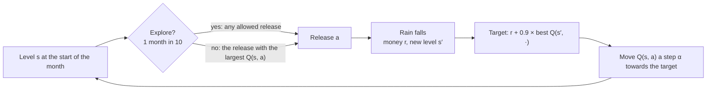
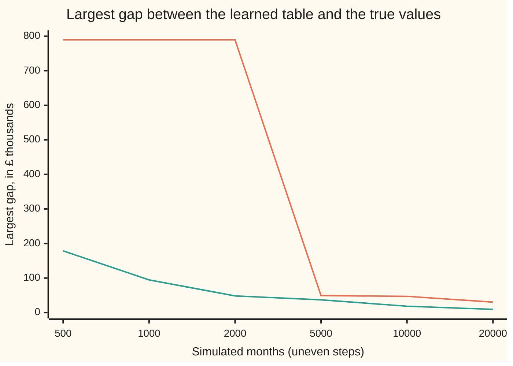

# Q-learning: learning the values by trying, without knowing the model

[Syllabus](../../../SYLLABUS.md) → [Optimization](../README.md) → [Dynamic Programming and Learning](../README.md#s07) → Q-learning

---

## General Overview

A hydro reservoir holds up to 40 million m³ of water. Once a month its operator decides how much to send through the turbines: nothing, 10 million m³ or 20 million m³. Released water earns money: £80,000 for 10 million m³, £120,000 for 20 million m³.

Then the month's rain arrives. If the reservoir overflows, the spilled water floods land downstream at £100,000 per 10 million m³. If it ends a month empty, the town's supply must be bought in at £120,000. The operator wants the rule, "at this level, release this much", that **maximises** the money earned over the years ahead, with next month's pound counted as 90p today.

The earlier cards on this shelf solve problems of this kind when the rain's chances are written down ([Value and policy iteration](03-value-and-policy-iteration.md)). This reservoir has its own numbers, and nobody has written its chances down. There is only a simulator: hand it a level and a release, and it plays out one month of rain and reports the money and the new level.

This card runs it for 20,000 simulated months. A table with one cell per pair (level, release) starts at zero. After each month, one cell is nudged towards what that month suggests it should be. After 20,000 months the table picks the same rule that the full model proves best: hold the water at 0 to 10 million m³, release 10 million m³ at 20 or 30 million m³, release 20 million m³ when full.

That method is **Q-learning**. It needs no chances, only experience. The price is that the operator must sometimes try a release it believes is worse, to find out whether it is. Here exploring, together with the early wrong guesses, costs £5.19k (thousand pounds) a month against the best rule while the table learns.

**Q-learning keeps a table of the value of each action in each state, and after every step moves one entry a small way towards "the money just earned plus the discounted value of the best action from where you landed"; at the true values those targets average to the values themselves, and from any other table they average to one sweep of value iteration, which shrinks the worst error by at least the factor 0.9; so with every pair tried often enough and steps that shrink at the right speed, the table settles on the true values and the best rule.**

**What kind of fact this is:** a method; that it converges is a theorem stated on this card with its sources (Watkins and Dayan, 1992; Tsitsiklis, 1994), not proved here. The reservoir is a model, and the rule the table learns is certified best for that model by a full enumeration of all 54 rules.

### The picture: one month of learning



The loop never consults the chances of rain. They act only through the months the simulator plays out.

---

## The formula

The shelf's notation comes from [Markov decision processes](02-markov-decision-processes.md): state $s$, action $a$, reward $r$, discount $\gamma$, rule (policy) $\pi$. This card introduces one new object, in words first.

The **Q-value** $Q^{*}(s, a)$ is the money, counted in today's pounds, that you can expect if you take action $a$ in state $s$ now and then follow the best rule ever after. The learning table holds a running estimate of it, written $Q(s, a)$. Money on this card is in thousands of pounds, written £k.

In the reservoir a unit is 10 million m³. The level $s$ is 0 to 4 units, the release $a$ is 0, 1 or 2 units and never more than $s$, and the rain $w$ is 0, 1 or 2 units with chances 30%, 40% and 30%. The next level is $s' = \min(s - a + w,\ 4)$, and anything above 4 spills.

The Q-learning update, after one month that started at $s$, released $a$, earned $r$ and ended at $s'$:

$$Q(s, a) \;\leftarrow\; Q(s, a) + \alpha_n \Big[\, \underbrace{r + \gamma \max_{a'} Q(s', a')}_{\text{target}} \;-\; Q(s, a) \Big]$$

**Read it aloud:** take the money just earned, add 0.9 times the best value available from the new level, and move the old estimate a fraction $\alpha_n$ of the way towards that.

The bracket is the **temporal difference** (TD) error, written $\delta$: the gap between what the table said this month was worth and what one month of experience suggests. Here $\max_{a'}$ means "the largest over all releases $a'$ allowed at $s'$". The same update with a fixed rule $\pi$ and one value per state is **TD(0)**, which judges a rule instead of improving it:

$$V^{\pi}(s) \;\leftarrow\; V^{\pi}(s) + \alpha_n \big[\, r + \gamma V^{\pi}(s') - V^{\pi}(s) \big]$$

The step size used throughout is $\alpha_n = 10/(9 + n)$, where $n$ counts the visits to that cell, this one included: 1 on the first visit, 0.909 on the second, then slowly shrinking.

| Symbol | Plain meaning | In our example | Push it up and the answer… |
| --- | --- | --- | --- |
| $s$, $s'$ | water level now, and at the end of the month | 2 units (20 million m³), then 1, 2 or 3 | more water is worth more: best value 533.20 when empty, 811.31 when full |
| $a$, $a'$ | the release: the action chosen; $a'$, a release allowed at the new level | 1 unit at level 2 | — |
| $w$, $p(w)$ | the month's rain and its chance | 0, 1, 2 units at 30%, 40%, 30% | — |
| $r$ | the month's money: revenue minus spill and empty penalties | £80k for releasing 1 unit | — |
| $\gamma$ | the discount: next month's pound is worth 0.9 today | 0.9 | the rule looks further ahead; at 0.5 it releases more |
| $\pi$, $\pi^{*}$ | a rule giving the release at each level; the best rule | `[0, 0, 1, 1, 2]` for levels 0 to 4 | — |
| $Q(s, a)$ | the learned table entry: the running estimate of $Q^{*}(s, a)$ | 711.28 for level 2, release 1 | — |
| $Q^{*}(s, a)$, $e$ | the true value of doing $a$ at $s$, then playing best; $e$, the table's largest gap from it | 720.69 for level 2, release 1; $e$ = 30.36 after 20,000 months | — |
| $\alpha_n$, $n$, $m_n$, $x_n$ | step size, and the number of visits to the cell; in Step 3, the mean of the first $n$ targets, and the $n$-th target | 10/(9 + n): 1, then 0.909, … | faster reaction, more noise |
| $\varepsilon$ | exploration rate: the chance of a random release | 10% | a trade: too low and the table locks in wrong values; too high and money is lost while learning |
| $\delta$ | the TD error: target minus current estimate | −64.07, 7.93 or 53.49 at $Q^{*}$ | — |
| $V^{\pi}(s)$, $V^{*}(s)$ | value of following rule $\pi$ from level $s$; the best value, the largest $Q^{*}(s, a)$ in the row | 601.09 at level 2 for "release 1 if you can"; 720.69 for the best rule | — |

### When it holds

- **The level is the whole state.** The update assumes next month depends only on this month's level and release. If rain followed the seasons, one table cell would average wet and dry months, and the learned rule would suit neither.
- **Every pair is tried again and again.** A cell that is never revisited keeps its first, possibly unlucky, value. With no exploring, the code's table ends £789.38k wrong in one cell and picks the wrong release at two levels.
- **Steps shrink, but not too fast.** The steps for each cell must add up to infinity (so the table can travel any distance) while their squares add up to a finite number (so the noise dies out). A constant step never stops jittering. The plain average, $\alpha_n = 1/n$, meets both conditions but is so slow here that after 20,000 months the table is still £363.28k out.
- **Discount below 1, money bounded.** At $\gamma = 1$ the Bellman operator (one sweep of value iteration) no longer shrinks distances ([The Bellman operator contracts](04-the-bellman-operator-as-a-contraction.md)), and the guarantee goes.
- **The table fits in memory.** Here it has 12 cells. A problem with millions of states needs a fitted function in place of the table, and then the convergence theorem no longer applies.

---

## Why it works

### Step 0: a value is an average, and averages can be learned by sampling

The true value $Q^{*}(2, 1)$ is an average over the rain: each kind of month weighted by its chance. An average can be estimated without knowing the chances, by collecting many samples and averaging them ([Law of large numbers](../../09-Probability%20and%20statistics/06-Limit%20Theorems%20in%20Practice/01-law-of-large-numbers.md)). Q-learning applies that idea to the Bellman equation. The single twist is that each sample contains the table itself.

### Step 1: the Bellman equation, written for Q

[Value and policy iteration](03-value-and-policy-iteration.md) finds the best values $V^{*}(s)$ from the model. Write the same equation one action at a time. Doing $a$ at $s$ earns this month's money, then lands at $s'$, where the best you can do is $\max_{a'} Q^{*}(s', a')$:

$$Q^{*}(s, a) = \sum_{w} p(w)\,\Big[\, r(s, a, w) + \gamma \max_{a'} Q^{*}(s', a') \Big]$$

Here $r(s, a, w)$ is the money in a month with rain $w$. The best rule reads straight off the table: at each level, pick the release with the largest $Q^{*}$. That is why the method learns Q and not V. Choosing the best action from V needs the chances, $\sum_w p(w)[\dots]$, in every decision. Choosing from Q needs only a comparison along one row.

### Step 2: at the true values, the TD error averages to zero

Put $Q^{*}$ into the target. The target becomes one sample from inside the sum of Step 1, so its average is $Q^{*}(s, a)$ itself. At level 2 with a release of 1 unit, the three kinds of month give TD errors of −64.07, +7.93 and +53.49 (worked below), and weighted by 30%, 40% and 30% they cancel. So $Q^{*}$ is the one table where the updates stop pushing on average. Any other table gets pushed.

### Step 3: the update is a running average

With $\alpha_n = 1/n$ the update is exactly the running mean. If $m_{n-1}$ is the mean of the first $n - 1$ targets $x_1, \dots, x_{n-1}$, then

$$m_{n-1} + \tfrac{1}{n}\,(x_n - m_{n-1}) = \tfrac{1}{n}\,\big((n-1)\,m_{n-1} + x_n\big) = m_n .$$

If the targets were fresh draws from a fixed law, the law of large numbers would finish the proof. They are not fixed: each target uses the current table, which is still wrong.

Two facts rescue the method. The Bellman operator shrinks the table's largest error by the factor $\gamma = 0.9$ ([The Bellman operator contracts](04-the-bellman-operator-as-a-contraction.md)), so targets built from a table that is $e$ out are on average at most $0.9e$ out. The noise, meanwhile, is averaged away by the shrinking steps. Error contracts, noise averages, and the two together drive the table to $Q^{*}$.

### Step 4: the convergence theorem, stated

The theorem (Watkins and Dayan, 1992; Tsitsiklis, 1994; Jaakkola, Jordan and Singh, 1994) is stated here and not proved. Suppose:

- the states and actions are finite, and the money each month is bounded;
- $\gamma < 1$;
- every pair $(s, a)$ is updated infinitely often;
- for each pair, the steps satisfy $\sum_n \alpha_n = \infty$ and $\sum_n \alpha_n^2 < \infty$.

Then the table converges to $Q^{*}$ with probability 1, whatever the starting table. The step conditions are those of the Robbins–Monro method for finding where an average is zero (1951). The card's $\alpha_n = 10/(9 + n)$ meets them: it shrinks like $10/n$, whose sum grows like a logarithm without limit, while the sum of its squares stays finite.

The theorem promises nothing about speed. The code therefore prints the error at six checkpoints. And it says nothing about how the actions are chosen, only that every pair keeps being tried.

### Step 5: exploring, and learning one rule while following another

The target always uses the best next action, $\max_{a'}$, whatever the operator actually does next month. So the table learns the values of the best rule, even while the operator behaves differently. This is called **off-policy** learning. It means the operator is free to explore. The rule used here is **ε-greedy**: in 90% of months take the greedy release, the one with the largest Q, and in 10% take a random allowed release. Every pair keeps being tried, which is the third condition of Step 4.

Exploring has a cost, paid in money while learning. Exploiting (using the current best guess) has a cost too: wrong guesses are never corrected. The table at the end of "How the table fills in, month by month" puts numbers on both.

### Step 6: TD(0) is the same idea for a fixed rule

Fix a rule $\pi$ and drop the max. The value of following $\pi$ solves $V^{\pi}(s) = \sum_w p(w)\,[\,r + \gamma V^{\pi}(s')\,]$, which is five linear equations in five unknowns. TD(0) samples it, exactly as Q-learning samples Step 1. The code judges the rule "release 1 unit whenever you can" both ways. Solving the equations by elimination gives 601.09 at level 2. TD(0) gives 609.00 after 20,000 months, and the worst gap over the five levels is 14.50.

---

## Worked numbers, by hand

The table at the true values, level 2, release 1 unit. Each kind of month earns £80k and ends at level 1, 2 or 3, whose best values are 640.69, 720.69 and 771.31.

| Step | Arithmetic | Value |
| --- | --- | --- |
| dry month (30%) | 80 + 0.9 × 640.69 | target 656.62, TD error −64.07 |
| average month (40%) | 80 + 0.9 × 720.69 | target 728.62, TD error 7.93 |
| wet month (30%) | 80 + 0.9 × 771.31 | target 774.18, TD error 53.49 |
| weight by the chances | 196.99 + 291.45 + 232.25 | 720.69 |
| compare with the other releases at level 2 | hold: 691.31; release 2 units: 653.20 | **release 1 unit: £720.69k** |

Starting at 20 million m³, releasing 10 million m³ this month and playing the best rule afterwards is worth £720.69k in today's money. Holding is worth only 691.31, and releasing 20 million m³ only 653.20.

One real update from the learning run. In month 2 the reservoir was full, the table was all zeros, and the greedy choice was to hold. One unit of rain spilled: $r = -100$. Target $= -100 + 0.9 \times 0 = -100$. First visit, so $\alpha = 1$, and $Q(4, 0)$ became −100.00.

### What breaks if you drop a piece

| Mistake | Comes out at | What went wrong |
| --- | --- | --- |
| Never explore ($\varepsilon = 0$) | rule `[0, 0, 0, 0, 2]`, wrong at levels 2 and 3; worst cell £789.38k out | Whichever release paid first at a level is never challenged, so the untried ones stay at 0 |
| Plain average, $\alpha_n = 1/n$ | worst cell still £363.28k out after 20,000 months | Early targets, built on an all-zero table, keep weight $1/n$ forever and are forgotten too slowly |
| Drop the future: target $= r$ only | rule `[0, 1, 2, 2, 2]`, worth £372.00k from level 2 against £720.69k | It learns this month's money and drains the reservoir, then pays the £120k empty penalty again and again |

The first row is the hypothesis "every pair tried infinitely often" failing. The second satisfies the theorem and still fails in practice: a guarantee of convergence is not a guarantee of speed.

---

## How the table fills in, month by month

The puzzle: the table starts at zero, and each month changes only one of its 12 cells. How does a correct table, and a correct rule, come out of that?

### The first six months

| Month | Level | Release | Rain | Money (£k) | New level | Target | Step α | Cell becomes |
| ---: | ---: | ---: | ---: | ---: | ---: | ---: | ---: | ---: |
| 1 | 2 | 0 | 2 | 0 | 4 | 0.00 | 1.000 | 0.00 |
| 2 | 4 | 0 | 1 | −100 | 4 | −100.00 | 1.000 | −100.00 |
| 3 | 4 | 1 | 2 | −20 | 4 | −20.00 | 1.000 | −20.00 |
| 4 | 4 | 2 | 1 | 120 | 3 | 120.00 | 1.000 | 120.00 |
| 5 | 3 | 0 | 0 | 0 | 3 | 0.00 | 1.000 | 0.00 |
| 6 | 3 | 0 | 0 | 0 | 3 | 0.00 | 0.909 | 0.00 |

Ties go to the smaller release, so at first the greedy operator holds. A spill in month 2 makes holding at full look bad. A smaller spill in month 3 makes releasing 1 unit look bad too, at −20. Month 4 releases 2 units and earns £120k.

From then on, release 2 is the greedy choice at full, and the −20 for release 1 sticks until exploring revisits it. That single unlucky month is the £789.38k error in the no-exploring run: there $Q(4, 1)$ stays at −20 against a true 769.38.

### Where the 20,000 months went

Each `#` is 250 visits to a cell; ε-greedy at 10%, seed 1.

```
level 0, hold           |#                            202
level 1, hold           |##############               3459
level 1, release 1      |#                            228
level 2, hold           |#                            273
level 2, release 1      |##########################   6617
level 2, release 2      |#                            257
level 3, hold           |#                            242
level 3, release 1      |###################          4854
level 3, release 2      |######                       1411
level 4, hold           |                             77
level 4, release 1      |                             90
level 4, release 2      |#########                    2290
```

Exploiting sends most months down the best rule's cells. Exploring keeps a trickle through every other cell, and those cells are the slowest to settle: level 4 with release 1 had only 90 visits in 20,000 months.

### The error as the months pass



Orange: the worst of all 12 cells. Green: the worst of the five cells the best rule uses. The orange line sits at 789.38 until exploring revisits level 4 with release 1, between month 2,000 and month 5,000. The green line roughly halves each time the months double, from 178.63 at 500 months to 9.40 at 20,000. The cells that matter for the decision settle first.

### Exploring against exploiting

Each row is a fresh 20,000-month run from seed 1. The best rule earns £74.00k a month in the long run.

| Exploration ε | Earned while learning (£k a month) | Short of the best | Worst cell error | Levels with the right release |
| ---: | ---: | ---: | ---: | ---: |
| 0% | 42.74 | 31.26 | 789.38 | 3 of 5 |
| 10% | 68.81 | 5.19 | 30.36 | 5 of 5 |
| 30% | 62.96 | 11.04 | 8.47 | 5 of 5 |
| 100% | 35.49 | 38.51 | 13.87 | 5 of 5 |

Never exploring is the worst of both worlds: the operator earns little and learns a wrong rule. Exploring all the time learns a good table but earns least, because a random release is often a bad one. Between them sits the trade: 10% gives up £5.19k a month and finds the right rule, while 30% gives up more money for a more accurate table.

---

## Code, from first principles, and it actually runs

The code builds the reservoir model and takes four roads.

- Road 1 is value iteration on the known model; it gives $Q^{*}$ and its Bellman residual, the largest amount by which $Q^{*}$ misses the equation of Step 1.
- Road 2 lists all 54 rules, solves each one's five linear equations by elimination, and confirms that one rule is best at every level and matches road 1: that is the certificate of optimality.
- Road 3 is Q-learning on 20,000 simulated months. It never reads the chances of rain, only the simulator's draws, and it must find the same rule.
- Road 4 is TD(0) on the rule "release 1 if you can", checked against road 2's exact solve.

Random numbers come from SplitMix64, a small generator written out in both languages with stated seeds, so the two programs print identical output.

### Python

```python
# Q-learning and temporal differences -- the check behind the card.  Standard
# library only.  A reservoir holds 0-4 units (1 unit = 10 million m3); each month
# it releases 0, 1 or 2 units, rain adds 0, 1 or 2.  Maximise discounted money,
# in GBP thousands.  Roads: (1) value iteration on the known model; (2) every one
# of the 54 rules, each solved exactly by elimination; (3) Q-learning from
# 20000 simulated months that never sees the model; (4) TD(0) against (2).
CAP, G, REV, SPILL, EMPTY = 4, 0.9, [0, 80, 120], 100, 120
RAIN = [(0, 0.3), (1, 0.4), (2, 0.3)]        # inflow units and their chances
M64 = (1 << 64) - 1
class SplitMix64:                            # the card's random numbers, seeded
    def __init__(self, seed): self.x = seed
    def next(self):
        self.x = (self.x + 0x9E3779B97F4A7C15) & M64
        z = ((self.x ^ (self.x >> 30)) * 0xBF58476D1CE4E5B9) & M64
        z = ((z ^ (z >> 27)) * 0x94D049BB133111EB) & M64
        return z ^ (z >> 31)
def acts(s): return range(min(s, 2) + 1)    # cannot release water not held
def step(s, a, w):                           # one month: release, rain, spill
    x = s - a + w
    s2 = min(x, CAP)
    return REV[a] - SPILL * max(x - CAP, 0) - (EMPTY if s2 == 0 else 0), s2
def best(Q, s):                              # greedy action, ties to less water
    b = 0
    for a in acts(s):
        if Q[s][a] > Q[s][b]: b = a
    return b
def backup(Q, s, a, g):                      # sum over rain of r + g max Q(s')
    tot = 0.0
    for w, p in RAIN:
        r, s2 = step(s, a, w)
        tot += p * (r + g * Q[s2][best(Q, s2)])
    return tot
def value_iteration(g):
    Q, k = [[0.0] * 3 for _ in range(5)], 0
    while True:
        N = [[backup(Q, s, a, g) if a <= s else 0.0 for a in range(3)] for s in range(5)]
        k, d = k + 1, max(abs(N[s][a] - Q[s][a]) for s in range(5) for a in acts(s))
        Q = N
        if d < 1e-9: return Q, k
def evaluate(pol):                           # solve (I - g P) V = r by elimination
    A = [[0.0] * 6 for _ in range(5)]
    for s in range(5):
        A[s][s] += 1.0
        for w, p in RAIN:
            r, s2 = step(s, pol[s], w)
            A[s][s2] -= G * p
            A[s][5] += p * r
    for c in range(5):
        piv = max(range(c, 5), key=lambda i: abs(A[i][c]))
        A[c], A[piv] = A[piv], A[c]
        for i in range(c + 1, 5):
            f = A[i][c] / A[c][c]
            A[i] = [A[i][j] - f * A[c][j] for j in range(6)]
    V = [0.0] * 5
    for i in range(4, -1, -1):
        V[i] = (A[i][5] - sum(A[i][j] * V[j] for j in range(i + 1, 5))) / A[i][i]
    return V
def learn(eps, seed, months, c=10, myopic=False, trace=0, marks=()):
    rng, s, earned = SplitMix64(seed), 2, 0.0
    Q, n, errs = [[0.0] * 3 for _ in range(5)], [[0] * 3 for _ in range(5)], []
    for t in range(1, months + 1):
        if rng.next() % 100 < eps: a = rng.next() % (min(s, 2) + 1)   # explore
        else: a = best(Q, s)                                           # exploit
        u = rng.next() % 10
        w = 0 if u < 3 else (1 if u < 7 else 2)
        r, s2 = step(s, a, w)
        earned += r
        n[s][a] += 1
        alpha = c / (c - 1 + n[s][a]) if c else 1.0 / n[s][a]
        target = r + (0.0 if myopic else G * Q[s2][best(Q, s2)])
        old = Q[s][a]
        Q[s][a] += alpha * (target - Q[s][a])
        if t <= trace:
            print(f"trace,{t},{s},{a},{w},{r},{s2},{old:.2f},{target:.2f},{alpha:.3f},{Q[s][a]:.2f}")
        if t in marks: errs.append((t, err(Q), max(abs(Q[x][PI[x]] - QS[x][PI[x]]) for x in range(5))))
        s = s2
    return Q, n, earned / months, errs
def err(Q): return max(abs(Q[s][a] - QS[s][a]) for s in range(5) for a in acts(s))
f2 = lambda v: f"{v:.2f}"
QS, sweeps = value_iteration(G)
PI = [best(QS, s) for s in range(5)]
for s in range(5):
    print(f"Q*,s={s}," + ",".join(f2(QS[s][a]) for a in acts(s)) + f",best={PI[s]}")
res = max(abs(backup(QS, s, a, G) - QS[s][a]) for s in range(5) for a in acts(s))
print(f"value iteration: {sweeps} sweeps from Q=0 to change < 1e-9; Bellman residual < 1e-6: {res < 1e-6}")
for w, p in RAIN:                                # by hand: targets at Q*, level 2, release 1
    r, s2 = step(2, 1, w)
    tg = r + G * QS[s2][PI[s2]]
    print(f"hand,rain {w},chance {p},next level {s2},target {tg:.2f},TD error {tg - QS[2][1]:.2f},weighted {p * tg:.2f}")
rules = [[0, a1, a2, a3, a4] for a1 in range(2) for a2 in range(3) for a3 in range(3) for a4 in range(3)]
vals = [evaluate(p) for p in rules]
top = max(range(len(rules)), key=lambda i: sum(vals[i]))
dom = all(vals[top][s] >= vals[i][s] - 1e-9 for i in range(len(rules)) for s in range(5))
gapv = max(abs(vals[top][s] - QS[s][PI[s]]) for s in range(5))
print(f"enumeration: {len(rules)} rules, best {rules[top]}, best in every state {dom}, matches value iteration {gapv < 1e-6}")
d = [0.2] * 5                                    # long-run share of months per level
for _ in range(2000):
    nd = [0.0] * 5
    for s in range(5):
        for w, p in RAIN: nd[step(s, PI[s], w)[1]] += d[s] * p
    d = nd
avg = sum(d[s] * p * step(s, PI[s], w)[0] for s in range(5) for w, p in RAIN)
print(f"best rule earns on average {avg:.2f} per month in the long run")
MARKS = (500, 1000, 2000, 5000, 10000, 20000)
Q, n, earned, errs = learn(10, 1, 20000, trace=6, marks=MARKS)
for s in range(5):
    print(f"learned,s={s}," + ",".join(f2(Q[s][a]) for a in acts(s)) + f",best={best(Q, s)}")
print("visits," + ",".join(f"{s}{a}:{n[s][a]}" for s in range(5) for a in acts(s)))
for t, e1, e2 in errs: print(f"error after {t} months: all pairs {e1:.2f}, chosen pairs {e2:.2f}")
LP = [best(Q, s) for s in range(5)]
print(f"learned rule {LP}, true rule {PI}, earned {earned:.2f} per month while learning")
for eps in (0, 10, 30, 100):
    q, _, e, _ = learn(eps, 1, 20000)
    right = sum(best(q, s) == PI[s] for s in range(5))
    print(f"explore {eps}%: earned {e:.2f}/month, short of best {avg - e:.2f}, max error {err(q):.2f}, "
          f"levels right {right}/5, rule {[best(q, s) for s in range(5)]}")
q1 = learn(10, 1, 20000, c=0)[0]
qm = learn(10, 1, 20000, myopic=True)[0]
pm = [best(qm, s) for s in range(5)]
print(f"break, step 1/n: max error {err(q1):.2f}; drop the future: rule {pm}, "
      f"worth {evaluate(pm)[2]:.2f} from level 2 against {QS[2][PI[2]]:.2f}")
print("seeds 2 and 3: max error " + ", ".join(f2(err(learn(10, sd, 20000)[0])) for sd in (2, 3)))
for g in (0.5, 0.99): print(f"gamma {g}: best rule {[best(value_iteration(g)[0], s) for s in range(5)]}")
HOLD1 = [min(s, 1) for s in range(5)]          # TD(0): judge 'release 1 if you can'
VE, V, nv, rng, s = evaluate(HOLD1), [0.0] * 5, [0] * 5, SplitMix64(7), 2
for t in range(20000):
    u = rng.next() % 10
    r, s2 = step(s, HOLD1[s], 0 if u < 3 else (1 if u < 7 else 2))
    nv[s] += 1
    V[s] += 10 / (9 + nv[s]) * (r + G * V[s2] - V[s])
    s = s2
print("TD(0) release-1 rule: exact " + ",".join(map(f2, VE)) + "; TD " + ",".join(map(f2, V)))
tde = max(abs(V[s] - VE[s]) for s in range(5))
print(f"TD(0) max error {tde:.2f}")
assert res < 1e-6 and dom and gapv < 1e-6 and rules[top] == PI      # road 1 = road 2
assert LP == PI and errs[-1][2] < 0.05 * QS[2][PI[2]]                # road 3 agrees
assert err(learn(0, 1, 20000)[0]) > 100 and pm != PI                 # the breaks bite
assert tde < 0.05 * min(VE)                                          # road 4 agrees
print("ALL CHECKS PASS")
```

**Ran 2026-11-11 on macOS, Python 3.14.10, standard library only. All checks passed. Output, pasted from the run:**

```
Q*,s=0,533.20,best=0
Q*,s=1,640.69,613.20,best=0
Q*,s=2,691.31,720.69,653.20,best=1
Q*,s=3,689.38,771.31,760.69,best=1
Q*,s=4,630.18,769.38,811.31,best=2
value iteration: 239 sweeps from Q=0 to change < 1e-9; Bellman residual < 1e-6: True
hand,rain 0,chance 0.3,next level 1,target 656.62,TD error -64.07,weighted 196.99
hand,rain 1,chance 0.4,next level 2,target 728.62,TD error 7.93,weighted 291.45
hand,rain 2,chance 0.3,next level 3,target 774.18,TD error 53.49,weighted 232.25
enumeration: 54 rules, best [0, 0, 1, 1, 2], best in every state True, matches value iteration True
best rule earns on average 74.00 per month in the long run
trace,1,2,0,2,0,4,0.00,0.00,1.000,0.00
trace,2,4,0,1,-100,4,0.00,-100.00,1.000,-100.00
trace,3,4,1,2,-20,4,0.00,-20.00,1.000,-20.00
trace,4,4,2,1,120,3,0.00,120.00,1.000,120.00
trace,5,3,0,0,0,3,0.00,0.00,1.000,0.00
trace,6,3,0,0,0,3,0.00,0.00,0.909,0.00
learned,s=0,532.49,best=0
learned,s=1,634.15,616.27,best=0
learned,s=2,690.90,711.28,683.56,best=1
learned,s=3,680.72,762.80,741.86,best=1
learned,s=4,626.00,752.65,805.33,best=2
visits,00:202,10:3459,11:228,20:273,21:6617,22:257,30:242,31:4854,32:1411,40:77,41:90,42:2290
error after 500 months: all pairs 789.38, chosen pairs 178.63
error after 1000 months: all pairs 789.38, chosen pairs 94.68
error after 2000 months: all pairs 789.38, chosen pairs 48.29
error after 5000 months: all pairs 49.31, chosen pairs 36.95
error after 10000 months: all pairs 47.14, chosen pairs 18.55
error after 20000 months: all pairs 30.36, chosen pairs 9.40
learned rule [0, 0, 1, 1, 2], true rule [0, 0, 1, 1, 2], earned 68.81 per month while learning
explore 0%: earned 42.74/month, short of best 31.26, max error 789.38, levels right 3/5, rule [0, 0, 0, 0, 2]
explore 10%: earned 68.81/month, short of best 5.19, max error 30.36, levels right 5/5, rule [0, 0, 1, 1, 2]
explore 30%: earned 62.96/month, short of best 11.04, max error 8.47, levels right 5/5, rule [0, 0, 1, 1, 2]
explore 100%: earned 35.49/month, short of best 38.51, max error 13.87, levels right 5/5, rule [0, 0, 1, 1, 2]
break, step 1/n: max error 363.28; drop the future: rule [0, 1, 2, 2, 2], worth 372.00 from level 2 against 720.69
seeds 2 and 3: max error 36.19, 15.92
gamma 0.5: best rule [0, 1, 1, 2, 2]
gamma 0.99: best rule [0, 0, 1, 1, 2]
TD(0) release-1 rule: exact 419.18,499.18,601.09,629.34,594.39; TD 433.68,503.97,609.00,637.83,604.82
TD(0) max error 14.50
ALL CHECKS PASS
```

### Rust

The same roads, the same seeds, the same output, built with `rustc --edition 2021 -O`.

```rust
// Q-learning and temporal differences -- the same check as the Python, in Rust.
// No crates.  A reservoir holds 0-4 units (1 unit = 10 million m3); each month it
// releases 0, 1 or 2 units, rain adds 0, 1 or 2.  Maximise discounted money, in
// GBP thousands.  Roads: (1) value iteration on the known model; (2) every one of
// the 54 rules, each solved exactly by elimination; (3) Q-learning from 20000
// simulated months that never sees the model; (4) TD(0) against (2).
const CAP: usize = 4; const G: f64 = 0.9; const REV: [i64; 3] = [0, 80, 120];
const SPILL: i64 = 100; const EMPTY: i64 = 120;
const RAIN: [(usize, f64); 3] = [(0, 0.3), (1, 0.4), (2, 0.3)]; // inflow units, chances
type Tab = [[f64; 3]; 5];
struct SplitMix64 { x: u64 }                     // the card's random numbers, seeded
impl SplitMix64 {
    fn next(&mut self) -> u64 {
        self.x = self.x.wrapping_add(0x9E3779B97F4A7C15);
        let mut z = (self.x ^ (self.x >> 30)).wrapping_mul(0xBF58476D1CE4E5B9);
        z = (z ^ (z >> 27)).wrapping_mul(0x94D049BB133111EB);
        z ^ (z >> 31)
    }
}
fn na(s: usize) -> usize { s.min(2) + 1 }        // cannot release water not held
fn step(s: usize, a: usize, w: usize) -> (i64, usize) {   // release, rain, spill
    let (x, s2) = (s - a + w, (s - a + w).min(CAP));
    let spill = if x > CAP { (x - CAP) as i64 } else { 0 };
    (REV[a] - SPILL * spill - if s2 == 0 { EMPTY } else { 0 }, s2)
}
fn best(q: &Tab, s: usize) -> usize {            // greedy action, ties to less water
    (0..na(s)).fold(0, |b, a| if q[s][a] > q[s][b] { a } else { b })
}
fn backup(q: &Tab, s: usize, a: usize, g: f64) -> f64 {   // sum of r + g max Q(s')
    let mut tot = 0.0;
    for &(w, p) in RAIN.iter() {
        let (r, s2) = step(s, a, w);
        tot += p * (r as f64 + g * q[s2][best(q, s2)]);
    }
    tot
}
fn value_iteration(g: f64) -> (Tab, usize) {
    let (mut q, mut k) = ([[0.0; 3]; 5], 0);
    loop {
        let (mut n, mut d) = ([[0.0; 3]; 5], 0.0f64);
        for s in 0..5 { for a in 0..na(s) {
            n[s][a] = backup(&q, s, a, g);
            d = d.max((n[s][a] - q[s][a]).abs());
        } }
        k += 1; q = n;
        if d < 1e-9 { return (q, k); }
    }
}
fn evaluate(pol: &[usize]) -> Vec<f64> {         // solve (I - g P) V = r by elimination
    let mut m = [[0.0f64; 6]; 5];
    for s in 0..5 {
        m[s][s] += 1.0; for &(w, p) in RAIN.iter() {
            let (r, s2) = step(s, pol[s], w);
            m[s][s2] -= G * p; m[s][5] += p * r as f64;
        } }
    for c in 0..5 {
        let piv = (c..5).fold(c, |b, i| if m[i][c].abs() > m[b][c].abs() { i } else { b });
        m.swap(c, piv);
        for i in c + 1..5 {
            let f = m[i][c] / m[c][c];
            for j in 0..6 { m[i][j] = m[i][j] - f * m[c][j]; }
        }
    }
    let mut v = vec![0.0; 5];
    for i in (0..5).rev() {
        let sum = ((i + 1)..5).fold(0.0, |t, j| t + m[i][j] * v[j]);
        v[i] = (m[i][5] - sum) / m[i][i];
    }
    v
}
fn rain(u: u64) -> usize { if u < 3 { 0 } else if u < 7 { 1 } else { 2 } }
fn err(q: &Tab, qs: &Tab) -> f64 {
    (0..5).flat_map(|s| (0..na(s)).map(move |a| (s, a))).fold(0.0f64, |e, (s, a)| e.max((q[s][a] - qs[s][a]).abs()))
}
fn learn(eps: u64, seed: u64, months: usize, c: usize, myopic: bool, trace: usize, marks: &[usize],
         qs: &Tab, pi: &[usize]) -> (Tab, [[usize; 3]; 5], f64, Vec<(usize, f64, f64)>) {
    let (mut rng, mut s, mut earned) = (SplitMix64 { x: seed }, 2usize, 0.0);
    let (mut q, mut n, mut errs) = ([[0.0f64; 3]; 5], [[0usize; 3]; 5], vec![]);
    for t in 1..=months {
        let a = if rng.next() % 100 < eps { (rng.next() % na(s) as u64) as usize }  // explore
                else { best(&q, s) };                                               // exploit
        let w = rain(rng.next() % 10);
        let (r, s2) = step(s, a, w);
        earned += r as f64;
        n[s][a] += 1;
        let alpha = if c > 0 { c as f64 / (c - 1 + n[s][a]) as f64 } else { 1.0 / n[s][a] as f64 };
        let target = r as f64 + if myopic { 0.0 } else { G * q[s2][best(&q, s2)] };
        let old = q[s][a]; q[s][a] += alpha * (target - q[s][a]);
        if t <= trace { println!("trace,{},{},{},{},{},{},{:.2},{:.2},{:.3},{:.2}", t, s, a, w, r, s2, old, target, alpha, q[s][a]); }
        if marks.contains(&t) {
            let e2 = (0..5).fold(0.0f64, |m, x| m.max((q[x][pi[x]] - qs[x][pi[x]]).abs()));
            errs.push((t, err(&q, qs), e2));
        }
        s = s2;
    }
    (q, n, earned / months as f64, errs)
}
fn yes(b: bool) -> &'static str { if b { "True" } else { "False" } }
fn row(q: &Tab, s: usize) -> String { (0..na(s)).map(|a| format!("{:.2}", q[s][a])).collect::<Vec<_>>().join(",") }
fn main() {
    let (qs, sweeps) = value_iteration(G);
    let pi: Vec<usize> = (0..5).map(|s| best(&qs, s)).collect();
    for s in 0..5 { println!("Q*,s={},{},best={}", s, row(&qs, s), pi[s]); }
    let mut res: f64 = 0.0;
    for s in 0..5 { for a in 0..na(s) { res = res.max((backup(&qs, s, a, G) - qs[s][a]).abs()); } }
    println!("value iteration: {} sweeps from Q=0 to change < 1e-9; Bellman residual < 1e-6: {}", sweeps, yes(res < 1e-6));
    for &(w, p) in RAIN.iter() {                 // by hand: targets at Q*, level 2, release 1
        let (r, s2) = step(2, 1, w); let tg = r as f64 + G * qs[s2][pi[s2]];
        println!("hand,rain {},chance {},next level {},target {:.2},TD error {:.2},weighted {:.2}", w, p, s2, tg, tg - qs[2][1], p * tg);
    }
    let mut rules = vec![];
    for a1 in 0..2 { for a2 in 0..3 { for a3 in 0..3 { for a4 in 0..3 { rules.push(vec![0, a1, a2, a3, a4]); } } } }
    let vals: Vec<Vec<f64>> = rules.iter().map(|p| evaluate(p)).collect();
    let tot = |i: usize| vals[i].iter().fold(0.0, |t, v| t + v);
    let mut top = 0;
    for i in 0..rules.len() { if tot(i) > tot(top) { top = i; } }
    let dom = (0..rules.len()).all(|i| (0..5).all(|s| vals[top][s] >= vals[i][s] - 1e-9));
    let gapv = (0..5).fold(0.0f64, |m, s| m.max((vals[top][s] - qs[s][pi[s]]).abs()));
    println!("enumeration: {} rules, best {:?}, best in every state {}, matches value iteration {}",
             rules.len(), rules[top], yes(dom), yes(gapv < 1e-6));
    let mut d = [0.2f64; 5];                     // long-run share of months per level
    for _ in 0..2000 {
        let mut nd = [0.0; 5];
        for s in 0..5 { for &(w, p) in RAIN.iter() { nd[step(s, pi[s], w).1] += d[s] * p; } } d = nd;
    }
    let mut avg = 0.0; for s in 0..5 { for &(w, p) in RAIN.iter() { avg += d[s] * p * step(s, pi[s], w).0 as f64; } }
    println!("best rule earns on average {:.2} per month in the long run", avg);
    let marks = [500, 1000, 2000, 5000, 10000, 20000];
    let (q, n, earned, errs) = learn(10, 1, 20000, 10, false, 6, &marks, &qs, &pi);
    for s in 0..5 { println!("learned,s={},{},best={}", s, row(&q, s), best(&q, s)); }
    let mut vis = vec![];
    for s in 0..5 { for a in 0..na(s) { vis.push(format!("{}{}:{}", s, a, n[s][a])); } }
    println!("visits,{}", vis.join(","));
    for &(t, e1, e2) in errs.iter() { println!("error after {} months: all pairs {:.2}, chosen pairs {:.2}", t, e1, e2); }
    let lp: Vec<usize> = (0..5).map(|s| best(&q, s)).collect();
    println!("learned rule {:?}, true rule {:?}, earned {:.2} per month while learning", lp, pi, earned);
    for &eps in [0u64, 10, 30, 100].iter() {
        let (q2, _, e, _) = learn(eps, 1, 20000, 10, false, 0, &[], &qs, &pi);
        let right = (0..5).filter(|&s| best(&q2, s) == pi[s]).count();
        println!("explore {}%: earned {:.2}/month, short of best {:.2}, max error {:.2}, levels right {}/5, rule {:?}",
                 eps, e, avg - e, err(&q2, &qs), right, (0..5).map(|s| best(&q2, s)).collect::<Vec<_>>());
    }
    let q1 = learn(10, 1, 20000, 0, false, 0, &[], &qs, &pi).0;
    let qm = learn(10, 1, 20000, 10, true, 0, &[], &qs, &pi).0;
    let pm: Vec<usize> = (0..5).map(|s| best(&qm, s)).collect();
    println!("break, step 1/n: max error {:.2}; drop the future: rule {:?}, worth {:.2} from level 2 against {:.2}",
             err(&q1, &qs), pm, evaluate(&pm)[2], qs[2][pi[2]]);
    let sd: Vec<String> = [2u64, 3].iter().map(|&k| format!("{:.2}", err(&learn(10, k, 20000, 10, false, 0, &[], &qs, &pi).0, &qs))).collect();
    println!("seeds 2 and 3: max error {}", sd.join(", "));
    for &g in [0.5, 0.99].iter() {
        let qg = value_iteration(g).0;
        println!("gamma {}: best rule {:?}", g, (0..5).map(|s| best(&qg, s)).collect::<Vec<_>>());
    }
    let hold1: Vec<usize> = (0..5).map(|s: usize| s.min(1)).collect();   // TD(0): 'release 1 if you can'
    let (ve, mut v, mut nv, mut rng, mut s) = (evaluate(&hold1), [0.0f64; 5], [0usize; 5], SplitMix64 { x: 7 }, 2usize);
    for _ in 0..20000 {
        let (r, s2) = step(s, hold1[s], rain(rng.next() % 10));
        nv[s] += 1; v[s] += 10.0 / (9 + nv[s]) as f64 * (r as f64 + G * v[s2] - v[s]);
        s = s2; }
    let j = |x: &[f64]| x.iter().map(|y| format!("{:.2}", y)).collect::<Vec<_>>().join(",");
    println!("TD(0) release-1 rule: exact {}; TD {}", j(&ve), j(&v));
    let tde = (0..5).fold(0.0f64, |m, s| m.max((v[s] - ve[s]).abs()));
    println!("TD(0) max error {:.2}", tde);
    let minve = ve.iter().fold(f64::INFINITY, |m, &y| m.min(y));
    assert!(res < 1e-6 && dom && gapv < 1e-6 && rules[top] == pi);          // road 1 = road 2
    assert!(lp == pi && errs[errs.len() - 1].2 < 0.05 * qs[2][pi[2]]);       // road 3 agrees
    assert!(err(&learn(0, 1, 20000, 10, false, 0, &[], &qs, &pi).0, &qs) > 100.0 && pm != pi); // breaks bite
    assert!(tde < 0.05 * minve);                                             // road 4 agrees
    println!("ALL CHECKS PASS");
}
```

**Ran 2026-11-11 on macOS, rustc 1.98.1, no crates. All checks passed. Output, pasted from the run:**

```
Q*,s=0,533.20,best=0
Q*,s=1,640.69,613.20,best=0
Q*,s=2,691.31,720.69,653.20,best=1
Q*,s=3,689.38,771.31,760.69,best=1
Q*,s=4,630.18,769.38,811.31,best=2
value iteration: 239 sweeps from Q=0 to change < 1e-9; Bellman residual < 1e-6: True
hand,rain 0,chance 0.3,next level 1,target 656.62,TD error -64.07,weighted 196.99
hand,rain 1,chance 0.4,next level 2,target 728.62,TD error 7.93,weighted 291.45
hand,rain 2,chance 0.3,next level 3,target 774.18,TD error 53.49,weighted 232.25
enumeration: 54 rules, best [0, 0, 1, 1, 2], best in every state True, matches value iteration True
best rule earns on average 74.00 per month in the long run
trace,1,2,0,2,0,4,0.00,0.00,1.000,0.00
trace,2,4,0,1,-100,4,0.00,-100.00,1.000,-100.00
trace,3,4,1,2,-20,4,0.00,-20.00,1.000,-20.00
trace,4,4,2,1,120,3,0.00,120.00,1.000,120.00
trace,5,3,0,0,0,3,0.00,0.00,1.000,0.00
trace,6,3,0,0,0,3,0.00,0.00,0.909,0.00
learned,s=0,532.49,best=0
learned,s=1,634.15,616.27,best=0
learned,s=2,690.90,711.28,683.56,best=1
learned,s=3,680.72,762.80,741.86,best=1
learned,s=4,626.00,752.65,805.33,best=2
visits,00:202,10:3459,11:228,20:273,21:6617,22:257,30:242,31:4854,32:1411,40:77,41:90,42:2290
error after 500 months: all pairs 789.38, chosen pairs 178.63
error after 1000 months: all pairs 789.38, chosen pairs 94.68
error after 2000 months: all pairs 789.38, chosen pairs 48.29
error after 5000 months: all pairs 49.31, chosen pairs 36.95
error after 10000 months: all pairs 47.14, chosen pairs 18.55
error after 20000 months: all pairs 30.36, chosen pairs 9.40
learned rule [0, 0, 1, 1, 2], true rule [0, 0, 1, 1, 2], earned 68.81 per month while learning
explore 0%: earned 42.74/month, short of best 31.26, max error 789.38, levels right 3/5, rule [0, 0, 0, 0, 2]
explore 10%: earned 68.81/month, short of best 5.19, max error 30.36, levels right 5/5, rule [0, 0, 1, 1, 2]
explore 30%: earned 62.96/month, short of best 11.04, max error 8.47, levels right 5/5, rule [0, 0, 1, 1, 2]
explore 100%: earned 35.49/month, short of best 38.51, max error 13.87, levels right 5/5, rule [0, 0, 1, 1, 2]
break, step 1/n: max error 363.28; drop the future: rule [0, 1, 2, 2, 2], worth 372.00 from level 2 against 720.69
seeds 2 and 3: max error 36.19, 15.92
gamma 0.5: best rule [0, 1, 1, 2, 2]
gamma 0.99: best rule [0, 0, 1, 1, 2]
TD(0) release-1 rule: exact 419.18,499.18,601.09,629.34,594.39; TD 433.68,503.97,609.00,637.83,604.82
TD(0) max error 14.50
ALL CHECKS PASS
```

The two outputs match line for line.

### Lean

Lean proves the averaging and shrinking steps for every finite model, and checks the card's step sizes and hand arithmetic.

- Take any model with finitely many states, releases and kinds of month, chances that add up to 1, and a discount below 1.
- In that model, average the targets built from any table: that is one sweep of value iteration. Its worst gap from the true values is at most the discount times the table's worst gap.
- At the true values, the TD error averages to zero in every cell, so the updates stop pushing on average.
- The card's steps 10/(9 + n) add up to infinity, while their squares add up to a finite number.
- The first five months of the learning run, the update in month 2 and the step 0.909 (10/11) on a second visit all check exactly.
- So do the rain's chances adding to 1, the 12 cells, the 54 rules and the 20,000 visits.

The convergence theorem stays stated, not proved; the reservoir's values, the learning run and TD(0) are left to the Python and Rust checks.

```lean
-- Q-learning: the Q-learning targets average, at the true values, to the values themselves and, from any other table, to one sweep of value iteration that shrinks the worst error by the discount factor, and the card's step sizes 10/(9 + n) meet the Robbins–Monro conditions.
import Mathlib.Analysis.Normed.Group.Constructions
import Mathlib.Analysis.Normed.Order.Lattice
import Mathlib.Analysis.PSeries
import Mathlib.Algebra.Order.BigOperators.Group.Finset
import Mathlib.Data.Finset.Lattice.Fold

open Filter Topology

/-- The Q-learning target after one month: the money `r s a w` earned when the month's random
outcome (the rain) is `w`, plus `γ` times the best table entry at the level `next s a w` where
the month ends. Tables are `(s : S) → A s → ℝ`, one cell per state and allowed action. -/
noncomputable def qTarget {S W : Type*} {A : S → Type*} [∀ s, Fintype (A s)] [∀ s, Nonempty (A s)]
    (r : (s : S) → A s → W → ℝ) (next : (s : S) → A s → W → S) (γ : ℝ)
    (Q : (s : S) → A s → ℝ) (s : S) (a : A s) (w : W) : ℝ :=
  r s a w + γ * Finset.univ.sup' Finset.univ_nonempty (Q (next s a w))

/-- One sweep of value iteration for Q (the Bellman operator): each cell becomes the average of
its Q-learning targets, weighted by the chances `p w` of the outcomes. -/
noncomputable def qBellman {S W : Type*} [Fintype W] {A : S → Type*} [∀ s, Fintype (A s)]
    [∀ s, Nonempty (A s)] (p : W → ℝ) (r : (s : S) → A s → W → ℝ) (next : (s : S) → A s → W → S)
    (γ : ℝ) (Q : (s : S) → A s → ℝ) : (s : S) → A s → ℝ :=
  fun s a => ∑ w, p w * qTarget r next γ Q s a w

/-- Helper: the largest entries of two finite tables differ by at most the largest gap. -/
theorem sup'_sub_sup'_abs_le {ι : Type*} [Fintype ι] [Nonempty ι] (f g : ι → ℝ) :
    |Finset.univ.sup' Finset.univ_nonempty f - Finset.univ.sup' Finset.univ_nonempty g|
      ≤ ‖f - g‖ := by
  rw [abs_sub_le_iff]
  constructor
  · rw [sub_le_iff_le_add]
    apply Finset.sup'_le
    intro i _
    have h1 := norm_le_pi_norm (f - g) i
    rw [Pi.sub_apply, Real.norm_eq_abs] at h1
    have h2 := Finset.le_sup' g (Finset.mem_univ i)
    linarith [le_abs_self (f i - g i)]
  · rw [sub_le_iff_le_add]
    apply Finset.sup'_le
    intro i _
    have h1 := norm_le_pi_norm (f - g) i
    rw [Pi.sub_apply, Real.norm_eq_abs] at h1
    have h2 := Finset.le_sup' f (Finset.mem_univ i)
    linarith [neg_abs_le (f i - g i)]

#print axioms sup'_sub_sup'_abs_le

/-- The card's main claim: with finitely many states, a nonempty finite set of allowed actions in
each state, finitely many outcomes with chances that are non-negative and add up to 1, and a
discount `0 ≤ γ < 1`, let `Q*` be the true values (they satisfy the Bellman equation
`Q* = T Q*`). Then for any table `Q`, the targets built from `Q` average to one sweep `T Q`,
which is at most `γ` times as far from `Q*` in the worst cell: `‖T Q - Q*‖∞ ≤ γ ‖Q - Q*‖∞`.
(Mathlib's norm on tables over finite types is the sup norm, the largest gap over cells.) -/
theorem q_learning_target_shrinks_worst_error {S W : Type*} [Fintype S] [Fintype W]
    {A : S → Type*} [∀ s, Fintype (A s)] [∀ s, Nonempty (A s)]
    (p : W → ℝ) (r : (s : S) → A s → W → ℝ) (next : (s : S) → A s → W → S) (γ : ℝ)
    (hp_nonneg : ∀ w, 0 ≤ p w) (hp_sum : ∑ w, p w = 1) (hγ0 : 0 ≤ γ) (hγ1 : γ < 1)
    (Qstar : (s : S) → A s → ℝ) (hstar : qBellman p r next γ Qstar = Qstar)
    (Q : (s : S) → A s → ℝ) :
    ‖qBellman p r next γ Q - Qstar‖ ≤ γ * ‖Q - Qstar‖ := by
  have hr : 0 ≤ γ * ‖Q - Qstar‖ := mul_nonneg hγ0 (norm_nonneg _)
  rw [pi_norm_le_iff_of_nonneg hr]
  intro s
  rw [pi_norm_le_iff_of_nonneg hr]
  intro a
  have h := congrFun (congrFun hstar s) a
  rw [Pi.sub_apply, Pi.sub_apply, Real.norm_eq_abs, ← h]
  simp only [qBellman, qTarget]
  rw [← Finset.sum_sub_distrib]
  calc _ ≤ ∑ w, |p w * (r s a w + γ * Finset.univ.sup' Finset.univ_nonempty (Q (next s a w)))
          - p w * (r s a w + γ * Finset.univ.sup' Finset.univ_nonempty (Qstar (next s a w)))| :=
        Finset.abs_sum_le_sum_abs _ _
    _ ≤ ∑ w, p w * (γ * ‖Q - Qstar‖) := by
        apply Finset.sum_le_sum
        intro w _
        have e : p w * (r s a w + γ * Finset.univ.sup' Finset.univ_nonempty (Q (next s a w)))
            - p w * (r s a w + γ * Finset.univ.sup' Finset.univ_nonempty (Qstar (next s a w)))
            = p w * (γ * (Finset.univ.sup' Finset.univ_nonempty (Q (next s a w))
              - Finset.univ.sup' Finset.univ_nonempty (Qstar (next s a w)))) := by ring
        rw [e, abs_mul, abs_mul, abs_of_nonneg (hp_nonneg w), abs_of_nonneg hγ0]
        have h1 := sup'_sub_sup'_abs_le (Q (next s a w)) (Qstar (next s a w))
        have h2 := norm_le_pi_norm (Q - Qstar) (next s a w)
        rw [Pi.sub_apply] at h2
        exact mul_le_mul_of_nonneg_left (mul_le_mul_of_nonneg_left (h1.trans h2) hγ0)
          (hp_nonneg w)
    _ = γ * ‖Q - Qstar‖ := by rw [← Finset.sum_mul, hp_sum, one_mul]

/-- Step 2 of the card: at the true values `Q*` (a solution of the Bellman equation), the
temporal-difference error `δ = target - Q*(s, a)` averages to zero over the outcomes, in every
cell, so `Q*` is the table where the updates stop pushing on average. -/
theorem td_error_averages_to_zero_at_true_values {S W : Type*} [Fintype W]
    {A : S → Type*} [∀ s, Fintype (A s)] [∀ s, Nonempty (A s)]
    (p : W → ℝ) (r : (s : S) → A s → W → ℝ) (next : (s : S) → A s → W → S) (γ : ℝ)
    (hp_nonneg : ∀ w, 0 ≤ p w) (hp_sum : ∑ w, p w = 1)
    (Qstar : (s : S) → A s → ℝ) (hstar : qBellman p r next γ Qstar = Qstar) :
    ∀ s a, ∑ w, p w * (qTarget r next γ Qstar s a w - Qstar s a) = 0 := by
  intro s a
  have h := congrFun (congrFun hstar s) a
  simp only [qBellman] at h
  simp only [mul_sub, Finset.sum_sub_distrib, ← Finset.sum_mul, hp_sum, one_mul, h, sub_self]

/-- Step 4 of the card: the step sizes `α_n = 10/(9 + n)`, `n = 1, 2, 3, …`, meet the
Robbins–Monro conditions: their sum grows without limit, while the sum of their squares is
finite. -/
theorem card_step_sizes_meet_robbins_monro :
    Tendsto (fun N : ℕ => ∑ n ∈ Finset.range N, (10 : ℝ) / (9 + ((n : ℝ) + 1))) atTop atTop ∧
    Summable (fun n : ℕ => ((10 : ℝ) / (9 + ((n : ℝ) + 1))) ^ 2) := by
  constructor
  · refine tendsto_atTop_mono (fun N => ?_) Real.tendsto_sum_range_one_div_nat_succ_atTop
    apply Finset.sum_le_sum
    intro n _
    have hn : (0 : ℝ) ≤ n := Nat.cast_nonneg n
    rw [div_le_div_iff₀ (by positivity) (by positivity)]
    nlinarith
  · have hs : Summable (fun n : ℕ => 100 * (1 / ((n : ℝ) + 1) ^ 2)) := by
      have := (summable_nat_add_iff 1).mpr (Real.summable_one_div_nat_pow.mpr one_lt_two)
      push_cast at this
      exact this.mul_left 100
    refine Summable.of_nonneg_of_le (fun n => by positivity) (fun n => ?_) hs
    have hn : (0 : ℝ) ≤ n := Nat.cast_nonneg n
    rw [div_pow, mul_one_div, div_le_div_iff₀ (by positivity) (by positivity)]
    nlinarith

/-- The card's reservoir month, in units of 10 million m³ and thousands of pounds: from level `s`,
release `a`, rain `w`; earn 0, 80 or 120 for the release, pay 100 per unit spilled above 4, and
pay 120 if the month ends empty. Returns the money and the new level `min (s - a + w) 4`. -/
def reservoirMonth (s a w : ℤ) : ℤ × ℤ :=
  let x := s - a + w
  let s' := min x 4
  ((if a = 0 then 0 else if a = 1 then 80 else 120) - 100 * max (x - 4) 0
    - (if s' = 0 then 120 else 0), s')

-- The first five months of the learning run: (money, new level) for each (level, release, rain).
example : reservoirMonth 2 0 2 = (0, 4) := by decide
example : reservoirMonth 4 0 1 = (-100, 4) := by decide
example : reservoirMonth 4 1 2 = (-20, 4) := by decide
example : reservoirMonth 4 2 1 = (120, 3) := by decide
example : reservoirMonth 3 0 0 = (0, 3) := by decide
-- Month 2's update: first visit, so α = 10/(9 + 1) = 1, and the target is -100 + 0.9 × 0 = -100.
example : (10 : ℚ) / (9 + 1) = 1 := by norm_num
example : (0 : ℚ) + 10 / (9 + 1) * ((-100 + 9/10 * 0) - 0) = -100 := by norm_num
-- The second visit to a cell uses α = 10/11 (printed as 0.909).
example : (10 : ℚ) / (9 + 2) = 10 / 11 := by norm_num
-- The rain's chances 30%, 40%, 30% add up to 1.
example : (3 : ℚ) / 10 + 4 / 10 + 3 / 10 = 1 := by norm_num
-- Levels 0 to 4 allow 1, 2, 3, 3, 3 releases: 12 table cells and 1 × 2 × 3 × 3 × 3 = 54 rules.
example : ∑ s ∈ Finset.range 5, (min s 2 + 1) = 12 := by decide
example : ∏ s ∈ Finset.range 5, (min s 2 + 1) = 54 := by decide
-- The twelve cells' visit counts add up to the 20,000 simulated months.
example : 202 + 3459 + 228 + 273 + 6617 + 257 + 242 + 4854 + 1411 + 77 + 90 + 2290 = 20000 := by
  norm_num

#print axioms q_learning_target_shrinks_worst_error
#print axioms td_error_averages_to_zero_at_true_values
#print axioms card_step_sizes_meet_robbins_monro
```

**Checked 2026-11-12 on macOS, Lean 4.36.0-rc2, Mathlib v4.36.0-rc2. Every proof is complete and uses only Lean's standard axioms. Output, pasted from the run:**

```
'sup'_sub_sup'_abs_le' depends on axioms: [propext, Classical.choice, Quot.sound]
'q_learning_target_shrinks_worst_error' depends on axioms: [propext, Classical.choice, Quot.sound]
'td_error_averages_to_zero_at_true_values' depends on axioms: [propext, Classical.choice, Quot.sound]
'card_step_sizes_meet_robbins_monro' depends on axioms: [propext, Classical.choice, Quot.sound]
```

> [!TIP]
> **Try changing**
> - Guess first: with exploring at 30% instead of 10%, is the table more or less accurate, and does the operator earn more or less? The `explore 30%` line says: worst error 8.47 against 30.36, but £62.96k a month against £68.81k.
> - Guess first: does the 20,000-month result depend on the luck of seed 1? The `seeds 2 and 3` line reruns it: worst errors 36.19 and 15.92, the same size as seed 1's 30.36.
> - Guess first: if the operator cared less about the future, $\gamma = 0.5$, would it release more or less? More: the best rule becomes `[0, 1, 1, 2, 2]`. At $\gamma = 0.99$ it stays `[0, 0, 1, 1, 2]`.
> - Guess first: set `c=0` in the main `learn` call, which switches to the plain average $1/n$. The worst error is 363.28 after 20,000 months, and the assert on road 3 stops the program.

---

## The usual mistake

> [!warning]
> **Trusting the greedy choice from day one.** A table that starts at zero and always takes its current best release locks in whatever paid first. In the code, holding at level 2 was tried first and its value turned positive, so the releases there, still at zero, were never tried. The run ends holding water at 20 and 30 million m³, the worst cell £789.38k out, and earns £42.74k a month against the best rule's £74.00k. Learning needs exploring, because the table can only correct the cells it visits.
>
> - **Dropping the future from the target.** Using only this month's money learns a rule that drains the reservoir, `[0, 1, 2, 2, 2]`, worth £372.00k from level 2 against £720.69k.
> - **Reading "converges" as "converges fast".** The plain average $1/n$ satisfies the theorem and is still £363.28k out after 20,000 months.
> - **Judging the table by its worst cell.** Rarely tried cells, like level 4 with release 1 (90 visits), stay rough longest. The decision needs only the right ordering in each row, and the best rule's own cells were within £9.40k.
> - **Calling the learned rule optimal on its own evidence.** Learning gives the best rule found. Here it is certified only because road 2 checked all 54 rules against the full model, which a real operator without the model cannot do.

---

## Where you meet it in real life

- **Reservoirs, batteries and storage.** Where a simulator of inflows or prices exists but its probabilities are not written down, the same update learns a release or charge rule from simulated months, as this card does.
- **Board games.** A backgammon program trained only by temporal differences, playing against itself, came close to the best human players in the early 1990s.
- **Video games from the screen.** Q-learning with a neural network in place of the table learned dozens of classic arcade games from raw pixels in 2015. The table had to go, because the screens have far too many states.
- **The brain's reward signal.** Dopamine neurons in monkeys fire in a pattern that matches the TD error $\delta$: a burst for an unexpected reward, and a dip when an expected one fails to come.
- **Lifts and traffic lights.** Dispatching a bank of lifts, or timing a junction, has been learned this way from simulated traffic.

> **Say it back**
> Q-learning keeps one number per state and action: the value of doing that action now and playing best afterwards. After each step it moves that number a small step towards the money just earned plus 0.9 times the best number at the new state. At the true values those targets average out to the values themselves, so the true table is where the updates stop. Every pair must keep being tried, which is why the operator explores 10% of the time, and the steps must shrink so the noise dies out. From 20,000 simulated months, with no chances of rain, the reservoir's table picked the same rule, `[0, 0, 1, 1, 2]`, that a full check of all 54 rules proves best.

---

## What this builds on

- [Value and policy iteration](03-value-and-policy-iteration.md): the Bellman equation and the sweeps that solve it when the model is known. This card samples the same equation instead of computing its sums, and uses value iteration as road 1.
- [Law of large numbers](../../09-Probability%20and%20statistics/06-Limit%20Theorems%20in%20Practice/01-law-of-large-numbers.md): why an average of many samples settles on the true mean. That is the reason a running average of targets can stand in for the sum over the rain.

## Where this goes next

- [Optimal stopping](06-optimal-stopping-as-a-dynamic-program.md): a decision with two actions, stop or continue. The same Q-table can learn it when the law of the prices is unknown.
- [Two-stage stochastic programming](07-stochastic-programming-with-recourse.md): the model-based alternative for uncertain inflows, which writes the rain as scenarios and optimises over them directly.
- [Bayesian optimisation](08-global-optimisation-and-bayesian-optimisation.md): exploring against exploiting again, with a model of what is still unknown deciding where to look next, in place of a fixed 10% coin.

The question this card leaves open is what to do when the table is too big to store, and a fitted function must stand in for it without losing the guarantee.

---

## Sources

Verified 2026-11-11: every link below resolves to the publisher's page.

- Watkins, C. J. C. H. and Dayan, P. "Q-learning." *Machine Learning* 8 (1992), 279–292. [doi:10.1007/BF00992698](https://doi.org/10.1007/BF00992698). The update on this card and the first proof that it converges in the tabular case.
- Sutton, R. S. "Learning to predict by the methods of temporal differences." *Machine Learning* 3 (1988), 9–44. [doi:10.1007/BF00115009](https://doi.org/10.1007/BF00115009). The TD error and TD(0), used here as road 4.
- Tsitsiklis, J. N. "Asynchronous stochastic approximation and Q-learning." *Machine Learning* 16 (1994), 185–202. [doi:10.1007/BF00993306](https://doi.org/10.1007/BF00993306). The convergence theorem in the form stated in Step 4, through the contraction of the Bellman operator.
- Jaakkola, T., Jordan, M. I. and Singh, S. P. "On the convergence of stochastic iterative dynamic programming algorithms." *Neural Computation* 6, no. 6 (1994), 1185–1201. [doi:10.1162/neco.1994.6.6.1185](https://doi.org/10.1162/neco.1994.6.6.1185). An independent proof of the same theorem for Q-learning and TD.
- Robbins, H. and Monro, S. "A stochastic approximation method." *Annals of Mathematical Statistics* 22, no. 3 (1951), 400–407. [doi:10.1214/aoms/1177729586](https://doi.org/10.1214/aoms/1177729586). The step-size conditions, $\sum \alpha_n = \infty$ and $\sum \alpha_n^2 < \infty$, for finding where an average is zero from noisy samples.
