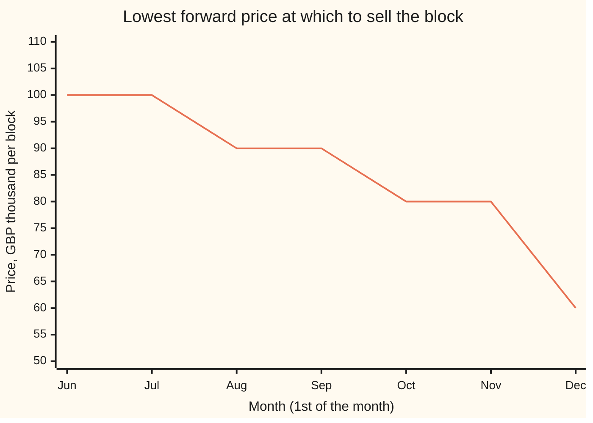
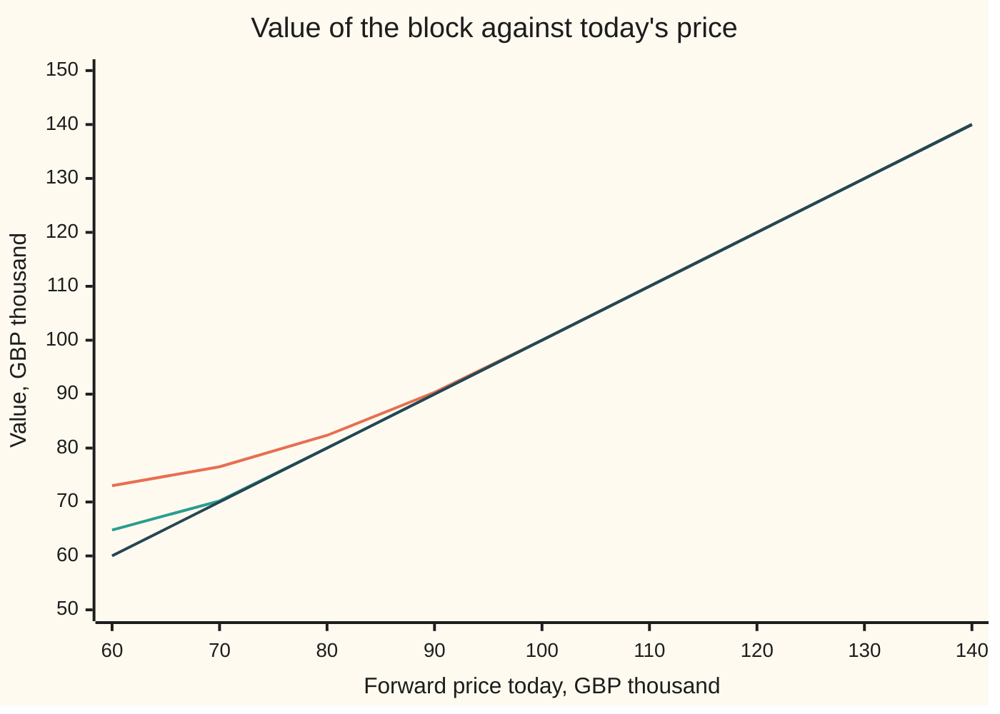

# Optimal stopping: deciding when now beats waiting

[Syllabus](../../../SYLLABUS.md) → [Optimization](../README.md) → [Dynamic Programming and Learning](../README.md#s07) → Optimal stopping

---

## General Overview

On 1 June a hydro dam holds one spare block of water, 10 million cubic metres (m³), that it will not need for its own turbines. A buyer downstream will take it on a forward contract: agree a price today, deliver later.

Today's quoted forward price is £80,000. Next month's quote is unknown: it moves £10,000 up or down, and it leans back toward £100,000, the usual level. Keeping the block costs £1,000 a month in evaporation and seepage. By 1 December the block must be sold at whatever the quote is then, because winter rain will refill the reservoir and spill it.

Each month the operator has one question: sell now, or wait a month? Selling locks in today's price and ends the problem: from then on the storage is the buyer's concern. Waiting costs £1,000 and buys a look at next month's price, with the same question again. This is a **maximisation**: the operator wants the largest average of sale price minus storage paid.

The answer is a bar for each month. Sell if the quote is at or above £100,000 in June or July, £90,000 in August or September, and £80,000 in October or November; on 1 December, sell at any price. Starting from £80,000, that rule is worth **£82,360** on average, £2,360 more than selling today, and no rule that decides from the prices seen so far does better.

**Optimal stopping is backward induction with two choices, stop or wait: at each month and price, the value is the larger of the price now and the average value of waiting, and the prices where stopping wins form the stopping boundary, a bar that falls as the deadline nears.**

**What kind of fact this is:** a theorem, the backward-induction theorem from [Backward induction](01-finite-horizon-dynamic-programming-and-backward-induction.md) applied to a two-choice problem. The bar's fall toward the deadline is proved in Why it works. The one-bar shape is argued there and checked month by month by the code, which settles it for this finite table.

### The picture: the bar a quote must clear, month by month



The line is the stopping boundary: at or above it, sell; below it, wait. It falls as December nears, because fewer months remain in which a better price could turn up. On 1 December the bar is the bottom of the price grid, £60,000: any price is taken.

---

## The formula

Two earlier cards hold most of the machinery. [Backward induction](01-finite-horizon-dynamic-programming-and-backward-induction.md) solves the last month first and proves the resulting table is the best over every rule. [Optimal stopping](../../11-Stochastic%20processes%20and%20calculus/08-Generators%2C%20Densities%20and%20Simulation/07-optimal-stopping-and-snell-envelope.md) solves a stopping problem the same way, on the tree of every possible history, and calls the result the Snell envelope. New here: the history is replaced by a **state**, today's price, so the table has one row per month and one column per price, and the decision becomes a boundary in that table.

Prices are in thousands of pounds, on the grid 60, 70, …, 140. Months run $k = 0$ (1 June) to $N = 6$ (1 December).

$$V_N(x) = x, \qquad W_k(x) = -c + \sum_{x'} p(x' \mid x)\, V_{k+1}(x'), \qquad V_k(x) = \max\big(x,\; W_k(x)\big)$$

**Read it aloud:** in December the block is worth its price; in any earlier month the value of waiting is next month's value averaged over where the price may go, minus a month's storage, and the block is worth the better of selling now and waiting.

The **stopping boundary** is the bar $b_k$, the lowest price at which selling wins:

$$b_k = \min\{\, x : x \ge W_k(x) \,\}, \qquad \text{rule: sell in month } k \text{ when } x \ge b_k.$$

In the language of [Markov decision processes](02-markov-decision-processes.md), the state is the month and the price, the two actions are stop and wait, and "sold" is a state that earns nothing more.

| Symbol | Plain meaning | In our example | Push it up and the answer… |
| --- | --- | --- | --- |
| $k$ | the month, from 0 (1 June) to $N$ | 0 to 6 | fewer months left: $W_k$ and $b_k$ fall |
| $N$ | the deadline month, when the block must be sold | 6 (1 December) | more chances: $V_0(80)$ rises, 85.145 at 12 months |
| $x$ | today's forward price for the block, £ thousand | 80 on 1 June | selling now pays more |
| $x'$ | next month's price | $x - 10$ or $x + 10$; at the grid's ends, the blocked move stays put | — |
| $p(x' \mid x)$ | chance the price moves from $x$ to $x'$ | rise 0.54 from 80, 0.50 from 100, 0.46 from 120 | more chance of a rise: more waiting |
| $i$ | the price's grid step, 0 at £60,000 up to 8 at £140,000 | 2 at £80,000 | — |
| $c$ | storage cost per month, £ thousand | 1 | waiting costs more: $b_k$ falls |
| $V_k(x)$ | value: best average net result from month $k$ at price $x$, £ thousand | $V_0(80)$ = 82.36 | — |
| $W_k(x)$ | wait value: the average of next month's value, less storage | $W_0(80)$ = 82.36, $W_5(80)$ = 79.80 | above $x$: wait |
| $b_k$ | the bar: lowest price at which selling wins | 100, 100, 90, 90, 80, 80 | — |
| $\max(x, W_k(x))$ | the choice: stop and take $x$, or wait and get $W_k(x)$ on average | June at 90: max(90, 90.33), so wait | — |

The chance of a rise from grid step $i$ ($i = 0$ at £60,000, $i = 4$ at £100,000) is $0.5 - 0.02\,(i - 4)$: the price leans back toward £100,000. That lean is called **mean reversion**.

### When it holds

- **The price is a Markov chain**: next month's chance depends on today's price only. Then the price is enough state. If prices have momentum, a rise tending to follow a rise, the state must also carry last month's move, or the bars are wrong.
- **The decision uses only prices seen so far.** A rule that knew the whole path would average 94.365, but no one can follow it.
- **A deadline exists.** It anchors the recursion at $V_N(x) = x$. With no deadline the same equation becomes a fixed point: the value table must come back unchanged after one more backward step. [Value and policy iteration](03-value-and-policy-iteration.md) solves it, and a best rule need not exist without a cost or discount.
- **Stopping is final.** Once sold, the block is gone. A problem where one can sell part and keep part is a general dynamic program, not a stopping problem.
- **One bar per month needs the right shape.** The bar exists because the gap $W_k(x) - x$ shrinks as the price rises. That holds here (Step 3), but in other models the sell prices can come in two separate bands.

---

## Why it works

### Step 0: stopping is a dynamic program with two choices

Every stopping problem has the same structure. At each month there are two moves: take the reward on offer, or pay to see one more month. Taking the reward ends the game, so its value is just the reward. Waiting leads to next month, whose value is already known if the table is filled from the deadline back. So the whole decision is a table of numbers $V_k(x)$, one per month and price, filled right to left.

What makes a table possible is that the price is the whole story. On 1 September at £90,000, the future looks the same whether the price got there by rising or by falling. So the best average from here is one number, $V_3(90)$, not one number per history.

### Step 1: the table gives the best rule

The general proof is on [Backward induction](01-finite-horizon-dynamic-programming-and-backward-induction.md): with the choices "stop" and "wait", and "sold" as an extra state worth nothing more, it says no rule averages more than $V_0(x)$, even one that remembers every past price. The rule that picks the larger side of each maximum attains it.

The same numbers are the Snell envelope of [Optimal stopping](../../11-Stochastic%20processes%20and%20calculus/08-Generators%2C%20Densities%20and%20Simulation/07-optimal-stopping-and-snell-envelope.md), which solves the problem on the full tree of price histories. Because the price is Markov, every branch that reaches the same month and price has the same envelope value, so that tree collapses into this table. That collapse is what a dynamic program buys: the tree doubles in size with every month added, while the table grows by one row of nine prices.

### Step 2: the deadline anchors it, and one month back is a comparison

On 1 December the block must go: $V_6(x) = x$. On 1 November at £80,000, waiting gives £70,000 with chance 0.46 or £90,000 with chance 0.54, less £1,000: $W_5(80) = 79.80$. That is below 80, so sell. At £70,000, waiting gives $0.44 \times 60 + 0.56 \times 80 - 1 = 70.20$, above 70, so wait. The bar in November is £80,000.

### Step 3: one bar per month

Selling wins where $x \ge W_k(x)$, so look at the gap $W_k(x) - x$, the gain from waiting. It splits into two parts:

- **The drift**, the average move less storage: $10 \times (0.5 - 0.02\,(i-4)) - 10 \times (0.5 + 0.02\,(i-4)) - 1$. That is $-0.4\,(i-4) - 1$, which falls by 0.4 per grid step except at the grid's two ends, where the blocked move stays put and the drift falls faster still.
- **The option**, how much next month's value beats next month's price on average. Next month's value exceeds the price only at low prices, where waiting is still worth something, so this part is largest at the bottom of the grid.

Both parts are largest at low prices and shrink as the price rises. So the gap crosses zero once, and the sell prices are everything at or above one bar. In June the gap is 13.02 at £60,000, 2.36 at £80,000, 0.33 at £90,000 and −0.99 at £100,000. The second part's shape is not automatic for every chain, so the code checks the one-bar shape in every month with an assert that can fail.

### Step 4: the bar falls toward the deadline

More months left can only help: with one extra month the operator could always copy the shorter rule and stop when it stops. So $V_k(x) \ge V_{k+1}(x)$ at every price, and the wait value, an average of next month's values less a fixed cost, is also larger earlier. A larger wait value means a higher bar. The wait value at £80,000 runs 82.36, 81.95, 81.30, 80.86, 79.89, 79.80 from June to November; it crosses 80 between September and October, which is where the bar drops to £80,000.

<details>
<summary>Detailed proof: the bar never rises toward the deadline</summary>

The prices, chances and cost are the same every month, so $V_k$ depends only on the months left, $N - k$. Claim: $V_k(x) \ge V_{k+1}(x)$ for every $x$ and every $k < N$.

Base: $V_{N-1}(x) = \max(x, W_{N-1}(x)) \ge x = V_N(x)$.

Step: suppose $V_{k+1} \ge V_{k+2}$ at every price. The chances $p(x' \mid x)$ are not negative, so averaging keeps the order: $W_k(x) = -c + \sum p(x' \mid x) V_{k+1}(x') \ge -c + \sum p(x' \mid x) V_{k+2}(x') = W_{k+1}(x)$. Then $V_k(x) = \max(x, W_k(x)) \ge \max(x, W_{k+1}(x)) = V_{k+1}(x)$. Induction downward gives the claim at every month.

The bar follows. If selling wins at price $x$ in month $k$, then $x \ge W_k(x) \ge W_{k+1}(x)$, so selling also wins at $x$ in month $k + 1$. Every sell price stays a sell price as the deadline nears, so $b_{k+1} \le b_k$.

</details>

### Step 5: the certificate

"Best" rests on the backward-induction theorem of Step 1. Four printed checks confirm the arithmetic behind it.

- The backward table gives 82.360.
- Running the bar rule forward over every price path, carrying the chance of each unsold price month by month, gives 82.360 again: the rule earns what the table says.
- Listing all 262,144 pairs of stop sets for October and November (any subset of the nine prices in each month) and scoring each, the best equals the table's October values at every price. Over the last two months, no rule beats the table.
- 200,000 simulated sellers following the rule average 82.372, with standard error 0.030: the typical size of the random error in that average.

---

## Worked numbers, by hand

Prices in £ thousand. December first, then back.

| Step | Arithmetic | Value |
| --- | --- | --- |
| 1 Dec, any price | must sell: $V_6(x) = x$ | 60 to 140 |
| 1 Nov at 70, wait | 0.44 × 60 + 0.56 × 80 − 1 | 70.20 > 70: wait |
| 1 Nov at 80, wait | 0.46 × 70 + 0.54 × 90 − 1 | 79.80 < 80: sell |
| 1 Nov at 90, wait | 0.48 × 80 + 0.52 × 100 − 1 | 89.40 < 90: sell |
| 1 Oct at 80, wait | 0.46 × 70.20 + 0.54 × 90 − 1 | 79.89 < 80: sell; bar 80 |
| September back to July | the same step, three more times | see the table below |
| 1 Jun at 90, wait | the June wait value | 90.33 > 90: wait |
| 1 Jun at 100, wait | the June wait value | 99.01 < 100: sell; bar 100 |
| **1 Jun at 80** | $V_0(80) = W_0(80)$, since waiting wins | **82.36** |

The block is worth £82,360 to an operator who follows the bars, against £80,000 for selling on 1 June: the right to wait is worth £2,360.

The whole table, value $V_k(x)$ in £ thousand, with the bar:

| Month | Bar | 60 | 70 | 80 | 90 | 100 | 110 to 140 |
| --- | ---: | ---: | ---: | ---: | ---: | ---: | --- |
| Jun | 100 | 73.02 | 76.53 | 82.36 | 90.33 | 100.00 | the price |
| Jul | 100 | 71.91 | 75.54 | 81.95 | 90.02 | 100.00 | the price |
| Aug | 90 | 70.49 | 74.67 | 81.30 | 90.00 | 100.00 | the price |
| Sep | 90 | 69.05 | 73.25 | 80.86 | 90.00 | 100.00 | the price |
| Oct | 80 | 66.93 | 72.31 | 80.00 | 90.00 | 100.00 | the price |
| Nov | 80 | 64.80 | 70.20 | 80.00 | 90.00 | 100.00 | the price |
| Dec | sell | 60.00 | 70.00 | 80.00 | 90.00 | 100.00 | the price |

Where a cell equals the price, selling wins. The boundary is the line between the cells above the price and the cells equal to it.

### What breaks if you drop a piece

The right answer is 82.360, in £ thousand, from a June price of 80.

| Mistake | Comes out at | What went wrong |
| --- | --- | --- |
| Sell on 1 June | 80.000 | Throws away the right to wait, worth 2.360 |
| Hold to 1 December | 80.630 | Pays six months' storage and ignores good prices on the way |
| Look one month ahead only | 80.000 | Compares 80 with $W$ computed as if next month must sell: 79.80, so sells at once. Waiting buys the right to decide again |
| Best fixed bar for every month (90) | 82.328 | Close, because the bar moves only one step at a time here, but it holds out too long in October and November and sells too soon in June and July |
| Treat each month's price as a fresh draw | delivered 81.074 | A wrong price model: it draws next month's price from the long-run spread around £100,000, whatever today's price, so it expects a low price to jump straight back, when the price really moves only £10,000 a month. The bars come out too high, 120.98 down to 99.00, so the rule turns down £90,000 and £100,000 for months |
| The prophet, who sees the whole path first | 94.365 | Not a rule anyone can follow: it decides using future prices. An upper bound, not a plan |

The fifth row breaks the model; the sixth breaks the rule that decisions use only the past.

---

## How the bar moves through the season

The puzzle: the price leans back toward £100,000, so a low price is likely to improve, and that argues for waiting. But each month costs £1,000, and each month gone is one fewer chance to see the improvement. Early in the season the first force wins over a wide range of prices; late in the season the second wins, and the bar comes down.

One season, traced through the rule:

| | Jun | Jul | Aug | Sep |
| --- | ---: | ---: | ---: | ---: |
| Price on the 1st | 80 | 70 | 80 | 90 |
| Bar | 100 | 100 | 90 | 90 |
| Decision | wait | wait | wait | **sell** |

The block sells on 1 September at £90,000, net £87,000 after three months' storage. The same price of £80,000 is refused in August and would be taken in October: the price is the same, the months left are not.

Across all seasons, the rule sells in August with chance 28.1%, September 27.9%, October 19.9%, November 2.8% and on 1 December 21.4%. It never sells in June or July from a start of £80,000, because the price cannot reach £100,000 in one month. On average the block is held 3.614 months and fetches 85.974, and 85.974 − 3.614 × 1 = 82.360.

One force at a time: $V_0(80)$ in £ thousand when one setting changes.

```
no pull toward 100        ████████████████████████████████▎        80.688
cost 3 a month            ████████████████████████████████         80.000
this card                 ████████████████████████████████▉        82.360
a 12-month season         ██████████████████████████████████       85.145
no storage cost           ██████████████████████████████████▋      86.835
```

Without the pull toward £100,000, the price is close to a fair coin and waiting is worth little: 80.688. A cost of £3,000 a month makes even June's bar £80,000, so the block sells at once. A longer season or free storage raises the value, and raises the bars: free storage gives bars of 120, 110, 110, 110, 110 and 100.

The combined picture: the value of the block against the price, in June and in November, with the price itself for comparison.



Orange: the value on 1 June. Green: the value on 1 November. Dark: the price, what selling now pays. Each value line sits above the price line at low prices, where waiting pays, and joins it at the bar: £100,000 in June, £80,000 in November. The point where a value line meets the price line is the stopping boundary.

---

## Code, from first principles, and it actually runs

The script fills the table from 1 December back, reads off each month's bar, and asserts that the sell prices form one block at the top in every month. It then reaches $V_0(80)$ by three more roads. Road 2 runs the bar rule forward, carrying the chance of each unsold price, with no maximum taken. Road 3 lists all 262,144 pairs of stop sets for October and November and checks the best matches the table at every price. Road 4 simulates 200,000 seasons with a SplitMix64 random-number generator started from seed 20261111, and checks the mean lies within four standard errors. A hand-computed November wait value is checked, and the mistakes and experiments are computed and printed. Both languages add their sums in the same order, so their outputs match to the last digit.

### Python

```python
# Optimal stopping as a dynamic program -- the check behind the card.  Standard library only.
# One block of stored water (10 million m3) and a forward price x for it, GBP thousand, on the grid
# 60, 70, ..., 140.  Each month the price moves 10 up or 10 down, pulled toward 100; at the ends of the
# grid the blocked move becomes "stay".  Storing costs C a month.  Months k = 0 (1 June) .. N = 6
# (1 December), when the block must be sold.  Maximise the average sale price minus storage costs.
# Roads: (1) backward induction; (2) the rule run forward over every price path; (3) every stop set for
# October and November listed and scored; (4) a simulation with SplitMix64, seed 20261111.
X = [60 + 10 * i for i in range(9)]
MONTHS = ["Jun", "Jul", "Aug", "Sep", "Oct", "Nov", "Dec"]
N, C, PULL, START = 6, 1.0, 0.02, 2           # months, GBP k a month, pull per step, start at x = 80

def moves(i, pull=PULL):                      # (next index, chance): down, up; a blocked move stays put
    up, dn = 0.5 - pull * (i - 4), 0.5 + pull * (i - 4)
    if i == 0: return [(0, dn), (1, up)]
    if i == 8: return [(7, dn), (8, up)]
    return [(i - 1, dn), (i + 1, up)]

def tot(terms):                               # plain left-to-right sum, the same order as the Rust check
    s = 0.0
    for t in terms: s += t
    return s

def wait_value(V1, i, c, pull):               # pay a month's storage, then the average of next month
    return tot(q * V1[j] for j, q in moves(i, pull)) - c

def solve(c=C, pull=PULL, n=N):
    V = [None] * (n + 1); W = [None] * n; stop = [None] * n
    V[n] = [float(x) for x in X]              # 1 December: sell at whatever the price is
    for k in range(n - 1, -1, -1):
        W[k] = [wait_value(V[k + 1], i, c, pull) for i in range(9)]
        stop[k] = [X[i] >= W[k][i] for i in range(9)]
        V[k] = [max(X[i], W[k][i]) for i in range(9)]
    return V, W, stop

def run_forward(stop, i0, c=C, n=N):         # road 2: carry the chance of each unsold price forward
    mass, value, sold = [0.0] * 9, 0.0, []
    mass[i0] = 1.0
    for k in range(n + 1):
        here = tot(mass[i] for i in range(9) if k == n or stop[k][i])
        value += tot(mass[i] * (X[i] - c * k) for i in range(9) if k == n or stop[k][i])
        sold.append(here)
        nxt = [0.0] * 9
        for i in range(9):
            if k < n and not stop[k][i]:
                for j, q in moves(i): nxt[j] += q * mass[i]
        mass = nxt
    return value, sold

V, W, stop = solve()
bar = [min(X[i] for i in range(9) if stop[k][i]) for k in range(N)]
print("price x            " + " ".join(f"{x:7d}" for x in X))
print("chance of a rise   " + " ".join(f"{moves(i)[-1][1]:7.2f}" for i in range(9)))
print("month  bar | value V_k(x), GBP k")
for k in range(N):
    assert all(stop[k][i] == (X[i] >= bar[k]) for i in range(9))     # the stop set is one threshold
    print(f"{MONTHS[k]}  {bar[k]:5d} | " + " ".join(f"{v:7.2f}" for v in V[k]))
print(f"Dec   sell | " + " ".join(f"{v:7.2f}" for v in V[N]))
print("Nov wait values  " + " ".join(f"{w:6.2f}" for w in W[5]))
print("Jun wait values  " + " ".join(f"{w:6.2f}" for w in W[0]))
print("Jun gap W_0(x)-x " + " ".join(f"{W[0][i] - X[i]:6.2f}" for i in range(9)))
for i in (2, 3, 4): print(f"wait value at x={X[i]}, Jun..Nov  " + " ".join(f"{W[k][i]:6.2f}" for k in range(N)))
assert abs(W[5][2] - (0.46 * 70 + 0.54 * 90 - 1)) < 1e-9 and abs(W[5][3] - (0.48 * 80 + 0.52 * 100 - 1)) < 1e-9
best = V[0][START]
fwd, sold = run_forward(stop, START)
print(f"road 1, backward induction, V_0(80)       {best:8.3f}")
print(f"road 2, rule run forward over the prices  {fwd:8.3f}")
assert abs(best - fwd) < 1e-9
print("chance of selling in " + " ".join(f"{m} {s:.3f}" for m, s in zip(MONTHS, sold)))
held = tot(k * s for k, s in enumerate(sold))
print(f"average months held {held:.3f}, average sale price {best + C * held:.3f}")
top = [-1e9] * 9                               # road 3: every stop set for Oct and Nov
for a in range(512):
    for b in range(512):
        s4 = [a >> i & 1 for i in range(9)]; s5 = [b >> i & 1 for i in range(9)]
        v5 = [X[i] if s5[i] else wait_value(V[N], i, C, PULL) for i in range(9)]
        for i in range(9):
            v4 = X[i] if s4[i] else wait_value(v5, i, C, PULL)
            if v4 > top[i]: top[i] = v4
print("road 3, best of 262144 Oct-Nov rules: " + " ".join(f"{v:.2f}" for v in top))
assert all(abs(top[i] - V[4][i]) < 1e-9 for i in range(9))
MASK = (1 << 64) - 1
def splitmix(s):
    s = (s + 0x9E3779B97F4A7C15) & MASK
    z = s; z = ((z ^ (z >> 30)) * 0xBF58476D1CE4E5B9) & MASK
    z = ((z ^ (z >> 27)) * 0x94D049BB133111EB) & MASK
    return s, (z ^ (z >> 31)) >> 11
seed, total, total2, R = 20261111, 0.0, 0.0, 200000
for _ in range(R):                             # road 4: simulate sellers who follow the rule
    i, k = START, 0
    while k < N and not stop[k][i]:
        seed, r = splitmix(seed)
        i = moves(i)[-1][0] if r / 2.0 ** 53 < moves(i)[-1][1] else moves(i)[0][0]
        k += 1
    g = X[i] - C * k; total += g; total2 += g * g
mean = total / R; se = ((total2 / R - mean * mean) / (R - 1)) ** 0.5
print(f"road 4, {R} simulated sellers   {mean:8.3f}  (standard error {se:.3f})")
assert abs(mean - best) < 4 * se
story = [80, 70, 80, 90, 80, 90]
k = 0
while k < N and story[k] < bar[k]: k += 1
print("story: prices " + " ".join(map(str, story)) + f"; sold in {MONTHS[k]} at {story[k]}, net {story[k] - C * k:.0f}")
print("rule's sale in Aug at 80?", stop[2][2], "| in Oct at 80?", stop[4][2])
never = [[False] * 9 for _ in range(N)]
hold = run_forward(never, START)[0]
myopic = [[X[i] >= wait_value(X, i, C, PULL) for i in range(9)] for _ in range(N)]
fixed = max((run_forward([[x >= t for x in X] for _ in range(N)], START)[0], t) for t in X)
def prophet(k, i, best_so_far):                # sees the whole price path, then picks the best month
    g = max(best_so_far, X[i] - C * k)
    return g if k == N else tot(q * prophet(k + 1, j, g) for j, q in moves(i))
pi = [1.0] * 9                                 # the long-run spread of prices, from balance up = down
for i in range(8): pi[i + 1] = pi[i] * moves(i)[-1][1] / moves(i + 1)[0][1]
z = tot(pi); pi = [p / z for p in pi]
Vi = [tot(p * x for p, x in zip(pi, X)) - C]   # wrong model: each month a fresh price from that spread
for _ in range(N - 1): Vi.append(tot(p * max(x, Vi[-1]) for p, x in zip(pi, X)) - C)
indep = [[X[i] >= Vi[N - 1 - k] for i in range(9)] for k in range(N)]
rows = [("wrong: sell on 1 June", float(X[START])),
        ("wrong: hold to 1 December", hold),
        ("wrong: look one month ahead only", run_forward(myopic, START)[0]),
        (f"wrong: best fixed bar ({fixed[1]})", fixed[0]),
        ("wrong: fresh price each month, delivered", run_forward(indep, START)[0]),
        ("wrong: prophet who sees the whole path", prophet(0, START, -1e9))]
for name, v in rows: print(f"{name:<42}{v:8.3f}")
assert all(v < best - 0.02 for _, v in rows[:5]) and rows[5][1] > best + 0.5
print("fresh-price model's bars " + " ".join(f"{v:.2f}" for v in Vi[::-1]))
for name, (c, pull, n) in [("try: no storage cost", (0.0, PULL, N)), ("try: no pull to 100", (C, 0.0, N)),
                           ("try: a 12-month season", (C, PULL, 12)), ("try: cost 3 a month", (3.0, PULL, N))]:
    Vt, _, st = solve(c, pull, n)
    bars = [min([X[i] for i in range(9) if st[k][i]]) for k in range(n)]
    print(f"{name:<24}V_0(80) {Vt[0][START]:7.3f}  bars " + " ".join(map(str, bars)))
print("chart, V_0(x) and V_5(x): " + " ".join(f"{v:.2f}" for v in V[0]) + " | " + " ".join(f"{v:.2f}" for v in V[5]))
print("ALL CHECKS PASS")
```

**Ran 2026-11-11 on macOS, Python 3.14.10, standard library only. All checks passed. Output, pasted from the run:**

```
price x                 60      70      80      90     100     110     120     130     140
chance of a rise      0.58    0.56    0.54    0.52    0.50    0.48    0.46    0.44    0.42
month  bar | value V_k(x), GBP k
Jun    100 |   73.02   76.53   82.36   90.33  100.00  110.00  120.00  130.00  140.00
Jul    100 |   71.91   75.54   81.95   90.02  100.00  110.00  120.00  130.00  140.00
Aug     90 |   70.49   74.67   81.30   90.00  100.00  110.00  120.00  130.00  140.00
Sep     90 |   69.05   73.25   80.86   90.00  100.00  110.00  120.00  130.00  140.00
Oct     80 |   66.93   72.31   80.00   90.00  100.00  110.00  120.00  130.00  140.00
Nov     80 |   64.80   70.20   80.00   90.00  100.00  110.00  120.00  130.00  140.00
Dec   sell |   60.00   70.00   80.00   90.00  100.00  110.00  120.00  130.00  140.00
Nov wait values   64.80  70.20  79.80  89.40  99.00 108.60 118.20 127.80 133.20
Jun wait values   73.02  76.53  82.36  90.33  99.01 108.60 118.20 127.80 133.20
Jun gap W_0(x)-x  13.02   6.53   2.36   0.33  -0.99  -1.40  -1.80  -2.20  -6.80
wait value at x=80, Jun..Nov   82.36  81.95  81.30  80.86  79.89  79.80
wait value at x=90, Jun..Nov   90.33  90.02  89.81  89.40  89.40  89.40
wait value at x=100, Jun..Nov   99.01  99.00  99.00  99.00  99.00  99.00
road 1, backward induction, V_0(80)         82.360
road 2, rule run forward over the prices    82.360
chance of selling in Jun 0.000 Jul 0.000 Aug 0.281 Sep 0.279 Oct 0.199 Nov 0.028 Dec 0.214
average months held 3.614, average sale price 85.974
road 3, best of 262144 Oct-Nov rules: 66.93 72.31 80.00 90.00 100.00 110.00 120.00 130.00 140.00
road 4, 200000 simulated sellers     82.372  (standard error 0.030)
story: prices 80 70 80 90 80 90; sold in Sep at 90, net 87
rule's sale in Aug at 80? False | in Oct at 80? True
wrong: sell on 1 June                       80.000
wrong: hold to 1 December                   80.630
wrong: look one month ahead only            80.000
wrong: best fixed bar (90)                  82.328
wrong: fresh price each month, delivered    81.074
wrong: prophet who sees the whole path      94.365
fresh-price model's bars 120.98 119.28 116.87 113.46 108.30 99.00
try: no storage cost    V_0(80)  86.835  bars 120 110 110 110 110 100
try: no pull to 100     V_0(80)  80.688  bars 90 90 80 80 80 70
try: a 12-month season  V_0(80)  85.145  bars 100 100 100 100 100 100 100 100 90 90 80 80
try: cost 3 a month     V_0(80)  80.000  bars 80 80 80 70 70 70
chart, V_0(x) and V_5(x): 73.02 76.53 82.36 90.33 100.00 110.00 120.00 130.00 140.00 | 64.80 70.20 80.00 90.00 100.00 110.00 120.00 130.00 140.00
ALL CHECKS PASS
```

### Rust

Same numbers, same labels, built with `rustc --edition 2021 -O`.

```rust
// Optimal stopping as a dynamic program -- the same check as the Python, in Rust.  std only, no crates.
// One block of stored water (10 million m3) and a forward price x for it, GBP thousand, on the grid
// 60, 70, ..., 140.  Each month the price moves 10 up or 10 down, pulled toward 100; at the ends of the
// grid the blocked move becomes "stay".  Storing costs C a month.  Months k = 0 (1 June) .. N = 6
// (1 December), when the block must be sold.  Maximise the average sale price minus storage costs.
// Roads: (1) backward induction; (2) the rule run forward over every price path; (3) every stop set for
// October and November listed and scored; (4) a simulation with SplitMix64, seed 20261111.
const MONTHS: [&str; 7] = ["Jun", "Jul", "Aug", "Sep", "Oct", "Nov", "Dec"];
const N: usize = 6; const C: f64 = 1.0; const PULL: f64 = 0.02; const START: usize = 2;
type Row = [f64; 9]; type Stop = Vec<[bool; 9]>;
fn x(i: usize) -> f64 { 60.0 + 10.0 * i as f64 }
fn moves(i: usize, pull: f64) -> [(usize, f64); 2] { // (next index, chance): down, up
    let (up, dn) = (0.5 - pull * (i as f64 - 4.0), 0.5 + pull * (i as f64 - 4.0));
    if i == 0 { [(0, dn), (1, up)] } else if i == 8 { [(7, dn), (8, up)] } else { [(i - 1, dn), (i + 1, up)] }
}
fn wait_value(v1: &Row, i: usize, c: f64, pull: f64) -> f64 {
    let mut s = 0.0; for (j, q) in moves(i, pull) { s += q * v1[j]; }
    s - c
}
fn solve(c: f64, pull: f64, n: usize) -> (Vec<Row>, Vec<Row>, Stop) {
    let mut v = vec![[0.0; 9]; n + 1];
    let (mut w, mut stop) = (vec![[0.0; 9]; n], vec![[false; 9]; n]);
    for i in 0..9 { v[n][i] = x(i); }                  // 1 December: sell at whatever the price is
    for k in (0..n).rev() {
        for i in 0..9 {
            w[k][i] = wait_value(&v[k + 1], i, c, pull);
            stop[k][i] = x(i) >= w[k][i];
            v[k][i] = x(i).max(w[k][i]);
        }
    }
    (v, w, stop)
}
fn run_forward(stop: &Stop, i0: usize, c: f64, n: usize) -> (f64, Vec<f64>) { // road 2
    let (mut mass, mut value, mut sold) = ([0.0f64; 9], 0.0, vec![]);
    mass[i0] = 1.0;
    for k in 0..=n {
        let (mut here, mut gain) = (0.0, 0.0);
        for i in 0..9 {
            if k == n || stop[k][i] { here += mass[i]; gain += mass[i] * (x(i) - c * k as f64); }
        }
        value += gain; sold.push(here);
        let mut nxt = [0.0; 9];
        for i in 0..9 {
            if k < n && !stop[k][i] { for (j, q) in moves(i, PULL) { nxt[j] += q * mass[i]; } }
        }
        mass = nxt;
    }
    (value, sold)
}
fn splitmix(s: u64) -> (u64, u64) {
    let s = s.wrapping_add(0x9E3779B97F4A7C15);
    let mut z = (s ^ (s >> 30)).wrapping_mul(0xBF58476D1CE4E5B9);
    z = (z ^ (z >> 27)).wrapping_mul(0x94D049BB133111EB);
    (s, (z ^ (z >> 31)) >> 11)
}
fn prophet(k: usize, i: usize, best: f64) -> f64 { // sees the whole price path, then picks the best month
    let g = best.max(x(i) - C * k as f64);
    if k == N { return g; }
    let mut s = 0.0; for (j, q) in moves(i, PULL) { s += q * prophet(k + 1, j, g); }
    s
}
fn join(v: &[f64], p: usize, w: usize) -> String {
    v.iter().map(|a| format!("{:w$.p$}", a, w = w, p = p)).collect::<Vec<_>>().join(" ")
}
fn bars(stop: &Stop) -> Vec<usize> {
    stop.iter().map(|s| (0..9).filter(|&i| s[i]).map(|i| 60 + 10 * i).min().unwrap()).collect()
}
fn main() {
    let (v, w, stop) = solve(C, PULL, N);
    let bar = bars(&stop);
    println!("price x            {}", (0..9).map(|i| format!("{:7}", 60 + 10 * i)).collect::<Vec<_>>().join(" "));
    println!("chance of a rise   {}", join(&(0..9).map(|i| moves(i, PULL)[1].1).collect::<Vec<_>>(), 2, 7));
    println!("month  bar | value V_k(x), GBP k");
    for k in 0..N {
        assert!((0..9).all(|i| stop[k][i] == (60 + 10 * i >= bar[k])));   // the stop set is one threshold
        println!("{}  {:5} | {}", MONTHS[k], bar[k], join(&v[k], 2, 7));
    }
    println!("Dec   sell | {}", join(&v[N], 2, 7));
    println!("Nov wait values  {}", join(&w[5], 2, 6));
    println!("Jun wait values  {}", join(&w[0], 2, 6));
    println!("Jun gap W_0(x)-x {}", join(&(0..9).map(|i| w[0][i] - x(i)).collect::<Vec<_>>(), 2, 6));
    for i in [2usize, 3, 4] { println!("wait value at x={}, Jun..Nov  {}", 60 + 10 * i, join(&(0..N).map(|k| w[k][i]).collect::<Vec<_>>(), 2, 6)); }
    assert!((w[5][2] - (0.46 * 70.0 + 0.54 * 90.0 - 1.0)).abs() < 1e-9 && (w[5][3] - (0.48 * 80.0 + 0.52 * 100.0 - 1.0)).abs() < 1e-9);
    let best = v[0][START];
    let (fwd, sold) = run_forward(&stop, START, C, N);
    println!("road 1, backward induction, V_0(80)       {:8.3}", best);
    println!("road 2, rule run forward over the prices  {:8.3}", fwd);
    assert!((best - fwd).abs() < 1e-9);
    println!("chance of selling in {}", (0..=N).map(|k| format!("{} {:.3}", MONTHS[k], sold[k])).collect::<Vec<_>>().join(" "));
    let mut held = 0.0; for k in 0..=N { held += k as f64 * sold[k]; }
    println!("average months held {:.3}, average sale price {:.3}", held, best + C * held);
    let mut top = [-1e9f64; 9];                         // road 3: every stop set for Oct and Nov
    for a in 0..512usize {
        for b in 0..512usize {
            let mut v5 = [0.0; 9];
            for i in 0..9 { v5[i] = if b >> i & 1 == 1 { x(i) } else { wait_value(&v[N], i, C, PULL) }; }
            for i in 0..9 {
                let v4 = if a >> i & 1 == 1 { x(i) } else { wait_value(&v5, i, C, PULL) };
                if v4 > top[i] { top[i] = v4; }
            }
        }
    }
    println!("road 3, best of 262144 Oct-Nov rules: {}", top.iter().map(|t| format!("{:.2}", t)).collect::<Vec<_>>().join(" "));
    assert!((0..9).all(|i| (top[i] - v[4][i]).abs() < 1e-9));
    let (mut seed, mut total, mut total2, r) = (20261111u64, 0.0f64, 0.0f64, 200000usize);
    for _ in 0..r {                                     // road 4: simulate sellers who follow the rule
        let (mut i, mut k) = (START, 0usize);
        while k < N && !stop[k][i] {
            let (s, bits) = splitmix(seed); seed = s;
            let m = moves(i, PULL);
            i = if (bits as f64) / 2f64.powi(53) < m[1].1 { m[1].0 } else { m[0].0 };
            k += 1;
        }
        let g = x(i) - C * k as f64;
        total += g; total2 += g * g;
    }
    let mean = total / r as f64;
    let se = ((total2 / r as f64 - mean * mean) / (r as f64 - 1.0)).sqrt();
    println!("road 4, {} simulated sellers   {:8.3}  (standard error {:.3})", r, mean, se);
    assert!((mean - best).abs() < 4.0 * se);
    let story = [80usize, 70, 80, 90, 80, 90];
    let mut k = 0;
    while k < N && story[k] < bar[k] { k += 1; }
    println!("story: prices {}; sold in {} at {}, net {:.0}",
             story.iter().map(|s| s.to_string()).collect::<Vec<_>>().join(" "), MONTHS[k], story[k], story[k] as f64 - C * k as f64);
    println!("rule's sale in Aug at 80? {} | in Oct at 80? {}", if stop[2][2] { "True" } else { "False" }, if stop[4][2] { "True" } else { "False" });
    let never: Stop = vec![[false; 9]; N];
    let hold = run_forward(&never, START, C, N).0;
    let mut myopic: Stop = vec![[false; 9]; N];
    let xs: Row = std::array::from_fn(|i| x(i));
    for k in 0..N { for i in 0..9 { myopic[k][i] = x(i) >= wait_value(&xs, i, C, PULL); } }
    let (mut fixed, mut fixed_t) = (-1e9, 0usize);
    for t in 0..9 {
        let rule: Stop = vec![std::array::from_fn(|i| i >= t); N];
        let f = run_forward(&rule, START, C, N).0;
        if f > fixed { fixed = f; fixed_t = 60 + 10 * t; }
    }
    let mut pi = [1.0f64; 9];                           // the long-run spread of prices, from balance up = down
    for i in 0..8 { pi[i + 1] = pi[i] * moves(i, PULL)[1].1 / moves(i + 1, PULL)[0].1; }
    let mut z = 0.0; for p in pi { z += p; }
    for p in pi.iter_mut() { *p /= z; }
    let mut vi = vec![];                                // wrong model: each month a fresh price from that spread
    let mut s = 0.0; for i in 0..9 { s += pi[i] * x(i); }
    vi.push(s - C);
    for _ in 0..N - 1 {
        let (last, mut s) = (vi[vi.len() - 1], 0.0); for i in 0..9 { s += pi[i] * x(i).max(last); }
        vi.push(s - C);
    }
    let mut indep: Stop = vec![[false; 9]; N];
    for k in 0..N { for i in 0..9 { indep[k][i] = x(i) >= vi[N - 1 - k]; } }
    let rows = [("wrong: sell on 1 June".to_string(), x(START)),
                ("wrong: hold to 1 December".to_string(), hold),
                ("wrong: look one month ahead only".to_string(), run_forward(&myopic, START, C, N).0),
                (format!("wrong: best fixed bar ({})", fixed_t), fixed),
                ("wrong: fresh price each month, delivered".to_string(), run_forward(&indep, START, C, N).0),
                ("wrong: prophet who sees the whole path".to_string(), prophet(0, START, -1e9))];
    for (name, val) in rows.iter() { println!("{:<42}{:8.3}", name, val); }
    assert!(rows[..5].iter().all(|(_, val)| *val < best - 0.02) && rows[5].1 > best + 0.5);
    let rev: Vec<f64> = vi.iter().rev().cloned().collect();
    println!("fresh-price model's bars {}", rev.iter().map(|t| format!("{:.2}", t)).collect::<Vec<_>>().join(" "));
    for (name, c, pull, n) in [("try: no storage cost", 0.0, PULL, N), ("try: no pull to 100", C, 0.0, N),
                               ("try: a 12-month season", C, PULL, 12), ("try: cost 3 a month", 3.0, PULL, N)] {
        let (vt, _, st) = solve(c, pull, n);
        println!("{:<24}V_0(80) {:7.3}  bars {}", name, vt[0][START],
                 bars(&st).iter().map(|b| b.to_string()).collect::<Vec<_>>().join(" "));
    }
    println!("chart, V_0(x) and V_5(x): {} | {}", v[0].iter().map(|t| format!("{:.2}", t)).collect::<Vec<_>>().join(" "),
             v[5].iter().map(|t| format!("{:.2}", t)).collect::<Vec<_>>().join(" "));
    println!("ALL CHECKS PASS");
}
```

**Ran 2026-11-11 on macOS, rustc 1.98.1, no crates. All checks passed. Output, pasted from the run:**

```
price x                 60      70      80      90     100     110     120     130     140
chance of a rise      0.58    0.56    0.54    0.52    0.50    0.48    0.46    0.44    0.42
month  bar | value V_k(x), GBP k
Jun    100 |   73.02   76.53   82.36   90.33  100.00  110.00  120.00  130.00  140.00
Jul    100 |   71.91   75.54   81.95   90.02  100.00  110.00  120.00  130.00  140.00
Aug     90 |   70.49   74.67   81.30   90.00  100.00  110.00  120.00  130.00  140.00
Sep     90 |   69.05   73.25   80.86   90.00  100.00  110.00  120.00  130.00  140.00
Oct     80 |   66.93   72.31   80.00   90.00  100.00  110.00  120.00  130.00  140.00
Nov     80 |   64.80   70.20   80.00   90.00  100.00  110.00  120.00  130.00  140.00
Dec   sell |   60.00   70.00   80.00   90.00  100.00  110.00  120.00  130.00  140.00
Nov wait values   64.80  70.20  79.80  89.40  99.00 108.60 118.20 127.80 133.20
Jun wait values   73.02  76.53  82.36  90.33  99.01 108.60 118.20 127.80 133.20
Jun gap W_0(x)-x  13.02   6.53   2.36   0.33  -0.99  -1.40  -1.80  -2.20  -6.80
wait value at x=80, Jun..Nov   82.36  81.95  81.30  80.86  79.89  79.80
wait value at x=90, Jun..Nov   90.33  90.02  89.81  89.40  89.40  89.40
wait value at x=100, Jun..Nov   99.01  99.00  99.00  99.00  99.00  99.00
road 1, backward induction, V_0(80)         82.360
road 2, rule run forward over the prices    82.360
chance of selling in Jun 0.000 Jul 0.000 Aug 0.281 Sep 0.279 Oct 0.199 Nov 0.028 Dec 0.214
average months held 3.614, average sale price 85.974
road 3, best of 262144 Oct-Nov rules: 66.93 72.31 80.00 90.00 100.00 110.00 120.00 130.00 140.00
road 4, 200000 simulated sellers     82.372  (standard error 0.030)
story: prices 80 70 80 90 80 90; sold in Sep at 90, net 87
rule's sale in Aug at 80? False | in Oct at 80? True
wrong: sell on 1 June                       80.000
wrong: hold to 1 December                   80.630
wrong: look one month ahead only            80.000
wrong: best fixed bar (90)                  82.328
wrong: fresh price each month, delivered    81.074
wrong: prophet who sees the whole path      94.365
fresh-price model's bars 120.98 119.28 116.87 113.46 108.30 99.00
try: no storage cost    V_0(80)  86.835  bars 120 110 110 110 110 100
try: no pull to 100     V_0(80)  80.688  bars 90 90 80 80 80 70
try: a 12-month season  V_0(80)  85.145  bars 100 100 100 100 100 100 100 100 90 90 80 80
try: cost 3 a month     V_0(80)  80.000  bars 80 80 80 70 70 70
chart, V_0(x) and V_5(x): 73.02 76.53 82.36 90.33 100.00 110.00 120.00 130.00 140.00 | 64.80 70.20 80.00 90.00 100.00 110.00 120.00 130.00 140.00
ALL CHECKS PASS
```

The two outputs match line for line.

### Lean

Lean proves the backward-induction claims for any finite price grid, chances and storage cost, and checks this card's bars and June value exactly.

- If the chances are not negative and each price's chances add up to 1, no rule that decides from the prices seen so far averages more than $V_0(x)$.
- The bar rule, sell when the price is at least the wait value, averages exactly $V_0(x)$.
- More months left can only help: $V_k(x) \ge V_{k+1}(x)$ at every price, in every month before the deadline.
- If selling wins at a price in one month, it still wins there the next month, so the bar never rises toward the deadline.
- In this card's model the chances are not negative, and each price's chances add up to 1: the price is a Markov chain.
- In every month from June to November, selling wins exactly at the prices at or above that month's bar: 100, 100, 90, 90, 80, 80.
- $V_0(80)$ is exactly 12868727317/156250000, about 82.3599, shown as 82.36 on this card.
- The hand arithmetic holds exactly, as fractions. That covers the November wait values 70.20, 79.80 and 89.40, October's 79.89 at £80,000, the story's net 87, and 262,144 rule pairs.

The forward run of the rule, the search over October and November rules, the simulation, the mistakes and the experiments are left to the Python and Rust checks.

```lean
-- Optimal stopping: backward induction gives the best stop-or-wait rule over every rule that sees only past prices, and the set of prices where stopping wins only grows as the deadline nears.
import Mathlib.Algebra.BigOperators.Group.Finset.Basic
import Mathlib.Algebra.Order.BigOperators.Group.Finset
import Mathlib.Algebra.Order.Field.Basic
import Mathlib.Data.Rat.Defs
import Mathlib.Data.Fin.VecNotation
import Mathlib.Tactic.NormNum

open Finset

namespace OptimalStopping

/-! ## The setting

A finite set `S` of prices (states), the reward `r x` paid on selling at `x`, the chance
`p x y` that the price moves from `x` to `y` in one month, and the storage cost `c` per month.
The deadline is month `N`. Numbers live in any ordered field `𝕜` (the reals, or the rationals
used for the card's exact example). -/

variable {𝕜 : Type*} [Field 𝕜] [LinearOrder 𝕜] [IsStrictOrderedRing 𝕜]
variable {S : Type*} [Fintype S]

/-- Value with `m` months left: `m = 0` is the deadline, where the block must be sold. -/
def valueLeft (p : S → S → 𝕜) (r : S → 𝕜) (c : 𝕜) : ℕ → S → 𝕜
  | 0, x => r x
  | m + 1, x => max (r x) (-c + ∑ y, p x y * valueLeft p r c m y)

/-- The card's `V_k(x)`: the value in month `k` of an `N`-month season, `V_N(x) = x`,
`V_k(x) = max(x, W_k(x))`. -/
def V (p : S → S → 𝕜) (r : S → 𝕜) (c : 𝕜) (N k : ℕ) (x : S) : 𝕜 :=
  valueLeft p r c (N - k) x

/-- The card's wait value `W_k(x) = -c + ∑ p(x' | x) V_{k+1}(x')`, for `k < N`. -/
def W (p : S → S → 𝕜) (r : S → 𝕜) (c : 𝕜) (N k : ℕ) (x : S) : 𝕜 :=
  -c + ∑ y, p x y * V p r c N (k + 1) y

/-- A stopping rule that decides from the prices seen so far: given the list of prices up to
and including today's, `σ` says stop (`true`) or wait (`false`). It may depend on the whole
past path, and on the month, which is the length of that list. -/
abbrev Rule (S : Type*) := List S → Bool

/-- The average net result of following rule `σ` with `m` months left, past prices `h`, and
today's price `x`: on stopping, take `r x`; on waiting, pay `c` and average over next month.
At the deadline (`m = 0`) the block is sold whatever the rule says. Stopping is final. -/
def ruleValue (p : S → S → 𝕜) (r : S → 𝕜) (c : 𝕜) (σ : Rule S) : ℕ → List S → S → 𝕜
  | 0, _, x => r x
  | m + 1, h, x =>
      if σ (h ++ [x]) then r x
      else -c + ∑ y, p x y * ruleValue p r c σ m (h ++ [x]) y

/-- The card's bar rule for an `N`-month season: in month `k` (the price list has `k + 1`
entries), sell at price `x` exactly when `x ≥ W_k(x)`. -/
def barRule (p : S → S → 𝕜) (r : S → 𝕜) (c : 𝕜) (N : ℕ) : Rule S := fun h =>
  match h.getLast? with
  | none => false
  | some x => decide (W p r c N (h.length - 1) x ≤ r x)

/-- Any rule averages at most the table value, from any past and any number of months left. -/
theorem ruleValue_le_valueLeft
    (p : S → S → 𝕜) (r : S → 𝕜) (c : 𝕜) (hp : ∀ x y, 0 ≤ p x y) (σ : Rule S) :
    ∀ (m : ℕ) (h : List S) (x : S), ruleValue p r c σ m h x ≤ valueLeft p r c m x := by
  intro m
  induction m with
  | zero => intro h x; simp [ruleValue, valueLeft]
  | succ m ih =>
    intro h x
    simp only [ruleValue, valueLeft]
    split_ifs
    · exact le_max_left _ _
    · refine le_trans ?_ (le_max_right _ _)
      have : ∑ y, p x y * ruleValue p r c σ m (h ++ [x]) y ≤ ∑ y, p x y * valueLeft p r c m y :=
        Finset.sum_le_sum fun y _ => mul_le_mul_of_nonneg_left (ih _ y) (hp x y)
      exact add_le_add le_rfl this

omit [IsStrictOrderedRing 𝕜] in
/-- The bar rule averages exactly the table value, whenever the past has `N - m` entries. -/
theorem ruleValue_barRule
    (p : S → S → 𝕜) (r : S → 𝕜) (c : 𝕜) (N : ℕ) :
    ∀ (m : ℕ) (h : List S) (x : S), h.length + m = N →
      ruleValue p r c (barRule p r c N) m h x = valueLeft p r c m x := by
  intro m
  induction m with
  | zero => intro h x _; simp [ruleValue, valueLeft]
  | succ m ih =>
    intro h x hN
    have hW : W p r c N h.length x = -c + ∑ y, p x y * valueLeft p r c m y := by
      simp only [W, V]
      congr 2
      have : N - (h.length + 1) = m := by omega
      rw [this]
    have hb : barRule p r c N (h ++ [x]) = decide (W p r c N h.length x ≤ r x) := by
      simp [barRule]
    simp only [ruleValue, valueLeft, hb, hW]
    by_cases hc : -c + ∑ y, p x y * valueLeft p r c m y ≤ r x
    · simp [hc]
    · have hsum : ∑ y, p x y * ruleValue p r c (barRule p r c N) m (h ++ [x]) y
          = ∑ y, p x y * valueLeft p r c m y := by
        refine Finset.sum_congr rfl fun y _ => ?_
        rw [ih (h ++ [x]) y (by simp; omega)]
      simp only [hc, decide_false, Bool.false_eq_true, ite_false, hsum]
      exact (max_eq_right (le_of_lt (not_le.mp hc))).symm

/-- One more month left never lowers the value. -/
theorem valueLeft_mono_succ
    (p : S → S → 𝕜) (r : S → 𝕜) (c : 𝕜) (hp : ∀ x y, 0 ≤ p x y) :
    ∀ (m : ℕ) (x : S), valueLeft p r c m x ≤ valueLeft p r c (m + 1) x := by
  intro m
  induction m with
  | zero => intro x; simp only [valueLeft]; exact le_max_left _ _
  | succ m ih =>
    intro x
    simp only [valueLeft]
    refine max_le_max le_rfl ?_
    have : ∑ y, p x y * valueLeft p r c m y ≤ ∑ y, p x y * valueLeft p r c (m + 1) y :=
      Finset.sum_le_sum fun y _ => mul_le_mul_of_nonneg_left (ih y) (hp x y)
    exact add_le_add le_rfl this

#print axioms ruleValue_le_valueLeft
#print axioms ruleValue_barRule
#print axioms valueLeft_mono_succ

/-- **Optimal stopping is backward induction.** If the price is a Markov chain (the chances
`p x y` are not negative and each row adds up to 1), then for a season with deadline `N`:
no rule that decides from the prices seen so far averages more than the table value `V_0(x)`,
and the rule "sell when the price is at least the wait value" averages exactly `V_0(x)`. -/
theorem optimal_stopping_is_backward_induction
    (p : S → S → 𝕜) (r : S → 𝕜) (c : 𝕜)
    (hp : ∀ x y, 0 ≤ p x y) (hsum : ∀ x, ∑ y, p x y = 1) (N : ℕ) (x : S) :
    (∀ σ : Rule S, ruleValue p r c σ N [] x ≤ V p r c N 0 x) ∧
      ruleValue p r c (barRule p r c N) N [] x = V p r c N 0 x := by
  refine ⟨fun σ => ?_, ?_⟩
  · simpa [V] using ruleValue_le_valueLeft p r c hp σ N [] x
  · simpa [V] using ruleValue_barRule p r c N N [] x (by simp)

/-- **More months left can only help:** `V_k(x) ≥ V_{k+1}(x)` at every price, for every
month `k` before the deadline. -/
theorem value_falls_toward_deadline
    (p : S → S → 𝕜) (r : S → 𝕜) (c : 𝕜)
    (hp : ∀ x y, 0 ≤ p x y) (hsum : ∀ x, ∑ y, p x y = 1) (N k : ℕ) (hk : k < N) (x : S) :
    V p r c N (k + 1) x ≤ V p r c N k x := by
  have h1 : N - k = (N - (k + 1)) + 1 := by omega
  simp only [V]
  rw [h1]
  exact valueLeft_mono_succ p r c hp _ x

/-- **The bar falls toward the deadline:** if selling wins at price `x` in month `k`
(`x ≥ W_k(x)`), then selling also wins at `x` in month `k + 1`. So every sell price stays a
sell price, and the bar `b_k`, the lowest sell price, satisfies `b_{k+1} ≤ b_k`. -/
theorem stopping_set_grows_toward_deadline
    (p : S → S → 𝕜) (r : S → 𝕜) (c : 𝕜)
    (hp : ∀ x y, 0 ≤ p x y) (hsum : ∀ x, ∑ y, p x y = 1) (N k : ℕ) (hk : k + 1 < N) (x : S)
    (hstop : W p r c N k x ≤ r x) :
    W p r c N (k + 1) x ≤ r x := by
  refine le_trans ?_ hstop
  simp only [W]
  have : ∑ y, p x y * V p r c N (k + 1 + 1) y ≤ ∑ y, p x y * V p r c N (k + 1) y :=
    Finset.sum_le_sum fun y _ =>
      mul_le_mul_of_nonneg_left (value_falls_toward_deadline p r c hp hsum N (k + 1) hk y) (hp x y)
  exact add_le_add le_rfl this

/-! ## The card's model, in exact rational arithmetic

Prices `60, 70, …, 140` (£ thousand) at grid steps `i = 0, …, 8`. From step `i` the price
rises with chance `1/2 - (i - 4)/50` and falls with chance `1/2 + (i - 4)/50`; at the grid's
ends the blocked move stays put. Storage costs 1 a month; the season runs 6 months. -/

/-- The forward price at grid step `i`, £ thousand. -/
def price (i : Fin 9) : ℚ := 60 + 10 * (i : ℚ)

/-- Chance of a rise from grid step `i`. -/
def upChance (i : Fin 9) : ℚ := 1 / 2 - ((i : ℚ) - 4) / 50

/-- The card's transition chances, with a blocked move at either end staying put. -/
def chance (i j : Fin 9) : ℚ :=
  (if (j : ℕ) = min ((i : ℕ) + 1) 8 then upChance i else 0) +
    (if (j : ℕ) = (i : ℕ) - 1 then 1 - upChance i else 0)

/-- The card's bars, months June (`k = 0`) to November (`k = 5`): 100, 100, 90, 90, 80, 80. -/
def bar : Fin 6 → ℚ := ![100, 100, 90, 90, 80, 80]

-- The card's model is a Markov chain: chances are not negative and each row adds up to 1.
example : ∀ i j, 0 ≤ chance i j := by decide +kernel
example : ∀ i, ∑ j, chance i j = 1 := by decide +kernel

-- One bar per month, at the card's values: in month k, sell at price x exactly when x ≥ b_k.
example : ∀ k : Fin 6, ∀ i : Fin 9,
    (W chance price 1 6 k i ≤ price i ↔ bar k ≤ price i) := by decide +kernel

-- The value of the block on 1 June at £80,000, exactly (82.3598…, shown as 82.36 on the card).
example : V chance price 1 6 0 2 = 12868727317 / 156250000 := by decide +kernel

-- Hand checks for 1 November (V_6(x) = x): wait values 70.20 > 70, 79.80 < 80, 89.40 < 90.
example : (44 : ℚ) / 100 * 60 + 56 / 100 * 80 - 1 = 351 / 5 ∧ (70 : ℚ) < 351 / 5 := by norm_num
example : (46 : ℚ) / 100 * 70 + 54 / 100 * 90 - 1 = 399 / 5 ∧ (399 : ℚ) / 5 < 80 := by norm_num
example : (48 : ℚ) / 100 * 80 + 52 / 100 * 100 - 1 = 447 / 5 ∧ (447 : ℚ) / 5 < 90 := by norm_num

-- 1 October at 80: 0.46 × 70.20 + 0.54 × 90 − 1 = 79.892 < 80, so sell; the bar is 80.
example : (46 : ℚ) / 100 * (351 / 5) + 54 / 100 * 90 - 1 < 80 := by norm_num

-- The story season: sold on 1 September at 90 after three months' storage, net 87.
example : 90 - 3 * 1 = 87 := by norm_num

-- Road 3 lists every pair of stop sets for October and November: 512 × 512 = 262,144.
example : 2 ^ 9 * 2 ^ 9 = 262144 := by norm_num

#print axioms optimal_stopping_is_backward_induction
#print axioms value_falls_toward_deadline
#print axioms stopping_set_grows_toward_deadline

end OptimalStopping
```

**Checked 2026-11-12 on macOS, Lean 4.36.0-rc2, Mathlib v4.36.0-rc2. Every proof is complete and uses only Lean's standard axioms. Output, pasted from the run:**

```
'OptimalStopping.ruleValue_le_valueLeft' depends on axioms: [propext, Classical.choice, Quot.sound]
'OptimalStopping.ruleValue_barRule' depends on axioms: [propext, Classical.choice, Quot.sound]
'OptimalStopping.valueLeft_mono_succ' depends on axioms: [propext, Classical.choice, Quot.sound]
'OptimalStopping.optimal_stopping_is_backward_induction' depends on axioms: [propext, Classical.choice, Quot.sound]
'OptimalStopping.value_falls_toward_deadline' depends on axioms: [propext, Classical.choice, Quot.sound]
'OptimalStopping.stopping_set_grows_toward_deadline' depends on axioms: [propext, Classical.choice, Quot.sound]
```

> [!TIP]
> **Try changing**
> Guess first, then run it. Each experiment is one entry `(c, pull, n)` of the `try:` list near the end of the script, and its answer is printed on the matching `try:` line; edit those entries to explore further. Changing `C`, `PULL` or `N` at the top instead stops the script early, because the month names and the hand-computed November value are pinned to this card's settings.
> - **Guess first:** does free storage raise the bars or lower them? Entry `(0.0, PULL, N)`. They rise, to 120, 110, 110, 110, 110, 100, and $V_0(80)$ becomes 86.835.
> - **Guess first:** without the pull toward £100,000, is waiting still worth much? Entry `(C, 0.0, N)`. $V_0(80)$ falls to 80.688 and the bars drop to 90, 90, 80, 80, 80, 70.
> - **Guess first:** a 12-month season from June? Entry `(C, PULL, 12)`. $V_0(80)$ = 85.145; the bar stays at 100 for eight months, then falls 90, 90, 80, 80.
> - **Guess first:** at what storage cost does selling on 1 June become right? Entry `(3.0, PULL, N)`: the June bar is 80, so the block sells at once for 80.000.

---

## The usual mistake

> [!warning]
> **Comparing today's price with next month's average price, instead of with the value of waiting.** Next month's average less storage is 79.80 at £80,000, so a one-step look says sell, and that rule gets 80.000. But waiting does not commit to selling next month. It buys the right to decide again, and that right is worth 82.36 − 80 = 2.36 here. The value of waiting must be the average of next month's *value*, $V_{k+1}$, not next month's price.
>
> - **A fixed bar.** One bar for the whole season, at its best (£90,000), gives 82.328. The bar should fall as the deadline nears.
> - **Forgetting the state.** Treating each month's price as a fresh draw around £100,000, whatever today's price, expects a low price to jump straight back, when it moves only £10,000 a month; the resulting bars are too high, and the rule delivers 81.074.
> - **Aiming at the prophet.** 94.365 needs to know future prices. It bounds what is possible; it is not a target.
> - **Getting the deadline wrong.** The forced sale on 1 December, $V_N(x) = x$, anchors every bar. Planning as if the block could wait a 12-month season values it at 85.145 instead of 82.360, and holds out for £100,000 all the way to November.

---

## Where you meet it in real life

- **Water and energy storage.** Any store that can sell now or later at an uncertain price, water in a reservoir, gas in a cavern, charge in a grid battery, faces this table. Storage operators call the wait value the "water value" or the value of keeping the option open.
- **American options.** An American put is the right to sell a share at a fixed price, the strike, on any date up to expiry. It has the best-known stopping boundary: at every date, exercise if the share is below a price that rises toward the strike as expiry nears, as on [American options](../../12-Financial%20mathematics/15-American%20and%20Bermudan%20exercise/01-american-options-and-early-exercise.md).
- **Selling an asset.** Houses, cars, a harvest of timber, a parcel of shares: sell when the offer clears the bar, and the bar falls as the deadline nears.
- **Machine replacement.** Keep an ageing machine or replace it now: the state is its condition, and the boundary is the condition at which replacement wins.
- **Many states at once.** When the state is a long list of prices, the table is too big; banks estimate the wait value from simulated paths by regression (fitting a simple curve through the simulated results), the method of Longstaff and Schwartz, and then apply the same compare-and-stop rule.

> **Say it back**
> A stopping problem has two choices each month: take the reward now, or pay to wait and decide again. Backward induction fills a table of values, month by month and price by price, from the deadline back: each value is the larger of the price now and the average value of waiting. The prices where stopping wins form the stopping boundary, here one bar per month, falling from £100,000 in June to £80,000 in November. Starting at £80,000, the rule is worth £82,360 against £80,000 for selling at once. The value of waiting is next month's value, not next month's price.

---

## What this builds on

- [Backward induction](01-finite-horizon-dynamic-programming-and-backward-induction.md): the method and its proof that the table beats every rule, here with only two choices.
- [Optimal stopping](../../11-Stochastic%20processes%20and%20calculus/08-Generators%2C%20Densities%20and%20Simulation/07-optimal-stopping-and-snell-envelope.md): the same problem on the tree of histories, the Snell envelope, and why stopping when the reward meets it is best.
- [American options](../../12-Financial%20mathematics/15-American%20and%20Bermudan%20exercise/01-american-options-and-early-exercise.md): the stop-or-continue check at every node of a share-price tree.

## Where this goes next

- [Q-learning](05-q-learning-and-temporal-differences.md): when the price chances are unknown, the wait value can be learned from experience instead of computed.
- [Two-stage stochastic programming](07-stochastic-programming-with-recourse.md): when the choice is how much to commit now, not just whether, and the rest is decided after the uncertainty is seen.

This card's block is one indivisible unit, and its price forgets how it got where it is; the question it leaves open is where the boundary goes when the block can be sold a part at a time, or when prices carry momentum.

---

## Sources

Verified 2026-11-11: every link below resolves to the publisher's page.

- Snell, J. Laurie. "Applications of martingale system theorems." *Transactions of the American Mathematical Society* 73 (1952): 293–312. [doi:10.1090/S0002-9947-1952-0050209-9](https://doi.org/10.1090/S0002-9947-1952-0050209-9). The backward recursion for a best stopping rule, in its original form.
- Ferguson, Thomas S. *Optimal Stopping and Applications*. The author's own online text, Mathematics Department, UCLA. [Online text](https://www.math.ucla.edu/~tom/Stopping/Contents.html). Chapter 2 solves finite-horizon problems by backward induction; Chapter 4 treats Markov models and selling an asset.
- Puterman, Martin L. *Markov Decision Processes: Discrete Stochastic Dynamic Programming*. Wiley, 1994. [doi:10.1002/9780470316887](https://doi.org/10.1002/9780470316887). Optimal stopping set out as a Markov decision process with actions stop and continue, and the finite-horizon backward solution.
- Little, John D. C. "The Use of Storage Water in a Hydroelectric System." *Journal of the Operations Research Society of America* 3, no. 2 (1955): 187–197. [doi:10.1287/opre.3.2.187](https://doi.org/10.1287/opre.3.2.187). Stored water valued by backward recursion over an uncertain future: the setting of this card.
- Longstaff, Francis A., and Eduardo S. Schwartz. "Valuing American Options by Simulation: A Simple Least-Squares Approach." *Review of Financial Studies* 14, no. 1 (2001): 113–147. [doi:10.1093/rfs/14.1.113](https://doi.org/10.1093/rfs/14.1.113). Estimating the wait value by regression when the state is too large for a table.
