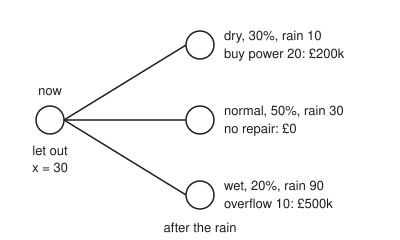
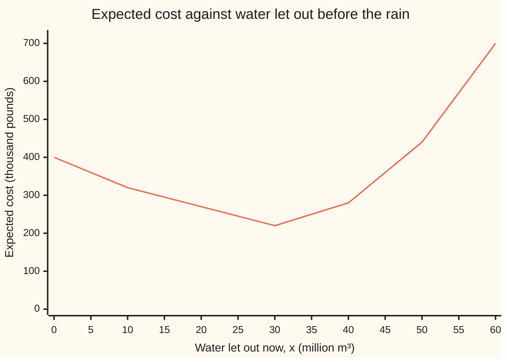

# Two-stage stochastic programming: decide now, adjust when you know more

[Syllabus](../../../SYLLABUS.md) → [Optimization](../README.md) → [Dynamic Programming and Learning](../README.md#s07) → Two-stage stochastic programming

---

## General Overview

A hydro reservoir holds 70 million cubic metres (m³) of water on 1 November. It has room for 100 million m³. A storm season is coming, and November's rain will bring 10, 30 or 90 million m³: dry, normal or wet, with chances 30, 50 and 20 percent.

The operator acts twice. **Now**, before the rain, she can open the spill gates and let water out to make room, at £2,000 per million m³ for downstream warnings. Once the storm arrives the gates cannot pass the flood peak, so the only room is room made beforehand.

**After the rain**, she knows how much fell and adjusts the turbine, which a power contract expects to run 20 million m³ in the month. Then she pays for what still went wrong:

- £10,000 per million m³ of turbine water not run (bought as power instead)
- £50,000 per million m³ that overflows the crest onto farmland
- £30,000 per million m³ below a 50 million m³ town reserve

Letting water out helps in a wet month and hurts in a dry one. The goal is the smallest **expected cost**: the cost averaged over the three kinds of month, weighted by their chances. This is a **minimisation**.

Two-stage stochastic programming draws the three months as leaves of a tree, gives each leaf its own copy of the after-the-rain choices and gives the now-choice one copy shared by all three. The total is a single linear program (straight-line costs under straight-line limits).

Its answer: **let out 30 million m³ now**. In a dry month, buy power for the 20 million m³ the turbine cannot run (£200,000). In a normal month, nothing goes wrong. In a wet month, 10 million m³ overflow (£500,000). The expected cost is **£220,000**, and a set of dual prices (one price on each limit of the program) proves no plan does better.

Planning for the average rain of 36 million m³ instead lets nothing out and forecasts £0. Its true expected cost is £400,000.

**Give every possible future its own copy of the later decisions, keep one shared copy of the decision that must be made now, and the best plan under uncertainty becomes one linear program whose answer hedges across the futures instead of betting on the average.**

**What kind of fact this is:** a model (the three rain scenarios and their chances are assumptions, not laws), and inside it a theorem, proved on this card in Why it works: the one large linear program has the same best plan and cost as the two-stage problem. The answer here is certified optimal by a dual bound that meets it.

### The picture: the scenario tree

<p align="center"></p>

Schematic, not to scale. The root is the decision made before the rain; each leaf is one kind of month, with the best plan's repair there and its cost.

---

## The formula

$$\min_{0 \,\le\, x \,\le\, 70}\; c^T x \;+\; \sum_{s} p_s\, Q(x, s), \qquad Q(x, s) \;=\; \min_{y_s \,\ge\, 0}\ \big\{\, q^T y_s \;:\; W y_s \,\ge\, h_s - T x \,\big\}$$

**Read it aloud:** choose the now-decision to make smallest its own cost plus the chance-weighted average, over the scenarios, of the cheapest repair each scenario allows once it is known.

The second half, $Q(x, s)$, is the **recourse** (the after-the-fact correction). The whole problem is called a two-stage program **with recourse**. Write out every $Q$ in full and the two minimisations merge into one, the **extensive form**:

$$\min_{x,\ y_1, \dots, y_S}\; c^T x + \sum_s p_s\, q^T y_s \quad \text{subject to} \quad T x + W y_s \ge h_s \ \text{ for every scenario } s, \qquad 0 \le x \le 70,\ \ y_s \ge 0.$$

Here $x$ is one number, so $c^T x$ is $2x$. The raised $T$ (transpose) means "multiply entry by entry, then add up": $q^T y_s$ is each repair price times its amount, summed. It is not the matrix $T$ below. On this card $y$ is the recourse, not the linear-programming shelf's dual prices, which are written $\lambda$ here. $Q$ is this subject's standard letter, and its likeness to the values of [Q-learning](05-q-learning-and-temporal-differences.md) is real: both price a choice followed by the best continuation.

For the reservoir, the water level at the end of November in scenario $s$ is $70 + \xi_s - x - (20 - g_s) - f_s$: what was there, plus rain, minus what was let out, minus what the turbine ran, minus overflow. Each leaf has four rows (limits, one line of the program each): the end level is at most 100 (room), the end level plus the shortfall $b_s$ is at least 50 (reserve), $g_s \le 20$ (turbine), and the end level is at least 0.

| Symbol | Plain meaning | In our example | Push it up and the answer… |
| --- | --- | --- | --- |
| $x$ | the first-stage decision: water let out through the spill gates now, before the rain, million m³ | best $x^* = 30$ | more room if wet, less water if dry; the expected cost falls until 30, then rises |
| $c$ | cost of letting out one million m³ now, thousand pounds | 2 | $x^*$ falls; at 12 it is 0 |
| $s$, $p_s$ | a scenario (one leaf of the tree, $S$ leaves in all) and its chance | dry 0.3, normal 0.5, wet 0.2 | more weight on wet: $x^*$ rises (40 at wet 40%) |
| $\xi_s$ | rain inflow in scenario $s$, million m³ (say "xi") | 10, 30, 90 | more room is needed |
| $y_s = (g_s, f_s, b_s)$ | the recourse: power bought for turbine water not run, overflow over the crest, shortfall below the 50 reserve, million m³ | wet: (0, 10, 0) | — |
| $q$ | recourse prices per million m³, thousand pounds | (10, 50, 30) | overflow at 100: $x^* = 40$, cost 280 |
| $W$, $T$, $h_s$; $A z \ge h$ | how the recourse, the now-decision and the rain enter each leaf's rows; all rows stacked, with $z$ every unknown | four rows per leaf; 13 rows, 10 unknowns | — |
| $Q(x, s)$ | recourse cost: the cheapest repair in scenario $s$, given $x$ | at $x = 30$: 200, 0, 500 | — |
| $p^*$ | the optimal value: the best expected cost, the value of the whole program | 220 | — |
| $\lambda$ | dual prices on the rows: the certificate that nothing beats $p^*$ | 8, 5 and 10 on three rows, 0 elsewhere | — |
| EEV, VSS | expected cost of the plan made for average rain; the value of the stochastic solution, EEV − $p^*$ | 400, 180 | — |
| WS, EVPI | wait-and-see: expected cost with perfect foresight; the expected value of perfect information, $p^*$ − WS | 16, 204 | — |

### When it holds

- **The now-decision cannot see the rain.** Give each leaf its own $x$ and the program prices clairvoyance instead (WS = 16), which no operator can achieve.
- **The scenarios and chances describe the weather.** Shift the wet chance from 20 to 40 percent, taken from normal, and the best release moves from 30 to 40.
- **Every leaf has a repair, whatever $x$ is.** Here every shortfall has a price. Make the reserve a hard wall and any $x$ above 30 leaves the dry leaf with no repair: its $Q$ is infinite, and those $x$ are ruled out.
- **Costs and limits are straight lines.** That makes it one linear program. Gates that open only in steps of 25 million m³ would make it an integer program (some unknowns limited to whole steps): see [Integer programs](../05-Integer%20and%20Combinatorial%20Optimisation/01-integer-programs-and-relaxations.md).
- **The target is the average cost.** The plan accepts a 20 percent chance of a £500,000 bill. An operator who cannot afford that leaf needs a risk measure (a target that counts the bad leaves more heavily than their chance), not the plain average.

---

## Why it works

### Step 0: one copy of the now-decision, one copy of the later decisions per leaf

The later decisions are made after the rain, so they may depend on it: they are three sets of numbers, one per leaf. The now-decision is one number shared by every leaf. That sharing is the whole content of "decide now": the program cannot use information it will not have.

With the copies written down, the expected cost $c^T x + \sum_s p_s q^T y_s$ is a straight-line function of all the unknowns, because the chances are fixed numbers. Each leaf's limits are straight lines too. That is a linear program.

### Step 1: one leaf on its own

Fix $x$ and the scenario, and the leaf can be solved in words. The water on hand after the rain is $70 + \xi_s - x$. Run the turbine up to 20 million m³, but not below the 50 million m³ reserve: falling short of the reserve costs 30 per million m³, buying the power costs only 10. Whatever is still above 100 overflows. At $x = 30$ this gives $Q(30, s)$ = 200, 0 and 500, as the worked numbers show.

### Step 2: the one large program equals the two-stage problem

Fix $x$. No row of the extensive form contains two leaves' variables. So minimising $\sum_s p_s q^T y_s$ over all of them at once is minimising each leaf separately and adding, and each separate minimum is $Q(x, s)$. What is left is the minimum over $x$: the two-stage problem.

<details>
<summary>Detailed proof: the extensive form and the two-stage problem have the same value and the same best x</summary>

Call $(x, y_1, \dots, y_S)$ feasible when $0 \le x \le 70$ and $T x + W y_s \ge h_s$, $y_s \ge 0$ for every $s$. Its total cost is $c^T x + \sum_s p_s q^T y_s$.

For any feasible point, each $y_s$ satisfies the rows that define $Q(x, s)$, so $q^T y_s \ge Q(x, s)$. Every $p_s \ge 0$, so the total cost is at least $c^T x + \sum_s p_s Q(x, s)$. The extensive form's value is at least the two-stage value.

Conversely, fix any $x$ with every $Q(x, s)$ finite, and in each leaf pick a $y_s$ that attains $Q(x, s)$ (a feasible linear program with a finite value attains it). Different leaves share no row, so these choices do not interfere: with $x$ they form a feasible point whose total cost is $c^T x + \sum_s p_s Q(x, s)$. The extensive form's value is at most the two-stage value.

The two values are equal, and an $x$ is best in one exactly when it is best in the other.

</details>

### Step 3: the expected cost is convex in x, so the best x is a kink

Each $Q(x, s)$ is a **convex** function of $x$ (a curve that never bends down). The rows are straight lines, so a mixture of a repair that works at one release and a repair that works at another works at the same mixture of releases, at the same mixture of costs. A chance-weighted sum of convex functions is convex.

So the expected cost has no false local minimum, and being made of straight pieces, it is smallest at a kink (a release where some leaf changes what its repair does) or at an end of the range. Between 10 and 30 the expected cost falls by 25 for every 5 million m³ let out; from 30 to 40 it rises by 30 for every 5.



The one line is the expected cost, gates plus the chance-weighted repairs. It bends at 10, 30, 40 and 50, and its lowest point is 220 at $x = 30$.

### Step 4: solving the program, and proving nothing beats it

The extensive form here has 10 columns ($x$ and three variables per leaf) and 13 rows (one limit on $x$, four per leaf). The code solves it by the **dual simplex method** in exact fractions ("simplex" meaning the pivoting method of [The simplex method](../04-Linear%20Programming/03-simplex-method.md), not a triangle).

Every cost here is at least zero, so "do nothing" is the cheapest plan of all; it just breaks some rows. Each **pivot** (one exchange of a variable into the plan) repairs one broken row at the least extra cost per unit, keeping every **reduced cost** (the extra cost of one more unit of a variable) at zero or above. When no row is broken, the plan is feasible and still cheapest. Here that takes 3 pivots.

The certificate is the dual prices $\lambda \ge 0$, one per row, read off the last table. They pass two tests on the original data: every column's cost is at least that column's entry in $A^T\lambda$, and $h^T\lambda = 220$. Then for any feasible plan $z$,

$$\text{cost}(z) \;\ge\; (A^T\lambda)^T z \;=\; \lambda^T (A z) \;\ge\; \lambda^T h \;=\; 220,$$

the first step because $z \ge 0$, the second because $\lambda \ge 0$ and $Az \ge h$. This is weak duality, proved on [LP duality](../04-Linear%20Programming/04-lp-duality-and-complementary-slackness.md); the chain above is a reminder.

The plan itself is checked on the same original rows, $z \ge 0$ and $Az \ge h$. That test is needed: at every step of this method $h^T\lambda$ equals the current plan's cost, so the match alone does not show the plan is optimal until the plan is also feasible. No plan can cost less than 220, and this feasible plan costs 220, so it is optimal.

The prices that do the job are 8 on the dry reserve row, 5 on the dry turbine row and 10 on the wet room row. In the $x$ column they balance: 2 for the gates plus 8 from the dry reserve row equals 10 from the wet room row. This corner is degenerate (more rows tight than needed), so the prices are not unique. Read them as the proof, not as the value of one more million m³.

### Step 5: what the hedge is worth

- **Planning for the average.** Average rain is 36 million m³. The plan for it sees no flood, lets nothing out and forecasts £0. Under the real three-leaf weather it costs EEV = 400. The **value of the stochastic solution** is VSS = 400 − 220 = 180. It is never negative: the average-rain plan is one of the plans the program considered.
- **Seeing the future.** A clairvoyant lets out nothing before a dry or normal month and 40 before a wet one, costing 80. On average WS = 16. The **expected value of perfect information** is EVPI = 220 − 16 = 204, the most a perfect forecast could be worth. It is never negative: in each leaf the clairvoyant could copy the shared plan.

So wait-and-see ≤ recourse ≤ mean-value plan always holds: here 16 ≤ 220 ≤ 400.

### Step 6: how big it gets

Each leaf adds three columns and four rows, so $S$ leaves give $1 + 3S$ columns. More stages are worse: a decision every month for a year, with three kinds of month each time, gives 531441 leaves. For large trees the **L-shaped method** splits the program back into leaves: each leaf's dual prices become a straight-line lower bound on its $Q$ (a **cut**), and a small master program in $x$ collects the cuts.

---

## Worked numbers, by hand

Water in million m³, money in thousand pounds. The plan: let out $x = 30$ now.

| Step | Arithmetic | Value |
| --- | --- | --- |
| gates now | 2 × 30 | 60 |
| dry: water on hand | 70 + 10 − 30 | 50 |
| dry: repair | turbine 0 (it would dip below the reserve), buy 20 × 10 | 200 |
| normal: water on hand | 70 + 30 − 30 | 70 |
| normal: repair | turbine 20, ends at 50 | 0 |
| wet: water on hand | 70 + 90 − 30 | 130 |
| wet: repair | turbine 20 leaves 110; overflow 10 × 50 | 500 |
| expected repair | 0.3 × 200 + 0.5 × 0 + 0.2 × 500 | 160 |
| **expected cost $p^*$** | 60 + 160 | **220** |
| dual bound $h^T\lambda$ | from the three nonzero prices | 220 |
| neighbours | expected cost at $x$ = 20 and 40 | 270, 280 |

Letting 30 million m³ out before the rain costs on average £220,000, and the dual bound shows no plan can cost less.

### What breaks if you drop a piece

| Mistake | Comes out at | What went wrong |
| --- | --- | --- |
| Plan for the average rain, 36 | 400 (forecast 0) | The average month never floods; the real wet month does, and its overflow is priced at 50 |
| Plan for the wet year | 280, with $x$ = 40 | It buys flood room the dry and normal months then pay for |
| Average the three clairvoyant plans, 0.2 × 40 | 336, with $x$ = 8 | Averaging the best plans for known weather does not give a good plan for unknown weather |
| Fix the turbine release now too | 320, with $x$ = 10 and turbine 20 | The modelling assumption that releases adjust after the rain is dropped; that flexibility was worth 100 |

---

## Code, from first principles, and it actually runs

Three independent roads. Road 1 writes the whole tree as one linear program and solves it by the dual simplex method in exact fractions. Road 2 checks the plan and the dual prices against the original rows and confirms the prices' bound meets the cost. Road 3 ignores the program: it costs each leaf with the repair rule of Step 1 and scans every whole $x$ from 0 to 70, which is exact because the kinks fall at whole numbers. All three give $x^* = 30$ and £220,000. The scripts also compute the comparisons, the mistakes and the experiments, each experiment by both the program and the scan. Python uses its standard `fractions` module; Rust carries a small rational type.

### Python

```python
# Two-stage stochastic programming with recourse -- the check behind the card.
# Standard library only.  The reservoir: 70 million m3 in store, room for 100.
# Now: let x out through the spill gates (GBP 2k per million m3).  Then the rain
# comes: dry, normal or wet.  After it: buy power the turbine could not make
# (10), pay for overflow (50) and for each million m3 below the 50 reserve (30),
# all in thousand pounds per million m3.  Minimise the expected cost.
# Road 1 solves the whole scenario tree as ONE linear program, by the dual
# simplex method in exact fractions.  Road 2 checks its dual prices (a lower
# bound).  Road 3 scans every whole x with the recourse rule worked out in words.
from fractions import Fraction as Fr

NAMES, P, RAIN = ["dry", "normal", "wet"], [Fr(3, 10), Fr(1, 2), Fr(1, 5)], [10, 30, 90]

def build(p, w, gate=2, flood=50, buy=10, short=30):
    """Extensive form: columns x, then (g_s, f_s, b_s) per scenario; rows A z >= h."""
    n = 1 + 3 * len(p)
    cost = [Fr(gate)] + [pi * k for pi in p for k in (buy, flood, short)]
    A, h, rows = [], [], []
    def row(coefs, rhs, name):
        a = [Fr(0)] * n
        for j, v in coefs: a[j] = Fr(v)
        A.append(a); h.append(Fr(rhs)); rows.append(name)
    row([(0, -1)], -70, "gates: x <= 70")
    for s, ws in enumerate(w):
        g, f, b, nm = 1 + 3 * s, 2 + 3 * s, 3 + 3 * s, NAMES[s]
        row([(0, 1), (g, -1), (f, 1)], ws - 50, nm + " room: level <= 100")
        row([(0, -1), (g, 1), (f, -1), (b, 1)], -ws, nm + " reserve: level + b >= 50")
        row([(g, -1)], -20, nm + " turbine: g <= 20")
        row([(0, -1), (g, 1), (f, -1)], -50 - ws, nm + " level >= 0")
    return cost, A, h, rows

def dual_simplex(cost, A, h):
    """Every cost >= 0, so the all-zero plan is the cheapest plan of all; it just
    breaks some rows.  Each pivot repairs one broken row at the least extra cost
    per unit, keeping every reduced cost >= 0.  When no row is broken, done."""
    m, n = len(A), len(cost)
    T = [[-a for a in A[i]] + [Fr(int(i == k)) for k in range(m)] + [-h[i]] for i in range(m)]
    d, basis, pivots = list(cost) + [Fr(0)] * m, [n + i for i in range(m)], 0
    while True:
        bad = [i for i in range(m) if T[i][-1] < 0]
        if not bad: break
        i = bad[0]                                       # Bland: lowest broken row
        cand = [j for j in range(n + m) if T[i][j] < 0]
        if not cand: raise ValueError("infeasible")
        j = min(cand, key=lambda j: (d[j] / -T[i][j], j))
        piv = T[i][j]; T[i] = [v / piv for v in T[i]]
        for k in range(m):
            if k != i and T[k][j] != 0:
                fct = T[k][j]; T[k] = [a - fct * b for a, b in zip(T[k], T[i])]
        fct = d[j]; d = [a - fct * b for a, b in zip(d, T[i][:-1])]
        basis[i], pivots = j, pivots + 1
    z = [Fr(0)] * n
    for i, j in enumerate(basis):
        if j < n: z[j] = T[i][-1]
    return z, d[n:], pivots                              # plan, dual prices, pivots

def Q(L, buy=10, flood=50, short=30):
    """Recourse rule in words, for L million m3 on hand after the rain: run the
    turbine to 20 unless that dips below the 50 reserve; spill what is over 100."""
    run = max(0, min(20, L - 50))
    return buy * (20 - run) + flood * max(0, L - run - 100) + short * max(0, 50 - L)

def expected(x, p=P, w=RAIN, gate=2, flood=50):
    return gate * x + sum(pi * Q(70 + wi - x, flood=flood) for pi, wi in zip(p, w))

def scan(p=P, w=RAIN, gate=2, flood=50):
    return min((expected(x, p, w, gate, flood), x) for x in range(71))

def show(label, v): print(f"{label:<44}{str(v):>12}")

cost, A, h, rows = build(P, RAIN)
z, lam, pivots = dual_simplex(cost, A, h)
pstar = sum(c * v for c, v in zip(cost, z))
print(f"tree: 1 decision now, 3 leaves; one LP with {len(cost)} columns, {len(A)} rows")
show("road 1: dual simplex pivots", pivots)
show("  x*, let out now (million m3)", z[0])
show("  p*, expected cost (GBP thousand)", pstar)
show("  of which gates, and expected repair", f"{2 * z[0]}, {pstar - 2 * z[0]}")
for s in range(3):
    g, f, b = z[1 + 3 * s: 4 + 3 * s]
    L = 70 + RAIN[s] - z[0]
    print(f"  {NAMES[s]:<7}rain {RAIN[s]:>2} p {str(P[s]):>4}: on hand {L}, turbine {20 - g}, "
          f"bought {g}, overflow {f}, short {b}, cost {Q(L)}")
    assert Q(L) == 10 * g + 50 * f + 30 * b, "LP recourse must match the rule in words"
print("road 2: dual prices lambda on the binding rows")
for i, v in enumerate(lam):
    if v != 0: show("  " + rows[i], v)
reduced = [c - sum(A[i][j] * lam[i] for i in range(len(A))) for j, c in enumerate(cost)]
bound = sum(hi * li for hi, li in zip(h, lam))
show("  smallest reduced cost, must be >= 0", min(reduced))
show("  dual bound h^T lambda", bound)
best_e, best_x = scan()
show("road 3: scan x = 0..70, best x", best_x)
show("  its expected cost", best_e)
print("chart x  " + " ".join(f"{x:>4}" for x in range(0, 61, 5)))
print("chart E  " + " ".join(f"{str(expected(x)):>4}" for x in range(0, 61, 5)))
for x in (10, 20, 30, 40): show(f"  expected cost at x = {x}", expected(x))

wbar = sum(pi * wi for pi, wi in zip(P, RAIN))     # plan for the average rain
fc, xbar = scan([Fr(1)], [wbar])
eev = expected(xbar)
ws_each = [scan([Fr(1)], [wi])[0] for wi in RAIN]   # perfect foresight, each leaf
ws = sum(pi * v for pi, v in zip(P, ws_each))
show("average rain (million m3)", wbar)
show("  its plan x, and the cost it forecasts", f"{xbar}, {fc}")
show("  EEV: that plan's real expected cost", eev)
show("wait-and-see: dry, normal, wet", ", ".join(str(v) for v in ws_each))
show("  WS, perfect-foresight average", ws)
show("VSS = EEV - p*", eev - pstar)
show("EVPI = p* - WS", pstar - ws)
x_wet = scan([Fr(1)], [90])[1]
x_avg = sum(pi * scan([Fr(1)], [wi])[1] for pi, wi in zip(P, RAIN))
fixed = min((2 * x + 10 * (20 - y) + sum(pi * (50 * max(0, 70 + wi - x - y - 100)
         + 30 * max(0, 50 - (70 + wi - x - y))) for pi, wi in zip(P, RAIN)), x, y)
         for x in range(71) for y in range(21))
show("wrong: plan for the average rain", eev)
show(f"wrong: plan for the wet year, x = {x_wet}", expected(x_wet))
show(f"wrong: average the 3 foresight plans, x = {x_avg}", expected(x_avg))
show(f"wrong: fix turbine {fixed[2]} now too, x = {fixed[1]}", fixed[0])
show("  extra cost of fixing it, over p*", fixed[0] - pstar)
show("size: leaves of a 12-month, 3-way tree", 3 ** 12)
for label, p, gate, flood in [("try: wet 40%, normal 30%", [Fr(3, 10), Fr(3, 10), Fr(2, 5)], 2, 50),
                              ("try: overflow costs 100", P, 2, 100), ("try: gates cost 12", P, 12, 50)]:
    e, x = scan(p, RAIN, gate, flood)
    assert dual_simplex(*build(p, RAIN, gate, flood)[:3])[0][0] == x, "LP and scan agree"
    show(label + ": x*, p*", f"{x}, {e}")
print(f"figure, root x {z[0]}; leaves (rain, chance, turbine, bought, overflow, cost): " + " | ".join(
    f"{NAMES[s]} {RAIN[s]} {float(P[s])} {20 - z[1 + 3 * s]} {z[1 + 3 * s]} {z[2 + 3 * s]} {Q(70 + RAIN[s] - z[0])}"
    for s in range(3)))

assert (z[0], pstar) == (best_x, best_e) == (30, 220), "LP must match the scan"
assert min(z) >= 0 and all(sum(a * v for a, v in zip(A[i], z)) >= h[i] for i in range(len(A))), "the plan must meet every row"
assert min(reduced) >= 0 and min(lam) >= 0, "dual prices must be feasible"
assert bound == pstar, "dual bound must meet the LP value: the certificate"
assert ws <= pstar <= eev and fc < eev, "foresight <= recourse <= mean-value plan"
assert (wbar, xbar, eev, ws) == (36, 0, 400, 16), "Step 5 by hand: average rain 36, its plan 0, EEV 400, WS 16"
print("ALL CHECKS PASS")
```

**Ran 2026-11-11 on macOS, Python 3.14.10, standard library only. All checks passed. Output, pasted from the run:**

```
tree: 1 decision now, 3 leaves; one LP with 10 columns, 13 rows
road 1: dual simplex pivots                            3
  x*, let out now (million m3)                        30
  p*, expected cost (GBP thousand)                   220
  of which gates, and expected repair            60, 160
  dry    rain 10 p 3/10: on hand 50, turbine 0, bought 20, overflow 0, short 0, cost 200
  normal rain 30 p  1/2: on hand 70, turbine 20, bought 0, overflow 0, short 0, cost 0
  wet    rain 90 p  1/5: on hand 130, turbine 20, bought 0, overflow 10, short 0, cost 500
road 2: dual prices lambda on the binding rows
  dry reserve: level + b >= 50                         8
  dry turbine: g <= 20                                 5
  wet room: level <= 100                              10
  smallest reduced cost, must be >= 0                  0
  dual bound h^T lambda                              220
road 3: scan x = 0..70, best x                        30
  its expected cost                                  220
chart x     0    5   10   15   20   25   30   35   40   45   50   55   60
chart E   400  360  320  295  270  245  220  250  280  360  440  570  700
  expected cost at x = 10                            320
  expected cost at x = 20                            270
  expected cost at x = 30                            220
  expected cost at x = 40                            280
average rain (million m3)                             36
  its plan x, and the cost it forecasts             0, 0
  EEV: that plan's real expected cost                400
wait-and-see: dry, normal, wet                  0, 0, 80
  WS, perfect-foresight average                       16
VSS = EEV - p*                                       180
EVPI = p* - WS                                       204
wrong: plan for the average rain                     400
wrong: plan for the wet year, x = 40                 280
wrong: average the 3 foresight plans, x = 8          336
wrong: fix turbine 20 now too, x = 10                320
  extra cost of fixing it, over p*                   100
size: leaves of a 12-month, 3-way tree            531441
try: wet 40%, normal 30%: x*, p*                 40, 260
try: overflow costs 100: x*, p*                  40, 280
try: gates cost 12: x*, p*                        0, 400
figure, root x 30; leaves (rain, chance, turbine, bought, overflow, cost): dry 10 0.3 0 20 0 200 | normal 30 0.5 20 0 0 0 | wet 90 0.2 20 0 10 500
ALL CHECKS PASS
```

### Rust

```rust
// Two-stage stochastic programming with recourse -- the check behind the card.
// Rust std only.  Same reservoir, same three roads as the Python check:
// road 1 solves the scenario tree as ONE linear program by the dual simplex
// method in exact fractions (a small rational type below); road 2 checks its
// dual prices; road 3 scans every whole x with the recourse rule in words.
use std::fmt;
use std::ops::{Add, Div, Mul, Neg, Sub};

#[derive(Clone, Copy, PartialEq, Eq, Debug)]
struct Fr { n: i128, d: i128 }
fn gcd(a: i128, b: i128) -> i128 { if b == 0 { a.abs() } else { gcd(b, a % b) } }
fn fr(n: i128, d: i128) -> Fr { let g = gcd(n, d) * d.signum(); Fr { n: n / g, d: d / g } }
fn int(n: i128) -> Fr { Fr { n, d: 1 } }
impl Add for Fr { type Output = Fr; fn add(self, o: Fr) -> Fr { fr(self.n * o.d + o.n * self.d, self.d * o.d) } }
impl Sub for Fr { type Output = Fr; fn sub(self, o: Fr) -> Fr { self + (-o) } }
impl Mul for Fr { type Output = Fr; fn mul(self, o: Fr) -> Fr { fr(self.n * o.n, self.d * o.d) } }
impl Div for Fr { type Output = Fr; fn div(self, o: Fr) -> Fr { fr(self.n * o.d, self.d * o.n) } }
impl Neg for Fr { type Output = Fr; fn neg(self) -> Fr { Fr { n: -self.n, d: self.d } } }
impl PartialOrd for Fr { fn partial_cmp(&self, o: &Fr) -> Option<std::cmp::Ordering> { Some(self.cmp(o)) } }
impl Ord for Fr { fn cmp(&self, o: &Fr) -> std::cmp::Ordering { (self.n * o.d).cmp(&(o.n * self.d)) } }
impl fmt::Display for Fr { fn fmt(&self, f: &mut fmt::Formatter) -> fmt::Result {
    if self.d == 1 { f.pad(&self.n.to_string()) } else { f.pad(&format!("{}/{}", self.n, self.d)) } } }
fn fmax(a: Fr, b: Fr) -> Fr { if a > b { a } else { b } }  fn fmin(a: Fr, b: Fr) -> Fr { if a < b { a } else { b } }

const NAMES: [&str; 3] = ["dry", "normal", "wet"];
const RAIN: [i128; 3] = [10, 30, 90];
fn probs() -> Vec<Fr> { vec![fr(3, 10), fr(1, 2), fr(1, 5)] }

// Extensive form: columns x, then (g_s, f_s, b_s) per scenario; rows A z >= h.
fn build(p: &[Fr], w: &[i128], gate: i128, flood: i128) -> (Vec<Fr>, Vec<Vec<Fr>>, Vec<Fr>, Vec<String>) {
    let n = 1 + 3 * p.len();
    let mut cost = vec![int(gate)];
    for &pi in p { for k in [10, flood, 30] { cost.push(pi * int(k)); } }
    let (mut a, mut h, mut rows) = (vec![], vec![], vec![]);
    let mut row = |coefs: &[(usize, i128)], rhs: i128, name: String| {
        let mut v = vec![int(0); n];
        for &(j, c) in coefs { v[j] = int(c); }
        a.push(v); h.push(int(rhs)); rows.push(name);
    };
    row(&[(0, -1)], -70, "gates: x <= 70".to_string());
    for (s, &ws) in w.iter().enumerate() {
        let (g, f, b, nm) = (1 + 3 * s, 2 + 3 * s, 3 + 3 * s, NAMES[s]);
        row(&[(0, 1), (g, -1), (f, 1)], ws - 50, format!("{} room: level <= 100", nm));
        row(&[(0, -1), (g, 1), (f, -1), (b, 1)], -ws, format!("{} reserve: level + b >= 50", nm));
        row(&[(g, -1)], -20, format!("{} turbine: g <= 20", nm));
        row(&[(0, -1), (g, 1), (f, -1)], -50 - ws, format!("{} level >= 0", nm));
    }
    (cost, a, h, rows)
}

// All costs >= 0: start from the all-zero plan, repair one broken row per pivot
// at the least extra cost per unit, keeping every reduced cost >= 0.
fn dual_simplex(cost: &[Fr], a: &[Vec<Fr>], h: &[Fr]) -> (Vec<Fr>, Vec<Fr>, usize) {
    let (m, n) = (a.len(), cost.len());
    let mut t: Vec<Vec<Fr>> = (0..m).map(|i| {
        let mut v: Vec<Fr> = a[i].iter().map(|&x| -x).collect();
        for k in 0..m { v.push(int((i == k) as i128)); }
        v.push(-h[i]); v
    }).collect();
    let mut d: Vec<Fr> = cost.to_vec(); d.extend(vec![int(0); m]);
    let (mut basis, mut pivots): (Vec<usize>, usize) = ((n..n + m).collect(), 0);
    while let Some(i) = (0..m).find(|&i| t[i][n + m] < int(0)) {     // Bland: lowest broken row
        let j = (0..n + m).filter(|&j| t[i][j] < int(0))
            .min_by(|&x, &y| (d[x] / -t[i][x], x).cmp(&(d[y] / -t[i][y], y))).expect("infeasible");
        let piv = t[i][j]; t[i] = t[i].iter().map(|&v| v / piv).collect();
        for k in 0..m { if k != i && t[k][j] != int(0) {
            let fct = t[k][j]; t[k] = t[k].iter().zip(t[i].iter()).map(|(&x, &y)| x - fct * y).collect(); } }
        let fct = d[j]; d = d.iter().zip(t[i].iter()).map(|(&x, &y)| x - fct * y).collect();
        basis[i] = j; pivots += 1;
    }
    let mut z = vec![int(0); n];
    for (i, &j) in basis.iter().enumerate() { if j < n { z[j] = t[i][n + m]; } }
    (z, d[n..].to_vec(), pivots)
}

// Recourse rule in words, for L on hand after the rain: run the turbine to 20
// unless that dips below the 50 reserve; spill what is over 100.
fn q(l: Fr, flood: i128) -> Fr {
    let run = fmax(int(0), fmin(int(20), l - int(50)));
    int(10) * (int(20) - run) + int(flood) * fmax(int(0), l - run - int(100)) + int(30) * fmax(int(0), int(50) - l)
}
fn expected(x: i128, p: &[Fr], w: &[i128], gate: i128, flood: i128) -> Fr {
    let mut e = int(gate * x);
    for (&pi, &wi) in p.iter().zip(w) { e = e + pi * q(int(70 + wi - x), flood); }
    e
}
fn scan(p: &[Fr], w: &[i128], gate: i128, flood: i128) -> (Fr, i128) {
    (0..71).map(|x| (expected(x, p, w, gate, flood), x)).min().unwrap()
}
fn show(label: &str, v: impl fmt::Display) { println!("{:<44}{:>12}", label, v); }

fn main() {
    let p = probs();
    let (cost, a, h, rows) = build(&p, &RAIN, 2, 50);
    let (z, lam, pivots) = dual_simplex(&cost, &a, &h);
    let pstar = cost.iter().zip(&z).fold(int(0), |s, (&c, &v)| s + c * v);
    println!("tree: 1 decision now, 3 leaves; one LP with {} columns, {} rows", cost.len(), a.len());
    show("road 1: dual simplex pivots", pivots);
    show("  x*, let out now (million m3)", z[0]);
    show("  p*, expected cost (GBP thousand)", pstar);
    show("  of which gates, and expected repair", format!("{}, {}", int(2) * z[0], pstar - int(2) * z[0]));
    for s in 0..3 {
        let (g, f, b) = (z[1 + 3 * s], z[2 + 3 * s], z[3 + 3 * s]);
        let l = int(70 + RAIN[s]) - z[0];
        println!("  {:<7}rain {:>2} p {:>4}: on hand {}, turbine {}, bought {}, overflow {}, short {}, cost {}",
                 NAMES[s], RAIN[s], p[s], l, int(20) - g, g, f, b, q(l, 50));
        assert!(q(l, 50) == int(10) * g + int(50) * f + int(30) * b, "LP recourse must match the rule in words");
    }
    println!("road 2: dual prices lambda on the binding rows");
    for (i, &v) in lam.iter().enumerate() { if v != int(0) { show(&format!("  {}", rows[i]), v); } }
    let reduced: Vec<Fr> = (0..cost.len()).map(|j| (0..a.len()).fold(cost[j], |s, i| s - a[i][j] * lam[i])).collect();
    let bound = h.iter().zip(&lam).fold(int(0), |s, (&hi, &li)| s + hi * li);
    show("  smallest reduced cost, must be >= 0", *reduced.iter().min().unwrap());
    show("  dual bound h^T lambda", bound);
    let (best_e, best_x) = scan(&p, &RAIN, 2, 50);
    show("road 3: scan x = 0..70, best x", best_x);
    show("  its expected cost", best_e);
    let xs: Vec<i128> = (0..13).map(|k| 5 * k).collect();
    println!("chart x  {}", xs.iter().map(|x| format!("{:>4}", x)).collect::<Vec<_>>().join(" "));
    println!("chart E  {}", xs.iter().map(|&x| format!("{:>4}", expected(x, &p, &RAIN, 2, 50))).collect::<Vec<_>>().join(" "));
    for x in [10, 20, 30, 40] { show(&format!("  expected cost at x = {}", x), expected(x, &p, &RAIN, 2, 50)); }

    let wbar = p.iter().zip(&RAIN).fold(int(0), |s, (&pi, &wi)| s + pi * int(wi));
    let (one, (fc, xbar)) = ([int(1)], scan(&[int(1)], &[wbar.n], 2, 50));   // wbar is a whole number
    let eev = expected(xbar, &p, &RAIN, 2, 50);
    let ws_each: Vec<Fr> = RAIN.iter().map(|&wi| scan(&one, &[wi], 2, 50).0).collect();
    let ws = p.iter().zip(&ws_each).fold(int(0), |s, (&pi, &v)| s + pi * v);
    show("average rain (million m3)", wbar);
    show("  its plan x, and the cost it forecasts", format!("{}, {}", xbar, fc));
    show("  EEV: that plan's real expected cost", eev);
    show("wait-and-see: dry, normal, wet", ws_each.iter().map(|v| v.to_string()).collect::<Vec<_>>().join(", "));
    show("  WS, perfect-foresight average", ws);
    show("VSS = EEV - p*", eev - pstar);
    show("EVPI = p* - WS", pstar - ws);
    let x_wet = scan(&one, &[90], 2, 50).1;
    let x_avg = p.iter().zip(&RAIN).fold(int(0), |s, (&pi, &wi)| s + pi * int(scan(&one, &[wi], 2, 50).1));
    let mut fixed = (int(1_000_000), 0, 0);
    for x in 0..71 { for y in 0..21 {
        let c = p.iter().zip(&RAIN).fold(int(2 * x + 10 * (20 - y)), |c, (&pi, &wi)|
            c + pi * int(50 * (70 + wi - x - y - 100).max(0) + 30 * (50 - (70 + wi - x - y)).max(0)));
        if (c, x, y) < fixed { fixed = (c, x, y); } } }
    show("wrong: plan for the average rain", eev);
    show(&format!("wrong: plan for the wet year, x = {}", x_wet), expected(x_wet, &p, &RAIN, 2, 50));
    show(&format!("wrong: average the 3 foresight plans, x = {}", x_avg), expected(x_avg.n, &p, &RAIN, 2, 50));
    show(&format!("wrong: fix turbine {} now too, x = {}", fixed.2, fixed.1), fixed.0);
    show("  extra cost of fixing it, over p*", fixed.0 - pstar);
    show("size: leaves of a 12-month, 3-way tree", 3i64.pow(12));
    for (label, pp, gate, flood) in [("try: wet 40%, normal 30%", vec![fr(3, 10), fr(3, 10), fr(2, 5)], 2, 50),
                                     ("try: overflow costs 100", p.clone(), 2, 100), ("try: gates cost 12", p.clone(), 12, 50)] {
        let (e, x) = scan(&pp, &RAIN, gate, flood);
        let (c2, a2, r2, _) = build(&pp, &RAIN, gate, flood);
        assert!(dual_simplex(&c2, &a2, &r2).0[0] == int(x), "LP and scan agree");
        show(&format!("{}: x*, p*", label), format!("{}, {}", x, e));
    }
    let leaves: Vec<String> = (0..3).map(|s| format!("{} {} {} {} {} {} {}", NAMES[s], RAIN[s], p[s].n as f64 / p[s].d as f64,
        int(20) - z[1 + 3 * s], z[1 + 3 * s], z[2 + 3 * s], q(int(70 + RAIN[s]) - z[0], 50))).collect();
    println!("figure, root x {}; leaves (rain, chance, turbine, bought, overflow, cost): {}", z[0], leaves.join(" | "));

    assert!(z[0] == int(best_x) && pstar == best_e && best_e == int(220) && best_x == 30, "LP must match the scan");
    assert!(z.iter().all(|&v| v >= int(0)) && (0..a.len()).all(|i| (0..cost.len()).fold(int(0), |s, j| s + a[i][j] * z[j]) >= h[i]), "the plan must meet every row");
    assert!(*reduced.iter().min().unwrap() >= int(0) && *lam.iter().min().unwrap() >= int(0), "dual prices must be feasible");
    assert!(bound == pstar, "dual bound must meet the LP value: the certificate");
    assert!(ws <= pstar && pstar <= eev && fc < eev, "foresight <= recourse <= mean-value plan");
    assert!(wbar == int(36) && xbar == 0 && eev == int(400) && ws == int(16), "Step 5 by hand: average rain 36, its plan 0, EEV 400, WS 16");
    println!("ALL CHECKS PASS");
}
```

**Ran 2026-11-11 on macOS, rustc 1.98.1, no crates. All checks passed. Output, pasted from the run:**

```
tree: 1 decision now, 3 leaves; one LP with 10 columns, 13 rows
road 1: dual simplex pivots                            3
  x*, let out now (million m3)                        30
  p*, expected cost (GBP thousand)                   220
  of which gates, and expected repair            60, 160
  dry    rain 10 p 3/10: on hand 50, turbine 0, bought 20, overflow 0, short 0, cost 200
  normal rain 30 p  1/2: on hand 70, turbine 20, bought 0, overflow 0, short 0, cost 0
  wet    rain 90 p  1/5: on hand 130, turbine 20, bought 0, overflow 10, short 0, cost 500
road 2: dual prices lambda on the binding rows
  dry reserve: level + b >= 50                         8
  dry turbine: g <= 20                                 5
  wet room: level <= 100                              10
  smallest reduced cost, must be >= 0                  0
  dual bound h^T lambda                              220
road 3: scan x = 0..70, best x                        30
  its expected cost                                  220
chart x     0    5   10   15   20   25   30   35   40   45   50   55   60
chart E   400  360  320  295  270  245  220  250  280  360  440  570  700
  expected cost at x = 10                            320
  expected cost at x = 20                            270
  expected cost at x = 30                            220
  expected cost at x = 40                            280
average rain (million m3)                             36
  its plan x, and the cost it forecasts             0, 0
  EEV: that plan's real expected cost                400
wait-and-see: dry, normal, wet                  0, 0, 80
  WS, perfect-foresight average                       16
VSS = EEV - p*                                       180
EVPI = p* - WS                                       204
wrong: plan for the average rain                     400
wrong: plan for the wet year, x = 40                 280
wrong: average the 3 foresight plans, x = 8          336
wrong: fix turbine 20 now too, x = 10                320
  extra cost of fixing it, over p*                   100
size: leaves of a 12-month, 3-way tree            531441
try: wet 40%, normal 30%: x*, p*                 40, 260
try: overflow costs 100: x*, p*                  40, 280
try: gates cost 12: x*, p*                        0, 400
figure, root x 30; leaves (rain, chance, turbine, bought, overflow, cost): dry 10 0.3 0 20 0 200 | normal 30 0.5 20 0 0 0 | wet 90 0.2 20 0 10 500
ALL CHECKS PASS
```

The two outputs are identical, line for line.

### Lean

Lean proves that the extensive form matches the two-stage problem for any finite set of scenarios, and solves the card's reservoir exactly.

- Take finitely many scenarios, chances at least zero adding to 1, and straight-line costs and rows. Suppose every leaf has a repair whatever allowed $x$ is chosen, and every $Q(x, s)$ is finite.
- Then the extensive form and the two-stage problem have the same value. If either can be pushed down without limit, so can the other.
- With the same conditions, an $x$ is best for the two-stage problem exactly when it is the now-decision of a best extensive-form plan.
- For the reservoir, letting out 30, then buying power for 20 if dry and overflowing 10 if wet, meets every row and costs 220.
- No plan that meets every row costs less than 220, and every plan costing 220 lets out exactly 30.
- The hand arithmetic holds exactly: the worked numbers, the chart, the scan of every whole $x$ from 0 to 70, and the dual bound.
- So do EEV 400, WS 16, VSS 180, EVPI 204, the first three mistakes and the 531441 leaves.

The dual simplex solve, the full dual-price check, the fixed-turbine mistake and the Try changing experiments are left to the Python and Rust checks.

```lean
-- Two-stage stochastic programming: the one large linear program (the extensive form) has the same best cost and the same best now-decision as the two-stage problem, and for the card's reservoir the best plan lets out 30 million m³ at an expected cost of £220,000.
import Mathlib.Data.Matrix.Mul
import Mathlib.Order.ConditionallyCompleteLattice.Basic
import Mathlib.Algebra.Order.Archimedean.Real.Basic
import Mathlib.Algebra.BigOperators.Fin
import Mathlib.Topology.Algebra.Module.FiniteDimension
import Mathlib.Topology.Order.Monotone
import Mathlib.Topology.Instances.Real.Lemmas
import Mathlib.Tactic

open Matrix

theorem cone_closed_aux {ι E : Type*} [Fintype ι] [DecidableEq ι] [AddCommGroup E] [Module ℝ E]
    [TopologicalSpace E] [IsTopologicalAddGroup E] [ContinuousSMul ℝ E] [T2Space E]
    (L : (ι → ℝ) →ₗ[ℝ] E) (S : Finset ι) :
    IsClosed (L '' {μ | 0 ≤ μ ∧ ∀ i ∉ S, μ i = 0}) := by
  induction S using Finset.strongInduction with
  | H S ih =>
  by_cases hind : ∀ μ : ι → ℝ, (∀ i ∉ S, μ i = 0) → L μ = 0 → μ = 0
  · let V : Submodule ℝ (ι → ℝ) :=
      { carrier := {μ | ∀ i ∉ S, μ i = 0}
        add_mem' := by
          intro a b ha hb i hi
          simp [ha i hi, hb i hi]
        zero_mem' := by intro i _; rfl
        smul_mem' := by
          intro c a ha i hi
          simp [ha i hi] }
    have hker : LinearMap.ker (L.domRestrict V) = ⊥ := by
      rw [LinearMap.ker_eq_bot']
      intro v hv
      exact Subtype.ext (hind v v.2 hv)
    have hemb := LinearMap.isClosedEmbedding_of_injective hker
    have hcl : IsClosed {v : V | 0 ≤ (v : ι → ℝ)} :=
      isClosed_le continuous_const continuous_subtype_val
    have := hemb.isClosedMap _ hcl
    convert this using 1
    ext x
    constructor
    · rintro ⟨μ, ⟨h0, hS⟩, rfl⟩
      exact ⟨⟨μ, hS⟩, h0, rfl⟩
    · rintro ⟨v, hv, rfl⟩
      exact ⟨v, ⟨hv, v.2⟩, rfl⟩
  · push Not at hind
    obtain ⟨g0, hg0S, hLg0, hg0⟩ := hind
    obtain ⟨j0, hj0⟩ : ∃ j, g0 j ≠ 0 := by
      by_contra hc
      push Not at hc
      exact hg0 (funext hc)
    -- choose a sign so that some coordinate is positive
    obtain ⟨g, hgS, hLg, j1, hj1⟩ : ∃ g : ι → ℝ, (∀ i ∉ S, g i = 0) ∧ L g = 0 ∧
        ∃ j, 0 < g j := by
      rcases lt_or_gt_of_ne hj0 with h | h
      · refine ⟨-g0, fun i hi => by simp [hg0S i hi], by simp [hLg0], j0, by simp; linarith⟩
      · exact ⟨g0, hg0S, hLg0, j0, h⟩
    have hj1S : j1 ∈ S := by
      by_contra hc
      rw [hgS j1 hc] at hj1
      exact lt_irrefl _ hj1
    let P := S.filter (fun i => 0 < g i)
    have hP : P.Nonempty := ⟨j1, Finset.mem_filter.mpr ⟨hj1S, hj1⟩⟩
    have key : L '' {μ | 0 ≤ μ ∧ ∀ i ∉ S, μ i = 0} =
        ⋃ j ∈ P, L '' {μ | 0 ≤ μ ∧ ∀ i ∉ S.erase j, μ i = 0} := by
      ext x
      simp only [Set.mem_iUnion, Set.mem_image, Set.mem_ofPred_eq]
      constructor
      · rintro ⟨μ, ⟨h0, hS⟩, rfl⟩
        obtain ⟨j, hjP, hjmin⟩ := P.exists_min_image (fun i => μ i / g i) hP
        have hjP' := Finset.mem_filter.mp hjP
        set t := μ j / g j with ht
        have ht0 : 0 ≤ t := div_nonneg (h0 j) hjP'.2.le
        refine ⟨j, hjP, μ - t • g, ⟨?_, ?_⟩, ?_⟩
        · intro i
          simp only [Pi.zero_apply, Pi.sub_apply, Pi.smul_apply, smul_eq_mul]
          by_cases hgi : 0 < g i
          · have hiS : i ∈ S := by
              by_contra hc
              rw [hgS i hc] at hgi
              exact lt_irrefl _ hgi
            have := hjmin i (Finset.mem_filter.mpr ⟨hiS, hgi⟩)
            rw [le_div_iff₀ hgi] at this
            linarith
          · push Not at hgi
            have := h0 i
            have : t * g i ≤ 0 := mul_nonpos_of_nonneg_of_nonpos ht0 hgi
            simp only [Pi.zero_apply] at *
            linarith
        · intro i hi
          simp only [Pi.sub_apply, Pi.smul_apply, smul_eq_mul]
          by_cases hij : i = j
          · subst hij
            rw [ht]
            field_simp [hjP'.2.ne']
            ring
          · have hiS : i ∉ S := fun h => hi (Finset.mem_erase.mpr ⟨hij, h⟩)
            simp [hS i hiS, hgS i hiS]
        · simp [map_sub, map_smul, hLg]
      · rintro ⟨j, _, μ, ⟨h0, hS⟩, rfl⟩
        exact ⟨μ, ⟨h0, fun i hi => hS i (fun h => hi (Finset.mem_of_mem_erase h))⟩, rfl⟩
    rw [key]
    refine isClosed_biUnion_finset fun j hj => ih _ ?_
    exact Finset.erase_ssubset (Finset.mem_filter.mp hj).1

theorem lp_attains {m k : ℕ} (q : Fin m → ℝ) (W : Matrix (Fin k) (Fin m) ℝ) (d b : Fin k → ℝ)
    (hne : {y : Fin m → ℝ | 0 ≤ y ∧ b ≤ d + W *ᵥ y}.Nonempty)
    (hbdd : BddBelow ((fun y => q ⬝ᵥ y) '' {y : Fin m → ℝ | 0 ≤ y ∧ b ≤ d + W *ᵥ y})) :
    ∃ y ∈ {y : Fin m → ℝ | 0 ≤ y ∧ b ≤ d + W *ᵥ y},
      ∀ y' ∈ {y : Fin m → ℝ | 0 ≤ y ∧ b ≤ d + W *ᵥ y}, q ⬝ᵥ y ≤ q ⬝ᵥ y' := by
  classical
  let L : (Fin m ⊕ Fin k → ℝ) →ₗ[ℝ] ℝ × (Fin k → ℝ) :=
    { toFun := fun μ => (q ⬝ᵥ (fun j => μ (Sum.inl j)),
        W *ᵥ (fun j => μ (Sum.inl j)) - fun i => μ (Sum.inr i))
      map_add' := by
        intro a b
        have e : (fun j => (a + b) (Sum.inl j)) =
            (fun j => a (Sum.inl j)) + (fun j => b (Sum.inl j)) := rfl
        have e2 : (fun i => (a + b) (Sum.inr i)) =
            (fun i => a (Sum.inr i)) + (fun i => b (Sum.inr i)) := rfl
        rw [e, e2, dotProduct_add, Matrix.mulVec_add, Prod.mk_add_mk]
        congr 1
        abel
      map_smul' := by
        intro c a
        have e : (fun j => (c • a) (Sum.inl j)) = c • (fun j => a (Sum.inl j)) := rfl
        have e2 : (fun i => (c • a) (Sum.inr i)) = c • (fun i => a (Sum.inr i)) := rfl
        rw [e, e2, dotProduct_smul, Matrix.mulVec_smul, RingHom.id_apply, Prod.smul_mk, smul_sub] }
  have hC := cone_closed_aux L Finset.univ
  set Pset := {y : Fin m → ℝ | 0 ≤ y ∧ b ≤ d + W *ᵥ y} with hPset
  let T : Set ℝ := (fun τ : ℝ => (τ, b - d)) ⁻¹' (L '' {μ | 0 ≤ μ ∧ ∀ i ∉ Finset.univ, μ i = 0})
  have hTcl : IsClosed T := hC.preimage (continuous_id.prodMk continuous_const)
  have hmemT : ∀ y ∈ Pset, q ⬝ᵥ y ∈ T := by
    rintro y ⟨hy0, hyb⟩
    refine ⟨Sum.elim y (d + W *ᵥ y - b), ⟨?_, by simp⟩, ?_⟩
    · intro i
      cases i with
      | inl j => exact hy0 j
      | inr i => simpa using hyb i
    · refine Prod.ext rfl ?_
      ext i
      simp [L]
      ring
  have hTsub : ∀ τ ∈ T, ∃ y ∈ Pset, q ⬝ᵥ y = τ := by
    rintro τ ⟨μ, ⟨h0, -⟩, hμ⟩
    simp only [L, LinearMap.coe_mk, AddHom.coe_mk, Prod.mk.injEq] at hμ
    refine ⟨fun j => μ (Sum.inl j), ⟨fun j => h0 (Sum.inl j), ?_⟩, hμ.1⟩
    intro i
    have h2 := congrFun hμ.2 i
    have h3 := h0 (Sum.inr i)
    simp only [Pi.sub_apply, Pi.zero_apply] at h2 h3
    simp only [Pi.add_apply]
    linarith
  obtain ⟨y0, hy0⟩ := hne
  have hTne : T.Nonempty := ⟨_, hmemT y0 hy0⟩
  have hTbdd : BddBelow T := by
    obtain ⟨B, hB⟩ := hbdd
    refine ⟨B, fun τ hτ => ?_⟩
    obtain ⟨y, hy, rfl⟩ := hTsub τ hτ
    exact hB ⟨y, hy, rfl⟩
  obtain ⟨y, hy, hyq⟩ := hTsub _ (hTcl.csInf_mem hTne hTbdd)
  refine ⟨y, hy, fun y' hy' => ?_⟩
  rw [hyq]
  exact csInf_le hTbdd (hmemT y' hy')

namespace TwoStage

variable {σ : Type*} {n m k : ℕ}

/-- The repairs allowed in scenario `s` once the now-decision `x` is fixed: recourse amounts
`y ≥ 0` with `T x + W y ≥ h s` (the card's `W y ≥ h_s - T x`). -/
def recourseSet (W : Matrix (Fin k) (Fin m) ℝ) (T : Matrix (Fin k) (Fin n) ℝ)
    (h : σ → Fin k → ℝ) (x : Fin n → ℝ) (s : σ) : Set (Fin m → ℝ) :=
  {y | 0 ≤ y ∧ h s ≤ T *ᵥ x + W *ᵥ y}

/-- The recourse cost `Q(x, s)`: the cheapest repair in scenario `s`, given `x`. -/
noncomputable def Q (q : Fin m → ℝ) (W : Matrix (Fin k) (Fin m) ℝ)
    (T : Matrix (Fin k) (Fin n) ℝ) (h : σ → Fin k → ℝ) (x : Fin n → ℝ) (s : σ) : ℝ :=
  sInf ((fun y => q ⬝ᵥ y) '' recourseSet W T h x s)

/-- The two-stage objective: now-cost plus the chance-weighted cheapest repairs,
`cᵀx + Σ_s p_s Q(x, s)`. -/
noncomputable def twoStageCost [Fintype σ] (p : σ → ℝ) (c : Fin n → ℝ) (q : Fin m → ℝ)
    (W : Matrix (Fin k) (Fin m) ℝ) (T : Matrix (Fin k) (Fin n) ℝ) (h : σ → Fin k → ℝ)
    (x : Fin n → ℝ) : ℝ :=
  c ⬝ᵥ x + ∑ s, p s * Q q W T h x s

/-- The extensive form's objective: one shared `x`, one copy `y s` of the repair per leaf,
`cᵀx + Σ_s p_s qᵀy_s`. -/
def extensiveCost [Fintype σ] (p : σ → ℝ) (c : Fin n → ℝ) (q : Fin m → ℝ)
    (x : Fin n → ℝ) (y : σ → Fin m → ℝ) : ℝ :=
  c ⬝ᵥ x + ∑ s, p s * (q ⬝ᵥ y s)

/-- A point of the extensive form is allowed when the shared `x` is an allowed now-decision
and every leaf's copy `y s` meets that leaf's rows `T x + W y_s ≥ h_s`, `y_s ≥ 0`. -/
def extensiveFeasible (X : Set (Fin n → ℝ)) (W : Matrix (Fin k) (Fin m) ℝ)
    (T : Matrix (Fin k) (Fin n) ℝ) (h : σ → Fin k → ℝ)
    (x : Fin n → ℝ) (y : σ → Fin m → ℝ) : Prop :=
  x ∈ X ∧ ∀ s, y s ∈ recourseSet W T h x s

theorem Q_le_of_mem (q : Fin m → ℝ) (W : Matrix (Fin k) (Fin m) ℝ)
    (T : Matrix (Fin k) (Fin n) ℝ) (h : σ → Fin k → ℝ) (x : Fin n → ℝ) (s : σ)
    (hb : BddBelow ((fun y => q ⬝ᵥ y) '' recourseSet W T h x s))
    (y : Fin m → ℝ) (hy : y ∈ recourseSet W T h x s) : Q q W T h x s ≤ q ⬝ᵥ y :=
  csInf_le hb ⟨y, hy, rfl⟩

theorem twoStage_le_extensive [Fintype σ] (p : σ → ℝ) (hp : ∀ s, 0 ≤ p s)
    (X : Set (Fin n → ℝ)) (c : Fin n → ℝ) (q : Fin m → ℝ)
    (W : Matrix (Fin k) (Fin m) ℝ) (T : Matrix (Fin k) (Fin n) ℝ) (h : σ → Fin k → ℝ)
    (hfinite : ∀ x ∈ X, ∀ s, BddBelow ((fun y => q ⬝ᵥ y) '' recourseSet W T h x s))
    (x : Fin n → ℝ) (y : σ → Fin m → ℝ) (hf : extensiveFeasible X W T h x y) :
    twoStageCost p c q W T h x ≤ extensiveCost p c q x y := by
  unfold twoStageCost extensiveCost
  gcongr with s
  · exact hp s
  · exact Q_le_of_mem q W T h x s (hfinite x hf.1 s) (y s) (hf.2 s)

theorem exists_extensive_eq_twoStage [Fintype σ] (p : σ → ℝ)
    (X : Set (Fin n → ℝ)) (c : Fin n → ℝ) (q : Fin m → ℝ)
    (W : Matrix (Fin k) (Fin m) ℝ) (T : Matrix (Fin k) (Fin n) ℝ) (h : σ → Fin k → ℝ)
    (hrepair : ∀ x ∈ X, ∀ s, (recourseSet W T h x s).Nonempty)
    (hfinite : ∀ x ∈ X, ∀ s, BddBelow ((fun y => q ⬝ᵥ y) '' recourseSet W T h x s))
    (x : Fin n → ℝ) (hx : x ∈ X) :
    ∃ y, extensiveFeasible X W T h x y ∧
      extensiveCost p c q x y = twoStageCost p c q W T h x := by
  have hmin : ∀ s, ∃ y ∈ recourseSet W T h x s, ∀ y' ∈ recourseSet W T h x s,
      q ⬝ᵥ y ≤ q ⬝ᵥ y' := fun s =>
    lp_attains q W (T *ᵥ x) (h s) (hrepair x hx s) (hfinite x hx s)
  choose y hy hymin using hmin
  refine ⟨y, ⟨hx, hy⟩, ?_⟩
  unfold extensiveCost twoStageCost
  congr 1
  refine Finset.sum_congr rfl fun s _ => ?_
  congr 1
  symm
  exact (show IsLeast ((fun y => q ⬝ᵥ y) '' recourseSet W T h x s) (q ⬝ᵥ y s) from
    ⟨⟨y s, hy s, rfl⟩, by rintro _ ⟨y', hy', rfl⟩; exact hymin s y' hy'⟩).csInf_eq

/-- The extensive form equals the two-stage problem (value). Take finitely many scenarios with
chances `p s ≥ 0` adding to 1, an allowed set `X` of now-decisions, and linear costs and rows.
Suppose every leaf has a repair whatever allowed `x` is chosen, and every repair cost `Q(x, s)`
is finite (the leaf's costs are bounded below). Then the one large linear program over
`(x, y_1, …, y_S)` and the two-stage problem `min_x cᵀx + Σ_s p_s Q(x, s)` are bounded below
together, and they have the same best value. -/
theorem extensive_form_value_eq_two_stage_value [Fintype σ]
    (p : σ → ℝ) (hp : ∀ s, 0 ≤ p s) (hsum : ∑ s, p s = 1)
    (X : Set (Fin n → ℝ)) (c : Fin n → ℝ) (q : Fin m → ℝ)
    (W : Matrix (Fin k) (Fin m) ℝ) (T : Matrix (Fin k) (Fin n) ℝ) (h : σ → Fin k → ℝ)
    (hrepair : ∀ x ∈ X, ∀ s, (recourseSet W T h x s).Nonempty)
    (hfinite : ∀ x ∈ X, ∀ s, BddBelow ((fun y => q ⬝ᵥ y) '' recourseSet W T h x s)) :
    (BddBelow {v | ∃ x y, extensiveFeasible X W T h x y ∧ v = extensiveCost p c q x y} ↔
        BddBelow (twoStageCost p c q W T h '' X)) ∧
      sInf {v | ∃ x y, extensiveFeasible X W T h x y ∧ v = extensiveCost p c q x y} =
        sInf (twoStageCost p c q W T h '' X) := by
  classical
  set E := {v | ∃ x y, extensiveFeasible X W T h x y ∧ v = extensiveCost p c q x y} with hE
  set S := twoStageCost p c q W T h '' X with hS
  have hSE : S ⊆ E := by
    rintro _ ⟨x, hx, rfl⟩
    obtain ⟨y, hy, hyeq⟩ := exists_extensive_eq_twoStage p X c q W T h hrepair hfinite x hx
    exact ⟨x, y, hy, hyeq.symm⟩
  have hES : ∀ e ∈ E, ∃ s ∈ S, s ≤ e := by
    rintro _ ⟨x, y, hf, rfl⟩
    exact ⟨_, ⟨x, hf.1, rfl⟩, twoStage_le_extensive p hp X c q W T h hfinite x y hf⟩
  have hlb : lowerBounds E = lowerBounds S := by
    ext B
    constructor
    · intro hB s hs
      exact hB (hSE hs)
    · intro hB e he
      obtain ⟨s, hs, hse⟩ := hES e he
      exact (hB hs).trans hse
  have hbdd : BddBelow E ↔ BddBelow S := by
    unfold BddBelow
    rw [hlb]
  refine ⟨hbdd, ?_⟩
  rcases X.eq_empty_or_nonempty with hX | hX
  · have hS0 : S = ∅ := by rw [hS, hX, Set.image_empty]
    have hE0 : E = ∅ := by
      apply Set.eq_empty_of_forall_notMem
      intro e he
      obtain ⟨s, hs, -⟩ := hES e he
      rw [hS0] at hs
      exact hs
    rw [hS0, hE0]
  · have hSne : S.Nonempty := hX.image _
    have hEne : E.Nonempty := hSne.mono hSE
    by_cases hB : BddBelow S
    · have hBE : BddBelow E := hbdd.mpr hB
      apply le_antisymm
      · exact le_csInf hSne fun s hs => csInf_le hBE (hSE hs)
      · refine le_csInf hEne fun e he => ?_
        obtain ⟨s, hs, hse⟩ := hES e he
        exact (csInf_le hB hs).trans hse
    · rw [Real.sInf_of_not_bddBelow hB, Real.sInf_of_not_bddBelow (fun h' => hB (hbdd.mp h'))]

/-- The extensive form and the two-stage problem have the same best now-decision. Under the
same conditions, an allowed `x` is best for the two-stage problem exactly when it is the shared
now-decision of some best point `(x, y_1, …, y_S)` of the one large linear program. -/
theorem same_best_now_decision [Fintype σ]
    (p : σ → ℝ) (hp : ∀ s, 0 ≤ p s) (hsum : ∑ s, p s = 1)
    (X : Set (Fin n → ℝ)) (c : Fin n → ℝ) (q : Fin m → ℝ)
    (W : Matrix (Fin k) (Fin m) ℝ) (T : Matrix (Fin k) (Fin n) ℝ) (h : σ → Fin k → ℝ)
    (hrepair : ∀ x ∈ X, ∀ s, (recourseSet W T h x s).Nonempty)
    (hfinite : ∀ x ∈ X, ∀ s, BddBelow ((fun y => q ⬝ᵥ y) '' recourseSet W T h x s))
    (x : Fin n → ℝ) (hx : x ∈ X) :
    (∀ x' ∈ X, twoStageCost p c q W T h x ≤ twoStageCost p c q W T h x') ↔
      ∃ y, extensiveFeasible X W T h x y ∧
        ∀ x' y', extensiveFeasible X W T h x' y' →
          extensiveCost p c q x y ≤ extensiveCost p c q x' y' := by
  constructor
  · intro hopt
    obtain ⟨y, hy, hyeq⟩ := exists_extensive_eq_twoStage p X c q W T h hrepair hfinite x hx
    refine ⟨y, hy, fun x' y' hf' => ?_⟩
    rw [hyeq]
    exact (hopt x' hf'.1).trans (twoStage_le_extensive p hp X c q W T h hfinite x' y' hf')
  · rintro ⟨y, hy, hymin⟩ x' hx'
    obtain ⟨y', hy', hyeq'⟩ := exists_extensive_eq_twoStage p X c q W T h hrepair hfinite x' hx'
    calc twoStageCost p c q W T h x ≤ extensiveCost p c q x y :=
          twoStage_le_extensive p hp X c q W T h hfinite x y hy
      _ ≤ extensiveCost p c q x' y' := hymin x' y' hy'
      _ = twoStageCost p c q W T h x' := hyeq'

end TwoStage

namespace Reservoir

/-- November rain in million m³: dry, normal, wet. -/
def rain : Fin 3 → ℝ := ![10, 30, 90]

/-- The chances of a dry, normal and wet month. -/
noncomputable def chance : Fin 3 → ℝ := ![3 / 10, 1 / 2, 1 / 5]

/-- End-of-November level in scenario `s`: 70 in store, plus rain, minus `x` let out now, minus
what the turbine ran (`20 - g s`), minus overflow `f s`. -/
def level (x : ℝ) (g f : Fin 3 → ℝ) (s : Fin 3) : ℝ :=
  70 + rain s - x - (20 - g s) - f s

/-- The extensive form's rows: `0 ≤ x ≤ 70`; in each leaf `g, f, b ≥ 0`, level at most 100
(room), level plus shortfall at least 50 (reserve), `g ≤ 20` (turbine), level at least 0. -/
def feasible (x : ℝ) (g f b : Fin 3 → ℝ) : Prop :=
  0 ≤ x ∧ x ≤ 70 ∧
    ∀ s, 0 ≤ g s ∧ 0 ≤ f s ∧ 0 ≤ b s ∧ level x g f s ≤ 100 ∧
      50 ≤ level x g f s + b s ∧ g s ≤ 20 ∧ 0 ≤ level x g f s

/-- Expected cost in thousand pounds: 2 per million m³ let out now, then per leaf 10 per
million m³ of power bought, 50 per million m³ of overflow, 30 per million m³ below the reserve. -/
noncomputable def cost (x : ℝ) (g f b : Fin 3 → ℝ) : ℝ :=
  2 * x + ∑ s, chance s * (10 * g s + 50 * f s + 30 * b s)

/-- The card's answer for the reservoir: letting out 30 million m³ now, then buying power for 20
in a dry month, doing nothing in a normal month and overflowing 10 in a wet month, is an allowed
plan with expected cost 220 (£220,000); no allowed plan costs less; and every best plan lets out
exactly 30. -/
theorem reservoir_best_release_30_expected_cost_220 :
    feasible 30 ![20, 0, 0] ![0, 0, 10] ![0, 0, 0] ∧
      cost 30 ![20, 0, 0] ![0, 0, 10] ![0, 0, 0] = 220 ∧
      (∀ x g f b, feasible x g f b → 220 ≤ cost x g f b) ∧
      (∀ x g f b, feasible x g f b → cost x g f b = 220 → x = 30) := by
  refine ⟨?_, ?_, ?_, ?_⟩
  · refine ⟨by norm_num, by norm_num, ?_⟩
    intro s
    fin_cases s <;> simp [level, rain] <;> norm_num
  · simp [cost, chance, Fin.sum_univ_three]
    norm_num
  · rintro x g f b ⟨hx0, hx70, hs⟩
    obtain ⟨a1, a2, a3, a4, a5, a6, a7⟩ := hs 0
    obtain ⟨b1, b2, b3, b4, b5, b6, b7⟩ := hs 1
    obtain ⟨c1, c2, c3, c4, c5, c6, c7⟩ := hs 2
    simp [level, rain] at a4 a5 a7 b4 b5 b7 c4 c5 c7
    simp [cost, chance, Fin.sum_univ_three]
    linarith
  · rintro x g f b ⟨hx0, hx70, hs⟩ hcost
    obtain ⟨a1, a2, a3, a4, a5, a6, a7⟩ := hs 0
    obtain ⟨b1, b2, b3, b4, b5, b6, b7⟩ := hs 1
    obtain ⟨c1, c2, c3, c4, c5, c6, c7⟩ := hs 2
    simp [level, rain] at a4 a5 a7 b4 b5 b7 c4 c5 c7
    simp [cost, chance, Fin.sum_univ_three] at hcost
    apply le_antisymm <;> linarith

/-- The card's repair rule for `L` million m³ on hand after the rain (in whole numbers): run the
turbine up to 20 without dipping below the 50 reserve, buy the rest of the power at 10, pay 50
per million m³ still over 100 and 30 per million m³ below 50. -/
def repair (L : ℤ) : ℤ :=
  let run := max 0 (min 20 (L - 50))
  10 * (20 - run) + 50 * max 0 (L - run - 100) + 30 * max 0 (50 - L)

/-- Ten times the expected cost of letting out `x` now (chances 3/10, 1/2, 1/5 become 3, 5, 2),
kept in whole numbers. -/
def tenTimesExpected (x : ℤ) : ℤ :=
  10 * (2 * x) + 3 * repair (70 + 10 - x) + 5 * repair (70 + 30 - x) + 2 * repair (70 + 90 - x)

end Reservoir

open Reservoir in
-- Worked numbers at x = 30: gates 60; water on hand 50, 70, 130; repairs 200, 0, 500.
example : 2 * 30 = 60 ∧ 70 + 10 - 30 = 50 ∧ 70 + 30 - 30 = 70 ∧ 70 + 90 - 30 = 130 := by decide
open Reservoir in
example : repair 50 = 200 ∧ repair 70 = 0 ∧ repair 130 = 500 := by decide
-- Expected repair 3/10 × 200 + 1/2 × 0 + 1/5 × 500 = 160, and 60 + 160 = 220.
example : (3 / 10 : ℚ) * 200 + 1 / 2 * 0 + 1 / 5 * 500 = 160 ∧ (60 : ℚ) + 160 = 220 := by norm_num
open Reservoir in
-- The expected cost at x = 30 is 220; its neighbours at x = 20 and 40 cost 270 and 280.
example : tenTimesExpected 30 = 2200 ∧ tenTimesExpected 20 = 2700 ∧ tenTimesExpected 40 = 2800 := by
  decide
open Reservoir in
-- The chart: expected cost at x = 0, 5, …, 60 is 400, 360, 320, 295, 270, 245, 220, 250, 280, 360, 440, 570, 700.
example : (List.range 13).map (fun i => tenTimesExpected (5 * i)) =
    [4000, 3600, 3200, 2950, 2700, 2450, 2200, 2500, 2800, 3600, 4400, 5700, 7000] := by decide
open Reservoir in
-- Road 3: scanning every whole x from 0 to 70, nothing beats 220.
example : ∀ x : Fin 71, 2200 ≤ tenTimesExpected x := by decide
-- The dual bound: prices 8, 5, 10 on rows with right-hand sides -10, -20, 40 give 220; in the x
-- column, 2 for the gates plus 8 from the dry reserve row equals 10 from the wet room row.
example : 8 * (-10) + 5 * (-20) + 10 * 40 = (220 : ℤ) ∧ 2 + 8 = 10 := by decide
-- Average rain 3/10 × 10 + 1/2 × 30 + 1/5 × 90 = 36.
example : (3 / 10 : ℚ) * 10 + 1 / 2 * 30 + 1 / 5 * 90 = 36 := by norm_num
open Reservoir in
-- The average-rain plan lets out nothing: its real expected cost EEV is 400.
example : tenTimesExpected 0 = 4000 := by decide
open Reservoir in
-- Wait-and-see: a clairvoyant pays 0 in a dry or normal month and 80 in a wet one (x = 40);
-- WS = 1/5 × 80 = 16.
example : repair (70 + 10 - 0) = 0 ∧ repair (70 + 30 - 0) = 0 ∧ 2 * 40 + repair (70 + 90 - 40) = 80 := by
  decide
example : (3 / 10 : ℚ) * 0 + 1 / 2 * 0 + 1 / 5 * 80 = 16 := by norm_num
-- VSS = 400 - 220 = 180, EVPI = 220 - 16 = 204, and 16 ≤ 220 ≤ 400.
example : 400 - 220 = 180 ∧ 220 - 16 = 204 ∧ 16 ≤ 220 ∧ 220 ≤ 400 := by decide
open Reservoir in
-- Averaging the clairvoyant plans, 1/5 × 40 = 8, costs 336.
example : tenTimesExpected 8 = 3360 := by decide
-- A year of monthly decisions with three kinds of month gives 3 ^ 12 = 531441 leaves.
example : 3 ^ 12 = 531441 := by norm_num

open TwoStage Reservoir

#print axioms extensive_form_value_eq_two_stage_value
#print axioms same_best_now_decision
#print axioms reservoir_best_release_30_expected_cost_220
#print axioms cone_closed_aux
#print axioms lp_attains
#print axioms Q_le_of_mem
#print axioms twoStage_le_extensive
#print axioms exists_extensive_eq_twoStage
```

**Checked 2026-11-12 on macOS, Lean 4.36.0-rc2, Mathlib v4.36.0-rc2. Every proof is complete and uses only Lean's standard axioms. Output, pasted from the run:**

```
'TwoStage.extensive_form_value_eq_two_stage_value' depends on axioms: [propext, Classical.choice, Quot.sound]
'TwoStage.same_best_now_decision' depends on axioms: [propext, Classical.choice, Quot.sound]
'Reservoir.reservoir_best_release_30_expected_cost_220' depends on axioms: [propext, Classical.choice, Quot.sound]
'cone_closed_aux' depends on axioms: [propext, Classical.choice, Quot.sound]
'lp_attains' depends on axioms: [propext, Classical.choice, Quot.sound]
'TwoStage.Q_le_of_mem' depends on axioms: [propext, Classical.choice, Quot.sound]
'TwoStage.twoStage_le_extensive' depends on axioms: [propext, Classical.choice, Quot.sound]
'TwoStage.exists_extensive_eq_twoStage' depends on axioms: [propext, Classical.choice, Quot.sound]
```

> [!TIP]
> **Try changing**
> Each experiment is one entry in the scripts' `try:` list; edit it, or add your own, and both the program and the scan re-solve.
> - Guess first: the wet chance doubles to 40 percent, taken from normal (chances `[Fr(3, 10), Fr(3, 10), Fr(2, 5)]`). The best release rises to **40** and the expected cost to **260**.
> - Guess first: flood damage doubles to 100 per million m³ (`flood` 100). The release rises to **40**, cost **280**: a dearer flood buys more room.
> - Guess first: the gates cost 12 per million m³ instead of 2 (`gate` 12). The release drops to **0** and the cost is **400**: each million m³ let out now costs more than the 10 it saves in the wet leaf on average (0.2 × 50).

---

## The usual mistake

> [!warning]
> **Planning for the average weather.** Average rain is 36 million m³, a month that never floods. The plan made for it lets nothing out and promises a cost of £0. Its real expected cost is £400,000, because cost is not a straight line in the rain: overflow is free up to the crest and £50,000 per million m³ above it. Optimising for the average input is not optimising the average cost.
>
> Smaller traps:
> - **Averaging the answers.** The clairvoyant plans 0, 0 and 40 average to 8, which costs 336.
> - **Planning for the worst case.** The wet-month plan, $x$ = 40, costs 280: safe in one leaf, dear in two.
> - **Deciding everything now.** Fixing the turbine before the rain too costs 320. The second stage is the point.
> - **Taking WS as a target.** The clairvoyant's 16 is a bound no operator acting before the rain can reach.

---

## Where you meet it in real life

- **Hydro scheduling.** Reservoir operators plan releases against inflow scenarios in this shape, and large hydro-thermal power systems plan with a multistage version of it.
- **Power-plant commitment.** A grid operator decides the day before which plants to start, which takes hours, then adjusts their output once demand and wind are seen.
- **Capacity planning.** A firm sizes a factory before demand is known; the second stage serves whatever demand arrives, by overtime, outsourcing or lost sales.
- **Sampled scenarios.** When the uncertainty is continuous, the tree is built from a sample and the sample's program is solved: the sample average approximation of [Stochastic gradient](../06-Conic%2C%20Quadratic%20and%20Stochastic%20Programs/08-stochastic-gradient-and-sample-average-approximation.md).

> **Say it back**
> Some decisions must be made before the uncertainty clears, and others can wait. Draw the possible futures as leaves of a tree, give each leaf its own copy of the waiting decisions and give all leaves one shared copy of the now-decision. The expected cost is then a straight-line function of all the copies, so the whole problem is one linear program. For the reservoir it lets out 30 million m³ and costs £220,000 on average, and dual prices prove nothing does better. Planning for the average rain costs £400,000; perfect foresight would cost £16,000.

---

## What this builds on

- [Markov decision processes](02-markov-decision-processes.md): a decision, then chance, then a reaction to what chance did. A two-stage program is that pattern cut to two steps, with straight-line costs and continuous choices instead of a short list of actions.
- [Network flows](../04-Linear%20Programming/06-network-flows-as-linear-programs.md): water in equals water out at the dam, and the room, reserve and turbine limits are capacities, so each leaf's repair is a small flow problem.

## Where this goes next

- [Backward induction](01-finite-horizon-dynamic-programming-and-backward-induction.md): with a decision every month, the tree grows to 531441 leaves after a year. Backward induction is the other way to handle many stages: it solves from the last month back, and needs only a value per storage level, not a copy per leaf.
- [Stochastic gradient](../06-Conic%2C%20Quadratic%20and%20Stochastic%20Programs/08-stochastic-gradient-and-sample-average-approximation.md): solving on a sample of scenarios, and how far that answer can sit from the true one.
- [Robust and chance constraints](../06-Conic%2C%20Quadratic%20and%20Stochastic%20Programs/10-robust-and-chance-constrained-optimisation.md): for an operator who cannot accept a 20 percent chance of flooding, a limit on the bad leaves instead of an average over them.

The question this card leaves open is where the three leaves come from: real rain is a continuum, and choosing a few scenarios that lead to nearly the right release is its own problem.

---

## Sources

Verified 2026-11-11: every link below resolves to the publisher's page.

- Dantzig, George B. "Linear Programming under Uncertainty." *Management Science* 1, no. 3–4 (1955): 197–206. [doi:10.1287/mnsc.1.3-4.197](https://doi.org/10.1287/mnsc.1.3-4.197). The founding paper: decide now, then correct once the uncertain data are known, all as one linear program.
- Van Slyke, R. M., and Roger Wets. "L-Shaped Linear Programs with Applications to Optimal Control and Stochastic Programming." *SIAM Journal on Applied Mathematics* 17, no. 4 (1969): 638–663. [doi:10.1137/0117061](https://doi.org/10.1137/0117061). The block shape of the extensive form, and the L-shaped method of Step 6 that splits it into leaves joined by cuts.
- Birge, John R. "The Value of the Stochastic Solution in Stochastic Linear Programs with Fixed Recourse." *Mathematical Programming* 24 (1982): 314–325. [doi:10.1007/BF01585113](https://doi.org/10.1007/BF01585113). Defines the value of the stochastic solution, sets it beside EVPI, and gives the ordering of wait-and-see, recourse and mean-value costs used in Step 5.
- Lemke, C. E. "The Dual Method of Solving the Linear Programming Problem." *Naval Research Logistics Quarterly* 1, no. 1 (1954): 36–47. [doi:10.1002/nav.3800010107](https://doi.org/10.1002/nav.3800010107). The dual simplex method used in the code.
- Birge, John R., and François Louveaux. *Introduction to Stochastic Programming*, 2nd ed. Springer, 2011. [Publisher page](https://link.springer.com/book/10.1007/978-1-4614-0237-4). The standard textbook: recourse, the extensive form, EVPI and VSS, and the L-shaped method.
