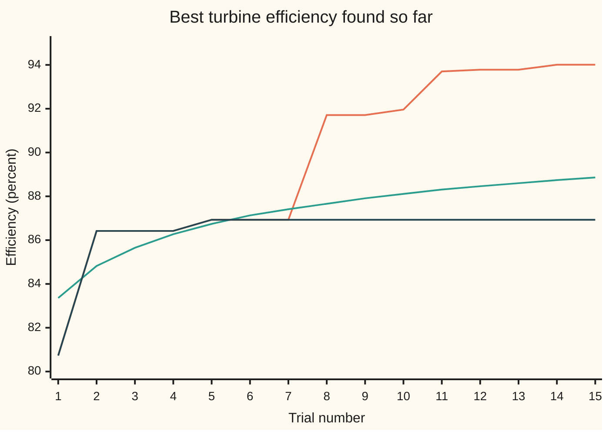

# Bayesian optimisation: choosing the next expensive experiment wisely

[Syllabus](../../../SYLLABUS.md) → [Optimization](../README.md) → [Dynamic Programming and Learning](../README.md#s07) → Bayesian optimisation

---

## General Overview

A hydro station has just fitted a new turbine. Three settings decide how much of the falling water's energy it turns into electricity: the **gate opening** (0 to 100 percent), the **blade angle** (10 to 30 degrees) and the **air injection** that calms the swirl below the runner (0 to 4 litres a second). The engineers want the settings that give the highest efficiency, so this is a **maximisation**.

Each test is dear. One setting means draining down, running the unit for a day on the test rig and reading the efficiency: about £20,000 a trial. The budget is **15 trials**, £300,000. A fine grid of 21 values per setting would need 9,261 trials and £185,220,000. Nobody has a formula for efficiency either, and no slope to follow: each trial returns one number and nothing else.

So the question is not "how do I climb?" but **"which trial should I run next?"** Bayesian optimisation answers it in two moves. First it fits a **surrogate**: a cheap statistical guess of the whole efficiency surface, with an error bar at every setting, built from the trials so far. Then it scores every untried setting by its **expected improvement**: how much, on average, it would beat the best result so far. It runs the top-scoring trial, adds the result, refits and repeats.

On this turbine the first five trials, spread across the box, reach 86.93 percent. Ten trials chosen by expected improvement climb to **94.01 percent at 70 percent gate, 17.0 degrees, 2.40 litres a second**, found on trial 14. That matches the best of all 9,261 grid settings, at 15 trials' cost.

**Treat the unknown efficiency surface as a random function, condition it on the trials so far to get a best guess and an error bar everywhere, and run next wherever the expected gain over the best result so far is largest: that one score trades a good guess against a large error bar.**

**What kind of fact this is:** a method. The expected-improvement formula is a theorem, proved on this card in Why it works. The surrogate is a model: an assumption about how smooth the surface is, not a law. The answer is "the best found". Here a full grid search on a stand-in rig, which a real turbine could never afford, certifies it as the best of the 9,261 grid settings; the rig's true peak, 94.09, sits between grid points.

### The picture: best efficiency so far, trial by trial



Orange: Bayesian optimisation with expected improvement. Green: random settings, the average over 2,000 runs of 15 trials. Dark blue: always testing the setting with the highest predicted efficiency, which re-runs trial 5 for ever. The orange and dark blue lines share the same five starting trials.

---

## The formula

Notation first, in words. A setting is a point $x$ = (gate, blade, air), each part scaled to run from 0 to 1 (gate 0 to 100 percent, blade 10 to 30 degrees, air 0 to 4 litres a second). The true efficiency at $x$ is $f(x)$, in percent; nobody knows it until a trial is run. After $n$ trials we hold settings $x_1, \dots, x_n$ and readings $y_1, \dots, y_n$. A **kernel** $k(x, x')$ is a number saying how strongly the efficiencies at two settings move together: large when the settings are close, near zero when they are far apart. This card uses

$$k(x, x') = \sigma^2 \exp\!\Big(-\frac{\lVert x - x' \rVert^2}{2\ell^2}\Big),$$

where $\lVert x - x' \rVert$ is the ordinary straight-line distance. Gather the kernel between every pair of trials into the $n \times n$ table $K$, and between a new setting and each trial into the column $k_n(x)$. $I$ is the identity table and $y - m$ the column of readings minus the prior mean.

The **surrogate** (a Gaussian process: a random function whose values at any finite set of settings are jointly normal) gives at every setting a mean and a spread:

$$\mu_n(x) = m + k_n(x)^T (K + \tau^2 I)^{-1} (y - m), \qquad \sigma_n^2(x) = \sigma^2 - k_n(x)^T (K + \tau^2 I)^{-1} k_n(x)$$

Here $\mu$ is a mean, not shelf 01's strong-convexity constant. With $f^+ = \max_i y_i$ the best reading so far and $z = (\mu_n(x) - f^+)/\sigma_n(x)$, the **expected improvement** is

$$\mathrm{EI}_n(x) = \big(\mu_n(x) - f^+\big)\,\Phi(z) + \sigma_n(x)\,\varphi(z), \qquad x_{n+1} = \operatorname{argmax}_x \mathrm{EI}_n(x)$$

**Read it aloud:** the expected gain at a setting is how far its predicted efficiency beats the best so far, weighted by the chance it does, plus its spread times the bell-curve height at that gap; the next trial goes where that is largest.

| Symbol | Plain meaning | In our example | Push it up and the answer… |
| --- | --- | --- | --- |
| $x$ | a setting: gate, blade, air, each scaled 0 to 1 | best found (0.70, 0.35, 0.60) | — |
| $f(x)$ | true efficiency at $x$, percent, unknown until tested | 94.01 at the best found | — |
| $x_i, y_i, n$, $Y$ | trial $i$'s setting and reading; number of trials so far; the unknown true efficiency at the next trial's setting | $y_5$ = 86.93; $n$ runs 5 to 14 | more trials, smaller error bars |
| $m$ | prior mean: the efficiency guessed before any trial, percent | 85 | the surrogate is more hopeful far from the data |
| $\sigma^2$ | prior variance: how far from $m$ the surface may stray, percent squared | 25 (spread 5 points) | wider error bars, more exploring |
| $\ell$ | length scale: how far apart two settings must be before they stop telling about each other | 0.2 | a smoother, more confident surrogate |
| $\tau^2$ | measurement noise variance of one trial, percent squared | 0.01 (rig repeats to 0.1 points) | the surrogate trusts readings less |
| $k$, $K$, $k_n(x)$, $I$ | kernel; its table between trials; its column from $x$ to the trials; the identity table, which adds the noise on the diagonal | $k$ = 25 × 0.6065 at distance 0.2 | — |
| $\mu_n(x)$, $\sigma_n(x)$ | surrogate's mean and spread at $x$ after $n$ trials | 85.7769 and 4.6000 at trial 6's setting | — |
| $f^+$ | best reading so far | 86.93 after five trials | a higher bar, smaller EI everywhere |
| $z$, $Z$, $\Phi$, $\varphi$ | standard score of the gap; a standard normal variable; normal CDF (chance below); normal density (bell height) | $z$ = −0.2501, $\Phi$ = 0.401259, $\varphi$ = 0.386659 | — |
| $\mathrm{EI}_n(x)$ | expected improvement: average gain over $f^+$ if $x$ is tested | 1.3170 at trial 6's setting | that setting gets picked |

### When it holds

- **The surface is about as smooth as the kernel says.** The length scale 0.2 claims settings 0.2 apart still share most of their behaviour. If the true peak is narrower than that, the surrogate cannot see it between trials; What breaks shows a 0.1-wide peak missed entirely, 87.67 against 94.01.
- **The surrogate's error bars are honest.** Expected improvement trusts $\sigma_n(x)$. Set the prior spread or length scale badly and it explores the wrong amount, too much or too little.
- **Trials are expensive and few.** Each step solves an $n \times n$ system and scores thousands of candidates. That is cheap beside a £20,000 trial, absurd beside a function that takes a microsecond: then just evaluate it, or use a gradient method.
- **A few settings, a bounded box.** With three settings, scoring a 9,261-point candidate grid is easy. In 50 dimensions both the surrogate and the search for the best candidate struggle.
- **Only "best found" is promised.** No finite set of trials can certify a global maximum of an arbitrary surface: a narrow spike can always hide between them. The certificate on this card exists only because the stand-in rig is cheap to evaluate at all 9,261 grid settings, and it covers only those: the rig's true peak, 94.09, sits between them.

---

## Why it works

### Step 0: turn ignorance into a probability

Global optimisation is hard because nothing local tells you about the far side of the box. A hill climber finds a peak, not the peak ([Local and global minima](../01-Convexity/01-local-and-global-minima.md) makes the distinction). Bayesian optimisation adds one assumption: nearby settings give similar efficiencies. Written as a probability law over surfaces, that assumption lets each trial inform every setting near it, and lets us ask, before paying, what a trial is likely to return.

### Step 1: the surrogate is a multivariate normal

Pick any finite set of settings. The surrogate says their efficiencies are jointly normal, each with mean $m$ and variance $\sigma^2$, with covariance $k(x, x')$ between any two. That is exactly a [Multivariate normal](../../09-Probability%20and%20statistics/05-Transformations%20and%20Joint%20Laws/06-multivariate-normal.md) with covariance table built from the kernel. Close settings get covariance near $\sigma^2$, so they move together; settings far apart get nearly zero, so they are nearly independent. The length scale $\ell$ sets what "close" means. The kernel table is a valid covariance (positive semidefinite) for every choice of points, which is what lets one formula describe a whole surface.

### Step 2: conditioning on the trials

A trial's reading is the true value plus small noise of variance $\tau^2$. Once the readings are in, the efficiency at any untried setting, given the readings, is still normal. Its mean and variance are the formulas above: the same conditioning rule as for two variables on [Bivariate normal](../../09-Probability%20and%20statistics/05-Transformations%20and%20Joint%20Laws/05-bivariate-normal-and-conditioning.md), with a table in place of a single correlation. The mean moves towards nearby readings; the spread shrinks near trials and stays at $\sigma$ far from them.

With one trial the table is one number, and the rule is the bivariate one. Trial 5 read $y_5$ = 86.9273 at (0.90, 0.30, 0.70). At the candidate (0.70, 0.30, 0.70), distance 0.2 away, the correlation is $\exp(-0.5)$ = 0.6065, so

$$\mu_1 = m + \frac{0.6065\,\sigma^2}{\sigma^2 + \tau^2}(y_5 - m), \qquad \sigma_1^2 = \sigma^2 - 0.6065^2\,\frac{\sigma^4}{\sigma^2 + \tau^2}.$$

The mean slides 0.6063 of the way from 85 to the reading; the variance falls from 25 to 15.8067. The code checks both against this two-variable rule.

### Step 3: the expected improvement has a closed form

Let $Y = f(x)$ be the true efficiency at the next trial's setting. The improvement is $\max(Y - f^+, 0)$: the amount it beats the best so far, or nothing. Under the surrogate $Y$ is normal with mean $\mu$ and spread $\sigma$ (dropping the $n$ and $x$). The improvement is measured on $f$ itself; the reading adds noise of variance $\tau^2$, which with $\tau = 0.1$ is negligible. Its average works out to $(\mu - f^+)\Phi(z) + \sigma\varphi(z)$. The proof is one substitution and one exact integral.

<details>
<summary>Detailed proof: the expected improvement of a normal reading</summary>

Write $Y = \mu + \sigma Z$ with $Z$ standard normal, and $z = (\mu - f^+)/\sigma$. Then $Y - f^+ = \sigma(Z + z)$, which is positive exactly when $Z > -z$. So

$$E[\max(Y - f^+, 0)] = \int_{-z}^{\infty} \sigma (t + z)\, \varphi(t)\, dt = \sigma z \int_{-z}^{\infty} \varphi(t)\,dt + \sigma \int_{-z}^{\infty} t\, \varphi(t)\, dt.$$

The first integral is the chance $Z > -z$, which by the bell's symmetry is $\Phi(z)$. For the second, $\varphi(t) = e^{-t^2/2}/\sqrt{2\pi}$ has derivative $-t\,\varphi(t)$, so $\int_{-z}^{\infty} t\,\varphi(t)\,dt = \big[-\varphi(t)\big]_{-z}^{\infty} = \varphi(-z) = \varphi(z)$. Putting these together, with $\sigma z = \mu - f^+$:

$$E[\max(Y - f^+, 0)] = (\mu - f^+)\,\Phi(z) + \sigma\,\varphi(z).$$

</details>

The code checks this formula against Simpson's rule on the integral itself: both give 1.317008 at trial 6's setting.

### Step 4: one score balances guessing well and learning

Differentiate the formula. Its slope with respect to $\mu$ is $\Phi(z)$ and with respect to $\sigma$ is $\varphi(z)$, both positive (the other terms cancel because $\varphi'(z) = -z\varphi(z)$). So expected improvement **rises with a higher predicted efficiency and with a wider error bar**. A setting predicted slightly worse than the best but very uncertain can win; a setting predicted well but already measured cannot. At trial 5's own setting the mean is 86.9265 and the spread only 0.1000, so EI is 0.0395. At the candidate 0.2 away the mean is lower, 86.1685, but the spread is 3.9758, and EI is 1.2355, far more. This is the **exploration–exploitation trade-off** (exploit: test where the guess is good; explore: test where you know little) settled by one number instead of a hand-set dial.

### Step 5: what it costs, and what it promises

Each step factors the $n \times n$ table once, about $n^3/6$ multiplications by the Cholesky method, then scores every candidate with about $n^2/2$ more: here 9,261 candidates at $n \le 14$, every step. That is the price of thinking hard before spending £20,000.

The promise is modest, and it does not cover this run. Vazquez and Bect proved that expected improvement's trial points eventually fill the whole box, for every surface in the space the kernel describes, so its best found tends to the true maximum. Their theorem needs three things: a kernel with what they call the No-Empty-Ball property (the error bar at a setting shrinks to zero only if trials come arbitrarily close to it), exact readings, and each trial chosen from the whole box. The property is proved for kernels such as the Matérn family, which allow rougher surfaces, and is not known for the Gaussian kernel used here. These runs also read with noise and choose only among the 9,261 grid settings, which can never fill the box. So this run has no proved convergence guarantee, not even one about infinitely many trials. For 15 trials there is only evidence: here, the grid search on the stand-in.

---

## Worked numbers, by hand

The one-trial case of Step 2, then the real first pick. Efficiencies in percent.

| Step | Arithmetic | Value |
| --- | --- | --- |
| Correlation, trial 5 to candidate 0.2 away | $\exp(-0.2^2 / (2 \times 0.2^2)) = \exp(-0.5)$ | 0.6065 |
| Weight on the reading | 0.6065 × 25 / (25 + 0.01) | 0.6063 |
| Mean at the candidate | 85 + 0.6063 × (86.9273 − 85) | 86.1685 |
| Variance, then spread | 25 − 0.6065 × 0.6063 × 25; square root | 15.8067; 3.9758 |
| Standard score of the gap | (86.1685 − 86.9273) / 3.9758 | −0.1909 |
| Chance below, bell height | $\Phi(-0.1909)$, $\varphi(-0.1909)$ | 0.424319, 0.391742 |
| Expected improvement | −0.7588 × 0.424319 + 3.9758 × 0.391742 = −0.3220 + 1.5575 | 1.2355 |
| Same, at trial 5's own setting | mean 86.9265, spread 0.1000 | 0.0395 |
| All five trials: mean and spread at (1.00, 0.35, 0.95) | from the formula, by the code | 85.7769, 4.6000 |
| Its standard score | (85.7769 − 86.9273) / 4.6000 | −0.2501 |
| $\Phi$ and $\varphi$ there | normal CDF and density | 0.401259, 0.386659 |
| **Trial 6's expected improvement** | −0.4616 + 1.7786 | **1.3170** |

The sixth trial goes to a corner the first five never touched, predicted *worse* than the best so far but with a spread of 4.6000 points: it is the setting with the most to teach. It reads 80.94, a miss, and the miss is useful: it pulls the surrogate down there and sends trials 7 and 8 back towards the middle, where trial 8 finds 91.71.

### What breaks if you drop a piece

The right answer is 94.01 percent after 15 trials, the best point of the 9,261-setting grid.

| Mistake | Comes out at | What went wrong |
| --- | --- | --- |
| Always test the highest predicted efficiency | 86.93 | Pure exploiting: trial 6 re-runs trial 5's (0.90, 0.30, 0.70), and the spread there is so small that it does so every time |
| Always test the widest error bar | 86.93 | Pure exploring: every trial goes as far as possible from earlier ones, so it never returns to the good region |
| Length scale 0.05 instead of 0.2 | 92.88 | The surrogate thinks each trial says almost nothing about its neighbours, so it scatters trials and closes in slowly |
| Random settings, 15 trials | 88.86 on average | No learning: only 3.60 percent of 2,000 runs reach 93 |
| The true peak is 0.1 wide, not 0.2 (broken assumption) | 87.67, against a grid best of 94.01 | The surrogate's smoothness is wrong: the narrow peak falls between trials and the method settles on the broad lower hill |

The last row is the hypothesis that fails: the surface is rougher than the kernel claims. No method that sees only 15 readings can promise to find a spike that narrow.

---

## How the search moves

The puzzle: fifteen trials, three settings, a high narrow hill near the middle and a lower broad one elsewhere. Each trial changes the surrogate, and so changes where the next one goes. Here is the whole run, settings scaled 0 to 1 in the order gate, blade, air.

| Trial | Setting | Chosen by | Efficiency | Best so far |
| ---: | --- | --- | ---: | ---: |
| 1 | (0.10, 0.50, 0.90) | start | 80.73 | 80.73 |
| 2 | (0.30, 0.90, 0.30) | start | 86.42 | 86.42 |
| 3 | (0.50, 0.10, 0.50) | start | 83.88 | 86.42 |
| 4 | (0.70, 0.70, 0.10) | start | 82.76 | 86.42 |
| 5 | (0.90, 0.30, 0.70) | start | 86.93 | 86.93 |
| 6 | (1.00, 0.35, 0.95) | EI 1.317 | 80.94 | 86.93 |
| 7 | (0.95, 0.25, 0.50) | EI 1.606 | 84.83 | 86.93 |
| 8 | (0.75, 0.45, 0.65) | EI 1.502 | 91.71 | 91.71 |
| 9 | (0.75, 0.60, 0.65) | EI 0.648 | 86.84 | 91.71 |
| 10 | (0.65, 0.35, 0.70) | EI 1.006 | 91.96 | 91.96 |
| 11 | (0.65, 0.40, 0.60) | EI 0.761 | 93.70 | 93.70 |
| 12 | (0.70, 0.35, 0.55) | EI 0.332 | 93.78 | 93.78 |
| 13 | (0.65, 0.40, 0.45) | EI 0.272 | 91.39 | 93.78 |
| 14 | (0.70, 0.35, 0.60) | EI 0.210 | 94.01 | 94.01 |
| 15 | (0.00, 1.00, 0.05) | EI 0.075 | 82.08 | 94.01 |

The five starting trials are a spread-out design: each setting takes each of five levels once. Trials 6 and 7 explore near the best start, then trial 8 lands on the flank of the high hill. Trials 9 to 14 close in on the hill's top, and the expected improvement falls, unevenly, from 1.502 at trial 8 to 0.210 at trial 14 as the surrogate grows sure there is little left to gain nearby. By trial 15 the best guess near the peak promises less than a far, unknown corner, so the method spends its last trial exploring. That is not a bug: with nothing more to win locally, the error bar elsewhere is worth more.

Falling expected improvement is also the natural stopping signal: when the best score on the grid drops below what a trial is worth to you, stop paying.

---

## Code, from first principles, and it actually runs

The script stands in a formula for the test rig: a high hill of width 0.2 centred at (0.70, 0.35, 0.60) and a lower hill of width 0.3 at (0.30, 0.70, 0.30). The method never sees the formula, only the readings. It builds the surrogate with its own Cholesky factorisation, writes its own normal CDF (a series in the middle, a continued fraction in the tails) and runs 15 trials by expected improvement: road 1. Road 2 evaluates the rig at all 9,261 grid points, something no real turbine allows, and confirms the method reached the best of them. A compass search from that point (step one setting up or down, halving the step when no step helps) then finds the rig's true peak, 94.09 at (0.684, 0.364, 0.588), between grid points: the grid search certifies only the grid. Road 3 checks the pieces independently: expected improvement against Simpson's rule on its defining integral, the surrogate's mean against plain Gaussian elimination, and the one-trial case against the bivariate-normal rule. Road 4 runs random search 2,000 times from a written-out SplitMix64 generator (seed 2026) and checks its success rate against the share of the box above 93 percent, measured on a 40 × 40 × 40 grid of cell centres. Both languages print the same lines.

### Python

```python
# Bayesian optimisation of three turbine settings -- the check behind the card.  Standard library only.
# Settings scaled to 0..1: gate opening 0-100 %, blade angle 10-30 degrees, air 0-4 litres a second.
# Roads: (1) Gaussian-process surrogate + expected improvement, 15 trials; (2) every point of the
# 21 x 21 x 21 grid scored on the stand-in rig; (3) EI's formula against a numerical integral, and the
# surrogate's linear solve by Cholesky against plain elimination; (4) random search, 2000 seeded runs.
import math
PEAK, SHOULDER = (0.7, 0.35, 0.6), (0.3, 0.7, 0.3)
M, SF2, ELL, NOISE2 = 85.0, 25.0, 0.2, 0.01         # prior mean %, prior variance, length scale, noise
START = [(0.1, 0.5, 0.9), (0.3, 0.9, 0.3), (0.5, 0.1, 0.5), (0.7, 0.7, 0.1), (0.9, 0.3, 0.7)]
GRID = [(a / 20, b / 20, c / 20) for a in range(21) for b in range(21) for c in range(21)]
def d2(p, q): return sum((a - b) * (a - b) for a, b in zip(p, q))
def rig(x, w2=0.08):                                 # the stand-in test rig: efficiency in percent
    return 80 + 13 * math.exp(-d2(x, PEAK) / w2) + 8 * math.exp(-d2(x, SHOULDER) / 0.18)
def kern(p, q, ell): return SF2 * math.exp(-d2(p, q) / (2 * ell * ell))
def phi(z): return math.exp(-z * z / 2) / math.sqrt(2 * math.pi)
def Phi(z):                                          # normal CDF: series in the middle, continued fraction in the tails
    if abs(z) > 3:
        cf = abs(z)
        for k in range(40, 0, -1): cf = abs(z) + k / cf
        return phi(z) / cf if z < 0 else 1 - phi(z) / cf
    x = z / math.sqrt(2); term = x; s = x
    for n in range(60):
        term = -term * x * x / (n + 1); s += term / (2 * n + 3)
    return 0.5 + s / math.sqrt(math.pi)
def ei(mu, s, best):
    z = (mu - best) / s
    return (mu - best) * Phi(z) + s * phi(z)
def cholesky(K):
    n = len(K); L = [[0.0] * n for _ in range(n)]
    for i in range(n):
        for j in range(i + 1):
            t = K[i][j] - sum(L[i][k] * L[j][k] for k in range(j))
            L[i][j] = math.sqrt(t) if i == j else t / L[j][j]
    return L
def lower_solve(L, b):
    z = []
    for i in range(len(b)): z.append((b[i] - sum(L[i][k] * z[k] for k in range(i))) / L[i][i])
    return z
def surrogate(X, Y, ell):                            # returns x -> (posterior mean, posterior sd)
    K = [[kern(p, q, ell) + (NOISE2 if i == j else 0) for j, q in enumerate(X)] for i, p in enumerate(X)]
    L = cholesky(K); r = lower_solve(L, [y - M for y in Y])
    def post(x):
        v = lower_solve(L, [kern(x, p, ell) for p in X])
        return M + sum(a * b for a, b in zip(v, r)), math.sqrt(max(SF2 - sum(a * a for a in v), 1e-12))
    return post
def bo(rule="ei", ell=ELL, trials=15, w2=0.08):
    X = list(START); Y = [rig(x, w2) for x in X]; log = []
    while len(X) < trials:
        post, best, top = surrogate(X, Y, ell), max(Y), (-1.0, None)
        for x in GRID:
            mu, s = post(x)
            score = ei(mu, s, best) if rule == "ei" else mu if rule == "mean" else s
            if score > top[0]: top = (score, x)
        X.append(top[1]); Y.append(rig(top[1], w2)); log.append(top[0])
    return X, Y, log
def so_far(Y): return [max(Y[:i + 1]) for i in range(len(Y))]
def fmt(x): return "(" + ", ".join(f"{v:.2f}" for v in x) + ")"
# a hand-sized case: only trial 5 known, a candidate 0.2 away from it
y5, q = rig(START[4]), (0.7, 0.3, 0.7)
mu1, s1 = surrogate([START[4]], [y5], ELL)(q)
rho = math.exp(-d2(START[4], q) / (2 * ELL * ELL)); z1 = (mu1 - y5) / s1
wt = rho * SF2 / (SF2 + NOISE2)
print(f"one trial: y5 {y5:.4f}, correlation {rho:.4f}, weight {wt:.4f}, mean {mu1:.4f}, variance {s1 * s1:.4f}, sd {s1:.4f}")
print(f"one trial: z {z1:.4f} Phi {Phi(z1):.6f} phi {phi(z1):.6f} EI {mu1 - y5:.4f} x Phi + {s1:.4f} x phi = {(mu1 - y5) * Phi(z1):.4f} + {s1 * phi(z1):.4f} = {ei(mu1, s1, y5):.4f}")
mu0, s0 = surrogate([START[4]], [y5], ELL)(START[4])
print(f"at trial 5 itself: mean {mu0:.4f}, sd {s0:.4f}, EI {ei(mu0, s0, y5):.4f}")
assert abs(mu1 - (M + wt * (y5 - M))) < 1e-9          # the bivariate-normal rule
assert abs(s1 * s1 - (SF2 - rho * rho * SF2 * SF2 / (SF2 + NOISE2))) < 1e-9
X, Y, log = bo()
for i, (x, y) in enumerate(zip(X, Y)):
    tag = "start" if i < 5 else f"EI {log[i - 5]:5.3f}"
    print(f"trial {i + 1:2d} {fmt(x)} {tag:8s} -> {y:5.2f}  best {max(Y[:i + 1]):5.2f}")
best5 = max(Y[:5]); mu6, s6 = surrogate(X[:5], Y[:5], ELL)(X[5]); z6 = (mu6 - best5) / s6
print(f"pick 6: mean {mu6:.4f} sd {s6:.4f} z {z6:.4f} Phi {Phi(z6):.6f} phi {phi(z6):.6f} EI {(mu6 - best5) * Phi(z6):.4f} + {s6 * phi(z6):.4f} = {ei(mu6, s6, best5):.4f}")
# road 3a: EI's formula against Simpson's rule on the improvement integral
n = 4000; h = 10 * s6 / n
simp = sum((1 if j in (0, n) else 4 if j % 2 else 2) * j * h * phi((best5 + j * h - mu6) / s6) / s6 for j in range(n + 1)) * h / 3
print(f"road 3, EI formula {ei(mu6, s6, best5):.6f}  Simpson {simp:.6f}")
assert abs(ei(mu6, s6, best5) - simp) < 1e-6
# road 3b: the same mean by plain Gaussian elimination on the full system
A = [[kern(p, q, ELL) + (NOISE2 if i == j else 0) for j, q in enumerate(X[:5])] + [Y[i] - M] for i, p in enumerate(X[:5])]
for c in range(5):
    for r in range(c + 1, 5):
        g = A[r][c] / A[c][c]; A[r] = [a - g * b for a, b in zip(A[r], A[c])]
alpha = [0.0] * 5
for r in range(4, -1, -1): alpha[r] = (A[r][5] - sum(A[r][k] * alpha[k] for k in range(r + 1, 5))) / A[r][r]
mu_elim = M + sum(kern(X[5], p, ELL) * a for p, a in zip(X[:5], alpha))
print(f"road 3, mean at pick 6 by elimination {mu_elim:.6f}")
assert abs(mu_elim - mu6) < 1e-9
# road 2: score every grid point on the rig
gbest = max(GRID, key=rig)
print(f"road 2, all {len(GRID)} grid points: best {fmt(gbest)} -> {rig(gbest):.2f}; BO best {max(Y):.2f}")
assert max(Y) >= rig(gbest) - 1e-9                # BO reached the grid's best point
assert best5 < rig(gbest) - 5                      # and the start alone did not
tp, hs = list(gbest), 0.05                         # the rig's true peak: compass search from the grid's best
while hs > 1e-9:
    nb = max(([v + s * hs * (k == i) for k, v in enumerate(tp)] for i in range(3) for s in (1.0, -1.0)), key=rig)
    tp, hs = (nb, hs) if rig(nb) > rig(tp) else (tp, hs / 2)
print(f"road 2, between grid points: compass search from the grid's best reaches {rig(tp):.2f} at ({tp[0]:.3f}, {tp[1]:.3f}, {tp[2]:.3f})")
assert rig(tp) > rig(gbest) + 0.05                 # so the grid search certifies the grid's best, not the box's
b = X[Y.index(max(Y))]
print(f"best settings: gate {100 * b[0]:.0f} %, blade {10 + 20 * b[1]:.1f} degrees, air {4 * b[2]:.2f} L/s")
print(f"cost at GBP 20000 a trial: 15 trials {15 * 20000}, every grid point {len(GRID) * 20000}")
# road 4: random search, 2000 runs of 15 trials, SplitMix64 from seed 2026
MASK = (1 << 64) - 1
def splitmix(s):
    s = (s + 0x9E3779B97F4A7C15) & MASK
    z = ((s ^ (s >> 30)) * 0xBF58476D1CE4E5B9) & MASK; z = ((z ^ (z >> 27)) * 0x94D049BB133111EB) & MASK
    return s, (z ^ (z >> 31)) >> 11
RUNS, state, avg, hits = 2000, 2026, [0.0] * 15, 0
for run in range(RUNS):
    ys = []
    for t in range(15):
        x = []
        for _ in range(3): state, u = splitmix(state); x.append(u / 2 ** 53)
        ys.append(rig(x))
    sf = so_far(ys); avg = [a + b / RUNS for a, b in zip(avg, sf)]; hits += sf[-1] >= 93
cells = [((a + .5) / 40, (b + .5) / 40, (c + .5) / 40) for a in range(40) for b in range(40) for c in range(40)]
frac = sum(rig(x) >= 93 for x in cells) / len(cells); p15 = 1 - (1 - frac) ** 15
print(f"random: share of the box at 93 or more {frac:.5f}; runs reaching 93: {hits / RUNS:.4f}, predicted {p15:.4f}")
assert abs(hits / RUNS - p15) < 3 * math.sqrt(p15 * (1 - p15) / RUNS) + 0.005
print("chart, BO best so far     " + " ".join(f"{v:.2f}" for v in so_far(Y)))
print("chart, random, average    " + " ".join(f"{v:.2f}" for v in avg))
Xm, Ym, _ = bo(rule="mean")
print("chart, highest mean only  " + " ".join(f"{v:.2f}" for v in so_far(Ym)) + f"; trial 6 at {fmt(Xm[5])}")
assert max(Ym) < max(Y) - 5                        # exploiting alone stalls on the start
assert avg[-1] < max(Y) - 3                        # random search trails on average
_, Ys, _ = bo(rule="sd")
_, Yr, _ = bo(ell=0.05)
_, Yn, _ = bo(w2=0.02)
print(f"wrong: most uncertain point only   {max(Ys):.2f}")
print(f"wrong: length scale 0.05           {max(Yr):.2f}")
print(f"broken: peak narrower, width 0.1   {max(Yn):.2f}, grid best {max(rig(x, 0.02) for x in GRID):.2f}")
for ell in (0.1, 0.3):
    Xt, Yt, _ = bo(ell=ell)
    print(f"try: length scale {ell}  best {max(Yt):.2f} at {fmt(Xt[Yt.index(max(Yt))])}, trial {Yt.index(max(Yt)) + 1}")
print("ALL CHECKS PASS")
```

**Ran 2026-11-11 on macOS, Python 3.14.10, standard library only. All checks passed. Output, pasted from the run:**

```
one trial: y5 86.9273, correlation 0.6065, weight 0.6063, mean 86.1685, variance 15.8067, sd 3.9758
one trial: z -0.1909 Phi 0.424319 phi 0.391742 EI -0.7588 x Phi + 3.9758 x phi = -0.3220 + 1.5575 = 1.2355
at trial 5 itself: mean 86.9265, sd 0.1000, EI 0.0395
trial  1 (0.10, 0.50, 0.90) start    -> 80.73  best 80.73
trial  2 (0.30, 0.90, 0.30) start    -> 86.42  best 86.42
trial  3 (0.50, 0.10, 0.50) start    -> 83.88  best 86.42
trial  4 (0.70, 0.70, 0.10) start    -> 82.76  best 86.42
trial  5 (0.90, 0.30, 0.70) start    -> 86.93  best 86.93
trial  6 (1.00, 0.35, 0.95) EI 1.317 -> 80.94  best 86.93
trial  7 (0.95, 0.25, 0.50) EI 1.606 -> 84.83  best 86.93
trial  8 (0.75, 0.45, 0.65) EI 1.502 -> 91.71  best 91.71
trial  9 (0.75, 0.60, 0.65) EI 0.648 -> 86.84  best 91.71
trial 10 (0.65, 0.35, 0.70) EI 1.006 -> 91.96  best 91.96
trial 11 (0.65, 0.40, 0.60) EI 0.761 -> 93.70  best 93.70
trial 12 (0.70, 0.35, 0.55) EI 0.332 -> 93.78  best 93.78
trial 13 (0.65, 0.40, 0.45) EI 0.272 -> 91.39  best 93.78
trial 14 (0.70, 0.35, 0.60) EI 0.210 -> 94.01  best 94.01
trial 15 (0.00, 1.00, 0.05) EI 0.075 -> 82.08  best 94.01
pick 6: mean 85.7769 sd 4.6000 z -0.2501 Phi 0.401259 phi 0.386659 EI -0.4616 + 1.7786 = 1.3170
road 3, EI formula 1.317008  Simpson 1.317008
road 3, mean at pick 6 by elimination 85.776894
road 2, all 9261 grid points: best (0.70, 0.35, 0.60) -> 94.01; BO best 94.01
road 2, between grid points: compass search from the grid's best reaches 94.09 at (0.684, 0.364, 0.588)
best settings: gate 70 %, blade 17.0 degrees, air 2.40 L/s
cost at GBP 20000 a trial: 15 trials 300000, every grid point 185220000
random: share of the box at 93 or more 0.00267; runs reaching 93: 0.0360, predicted 0.0393
chart, BO best so far     80.73 86.42 86.42 86.42 86.93 86.93 86.93 91.71 91.71 91.96 93.70 93.78 93.78 94.01 94.01
chart, random, average    83.36 84.82 85.65 86.27 86.74 87.13 87.41 87.66 87.91 88.11 88.31 88.46 88.60 88.74 88.86
chart, highest mean only  80.73 86.42 86.42 86.42 86.93 86.93 86.93 86.93 86.93 86.93 86.93 86.93 86.93 86.93 86.93; trial 6 at (0.90, 0.30, 0.70)
wrong: most uncertain point only   86.93
wrong: length scale 0.05           92.88
broken: peak narrower, width 0.1   87.67, grid best 94.01
try: length scale 0.1  best 94.01 at (0.70, 0.35, 0.60), trial 15
try: length scale 0.3  best 93.57 at (0.65, 0.40, 0.55), trial 15
ALL CHECKS PASS
```

### Rust

```rust
// Bayesian optimisation of three turbine settings -- the check behind the card.  std only, no crates.
// Settings scaled to 0..1: gate opening 0-100 %, blade angle 10-30 degrees, air 0-4 litres a second.
// Roads: (1) Gaussian-process surrogate + expected improvement, 15 trials; (2) every point of the
// 21 x 21 x 21 grid scored on the stand-in rig; (3) EI's formula against a numerical integral, and the
// surrogate's linear solve by Cholesky against plain elimination; (4) random search, 2000 seeded runs.
use std::f64::consts::PI;
type P = [f64; 3];
const PEAK: P = [0.7, 0.35, 0.6]; const SHOULDER: P = [0.3, 0.7, 0.3];
const M: f64 = 85.0; const SF2: f64 = 25.0; const ELL: f64 = 0.2; const NOISE2: f64 = 0.01; // as in Python
const START: [P; 5] = [[0.1, 0.5, 0.9], [0.3, 0.9, 0.3], [0.5, 0.1, 0.5], [0.7, 0.7, 0.1], [0.9, 0.3, 0.7]];
fn d2(p: &P, q: &P) -> f64 { let mut s = 0.0; for i in 0..3 { s += (p[i] - q[i]) * (p[i] - q[i]); } s }
fn rig(x: &P, w2: f64) -> f64 { 80.0 + 13.0 * (-d2(x, &PEAK) / w2).exp() + 8.0 * (-d2(x, &SHOULDER) / 0.18).exp() }
fn kern(p: &P, q: &P, ell: f64) -> f64 { SF2 * (-d2(p, q) / (2.0 * ell * ell)).exp() }
fn phi(z: f64) -> f64 { (-z * z / 2.0).exp() / (2.0 * PI).sqrt() }
fn cdf(z: f64) -> f64 { // normal CDF: series in the middle, continued fraction in the tails
    if z.abs() > 3.0 {
        let mut cf = z.abs();
        for k in (1..=40).rev() { cf = z.abs() + k as f64 / cf; }
        return if z < 0.0 { phi(z) / cf } else { 1.0 - phi(z) / cf };
    }
    let x = z / 2f64.sqrt();
    let (mut term, mut s) = (x, x);
    for n in 0..60 { term = -term * x * x / (n + 1) as f64; s += term / (2 * n + 3) as f64; }
    0.5 + s / PI.sqrt()
}
fn ei(mu: f64, s: f64, best: f64) -> f64 { let z = (mu - best) / s; (mu - best) * cdf(z) + s * phi(z) }
fn lower_solve(l: &[Vec<f64>], b: &[f64]) -> Vec<f64> {
    let mut z: Vec<f64> = Vec::new();
    for i in 0..b.len() { let mut s = 0.0; for k in 0..i { s += l[i][k] * z[k]; } z.push((b[i] - s) / l[i][i]); }
    z
}
struct Post { x: Vec<P>, l: Vec<Vec<f64>>, r: Vec<f64>, ell: f64 }
fn surrogate(x: &[P], y: &[f64], ell: f64) -> Post {
    let n = x.len();
    let mut l = vec![vec![0.0; n]; n];
    for i in 0..n {
        for j in 0..=i {
            let mut s = 0.0; for k in 0..j { s += l[i][k] * l[j][k]; }
            let t = kern(&x[i], &x[j], ell) + if i == j { NOISE2 } else { 0.0 } - s;
            l[i][j] = if i == j { t.sqrt() } else { t / l[j][j] };
        }
    }
    let r = lower_solve(&l, &y.iter().map(|v| v - M).collect::<Vec<_>>());
    Post { x: x.to_vec(), l, r, ell }
}
impl Post {
    fn at(&self, q: &P) -> (f64, f64) {
        let v = lower_solve(&self.l, &self.x.iter().map(|p| kern(q, p, self.ell)).collect::<Vec<_>>());
        let (mut a, mut b) = (0.0, 0.0);
        for i in 0..v.len() { a += v[i] * self.r[i]; b += v[i] * v[i]; }
        (M + a, (SF2 - b).max(1e-12).sqrt())
    }
}
fn grid() -> Vec<P> { (0..9261).map(|i| [(i / 441) as f64 / 20.0, (i / 21 % 21) as f64 / 20.0, (i % 21) as f64 / 20.0]).collect() }
fn maxv(y: &[f64]) -> f64 { y.iter().cloned().fold(f64::MIN, f64::max) }
fn argmax(y: &[f64]) -> usize { let m = maxv(y); y.iter().position(|&v| v == m).unwrap() }
fn bo(rule: &str, ell: f64, trials: usize, w2: f64) -> (Vec<P>, Vec<f64>, Vec<f64>) {
    let g = grid();
    let (mut x, mut log): (Vec<P>, Vec<f64>) = (START.to_vec(), Vec::new());
    let mut y: Vec<f64> = x.iter().map(|p| rig(p, w2)).collect();
    while x.len() < trials {
        let (post, best) = (surrogate(&x, &y, ell), maxv(&y));
        let (mut top, mut arg) = (-1.0, g[0]);
        for p in &g {
            let (mu, s) = post.at(p);
            let score = if rule == "ei" { ei(mu, s, best) } else if rule == "mean" { mu } else { s };
            if score > top { top = score; arg = *p; }
        }
        x.push(arg); y.push(rig(&arg, w2)); log.push(top);
    }
    (x, y, log)
}
fn so_far(y: &[f64]) -> Vec<f64> { (0..y.len()).map(|i| maxv(&y[..=i])).collect() }
fn fmt(x: &P) -> String { format!("({:.2}, {:.2}, {:.2})", x[0], x[1], x[2]) }
fn row(v: &[f64]) -> String { v.iter().map(|a| format!("{:.2}", a)).collect::<Vec<_>>().join(" ") }
fn splitmix(s: &mut u64) -> u64 {
    *s = s.wrapping_add(0x9E3779B97F4A7C15); let mut z = (*s ^ (*s >> 30)).wrapping_mul(0xBF58476D1CE4E5B9);
    z = (z ^ (z >> 27)).wrapping_mul(0x94D049BB133111EB); (z ^ (z >> 31)) >> 11
}
fn main() {
    // a hand-sized case: only trial 5 known, a candidate 0.2 away from it
    let (y5, q) = (rig(&START[4], 0.08), [0.7, 0.3, 0.7]);
    let one = surrogate(&START[4..5], &[y5], ELL);
    let (mu1, s1) = one.at(&q);
    let rho = (-d2(&START[4], &q) / (2.0 * ELL * ELL)).exp();
    let (z1, wt) = ((mu1 - y5) / s1, rho * SF2 / (SF2 + NOISE2));
    println!("one trial: y5 {:.4}, correlation {:.4}, weight {:.4}, mean {:.4}, variance {:.4}, sd {:.4}", y5, rho, wt, mu1, s1 * s1, s1);
    println!("one trial: z {:.4} Phi {:.6} phi {:.6} EI {:.4} x Phi + {:.4} x phi = {:.4} + {:.4} = {:.4}",
        z1, cdf(z1), phi(z1), mu1 - y5, s1, (mu1 - y5) * cdf(z1), s1 * phi(z1), ei(mu1, s1, y5));
    let (mu0, s0) = one.at(&START[4]);
    println!("at trial 5 itself: mean {:.4}, sd {:.4}, EI {:.4}", mu0, s0, ei(mu0, s0, y5));
    assert!((mu1 - (M + wt * (y5 - M))).abs() < 1e-9); // the bivariate-normal rule
    assert!((s1 * s1 - (SF2 - rho * rho * SF2 * SF2 / (SF2 + NOISE2))).abs() < 1e-9);
    let (x, y, log) = bo("ei", ELL, 15, 0.08);
    for i in 0..15 {
        let tag = if i < 5 { "start".to_string() } else { format!("EI {:5.3}", log[i - 5]) };
        println!("trial {:2} {} {:8} -> {:5.2}  best {:5.2}", i + 1, fmt(&x[i]), tag, y[i], maxv(&y[..=i]));
    }
    let best5 = maxv(&y[..5]); let (mu6, s6) = surrogate(&x[..5], &y[..5], ELL).at(&x[5]); let z6 = (mu6 - best5) / s6;
    println!("pick 6: mean {:.4} sd {:.4} z {:.4} Phi {:.6} phi {:.6} EI {:.4} + {:.4} = {:.4}",
        mu6, s6, z6, cdf(z6), phi(z6), (mu6 - best5) * cdf(z6), s6 * phi(z6), ei(mu6, s6, best5));
    // road 3a: EI's formula against Simpson's rule on the improvement integral
    let (n, mut simp) = (4000, 0.0); let h = 10.0 * s6 / n as f64;
    for j in 0..=n {
        let c = if j == 0 || j == n { 1 } else if j % 2 == 1 { 4 } else { 2 };
        simp += (c * j) as f64 * h * phi((best5 + j as f64 * h - mu6) / s6) / s6;
    }
    simp = simp * h / 3.0;
    println!("road 3, EI formula {:.6}  Simpson {:.6}", ei(mu6, s6, best5), simp);
    assert!((ei(mu6, s6, best5) - simp).abs() < 1e-6);
    // road 3b: the same mean by plain Gaussian elimination on the full system
    let mut a: Vec<Vec<f64>> = (0..5).map(|i| {
        let mut r: Vec<f64> = (0..5).map(|j| kern(&x[i], &x[j], ELL) + if i == j { NOISE2 } else { 0.0 }).collect();
        r.push(y[i] - M); r }).collect();
    for c in 0..5 { for r in c + 1..5 { let g = a[r][c] / a[c][c]; for k in 0..6 { a[r][k] = a[r][k] - g * a[c][k]; } } }
    let mut alpha = [0.0; 5];
    for r in (0..5).rev() { let mut s = 0.0; for k in r + 1..5 { s += a[r][k] * alpha[k]; } alpha[r] = (a[r][5] - s) / a[r][r]; }
    let mut sum = 0.0; for i in 0..5 { sum += kern(&x[5], &x[i], ELL) * alpha[i]; } let mu_elim = M + sum;
    println!("road 3, mean at pick 6 by elimination {:.6}", mu_elim);
    assert!((mu_elim - mu6).abs() < 1e-9);
    // road 2: score every grid point on the rig
    let g = grid(); let gv: Vec<f64> = g.iter().map(|p| rig(p, 0.08)).collect(); let gbest = g[argmax(&gv)];
    println!("road 2, all {} grid points: best {} -> {:.2}; BO best {:.2}", g.len(), fmt(&gbest), maxv(&gv), maxv(&y));
    assert!(maxv(&y) >= maxv(&gv) - 1e-9); // BO reached the grid's best point
    assert!(best5 < maxv(&gv) - 5.0); // and the start alone did not
    let (mut tp, mut hs) = (gbest, 0.05); // the rig's true peak: compass search from the grid's best
    while hs > 1e-9 { let mut nb = tp; for i in 0..3 { for s in [1.0, -1.0] { let mut c = tp; c[i] += s * hs; if rig(&c, 0.08) > rig(&nb, 0.08) { nb = c; } } }
        if rig(&nb, 0.08) > rig(&tp, 0.08) { tp = nb; } else { hs /= 2.0; } }
    println!("road 2, between grid points: compass search from the grid's best reaches {:.2} at ({:.3}, {:.3}, {:.3})", rig(&tp, 0.08), tp[0], tp[1], tp[2]);
    assert!(rig(&tp, 0.08) > maxv(&gv) + 0.05); // so the grid search certifies the grid's best, not the box's
    let b = x[argmax(&y)];
    println!("best settings: gate {:.0} %, blade {:.1} degrees, air {:.2} L/s", 100.0 * b[0], 10.0 + 20.0 * b[1], 4.0 * b[2]);
    println!("cost at GBP 20000 a trial: 15 trials {}, every grid point {}", 15 * 20000, g.len() * 20000);
    // road 4: random search, 2000 runs of 15 trials, SplitMix64 from seed 2026
    let (runs, mut state, mut avg, mut hits) = (2000, 2026u64, vec![0.0; 15], 0);
    for _ in 0..runs {
        let mut ys = Vec::new();
        for _ in 0..15 {
            let mut p = [0.0; 3];
            for k in 0..3 { p[k] = splitmix(&mut state) as f64 / 9007199254740992.0; }
            ys.push(rig(&p, 0.08));
        }
        let sf = so_far(&ys);
        for t in 0..15 { avg[t] = avg[t] + sf[t] / runs as f64; }
        if sf[14] >= 93.0 { hits += 1; }
    }
    let mut inside = 0;
    for a in 0..40 { for b in 0..40 { for c in 0..40 {
        let p = [(a as f64 + 0.5) / 40.0, (b as f64 + 0.5) / 40.0, (c as f64 + 0.5) / 40.0];
        if rig(&p, 0.08) >= 93.0 { inside += 1; } } } }
    let (frac, share) = (inside as f64 / 64000.0, hits as f64 / runs as f64); let p15 = 1.0 - (1.0 - frac).powf(15.0);
    println!("random: share of the box at 93 or more {:.5}; runs reaching 93: {:.4}, predicted {:.4}", frac, share, p15);
    assert!((share - p15).abs() < 3.0 * (p15 * (1.0 - p15) / runs as f64).sqrt() + 0.005);
    println!("chart, BO best so far     {}", row(&so_far(&y)));
    println!("chart, random, average    {}", row(&avg));
    let (xm, ym, _) = bo("mean", ELL, 15, 0.08);
    println!("chart, highest mean only  {}; trial 6 at {}", row(&so_far(&ym)), fmt(&xm[5]));
    assert!(maxv(&ym) < maxv(&y) - 5.0); // exploiting alone stalls on the start
    assert!(avg[14] < maxv(&y) - 3.0); // random search trails on average
    let (ys, yr, yn) = (bo("sd", ELL, 15, 0.08).1, bo("ei", 0.05, 15, 0.08).1, bo("ei", ELL, 15, 0.02).1);
    println!("wrong: most uncertain point only   {:.2}", maxv(&ys));
    println!("wrong: length scale 0.05           {:.2}", maxv(&yr));
    let gn: Vec<f64> = g.iter().map(|p| rig(p, 0.02)).collect();
    println!("broken: peak narrower, width 0.1   {:.2}, grid best {:.2}", maxv(&yn), maxv(&gn));
    for ell in [0.1, 0.3] {
        let (xt, yt, _) = bo("ei", ell, 15, 0.08);
        println!("try: length scale {}  best {:.2} at {}, trial {}", ell, maxv(&yt), fmt(&xt[argmax(&yt)]), argmax(&yt) + 1);
    }
    println!("ALL CHECKS PASS");
}
```

**Ran 2026-11-11 on macOS, rustc 1.98.1, no crates. All checks passed. Output, pasted from the run:**

```
one trial: y5 86.9273, correlation 0.6065, weight 0.6063, mean 86.1685, variance 15.8067, sd 3.9758
one trial: z -0.1909 Phi 0.424319 phi 0.391742 EI -0.7588 x Phi + 3.9758 x phi = -0.3220 + 1.5575 = 1.2355
at trial 5 itself: mean 86.9265, sd 0.1000, EI 0.0395
trial  1 (0.10, 0.50, 0.90) start    -> 80.73  best 80.73
trial  2 (0.30, 0.90, 0.30) start    -> 86.42  best 86.42
trial  3 (0.50, 0.10, 0.50) start    -> 83.88  best 86.42
trial  4 (0.70, 0.70, 0.10) start    -> 82.76  best 86.42
trial  5 (0.90, 0.30, 0.70) start    -> 86.93  best 86.93
trial  6 (1.00, 0.35, 0.95) EI 1.317 -> 80.94  best 86.93
trial  7 (0.95, 0.25, 0.50) EI 1.606 -> 84.83  best 86.93
trial  8 (0.75, 0.45, 0.65) EI 1.502 -> 91.71  best 91.71
trial  9 (0.75, 0.60, 0.65) EI 0.648 -> 86.84  best 91.71
trial 10 (0.65, 0.35, 0.70) EI 1.006 -> 91.96  best 91.96
trial 11 (0.65, 0.40, 0.60) EI 0.761 -> 93.70  best 93.70
trial 12 (0.70, 0.35, 0.55) EI 0.332 -> 93.78  best 93.78
trial 13 (0.65, 0.40, 0.45) EI 0.272 -> 91.39  best 93.78
trial 14 (0.70, 0.35, 0.60) EI 0.210 -> 94.01  best 94.01
trial 15 (0.00, 1.00, 0.05) EI 0.075 -> 82.08  best 94.01
pick 6: mean 85.7769 sd 4.6000 z -0.2501 Phi 0.401259 phi 0.386659 EI -0.4616 + 1.7786 = 1.3170
road 3, EI formula 1.317008  Simpson 1.317008
road 3, mean at pick 6 by elimination 85.776894
road 2, all 9261 grid points: best (0.70, 0.35, 0.60) -> 94.01; BO best 94.01
road 2, between grid points: compass search from the grid's best reaches 94.09 at (0.684, 0.364, 0.588)
best settings: gate 70 %, blade 17.0 degrees, air 2.40 L/s
cost at GBP 20000 a trial: 15 trials 300000, every grid point 185220000
random: share of the box at 93 or more 0.00267; runs reaching 93: 0.0360, predicted 0.0393
chart, BO best so far     80.73 86.42 86.42 86.42 86.93 86.93 86.93 91.71 91.71 91.96 93.70 93.78 93.78 94.01 94.01
chart, random, average    83.36 84.82 85.65 86.27 86.74 87.13 87.41 87.66 87.91 88.11 88.31 88.46 88.60 88.74 88.86
chart, highest mean only  80.73 86.42 86.42 86.42 86.93 86.93 86.93 86.93 86.93 86.93 86.93 86.93 86.93 86.93 86.93; trial 6 at (0.90, 0.30, 0.70)
wrong: most uncertain point only   86.93
wrong: length scale 0.05           92.88
broken: peak narrower, width 0.1   87.67, grid best 94.01
try: length scale 0.1  best 94.01 at (0.70, 0.35, 0.60), trial 15
try: length scale 0.3  best 93.57 at (0.65, 0.40, 0.55), trial 15
ALL CHECKS PASS
```

> [!TIP]
> **Try changing**
> - Guess first: does a smoother surrogate help? Call `bo(ell=0.3)`. Best found falls to **93.57** at (0.65, 0.40, 0.55): too confident between trials, it stops short of the top.
> - Guess first: a rougher one, `bo(ell=0.1)`? It still reaches **94.01**, but only on trial 15, one later than with 0.2.
> - Guess first: what do ten trials buy? Read `so_far(Y)[9]` from the chart line: **91.96**, against 94.01 for fifteen.
> - Guess first: how much does the peak's width matter? Run `bo(w2=0.02)`, a peak half as wide: **87.67**, the broad lower hill wins.

---

## The usual mistake

> [!warning]
> **Picking the setting with the best prediction.** It sounds sensible: test where the surrogate expects the highest efficiency. But the best prediction sits on top of the best trial so far, where the error bar is nearly zero, so the "new" trial is a repeat. On this turbine trial 6 re-runs (0.90, 0.30, 0.70) and the search stalls at 86.93 for good, against 94.01 with expected improvement. The value of a trial lies in what it might reveal, which is why expected improvement counts the spread.
>
> Smaller traps:
> - **Exploring for its own sake.** Always testing the widest error bar also stalls at 86.93: knowledge is gathered but never cashed in.
> - **Setting the length scale by habit.** At 0.05 the surrogate treats trials as unrelated and ends at 92.88; at 0.3 it is overconfident and ends at 93.57.
> - **Calling the best found optimal.** With 15 readings a narrow spike can always hide between trials; on a 0.1-wide peak the method ends at 87.67 while a grid setting gives 94.01.
> - **Trusting a random search because it is "unbiased".** It does not learn: 88.86 on average, and only 3.60 percent of runs reach 93.

---

## Where you meet it in real life

- **Hydro and wind turbine commissioning.** Tuning a handful of settings when each test means lost generation is this card's example: few trials, no gradient, a smooth but unknown response.
- **Machine-learning hyperparameters.** Learning rates, depths and penalty weights are tuned this way, because each training run can take hours. The error being made smallest is the held-out error of [Overfitting](../../09-Probability%20and%20statistics/09-Regression/08-cross-validation-and-overfitting.md).
- **Engineering design by simulation.** Jones, Schonlau and Welch brought expected improvement to designs whose every evaluation is a long computer simulation, where each run of the model takes hours.
- **Laboratory experiments.** Chemists and materials scientists choose the next mixture or temperature by the same rule when each experiment takes a day.
- **Where to look next in a learning problem.** The same trade between using what is known and testing what is not drives [Q-learning](05-q-learning-and-temporal-differences.md), which faces it inside a decision process.

> **Say it back**
> Bayesian optimisation is for functions that are expensive, slope-free and few-trial: like a turbine where each test costs £20,000.
> It treats the unknown surface as a random function and conditions it on the trials so far, giving a best guess and an error bar at every setting.
> Expected improvement scores each setting by how much it would beat the best result on average, and that score rises with both the guess and the error bar.
> On the turbine, ten such trials after five starting ones reach 94.01 percent, the best of 9,261 grid settings, while greedy guessing stalls at 86.93 and random search averages 88.86.
> The answer is always "the best found": if the surface is rougher than the surrogate assumes, a narrow peak can be missed.

---

## What this builds on

- [Local and global minima](../01-Convexity/01-local-and-global-minima.md): why a search can stop on a peak that is not the highest, the problem this card attacks without gradients.
- [Overfitting](../../09-Probability%20and%20statistics/09-Regression/08-cross-validation-and-overfitting.md): a flexible fit can copy noise; the length scale and noise term here are the surrogate's guard against that, and held-out error is what hyperparameter tuning minimises.
- [Multivariate normal](../../09-Probability%20and%20statistics/05-Transformations%20and%20Joint%20Laws/06-multivariate-normal.md): the surrogate is a normal law over the unknown function's values at any finite set of settings, with covariances from the kernel.
- [Bivariate normal](../../09-Probability%20and%20statistics/05-Transformations%20and%20Joint%20Laws/05-bivariate-normal-and-conditioning.md): conditioning a normal on observed values moves the mean and shrinks the spread; this card applies the same rule to a handful of costly trials.

---

## Where this goes next

- [Search without derivatives](09-derivative-free-and-metaheuristic-search.md): pattern searches and population methods that also work from readings alone, but when trials are cheap enough to spend hundreds without a surrogate.

The question this card leaves open is how to set the length scale and prior spread themselves from the trials, rather than by judgement, without the surrogate fooling itself on so few readings.

---

## Sources

Verified 2026-11-11: every link below resolves to the publisher's page.

- Jones, D. R., Schonlau, M. and Welch, W. J. (1998). [Efficient global optimization of expensive black-box functions](https://doi.org/10.1023/A:1008306431147). *Journal of Global Optimization* 13, 455–492. Brings expected improvement, first proposed by Mockus in the 1970s, to computer experiments with a fitted surrogate, and gives the closed form of Step 3.
- Rasmussen, C. E. and Williams, C. K. I. (2006). [Gaussian Processes for Machine Learning](https://doi.org/10.7551/mitpress/3206.001.0001). MIT Press. The surrogate: kernels, the posterior mean and variance of Step 2, and the length scale.
- Vazquez, E. and Bect, J. (2010). [Convergence properties of the expected improvement algorithm with fixed mean and covariance functions](https://doi.org/10.1016/j.jspi.2010.04.018). *Journal of Statistical Planning and Inference* 140, 3088–3095. The convergence result quoted in Step 5: for a kernel with their No-Empty-Ball property (shown for Matérn kernels, not known for the Gaussian one), exact readings and each trial chosen from the whole box, the trial points become dense in the box.
- Shahriari, B., Swersky, K., Wang, Z., Adams, R. P. and de Freitas, N. (2016). [Taking the human out of the loop: a review of Bayesian optimization](https://doi.org/10.1109/JPROC.2015.2494218). *Proceedings of the IEEE* 104, 148–175. A survey of surrogates, scoring rules and uses, including hyperparameter tuning.
- Garnett, R. (2023). [Bayesian Optimization](https://www.cambridge.org/core/books/bayesian-optimization/11AED383B208E7F22A4CE1B5BCBADB44). Cambridge University Press. A full textbook treatment, including stopping rules and the exploration–exploitation trade-off.
