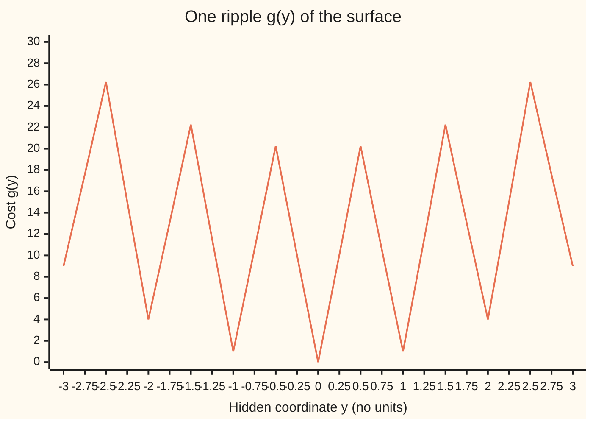
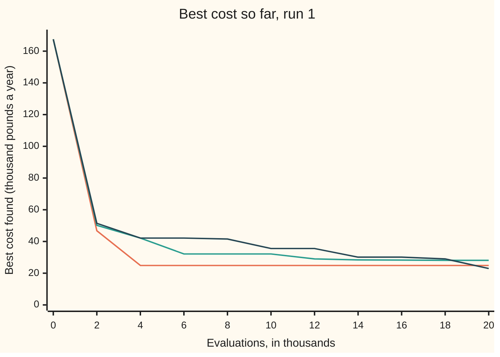

# Search without derivatives: Nelder-Mead, annealing and populations

[Syllabus](../../../SYLLABUS.md) → [Optimization](../README.md) → [Dynamic Programming and Learning](../README.md#s07) → Search without derivatives

---

## General Overview

A simulator takes ten settings and returns one cost. It might be a reservoir model scoring a release rule with ten numbers against a year of rain, the shelf's house example. Nothing else comes back: no formula, no slope. A run is cheap enough that a budget of 20,000 runs is fine, but far too few to try everything. The aim is the smallest cost, so this is a **minimisation**.

This card uses a stand-in surface whose bottom is known, so every answer can be graded. Read its cost as the rule's yearly cost in thousand pounds above the best possible rule, so 0 is the best rule.

It is a rotated version of the Rastrigin test function: a bowl with ripples cut into it. Measured along ten tilted axes (its hidden coordinates, defined in The formula), it has one valley around every point whose coordinates are whole numbers, and the true minimum is 0, at the origin. Run 1's random start costs 167.50 thousand pounds a year more than the best rule.

Three kinds of method work from values alone. **Nelder-Mead** moves a cluster of points downhill by mirroring the worst point through the others. **Simulated annealing** takes random steps and sometimes accepts a step uphill, less often as a "temperature" falls. **Population methods**, here differential evolution, move 40 points at once, each taking steps the size of the gaps between the others.

Over 10 seeded runs of 20,000 evaluations each (a seed fixes a run's random choices, so it can be repeated), the best cost found averages 42.29 for Nelder-Mead restarted from a fresh random start whenever its cluster collapses, 29.78 for annealing and 28.04 for differential evolution. A single Nelder-Mead run stops long before the budget, after about 1,077 evaluations, at 78.00 on average.

None reaches 0. An operator would adopt the best rule found and, on a real simulator, could not tell how far above the best rule it sits.

Then the honest part. No method that only reads values can prove it has found the bottom. Nelder-Mead promises only that its best value never rises, and annealing's theorems are about an endless run. A certified answer needs extra knowledge, such as a bound on how steep the surface can be, and then costs $10^{35.73}$ evaluations here.

**Without derivatives a search can only compare values: Nelder-Mead reshapes a cluster of points to slide downhill and stops in the first valley that holds it, annealing climbs out of valleys with a chance that shrinks as the temperature falls, and a population scales its steps by its own spread; each reports the best found, because no finite list of values can certify a global minimum.**

**What kind of fact this is:** methods with no promise of the global minimum. Two facts are proved on this card in Why it works: Nelder-Mead's best value never rises, and no method that sees finitely many values can certify a global minimum. The convergence theorems for annealing are stated with their sources, not proved.

### The picture: one of the ten ripples



The line is one ripple, sampled every quarter step. Valley floors sit near whole numbers; at 0, 1, 2 and 3 the cost is 0.00, 1.00, 4.00 and 9.00. The walls between them stand about 20 higher: 20.25 at 0.5. The surface adds ten of these, one along each hidden direction, so a search must cross walls to move from one valley to a lower one.

---

## The formula

In words first. The ten settings form a point $x$. The **hidden coordinates** $y = Qx$ come from a fixed rotation $Q$: a matrix that turns space without stretching it, so lengths stay the same. The rotation stops any method from treating the ten settings one at a time. ($Q$ here is only this rotation, not the values $Q(s, a)$ of [Q-learning](05-q-learning-and-temporal-differences.md) or the recourse cost of [Two-stage stochastic programming](07-stochastic-programming-with-recourse.md).)

$$f(x) = \sum_{i=1}^{10} g(y_i), \qquad g(y) = y^2 - 10\cos(2\pi y) + 10, \qquad y = Qx$$

**Read it aloud:** ten ripples, each a parabola with a cosine dent cut into it, read along ten hidden directions and added up.

Since $-10\cos(2\pi y) + 10$ is never negative, each ripple is at least $y^2$, so $f \ge 0$, with $f = 0$ only at the origin. That floor is what grades every run.

**Nelder-Mead** keeps a **simplex**: $n + 1$ points in $n$ settings, a triangle when $n = 2$. (This is not [The simplex method](../04-Linear%20Programming/03-simplex-method.md) of linear programming, which walks corners of a feasible region.) Sort the corners best first, $x_1, \dots, x_{n+1}$, and let $c$ be the centre of all but the worst. Every trial point lies on one line:

$$x(t) = c + t\,(x_{n+1} - c), \qquad t = -1 \text{ reflect}, \quad t = -2 \text{ expand}, \quad t = -\tfrac12 \text{ contract outside}, \quad t = \tfrac12 \text{ contract inside}$$

**Read it aloud:** each trial sits on the line from the worst corner through the centre of the others; $t$ says how far along and on which side.

**Simulated annealing** proposes a step that changes the cost by $\Delta$ and accepts it with chance

$$P(\text{accept}) = \min\!\left(1,\; e^{-\Delta/T_k}\right), \qquad T_k = T_0\, q^{k}, \qquad q = \left(T_{\text{end}}/T_0\right)^{1/K}$$

**Read it aloud:** always take a step that does not raise the cost; take one that raises it by $\Delta$ with chance e to the minus $\Delta$ over $T$; and shrink $T$ by the same factor $q$ after every evaluation, so it falls from $T_0$ to $T_{\text{end}}$ over the budget.

| Symbol | Plain meaning | In our example | Push it up and the answer… |
| --- | --- | --- | --- |
| $f(x)$ | the cost the simulator returns, to be made smallest: thousand pounds a year above the best rule | 167.50 at run 1's start; floor 0 | — |
| $x$, $n$ | the settings; how many there are | starts drawn from −5.12 to 5.12 each; $n = 10$ | more settings: far more valleys |
| $y$, $Q$ | hidden coordinates; the fixed rotation that makes them | $y = Qx$ | — |
| $g(y)$ | one ripple: a parabola with cosine dents | $g(1) = 1.00$, $g(0.5) = 20.25$ | — |
| $x_1, \dots, x_{n+1}$ | the simplex corners, best first | 11 corners for 10 settings | — |
| $c$, $t$ | centre of all corners but the worst; where on the line through it a trial sits | (0.4215, −0.2965) in the worked step; $t$ = −1, −2, −½ or ½ | — |
| $\Delta$ | the change in cost a proposed step would make | +10 in the trace below | accepted less often |
| $T_k$ | the **temperature**: how willing the walk is to go uphill | 30 at the start, 1.7321 at $k$ = 10,000 | more uphill steps taken |
| $T_0$, $T_{\text{end}}$, $q$ | start and end temperature; cooling factor per evaluation | 30, 0.1, 0.999715 | slower cooling |
| $k$, $K$ | evaluations so far; the budget | $K$ = 20,000 | more found, more cost |
| $u$, $v$ | the two settings of McKinnon's function, Step 2 | stall at (0, 0) | — |
| $L$ | a **Lipschitz bound**: the most the cost can change per unit moved, Step 5 | 231.07 | a finer grid is needed to certify |

### When it holds

- **A floor is known.** Here $f \ge 0$ because we built the surface. On a real simulator nothing tells 29.78 apart from the minimum.
- **Nelder-Mead needs one smooth valley.** On a smooth bowl, $f = \sum x_i^2$, from run 1's start it reaches 4.82e-13 in 1176 evaluations. On the ripples it stops in the first valley that holds it: 78.00 on average. Even a smooth convex function can stall it, as Step 2 shows.
- **The temperature must fall.** Held at 30, the walk ends at 248.04 on average, worse than the average start, 177.47. At 0 it only goes downhill and its best is 84.37.
- **Methods are compared at equal evaluations, over many seeds.** One Nelder-Mead run ends anywhere from 44.77 to 131.33, depending on the start.
- **Annealing's theorems have their own hypotheses.** One needs a finite set of states and a slow logarithmic cooling; the other needs proposals that can land anywhere in the region. These runs move one setting at a time on a continuous surface, so neither covers them.

---

## Why it works

### Step 0: compare, never differentiate

A derivative says which way is down. Without one, the only information is which of two points is lower, and every method here is built from that comparison. It is also why none can tell a valley floor from the global floor: from inside, both look the same.

### Step 1: Nelder-Mead rolls a simplex downhill

Take the worst corner and mirror it through the centre of the others ($t = -1$). On a slope the worst corner sits on the uphill side, so its mirror image lands downhill. Then:

- if the mirror point is the new best, try twice as far ($t = -2$) and keep the better of the two;
- if it beats the second-worst corner, keep it;
- otherwise pull a point in halfway, on the mirror side ($t = -\tfrac12$) if the mirror point beat the worst, or on the worst corner's side ($t = \tfrac12$) if not, and keep it if it beats both;
- if even that fails, shrink every corner halfway toward the best.

Expansions lengthen the stride along a long slope; contractions shorten it near a floor. So the simplex sets its own step and direction from comparisons alone.

One step by hand, on McKinnon's function of Step 2, in two settings $u$ and $v$. The corners are (0, 0) with cost 0.0000, (1, 1) with 8.0000, and (0.8431, −0.5931) with 4.0233. The worst is (1, 1). The centre of the other two is $c$ = (0.4215, −0.2965). The mirror point (−0.1569, −1.5931) costs 9.8105: not below the worst, 8. So the method contracts inside, to (0.7108, 0.3517), cost 3.5066. That beats 8, and it replaces (1, 1).

### Step 2: what Nelder-Mead promises, and McKinnon's stall

One thing is guaranteed: the best corner's value never rises. The proof is short.

<details>
<summary>Detailed proof: Nelder-Mead's best value never rises</summary>

Each step either replaces the worst corner or shrinks. A replacement is accepted only if it is lower than the worst corner's value (reflection: below the second-worst; expansion: below the best; contraction: below the worst and the mirror point). The best corner is never the one replaced, unless all corners tie, and then the newcomer is lower still. A shrink keeps the best corner where it is and moves the others. So after every step the lowest value among the corners is at most what it was. When $f$ has a floor, as the ripples do ($f \ge 0$), the best values form a falling sequence bounded below, so they settle to some number. Nothing in the proof says that number is a minimum.

</details>

Beyond that, the known results are thin. Lagarias and co-authors proved that for a strictly convex function of one setting the method reaches the minimiser. For two settings they proved the values at the three corners settle to one common value, and could not prove the corners reach the minimiser.

McKinnon showed they need not. His function is

$$f(u, v) = \begin{cases} 360\,u^2 + v + v^2 & u \le 0 \\ 6\,u^2 + v + v^2 & u > 0 \end{cases}$$

It is strictly convex with a continuous slope, and calculus gives its minimum: $u = 0$ and $1 + 2v = 0$, so $v = -0.5$ and $f = -0.250000$. McKinnon proved that from the start of Step 1 every step is an inside contraction. The simplex shrinks onto (0, 0), where the slope is (0, 1), not zero.

The checks stop at (0.000000, 0.000000) with $f$ = 0.000000 after 165 evaluations. A fresh simplex of side 1 started at that point finds (0.000000, −0.500000) with $f$ = −0.250000, after 286 evaluations in all. Restarting a collapsed simplex is the usual fix. It is a habit, not a theorem.

On the ripples each run collapses into a valley after 1077.3 evaluations on average. Spending the rest of the budget on fresh random starts, **multistart**, brings the mean best down from 78.00 to 42.29.

### Step 3: annealing pays for uphill steps

Annealing changes one setting at a time by a normal (bell-curve) random step of spread 1, about the distance between valleys. It takes every step down. It takes a step up by $\Delta$ with chance $e^{-\Delta/T}$, so a climb of 10 is accepted with chance 0.716531 at $T = 30$, and almost never once $T$ is below 1.

Why does that find low valleys? Hold $T$ fixed. The acceptance rule satisfies detailed balance: in the long run each step is made as often as its reverse. So the walk spends its time in proportion to $e^{-f/T}$, as [Local search](../../14-Applied%20and%20computational/02-Randomised%20and%20Approximate%20Algorithms/07-local-search-and-metaheuristics.md) states and [MCMC](../../11-Stochastic%20processes%20and%20calculus/03-Markov%20Chains/07-markov-chain-monte-carlo.md) proves. Lower valleys get exponentially more weight, and the weight piles up faster as $T$ falls.

The checks test this on one ripple at $T = 5$. A walk of 200,000 steps spends 0.2525 of its time within 0.5 of the bottom, with a standard error (the likely size of the error in that estimate) of 0.0024. Simpson's rule (a standard way to compute an area under a curve from sampled heights) applied to $e^{-g/T}$ says 0.2513. The two agree.

### Step 4: the cooling schedule, and what it can promise

The runs here cool geometrically, from 30 to 0.1. The factor is $q = (0.1/30)^{1/20000}$ = 0.999715 per evaluation, and halfway through $T$ = 1.7321. This schedule, the one nearly everyone uses, carries no guarantee. Its results are measured run by run.

Two kinds of theorem exist, and neither covers these runs. For a finite search with local moves, Hajek's theorem, stated on [Local search](../../14-Applied%20and%20computational/02-Randomised%20and%20Approximate%20Algorithms/07-local-search-and-metaheuristics.md), needs the slow schedule $T_k = T_0 / \ln(k + 2)$, with $T_0$ at least the depth of the deepest trap. That card writes it $c / \ln(t + 1)$; it is shifted here because $k$ counts from 0 and $\ln 1 = 0$.

For a continuous surface, Bélisle proved a limit result. Suppose every proposal can land anywhere in the region, with a chance density bounded away from zero, and the temperature falls to 0. Then under mild further conditions the current value converges in probability to the global minimum value: the chance of sitting more than any fixed amount above it shrinks to 0.

Both are statements about the limit $k \to \infty$, not about 20,000 evaluations. The checks run the logarithmic schedule with $T_0 = 30$, with no proof that 30 is deep enough. At the end of the budget it is still at $T$ = 3.0292. Its walks end at 46.54 on average, and their best is 32.56, against 29.78 for geometric cooling.

Bélisle's guarantee leans on the same fact that makes plain random search converge: a proposal that can land anywhere will, eventually, land near the bottom. How long "eventually" is comes next.

### Step 5: no method that reads values can certify the global minimum

<details>
<summary>Detailed proof: a finite list of values never certifies a global minimum</summary>

Suppose a method has evaluated $f$ at $K$ points. Pick any point it did not evaluate, and a ball around that point small enough to hold none of the evaluated points. Build a new function equal to $f$ everywhere except inside that ball, where a narrow pit dips to one unit below the best value found. Both functions give the same $K$ values, so the method makes exactly the same choices on both and reports the same best value. On the second function the true minimum is lower than that value. So $K$ values cannot prove that the best of them is the minimum, for any method and any $K$.

</details>

What breaks the argument is extra knowledge. A **Lipschitz bound** $L$ says the cost can change by at most $L$ times the distance moved. Here $\nabla f$ is the slope of the surface and $\|\nabla f\|$ is its length, the steepness. The box is the region where every setting lies from −5.12 to 5.12. Then $\|\nabla f\| \le 2\|y\| + 20\pi\sqrt{n}$, and $\|y\| = \|x\| \le 5.12\sqrt{10}$ inside the box, because the rotation keeps lengths, so $L$ = 231.07.

Lay a grid over the box. The minimiser is within half a grid diagonal of some grid point, so the best grid value is at most $L$ times that half-diagonal above the minimum. To be within 1 of the minimum, the spacing must be 0.002737: 3743 points per axis, $10^{35.73}$ points in all. That is a certificate, at a cost no budget can meet.

Random search has a guarantee too. One draw lands within 0.5 of the origin, inside the bottom valley, with chance 1.9646 in $10^{13}$. On average that takes 5.09 million million draws. In 20,000 draws its best averages 65.53.

### Step 6: populations

[Local search](../../14-Applied%20and%20computational/02-Randomised%20and%20Approximate%20Algorithms/07-local-search-and-metaheuristics.md) shows genetic moves: a population, crossover and mutation. **Differential evolution** brings that idea to continuous settings. It keeps 40 points. For each point it picks three others, starts from the first and adds half the gap between the other two. Each setting comes from that trial with chance 0.9, and at least one always does; the rest come from the point itself. The trial replaces the point if it is no worse.

Why it works: the steps are gaps inside the population. While the points are spread out the steps are long and cross many walls. As they gather in good valleys the steps shrink and polish. It is the same self-scaling as Nelder-Mead's simplex, spread over 40 points instead of 11. Its best costs average 28.04, from 5.97 in the best run to 38.98 in the worst. It has no guarantee either: once all 40 points sit in one valley, the gaps are small and the population stops exploring.

---

## Worked numbers, by hand

| Step | Arithmetic | Value |
| --- | --- | --- |
| cost at run 1's start | $f$ at a random point of the box | 167.50 |
| the floor | each ripple $\ge y^2 \ge 0$; $f$ at the origin | 0.00 |
| McKinnon, worst corner | $f(1, 1) = 6 + 1 + 1$ | 8.0000 |
| centre of the other two | ((0 + 0.8431)/2, (0 − 0.5931)/2) | (0.4215, −0.2965) |
| mirror point | $2c - (1, 1)$, then its cost | 9.8105, not below 8 |
| inside contraction | $c + \tfrac12((1, 1) - c)$, then its cost | 3.5066, accepted |
| cooling factor | $(0.1/30)^{1/20000}$ | 0.999715 |
| temperature halfway | $30 \times q^{10000}$ | 1.7321 |
| climbing 10 at the start | $e^{-10/30}$ | 0.716531 |
| slow schedule at the end | $30 / \ln 20002$ | 3.0292 |
| Nelder-Mead, restarted to the same budget | mean best of 10 runs | 42.29 |
| annealing | mean best of 10 runs | **29.78** |

Annealing's best rule averages 29.78 thousand pounds a year above the best possible rule: below Nelder-Mead restarted on the same 20,000 evaluations, and far above the floor of 0, so it is a best found, not a minimum.

### What breaks if you drop a piece

| Mistake | Comes out at | What went wrong |
| --- | --- | --- |
| Trusting Nelder-Mead's stop on McKinnon's function | $f$ = 0.000000 at (0, 0); the minimum is −0.250000 | The simplex collapsed onto a point where the slope is not zero |
| Annealing at $T = 0$, downhill only | mean best 84.37 | It stays in the first valley it reaches |
| Temperature held at 30 | best 64.92; the walk ends at 248.04 | Uphill steps are taken so often that the walk never settles |
| The slow logarithmic schedule | best 32.56; ends at 46.54 | It is built for the limit; at 20,000 the temperature is still 3.0292 |
| One run taken as the verdict | Nelder-Mead from 44.77 to 131.33 | The start decides which valley it falls into |

---

## How the search moves over 20,000 evaluations

The puzzle: annealing's best falls fast, then barely moves after 12,000 evaluations. Why stop improving with budget left?

Follow run 1. The table reads the temperature, the chance of climbing a wall of 10, and the best cost so far.

| Evaluations $k$ | Temperature $T_k$ | Chance to climb 10 | Best so far |
| ---: | ---: | ---: | ---: |
| 0 | 30.0000 | 0.716531 | 167.50 |
| 4,000 | 9.5873 | 0.352380 | 42.15 |
| 8,000 | 3.0639 | 0.038242 | 32.13 |
| 12,000 | 0.9791 | 0.000037 | 29.02 |
| 16,000 | 0.3129 | 0.000000 | 28.27 |
| 20,000 | 0.1000 | 0.000000 | 28.10 |

Up to about 8,000 evaluations the walk is hot. It climbs walls freely and roams across valleys, and the best falls from 167.50 to 32.13. By 12,000 a climb of 10 is taken 0.000037 of the time, and after that 0.000000 to six decimals, so the walk is locked in its valley and only polishes the floor: 29.02 to 28.10. The last stretch buys almost nothing. That is the trade the schedule sets: time spent hot is exploring, time spent cold is polishing.

One method at a time, the mean best over the 10 runs, one mark per 2 units of cost. Every bar spends 20,000 evaluations except one Nelder-Mead run, which stops after about 1,077:

```
random search                             #################################           65.53
Nelder-Mead, one run (1,077 evaluations)  #######################################     78.00
Nelder-Mead, multistart                   #####################                       42.29
anneal                                    ###############                             29.78
cold, T = 0                               ##########################################  84.37
hot, T = 30 held                          ################################            64.92
log cooling                               ################                            32.56
differential evolution                    ##############                              28.04
```

The two cooling schedules and the population sit lowest, with multistart next. The methods that never go uphill, or never settle, sit far above.

All together for run 1:



Orange: Nelder-Mead with multistart, at 24.87 by 4,000 evaluations and never better. Green: annealing, ending at 28.10. Dark blue: differential evolution, at 22.95 and still falling when the budget ends. All three start from 167.50. On this run multistart beats annealing; over 10 runs annealing's mean, 29.78, beats multistart's 42.29.

---

## Code, from first principles, and it actually runs

The script builds the rotated surface, then runs Nelder-Mead (one run and multistart), four temperature schedules for annealing, differential evolution and random search, each for 20,000 evaluations from 10 seeded starts. Cost is counted in evaluations, never seconds. Random numbers come from SplitMix64, a small random-number generator, written out, so both languages print the same. It takes four independent roads: every best found against the proved floor $f \ge 0$; the fixed-temperature walk against Simpson's rule on $e^{-g/T}$; Nelder-Mead on McKinnon's function against its calculus minimum, and on a smooth bowl against 0; and the rotation checked orthogonal.

### Python

```python
# Search without derivatives -- the check behind the card.  Standard library only.
# Minimise a rough 10-D surface using only its values: Nelder-Mead, annealing, differential
# evolution, random search; 20,000 evaluations per run, 10 seeded runs each (SplitMix64 written out).
# Roads: every result against the proved floor f >= 0; a fixed-temperature walk against Simpson's
# rule on exp(-g/T); Nelder-Mead on McKinnon's function against its calculus minimum; a smooth bowl.
import math
M64 = (1 << 64) - 1
class Rng:
    def __init__(s, seed): s.s = seed & M64
    def u(s):
        s.s = (s.s + 0x9E3779B97F4A7C15) & M64; z = s.s
        z = ((z ^ (z >> 30)) * 0xBF58476D1CE4E5B9) & M64; z = ((z ^ (z >> 27)) * 0x94D049BB133111EB) & M64
        return ((z ^ (z >> 31)) >> 11) / 2.0**53
    def g(s):
        u1 = s.u(); u2 = s.u(); return math.sqrt(-2.0 * math.log(1.0 - u1)) * math.cos(2.0 * math.pi * u2)
def tot(v):  # plain left-to-right sum, as Rust does (Python's sum() compensates)
    s = 0.0
    for t in v: s += t
    return s
N, BOX, BUD, RUNS, T0, TEND = 10, 5.12, 20000, 10, 30.0, 0.1
def ripple(t): return t * t - 10.0 * math.cos(2.0 * math.pi * t) + 10.0
rq, Q = Rng(2026), []          # a fixed random rotation, by Gram-Schmidt
for i in range(N):
    v = [rq.g() for _ in range(N)]
    for w in Q:
        d = tot(a * b for a, b in zip(v, w)); v = [a - d * b for a, b in zip(v, w)]
    nv = math.sqrt(tot(a * a for a in v)); Q.append([a / nv for a in v])
def rough(x): return tot(ripple(tot(Q[i][j] * x[j] for j in range(N))) for i in range(N))
def mck(x): return (360.0 if x[0] <= 0 else 6.0) * x[0] * x[0] + x[1] + x[1] * x[1]
def bowl(x): return tot(t * t for t in x)
st = {}
def reset(): st.update(n=0, best=math.inf, hist=[])
def ev(fn, x):                 # every evaluation goes through here: count it, track the best so far
    v = fn(x); st['n'] += 1; st['best'] = min(st['best'], v)
    if st['n'] % 2000 == 0: st['hist'].append(st['best'])
    return v
def simplex(x, step): return [list(x)] + [[x[j] + (step if j == i else 0.0) for j in range(len(x))] for i in range(len(x))]
def nelder_mead(fn, P, budget):
    n = len(P) - 1; V = [ev(fn, p) for p in P]
    while st['n'] + n + 2 <= budget:
        o = sorted(range(n + 1), key=lambda i: V[i]); P = [P[i] for i in o]; V = [V[i] for i in o]
        if V[n] - V[0] <= 1e-8 and max(abs(p[j] - P[0][j]) for p in P for j in range(n)) <= 1e-6: break
        c = [tot(P[i][j] for i in range(n)) / n for j in range(n)]
        pt = lambda t: [c[j] + t * (P[n][j] - c[j]) for j in range(n)]
        xr = pt(-1.0); fr = ev(fn, xr)
        if fr < V[0]:
            xe = pt(-2.0); fe = ev(fn, xe); P[n], V[n] = (xe, fe) if fe < fr else (xr, fr)
        elif fr < V[n - 1]: P[n], V[n] = xr, fr
        else:
            xc = pt(-0.5 if fr < V[n] else 0.5); fc = ev(fn, xc)
            if fc < min(fr, V[n]): P[n], V[n] = xc, fc
            else:
                for i in range(1, n + 1):
                    P[i] = [P[0][j] + 0.5 * (P[i][j] - P[0][j]) for j in range(n)]; V[i] = ev(fn, P[i])
    i = min(range(n + 1), key=lambda i: V[i]); return P[i], V[i]
def anneal(x, temp, r):        # one coordinate moves by a normal step of spread 1; Metropolis test
    fx = ev(rough, x)
    while st['n'] < BUD:
        T = temp(st['n']); y = list(x); i = int(r.u() * N); y[i] += r.g()
        fy = ev(rough, y); d = fy - fx
        if d <= 0 or (T > 0 and r.u() < math.exp(-d / T)): x, fx = y, fy
    return fx
def evolve(r, NP=40, F=0.5, CR=0.9):  # differential evolution, rand/1/bin
    P = [[BOX * (2 * r.u() - 1) for _ in range(N)] for _ in range(NP)]; V = [ev(rough, p) for p in P]
    while st['n'] + NP <= BUD:
        for i in range(NP):
            a = b = c = i
            while a == i: a = int(r.u() * NP)
            while b in (i, a): b = int(r.u() * NP)
            while c in (i, a, b): c = int(r.u() * NP)
            jr = int(r.u() * N)
            y = [P[a][j] + F * (P[b][j] - P[c][j]) if (r.u() < CR or j == jr) else P[i][j] for j in range(N)]
            fy = ev(rough, y)
            if fy <= V[i]: P[i], V[i] = y, fy
q = (TEND / T0) ** (1.0 / BUD)
temps = {'anneal': lambda k: T0 * q ** k, 'cold, T = 0': lambda k: 0.0,
         'hot, T = 30 held': lambda k: T0, 'log cooling': lambda k: T0 / math.log(k + 2.0)}
res = {m: [] for m in ['random search', 'Nelder-Mead, one run', 'Nelder-Mead, multistart', 'anneal',
                       'cold, T = 0', 'hot, T = 30 held', 'log cooling', 'differential evolution']}
one_evals, starts, ends, hists, x01 = [], [], {}, {}, None
for seed in range(1, RUNS + 1):
    r = Rng(seed); reset(); x0 = [BOX * (2 * r.u() - 1) for _ in range(N)]; x = x0; x01 = x01 or x0
    while st['n'] + 2 * N + 3 <= BUD:   # multistart: fresh random start each time a simplex collapses
        x, v = nelder_mead(rough, simplex(x, 1.0), BUD)
        if len(one_evals) < seed: res['Nelder-Mead, one run'].append(v); one_evals.append(st['n'])
        x = [BOX * (2 * r.u() - 1) for _ in range(N)]
    st['hist'] += [st['best']] * (BUD // 2000 - len(st['hist'])); res['Nelder-Mead, multistart'].append(st['best']); hists.setdefault('nm', st['hist'])
    for m, temp in temps.items():
        reset(); fend = anneal(list(x0), temp, Rng(1000 + seed)); res[m].append(st['best'])
        ends.setdefault(m, []).append(fend); hists.setdefault(m, st['hist'])
    reset(); evolve(Rng(2000 + seed)); res['differential evolution'].append(st['best']); hists.setdefault('de', st['hist'])
    reset(); r = Rng(3000 + seed); [ev(rough, [BOX * (2 * r.u() - 1) for _ in range(N)]) for _ in range(BUD)]
    res['random search'].append(st['best']); starts.append(rough(x0))
mean = lambda v: tot(v) / len(v)
print(f"n = {N}, budget {BUD}, {RUNS} runs, f(origin) = {rough([0.0] * N):.2f}; start, run 1: f = {starts[0]:.2f}; mean start {mean(starts):.2f}")
for m, v in res.items(): print(f"{m:26s} mean {mean(v):6.2f}  best {min(v):6.2f}  worst {max(v):6.2f}")
print(f"one Nelder-Mead run stops after {mean(one_evals):.1f} evaluations on average")
for m in ['anneal', 'hot, T = 30 held', 'log cooling']: print(f"{m}: mean value where the walk ends {mean(ends[m]):.2f}")
print(f"cooling factor q = {q:.6f}; T at 10000 = {T0 * q ** 10000:.4f}; log cooling T at 20000 = {T0 / math.log(BUD + 2.0):.4f}")
for k in range(0, BUD + 1, 4000):
    T = T0 * q ** k; b = hists['anneal'][k // 2000 - 1] if k else starts[0]
    print(f"trace k = {k:5d}: T = {T:8.4f}, accept +10 with {math.exp(-10 / T):.6f}, best so far {b:.2f}")
for m in ['nm', 'anneal', 'de']: print(f"chart {m}: " + ", ".join(f"{v:.2f}" for v in [starts[0]] + hists[m]))
print("chart ripple: " + ", ".join(f"{ripple(-3 + 0.25 * k):.2f}" for k in range(25)))
s33 = math.sqrt(33.0); P = [[0.0, 0.0], [1.0, 1.0], [(1 + s33) / 8, (1 - s33) / 8]]
c = [(P[0][j] + P[2][j]) / 2 for j in range(2)]; xr = [2 * c[j] - P[1][j] for j in range(2)]
xcc = [c[j] + 0.5 * (P[1][j] - c[j]) for j in range(2)]
print("McKinnon start: f = " + ", ".join(f"{mck(p):.4f}" for p in P) + f"; third vertex ({P[2][0]:.4f}, {P[2][1]:.4f})")
print(f"McKinnon step: c = ({c[0]:.4f}, {c[1]:.4f}), reflect ({xr[0]:.4f}, {xr[1]:.4f}) f = {mck(xr):.4f}, "
      f"inside ({xcc[0]:.4f}, {xcc[1]:.4f}) f = {mck(xcc):.4f}")
reset(); xs, vs = nelder_mead(mck, P, 5000); n1 = st['n']
xm, vm = nelder_mead(mck, simplex(xs, 1.0), 5000)
print(f"McKinnon stall: ({xs[0]:.6f}, {xs[1]:.6f}) f = {vs:.6f} after {n1}; restart: ({xm[0]:.6f}, {xm[1]:.6f}) "
      f"f = {vm:.6f} after {st['n']}; true minimum f(0, -0.5) = {mck([0.0, -0.5]):.6f}")
reset(); xb, vb = nelder_mead(bowl, simplex(x01, 1.0), BUD)
print(f"smooth bowl, same start: Nelder-Mead reaches f = {vb:.2e} after {st['n']} evaluations")
r, y, fy, inside, T, batch = Rng(4000), 0.0, ripple(0.0), [0] * 20, 5.0, 10000   # walk at a fixed T
for k in range(20 * batch):
    z = y + r.g(); fz = ripple(z)
    if fz <= fy or r.u() < math.exp(-(fz - fy) / T): y, fy = z, fz
    if abs(y) < 0.5: inside[k // batch] += 1
def simpson(a, b, m=2000):
    h = (b - a) / m; w = lambda k: 1 if k in (0, m) else (4 if k % 2 else 2)
    return tot(w(k) * math.exp(-ripple(a + k * h) / T) for k in range(m + 1)) * h / 3
share = [i / batch for i in inside]; walk = mean(share)
se = math.sqrt(tot((s - walk) * (s - walk) for s in share) / (19 * 20)); exact = simpson(-0.5, 0.5) / simpson(-10.0, 10.0)
print(f"fixed T = 5, one ripple: walk spends {walk:.4f} of its time in |y| < 0.5 (se {se:.4f}); exp(-g/T) gives {exact:.4f}")
L = 2 * BOX * math.sqrt(N) + 20 * math.pi * math.sqrt(N); h = 2 * 1.0 / (L * math.sqrt(N)); m = math.ceil(2 * BOX / h) + 1
print(f"certificate by grid: L = {L:.2f}, spacing {h:.6f}, {m} points per axis, 10^{N * math.log10(m):.2f} points")
p = math.pi ** 5 / 120 * 0.5 ** N / (2 * BOX) ** N; print(f"random search: one draw lands within 0.5 of the origin with chance {p * 1e13:.4f} in 10^13; "
      f"expected draws {1 / p / 1e12:.2f} million million")
orth = max(abs(tot(Q[i][k] * Q[j][k] for k in range(N)) - (i == j)) for i in range(N) for j in range(N))
assert orth < 1e-12, "the rotation is not orthogonal"
assert min(min(v) for v in res.values()) >= 0.0, "a best found below the proved floor f >= 0"
assert vs > mck([0.0, -0.5]) + 0.2 and abs(vm - mck([0.0, -0.5])) < 1e-6, "McKinnon: stall, then restart"
assert mck(xr) >= mck(P[1]) and mck(xcc) < mck(P[1]), "McKinnon's first step is an inside contraction"
assert vb < 1e-8, "Nelder-Mead on a smooth bowl must reach 0"; assert abs(walk - exact) < 4 * se, "fixed-temperature walk must match exp(-g/T)"
assert mean(res['anneal']) < mean(res['cold, T = 0']) and mean(res['anneal']) < mean(res['Nelder-Mead, multistart'])
print("ALL CHECKS PASS")
```

**Ran 2026-11-11 on macOS, Python 3.14.10, standard library only. All checks passed. Output, pasted from the run:**

```
n = 10, budget 20000, 10 runs, f(origin) = 0.00; start, run 1: f = 167.50; mean start 177.47
random search              mean  65.53  best  53.57  worst  71.49
Nelder-Mead, one run       mean  78.00  best  44.77  worst 131.33
Nelder-Mead, multistart    mean  42.29  best  24.87  worst  57.71
anneal                     mean  29.78  best  12.10  worst  53.91
cold, T = 0                mean  84.37  best  49.75  worst 148.25
hot, T = 30 held           mean  64.92  best  46.40  worst  82.43
log cooling                mean  32.56  best  15.30  worst  47.58
differential evolution     mean  28.04  best   5.97  worst  38.98
one Nelder-Mead run stops after 1077.3 evaluations on average
anneal: mean value where the walk ends 32.24
hot, T = 30 held: mean value where the walk ends 248.04
log cooling: mean value where the walk ends 46.54
cooling factor q = 0.999715; T at 10000 = 1.7321; log cooling T at 20000 = 3.0292
trace k =     0: T =  30.0000, accept +10 with 0.716531, best so far 167.50
trace k =  4000: T =   9.5873, accept +10 with 0.352380, best so far 42.15
trace k =  8000: T =   3.0639, accept +10 with 0.038242, best so far 32.13
trace k = 12000: T =   0.9791, accept +10 with 0.000037, best so far 29.02
trace k = 16000: T =   0.3129, accept +10 with 0.000000, best so far 28.27
trace k = 20000: T =   0.1000, accept +10 with 0.000000, best so far 28.10
chart nm: 167.50, 46.76, 24.87, 24.87, 24.87, 24.87, 24.87, 24.87, 24.87, 24.87, 24.87
chart anneal: 167.50, 50.17, 42.15, 32.13, 32.13, 32.13, 29.02, 28.38, 28.27, 28.10, 28.10
chart de: 167.50, 51.45, 42.15, 42.15, 41.56, 35.56, 35.56, 30.11, 30.11, 29.02, 22.95
chart ripple: 9.00, 17.56, 26.25, 15.06, 4.00, 13.06, 22.25, 11.56, 1.00, 10.56, 20.25, 10.06, 0.00, 10.06, 20.25, 10.56, 1.00, 11.56, 22.25, 13.06, 4.00, 15.06, 26.25, 17.56, 9.00
McKinnon start: f = 0.0000, 8.0000, 4.0233; third vertex (0.8431, -0.5931)
McKinnon step: c = (0.4215, -0.2965), reflect (-0.1569, -1.5931) f = 9.8105, inside (0.7108, 0.3517) f = 3.5066
McKinnon stall: (0.000000, 0.000000) f = 0.000000 after 165; restart: (0.000000, -0.500000) f = -0.250000 after 286; true minimum f(0, -0.5) = -0.250000
smooth bowl, same start: Nelder-Mead reaches f = 4.82e-13 after 1176 evaluations
fixed T = 5, one ripple: walk spends 0.2525 of its time in |y| < 0.5 (se 0.0024); exp(-g/T) gives 0.2513
certificate by grid: L = 231.07, spacing 0.002737, 3743 points per axis, 10^35.73 points
random search: one draw lands within 0.5 of the origin with chance 1.9646 in 10^13; expected draws 5.09 million million
ALL CHECKS PASS
```

### Rust

```rust
// Search without derivatives -- the check behind the card.  std only, no crates.
// Minimise a rough 10-D surface using only its values: Nelder-Mead, annealing, differential
// evolution, random search; 20,000 evaluations per run, 10 seeded runs each (SplitMix64 written out).
// Roads: every result against the proved floor f >= 0; a fixed-temperature walk against Simpson's
// rule on exp(-g/T); Nelder-Mead on McKinnon's function against its calculus minimum; a smooth bowl.
use std::f64::consts::PI;
struct Rng { s: u64 } fn rng(seed: u64) -> Rng { Rng { s: seed } }
impl Rng {
    fn u(&mut self) -> f64 {
        self.s = self.s.wrapping_add(0x9E3779B97F4A7C15); let mut z = self.s;
        z = (z ^ (z >> 30)).wrapping_mul(0xBF58476D1CE4E5B9); z = (z ^ (z >> 27)).wrapping_mul(0x94D049BB133111EB);
        ((z ^ (z >> 31)) >> 11) as f64 / 9007199254740992.0
    }
    fn g(&mut self) -> f64 { let u1 = self.u(); let u2 = self.u(); (-2.0 * (1.0 - u1).ln()).sqrt() * (2.0 * PI * u2).cos() }
}
fn tot<I: Iterator<Item = f64>>(v: I) -> f64 { let mut s = 0.0; for t in v { s += t; } s }
const N: usize = 10; const BOX: f64 = 5.12; const BUD: usize = 20000; const RUNS: usize = 10; const T0: f64 = 30.0; const TEND: f64 = 0.1;
fn ripple(t: f64) -> f64 { t * t - 10.0 * (2.0 * PI * t).cos() + 10.0 }
fn mck(x: &[f64]) -> f64 { (if x[0] <= 0.0 { 360.0 } else { 6.0 }) * x[0] * x[0] + x[1] + x[1] * x[1] }
fn bowl(x: &[f64]) -> f64 { tot(x.iter().map(|t| t * t)) }
struct St { n: usize, best: f64, hist: Vec<f64> }
impl St {
    fn reset(&mut self) { self.n = 0; self.best = f64::INFINITY; self.hist = vec![]; }
    fn ev(&mut self, f: &dyn Fn(&[f64]) -> f64, x: &[f64]) -> f64 {
        let v = f(x); self.n += 1; self.best = self.best.min(v);
        if self.n % 2000 == 0 { self.hist.push(self.best); } v
    }
}
fn simplex(x: &[f64], step: f64) -> Vec<Vec<f64>> {
    let mut p = vec![x.to_vec()]; for i in 0..x.len() { let mut y = x.to_vec(); y[i] += step; p.push(y); } p
}
fn argmin(v: &[f64]) -> usize { let mut b = 0; for i in 1..v.len() { if v[i] < v[b] { b = i; } } b }
fn nelder_mead(st: &mut St, f: &dyn Fn(&[f64]) -> f64, mut p: Vec<Vec<f64>>, budget: usize) -> (Vec<f64>, f64) {
    let n = p.len() - 1; let mut v: Vec<f64> = p.iter().map(|x| st.ev(f, x)).collect();
    while st.n + n + 2 <= budget {
        let mut o: Vec<usize> = (0..=n).collect(); o.sort_by(|&a, &b| v[a].partial_cmp(&v[b]).unwrap());
        p = o.iter().map(|&i| p[i].clone()).collect(); v = o.iter().map(|&i| v[i]).collect();
        let mut diam = 0.0f64; for q in &p { for j in 0..n { diam = diam.max((q[j] - p[0][j]).abs()); } }
        if v[n] - v[0] <= 1e-8 && diam <= 1e-6 { break; }
        let c: Vec<f64> = (0..n).map(|j| tot((0..n).map(|i| p[i][j])) / n as f64).collect();
        let pt = |t: f64, w: &Vec<f64>| -> Vec<f64> { (0..n).map(|j| c[j] + t * (w[j] - c[j])).collect() };
        let xr = pt(-1.0, &p[n]); let fr = st.ev(f, &xr);
        if fr < v[0] {
            let xe = pt(-2.0, &p[n]); let fe = st.ev(f, &xe);
            if fe < fr { p[n] = xe; v[n] = fe; } else { p[n] = xr; v[n] = fr; }
        } else if fr < v[n - 1] { p[n] = xr; v[n] = fr; } else {
            let xc = pt(if fr < v[n] { -0.5 } else { 0.5 }, &p[n]); let fc = st.ev(f, &xc);
            if fc < fr.min(v[n]) { p[n] = xc; v[n] = fc; } else {
                for i in 1..=n {
                    p[i] = (0..n).map(|j| p[0][j] + 0.5 * (p[i][j] - p[0][j])).collect(); v[i] = st.ev(f, &p[i]);
                }
            }
        }
    }
    let i = argmin(&v); (p[i].clone(), v[i])
}
fn anneal(st: &mut St, f: &dyn Fn(&[f64]) -> f64, mut x: Vec<f64>, temp: &dyn Fn(usize) -> f64, r: &mut Rng) -> f64 {
    let mut fx = st.ev(f, &x);
    while st.n < BUD {
        let t = temp(st.n); let mut y = x.clone(); let i = (r.u() * N as f64) as usize; y[i] += r.g();
        let fy = st.ev(f, &y); let d = fy - fx;
        if d <= 0.0 || (t > 0.0 && r.u() < (-d / t).exp()) { x = y; fx = fy; }
    } fx
}
fn evolve(st: &mut St, f: &dyn Fn(&[f64]) -> f64, r: &mut Rng) {
    let (np, fw, cr) = (40usize, 0.5, 0.9);
    let mut p: Vec<Vec<f64>> = (0..np).map(|_| (0..N).map(|_| BOX * (2.0 * r.u() - 1.0)).collect()).collect();
    let mut v: Vec<f64> = p.iter().map(|x| st.ev(f, x)).collect();
    while st.n + np <= BUD {
        for i in 0..np {
            let (mut a, mut b, mut c) = (i, i, i);
            while a == i { a = (r.u() * np as f64) as usize; }
            while b == i || b == a { b = (r.u() * np as f64) as usize; }
            while c == i || c == a || c == b { c = (r.u() * np as f64) as usize; }
            let jr = (r.u() * N as f64) as usize;
            let y: Vec<f64> = (0..N).map(|j| if r.u() < cr || j == jr { p[a][j] + fw * (p[b][j] - p[c][j]) } else { p[i][j] }).collect();
            let fy = st.ev(f, &y); if fy <= v[i] { p[i] = y; v[i] = fy; }
        }
    }
}
fn mean(v: &[f64]) -> f64 { tot(v.iter().cloned()) / v.len() as f64 }
fn minv(v: &[f64]) -> f64 { v.iter().cloned().fold(f64::INFINITY, f64::min) } fn maxv(v: &[f64]) -> f64 { v.iter().cloned().fold(f64::NEG_INFINITY, f64::max) }
fn join(v: &[f64], d: usize) -> String { v.iter().map(|x| format!("{:.*}", d, x)).collect::<Vec<_>>().join(", ") }
fn main() {
    let mut rq = rng(2026); let mut q: Vec<Vec<f64>> = vec![];   // a fixed random rotation, by Gram-Schmidt
    for _ in 0..N {
        let mut v: Vec<f64> = (0..N).map(|_| rq.g()).collect();
        for w in &q { let d = tot((0..N).map(|k| v[k] * w[k])); v = (0..N).map(|k| v[k] - d * w[k]).collect(); }
        let nv = tot(v.iter().map(|a| a * a)).sqrt(); q.push(v.iter().map(|a| a / nv).collect());
    }
    let rough = |x: &[f64]| -> f64 { tot((0..N).map(|i| ripple(tot((0..N).map(|j| q[i][j] * x[j]))))) };
    let mut st = St { n: 0, best: f64::INFINITY, hist: vec![] }; let qf = (TEND / T0).powf(1.0 / BUD as f64);
    let names = ["random search", "Nelder-Mead, one run", "Nelder-Mead, multistart", "anneal",
                 "cold, T = 0", "hot, T = 30 held", "log cooling", "differential evolution"];
    let temps: Vec<Box<dyn Fn(usize) -> f64>> = vec![Box::new(move |k| T0 * qf.powf(k as f64)), Box::new(|_| 0.0),
        Box::new(|_| T0), Box::new(|k| T0 / (k as f64 + 2.0).ln())];
    let mut res: Vec<Vec<f64>> = vec![vec![]; 8]; let mut ends: Vec<Vec<f64>> = vec![vec![]; 4];
    let mut hists: Vec<Vec<f64>> = vec![vec![]; 6]; let (mut one_evals, mut starts, mut x01) = (vec![], vec![], vec![]);
    for seed in 1..=RUNS {
        let mut r = rng(seed as u64); st.reset();
        let x0: Vec<f64> = (0..N).map(|_| BOX * (2.0 * r.u() - 1.0)).collect(); let mut x = x0.clone(); if x01.is_empty() { x01 = x0.clone(); }
        while st.n + 2 * N + 3 <= BUD {   // multistart: fresh random start each time a simplex collapses
            let (_, v) = nelder_mead(&mut st, &rough, simplex(&x, 1.0), BUD);
            if one_evals.len() < seed { res[1].push(v); one_evals.push(st.n as f64); }
            x = (0..N).map(|_| BOX * (2.0 * r.u() - 1.0)).collect();
        }
        while st.hist.len() < BUD / 2000 { st.hist.push(st.best); }
        res[2].push(st.best); if seed == 1 { hists[0] = st.hist.clone(); }
        for (m, temp) in temps.iter().enumerate() {
            st.reset(); let fend = anneal(&mut st, &rough, x0.clone(), temp.as_ref(), &mut rng(1000 + seed as u64));
            res[3 + m].push(st.best); ends[m].push(fend); if seed == 1 { hists[1 + m] = st.hist.clone(); }
        }
        st.reset(); evolve(&mut st, &rough, &mut rng(2000 + seed as u64)); res[7].push(st.best); if seed == 1 { hists[5] = st.hist.clone(); }
        st.reset(); let mut r = rng(3000 + seed as u64);
        for _ in 0..BUD { let y: Vec<f64> = (0..N).map(|_| BOX * (2.0 * r.u() - 1.0)).collect(); st.ev(&rough, &y); }
        res[0].push(st.best); starts.push(rough(&x0));
    }
    println!("n = {}, budget {}, {} runs, f(origin) = {:.2}; start, run 1: f = {:.2}; mean start {:.2}",
             N, BUD, RUNS, rough(&[0.0; N]), starts[0], mean(&starts));
    for (m, v) in names.iter().zip(&res) { println!("{:<26} mean {:6.2}  best {:6.2}  worst {:6.2}", m, mean(v), minv(v), maxv(v)); }
    println!("one Nelder-Mead run stops after {:.1} evaluations on average", mean(&one_evals));
    for m in [0usize, 2, 3] { println!("{}: mean value where the walk ends {:.2}", names[3 + m], mean(&ends[m])); }
    println!("cooling factor q = {:.6}; T at 10000 = {:.4}; log cooling T at 20000 = {:.4}", qf, T0 * qf.powf(10000.0), T0 / (BUD as f64 + 2.0).ln());
    for k in (0..=BUD).step_by(4000) {
        let t = T0 * qf.powf(k as f64); let b = if k > 0 { hists[1][k / 2000 - 1] } else { starts[0] };
        println!("trace k = {:5}: T = {:8.4}, accept +10 with {:.6}, best so far {:.2}", k, t, (-10.0 / t).exp(), b);
    }
    for (m, h) in [("nm", 0usize), ("anneal", 1), ("de", 5)] {
        let mut v = vec![starts[0]]; v.extend(&hists[h]); println!("chart {}: {}", m, join(&v, 2));
    }
    let rp: Vec<f64> = (0..25).map(|k| ripple(-3.0 + 0.25 * k as f64)).collect(); println!("chart ripple: {}", join(&rp, 2));
    let s33 = 33f64.sqrt(); let p = vec![vec![0.0, 0.0], vec![1.0, 1.0], vec![(1.0 + s33) / 8.0, (1.0 - s33) / 8.0]];
    let c: Vec<f64> = (0..2).map(|j| (p[0][j] + p[2][j]) / 2.0).collect(); let xr: Vec<f64> = (0..2).map(|j| 2.0 * c[j] - p[1][j]).collect();
    let xcc: Vec<f64> = (0..2).map(|j| c[j] + 0.5 * (p[1][j] - c[j])).collect();
    println!("McKinnon start: f = {}; third vertex ({:.4}, {:.4})", join(&p.iter().map(|x| mck(x)).collect::<Vec<_>>(), 4), p[2][0], p[2][1]);
    println!("McKinnon step: c = ({:.4}, {:.4}), reflect ({:.4}, {:.4}) f = {:.4}, inside ({:.4}, {:.4}) f = {:.4}",
             c[0], c[1], xr[0], xr[1], mck(&xr), xcc[0], xcc[1], mck(&xcc));
    st.reset(); let (xs, vs) = nelder_mead(&mut st, &mck, p.clone(), 5000); let n1 = st.n;
    let (xm, vm) = nelder_mead(&mut st, &mck, simplex(&xs, 1.0), 5000); let tm = mck(&[0.0, -0.5]);
    println!("McKinnon stall: ({:.6}, {:.6}) f = {:.6} after {}; restart: ({:.6}, {:.6}) f = {:.6} after {}; true minimum f(0, -0.5) = {:.6}",
             xs[0], xs[1], vs, n1, xm[0], xm[1], vm, st.n, tm);
    st.reset(); let (_, vb) = nelder_mead(&mut st, &bowl, simplex(&x01, 1.0), BUD);
    println!("smooth bowl, same start: Nelder-Mead reaches f = {:.2e} after {} evaluations", vb, st.n);
    let (mut r, mut y, mut fy, mut inside, t, batch) = (rng(4000), 0.0f64, ripple(0.0), [0usize; 20], 5.0, 10000usize);
    for k in 0..20 * batch {   // walk at a fixed T
        let z = y + r.g(); let fz = ripple(z);
        if fz <= fy || r.u() < (-(fz - fy) / t).exp() { y = z; fy = fz; }
        if y.abs() < 0.5 { inside[k / batch] += 1; }
    }
    let simpson = |a: f64, b: f64, m: usize| -> f64 { let h = (b - a) / m as f64;
        tot((0..=m).map(|k| (if k == 0 || k == m { 1.0 } else if k % 2 == 1 { 4.0 } else { 2.0 }) * (-ripple(a + k as f64 * h) / t).exp())) * h / 3.0
    };
    let share: Vec<f64> = inside.iter().map(|&i| i as f64 / batch as f64).collect(); let walk = mean(&share);
    let se = (tot(share.iter().map(|s| (s - walk) * (s - walk))) / (19.0 * 20.0)).sqrt(); let exact = simpson(-0.5, 0.5, 2000) / simpson(-10.0, 10.0, 2000);
    println!("fixed T = 5, one ripple: walk spends {:.4} of its time in |y| < 0.5 (se {:.4}); exp(-g/T) gives {:.4}", walk, se, exact);
    let nf = N as f64; let l = 2.0 * BOX * nf.sqrt() + 20.0 * PI * nf.sqrt();  let h = 2.0 * 1.0 / (l * nf.sqrt()); let m = (2.0 * BOX / h).ceil() + 1.0;
    println!("certificate by grid: L = {:.2}, spacing {:.6}, {} points per axis, 10^{:.2} points", l, h, m, nf * m.log10());
    let pr = PI.powf(5.0) / 120.0 * 0.5f64.powf(nf) / (2.0 * BOX).powf(nf);
    println!("random search: one draw lands within 0.5 of the origin with chance {:.4} in 10^13; expected draws {:.2} million million", pr * 1e13, 1.0 / pr / 1e12);
    let mut orth = 0.0f64; for i in 0..N { for j in 0..N { orth = orth.max((tot((0..N).map(|k| q[i][k] * q[j][k])) - if i == j { 1.0 } else { 0.0 }).abs()); } }
    assert!(orth < 1e-12, "the rotation is not orthogonal");
    assert!(res.iter().map(|v| minv(v)).fold(f64::INFINITY, f64::min) >= 0.0, "a best found below the proved floor f >= 0");
    assert!(vs > tm + 0.2 && (vm - tm).abs() < 1e-6, "McKinnon: stall, then restart");
    assert!(mck(&xr) >= mck(&p[1]) && mck(&xcc) < mck(&p[1]), "McKinnon's first step is an inside contraction");
    assert!(vb < 1e-8, "Nelder-Mead on a smooth bowl must reach 0"); assert!((walk - exact).abs() < 4.0 * se, "walk vs exp(-g/T)");
    assert!(mean(&res[3]) < mean(&res[4]) && mean(&res[3]) < mean(&res[2]));
    println!("ALL CHECKS PASS");
}
```

**Ran 2026-11-11 on macOS, rustc 1.98.1, no crates. All checks passed. Output, pasted from the run:**

```
n = 10, budget 20000, 10 runs, f(origin) = 0.00; start, run 1: f = 167.50; mean start 177.47
random search              mean  65.53  best  53.57  worst  71.49
Nelder-Mead, one run       mean  78.00  best  44.77  worst 131.33
Nelder-Mead, multistart    mean  42.29  best  24.87  worst  57.71
anneal                     mean  29.78  best  12.10  worst  53.91
cold, T = 0                mean  84.37  best  49.75  worst 148.25
hot, T = 30 held           mean  64.92  best  46.40  worst  82.43
log cooling                mean  32.56  best  15.30  worst  47.58
differential evolution     mean  28.04  best   5.97  worst  38.98
one Nelder-Mead run stops after 1077.3 evaluations on average
anneal: mean value where the walk ends 32.24
hot, T = 30 held: mean value where the walk ends 248.04
log cooling: mean value where the walk ends 46.54
cooling factor q = 0.999715; T at 10000 = 1.7321; log cooling T at 20000 = 3.0292
trace k =     0: T =  30.0000, accept +10 with 0.716531, best so far 167.50
trace k =  4000: T =   9.5873, accept +10 with 0.352380, best so far 42.15
trace k =  8000: T =   3.0639, accept +10 with 0.038242, best so far 32.13
trace k = 12000: T =   0.9791, accept +10 with 0.000037, best so far 29.02
trace k = 16000: T =   0.3129, accept +10 with 0.000000, best so far 28.27
trace k = 20000: T =   0.1000, accept +10 with 0.000000, best so far 28.10
chart nm: 167.50, 46.76, 24.87, 24.87, 24.87, 24.87, 24.87, 24.87, 24.87, 24.87, 24.87
chart anneal: 167.50, 50.17, 42.15, 32.13, 32.13, 32.13, 29.02, 28.38, 28.27, 28.10, 28.10
chart de: 167.50, 51.45, 42.15, 42.15, 41.56, 35.56, 35.56, 30.11, 30.11, 29.02, 22.95
chart ripple: 9.00, 17.56, 26.25, 15.06, 4.00, 13.06, 22.25, 11.56, 1.00, 10.56, 20.25, 10.06, 0.00, 10.06, 20.25, 10.56, 1.00, 11.56, 22.25, 13.06, 4.00, 15.06, 26.25, 17.56, 9.00
McKinnon start: f = 0.0000, 8.0000, 4.0233; third vertex (0.8431, -0.5931)
McKinnon step: c = (0.4215, -0.2965), reflect (-0.1569, -1.5931) f = 9.8105, inside (0.7108, 0.3517) f = 3.5066
McKinnon stall: (0.000000, 0.000000) f = 0.000000 after 165; restart: (0.000000, -0.500000) f = -0.250000 after 286; true minimum f(0, -0.5) = -0.250000
smooth bowl, same start: Nelder-Mead reaches f = 4.82e-13 after 1176 evaluations
fixed T = 5, one ripple: walk spends 0.2525 of its time in |y| < 0.5 (se 0.0024); exp(-g/T) gives 0.2513
certificate by grid: L = 231.07, spacing 0.002737, 3743 points per axis, 10^35.73 points
random search: one draw lands within 0.5 of the origin with chance 1.9646 in 10^13; expected draws 5.09 million million
ALL CHECKS PASS
```

### Lean

Lean proves the two facts of Why it works and the floor of the surface, for any number of settings.

- No method that only reads values can certify a global minimum. A pit away from every evaluated point leaves the values unchanged, yet dips one unit below them all.
- Nelder-Mead's best value never rises from one step to the next. When the cost has a floor, the best values settle to some number.
- For any rotation $Q$, the surface $f$ is never below 0, and it is 0 only at the origin.
- The worked numbers: McKinnon's function is 8 at (1, 1) and 0 at (0, 0), and one ripple is 0, 1, 4 and 9 at 0, 1, 2 and 3.

The runs, the annealing and population results, and McKinnon's stall are left to the Python and Rust checks.

```lean
-- Search without derivatives: no method that reads finitely many values can certify a global minimum, Nelder-Mead's best value never rises, and the rotated ripple surface is never below 0 and is 0 only at the origin.
import Mathlib.Analysis.InnerProductSpace.PiL2
import Mathlib.Analysis.SpecialFunctions.Trigonometric.Basic
import Mathlib.LinearAlgebra.UnitaryGroup
import Mathlib.Topology.Order.MonotoneConvergence

open Filter Topology

/-- A method that reads values only: at step `k` it picks its next point from the `k` values
it has seen so far. -/
def ValueMethod (E : Type*) := (k : ℕ) → (Fin k → ℝ) → E

/-- The point a value-only method evaluates at step `k` when run on `f`. -/
noncomputable def ValueMethod.trace {E : Type*} (q : ValueMethod E) (f : E → ℝ) (k : ℕ) : E :=
  q k (fun i : Fin k => f (q.trace f i.1))
termination_by k
decreasing_by exact i.2

/-- No method that sees finitely many values can certify a global minimum. For any method that
reads only values, any number `K` of evaluations and any cost `f` on `n` settings (`n ≥ 1`),
there is a ball holding none of the evaluated points and a new cost `g`, equal to `f` outside
that ball and differing from it by a continuous pit, on which the method makes exactly the same
`K` choices, sees the same values, and yet `g` dips at least one unit below every value seen. -/
theorem no_finite_list_of_values_certifies_global_minimum (n : ℕ) (hn : 0 < n)
    (q : ValueMethod (EuclideanSpace ℝ (Fin n))) (f : EuclideanSpace ℝ (Fin n) → ℝ) (K : ℕ) :
    ∃ (c : EuclideanSpace ℝ (Fin n)) (r : ℝ), 0 < r ∧ (∀ k < K, q.trace f k ∉ Metric.ball c r) ∧
      ∃ g : EuclideanSpace ℝ (Fin n) → ℝ,
        (∀ x ∉ Metric.ball c r, g x = f x) ∧ Continuous (g - f) ∧
        (∀ k < K, q.trace g k = q.trace f k ∧ g (q.trace g k) = f (q.trace f k)) ∧
        ∃ z, ∀ k < K, g z ≤ f (q.trace f k) - 1 := by
  classical
  set M : ℝ := (∑ k ∈ Finset.range K, ‖q.trace f k‖) + 2 with hM
  set e : EuclideanSpace ℝ (Fin n) := EuclideanSpace.single (⟨0, hn⟩ : Fin n) (1 : ℝ) with he
  have he1 : ‖e‖ = 1 := (EuclideanSpace.orthonormal_single (𝕜 := ℝ) (ι := Fin n)).1 _
  set c : EuclideanSpace ℝ (Fin n) := M • e with hc
  have hMnn : 0 ≤ ∑ k ∈ Finset.range K, ‖q.trace f k‖ :=
    Finset.sum_nonneg (fun _ _ => norm_nonneg _)
  have hcn : ‖c‖ = M := by
    rw [hc, norm_smul, he1, mul_one, Real.norm_eq_abs, abs_of_nonneg (by linarith)]
  have hout : ∀ k < K, q.trace f k ∉ Metric.ball c 1 := by
    intro k hk hmem
    rw [Metric.mem_ball, dist_eq_norm] at hmem
    have h1 : ‖q.trace f k‖ ≤ ∑ k ∈ Finset.range K, ‖q.trace f k‖ :=
      Finset.single_le_sum (f := fun k => ‖q.trace f k‖) (fun _ _ => norm_nonneg _)
        (Finset.mem_range.2 hk)
    have h2 : ‖c‖ ≤ ‖q.trace f k‖ + ‖q.trace f k - c‖ := by
      have := norm_sub_le (q.trace f k) (q.trace f k - c)
      simpa using this
    linarith
  set D : ℝ := |f c| + (∑ k ∈ Finset.range K, |f (q.trace f k)|) + 1 with hD
  set h : EuclideanSpace ℝ (Fin n) → ℝ := fun x => -D * max 0 (1 - dist x c) with hh
  have hcont : Continuous h :=
    continuous_const.mul (continuous_const.max (continuous_const.sub
      (continuous_id.dist continuous_const)))
  have hzero : ∀ x ∉ Metric.ball c 1, h x = 0 := by
    intro x hx
    rw [Metric.mem_ball, not_lt] at hx
    simp only [hh]
    rw [max_eq_left (by linarith)]
    ring
  refine ⟨c, 1, one_pos, hout, fun x => f x + h x, ?_, ?_, ?_, c, ?_⟩
  · intro x hx
    simp [hzero x hx]
  · have : ((fun x => f x + h x) - f) = h := by
      funext x; simp
    rw [this]; exact hcont
  · have key : ∀ k, k < K → q.trace (fun x => f x + h x) k = q.trace f k := by
      intro k
      induction k using Nat.strong_induction_on with
      | _ k ih =>
        intro hk
        rw [ValueMethod.trace, ValueMethod.trace]
        congr 1
        funext i
        rw [ih i.1 i.2 (lt_trans i.2 hk), hzero _ (hout _ (lt_trans i.2 hk)), add_zero]
    intro k hk
    refine ⟨key k hk, ?_⟩
    rw [key k hk]
    show f (q.trace f k) + h (q.trace f k) = f (q.trace f k)
    rw [hzero _ (hout _ hk), add_zero]
  · intro k hk
    have hhc : h c = -D := by simp [hh]
    have h1 : |f (q.trace f k)| ≤ ∑ k ∈ Finset.range K, |f (q.trace f k)| :=
      Finset.single_le_sum (f := fun k => |f (q.trace f k)|) (fun _ _ => abs_nonneg _)
        (Finset.mem_range.2 hk)
    have h2 := neg_abs_le (f (q.trace f k))
    have h3 := le_abs_self (f c)
    show f c + h c ≤ _
    rw [hhc, hD]
    linarith

/-- One Nelder-Mead step on a simplex of `n + 2` corners in `n + 1` settings, sorted best first.
Every trial point is `c + t (worst - c)`, with `c` the centre of all corners but the worst:
reflect (`t = -1`), expand (`t = -2`), contract outside (`t = -1/2`) or inside (`t = 1/2`),
and otherwise shrink every corner halfway toward the best. -/
noncomputable def nelderMeadStep (n : ℕ) (f : EuclideanSpace ℝ (Fin (n + 1)) → ℝ)
    (P : Fin (n + 2) → EuclideanSpace ℝ (Fin (n + 1))) : Fin (n + 2) → EuclideanSpace ℝ (Fin (n + 1)) :=
  let w : Fin (n + 2) := Fin.last (n + 1)
  let c : EuclideanSpace ℝ (Fin (n + 1)) := (1 / ((n : ℝ) + 1)) • ∑ i : Fin (n + 1), P i.castSucc
  let pt : ℝ → EuclideanSpace ℝ (Fin (n + 1)) := fun t => c + t • (P w - c)
  let xr := pt (-1)
  if f xr < f (P 0) then
    Function.update P w (if f (pt (-2)) < f xr then pt (-2) else xr)
  else if f xr < f (P (Fin.last n).castSucc) then
    Function.update P w xr
  else
    let xc := pt (if f xr < f (P w) then -1 / 2 else 1 / 2)
    if f xc < min (f xr) (f (P w)) then Function.update P w xc
    else fun i => P 0 + (1 / 2 : ℝ) • (P i - P 0)

/-- Nelder-Mead's best value never rises: if every simplex is sorted best first and each one is a
re-sorting of one Nelder-Mead step from the one before, the best corner's value never goes up,
and when the cost has a floor these best values settle to some number. -/
theorem nelder_mead_best_value_never_rises (n : ℕ) (f : EuclideanSpace ℝ (Fin (n + 1)) → ℝ)
    (S : ℕ → Fin (n + 2) → EuclideanSpace ℝ (Fin (n + 1)))
    (hsorted : ∀ k, Monotone (fun i => f (S k i)))
    (hstep : ∀ k, ∃ σ : Equiv.Perm (Fin (n + 2)), S (k + 1) = nelderMeadStep n f (S k) ∘ σ) :
    Antitone (fun k => f (S k 0)) ∧
      ((∃ m, ∀ x, m ≤ f x) → ∃ L, Tendsto (fun k => f (S k 0)) atTop (𝓝 L)) := by
  have h0 : ∀ P : Fin (n + 2) → EuclideanSpace ℝ (Fin (n + 1)), nelderMeadStep n f P 0 = P 0 := by
    intro P
    have hne : (0 : Fin (n + 2)) ≠ Fin.last (n + 1) := (Fin.last_pos).ne
    unfold nelderMeadStep
    simp only
    split_ifs <;> simp [hne]
  have hanti : Antitone (fun k => f (S k 0)) := by
    apply antitone_nat_of_succ_le
    intro k
    obtain ⟨σ, hσ⟩ := hstep k
    have h1 : f (S (k + 1) 0) ≤ f (S (k + 1) (σ.symm 0)) := hsorted (k + 1) (Fin.zero_le _)
    rw [hσ] at h1 ⊢
    simpa [Function.comp, h0] using h1
  refine ⟨hanti, ?_⟩
  rintro ⟨m, hm⟩
  exact ⟨_, tendsto_atTop_ciInf hanti ⟨m, by rintro _ ⟨k, rfl⟩; exact hm _⟩⟩

/-- One ripple: a parabola with a cosine dent, `g(y) = y² - 10 cos(2πy) + 10`. -/
noncomputable def ripple (y : ℝ) : ℝ := y ^ 2 - 10 * Real.cos (2 * Real.pi * y) + 10

/-- The rotated ripple surface: `f(x) = Σ g(y_i)` with hidden coordinates `y = Qx`. -/
noncomputable def roughSurface {n : ℕ} (Q : Matrix (Fin n) (Fin n) ℝ) (x : Fin n → ℝ) : ℝ :=
  ∑ i, ripple ((Q.mulVec x) i)

/-- The floor: for any rotation `Q`, the rotated ripple surface is never negative, and it is `0`
only at the origin. -/
theorem rough_surface_floor_zero_only_at_origin (n : ℕ) (Q : Matrix (Fin n) (Fin n) ℝ)
    (hQ : Q ∈ Matrix.orthogonalGroup (Fin n) ℝ) (x : Fin n → ℝ) :
    0 ≤ roughSurface Q x ∧ (roughSurface Q x = 0 ↔ x = 0) := by
  have hr : ∀ y, y ^ 2 ≤ ripple y := by
    intro y
    unfold ripple
    have := Real.cos_le_one (2 * Real.pi * y)
    nlinarith
  have hnn : ∀ i ∈ (Finset.univ : Finset (Fin n)), 0 ≤ ripple ((Q.mulVec x) i) :=
    fun i _ => le_trans (sq_nonneg _) (hr _)
  refine ⟨Finset.sum_nonneg hnn, ?_⟩
  unfold roughSurface
  rw [Finset.sum_eq_zero_iff_of_nonneg hnn]
  constructor
  · intro h
    have hy : Q.mulVec x = 0 := by
      funext i
      have := h i (Finset.mem_univ _)
      have := hr ((Q.mulVec x) i)
      have := sq_nonneg ((Q.mulVec x) i)
      simpa using (show ((Q.mulVec x) i) ^ 2 = 0 by linarith)
    have hQ' := (Matrix.mem_orthogonalGroup_iff' (Fin n) ℝ).1 hQ
    calc x = (Q.transpose * Q).mulVec x := by rw [hQ', Matrix.one_mulVec]
      _ = Q.transpose.mulVec (Q.mulVec x) := by rw [Matrix.mulVec_mulVec]
      _ = 0 := by rw [hy, Matrix.mulVec_zero]
  · rintro rfl i _
    simp [ripple]

/-- McKinnon's function: `360u² + v + v²` for `u ≤ 0` and `6u² + v + v²` for `u > 0`. -/
noncomputable def mckinnon (u v : ℝ) : ℝ := (if u ≤ 0 then 360 else 6) * u ^ 2 + v + v ^ 2

-- The worst corner of the worked step: f(1, 1) = 6 + 1 + 1 = 8.
example : mckinnon 1 1 = 8 := by norm_num [mckinnon]
-- The best corner of the worked step: f(0, 0) = 0.
example : mckinnon 0 0 = 0 := by norm_num [mckinnon]
-- Valley floors of one ripple: g(0) = 0, g(1) = 1, g(2) = 4, g(3) = 9.
example : ripple 0 = 0 ∧ ripple 1 = 1 ∧ ripple 2 = 4 ∧ ripple 3 = 9 := by
  have h : ∀ m : ℕ, Real.cos (2 * Real.pi * m) = 1 := by
    intro m; rw [mul_comm]; exact Real.cos_nat_mul_two_pi m
  have h1 := h 1
  have h2 := h 2
  have h3 := h 3
  push_cast at h1 h2 h3
  simp only [mul_one] at h1
  refine ⟨?_, ?_, ?_, ?_⟩ <;> simp [ripple, h1, h2, h3] <;> norm_num

#print axioms no_finite_list_of_values_certifies_global_minimum
#print axioms nelder_mead_best_value_never_rises
#print axioms rough_surface_floor_zero_only_at_origin
```

**Checked 2026-11-12 on macOS, Lean 4.36.0-rc2, Mathlib v4.36.0-rc2. Every proof is complete and uses only Lean's standard axioms. Output, pasted from the run:**

```
'no_finite_list_of_values_certifies_global_minimum' depends on axioms: [propext, Classical.choice, Quot.sound]
'nelder_mead_best_value_never_rises' depends on axioms: [propext, Classical.choice, Quot.sound]
'rough_surface_floor_zero_only_at_origin' depends on axioms: [propext, Classical.choice, Quot.sound]
```

> [!TIP]
> **Try changing**
> - Guess first: with the ripples taken away, how many evaluations does Nelder-Mead need from run 1's start? The script already runs `nelder_mead(bowl, ...)`: it reaches 4.82e-13 after 1176. The method is fine; the ripples are the problem.
> - Guess first: does the slow logarithmic schedule, the shape the classic theorem uses, beat geometric cooling in 20,000 evaluations? Compare the `log cooling` and `anneal` rows: 32.56 against 29.78. No.
> - Guess first: how much does spending the leftover budget on fresh starts help Nelder-Mead? Compare `Nelder-Mead, one run` with `multistart`: 78.00 down to 42.29.

---

## The usual mistake

> [!warning]
> **Calling the best found the minimum.** Annealing's 29.78, differential evolution's 28.04 and its best run, 5.97, all look like answers. Only the known floor of 0 shows that none of them is. On a real simulator there is no floor to check against, and the proof in Step 5 says the values alone can never supply one. Report the best found, the evaluations spent, the number of seeded runs and the spread: annealing's runs here ranged from 12.10 to 53.91.
>
> Smaller traps:
> - **Reading Nelder-Mead's stop as a minimum.** A collapsed simplex means the method stopped. On McKinnon's function it stops at 0.000000 while the minimum is −0.250000.
> - **Quoting a theorem for the schedule that was run.** The geometric schedule used here has no theorem. The logarithmic shape the theorems use ends at 46.54 after 20,000 evaluations. Neither result is certified.
> - **Judging from one run.** On run 1 multistart reaches 24.87 and annealing 28.10; over 10 runs annealing's mean, 29.78, is the lower.
> - **Tuning on the test.** The start temperature 30 and the step spread 1 were picked after a few trial settings on these same seeds. That flatters annealing; a fair comparison tunes on other seeds and then reports.

---

## Where you meet it in real life

- **Reservoir and water planning.** When a release rule has too many inputs for the table of [Backward induction](01-finite-horizon-dynamic-programming-and-backward-induction.md), planners fix the rule's shape, give it a few numbers, and tune those numbers by running a rainfall simulation for each candidate.
- **Fitting statistical models.** Nelder-Mead is the default general-purpose minimiser in several statistics packages, used where a likelihood has kinks or no coded derivative.
- **Chip layout and scheduling.** Annealing became famous on placing circuit parts on a chip, a search over arrangements like the timetables of [Local search](../../14-Applied%20and%20computational/02-Randomised%20and%20Approximate%20Algorithms/07-local-search-and-metaheuristics.md).
- **Machine-learning settings.** Learning rates and layer sizes are tuned by random search, populations or, when each training run is costly, [Bayesian optimisation](08-global-optimisation-and-bayesian-optimisation.md).

> **Say it back**
> Without derivatives, a search can only compare costs. Nelder-Mead mirrors the worst corner of a simplex through the others and adapts its own step, but it stops in the first valley, and even on a smooth convex function it can stall at a wrong point. Annealing takes uphill steps with chance e to the minus the rise over the temperature, explores while hot and polishes while cold, and its theorems speak only of an endless run. A population takes steps the size of its own spread. Each gives the best found, never a certified minimum, because no finite list of values can rule out a deeper pit somewhere unseen.

---

## What this builds on

- [Bayesian optimisation](08-global-optimisation-and-bayesian-optimisation.md): the same black box when each trial is dear, so a statistical surrogate chooses each of a handful of trials. This card is for cheap trials, spent by the thousand without a surrogate.
- [Local search](../../14-Applied%20and%20computational/02-Randomised%20and%20Approximate%20Algorithms/07-local-search-and-metaheuristics.md): hill climbing, restarts, the annealing acceptance rule and genetic moves, on an exam timetable. This card carries them to a continuous surface and adds the simplex.

## Where this goes next

- [Heuristics with a promise](../05-Integer%20and%20Combinatorial%20Optimisation/08-heuristics-and-approximation-guarantees.md): heuristics whose answers come with a proved bound, the kind of promise these methods lack.
- [Gradient descent](../02-Unconstrained%20Methods/02-gradient-descent-and-its-rate.md): when a slope is available, a step that uses it, with a rate under stated conditions.

The question this card leaves open is how to split a fixed budget between finding new valleys and polishing the best one, with a guarantee that holds after a finite number of evaluations.

---

## Sources

Verified 2026-11-11: every link below resolves to the publisher's page.

- Nelder, J. A., and R. Mead. "A Simplex Method for Function Minimization." *The Computer Journal* 7, no. 4 (1965): 308–313. [doi:10.1093/comjnl/7.4.308](https://doi.org/10.1093/comjnl/7.4.308). The method itself: reflection, expansion, contraction and shrink of a simplex, using values only.
- Lagarias, Jeffrey C., James A. Reeds, Margaret H. Wright, and Paul E. Wright. "Convergence Properties of the Nelder–Mead Simplex Method in Low Dimensions." *SIAM Journal on Optimization* 9, no. 1 (1998): 112–147. [doi:10.1137/S1052623496303470](https://doi.org/10.1137/S1052623496303470). The precise rules used here, and what is proved in one and two dimensions.
- McKinnon, K. I. M. "Convergence of the Nelder–Mead Simplex Method to a Nonstationary Point." *SIAM Journal on Optimization* 9, no. 1 (1998): 148–158. [doi:10.1137/S1052623496303482](https://doi.org/10.1137/S1052623496303482). The smooth, strictly convex function and starting simplex on which the method stalls, used in Step 2.
- Bélisle, C. J. P. "Convergence Theorems for a Class of Simulated Annealing Algorithms on ℝ^d." *Journal of Applied Probability* 29, no. 4 (1992): 885–895. [doi:10.2307/3214721](https://doi.org/10.2307/3214721). Convergence in probability to the global minimum when proposals have a density bounded away from zero: the theorem stated in Step 4.
- Storn, Rainer, and Kenneth Price. "Differential Evolution – A Simple and Efficient Heuristic for Global Optimization over Continuous Spaces." *Journal of Global Optimization* 11, no. 4 (1997): 341–359. [doi:10.1023/A:1008202821328](https://doi.org/10.1023/A:1008202821328). The population method of Step 6, with its scale factor and crossover rate.
