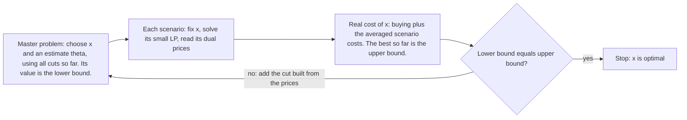
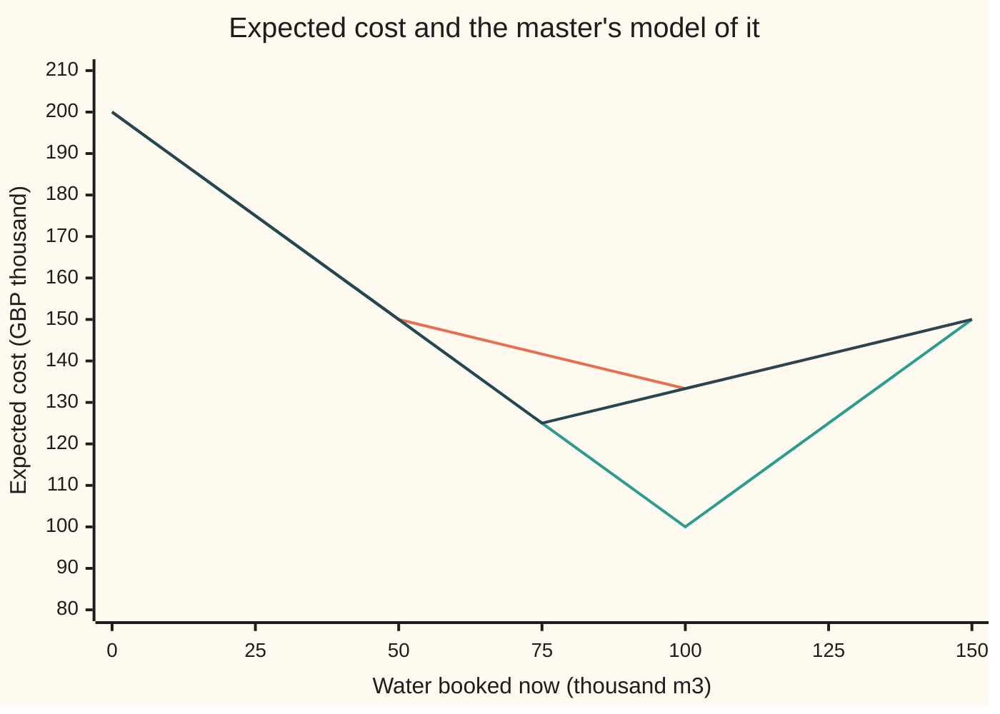

# Benders decomposition: fix the first-stage choice, and let each scenario send back a cut

[Syllabus](../../../SYLLABUS.md) → [Optimization](../README.md) → [Dynamic Programming and Learning](../README.md#s07) → Benders decomposition

---

## General Overview

A hydro reservoir also supplies farms with irrigation water. Each spring the operator books water for the season ahead from a neighbouring scheme, at £1,000 per thousand cubic metres (thousand m³). The season's demand depends on the summer: 50, 100 or 150 thousand m³, each with chance one in three.

Water that is short on the day comes by emergency tanker at £2,000 per thousand m³. The operator **chooses** the amount booked now, makes the **expected cost** (the cost averaged over the three summers, weighted by their chances) as **small** as possible, and is **limited** only by the booking being zero or more. This is a minimisation.

[Two-stage stochastic programming](07-stochastic-programming-with-recourse.md) solves such a problem as one large linear program, the **extensive form**, with a copy of the later decisions for every summer. With three summers that is easy. With a thousand summers, or a booking that must be made in whole blocks, the one large program becomes slow or impossible to write down.

**Benders decomposition** splits the work. A small **master problem** proposes a booking. Each summer, on its own, prices that booking: how much it would cost in tankers, and how much each extra thousand m³ booked would save. That price turns into a straight-line lower bound on the tanker cost, called a **cut**, which goes back to the master. The master proposes again, now knowing more.

On a two-stage stochastic program this loop is called the **L-shaped method**. The name comes from the extensive form's table of constraints: the booking's column runs down the left edge, and each summer's own block of columns sits on its own rows, so the filled entries trace an L.

Here the loop proposes 0, then 100, then 75, then 100 again. After three cuts the master's lower bound and the best real cost seen both read £133,333. So: **book 100 thousand m³**, at an expected cost of **£133,333**. The two bounds meeting is the proof that nothing does better.

**Fix the first-stage choice, solve every scenario as a small linear program, and turn each scenario's dual prices into a cut that bounds the future cost from below; the master problem gathers the cuts, and when its lower bound meets the best real cost found, the choice is optimal.**

**What kind of fact this is:** a method with a certificate. Two theorems behind it are proved on this card in Why it works: every cut is a true lower bound (by weak duality), and the method stops after finitely many cuts with the two bounds equal. The answer is also certified by dual prices of the one large program.

### The picture: the loop



The master never sees the scenarios themselves, only the cuts they send back. A scenario that has no repair at all for the proposed $`x`$ sends back a different kind of cut, a **feasibility cut**, that rules that $`x`$ out.

---

## The formula

The problem, from [Two-stage stochastic programming](07-stochastic-programming-with-recourse.md), with this card's numbers:

```math
\min_{x \,\ge\, 0}\; c\,x + \sum_s p_s\, Q(x, s), \qquad Q(x, s) = \min_{y_s \,\ge\, 0}\,\{\, q\, y_s \,:\, y_s \ge d_s - x \,\} = \max_{0 \,\le\, \lambda_s \,\le\, q}\, \lambda_s\,(d_s - x)
```

The last equality is LP duality: the scenario's small program and its dual have the same value. The master problem at iteration $`k`$ (counting from $`k = 0`$) replaces the unknown future cost by one number $`\theta`$, kept above every cut collected so far:

```math
\mathrm{LB}_k = \min_{x \,\ge\, 0,\ \theta \,\ge\, 0}\; c\,x + \theta \quad \text{subject to} \quad \theta \ge \sum_s p_s\, \lambda_{s,j}\,(d_s - x) \ \text{ for each earlier iteration } j < k
```

**Read it aloud:** the master books the amount that minimises buying cost plus an estimate of the tanker cost, where the estimate must sit on or above every straight line the scenarios have sent back; the best value it finds is a lower bound on the true answer.

The **upper bound** is the real cost of the best booking tried so far, $`\mathrm{UB}_k = \min_{j \le k}\, \big(c\,x_j + \sum_s p_s Q(x_j, s)\big)`$. The method stops when $`\mathrm{LB}_k = \mathrm{UB}_k`$; that common value is the optimal value $`p^*`$.

When a scenario can cover only a limited shortfall, at most $`u`$, a booking with $`d_s - x > u`$ leaves it no repair. Then the scenario sends back a **feasibility cut**, $`d_s - x - u \le 0`$, which forbids every booking too small for that summer.

On this card $`\theta`$ is the master's estimate of the expected recourse, not the mixing weight of the convex-sets card. The dual prices are $`\lambda`$, as on [Two-stage stochastic programming](07-stochastic-programming-with-recourse.md).

| Symbol | Plain meaning | In our example | Push it up and the answer… |
| --- | --- | --- | --- |
| $`x`$ | first-stage choice: water booked now, thousand m³ | best $`x^* = 100`$ | — |
| $`c`$ | price of booking now, £ thousand per thousand m³ | 1 | at 1.5 the best booking falls to 50, cost 175 |
| $`s`$, $`p_s`$ | a scenario (one kind of summer) and its chance | three, each 1/3 | — |
| $`d_s`$ | irrigation demand in scenario $`s`$, thousand m³ | 50, 100, 150 | more booked |
| $`q`$ | tanker price per thousand m³ short, £ thousand | 2 | at 4 the best booking is 150, cost 150 |
| $`y_s`$ | recourse: tanker water bought in scenario $`s`$, thousand m³ | at $`x = 100`$: 0, 0, 50 | — |
| $`Q(x, s)`$ | recourse cost: cheapest tanker bill in scenario $`s`$ given $`x`$, £ thousand | at $`x = 100`$: 0, 0, 100 | — |
| $`\lambda_s`$ | dual price of scenario $`s`$: the tanker bill saved per extra thousand m³ booked | 2 if short, 0 if not, anything from 0 to 2 if met exactly | — |
| $`\theta`$, $`\theta_s`$ | the master's estimate of the expected recourse $`\sum_s p_s Q(x, s)`$ (multi-cut: one $`\theta_s`$ per scenario) | 0, 0, 50, then 33.33 | — |
| $`k`$, $`x_k`$ | iteration count from 0, and the booking the master proposes at it | 0, 100, 75, 100 | — |
| $`\mathrm{LB}_k`$, $`\mathrm{UB}_k`$, $`p^*`$ | lower bound (master value), upper bound (best real cost so far), optimal value | 0, 100, 125, 133.33; 200, then 133.33; 133.33 | — |
| $`u`$ | cap on tanker water in one scenario, thousand m³ (a variant) | 30 | at 60 the cap no longer binds: 100, 133.33 |

### When it holds

- **The second stage is a linear program.** Then its dual prices give true cuts. If tankers come only whole, 40 thousand m³ for £80,000, the cuts bound the wrong function: the bounds stop at 133.33 and 153.33 and never meet, while the true best is 110 thousand m³ at £136,667.
- **Each scenario returns optimal dual prices.** Prices that are allowed but not optimal still give valid cuts, but loose ones. Charge 2 in every summer and the master proposes 100 forever, with the lower bound stuck at 100.
- **Every proposed booking has a repair, or a feasibility cut is added.** With the tanker cap at 30 and no feasibility cuts (the scenarios ignore the cap), the method books 100 and leaves 20 thousand m³ unmet in the 150 summer.
- **The future cost has a known floor.** Tanker bills are never negative, so $`\theta \ge 0`$ is a safe start. With no floor at all, the first master is unbounded below.
- **The master can be solved exactly.** Whole blocks of 35 thousand m³ are fine: the cuts still hold, and the master becomes a small integer program (one with whole-number unknowns; see [Integer programs](../05-Integer%20and%20Combinatorial%20Optimisation/01-integer-programs-and-relaxations.md)).

---

## Why it works

### Step 0: the future cost is a bowl made of straight pieces, and duality hands over its tangent lines

Each scenario's tanker bill $`Q(x, s)`$ is a convex function of $`x`$ (a curve that never bends down), made of straight pieces. A convex function lies above each of its tangent lines. So a few tangent lines, taken together, give a floor under the function that is exact where they touch.

The question is where to get the tangent lines without drawing the whole function. [LP duality](../04-Linear%20Programming/04-lp-duality-and-complementary-slackness.md) answers it: solve the scenario at one $`x`$, and its dual prices are the slope of a tangent line there. The slope is a **subgradient** (a slope that stays under the function even at a kink; see [Subgradients](../01-Convexity/07-subgradients.md)).

### Step 1: every cut is a true lower bound

Take any price $`\lambda_s`$ with $`0 \le \lambda_s \le q`$, and any repair $`y_s`$ that works at $`x`$: $`y_s \ge 0`$ and $`y_s \ge d_s - x`$. Then

```math
q\, y_s \;\ge\; \lambda_s\, y_s \;\ge\; \lambda_s\,(d_s - x).
```

The first step uses $`q \ge \lambda_s`$ and $`y_s \ge 0`$; the second uses $`\lambda_s \ge 0`$ and $`y_s \ge d_s - x`$. This holds for every working repair, so it holds for the cheapest: $`Q(x, s) \ge \lambda_s(d_s - x)`$ for **every** $`x`$. That is weak duality.

Averaging over the scenarios gives the cut $`\sum_s p_s Q(x, s) \ge \sum_s p_s \lambda_s (d_s - x)`$. It is true at every booking, not only at the one where the prices were found.

### Step 2: the right prices make the cut touch

At the booking $`\hat x`$ where the scenario was solved, choose $`\lambda_s = q`$ if the summer is short ($`d_s > \hat x`$) and $`\lambda_s = 0`$ if not. Then $`\lambda_s(d_s - \hat x)`$ equals the tanker bill $`q \max(0, d_s - \hat x)`$ exactly. By strong duality an optimal dual always does this.

So each cut is a tangent line of the expected recourse at $`\hat x`$. At $`x = 0`$ every summer is short and the prices are 2, 2, 2:

```math
\theta \;\ge\; \tfrac13 \cdot 2\,(50 - x) + \tfrac13 \cdot 2\,(100 - x) + \tfrac13 \cdot 2\,(150 - x) \;=\; 200 - 2x.
```

### Step 3: the master's value is a lower bound, any tried booking an upper bound

The master asks $`\theta`$ only to sit above the cuts, and the true expected recourse also sits above them. So the true problem is one of the choices the master allows, and the master's value $`\mathrm{LB}_k`$ is at most $`p^*`$.

Any booking actually tried has a real cost, and no real cost is below the best one. So $`\mathrm{UB}_k \ge p^*`$. Together:

```math
\mathrm{LB}_k \;\le\; p^* \;\le\; \mathrm{UB}_k.
```

When the two meet, the booking that gave $`\mathrm{UB}_k`$ is optimal, with the meeting value as its certificate.

### Step 4: the loop stops

Each scenario's dual here has only two corners, $`\lambda_s = 0`$ and $`\lambda_s = q`$, so there are at most $`2^3 = 8`$ different single cuts. If the master proposes a booking whose cut it already holds, the bounds have met. So the loop adds a new cut every round until it stops, and it stops after at most 8 new cuts. Here it takes 3 cuts and 4 master solves.

<details>
<summary>Detailed proof: if the new cut is already in the master, the lower bound equals the upper bound</summary>

Suppose the master at iteration $`k`$ returns $`(x_k, \theta_k)`$, and the cut the scenarios send back at $`x_k`$ is one the master already holds. Because the master obeys every cut it holds, $`\theta_k`$ sits on or above that cut at $`x_k`$.

By Step 2 the cut at $`x_k`$ touches the expected recourse there, so

$`\displaystyle \theta_k \;\ge\; \sum_s p_s\, \lambda_{s,k}\,(d_s - x_k) \;=\; \sum_s p_s\, Q(x_k, s).`$

Add $`c\, x_k`$ to both sides. The left side is $`\mathrm{LB}_k`$; the right side is the real cost of $`x_k`$, which is at least $`\mathrm{UB}_k`$:

$`\displaystyle \mathrm{LB}_k \;=\; c\, x_k + \theta_k \;\ge\; c\, x_k + \sum_s p_s\, Q(x_k, s) \;\ge\; \mathrm{UB}_k.`$

With Step 3, $`\mathrm{LB}_k \le \mathrm{UB}_k`$, so the two are equal.

So every round that does not stop adds a cut the master did not hold. Each scenario's dual has finitely many corners, so there are finitely many possible cuts, and the loop stops after at most that many rounds. The same counting covers feasibility cuts, which come from the dual's finitely many rays (Step 5). In general a scenario with many rows has many corners, so the bound is finite but can be large; Van Slyke and Wets (1969) give the general proof.

</details>

### Step 5: feasibility cuts, when a scenario has no repair

Cap tanker water at $`u = 30`$ thousand m³ per summer. At $`x = 0`$ the 50 summer needs 50, more than the cap, so its program has no working repair at all.

Its dual then has a **ray**: a direction along which the dual's value climbs forever. Here the ray charges 1 for each thousand m³ demanded beyond the booking and refunds 1 for each thousand m³ of cap; its value is $`d_s - x - u`$. When that is positive, scaling it up proves no repair exists, and requiring it to be at most zero gives the feasibility cut $`x \ge d_s - u`$.

At $`x = 0`$ the three summers send $`x \ge 20`$, $`x \ge 70`$ and $`x \ge 120`$. The master then books 120, the single optimality cut $`\theta \ge 100 - \tfrac23 x`$ follows, and both bounds meet at £140,000.

### Step 6: one cut, or one cut per scenario

The **single-cut** method above adds the averaged cut, one line per round. The **multi-cut** method gives the master one estimate $`\theta_s`$ per scenario, minimises $`c\,x + \sum_s p_s \theta_s`$, and keeps each scenario's cut separately.

Separate cuts keep more information: averaging three lines into one throws away where each scenario's kink sits. Here each summer's bill has one kink, and the first round of three cuts from $`x = 0`$ already describes all of them. The multi-cut master jumps straight to 100 and stops after 2 master solves instead of 4. The price is a master with more rows: three cuts per round instead of one.

### Step 7: Benders for a mixed-integer problem

Benders first used the idea for **mixed-integer programs** (programs where some unknowns must be whole numbers): fix the integer unknowns, and what is left is a linear program whose dual prices make cuts. Suppose the scheme sells water only in whole blocks of 35 thousand m³.

The cuts still hold, because Step 1 never used that $`x`$ is a fraction. Only the master changes: it now chooses among 0, 35, 70, 105, 140 and 175. The run proposes 0, 105, 70, then 105 again, and the bounds meet at £135,000: book **3 blocks**. Listing all six bookings confirms it.

The master is now an integer program, which in general is hard; the scenarios stay easy linear programs. That split, hard part small and large part easy, is why the method is used.

The other way round fails. If the **second** stage has whole-number decisions, its bill is no longer convex. Its LP dual prices still give true cuts, but loose ones: they bound the fractional bill, which lies below the real one, so the bounds stall apart, and stopping there reports a wrong answer, as "What breaks" shows.

### The picture: the master's floor rising under the true cost



The first line (orange) is the true expected cost, lowest at 133.33 when 100 is booked. The second (green) is the master's model after cut 1: its lowest point, 100 at a booking of 100, is the lower bound $`\mathrm{LB}_1`$. The third (dark) is the model after cut 2: its lowest point moves to 125 at 75. Cut 3 lifts the model to the true cost between 50 and 100, and the lowest point becomes 133.33.

---

## Worked numbers, by hand

Money in £ thousand, water in thousand m³. The repair costs are listed for the 50, 100 and 150 summers.

| Step | Arithmetic | Value |
| --- | --- | --- |
| $`k = 0`$: master, only $`\theta \ge 0`$ | cheapest is to book nothing | $`x_0 = 0`$, LB 0 |
| $`k = 0`$: scenarios | short 50, 100, 150 at 2 each: 100, 200, 300; average | 200; UB 200 |
| cut 1 | prices 2, 2, 2: $`\tfrac23(300 - 3x)`$ | $`\theta \ge 200 - 2x`$ |
| $`k = 1`$: master | $`x + 200 - 2x`$ falls until the cut reaches 0 at 100 | $`x_1 = 100`$, LB 100 |
| $`k = 1`$: scenarios | 0, 0, 100; 100 + 100/3 | UB 133.33 |
| cut 2 | prices 0, 0, 2: $`\tfrac23(150 - x)`$ | $`\theta \ge 100 - \tfrac23 x`$ |
| $`k = 2`$: master | cuts 1 and 2 cross: $`200 - 2x = 100 - \tfrac23 x`$, $`\theta = 50`$ | $`x_2 = 75`$, LB 125 |
| $`k = 2`$: scenarios | 0, 50, 150; 75 + 200/3 = 141.67, worse than 133.33 | UB 133.33 |
| cut 3 | prices 0, 2, 2: $`\tfrac23(250 - 2x)`$ | $`\theta \ge \tfrac{500}{3} - \tfrac43 x`$ |
| $`k = 3`$: master | cuts 2 and 3 cross at 100, $`\theta = 33.33`$ | $`x_3 = 100`$, LB 133.33 |
| check: extensive form | dual prices $`p_s \lambda_s`$ = 0, 1/3, 2/3: $`\tfrac13 \cdot 100 + \tfrac23 \cdot 150`$ | 133.33 |
| **answer** | LB = UB | **book 100, £133,333** |

Booking 100 thousand m³ costs £133,333 on average, and both the meeting bounds and the extensive form's dual prices show that no booking costs less.

The last check is the dual test of [Two-stage stochastic programming](07-stochastic-programming-with-recourse.md): the extensive form's prices, $`p_s \lambda_s`$ (a chance times a scenario price), sum to the booking price 1 and none exceeds 2/3 (a chance times the tanker price), so no plan costs less than $`\sum_s p_s \lambda_s d_s`$.

### What breaks if you drop a piece

| Mistake | Comes out at | What went wrong |
| --- | --- | --- |
| Cut with the value but no slope: $`\theta \ge 200`$ from $`x = 0`$ | LB 200, above the true 133.33 | The flat line is true only at $`x = 0`$; the "lower bound" is false |
| Prices 2 in every summer, even when not short | $`x`$ = 0, 100, 100, 100, 100; LB stuck at 100 | Allowed but not optimal prices: the cut never touches at 100, so the master never learns |
| Tanker cap 30, scenarios ignore it, no feasibility cuts | books 100; 20 unmet when demand is 150 | A booking with no repair was treated as allowed |
| Whole tankers of 40 at 80, LP cuts | bounds stop at 133.33 and 153.33; true best 110 at 136.67 | The second stage is not a linear program, so its cuts bound the wrong function |

---

## Code, from first principles, and it actually runs

Four independent roads, all in exact fractions. Road 1 runs the single-cut L-shaped method: each scenario's dual is solved by listing its corners and rays, and the master, which is convex and made of straight pieces, by checking every crossing of two cut lines. Road 2 runs the multi-cut method. Road 3 builds the extensive form's plan and dual prices and checks that the dual bound meets the plan's cost. Road 4 ignores all of that and scans every whole booking from 0 to 200, costing each one directly; that is exact because every kink falls on a whole number. All four give 100 and 133.33. The scripts also run the tanker cap, the whole blocks, the four breaks and the experiments.

### Python

```python
# Benders decomposition and the L-shaped method -- the check behind the card.
# Standard library only, exact fractions.  The reservoir buys x thousand m3 of
# irrigation water now at GBP 1k per thousand m3.  Demand is 50, 100 or 150
# (chance 1/3 each); each thousand m3 short on the day costs GBP 2k.  Minimise
# the expected cost.  Road 1: the L-shaped method, single-cut.  Road 2: the
# multi-cut version.  Road 3: the extensive form's plan with dual prices that
# meet its cost.  Road 4: a scan of every whole x, cost worked out directly.
from fractions import Fraction as F
from math import ceil

D, P, C = [50, 100, 150], [F(1, 3)] * 3, 1

def fmt(v): return str(v) if v == int(v) else f"{float(v):.2f}"
def line(a, b): return f"theta >= {a} {'-' if b < 0 else '+'} {abs(b)} x"

def sub(x, d, q=2, cap=None, tight=True):
    # scenario LP: min q*y, y >= d - x, 0 <= y (<= cap).  Its dual: max lam*(d-x) - mu*cap
    # over lam, mu >= 0, lam - mu <= q.  Corners (0,0), (q,0); rays (0,1), (1,1) if capped.
    for lam, mu in ([(0, 1), (1, 1)] if cap is not None else []):
        if lam * (d - x) - mu * cap > 0: return "ray", F(lam * d - mu * cap, lam)
    best = q if d - x > 0 else 0                     # the better corner (ties go to 0)
    return "opt", best * (d - x), best if tight else q

def master(groups, w, lo=F(0), grid=None):
    # min C*x + sum_g w_g * max(0, cuts in g) over x >= lo (or x in grid): convex and
    # piecewise linear, so its minimum sits at lo or at a crossing of two lines.
    def g(x): return C * x + sum(wi * max([F(0)] + [a + b * x for a, b in gr]) for wi, gr in zip(w, groups))
    cand = grid if grid else {lo} | {(a2 - a1) / (b1 - b2) for gr in groups
            for a1, b1 in gr + [(0, 0)] for a2, b2 in gr + [(0, 0)] if b1 != b2}
    cand = sorted(x for x in cand if x >= lo)
    best = min(cand, key=lambda x: (g(x), x))
    return best, g(best)

def benders(q=2, cap=None, multi=False, block=None, tight=True, tag="single", show=True, kmax=20):
    groups = [[] for _ in D] if multi else [[]]
    w = P if multi else [F(1)]
    lo, ub, k, visited = F(0), None, 0, []
    while k <= kmax:
        grid = [F(block * n) for n in range(6)] if block else None
        x, lb = master(groups, w, lo, [v for v in grid if v >= lo] if grid else None)
        res = [sub(x, d, q, cap, tight) for d in D]
        rays = [r[1] for r in res if r[0] == "ray"]
        if rays:
            lo = max([lo] + rays)
            if show: print(f"{tag} k={k} x={fmt(x)} infeasible -> feasibility cuts " + ", ".join(f"x >= {r}" for r in rays))
            k += 1; continue
        visited.append(x)
        val = C * x + sum(p * r[1] for p, r in zip(P, res))
        ub = val if ub is None else min(ub, val)
        cuts = [(F(r[2] * d), F(-r[2])) for r, d in zip(res, D)]   # Q_s(x) >= lam_s * (d_s - x)
        if not multi: cuts = [(sum(p * a for p, (a, _) in zip(P, cuts)), sum(p * b for p, (_, b) in zip(P, cuts)))]
        lams = ",".join(str(r[2]) for r in res)
        done = lb == ub
        qs = ",".join(fmt(r[1]) for r in res)
        if show: print(f"{tag} k={k} x={fmt(x)} theta={fmt(lb - C * x)} LB={fmt(lb)} | Q={qs} cost={fmt(val)} UB={fmt(ub)} | "
                       + ("stop" if done else f"prices {lams} | " + ("; ".join(line(a, b) for a, b in cuts) if not multi else f"{len(cuts)} cuts")))
        if done: return x, ub, k, visited
        for gr, cut in zip(groups, cuts): gr.append(cut)
        k += 1
    return x, lb, k, visited

def f(x, q=2, cap=None):   # expected cost worked out directly from the primal repair y = max(0, d - x)
    short = [max(0, d - x) for d in D]
    if cap is not None and max(short) > cap: return None
    return C * x + sum(p * q * s for p, s in zip(P, short))

def scan(xs, **kw):
    vals = [(f(x, **kw), x) for x in xs if f(x, **kw) is not None]
    return min(vals)[1], min(vals)[0]

print("demand 50/100/150 (1/3 each), buy at 1, shortfall at 2; GBP thousand, thousand m3")
x1, v1, k1, vis = benders()
x2, v2, k2, _ = benders(multi=True, tag="multi")
xs, vs = scan(range(0, 201))
print(f"dual corners per scenario 2, so at most {2 ** len(D)} different single cuts")
print(f"scan x = 0..200: best x={xs} cost={fmt(vs)};  f at kinks 0,50,100,150: " + ", ".join(fmt(f(x)) for x in (0, 50, 100, 150)))
ys = [max(0, d - x1) for d in D]                       # extensive form: plan and dual prices
lam, left = [], F(C)
for p, d in sorted(zip(P, D), key=lambda t: -t[1]):   # dual: max sum lam*d, lam_s <= 2p_s, sum <= C
    lam.append(min(2 * p, left)); left -= lam[-1]
lam = lam[::-1]
primal = C * x1 + sum(2 * p * y for p, y in zip(P, ys))
bound = sum(l * d for l, d in zip(lam, D))
print(f"extensive form: x={x1}, y={', '.join(map(str, ys))}, cost {fmt(primal)}; dual prices {', '.join(map(str, lam))} sum {sum(lam)}, bound {fmt(bound)}")
xc, vc, kc, _ = benders(cap=30, tag="cap 30")
xcs, vcs = scan(range(0, 201), cap=30)
print(f"cap 30 scan: best x={xcs} cost={fmt(vcs)}")
xb, vb, kb, _ = benders(block=35, tag="blocks 35")
grid = [35 * n for n in range(6)]
xbs, vbs = scan(grid)
print("blocks 35 enumeration: " + ", ".join(f"f({x})={fmt(f(x))}" for x in grid))
print("chart x       " + " ".join(f"{x:>6}" for x in range(0, 151, 25)))
for name, cuts in [("true", None), ("1 cut", [(200, -2)]), ("2 cuts", [(200, -2), (100, F(-2, 3))])]:
    vals = [f(x) if cuts is None else C * x + max([0] + [a + b * x for a, b in cuts]) for x in range(0, 151, 25)]
    print(f"chart {name:<8}" + " ".join(f"{fmt(v):>6}" for v in vals))
_, lbc = master([[(F(200), F(0))]], [F(1)])            # breaks 1: a cut with no slope
print(f"break: flat cut theta >= 200 from x=0 -> master LB {lbc} > optimum {fmt(v1)}")
xl, lbl, kl, visl = benders(tight=False, show=False, kmax=4)   # breaks 2: loose prices
print(f"break: prices 2 in every season -> x visits {', '.join(map(fmt, visl))}; LB stuck at {fmt(lbl)}")
unmet = max(D) - x1 - 30                               # breaks 3: no feasibility cut
print(f"break: cap 30 ignored -> x={x1}, {unmet} thousand m3 unmet when demand is 150")
fi = lambda x: C * x + sum(p * 80 * ceil(max(0, d - x) / 40) for p, d in zip(P, D))
xi = min(range(0, 201), key=lambda x: (fi(x), x))       # breaks 4: integer recourse
ubi = min(fi(x) for x in vis)
print(f"break: tankers of 40 at 80 -> LP cuts stop at LB {fmt(v1)}, best visited {fmt(ubi)}; true best x={xi} cost {fmt(fi(xi))}")
for label, kw in [("shortfall 4", dict(q=4)), ("cap 60", dict(cap=60)), ("blocks 25", dict(block=25))]:
    xt, vt, kt, _ = benders(show=label == "cap 60", tag=f"try {label}", **kw)
    print(f"try {label}: x={fmt(xt)} cost={fmt(vt)} after {kt + 1} master solves")
C = F(3, 2); xt, vt, kt, _ = benders(show=False); print(f"try buy 1.5: x={fmt(xt)} cost={fmt(vt)} after {kt + 1} master solves"); C = 1

assert (x1, v1, k1) == (xs, vs, 3) == (100, F(400, 3), 3), "single-cut must match the scan, in 4 master solves"
assert (x2, v2) == (100, F(400, 3)) and k2 == 1, "multi-cut must match, in 2 master solves"
assert min(lam) >= 0 and sum(lam) <= C and all(l <= 2 * p for l, p in zip(lam, P)), "dual prices feasible"
assert bound == primal == v1, "dual bound must meet the extensive form's cost: the certificate"
assert (xc, vc) == (xcs, vcs) == (120, 140), "feasibility cuts must reach the capped optimum"
assert (xb, vb) == (xbs, vbs) == (105, 135), "integer master must match enumeration"
assert lbc > v1 and lbl < v1 and fi(xi) < ubi and v1 < fi(xi), "the four breaks must show"
print("ALL CHECKS PASS")
```

**Ran 2026-11-24 on macOS, Python 3.14.10, standard library only. All checks passed. Output, pasted from the run:**

```
demand 50/100/150 (1/3 each), buy at 1, shortfall at 2; GBP thousand, thousand m3
single k=0 x=0 theta=0 LB=0 | Q=100,200,300 cost=200 UB=200 | prices 2,2,2 | theta >= 200 - 2 x
single k=1 x=100 theta=0 LB=100 | Q=0,0,100 cost=133.33 UB=133.33 | prices 0,0,2 | theta >= 100 - 2/3 x
single k=2 x=75 theta=50 LB=125 | Q=0,50,150 cost=141.67 UB=133.33 | prices 0,2,2 | theta >= 500/3 - 4/3 x
single k=3 x=100 theta=33.33 LB=133.33 | Q=0,0,100 cost=133.33 UB=133.33 | stop
multi k=0 x=0 theta=0 LB=0 | Q=100,200,300 cost=200 UB=200 | prices 2,2,2 | 3 cuts
multi k=1 x=100 theta=33.33 LB=133.33 | Q=0,0,100 cost=133.33 UB=133.33 | stop
dual corners per scenario 2, so at most 8 different single cuts
scan x = 0..200: best x=100 cost=133.33;  f at kinks 0,50,100,150: 200, 150, 133.33, 150
extensive form: x=100, y=0, 0, 50, cost 133.33; dual prices 0, 1/3, 2/3 sum 1, bound 133.33
cap 30 k=0 x=0 infeasible -> feasibility cuts x >= 20, x >= 70, x >= 120
cap 30 k=1 x=120 theta=0 LB=120 | Q=0,0,60 cost=140 UB=140 | prices 0,0,2 | theta >= 100 - 2/3 x
cap 30 k=2 x=120 theta=20 LB=140 | Q=0,0,60 cost=140 UB=140 | stop
cap 30 scan: best x=120 cost=140
blocks 35 k=0 x=0 theta=0 LB=0 | Q=100,200,300 cost=200 UB=200 | prices 2,2,2 | theta >= 200 - 2 x
blocks 35 k=1 x=105 theta=0 LB=105 | Q=0,0,90 cost=135 UB=135 | prices 0,0,2 | theta >= 100 - 2/3 x
blocks 35 k=2 x=70 theta=60 LB=130 | Q=0,60,160 cost=143.33 UB=135 | prices 0,2,2 | theta >= 500/3 - 4/3 x
blocks 35 k=3 x=105 theta=30 LB=135 | Q=0,0,90 cost=135 UB=135 | stop
blocks 35 enumeration: f(0)=200, f(35)=165, f(70)=143.33, f(105)=135, f(140)=146.67, f(175)=175
chart x            0     25     50     75    100    125    150
chart true       200    175    150 141.67 133.33 141.67    150
chart 1 cut      200    175    150    125    100    125    150
chart 2 cuts     200    175    150    125 133.33 141.67    150
break: flat cut theta >= 200 from x=0 -> master LB 200 > optimum 133.33
break: prices 2 in every season -> x visits 0, 100, 100, 100, 100; LB stuck at 100
break: cap 30 ignored -> x=100, 20 thousand m3 unmet when demand is 150
break: tankers of 40 at 80 -> LP cuts stop at LB 133.33, best visited 153.33; true best x=110 cost 136.67
try shortfall 4: x=150 cost=150 after 3 master solves
try cap 60 k=0 x=0 infeasible -> feasibility cuts x >= 40, x >= 90
try cap 60 k=1 x=90 theta=0 LB=90 | Q=0,20,120 cost=136.67 UB=136.67 | prices 0,2,2 | theta >= 500/3 - 4/3 x
try cap 60 k=2 x=125 theta=0 LB=125 | Q=0,0,50 cost=141.67 UB=136.67 | prices 0,0,2 | theta >= 100 - 2/3 x
try cap 60 k=3 x=100 theta=33.33 LB=133.33 | Q=0,0,100 cost=133.33 UB=133.33 | stop
try cap 60: x=100 cost=133.33 after 4 master solves
try blocks 25: x=100 cost=133.33 after 4 master solves
try buy 1.5: x=50 cost=175 after 4 master solves
ALL CHECKS PASS
```

### Rust

```rust
// Benders decomposition and the L-shaped method -- the check behind the card.
// std only, exact fractions in a small rational struct.  The reservoir buys x
// thousand m3 of irrigation water now at GBP 1k per thousand m3.  Demand is 50,
// 100 or 150 (chance 1/3 each); each thousand m3 short costs GBP 2k.  Minimise
// the expected cost.  Road 1: single-cut L-shaped.  Road 2: multi-cut.  Road 3:
// the extensive form's plan with dual prices that meet its cost.  Road 4: a
// scan of every whole x, cost worked out directly.
use std::cmp::Ordering;
use std::ops::{Add, Div, Mul, Neg, Sub};

#[derive(Clone, Copy, Debug, PartialEq, Eq)]
struct R(i64, i64);
fn gcd(a: i64, b: i64) -> i64 { if b == 0 { a.abs() } else { gcd(b, a % b) } }
fn r(n: i64, d: i64) -> R { let g = gcd(n, d).max(1) * d.signum(); R(n / g, d / g) }
fn ri(n: i64) -> R { R(n, 1) }
impl Add for R { type Output = R; fn add(self, o: R) -> R { r(self.0 * o.1 + o.0 * self.1, self.1 * o.1) } }
impl Sub for R { type Output = R; fn sub(self, o: R) -> R { r(self.0 * o.1 - o.0 * self.1, self.1 * o.1) } }
impl Mul for R { type Output = R; fn mul(self, o: R) -> R { r(self.0 * o.0, self.1 * o.1) } }
impl Div for R { type Output = R; fn div(self, o: R) -> R { r(self.0 * o.1, self.1 * o.0) } }
impl Neg for R { type Output = R; fn neg(self) -> R { R(-self.0, self.1) } }
impl PartialOrd for R { fn partial_cmp(&self, o: &R) -> Option<Ordering> { Some(self.cmp(o)) } }
impl Ord for R { fn cmp(&self, o: &R) -> Ordering { (self.0 * o.1).cmp(&(o.0 * self.1)) } }
impl std::fmt::Display for R {
    fn fmt(&self, f: &mut std::fmt::Formatter) -> std::fmt::Result {
        if self.1 == 1 { write!(f, "{}", self.0) } else { write!(f, "{}/{}", self.0, self.1) } } }
fn fm(v: R) -> String { if v.1 == 1 { format!("{}", v.0) } else { format!("{:.2}", v.0 as f64 / v.1 as f64) } }
fn line(a: R, b: R) -> String { format!("theta >= {} {} {} x", a, if b < ri(0) { "-" } else { "+" }, if b < ri(0) { -b } else { b }) }
fn join<T: ToString>(v: &[T], s: &str) -> String { v.iter().map(|t| t.to_string()).collect::<Vec<_>>().join(s) }

const D: [i64; 3] = [50, 100, 150];
fn p() -> R { r(1, 3) }
enum Sub_ { Ray(R), Opt(R, i64) }

// scenario LP: min q*y, y >= d - x, 0 <= y (<= cap).  Dual: max lam*(d-x) - mu*cap over
// lam, mu >= 0, lam - mu <= q.  Corners (0,0), (q,0); rays (0,1), (1,1) if capped.
fn sub(x: R, d: i64, q: i64, cap: Option<i64>, tight: bool) -> Sub_ {
    if let Some(c) = cap { for (lam, mu) in [(0i64, 1i64), (1, 1)] {
        if ri(lam) * (ri(d) - x) - ri(mu * c) > ri(0) { return Sub_::Ray(r(lam * d - mu * c, lam)); } } }
    let best = if ri(d) - x > ri(0) { q } else { 0 };
    Sub_::Opt(ri(best) * (ri(d) - x), if tight { best } else { q })
}

fn master(c: R, groups: &[Vec<(R, R)>], w: &[R], lo: R, grid: Option<Vec<R>>) -> (R, R) {
    let g = |x: R| { let mut s = c * x; for (wi, gr) in w.iter().zip(groups) {
        s = s + *wi * gr.iter().map(|&(a, b)| a + b * x).fold(ri(0), |m, v| m.max(v)); } s };
    let mut cand: Vec<R> = match grid { Some(v) => v, None => { let mut v = vec![lo];
        for gr in groups { let mut ls = gr.clone(); ls.push((ri(0), ri(0)));
            for &(a1, b1) in &ls { for &(a2, b2) in &ls { if b1 != b2 { v.push((a2 - a1) / (b1 - b2)); } } } } v } };
    cand.retain(|&x| x >= lo); cand.sort(); cand.dedup();
    let best = *cand.iter().min_by(|&&x, &&y| g(x).cmp(&g(y)).then(x.cmp(&y))).unwrap();
    (best, g(best))
}

struct Run { x: R, v: R, k: i64, visited: Vec<R> }
fn benders(c: R, q: i64, cap: Option<i64>, multi: bool, block: Option<i64>, tight: bool, tag: &str, show: bool, kmax: i64) -> Run {
    let mut groups: Vec<Vec<(R, R)>> = vec![vec![]; if multi { 3 } else { 1 }];
    let w: Vec<R> = if multi { vec![p(); 3] } else { vec![ri(1)] };
    let (mut lo, mut ub, mut k, mut visited) = (ri(0), None::<R>, 0, vec![]);
    let (mut x, mut lb) = (ri(0), ri(0));
    while k <= kmax {
        let grid = block.map(|b| (0..6).map(|n| ri(b * n)).filter(|&v| v >= lo).collect());
        let m = master(c, &groups, &w, lo, grid); x = m.0; lb = m.1;
        let res: Vec<Sub_> = D.iter().map(|&d| sub(x, d, q, cap, tight)).collect();
        let rays: Vec<R> = res.iter().filter_map(|s| if let Sub_::Ray(v) = s { Some(*v) } else { None }).collect();
        if !rays.is_empty() {
            for &v in &rays { lo = lo.max(v); }
            if show { println!("{} k={} x={} infeasible -> feasibility cuts {}", tag, k, fm(x),
                join(&rays.iter().map(|v| format!("x >= {}", v)).collect::<Vec<_>>(), ", ")); }
            k += 1; continue;
        }
        visited.push(x);
        let opt: Vec<(R, i64)> = res.iter().map(|s| if let Sub_::Opt(v, l) = s { (*v, *l) } else { unreachable!() }).collect();
        let val = opt.iter().fold(c * x, |s, &(v, _)| s + p() * v);
        ub = Some(match ub { None => val, Some(u) => u.min(val) });
        let mut cuts: Vec<(R, R)> = opt.iter().zip(D).map(|(&(_, l), d)| (ri(l * d), ri(-l))).collect();
        if !multi { cuts = vec![cuts.iter().fold((ri(0), ri(0)), |(sa, sb), &(a, b)| (sa + p() * a, sb + p() * b))]; }
        let lams = join(&opt.iter().map(|o| o.1).collect::<Vec<_>>(), ",");
        let done = Some(lb) == ub;
        let tail = if done { "stop".to_string() } else { format!("prices {} | {}", lams, if multi { format!("{} cuts", cuts.len()) }
            else { join(&cuts.iter().map(|&(a, b)| line(a, b)).collect::<Vec<_>>(), "; ") }) };
        let qs = join(&opt.iter().map(|o| fm(o.0)).collect::<Vec<_>>(), ",");
        if show { println!("{} k={} x={} theta={} LB={} | Q={} cost={} UB={} | {}", tag, k, fm(x), fm(lb - c * x), fm(lb), qs, fm(val), fm(ub.unwrap()), tail); }
        if done { return Run { x, v: ub.unwrap(), k, visited }; }
        for (gr, cut) in groups.iter_mut().zip(cuts) { gr.push(cut); }
        k += 1;
    }
    Run { x, v: lb, k, visited }
}

fn f(c: R, x: R, q: i64, cap: Option<i64>) -> Option<R> {
    let short: Vec<R> = D.iter().map(|&d| (ri(d) - x).max(ri(0))).collect();
    if let Some(cp) = cap { if *short.iter().max().unwrap() > ri(cp) { return None; } }
    Some(short.iter().fold(c * x, |s, &v| s + p() * ri(q) * v))
}
fn scan(c: R, xs: &[i64], q: i64, cap: Option<i64>) -> (R, R) {
    let mut best: Option<(R, R)> = None;
    for &x in xs { if let Some(v) = f(c, ri(x), q, cap) { if best.map_or(true, |(bv, _)| v < bv) { best = Some((v, ri(x))); } } }
    (best.unwrap().1, best.unwrap().0)
}

fn main() {
    let one = ri(1);
    let all: Vec<i64> = (0..=200).collect();
    println!("demand 50/100/150 (1/3 each), buy at 1, shortfall at 2; GBP thousand, thousand m3");
    let s1 = benders(one, 2, None, false, None, true, "single", true, 20);
    let s2 = benders(one, 2, None, true, None, true, "multi", true, 20);
    let (xs, vs) = scan(one, &all, 2, None);
    println!("dual corners per scenario 2, so at most {} different single cuts", 2i64.pow(D.len() as u32));
    let kinks: Vec<String> = [0, 50, 100, 150].iter().map(|&x| fm(f(one, ri(x), 2, None).unwrap())).collect();
    println!("scan x = 0..200: best x={} cost={};  f at kinks 0,50,100,150: {}", xs, fm(vs), join(&kinks, ", "));
    let ys: Vec<R> = D.iter().map(|&d| (ri(d) - s1.x).max(ri(0))).collect();
    let mut lam = vec![ri(0); 3]; let mut left = one;
    for i in (0..3).rev() { lam[i] = (ri(2) * p()).min(left); left = left - lam[i]; }   // largest demand first
    let primal = ys.iter().fold(s1.x, |s, &y| s + ri(2) * p() * y);
    let bound = lam.iter().zip(D).fold(ri(0), |s, (&l, d)| s + l * ri(d));
    let lsum = lam.iter().fold(ri(0), |s, &l| s + l);
    println!("extensive form: x={}, y={}, cost {}; dual prices {} sum {}, bound {}", s1.x, join(&ys, ", "), fm(primal), join(&lam, ", "), lsum, fm(bound));
    let sc = benders(one, 2, Some(30), false, None, true, "cap 30", true, 20);
    let (xcs, vcs) = scan(one, &all, 2, Some(30));
    println!("cap 30 scan: best x={} cost={}", xcs, fm(vcs));
    let sb = benders(one, 2, None, false, Some(35), true, "blocks 35", true, 20);
    let grid: Vec<i64> = (0..6).map(|n| 35 * n).collect();
    let (xbs, vbs) = scan(one, &grid, 2, None);
    println!("blocks 35 enumeration: {}", join(&grid.iter().map(|&x| format!("f({})={}", x, fm(f(one, ri(x), 2, None).unwrap()))).collect::<Vec<_>>(), ", "));
    let xs25: Vec<i64> = (0..=150).step_by(25).collect();
    println!("chart x       {}", join(&xs25.iter().map(|x| format!("{:>6}", x)).collect::<Vec<_>>(), " "));
    for (name, cuts) in [("true", vec![]), ("1 cut", vec![(ri(200), ri(-2))]), ("2 cuts", vec![(ri(200), ri(-2)), (ri(100), r(-2, 3))])] {
        let vals: Vec<String> = xs25.iter().map(|&x| { let x = ri(x); let v = if cuts.is_empty() { f(one, x, 2, None).unwrap() }
            else { cuts.iter().fold(ri(0), |m: R, &(a, b)| m.max(a + b * x)) + x }; format!("{:>6}", fm(v)) }).collect();
        println!("chart {:<8}{}", name, join(&vals, " "));
    }
    let (_, lbc) = master(one, &[vec![(ri(200), ri(0))]], &[one], ri(0), None);
    println!("break: flat cut theta >= 200 from x=0 -> master LB {} > optimum {}", lbc, fm(s1.v));
    let sl = benders(one, 2, None, false, None, false, "", false, 4);
    println!("break: prices 2 in every season -> x visits {}; LB stuck at {}", join(&sl.visited.iter().map(|&v| fm(v)).collect::<Vec<_>>(), ", "), fm(sl.v));
    println!("break: cap 30 ignored -> x={}, {} thousand m3 unmet when demand is 150", s1.x, ri(150) - s1.x - ri(30));
    let fi = |x: R| D.iter().fold(x, |s, &d| { let sh = (ri(d) - x).max(ri(0)); s + p() * ri(80) * ri((sh.0 + 40 * sh.1 - 1) / (40 * sh.1)) });
    let xi = (0..=200).map(ri).min_by(|&a, &b| fi(a).cmp(&fi(b)).then(a.cmp(&b))).unwrap();
    let ubi = s1.visited.iter().map(|&x| fi(x)).min().unwrap();
    println!("break: tankers of 40 at 80 -> LP cuts stop at LB {}, best visited {}; true best x={} cost {}", fm(s1.v), fm(ubi), xi, fm(fi(xi)));
    for (label, q, cap, block) in [("shortfall 4", 4, None, None), ("cap 60", 2, Some(60), None), ("blocks 25", 2, None, Some(25))] {
        let t = benders(one, q, cap, false, block, true, &format!("try {}", label), label == "cap 60", 20);
        println!("try {}: x={} cost={} after {} master solves", label, fm(t.x), fm(t.v), t.k + 1);
    }
    let t = benders(r(3, 2), 2, None, false, None, true, "", false, 20);
    println!("try buy 1.5: x={} cost={} after {} master solves", fm(t.x), fm(t.v), t.k + 1);

    assert!((s1.x, s1.v, s1.k) == (xs, vs, 3) && (xs, vs) == (ri(100), r(400, 3)), "single-cut must match the scan, in 4 master solves");
    assert!((s2.x, s2.v, s2.k) == (ri(100), r(400, 3), 1), "multi-cut must match, in 2 master solves");
    assert!(lam.iter().all(|&l| l >= ri(0) && l <= ri(2) * p()) && lsum <= one, "dual prices feasible");
    assert!(bound == primal && primal == s1.v, "dual bound must meet the extensive form's cost: the certificate");
    assert!((sc.x, sc.v) == (xcs, vcs) && (xcs, vcs) == (ri(120), ri(140)), "feasibility cuts must reach the capped optimum");
    assert!((sb.x, sb.v) == (xbs, vbs) && (xbs, vbs) == (ri(105), ri(135)), "integer master must match enumeration");
    assert!(lbc > s1.v && sl.v < s1.v && fi(xi) < ubi && s1.v < fi(xi), "the four breaks must show");
    println!("ALL CHECKS PASS");
}
```

**Ran 2026-11-24 on macOS, rustc 1.98.1, no crates. All checks passed. Output, pasted from the run:**

```
demand 50/100/150 (1/3 each), buy at 1, shortfall at 2; GBP thousand, thousand m3
single k=0 x=0 theta=0 LB=0 | Q=100,200,300 cost=200 UB=200 | prices 2,2,2 | theta >= 200 - 2 x
single k=1 x=100 theta=0 LB=100 | Q=0,0,100 cost=133.33 UB=133.33 | prices 0,0,2 | theta >= 100 - 2/3 x
single k=2 x=75 theta=50 LB=125 | Q=0,50,150 cost=141.67 UB=133.33 | prices 0,2,2 | theta >= 500/3 - 4/3 x
single k=3 x=100 theta=33.33 LB=133.33 | Q=0,0,100 cost=133.33 UB=133.33 | stop
multi k=0 x=0 theta=0 LB=0 | Q=100,200,300 cost=200 UB=200 | prices 2,2,2 | 3 cuts
multi k=1 x=100 theta=33.33 LB=133.33 | Q=0,0,100 cost=133.33 UB=133.33 | stop
dual corners per scenario 2, so at most 8 different single cuts
scan x = 0..200: best x=100 cost=133.33;  f at kinks 0,50,100,150: 200, 150, 133.33, 150
extensive form: x=100, y=0, 0, 50, cost 133.33; dual prices 0, 1/3, 2/3 sum 1, bound 133.33
cap 30 k=0 x=0 infeasible -> feasibility cuts x >= 20, x >= 70, x >= 120
cap 30 k=1 x=120 theta=0 LB=120 | Q=0,0,60 cost=140 UB=140 | prices 0,0,2 | theta >= 100 - 2/3 x
cap 30 k=2 x=120 theta=20 LB=140 | Q=0,0,60 cost=140 UB=140 | stop
cap 30 scan: best x=120 cost=140
blocks 35 k=0 x=0 theta=0 LB=0 | Q=100,200,300 cost=200 UB=200 | prices 2,2,2 | theta >= 200 - 2 x
blocks 35 k=1 x=105 theta=0 LB=105 | Q=0,0,90 cost=135 UB=135 | prices 0,0,2 | theta >= 100 - 2/3 x
blocks 35 k=2 x=70 theta=60 LB=130 | Q=0,60,160 cost=143.33 UB=135 | prices 0,2,2 | theta >= 500/3 - 4/3 x
blocks 35 k=3 x=105 theta=30 LB=135 | Q=0,0,90 cost=135 UB=135 | stop
blocks 35 enumeration: f(0)=200, f(35)=165, f(70)=143.33, f(105)=135, f(140)=146.67, f(175)=175
chart x            0     25     50     75    100    125    150
chart true       200    175    150 141.67 133.33 141.67    150
chart 1 cut      200    175    150    125    100    125    150
chart 2 cuts     200    175    150    125 133.33 141.67    150
break: flat cut theta >= 200 from x=0 -> master LB 200 > optimum 133.33
break: prices 2 in every season -> x visits 0, 100, 100, 100, 100; LB stuck at 100
break: cap 30 ignored -> x=100, 20 thousand m3 unmet when demand is 150
break: tankers of 40 at 80 -> LP cuts stop at LB 133.33, best visited 153.33; true best x=110 cost 136.67
try shortfall 4: x=150 cost=150 after 3 master solves
try cap 60 k=0 x=0 infeasible -> feasibility cuts x >= 40, x >= 90
try cap 60 k=1 x=90 theta=0 LB=90 | Q=0,20,120 cost=136.67 UB=136.67 | prices 0,2,2 | theta >= 500/3 - 4/3 x
try cap 60 k=2 x=125 theta=0 LB=125 | Q=0,0,50 cost=141.67 UB=136.67 | prices 0,0,2 | theta >= 100 - 2/3 x
try cap 60 k=3 x=100 theta=33.33 LB=133.33 | Q=0,0,100 cost=133.33 UB=133.33 | stop
try cap 60: x=100 cost=133.33 after 4 master solves
try blocks 25: x=100 cost=133.33 after 4 master solves
try buy 1.5: x=50 cost=175 after 4 master solves
ALL CHECKS PASS
```

### Lean

Lean proves the cut and bound facts of Steps 1 to 4 for any finite set of scenarios, and checks the reservoir's arithmetic exactly.

- Take prices $`0 \le \lambda_s \le q`$ and any working repairs. Then each scenario's tanker bill is at least $`\lambda_s (d_s - x)`$, so every cut is a true lower bound.
- Suppose every held cut comes from such prices, and the master returns its lowest value $`\mathrm{LB}`$. Then $`\mathrm{LB}`$ is at most the real expected cost of every booking.
- Take a booking whose real expected cost equals $`\mathrm{LB}`$. Then no booking costs less, so the meeting bounds prove it optimal.
- Suppose the master already holds the cut that touches at its proposal $`x_k`$, with Step 2's prices. Then $`\mathrm{LB}_k`$ equals the real cost of $`x_k`$, and $`x_k`$ is optimal.
- The hand arithmetic holds exactly: the three cuts, the lower bounds 100, 125 and 133.33, the multi-cut run and the extensive form's dual prices.
- So do the costs for the cap of 30, blocks of 35, whole tankers, the flat cut and two Try changing lines.

Running the loop, why it stops within 8 cuts, the feasibility cuts and the full scans are left to the Python and Rust checks.

```lean
-- Benders decomposition: every cut built from dual prices between 0 and the tanker price is a true floor under the expected recourse, the master's value is a lower bound on every booking's real cost, so a booking whose real cost meets it is optimal, and a master that proposes a booking whose touching cut it already holds has met its upper bound.
import Mathlib.Algebra.Order.BigOperators.Group.Finset
import Mathlib.Data.Real.Basic
import Mathlib.Tactic

open Finset

/-! The card's notation, for its two-stage problem with simple recourse.
* `x` is the first-stage choice (water booked now), with `x ≥ 0`, bought at price `c` each.
* `ι` indexes the scenarios (kinds of summer); `p s ≥ 0` is the chance of scenario `s` and
  `d s` its demand.
* `q` is the tanker price per unit short. A repair in scenario `s` is `y ≥ 0` with `y ≥ d s - x`;
  the scenario's linear program is `Q(x, s) = min { q y : y ≥ 0, y ≥ d s - x }`, whose value is
  `q * max 0 (d s - x)`. The expected cost of a booking is
  `f x = c * x + ∑ s, p s * (q * max 0 (d s - x))`, to be minimised over `x ≥ 0`.
* A dual price vector is `λ : ι → ℝ` with `0 ≤ λ s ≤ q`. It gives the single (averaged) cut
  `θ ≥ ∑ s, p s * λ s * (d s - x)`.
* The master holds the cuts indexed by a finite set `K`, the cut `j` coming from prices `lam j`.
  A pair `(x, θ)` is master-feasible when `x ≥ 0`, `θ ≥ 0` (the known floor) and `θ` sits on or
  above every held cut. The master's value `c * xk + θk` at its optimum `(xk, θk)` is `LB`. -/

/-- Each held cut sits under the real expected recourse at every booking. -/
theorem benders_cut_le_recourse
    {ι : Type*} [Fintype ι]
    (q x : ℝ) (p d lam : ι → ℝ) (hp : ∀ s, 0 ≤ p s)
    (hlam : ∀ s, 0 ≤ lam s ∧ lam s ≤ q) :
    ∑ s, p s * lam s * (d s - x) ≤ ∑ s, p s * (q * max 0 (d s - x)) := by
  apply Finset.sum_le_sum
  intro s _
  have h1 : lam s * (d s - x) ≤ lam s * max 0 (d s - x) :=
    mul_le_mul_of_nonneg_left (le_max_right _ _) (hlam s).1
  have h2 : lam s * max 0 (d s - x) ≤ q * max 0 (d s - x) :=
    mul_le_mul_of_nonneg_right (hlam s).2 (le_max_left _ _)
  rw [mul_assoc]
  exact mul_le_mul_of_nonneg_left (h1.trans h2) (hp s)

#print axioms benders_cut_le_recourse

/-- The bounds meeting certifies optimality. Let every held cut come from prices between 0 and
the tanker price `q ≥ 0`, and let `(xk, θk)` be a best point of the master. Then the master's value
`LB = c xk + θk` is at most the real expected cost of every booking `x ≥ 0`, and any booking
`x̂ ≥ 0` whose real expected cost equals `LB` is optimal: no booking costs less. -/
theorem benders_bounds_meet_certify_optimal
    {ι κ : Type*} [Fintype ι]
    (c q : ℝ) (p d : ι → ℝ) (hp : ∀ s, 0 ≤ p s) (hq : 0 ≤ q)
    (K : Finset κ) (lam : κ → ι → ℝ) (hlam : ∀ j ∈ K, ∀ s, 0 ≤ lam j s ∧ lam j s ≤ q)
    (xk θk : ℝ)
    (hmaster : ∀ x θ : ℝ, 0 ≤ x → 0 ≤ θ →
      (∀ j ∈ K, ∑ s, p s * lam j s * (d s - x) ≤ θ) → c * xk + θk ≤ c * x + θ) :
    (∀ x : ℝ, 0 ≤ x → c * xk + θk ≤ c * x + ∑ s, p s * (q * max 0 (d s - x))) ∧
    ∀ xh : ℝ, 0 ≤ xh → c * xh + ∑ s, p s * (q * max 0 (d s - xh)) = c * xk + θk →
      ∀ x : ℝ, 0 ≤ x →
        c * xh + ∑ s, p s * (q * max 0 (d s - xh)) ≤ c * x + ∑ s, p s * (q * max 0 (d s - x)) := by
  have part1 : ∀ x : ℝ, 0 ≤ x → c * xk + θk ≤ c * x + ∑ s, p s * (q * max 0 (d s - x)) := by
    intro x hx
    apply hmaster x _ hx
    · apply Finset.sum_nonneg
      intro s _
      exact mul_nonneg (hp s) (mul_nonneg hq (le_max_left _ _))
    · intro j hj
      exact benders_cut_le_recourse q x p d (lam j) hp (hlam j hj)
  refine ⟨part1, ?_⟩
  intro xh _ hxh x hx
  rw [hxh]
  exact part1 x hx

/-- Every cut is a true lower bound (weak duality). Take prices `0 ≤ λ s ≤ q` and any repairs
`y s ≥ 0` with `y s ≥ d s - x` in every scenario. Then each scenario's tanker bill is at least
`λ s (d s - x)`, and averaging with the chances `p s ≥ 0` gives the cut: the expected bill of the
repairs is at least `∑ s, p s λ s (d s - x)`, at every booking `x`. -/
theorem cut_le_expected_recourse
    {ι : Type*} [Fintype ι]
    (q x : ℝ) (p d lam y : ι → ℝ) (hp : ∀ s, 0 ≤ p s)
    (hlam : ∀ s, 0 ≤ lam s ∧ lam s ≤ q)
    (hy : ∀ s, 0 ≤ y s ∧ d s - x ≤ y s) :
    (∀ s, lam s * (d s - x) ≤ q * y s) ∧
    ∑ s, p s * lam s * (d s - x) ≤ ∑ s, p s * (q * y s) := by
  refine ⟨fun s => ?_, ?_⟩
  · exact (mul_le_mul_of_nonneg_left (hy s).2 (hlam s).1).trans
      (mul_le_mul_of_nonneg_right (hlam s).2 (hy s).1)
  · apply Finset.sum_le_sum
    intro s _
    rw [mul_assoc]
    exact mul_le_mul_of_nonneg_left
      ((mul_le_mul_of_nonneg_left (hy s).2 (hlam s).1).trans
        (mul_le_mul_of_nonneg_right (hlam s).2 (hy s).1)) (hp s)

/-- The loop stops when the new cut is already held. Let every held cut come from prices between
0 and `q ≥ 0`, let `(xk, θk)` be a master-feasible best point of the master, and suppose the master
already holds the cut with the touching prices at `xk` (`λ s = q` if the summer is short,
`d s > xk`, and `0` if not). Then the lower bound equals the real expected cost of `xk`, and `xk`
is optimal. -/
theorem benders_stops_when_cut_repeats
    {ι κ : Type*} [Fintype ι]
    (c q : ℝ) (p d : ι → ℝ) (hp : ∀ s, 0 ≤ p s) (hq : 0 ≤ q)
    (K : Finset κ) (lam : κ → ι → ℝ) (hlam : ∀ j ∈ K, ∀ s, 0 ≤ lam j s ∧ lam j s ≤ q)
    (xk θk : ℝ) (hxk : 0 ≤ xk) (hθk : 0 ≤ θk)
    (hfeas : ∀ j ∈ K, ∑ s, p s * lam j s * (d s - xk) ≤ θk)
    (hmaster : ∀ x θ : ℝ, 0 ≤ x → 0 ≤ θ →
      (∀ j ∈ K, ∑ s, p s * lam j s * (d s - x) ≤ θ) → c * xk + θk ≤ c * x + θ)
    (hheld : ∃ j ∈ K, ∀ s, lam j s = if xk < d s then q else 0) :
    c * xk + θk = c * xk + ∑ s, p s * (q * max 0 (d s - xk)) ∧
    ∀ x : ℝ, 0 ≤ x →
      c * xk + ∑ s, p s * (q * max 0 (d s - xk)) ≤ c * x + ∑ s, p s * (q * max 0 (d s - x)) := by
  have hR : 0 ≤ ∑ s, p s * (q * max 0 (d s - xk)) := by
    apply Finset.sum_nonneg
    intro s _
    exact mul_nonneg (hp s) (mul_nonneg hq (le_max_left _ _))
  have part1 : ∀ x : ℝ, 0 ≤ x → c * xk + θk ≤ c * x + ∑ s, p s * (q * max 0 (d s - x)) := by
    intro x hx
    apply hmaster x _ hx
    · apply Finset.sum_nonneg
      intro s _
      exact mul_nonneg (hp s) (mul_nonneg hq (le_max_left _ _))
    · intro j hj
      exact benders_cut_le_recourse q x p d (lam j) hp (hlam j hj)
  obtain ⟨j, hj, hjs⟩ := hheld
  have hcut := hfeas j hj
  have heq : ∑ s, p s * lam j s * (d s - xk) = ∑ s, p s * (q * max 0 (d s - xk)) := by
    apply Finset.sum_congr rfl
    intro s _
    rw [hjs s, mul_assoc]
    congr 1
    split_ifs with h
    · rw [max_eq_right (by linarith)]
    · rw [max_eq_left (by linarith)]; ring
  have hle := part1 xk hxk
  have hEq : c * xk + θk = c * xk + ∑ s, p s * (q * max 0 (d s - xk)) := by
    linarith
  refine ⟨hEq, ?_⟩
  intro x hx
  rw [← hEq]
  exact part1 x hx

-- k = 0: at x = 0 every summer is short (100, 200, 300 at price 2); the average is 200, so UB = 200.
example : (1 : ℚ) * 0 + 1 / 3 * (2 * max 0 (50 - 0)) + 1 / 3 * (2 * max 0 (100 - 0)) +
    1 / 3 * (2 * max 0 (150 - 0)) = 200 := by
  norm_num

-- Cut 1, prices 2, 2, 2 at x = 0: θ ≥ 200 - 2x.
example : ∀ x : ℚ, 1 / 3 * 2 * (50 - x) + 1 / 3 * 2 * (100 - x) + 1 / 3 * 2 * (150 - x) =
    200 - 2 * x := by
  intro x; ring

-- k = 1: the master books 100 (cut 1 reaches 0 there), LB = 100; the real cost is 100 + 100/3.
example : (200 : ℚ) - 2 * 100 = 0 ∧ (1 : ℚ) * 100 + 0 = 100 ∧
    (1 : ℚ) * 100 + 1 / 3 * (2 * max 0 (50 - 100)) + 1 / 3 * (2 * max 0 (100 - 100)) +
      1 / 3 * (2 * max 0 (150 - 100)) = 400 / 3 := by
  norm_num

-- Cut 2, prices 0, 0, 2 at x = 100: θ ≥ 100 - (2/3)x.
example : ∀ x : ℚ, 1 / 3 * 0 * (50 - x) + 1 / 3 * 0 * (100 - x) + 1 / 3 * 2 * (150 - x) =
    100 - 2 / 3 * x := by
  intro x; ring

-- k = 2: cuts 1 and 2 cross at x = 75 with θ = 50, LB = 125; the real cost there is 425/3.
example : (200 : ℚ) - 2 * 75 = 50 ∧ (100 : ℚ) - 2 / 3 * 75 = 50 ∧ (75 : ℚ) + 50 = 125 ∧
    (1 : ℚ) * 75 + 1 / 3 * (2 * max 0 (50 - 75)) + 1 / 3 * (2 * max 0 (100 - 75)) +
      1 / 3 * (2 * max 0 (150 - 75)) = 425 / 3 ∧ (400 / 3 : ℚ) < 425 / 3 := by
  norm_num

-- Cut 3, prices 0, 2, 2 at x = 75: θ ≥ 500/3 - (4/3)x.
example : ∀ x : ℚ, 1 / 3 * 0 * (50 - x) + 1 / 3 * 2 * (100 - x) + 1 / 3 * 2 * (150 - x) =
    500 / 3 - 4 / 3 * x := by
  intro x; ring

-- k = 3: cuts 2 and 3 cross at x = 100 with θ = 100/3, so LB = 400/3 = UB.
example : (100 : ℚ) - 2 / 3 * 100 = 100 / 3 ∧ (500 / 3 : ℚ) - 4 / 3 * 100 = 100 / 3 ∧
    (100 : ℚ) + 100 / 3 = 400 / 3 := by
  norm_num

-- Multi-cut: the three cuts from x = 0 are θ_s ≥ 2(d_s - x); at x = 100 they give
-- θ = 0, 0, 100, and 100 + 100/3 = 400/3 at once.
example : (1 : ℚ) * 100 + 1 / 3 * max 0 (2 * (50 - 100)) + 1 / 3 * max 0 (2 * (100 - 100)) +
    1 / 3 * max 0 (2 * (150 - 100)) = 400 / 3 := by
  norm_num

-- The extensive form's dual prices 0, 1/3, 2/3 sum to the booking price 1, none exceeds
-- (1/3) × 2, and their bound 1/3 × 100 + 2/3 × 150 meets the cost 400/3.
example : (0 : ℚ) + 1 / 3 + 2 / 3 = 1 ∧ (2 / 3 : ℚ) ≤ 1 / 3 * 2 ∧
    (0 : ℚ) * 50 + 1 / 3 * 100 + 2 / 3 * 150 = 400 / 3 := by
  norm_num

-- The real cost at the kinks 0, 50, 100, 150: 200, 150, 400/3, 150.
example : (1 : ℚ) * 50 + 1 / 3 * (2 * max 0 (50 - 50)) + 1 / 3 * (2 * max 0 (100 - 50)) +
      1 / 3 * (2 * max 0 (150 - 50)) = 150 ∧
    (1 : ℚ) * 150 + 1 / 3 * (2 * max 0 (50 - 150)) + 1 / 3 * (2 * max 0 (100 - 150)) +
      1 / 3 * (2 * max 0 (150 - 150)) = 150 := by
  norm_num

-- Each scenario's dual has two corners (0 and 2), so there are at most 2^3 = 8 single cuts.
example : 2 ^ 3 = 8 := by decide

-- Tanker cap 30: feasibility cuts x ≥ 20, 70, 120; at 120 the cost is 120 + (2/3) × 30 = 140.
example : 50 - 30 = 20 ∧ 100 - 30 = 70 ∧ 150 - 30 = 120 ∧
    (1 : ℚ) * 120 + 1 / 3 * (2 * (150 - 120)) = 140 := by
  norm_num

-- Blocks of 35: the enumeration f(0..175) = 200, 165, 430/3, 135, 440/3, 175, best at 105.
example : (35 : ℚ) + 2 / 3 * ((50 - 35) + (100 - 35) + (150 - 35)) = 165 ∧
    (70 : ℚ) + 2 / 3 * ((100 - 70) + (150 - 70)) = 430 / 3 ∧
    (105 : ℚ) + 2 / 3 * (150 - 105) = 135 ∧
    (140 : ℚ) + 2 / 3 * (150 - 140) = 440 / 3 ∧ (175 : ℚ) = 175 := by
  norm_num

-- Whole tankers of 40 at 80: booking 110 leaves 40 short only in the 150 summer, one tanker,
-- so the cost is 110 + 80/3 = 410/3, above the LP floor 400/3.
example : (150 - 110 + 39) / 40 = 1 ∧ (110 : ℚ) + 1 / 3 * 80 = 410 / 3 ∧
    (400 / 3 : ℚ) < 410 / 3 := by
  norm_num

-- A flat cut θ ≥ 200 from x = 0 claims a lower bound of 200, above the optimum 400/3.
example : (400 / 3 : ℚ) < 200 := by norm_num

-- Try changing: at booking price 3/2 the best booking is 50 at cost 175;
-- at tanker price 4 the best is 150 at cost 150.
example : (3 / 2 : ℚ) * 50 + 2 / 3 * ((100 - 50) + (150 - 50)) = 175 ∧
    (1 : ℚ) * 150 + 0 = 150 := by
  norm_num

#print axioms benders_bounds_meet_certify_optimal
#print axioms cut_le_expected_recourse
#print axioms benders_stops_when_cut_repeats
```

**Checked 2026-11-24 on macOS, Lean 4.36.0-rc2, Mathlib v4.36.0-rc2. Every proof is complete and uses only Lean's standard axioms. Output, pasted from the run:**

```
'benders_cut_le_recourse' depends on axioms: [propext, Classical.choice, Quot.sound]
'benders_bounds_meet_certify_optimal' depends on axioms: [propext, Classical.choice, Quot.sound]
'cut_le_expected_recourse' depends on axioms: [propext, Classical.choice, Quot.sound]
'benders_stops_when_cut_repeats' depends on axioms: [propext, Classical.choice, Quot.sound]
```

> [!TIP]
> **Try changing**
> Each experiment is one of the `try` lines near the end of the scripts; edit it, or add your own.
> - Guess first: the tanker price doubles to 4 (`q=4`). Every summer short is now worth covering: book **150**, cost **150**, after 3 master solves.
> - Guess first: the booking price rises to 1.5 (`C = F(3, 2)`). Booking now is dearer, so less is booked: **50**, cost **175**.
> - Guess first: the tanker cap is 60 instead of 30 (`cap=60`). Does it change the answer? No: 100 is booked, so the worst summer needs 50, inside the cap. But the method still meets the cap on the way (the `try cap 60` lines): the first proposal, $`x = 0`$, sends back $`x \ge 40`$ and $`x \ge 90`$; the run then visits 90, 125 and 100, and stops at **133.33** after 4 master solves.
> - Guess first: blocks of 25 instead of 35 (`block=25`). 100 is a whole number of blocks, so the answer is the unrestricted one: **100**, **133.33**, after 4 master solves.

---

## The usual mistake

> [!warning]
> **Using LP cuts when the second stage has whole-number decisions.** If tankers come only in whole loads of 40 thousand m³ at £80,000, the tanker bill jumps in steps and is not convex. The LP cuts bound the fractional bill, so the method closes in on 100 and £133,333. The real cost at 100 is £153,333, and the true best, 110 at £136,667, is never visited. The bounds stay apart, which is the warning sign; stopping anyway reports a wrong answer.
>
> Smaller traps:
> - **A cut with no slope.** $`\theta \ge 200`$, the bill at $`x = 0`$ alone, is false elsewhere and gives a "lower bound" of 200, above the true 133.33.
> - **Loose prices.** Charging 2 in a summer that is not short keeps the cut valid but loose; the master proposes 100 forever and the lower bound stays at 100.
> - **Forgetting feasibility cuts.** With a tanker cap of 30 the method books 100 and leaves 20 thousand m³ unmet.
> - **Reading the lower bound as the cost.** After cut 1 the master says 100 at a booking of 100; the real cost of that booking is 133.33.

---

## Where you meet it in real life

- **Power grids.** Operators decide the day before which plants to start, then check each scenario of demand and wind as a small dispatch program; the scenarios send back cuts.
- **Hydro planning over many months.** Large hydro-thermal systems plan releases with a multistage descendant of this method, which passes cuts backwards from month to month instead of building a giant scenario tree.
- **Network and facility design.** Which depots to open is a whole-number choice for the master; how to ship from the open depots is a linear program for each demand scenario.
- **Supply contracts.** A buyer books capacity before prices and demand are known and covers the rest on the spot market, the shape of this card's reservoir.

> **Say it back**
> Benders decomposition splits a two-stage problem into a small master problem for the now-decision and one small linear program per scenario. Each scenario, given the master's proposal, returns its dual prices, which make a straight-line cut that lies under the true future cost everywhere and touches it at the proposal. The master's value is a lower bound and the best real cost seen is an upper bound; when they meet, the proposal is optimal. For the reservoir, three cuts and four master solves give 100 thousand m³ at £133,333, and the extensive form's dual prices agree. A scenario with no repair sends a feasibility cut instead, and whole-number first-stage choices are fine but whole-number second-stage ones are not.

---

## What this builds on

- [Two-stage stochastic programming](07-stochastic-programming-with-recourse.md): the problem itself, the recourse cost $`Q(x, s)`$, and the one large program whose answer this card's loop reproduces piece by piece.
- [Cutting planes](../05-Integer%20and%20Combinatorial%20Optimisation/04-cutting-planes.md): adding inequalities that every real answer obeys and the current proposal breaks. Benders cuts are the same move, made in the space of $`(x, \theta)`$.
- [LP duality](../04-Linear%20Programming/04-lp-duality-and-complementary-slackness.md): weak duality makes every cut valid, and strong duality makes the cut touch at the proposal.
- [The subgradient method](../02-Unconstrained%20Methods/11-subgradient-method-and-polyak-steps.md): the cut's slope is a subgradient of the recourse cost. The subgradient method takes one step along it and forgets it; Benders keeps every one in the master.
- [Lagrangian relaxation](../05-Integer%20and%20Combinatorial%20Optimisation/07-lagrangian-relaxation-and-decomposition.md): the mirror-image split. Lagrangian relaxation prices the awkward constraint and solves what is left; Benders fixes the awkward variables and prices the rest.

## Where this goes next

- [Multi-armed bandits](11-multi-armed-bandits-ucb-and-thompson-sampling.md): this card assumes the summers' chances are known. A bandit has to learn them by trying, and pays for every poor try along the way.
- [Separation](../../18-Functional%20analysis/01-Normed%20and%20Banach%20Spaces/07-hahn-banach-separation-and-supporting-walls.md): every cut is a flat wall between the master's proposal and the set of good plans. With infinitely many scenarios the walls live in infinite-dimensional spaces, which is where that card's theorem is needed.
- [Reductions](../../24-Computability%20and%20complexity/03-Time%20Complexity/03-polynomial-reductions-and-np-completeness.md): why the integer master of Step 7 is hard in general, and why the method keeps that part small.

The question this card leaves open is how many cuts a large problem needs: the finite bound of Step 4 can be enormous, and in practice the speed of Benders depends on choosing good cuts among the many valid ones.

---

## Sources

Verified 2026-11-24: every link below resolves to the publisher's page.

- Benders, J. F. "Partitioning Procedures for Solving Mixed-Variables Programming Problems." *Numerische Mathematik* 4 (1962): 238–252. [doi:10.1007/BF01386316](https://doi.org/10.1007/BF01386316). The original method: fix the integer variables, solve the linear rest, and return its dual prices as cuts.
- Van Slyke, R. M., and Roger Wets. "L-Shaped Linear Programs with Applications to Optimal Control and Stochastic Programming." *SIAM Journal on Applied Mathematics* 17, no. 4 (1969): 638–663. [doi:10.1137/0117061](https://doi.org/10.1137/0117061). The L-shaped method for two-stage stochastic programs, with optimality and feasibility cuts and the proof of finite termination.
- Kelley, J. E., Jr. "The Cutting-Plane Method for Solving Convex Programs." *Journal of the Society for Industrial and Applied Mathematics* 8, no. 4 (1960): 703–712. [doi:10.1137/0108053](https://doi.org/10.1137/0108053). Minimising a convex function by a growing set of tangent lines, the master's view of the recourse cost.
- Birge, John R., and François V. Louveaux. "A Multicut Algorithm for Two-Stage Stochastic Linear Programs." *European Journal of Operational Research* 34, no. 3 (1988): 384–392. [doi:10.1016/0377-2217(88)90159-2](https://doi.org/10.1016/0377-2217(88)90159-2). The multi-cut version of Step 6 and its trade-off against the single cut.
- Birge, John R., and François Louveaux. *Introduction to Stochastic Programming*, 2nd ed. Springer, 2011. [Publisher page](https://link.springer.com/book/10.1007/978-1-4614-0237-4). The standard textbook treatment of the L-shaped method, its bounds and its variants.
