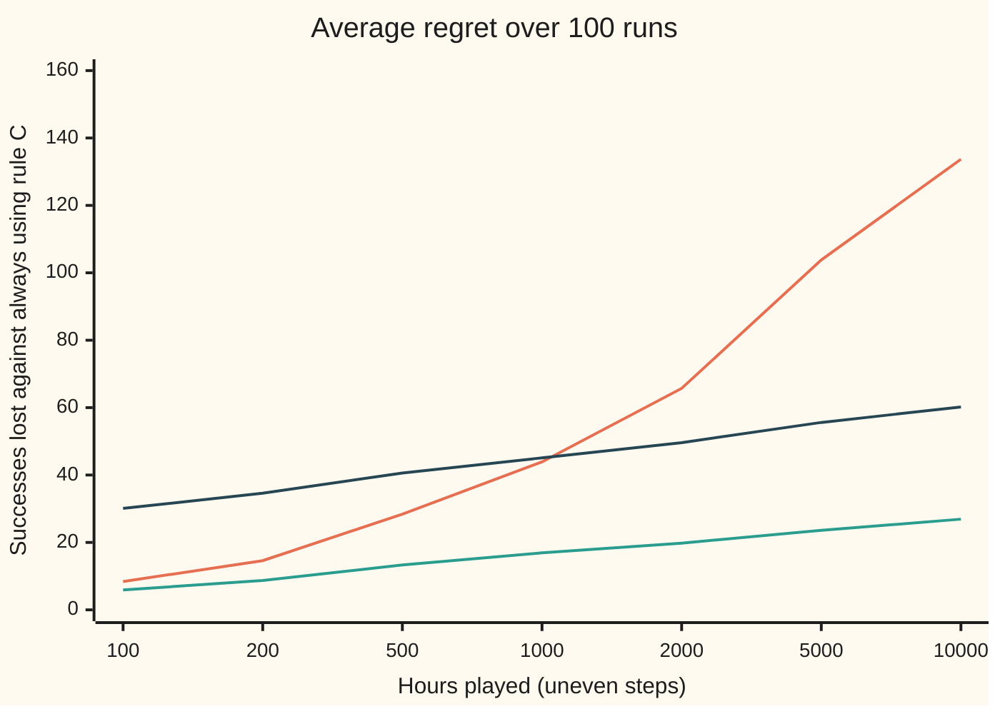

# Multi-armed bandits: explore or exploit, UCB's logarithmic regret, and Thompson sampling

[Syllabus](../../../SYLLABUS.md) → [Optimization](../README.md) → [Dynamic Programming and Learning](../README.md#s07) → Multi-armed bandits

---

## General Overview

A hydro plant on a reservoir gets an order from the grid every hour: deliver this much power. The operator has three written release rules for meeting it. Rule A follows the seasonal rule curve (the planned reservoir level for each week of the year). Rule B copies yesterday's demand. Rule C uses the rain forecast. An hour **succeeds** when the release meets the grid's order without pushing the reservoir outside its safe level band. A failed hour brings an imbalance charge: a fee for missing the order.

Each rule succeeds with a fixed chance that nobody knows: 30% for A, 50% for B, 60% for C. The operator sees only the results of the rule actually used, one hour at a time. The aim is to **maximise** the number of successful hours over the next 10,000 hours, a little over a year.

So every hour is a choice. Use the rule that looks best so far (**exploit**), or try another to learn more about it (**explore**). Exploit too soon and the operator can lock onto rule B for ever. Explore too much and good hours are thrown away on rule A.

The score is the **regret**: the successes lost against an operator who knew from the start that rule C is best. A method called **UCB1** keeps it growing only like the logarithm of the hours, ln T. The **Lai–Robbins bound** says no sensible method beats about 6.53 ln T in the long run. **Thompson sampling**, a Bayesian method, reaches that rate.

Over 100 simulated runs of 10,000 hours, the average regret is 149.2 lost successes for a fixed 10% exploring rate, 133.7 for UCB1 and 26.9 for Thompson sampling. Never exploring loses 981.1.

**Regret is each worse rule's gap times how often it is used; UCB1 adds a bonus for doubt that shrinks with tries, so a worse rule is used at most about 8 ln T over its squared gap times: the same logarithmic growth as the Lai–Robbins floor, with a larger constant.**

**What kind of fact this is:** a definition (regret) and two theorems proved on this card in Why it works: the regret decomposition and UCB1's ln T bound. The Lai–Robbins lower bound and the bounds for Thompson sampling are stated with their sources, not proved. The three chances are a model: real rules change with the seasons, and the card shows what that costs.

### The picture: regret as the hours pass



Orange: UCB1. Green: Thompson sampling. Dark: the Lai–Robbins rate, 6.53 ln T. The steps roughly double, so growth like ln T looks close to a straight line. Thompson's line nearly is one. UCB1's is not yet: at 10,000 hours, with its average counts, its bonuses for rules A and B are 0.342 and 0.146, still above their gaps of 0.3 and 0.1, so it has not settled into ln T growth. The dark line describes the long run, not a floor at every hour: Thompson sits below it (Why it works, Step 4).

---

## The formula

Notation first, in words. The rules are the **arms** of the bandit, named after slot machines ("one-armed bandits"); from here on they are rules.

- There are $`K = 3`$ rules, numbered $`i`$. Rule $`i`$ succeeds with chance $`\mu_i`$. Here $`\mu`$ is a chance of success, not the strong-convexity constant of shelf 01.
- The best chance is $`\mu^{*} = \max_i \mu_i`$, here 0.6. A rule's **gap** is $`\Delta_i = \mu^{*} - \mu_i`$: 0.3 for A, 0.1 for B, 0 for C.
- Hours run $`t = 1, 2, \dots, T`$. In hour $`t`$ the method uses rule $`I_t`$ and sees $`X_t`$: 1 for a success, 0 for a failure.
- $`N_i(t)`$ counts the hours rule $`i`$ has been used in the first $`t`$ hours, and $`\bar x_i`$ is its success rate over those hours.

**Regret** after $`T`$ hours is the expected shortfall against using the best rule every hour, and it splits rule by rule:

```math
R_T \;=\; T\mu^{*} - E\Big[\sum_{t=1}^{T} X_t\Big] \;=\; \sum_{i=1}^{K} \Delta_i\, E[N_i(T)]
```

**Read it aloud:** the regret is each rule's gap times the expected number of hours it is used, added over the rules.

**UCB1** (upper confidence bound) tries each rule once. After that, in the hour after $`t`$ hours, it uses the rule with the largest **index**:

```math
\bar x_i + \sqrt{\frac{2 \ln t}{N_i(t)}}
```

**Read it aloud:** the rule's success rate so far, plus a bonus that grows slowly with the hours played and shrinks as the rule is tried more.

Its guarantee, proved in Why it works:

```math
R_T \;\le\; \sum_{i:\,\Delta_i > 0} \frac{8 \ln T}{\Delta_i} \;+\; \Big(1 + \frac{\pi^2}{3}\Big) \sum_{i} \Delta_i
```

**Read it aloud:** the regret is at most 8 ln T divided by each worse rule's gap, added up, plus a constant that does not grow with T.

The **Lai–Robbins bound** is the floor. For rules that succeed or fail like coins, any method that does well on every such problem must, in the long run, have

```math
\liminf_{T \to \infty} \frac{R_T}{\ln T} \;\ge\; \sum_{i:\,\Delta_i > 0} \frac{\Delta_i}{\mathrm{KL}(\mu_i, \mu^{*})}, \qquad \mathrm{KL}(p, q) = p \ln\frac{p}{q} + (1 - p)\ln\frac{1 - p}{1 - q}
```

**Read it aloud:** as T grows, regret over ln T cannot stay below the sum of each worse rule's gap over its KL divergence from the best rule. "liminf" is the lowest level the ratio keeps returning to.

$`\mathrm{KL}(p, q)`$ is the [KL divergence](../../14-Applied%20and%20computational/03-Information%20Theory/03-kl-divergence-and-cross-entropy.md) between coins with chances $`p`$ and $`q`$, in nats: the evidence one try gives for telling them apart. For the plant the floor is $`(1.632 + 4.899) \ln T = 6.5316 \ln T`$.

**Thompson sampling** keeps a beta law (a probability distribution on the range 0 to 1) for each rule's chance ([Beta-binomial](../../09-Probability%20and%20statistics/10-Bayesian%20Inference/02-beta-binomial.md)). Each starts flat, at $`\mathrm{Beta}(1, 1)`$. After $`s_i`$ successes in $`N_i`$ hours, rule $`i`$'s law is $`\mathrm{Beta}(1 + s_i,\ 1 + N_i - s_i)`$. Each hour:

1. Draw one number $`\theta_i`$ from each rule's beta law. (Here $`\theta`$ is a draw, not the mixing weight of the convex-sets card.)
2. Use the rule with the largest draw.
3. Add the hour's success or failure to that rule's counts.

| Symbol | Plain meaning | In our example | Push it up and the answer… |
| --- | --- | --- | --- |
| $`K`$, $`i`$ | the number of rules (arms); a rule's number | 3 rules: A, B, C | more rules, more to explore: regret grows with each worse rule |
| $`\mu_i`$ | rule $`i`$'s chance of success in an hour, unknown | 0.3, 0.5, 0.6 | a worse rule closer to the best is harder to rule out |
| $`\mu^{*}`$ | the best rule's chance | 0.6 (rule C) | — |
| $`\Delta_i`$ | rule $`i`$'s gap, $`\mu^{*} - \mu_i`$ | 0.3, 0.1, 0 | each use costs more, but fewer uses are needed: UCB1's bound term falls like $`1/\Delta_i`$ |
| $`t`$, $`T`$, $`I_t`$, $`X_t`$ | the hour; the horizon; the rule used in hour $`t`$; its result, 1 or 0 | $`T`$ = 10,000 hours | regret grows like $`\ln T`$ for good methods, like $`T`$ for bad ones |
| $`N_i(t)`$, $`\ell`$, $`m`$ | hours rule $`i`$ has been used by hour $`t`$; $`\ell`$, Step 3's count of tries after which the bonus is at most half the gap; $`m`$ ($`m_i`$, $`m^{*}`$), a use count in the proof fold | UCB1 on average: 157.1, 866.1, 8976.9 at 10,000 hours | — |
| $`\bar x_i`$ | rule $`i`$'s success rate so far | 0.5000 for B after 10 tries | — |
| $`\sqrt{2\ln t / N_i(t)}`$ | UCB1's bonus: how far the true chance could plausibly sit above $`\bar x_i`$ | 0.8248 for B at $`t`$ = 30 | more tries shrink it; more hours grow it slowly |
| $`R_T`$ | regret: expected successes lost against always using the best rule | 133.7 for UCB1, 26.9 for Thompson | — |
| $`\varepsilon`$ | in ε-greedy, the chance of a random rule in an hour | 10% | regret per hour rises in proportion, for ever |
| $`\mathrm{KL}(p, q)`$ | KL divergence between coins with chances $`p`$ and $`q`$, in nats | 0.18379 for (0.3, 0.6), 0.02041 for (0.5, 0.6) | larger means easier to tell apart: fewer tries needed |
| $`\theta_i`$, $`s_i`$ | Thompson's draw for rule $`i`$ in an hour; rule $`i`$'s successes so far | draws 0.5106, 0.3641, 0.6012 at the hand state | — |

### When it holds

- **Each rule's chance is fixed.** The proofs assume the world does not change. If rules A and C swap their chances halfway through, Thompson sampling loses 637.6 successes on average over 20 runs over the second 5,000 hours, because its beliefs about C rest on thousands of hours and move slowly.
- **Results are independent and lie between 0 and 1.** If one bad hour made the next more likely to fail, Hoeffding's bound in the proof would not apply. Rewards over a wider range need the bonus scaled by the range.
- **The choice does not change the state.** If a rule changed tomorrow's level, the problem would be one of [Markov decision processes](02-markov-decision-processes.md), and one rule's regret would no longer be the right score.
- **The Lai–Robbins floor needs coin-like rules and a method good on every problem.** Always using rule C has zero regret here and huge regret wherever C is bad; the floor excludes it.

---

## Why it works

### Step 0: the trap, and the way out

A rule tried a few times has a noisy average. A greedy operator can see rule C fail its first try and never use it again, losing a fixed share of every hour: regret in proportion to $`T`$.

The way out is **optimism under uncertainty**: score each rule by the best chance it could plausibly have. A rarely tried rule gets a large benefit of the doubt, so it gets tried, and each try shrinks the doubt. A worse rule's optimistic score soon falls below the best rule's average, and it is left alone. Its uses grow only as fast as the doubt term allows: like $`\ln T`$.

### Step 1: regret splits rule by rule

The rule for hour $`t`$ is chosen before the hour's result is drawn. So, given the choice, the result averages to that rule's chance: $`E[X_t \mid I_t = i] = \mu_i`$. Adding over the hours,

```math
E\Big[\sum_{t=1}^{T} X_t\Big] = \sum_{i} \mu_i\, E[N_i(T)], \qquad T = \sum_i N_i(T).
```

Write $`T\mu^{*}`$ as $`\sum_i \mu^{*} E[N_i(T)]`$ and subtract: $`R_T = \sum_i (\mu^{*} - \mu_i) E[N_i(T)] = \sum_i \Delta_i E[N_i(T)]`$. Using the best rule costs nothing. Every other use costs its gap.

The code checks this both ways for UCB1: $`\sum_i \Delta_i N_i`$ gives 133.7, and the successes actually lost, $`0.6T`$ minus those seen, give 142.0 with a standard error of 5.2.

### Step 2: why the bonus is $`\sqrt{2\ln t / N}`$

[Concentration](../../09-Probability%20and%20statistics/06-Limit%20Theorems%20in%20Practice/06-concentration-inequalities-hoeffding-and-chernoff.md) gives Hoeffding's inequality. For $`n`$ independent results between 0 and 1 with mean $`\mu`$, the average overshoots by $`c`$ or more with chance at most $`e^{-2nc^2}`$. The same holds for undershooting.

Put $`c = \sqrt{2 \ln t / n}`$. Then $`2nc^2 = 4\ln t`$, so an average misses by more than its bonus with chance at most $`t^{-4}`$. That is small enough to add up over every hour and every count and stay finite.

### Step 3: UCB1 uses a worse rule at most about $`8\ln T/\Delta_i^2`$ times

Take a worse rule $`i`$ and let $`\ell = \lceil 8 \ln T / \Delta_i^2 \rceil`$, rounded up to a whole number. After $`\ell`$ tries its bonus is at most $`\Delta_i / 2`$. Then UCB1 uses it again only if the best rule's average undershot by more than its bonus, or rule $`i`$'s overshot by more than its bonus. Each has chance at most $`t^{-4}`$, and adding over all hours and counts leaves $`\sum_t 2t^{-2} = \pi^2/3`$. So

```math
E[N_i(T)] \;\le\; \frac{8 \ln T}{\Delta_i^2} + 1 + \frac{\pi^2}{3}.
```

Multiply by $`\Delta_i`$ and add over the worse rules (Step 1): that is the bound in The formula.

<details>
<summary>Detailed proof: UCB1's count bound, every step</summary>

Fix a worse rule $`i`$ and an integer $`\ell \ge 1`$. Write $`c_{t,m} = \sqrt{2\ln t / m}`$, and $`\bar x_{i,m}`$ for rule $`i`$'s average over its first $`m`$ uses. Every use of rule $`i`$ beyond its first $`\ell`$ is an hour $`t + 1`$ in which rule $`i`$ has been used $`m_i \ge \ell`$ times and its index is at least the best rule's. So, with $`m^{*}`$ the best rule's count at that hour (here $`m`$ counts uses, not successes),

$`\displaystyle N_i(T) \le \ell + \sum_{t=1}^{T} \mathbf{1}\Big\{\min_{1 \le m^{*} < t} \big(\bar x^{*}_{m^{*}} + c_{t,m^{*}}\big) \le \max_{\ell \le m_i < t} \big(\bar x_{i,m_i} + c_{t,m_i}\big)\Big\}`$

Here $`\mathbf{1}\{\cdot\}`$ is 1 when the event in braces happens and 0 otherwise. Bound the minimum and maximum by adding over every pair of counts:

$`\displaystyle N_i(T) \le \ell + \sum_{t=1}^{\infty} \sum_{m^{*}=1}^{t-1} \sum_{m_i=\ell}^{t-1} \mathbf{1}\big\{\bar x^{*}_{m^{*}} + c_{t,m^{*}} \le \bar x_{i,m_i} + c_{t,m_i}\big\}`$

If $`\bar x^{*}_{m^{*}} + c_{t,m^{*}} \le \bar x_{i,m_i} + c_{t,m_i}`$, then at least one of these holds: (a) $`\bar x^{*}_{m^{*}} \le \mu^{*} - c_{t,m^{*}}`$; (b) $`\bar x_{i,m_i} \ge \mu_i + c_{t,m_i}`$; (c) $`\mu^{*} < \mu_i + 2c_{t,m_i}`$. For if all three fail, $`\bar x^{*}_{m^{*}} + c_{t,m^{*}} > \mu^{*} \ge \mu_i + 2c_{t,m_i} > \bar x_{i,m_i} + c_{t,m_i}`$.

Choose $`\ell = \lceil 8 \ln T / \Delta_i^2 \rceil`$. For $`m_i \ge \ell`$ and $`t \le T`$, $`2c_{t,m_i} = 2\sqrt{2 \ln t / m_i} \le 2\sqrt{2\ln T / \ell} \le \Delta_i`$, so (c) fails. Hoeffding's inequality gives $`P(a) \le e^{-4\ln t} = t^{-4}`$ and $`P(b) \le t^{-4}`$. Taking expectations,

$`\displaystyle E[N_i(T)] \le \Big\lceil \frac{8 \ln T}{\Delta_i^2} \Big\rceil + \sum_{t=1}^{\infty} \sum_{m^{*}=1}^{t} \sum_{m_i=1}^{t} 2t^{-4} \le \frac{8 \ln T}{\Delta_i^2} + 1 + \sum_{t=1}^{\infty} \frac{2}{t^{2}} = \frac{8\ln T}{\Delta_i^2} + 1 + \frac{\pi^2}{3}`$

The last step uses $`\sum_{t \ge 1} 1/t^2 = \pi^2/6`$. Multiplying by $`\Delta_i`$ and adding over the worse rules gives the regret bound, by Step 1. This is Theorem 1 of Auer, Cesa-Bianchi and Fischer (2002).

</details>

At 10,000 hours the bound allows 823 uses of rule A, 7373 of rule B and a regret of 984.15. The runs use 157.1, 866.1 and lose 133.7. The bound is far above the runs, but it grows at the right rate and holds for every problem with results between 0 and 1.

### Step 4: the floor, stated

Lai and Robbins (1985) proved that no method can beat $`\ln T`$ growth on every problem. Call a method **consistent** if its regret grows slower than every power $`T^a`$ ($`a > 0`$) on every problem with coin-like rules. Then for every worse rule,

```math
\liminf_{T \to \infty} \frac{E[N_i(T)]}{\ln T} \;\ge\; \frac{1}{\mathrm{KL}(\mu_i, \mu^{*})}.
```

The idea: to rule out that B is secretly better than C, a method must tell a 50% coin from a 60% coin. Each try of B gives on average $`\mathrm{KL}(0.5, 0.6)`$ = 0.02041 nats of evidence, and a consistent method needs about $`\ln T`$ nats. The proof is in the source.

Multiplying by the gaps gives $`6.5316 \ln T`$, 60.16 at 10,000 hours. It is a **certificate**: no consistent method has a smaller long-run rate. UCB1's proved rate, $`8/\Delta_i`$ per rule, is far above it, because Hoeffding's bound uses only the range 0 to 1.

The floor limits a ratio as $`T`$ grows. At a finite $`T`$ a method can sit below it while lower-order terms are large. Thompson does: 26.9 against 60.16.

### Step 5: Thompson sampling, and what is known about it

Thompson sampling uses each rule with exactly its posterior chance of being best (the chance under its current beta law, updated on the results so far); taking the largest of one draw per law does this without computing that chance. A rule with few tries has a wide law and often draws high, so it gets explored. A rule whose law sits firmly below the leader's rarely does.

Two results are stated here, not proved:

- **It meets the floor.** Agrawal and Goyal (2017) proved that, for coin-like rules with $`\mathrm{Beta}(1,1)`$ starting laws, Thompson sampling's regret is at most $`\sum_i \Delta_i \ln T / \mathrm{KL}(\mu_i, \mu^{*})`$ times any chosen factor above 1, plus a term that does not grow with $`T`$. So its long-run rate equals the Lai–Robbins floor.
- **Its Bayesian regret is at most of order $`\sqrt{K T \ln T}`$.** The **Bayesian regret** averages the regret also over the starting laws: the chances themselves are drawn from the beta laws first. This bound holds with no assumption on the gaps (Lattimore and Szepesvári, 2020, chapter 36).

---

## Worked numbers, by hand

A UCB1 state after 30 hours: rule A tried 6 times with 1 success, B 10 times with 5, C 14 times with 8. Here $`\ln 30`$ = 3.4012.

| Step | Arithmetic | Value |
| --- | --- | --- |
| rule A index | $`1/6 + \sqrt{2 \times 3.4012 / 6}`$ = 0.1667 + 1.0648 | 1.2314 |
| rule B index | $`5/10 + \sqrt{2 \times 3.4012 / 10}`$ = 0.5000 + 0.8248 | **1.3248** |
| rule C index | $`8/14 + \sqrt{2 \times 3.4012 / 14}`$ = 0.5714 + 0.6971 | 1.2685 |
| KL for rule A | $`0.3 \ln(0.3/0.6) + 0.7 \ln(0.7/0.4)`$ | 0.18379 |
| KL for rule B | $`0.5 \ln(0.5/0.6) + 0.5 \ln(0.5/0.4)`$ | 0.02041 |
| Lai–Robbins constant | 0.3 / 0.18379 + 0.1 / 0.02041 = 1.632 + 4.899 | **6.5316** |
| floor at 10,000 hours | $`6.5316 \times \ln 10{,}000`$ | 60.16 |

UCB1 uses rule B in hour 31, although rule C has the better average. B's bonus is larger because B has had fewer tries, and B's chance could still plausibly be above C's.

Thompson sampling in the same state holds the laws $`\mathrm{Beta}(2, 6)`$, $`\mathrm{Beta}(6, 6)`$ and $`\mathrm{Beta}(9, 7)`$. One hour's draws were 0.5106, 0.3641 and 0.6012, so it used rule C. Integrating the three laws gives each rule's chance of being chosen: 3.19% for A, 35.61% for B, 61.20% for C. Out of 60,000 draws from the code's own sampler, 3.25%, 36.02% and 60.73% chose each rule. That is +0.76, +2.08 and −2.32 standard errors from the integral, inside the code's test of four.

### What breaks if you drop a piece

| Mistake | Comes out at | What went wrong |
| --- | --- | --- |
| Explore at a fixed 10% for ever (ε-greedy) | regret 149.2 at 10,000 hours, and 66.8 more from hour 5,000 to 10,000 | A tenth of the hours go to a random rule for ever, each costing on average (0.3 + 0.1 + 0) / 3 = 0.4 / 3: linear regret |
| Never explore (greedy after one try each) | regret 981.1; in 50 of 100 runs rule C is used under half the hours | An unlucky first result for C is never corrected |
| The chances change: A and C swap at hour 5,000 | averaged over 20 runs, Thompson loses 637.6 over the second half; UCB1 71.5 | Fixed chances fail. Thompson's laws for C rest on thousands of hours and move slowly; UCB1's bonuses keep the other rules close |

The first two rows are methods without the shrinking-doubt idea of Step 0. The third is the model failing: the guarantees of Steps 3 and 5 assume the chances stay fixed.

---

## How regret grows, hour by hour

The puzzle: three of the four methods use rule C most of the time, and even greedy uses it about half the hours. Why do their regrets at 10,000 hours run from 26.9 to 981.1?

### Regret at seven checkpoints

Average regret over the same 100 seeded runs (successes lost):

| Hours | ε-greedy, 10% | Greedy | UCB1 | Thompson | 6.53 ln T |
| ---: | ---: | ---: | ---: | ---: | ---: |
| 100 | 7.2 | 10.7 | 8.4 | 5.9 | 30.1 |
| 200 | 10.7 | 20.7 | 14.6 | 8.7 | 34.6 |
| 500 | 17.9 | 50.1 | 28.4 | 13.3 | 40.6 |
| 1,000 | 26.8 | 99.1 | 43.9 | 16.9 | 45.1 |
| 2,000 | 41.8 | 197.1 | 65.7 | 19.8 | 49.6 |
| 5,000 | 82.4 | 491.1 | 103.8 | 23.6 | 55.6 |
| 10,000 | 149.2 | 981.1 | 133.7 | 26.9 | 60.2 |

Greedy doubles when the hours double: linear. ε-greedy leads UCB1 up to 5,000 hours, then its linear growth takes over. From 5,000 to 10,000 hours ε-greedy adds 66.8, UCB1 29.9 and Thompson 3.3. Comparing guarantees, ε-greedy's certain loss of 0.1 × 0.4 / 3 per hour passes UCB1's whole bound from hour 91,524, about ten years.

### Where the hours went

Average hours on the two worse rules over 10,000 hours. Each `#` is 100 hours.

```
eps-greedy  rule A |###                        346.1
eps-greedy  rule B |#####                      453.9
greedy      rule A |########################   2402.9
greedy      rule B |########################## 2602.0
UCB1        rule A |##                         157.1
UCB1        rule B |#########                  866.1
Thompson    rule A |                           29.1
Thompson    rule B |##                         182.0
```
UCB1 spends far longer on rule B than on rule A, because B's gap is a third of A's and the bound counts tries as one over the gap squared. Thompson spends the least on both. Greedy's bars are big because half its runs locked onto A or B.

---

## Code, from first principles, and it actually runs

The code simulates the plant and takes three roads.

- Road 1 computes the closed forms: the UCB indices, the two KL divergences, the Lai–Robbins constant and UCB1's bound.
- Road 2 runs ε-greedy, greedy, UCB1 and Thompson sampling, 100 seeded runs of 10,000 hours each. It counts regret as $`\sum_i \Delta_i N_i`$ and as successes actually lost, asserts they agree within four standard errors, and asserts UCB1 stays under its bound.
- Road 3 integrates the three beta laws by Simpson's rule to get Thompson's chance of choosing each rule, and compares with 60,000 draws.

Random numbers come from SplitMix64, written out in both languages; normal draws use the Box–Muller method, gamma draws the Marsaglia–Tsang method, and a beta draw is one gamma draw over the sum of two.

### Python

```python
# Multi-armed bandits -- the check behind the card.  Standard library only.
# Three release rules for a hydro plant; each hour one is used, and it succeeds
# (meets the grid's order inside the level band) with unknown chance 0.3, 0.5 or
# 0.6.  Maximise successes; regret = successes lost against always using the best.
# Roads: (1) closed forms: UCB index, KL, the Lai-Robbins constant, the UCB1 bound;
# (2) 100 seeded simulated runs of 10000 hours for each method, regret counted two
# ways; (3) Thompson's choice chances by numerical integration against its sampler.
import math
MU, SWAP, T, RUNS = [0.3, 0.5, 0.6], [0.6, 0.5, 0.3], 10000, 100
GAP = [max(MU) - m for m in MU]
M64 = (1 << 64) - 1
def add(xs):                                   # plain left-to-right sum, as in Rust
    t = 0.0
    for x in xs: t += x
    return t
class Rng:                                     # SplitMix64, seeded
    def __init__(self, seed): self.x = seed
    def next(self):
        self.x = (self.x + 0x9E3779B97F4A7C15) & M64
        z = ((self.x ^ (self.x >> 30)) * 0xBF58476D1CE4E5B9) & M64
        z = ((z ^ (z >> 27)) * 0x94D049BB133111EB) & M64
        return z ^ (z >> 31)
    def unif(self): return (self.next() >> 11) * 2.0 ** -53
def normal(g): return math.sqrt(-2 * math.log(1 - g.unif())) * math.cos(2 * math.pi * g.unif())
def gamma(g, a):                               # Marsaglia-Tsang, shape a >= 1
    d = a - 1 / 3
    c = 1 / math.sqrt(9 * d)
    while True:
        x = normal(g)
        w = 1 + c * x
        if w <= 0: continue
        v = w * w * w
        if math.log(1 - g.unif()) < 0.5 * x * x + d - d * v + d * math.log(v): return d * v
def beta(g, a, b):
    x = gamma(g, a)
    return x / (x + gamma(g, b))
def kl(p, q): return p * math.log(p / q) + (1 - p) * math.log((1 - p) / (1 - q))
def argmax(v):
    b = 0
    for i in range(len(v)):
        if v[i] > v[b]: b = i
    return b
def run(method, seed, marks=(), eps=0.1, swap=False):
    g, n, s, got, out, late = Rng(seed), [0, 0, 0], [0, 0, 0], 0, [], 0.0
    for t in range(1, T + 1):
        mu = SWAP if swap and t > T // 2 else MU
        if method == "ts": i = argmax([beta(g, 1 + s[j], 1 + n[j] - s[j]) for j in range(3)])
        elif t <= 3: i = t - 1                 # the others try each rule once first
        elif method == "ucb":
            i = argmax([s[j] / n[j] + math.sqrt(2 * math.log(t - 1) / n[j]) for j in range(3)])
        elif g.unif() < eps: i = g.next() % 3  # explore
        else: i = argmax([s[j] / n[j] for j in range(3)])
        win = 1 if g.unif() < mu[i] else 0
        n[i] += 1; s[i] += win; got += win
        if t > T // 2: late += max(mu) - mu[i]
        if t in marks: out.append(add(GAP[j] * n[j] for j in range(3)))
    return n, got, out, late
L30 = math.log(30)
print(f"ln 30 = {L30:.4f}")
for name, k, m in (("A", 6, 1), ("B", 10, 5), ("C", 14, 8)):
    b = math.sqrt(2 * L30 / k)
    print(f"index,rule {name},tries {k},mean {m / k:.4f},bonus {b:.4f},index {m / k + b:.4f}")
kls = [kl(MU[i], 0.6) for i in range(2)]
lr = add(GAP[i] / kls[i] for i in range(2))
print(f"KL(0.3,0.6) {kls[0]:.5f}, KL(0.5,0.6) {kls[1]:.5f}; terms {GAP[0] / kls[0]:.3f} + {GAP[1] / kls[1]:.3f} = {lr:.4f}")
C3 = 1 + math.pi * math.pi / 3
ub = lambda h: add(8 * math.log(h) / GAP[i] + C3 * GAP[i] for i in range(2))
print(f"at T={T}: Lai-Robbins {lr * math.log(T):.2f}, UCB1 bound {ub(T):.2f}, "
      f"pull bounds A {8 * math.log(T) / 0.09 + C3:.0f} B {8 * math.log(T) / 0.01 + C3:.0f}")
cross = 2
while 0.1 * (0.3 + 0.1) / 3 * cross <= ub(cross): cross += 1
print(f"epsilon-greedy floor 0.1 x 0.4/3 x T passes the UCB1 bound from T = {cross}")
MARKS = (100, 200, 500, 1000, 2000, 5000, 10000)
res = {}
for meth in ("eps", "greedy", "ucb", "ts"):
    reg, real, pulls, lost = [0.0] * len(MARKS), [], [0, 0, 0], 0
    for r in range(RUNS):
        n, got, out, _ = run(meth, 1000 + r, MARKS, 0.0 if meth == "greedy" else 0.1)
        reg = [reg[k] + out[k] / RUNS for k in range(len(MARKS))]
        real.append(0.6 * T - got)
        pulls = [pulls[j] + n[j] for j in range(3)]
        lost += 1 if n[2] < T / 2 else 0
    mr = add(real) / RUNS
    se = math.sqrt(add((x - mr) * (x - mr) for x in real) / (RUNS - 1) / RUNS)
    res[meth] = (reg, mr, se, lost, pulls)
    print(f"{meth}: regret " + ",".join(f"{x:.1f}" for x in reg) + f"; realised {mr:.1f} (se {se:.1f})"
          f"; mean pulls " + ",".join(f"{p / RUNS:.1f}" for p in pulls) + f"; runs with C under half {lost}")
print("Lai-Robbins 6.53 ln T: " + ",".join(f"{lr * math.log(h):.1f}" for h in MARKS))
u, th, ep = res["ucb"][0], res["ts"][0], res["eps"][0]
print(f"growth 5000->10000: eps {ep[6] - ep[5]:.1f}, ucb {u[6] - u[5]:.1f}, ts {th[6] - th[5]:.1f}")
bon = [math.sqrt(2 * math.log(T) * RUNS / res["ucb"][4][j]) for j in range(2)]   # UCB1 bonus at the mean pulls
print(f"ucb bonus at T={T}, mean pulls: rule A {bon[0]:.3f} (gap {GAP[0]:.1f}), rule B {bon[1]:.3f} (gap {GAP[1]:.1f})")
lates = []
for meth in ("ucb", "ts"):                     # the world changes: A and C swap after T/2
    late = add(run(meth, 1000 + r, swap=True)[3] for r in range(20)) / 20
    print(f"swap at hour {T // 2}: {meth} regret over the second half {late:.1f}")
    lates.append(late)
post = [(2, 6), (6, 6), (9, 7)]                # Thompson's posteriors at the hand state
def pdf(x, a, b): return (a + b - 1) * math.comb(a + b - 2, a - 1) * x ** (a - 1) * (1 - x) ** (b - 1)
def cdf(x, a, b):                              # integer a, b: a binomial tail
    m = a + b - 1
    return add(math.comb(m, k) * x ** k * (1 - x) ** (m - k) for k in range(a, m + 1))
N, win = 2000, []
for i in range(3):                             # Simpson's rule on f_i(x) F_j(x) F_k(x)
    tot = 0.0
    for k in range(N + 1):
        x, wt = k / N, 1 if k in (0, N) else 4 if k % 2 else 2
        f = pdf(x, *post[i])
        for j in range(3):
            if j != i: f *= cdf(x, *post[j])
        tot += wt * f
    win.append(tot / (3 * N))
g, cnt, D = Rng(7), [0, 0, 0], 60000
first = [beta(g, a, b) for a, b in post]
cnt[argmax(first)] += 1
for _ in range(D - 1): cnt[argmax([beta(g, a, b) for a, b in post])] += 1
print("thompson draw " + ",".join(f"{x:.4f}" for x in first) + "; win chance by integral "
      + ",".join(f"{w:.4f}" for w in win) + "; by sampling " + ",".join(f"{c / D:.4f}" for c in cnt))
zs = [(cnt[i] / D - win[i]) / math.sqrt(win[i] * (1 - win[i]) / D) for i in range(3)]
print("sampling minus integral, in standard errors: " + ",".join(f"{z:+.2f}" for z in zs))
assert abs(5 / 10 + math.sqrt(2 * L30 / 10) - 1.3248) < 5e-5 and abs(lr - 6.53) < 5e-3   # road 1
for meth in ("eps", "ucb", "ts"):                                                     # road 2
    assert abs(res[meth][1] - res[meth][0][6]) < 4 * res[meth][2]
assert u[6] < ub(T) and th[6] < u[6] and ep[6] - ep[5] > 50 and u[6] - u[5] < (ep[6] - ep[5]) / 2
assert bon[0] > GAP[0] and bon[1] > GAP[1] and lates[1] > 3 * lates[0] > 0 and res["greedy"][3] > 0 and res["ucb"][3] == 0 and res["ts"][3] == 0
assert all(abs(win[i] - cnt[i] / D) < 4 * math.sqrt(win[i] * (1 - win[i]) / D) for i in range(3))  # road 3
assert abs(add(win) - 1) < 1e-6
print("ALL CHECKS PASS")
```

**Ran 2026-11-24 on macOS, Python 3.14.10, standard library only. All checks passed. Output, pasted from the run:**

```
ln 30 = 3.4012
index,rule A,tries 6,mean 0.1667,bonus 1.0648,index 1.2314
index,rule B,tries 10,mean 0.5000,bonus 0.8248,index 1.3248
index,rule C,tries 14,mean 0.5714,bonus 0.6971,index 1.2685
KL(0.3,0.6) 0.18379, KL(0.5,0.6) 0.02041; terms 1.632 + 4.899 = 6.5316
at T=10000: Lai-Robbins 60.16, UCB1 bound 984.15, pull bounds A 823 B 7373
epsilon-greedy floor 0.1 x 0.4/3 x T passes the UCB1 bound from T = 91524
eps: regret 7.2,10.7,17.9,26.8,41.8,82.4,149.2; realised 157.3 (se 6.1); mean pulls 346.1,453.9,9200.0; runs with C under half 0
greedy: regret 10.7,20.7,50.1,99.1,197.1,491.1,981.1; realised 982.4 (se 121.5); mean pulls 2402.9,2602.0,4995.1; runs with C under half 50
ucb: regret 8.4,14.6,28.4,43.9,65.7,103.8,133.7; realised 142.0 (se 5.2); mean pulls 157.1,866.1,8976.9; runs with C under half 0
ts: regret 5.9,8.7,13.3,16.9,19.8,23.6,26.9; realised 30.5 (se 5.1); mean pulls 29.1,182.0,9788.9; runs with C under half 0
Lai-Robbins 6.53 ln T: 30.1,34.6,40.6,45.1,49.6,55.6,60.2
growth 5000->10000: eps 66.8, ucb 29.9, ts 3.3
ucb bonus at T=10000, mean pulls: rule A 0.342 (gap 0.3), rule B 0.146 (gap 0.1)
swap at hour 5000: ucb regret over the second half 71.5
swap at hour 5000: ts regret over the second half 637.6
thompson draw 0.5106,0.3641,0.6012; win chance by integral 0.0319,0.3561,0.6120; by sampling 0.0325,0.3602,0.6073
sampling minus integral, in standard errors: +0.76,+2.08,-2.32
ALL CHECKS PASS
```

### Rust

The same roads, the same seeds, the same output, built with `rustc --edition 2021 -O`.

```rust
// Multi-armed bandits -- the same check as the Python, in Rust.  No crates.
// Three release rules for a hydro plant; each hour one is used, and it succeeds
// (meets the grid's order inside the level band) with unknown chance 0.3, 0.5 or
// 0.6.  Maximise successes; regret = successes lost against always using the best.
// Roads: (1) closed forms: UCB index, KL, the Lai-Robbins constant, the UCB1 bound;
// (2) 100 seeded simulated runs of 10000 hours for each method, regret counted two
// ways; (3) Thompson's choice chances by numerical integration against its sampler.
use std::f64::consts::PI;
const MU: [f64; 3] = [0.3, 0.5, 0.6];
const SWAP: [f64; 3] = [0.6, 0.5, 0.3];
const T: usize = 10000;
const RUNS: usize = 100;
struct Rng { x: u64 }                            // SplitMix64, seeded
impl Rng {
    fn next(&mut self) -> u64 {
        self.x = self.x.wrapping_add(0x9E3779B97F4A7C15);
        let mut z = (self.x ^ (self.x >> 30)).wrapping_mul(0xBF58476D1CE4E5B9);
        z = (z ^ (z >> 27)).wrapping_mul(0x94D049BB133111EB);
        z ^ (z >> 31)
    }
    fn unif(&mut self) -> f64 { (self.next() >> 11) as f64 * 2f64.powi(-53) }
}
fn normal(g: &mut Rng) -> f64 {
    let r = (-2.0 * (1.0 - g.unif()).ln()).sqrt();
    r * (2.0 * PI * g.unif()).cos()
}
fn gamma(g: &mut Rng, a: f64) -> f64 {           // Marsaglia-Tsang, shape a >= 1
    let d = a - 1.0 / 3.0;
    let c = 1.0 / (9.0 * d).sqrt();
    loop {
        let x = normal(g);
        let w = 1.0 + c * x;
        if w <= 0.0 { continue; }
        let v = w * w * w;
        if (1.0 - g.unif()).ln() < 0.5 * x * x + d - d * v + d * v.ln() { return d * v; }
    }
}
fn beta(g: &mut Rng, a: f64, b: f64) -> f64 { let x = gamma(g, a); x / (x + gamma(g, b)) }
fn kl(p: f64, q: f64) -> f64 { p * (p / q).ln() + (1.0 - p) * ((1.0 - p) / (1.0 - q)).ln() }
fn argmax(v: &[f64]) -> usize { (0..v.len()).fold(0, |b, i| if v[i] > v[b] { i } else { b }) }
fn comb(n: u64, k: u64) -> f64 { (0..k).fold(1u64, |c, i| c * (n - i) / (i + 1)) as f64 }
fn join(v: &[f64], p: usize) -> String { v.iter().map(|x| format!("{:.*}", p, x)).collect::<Vec<_>>().join(",") }
fn run(method: &str, seed: u64, marks: &[usize], eps: f64, swap: bool) -> ([usize; 3], usize, Vec<f64>, f64) {
    let gap: Vec<f64> = MU.iter().map(|m| 0.6 - m).collect();
    let (mut g, mut n, mut s, mut got, mut out, mut late) = (Rng { x: seed }, [0usize; 3], [0usize; 3], 0, vec![], 0.0);
    for t in 1..=T {
        let mu = if swap && t > T / 2 { SWAP } else { MU };
        let i = if method == "ts" {
            let v: Vec<f64> = (0..3).map(|j| beta(&mut g, (1 + s[j]) as f64, (1 + n[j] - s[j]) as f64)).collect();
            argmax(&v)
        } else if t <= 3 { t - 1 }                // the others try each rule once first
        else if method == "ucb" {
            let v: Vec<f64> = (0..3).map(|j| s[j] as f64 / n[j] as f64
                + (2.0 * ((t - 1) as f64).ln() / n[j] as f64).sqrt()).collect();
            argmax(&v)
        } else if g.unif() < eps { (g.next() % 3) as usize }   // explore
        else { argmax(&(0..3).map(|j| s[j] as f64 / n[j] as f64).collect::<Vec<_>>()) };
        let win = if g.unif() < mu[i] { 1 } else { 0 };
        n[i] += 1; s[i] += win; got += win;
        if t > T / 2 { late += 0.6 - mu[i]; }
        if marks.contains(&t) { out.push((0..3).fold(0.0, |a, j| a + gap[j] * n[j] as f64)); }
    }
    (n, got, out, late)
}
fn pdf(x: f64, a: u64, b: u64) -> f64 {
    (a + b - 1) as f64 * comb(a + b - 2, a - 1) * x.powf((a - 1) as f64) * (1.0 - x).powf((b - 1) as f64)
}
fn cdf(x: f64, a: u64, b: u64) -> f64 {          // integer a, b: a binomial tail
    let m = a + b - 1;
    (a..=m).fold(0.0, |t, k| t + comb(m, k) * x.powf(k as f64) * (1.0 - x).powf((m - k) as f64))
}
fn main() {
    let gap: Vec<f64> = MU.iter().map(|m| 0.6 - m).collect();
    let l30 = 30f64.ln();
    println!("ln 30 = {:.4}", l30);
    for &(name, k, m) in [("A", 6.0, 1.0), ("B", 10.0, 5.0), ("C", 14.0, 8.0)].iter() {
        let b = (2.0 * l30 / k).sqrt();
        println!("index,rule {},tries {},mean {:.4},bonus {:.4},index {:.4}", name, k, m / k, b, m / k + b);
    }
    let kls = [kl(MU[0], 0.6), kl(MU[1], 0.6)];
    let lr = 0.0 + gap[0] / kls[0] + gap[1] / kls[1];
    println!("KL(0.3,0.6) {:.5}, KL(0.5,0.6) {:.5}; terms {:.3} + {:.3} = {:.4}", kls[0], kls[1], gap[0] / kls[0], gap[1] / kls[1], lr);
    let c3 = 1.0 + PI * PI / 3.0;
    let ub = |h: f64| (0..2).fold(0.0, |a, i| a + (8.0 * h.ln() / gap[i] + c3 * gap[i]));
    let tf = T as f64;
    println!("at T={}: Lai-Robbins {:.2}, UCB1 bound {:.2}, pull bounds A {:.0} B {:.0}", T, lr * tf.ln(), ub(tf),
             8.0 * tf.ln() / 0.09 + c3, 8.0 * tf.ln() / 0.01 + c3);
    let mut cross = 2usize;
    while 0.1 * (0.3 + 0.1) / 3.0 * cross as f64 <= ub(cross as f64) { cross += 1; }
    println!("epsilon-greedy floor 0.1 x 0.4/3 x T passes the UCB1 bound from T = {}", cross);
    let marks = [100, 200, 500, 1000, 2000, 5000, 10000];
    let mut res = vec![];
    for &meth in ["eps", "greedy", "ucb", "ts"].iter() {
        let (mut reg, mut real, mut pulls, mut lost) = (vec![0.0; marks.len()], vec![], [0usize; 3], 0);
        for r in 0..RUNS {
            let (n, got, out, _) = run(meth, 1000 + r as u64, &marks, if meth == "greedy" { 0.0 } else { 0.1 }, false);
            for k in 0..marks.len() { reg[k] = reg[k] + out[k] / RUNS as f64; }
            real.push(0.6 * tf - got as f64);
            for j in 0..3 { pulls[j] += n[j]; }
            if (n[2] as f64) < tf / 2.0 { lost += 1; }
        }
        let mr = real.iter().fold(0.0, |a, x| a + x) / RUNS as f64;
        let se = (real.iter().fold(0.0, |a, x| a + (x - mr) * (x - mr)) / (RUNS - 1) as f64 / RUNS as f64).sqrt();
        let pm: Vec<f64> = pulls.iter().map(|&p| p as f64 / RUNS as f64).collect();
        println!("{}: regret {}; realised {:.1} (se {:.1}); mean pulls {}; runs with C under half {}", meth, join(&reg, 1), mr, se, join(&pm, 1), lost);
        res.push((reg, mr, se, lost, pulls));
    }
    println!("Lai-Robbins 6.53 ln T: {}", join(&marks.iter().map(|&h| lr * (h as f64).ln()).collect::<Vec<_>>(), 1));
    let (ep, u, th) = (res[0].0.clone(), res[2].0.clone(), res[3].0.clone());
    println!("growth 5000->10000: eps {:.1}, ucb {:.1}, ts {:.1}", ep[6] - ep[5], u[6] - u[5], th[6] - th[5]);
    let bon: Vec<f64> = (0..2).map(|j| (2.0 * tf.ln() * RUNS as f64 / res[2].4[j] as f64).sqrt()).collect();   // UCB1 bonus at the mean pulls
    println!("ucb bonus at T={}, mean pulls: rule A {:.3} (gap {:.1}), rule B {:.3} (gap {:.1})", T, bon[0], gap[0], bon[1], gap[1]);
    let mut lates = vec![];
    for &meth in ["ucb", "ts"].iter() {             // the world changes: A and C swap after T/2
        let late = (0..20).fold(0.0, |a, r| a + run(meth, 1000 + r, &[], 0.1, true).3) / 20.0;
        println!("swap at hour {}: {} regret over the second half {:.1}", T / 2, meth, late);
        lates.push(late);
    }
    let post = [(2u64, 6u64), (6, 6), (9, 7)];   // Thompson's posteriors at the hand state
    let nn = 2000usize;
    let mut win = vec![];
    for i in 0..3 {                              // Simpson's rule on f_i(x) F_j(x) F_k(x)
        let mut tot = 0.0;
        for k in 0..=nn {
            let x = k as f64 / nn as f64;
            let wt = if k == 0 || k == nn { 1.0 } else if k % 2 == 1 { 4.0 } else { 2.0 };
            let mut f = pdf(x, post[i].0, post[i].1);
            for j in 0..3 { if j != i { f *= cdf(x, post[j].0, post[j].1); } }
            tot += wt * f;
        }
        win.push(tot / (3 * nn) as f64);
    }
    let (mut g, mut cnt, d) = (Rng { x: 7 }, [0usize; 3], 60000usize);
    let first: Vec<f64> = post.iter().map(|&(a, b)| beta(&mut g, a as f64, b as f64)).collect();
    cnt[argmax(&first)] += 1;
    for _ in 0..d - 1 {
        let v: Vec<f64> = post.iter().map(|&(a, b)| beta(&mut g, a as f64, b as f64)).collect();
        cnt[argmax(&v)] += 1;
    }
    let fr: Vec<f64> = cnt.iter().map(|&c| c as f64 / d as f64).collect();
    println!("thompson draw {}; win chance by integral {}; by sampling {}", join(&first, 4), join(&win, 4), join(&fr, 4));
    let zs: Vec<String> = (0..3).map(|i| format!("{:+.2}", (fr[i] - win[i]) / (win[i] * (1.0 - win[i]) / d as f64).sqrt())).collect();
    println!("sampling minus integral, in standard errors: {}", zs.join(","));
    assert!((5.0 / 10.0 + (2.0 * l30 / 10.0).sqrt() - 1.3248).abs() < 5e-5 && (lr - 6.53).abs() < 5e-3); // road 1
    for k in [0usize, 2, 3] { assert!((res[k].1 - res[k].0[6]).abs() < 4.0 * res[k].2); }                 // road 2
    assert!(u[6] < ub(tf) && th[6] < u[6] && ep[6] - ep[5] > 50.0 && u[6] - u[5] < (ep[6] - ep[5]) / 2.0);
    assert!(bon[0] > gap[0] && bon[1] > gap[1] && lates[1] > 3.0 * lates[0] && lates[0] > 0.0 && res[1].3 > 0 && res[2].3 == 0 && res[3].3 == 0);
    for i in 0..3 { assert!((win[i] - fr[i]).abs() < 4.0 * (win[i] * (1.0 - win[i]) / d as f64).sqrt()); } // road 3
    assert!((win.iter().fold(0.0, |a, w| a + w) - 1.0).abs() < 1e-6);
    println!("ALL CHECKS PASS");
}
```

**Ran 2026-11-24 on macOS, rustc 1.98.1, no crates. All checks passed. Output, pasted from the run:**

```
ln 30 = 3.4012
index,rule A,tries 6,mean 0.1667,bonus 1.0648,index 1.2314
index,rule B,tries 10,mean 0.5000,bonus 0.8248,index 1.3248
index,rule C,tries 14,mean 0.5714,bonus 0.6971,index 1.2685
KL(0.3,0.6) 0.18379, KL(0.5,0.6) 0.02041; terms 1.632 + 4.899 = 6.5316
at T=10000: Lai-Robbins 60.16, UCB1 bound 984.15, pull bounds A 823 B 7373
epsilon-greedy floor 0.1 x 0.4/3 x T passes the UCB1 bound from T = 91524
eps: regret 7.2,10.7,17.9,26.8,41.8,82.4,149.2; realised 157.3 (se 6.1); mean pulls 346.1,453.9,9200.0; runs with C under half 0
greedy: regret 10.7,20.7,50.1,99.1,197.1,491.1,981.1; realised 982.4 (se 121.5); mean pulls 2402.9,2602.0,4995.1; runs with C under half 50
ucb: regret 8.4,14.6,28.4,43.9,65.7,103.8,133.7; realised 142.0 (se 5.2); mean pulls 157.1,866.1,8976.9; runs with C under half 0
ts: regret 5.9,8.7,13.3,16.9,19.8,23.6,26.9; realised 30.5 (se 5.1); mean pulls 29.1,182.0,9788.9; runs with C under half 0
Lai-Robbins 6.53 ln T: 30.1,34.6,40.6,45.1,49.6,55.6,60.2
growth 5000->10000: eps 66.8, ucb 29.9, ts 3.3
ucb bonus at T=10000, mean pulls: rule A 0.342 (gap 0.3), rule B 0.146 (gap 0.1)
swap at hour 5000: ucb regret over the second half 71.5
swap at hour 5000: ts regret over the second half 637.6
thompson draw 0.5106,0.3641,0.6012; win chance by integral 0.0319,0.3561,0.6120; by sampling 0.0325,0.3602,0.6073
sampling minus integral, in standard errors: +0.76,+2.08,-2.32
ALL CHECKS PASS
```

The two outputs match line for line.

### Lean

Lean proves Step 1's regret split, and the two steps of UCB1's detailed proof that need no chance, for any number of rules.

- Suppose each result lies between 0 and 1, and given the choice $`I_t = i`$ it averages to $`\mu_i`$. Then, for any method, $`R_T = \sum_i \Delta_i E[N_i(T)]`$.
- Take a worse rule tried $`m_i \ge \ell`$ times, with Step 3's $`\ell`$, at an hour $`t \le T`$. Then twice its bonus is at most the gap: $`2\sqrt{2\ln t / m_i} \le \Delta_i`$.
- Suppose the best rule's index is at most rule $`i`$'s index. Then case (a), (b) or (c) of the detailed proof holds.
- The worked numbers' tries add to 30 hours, and Thompson's laws are $`\mathrm{Beta}(2, 6)`$, $`\mathrm{Beta}(6, 6)`$ and $`\mathrm{Beta}(9, 7)`$.

Hoeffding's bound, the Lai–Robbins floor and Thompson sampling are not proved here; the Python and Rust checks test their numbers.

```lean
-- Multi-armed bandits: regret is each rule's gap times its expected number of uses, and the deterministic steps of UCB1's count bound hold.
import Mathlib.MeasureTheory.Integral.Bochner.Set
import Mathlib.Analysis.SpecialFunctions.Pow.Real

open MeasureTheory

/-- Regret splits rule by rule (Step 1). Rule `i` is used in hour `t` when `I t ω = i`, and the
hour's result `X t ω` lies between 0 and 1. If, given that rule `i` is chosen, the result averages
to the rule's fixed chance `μ i` (so `E[X_t ; I_t = i] = μ_i P(I_t = i)`), then after `T` hours
the shortfall against `T` times the reference chance `μstar` (the best chance `μ*`) equals
`∑ i, (μstar - μ i) * E[N_i(T)]`, where `N_i(T)` counts the hours rule `i` was used. -/
theorem regret_eq_sum_gap_mul_expected_pulls {Ω ι : Type*} [MeasurableSpace Ω] [Fintype ι]
    [DecidableEq ι] (P : Measure Ω) [IsProbabilityMeasure P] (I : ℕ → Ω → ι) (X : ℕ → Ω → ℝ)
    (μ : ι → ℝ) (μstar : ℝ) (T : ℕ)
    (hI : ∀ t i, MeasurableSet {ω | I t ω = i})
    (hXm : ∀ t, Measurable (X t))
    (hX01 : ∀ t ω, X t ω ∈ Set.Icc (0 : ℝ) 1)
    (hmean : ∀ t i, ∫ ω in {ω | I t ω = i}, X t ω ∂P = μ i * P.real {ω | I t ω = i}) :
    (T : ℝ) * μstar - ∫ ω, ∑ t ∈ Finset.range T, X t ω ∂P
      = ∑ i, (μstar - μ i) *
          ∫ ω, (((Finset.range T).filter (fun t => I t ω = i)).card : ℝ) ∂P := by
  have hint : ∀ t, Integrable (X t) P := fun t =>
    Integrable.of_bound (hXm t).aestronglyMeasurable 1 (ae_of_all _ fun ω => by
      have := hX01 t ω
      rw [Real.norm_eq_abs, abs_le]
      constructor <;> linarith [this.1, this.2])
  have hsplit : ∀ t (f : Ω → ℝ) ω, f ω = ∑ i, {ω | I t ω = i}.indicator f ω := by
    intro t f ω
    simp only [Set.indicator_apply, Set.mem_ofPred_eq]
    rw [Finset.sum_ite_eq]
    simp
  have key1 : ∀ t, ∫ ω, X t ω ∂P = ∑ i, μ i * P.real {ω | I t ω = i} := by
    intro t
    have : (fun ω => X t ω) = fun ω => ∑ i, {ω | I t ω = i}.indicator (X t) ω :=
      funext fun ω => hsplit t (X t) ω
    rw [this, integral_finsetSum _ (fun i _ => (hint t).indicator (hI t i))]
    refine Finset.sum_congr rfl fun i _ => ?_
    rw [integral_indicator (hI t i), hmean]
  have hi1 : ∀ t i, Integrable ({ω | I t ω = i}.indicator (1 : Ω → ℝ)) P :=
    fun t i => (integrable_const (1 : ℝ)).indicator (hI t i)
  have key2 : ∀ t, ∑ i, P.real {ω | I t ω = i} = 1 := by
    intro t
    have h1 : (fun _ : Ω => (1 : ℝ)) = fun ω => ∑ i, {ω | I t ω = i}.indicator 1 ω :=
      funext fun ω => hsplit t 1 ω
    have h2 := congrArg (fun f => ∫ ω, f ω ∂P) h1
    simp only at h2
    rw [integral_finsetSum _ (fun i _ => hi1 t i)] at h2
    simp only [integral_const, probReal_univ, smul_eq_mul, mul_one] at h2
    rw [h2]
    refine Finset.sum_congr rfl fun i _ => ?_
    rw [integral_indicator_one (hI t i)]
  have key3 : ∀ i, ∫ ω, (((Finset.range T).filter (fun t => I t ω = i)).card : ℝ) ∂P
      = ∑ t ∈ Finset.range T, P.real {ω | I t ω = i} := by
    intro i
    have : (fun ω => (((Finset.range T).filter (fun t => I t ω = i)).card : ℝ))
        = fun ω => ∑ t ∈ Finset.range T, {ω | I t ω = i}.indicator 1 ω := by
      funext ω
      rw [Finset.card_filter]
      push_cast
      refine Finset.sum_congr rfl fun t _ => ?_
      simp [Set.indicator_apply]
    rw [this, integral_finsetSum _ (fun t _ => hi1 t i)]
    refine Finset.sum_congr rfl fun t _ => ?_
    rw [integral_indicator_one (hI t i)]
  rw [integral_finsetSum _ (fun t _ => hint t)]
  simp_rw [key3, key1, Finset.mul_sum, sub_mul, Finset.sum_sub_distrib]
  rw [Finset.sum_comm (f := fun i t => μstar * P.real {ω | I t ω = i}),
    Finset.sum_comm (f := fun i t => μ i * P.real {ω | I t ω = i})]
  simp_rw [← Finset.mul_sum, key2]
  simp [mul_comm]

/-- UCB1's bonus is small enough after enough tries (Step 3, case (c) fails): if a worse rule
with gap `Δ > 0` has been tried `m ≥ ⌈8 ln T / Δ²⌉` times, then at every hour `t ≤ T` twice its
bonus `√(2 ln t / m)` is at most the gap. -/
theorem two_mul_ucb_bonus_le_gap (T t m : ℕ) (Δ : ℝ) (hΔ : 0 < Δ) (ht : t ≤ T)
    (hm : ⌈8 * Real.log T / Δ ^ 2⌉₊ ≤ m) :
    2 * Real.sqrt (2 * Real.log t / m) ≤ Δ := by
  rcases Nat.eq_zero_or_pos m with rfl | hm0
  · simp; linarith
  have hlogt : Real.log t ≤ Real.log T := by
    rcases Nat.eq_zero_or_pos t with rfl | ht0
    · simpa using Real.log_natCast_nonneg T
    · exact Real.log_le_log (by exact_mod_cast ht0) (by exact_mod_cast ht)
  have hlogt0 : 0 ≤ Real.log t := Real.log_natCast_nonneg t
  have hmR : (0 : ℝ) < m := by exact_mod_cast hm0
  have hc : 8 * Real.log T / Δ ^ 2 ≤ m := (Nat.le_ceil _).trans (by exact_mod_cast hm)
  have hc' : 8 * Real.log T ≤ m * Δ ^ 2 := (div_le_iff₀ (by positivity)).mp hc
  have hle : 2 * Real.log t / m ≤ (Δ / 2) ^ 2 := by
    rw [div_le_iff₀ hmR]
    nlinarith
  have := Real.sqrt_le_sqrt hle
  rw [Real.sqrt_sq (by linarith)] at this
  linarith

/-- The three-way split in the proof of UCB1's count bound: if the best rule's index is at most
rule `i`'s index, `x̄* + c* ≤ x̄ᵢ + cᵢ`, then (a) the best rule's average undershot by its bonus,
or (b) rule `i`'s average overshot by its bonus, or (c) the gap is less than twice rule `i`'s bonus. -/
theorem ucb_index_order_split (xstar cstar xi ci μstar μi : ℝ)
    (h : xstar + cstar ≤ xi + ci) :
    xstar ≤ μstar - cstar ∨ μi + ci ≤ xi ∨ μstar < μi + 2 * ci := by
  by_contra hc
  push Not at hc
  obtain ⟨h1, h2, h3⟩ := hc
  linarith

-- The card's hand state after 30 hours: 6 + 10 + 14 tries, and Thompson's beta laws
-- Beta(1 + s, 1 + N - s) are Beta(2, 6), Beta(6, 6) and Beta(9, 7).
example : 6 + 10 + 14 = 30 ∧ (1 + 1, 1 + 6 - 1) = (2, 6) ∧ (1 + 5, 1 + 10 - 5) = (6, 6) ∧
    (1 + 8, 1 + 14 - 8) = (9, 7) := by decide

#print axioms regret_eq_sum_gap_mul_expected_pulls
#print axioms two_mul_ucb_bonus_le_gap
#print axioms ucb_index_order_split
```

**Checked 2026-11-24 on macOS, Lean 4.36.0-rc2, Mathlib v4.36.0-rc2. Every proof is complete and uses only Lean's standard axioms. Output, pasted from the run:**

```
'regret_eq_sum_gap_mul_expected_pulls' depends on axioms: [propext, Classical.choice, Quot.sound]
'two_mul_ucb_bonus_le_gap' depends on axioms: [propext, Classical.choice, Quot.sound]
'ucb_index_order_split' depends on axioms: [propext, Classical.choice, Quot.sound]
```

> [!TIP]
> **Try changing**
> - Guess first: switch the method from `ucb` to `eps` (explore at 10%). Is UCB1 ahead after 1,000 hours? No. The `eps` and `ucb` lines give 26.8 against 43.9. UCB1 pulls ahead only later: 133.7 against 149.2 at 10,000 hours.
> - Guess first: set `eps` to 0.0, so the method never explores (the `greedy` line). In how many of the 100 runs is rule C used under half the hours? 50, and the regret jumps to 981.1.
> - Guess first: set `swap=True`, so rules A and C swap at hour 5,000. Which method recovers faster? The `swap` lines: UCB1 loses 71.5 over the second half, Thompson 637.6.
> - Guess first: is the realised regret, from successes actually seen, the same as $`\sum_i \Delta_i N_i`$? On average yes. The lines show 30.5 against 26.9 for Thompson, a gap within one standard error of 5.1.

---

## The usual mistake

> [!warning]
> **Stopping exploration once one rule looks best.** After a few hours the leader is often the wrong rule. Greedy use locks onto it and never collects the evidence that would correct it. In the code, half of the 100 greedy runs used rule C under half the hours, and the average regret was 981.1 against 133.7 for UCB1. Exploration must go on, but at a shrinking rate.
>
> - **Reading the Lai–Robbins bound as a floor at every hour.** It is a statement about $`R_T/\ln T`$ as $`T`$ grows. At 10,000 hours Thompson's regret is 26.9, below 6.53 ln T = 60.16.
> - **Reading UCB1's bound as a forecast.** It promises at most 984.15 at 10,000 hours; the runs lose 133.7. It is a worst-case guarantee, not a prediction.
> - **Calling ε-greedy good because it does well early.** It leads UCB1 at 1,000 hours, 26.8 against 43.9, but it loses 0.1 × 0.4 / 3 of a success every hour for ever, and adds 66.8 from hour 5,000 to 10,000.
> - **Trusting a bandit method after the world changes.** With the chances swapped at hour 5,000, Thompson's confident laws cost 637.6 lost successes before it switched rules.

---

## Where you meet it in real life

- **Clinical trials.** Thompson's 1933 paper asked how to share patients between two treatments while learning which works better. Adaptive trials still send more patients to the arm doing well.
- **Websites and advertising.** Choosing which headline or advert to show the next visitor is a bandit with many rounds a day. Thompson sampling and UCB-type methods replace a fixed even split of traffic.
- **Game-playing programs.** Monte Carlo tree search applies UCB1 at each node of a game tree to choose which move to simulate next. It was a key part of strong Go programs.
- **Tuning by trial.** [Bayesian optimisation](08-global-optimisation-and-bayesian-optimisation.md) uses the same optimism, as an upper-confidence score on a fitted surface.
- **Energy operations.** Choosing among dispatch or bidding rules hour by hour, against partly known prices and inflows, is this card's setting.

> **Say it back**
> A bandit is a repeated choice among options whose payoff chances are unknown, where only the chosen option's result is seen. Regret, the successes lost against always using the best option, is each worse option's gap times how often it is used. UCB1 adds to each average a bonus that shrinks with tries, so a worse option is tried at most about 8 ln T over its squared gap times, and its regret grows like ln T. Lai and Robbins proved that no method good on every problem can beat 6.53 ln T in the long run for the plant's three rules. Thompson sampling, which draws from beta laws and uses the largest draw, reaches that rate, and lost only 26.9 successes in 10,000 hours.

---

## What this builds on

- [Markov decision processes](02-markov-decision-processes.md): states, actions and rewards. A bandit is a Markov decision process with a single state whose rewards are unknown, so the whole problem is learning, not planning.
- [Q-learning](05-q-learning-and-temporal-differences.md): learning values from experience, with ε-greedy exploring. This card shows why a fixed exploring rate costs regret in proportion to time, and what replaces it.
- [Concentration](../../09-Probability%20and%20statistics/06-Limit%20Theorems%20in%20Practice/06-concentration-inequalities-hoeffding-and-chernoff.md): Hoeffding's inequality, which sets UCB1's bonus and bounds every wrong index in Step 3.
- [Beta-binomial](../../09-Probability%20and%20statistics/10-Bayesian%20Inference/02-beta-binomial.md): the beta law and its add-the-counts update, which is all Thompson sampling needs.
- [KL divergence](../../14-Applied%20and%20computational/03-Information%20Theory/03-kl-divergence-and-cross-entropy.md): the evidence per try for telling two coins apart, which sets the Lai–Robbins floor.

## Where this goes next

- [Policy gradients](12-policy-gradient-and-actor-critic.md): learning a rule for many states at once by adjusting its chances of each action, where exploring comes from the rule's own randomness.
- [Online convex optimisation](../08-First-Order%20Methods%20at%20Scale/06-online-convex-optimisation-and-regret.md): regret against payoffs chosen by an opponent or a changing world, not fixed chances. Its bandit version, Exp3, weights options by their past results.
- [Mirror descent](../08-First-Order%20Methods%20at%20Scale/05-mirror-descent-and-bregman-divergences.md): the multiplicative-weights update that Exp3 runs on, seen as a step in the geometry of the probability simplex.
- [Regret](../../24-Computability%20and%20complexity/06-Data%2C%20Learning%20and%20Fine-Grained%20Complexity/05-online-learning-and-regret.md): the full-information version, where every option's result is seen each round, and regret grows like the square root of the rounds.

The question this card leaves open is how to keep logarithmic regret when the chances drift with the seasons, as real release rules do.

---

## Sources

Verified 2026-11-24: every link below resolves to the publisher's page.

- Auer, P., Cesa-Bianchi, N. and Fischer, P. "Finite-time analysis of the multiarmed bandit problem." *Machine Learning* 47 (2002), 235–256. [doi:10.1023/A:1013689704352](https://doi.org/10.1023/A:1013689704352). UCB1 and the finite-time bound proved in Step 3 (their Theorem 1).
- Lai, T. L. and Robbins, H. "Asymptotically efficient adaptive allocation rules." *Advances in Applied Mathematics* 6 (1985), 4–22. [doi:10.1016/0196-8858(85)90002-8](https://doi.org/10.1016/0196-8858(85)90002-8). The lower bound stated in Step 4.
- Thompson, W. R. "On the likelihood that one unknown probability exceeds another in view of the evidence of two samples." *Biometrika* 25 (1933), 285–294. [doi:10.1093/biomet/25.3-4.285](https://doi.org/10.1093/biomet/25.3-4.285). The original proposal of Thompson sampling, for sharing patients between treatments.
- Agrawal, S. and Goyal, N. "Near-optimal regret bounds for Thompson sampling." *Journal of the ACM* 64, no. 5 (2017), 1–24. [doi:10.1145/3088510](https://doi.org/10.1145/3088510). The bound in Step 5 showing that Thompson sampling with beta laws reaches the Lai–Robbins rate.
- Lattimore, T. and Szepesvári, C. *Bandit Algorithms*. Cambridge University Press (2020). [doi:10.1017/9781108571401](https://doi.org/10.1017/9781108571401). Textbook treatment of regret, UCB (chapter 7), the asymptotic lower bound (chapter 16) and the Bayesian regret of Thompson sampling (chapter 36).
