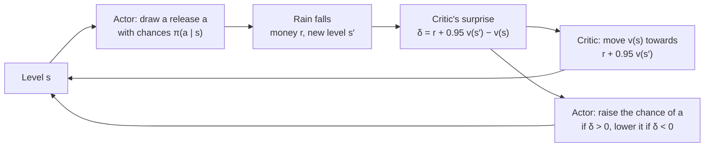
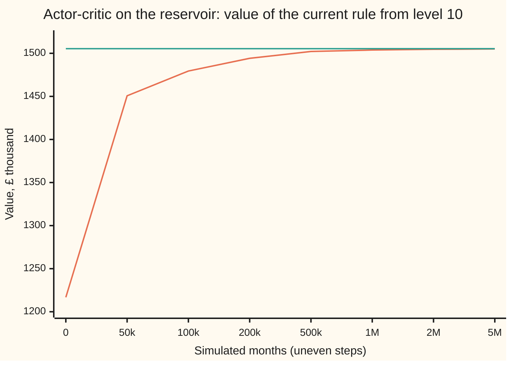

# Policy gradients: nudge the decision rule itself, with a learned critic to cut the noise

[Syllabus](../../../SYLLABUS.md) → [Optimization](../README.md) → [Dynamic Programming and Learning](../README.md#s07) → Policy gradients

---

## General Overview

A hydro reservoir holds up to 100 million m³ of water, tracked in 20 bands of 5 million m³: level 0 is nearly empty, level 19 is full. This is the reservoir of [Markov decision processes](02-markov-decision-processes.md). Each month the operator releases 1, 2 or 3 bands and sells the power for £40k, £75k or £90k (k means thousand). Rain then adds 0 to 4 bands. A month that ends at level 2 or below costs £100k for emergency water. The aim is to **maximise** the money over the years ahead, with next month's pound worth 95p today.

[Q-learning](05-q-learning-and-temporal-differences.md) learns a value for every pair (level, release) and picks the largest. This card instead writes the rule itself as **chances**: at level 10, say, release 1, 2 or 3 bands with chances 0.2, 0.5 and 0.3. It nudges those chances, month by month, in the direction that raises the expected money: the **policy gradient**.

The smallest case shows the idea. One state, two actions, each with chance 0.5; action 1 pays £1, action 2 pays nothing. The gradient is (0.25, −0.25): push action 1 up, action 2 down. One play gives a noisy estimate of it. Subtracting a **baseline** of 0.5, the average payment, keeps the direction and here removes all the noise.

On the reservoir, a second learner, the **critic**, keeps a running guess of what each level is worth and reports, after each month, how much better or worse it went than expected. The rule, now called the **actor**, moves its chances by that surprise. Starting from "every release equally likely", worth £1,216.77k from level 10, one seeded run of the actor-critic finds the best rule after 200,000 simulated months: release 1 band at levels 0 to 4, 2 bands at 5 to 9, 3 bands at 10 to 19. That is the rule [Value and policy iteration](03-value-and-policy-iteration.md) certifies as best, worth £1,505.37k.

**The gradient of the expected money with respect to the rule's scores is an average of "how good this action turned out" times "which way raises its chance", so it can be estimated from played months alone; subtracting a baseline keeps that average and cuts the noise, and a critic that learns the values by temporal differences supplies both the baseline and the "how good" one month at a time.**

**What kind of fact this is:** the policy gradient theorem and the baseline identity are theorems, proved on this card in Why it works. Convergence results for actor-critic (Konda and Tsitsiklis, 2003) are stated in Step 5, not proved, and do not cover the version run here. The reservoir is a model, and the learned rule is certified best by value iteration with a printed certificate.

### The picture: one month of actor-critic



Neither learner ever reads the chances of rain. Both work only from the months the simulator plays out.

---

## The formula

The shelf's notation comes from [Markov decision processes](02-markov-decision-processes.md): level $`s`$, release $`a`$, reward $`r`$, discount $`\gamma = 0.95`$, rule (policy) $`\pi`$. Values $`V^{\pi}(s)`$ and $`Q^{\pi}(s, a)`$ are as on [Q-learning](05-q-learning-and-temporal-differences.md), here for the current rule. This card introduces four new objects, in words first.

- The **scores** $`\theta(s, a)`$: one number per level and release. The rule turns them into chances by softmax ([Softmax and cross-entropy](../../14-Applied%20and%20computational/06-Machine%20Learning%20Mathematics/05-softmax-and-cross-entropy-for-classification.md)): $`\pi_\theta(a \mid s) = e^{\theta(s, a)} / \sum_b e^{\theta(s, b)}`$. Here $`\theta`$ is the rule's scores, not the mixing weight of the convex-sets card.
- The **objective** $`J(\theta) = V^{\pi_\theta}(10)`$: the expected discounted money from level 10 under the rule the scores give.
- The **discounted visits** $`\eta(s)`$: the expected number of months spent at level $`s`$, each weighted by $`\gamma^t`$ for the month $`t`$ it happens in. They add to $`1/(1 - \gamma)`$.
- The **score direction** $`\nabla \log \pi_\theta(a \mid s)`$: the change in the scores that raises the log-chance of $`a`$ fastest. For softmax it is "1 on action $`a`$, minus the chances", $`e_a - \pi_\theta(\cdot \mid s)`$.

The **policy gradient theorem**:

```math
\nabla J(\theta) = \sum_{s} \eta(s) \sum_{a} \pi_\theta(a \mid s)\, Q^{\pi}(s, a)\, \nabla \log \pi_\theta(a \mid s)
```

**Read it aloud:** the uphill direction for the rule is, at every level, weighted by how often the rule visits it, the average over releases of "what the release is worth" times "which way makes it more likely".

For the softmax table the score of release $`a`$ at level $`s`$ gets the single number

```math
\frac{\partial J}{\partial \theta(s, a)} = \eta(s)\, \pi_\theta(a \mid s)\, \big(Q^{\pi}(s, a) - V^{\pi}(s)\big)
```

**Read it aloud:** raise a release's score in proportion to how often the level is visited, how often the release is chosen, and how much better it is than the level's average.

REINFORCE and actor-critic sample this gradient; semi-gradient TD fits actor-critic's critic.

- **REINFORCE** plays, records the money $`G`$ that followed an action, and steps $`\theta \leftarrow \theta + \alpha_\theta\,(G - b)\,\nabla \log \pi_\theta(a \mid s)`$. The **baseline** $`b`$ is any number that does not depend on the action taken.
- **Semi-gradient TD** (TD: temporal difference, learning from the gap between successive guesses) fits the critic $`v_w(s) = w^{\mathsf T} x(s)`$, a straight-line (linear) combination of features $`x(s)`$, by $`w \leftarrow w + \alpha_w\, \delta\, x(s)`$ with the TD error $`\delta = r + \gamma\, v_w(s') - v_w(s)`$.
- **One-step actor-critic** runs both at once, and uses $`\delta`$ in place of $`G - b`$: $`\theta \leftarrow \theta + \alpha_\theta\, \delta\, \nabla \log \pi_\theta(a \mid s)`$.

**Read it aloud:** after each month, the critic moves its guess towards what the month suggests, and the actor raises the chance of what it just did by the critic's surprise.

| Symbol | Plain meaning | In our example | Push it up and the answer… |
| --- | --- | --- | --- |
| $`s`$, $`a`$, $`r`$, $`\gamma`$, $`p(s' \mid s, a)`$, $`t`$ | level, release, month's money in £k, discount, chance of the next level, month count | level 10; release 1, 2 or 3 bands; 0.95; months 0, 1, 2, … | — |
| $`\theta(s, a)`$ | score of release $`a`$ at level $`s`$ | all 0 at the start | that release is chosen more often |
| $`\pi_\theta(a \mid s)`$, $`P_\pi`$ | chance of release $`a`$ at level $`s`$, the softmax of the scores; the rule's level-to-level chances | 1/3 each at the start; 0.9919 for 2 bands at level 9 at the end | — |
| $`J(\theta)`$ | expected discounted money from level 10 | £1,216.77k at the start; best £1,505.37k | — |
| $`\nabla \log \pi_\theta(a \mid s)`$, $`e_a`$ | score direction; $`e_a`$ is 1 on action $`a`$ and 0 elsewhere | (0.5, −0.5) for action 1 in the two-action case | — |
| $`Q^{\pi}(s, a)`$, $`V^{\pi}(s)`$ | value of release $`a`$ then following the rule; the level's average over releases | 1226.1572 and 1216.7723 at level 10, uniform rule | — |
| $`\eta(s)`$, $`d_\pi(s)`$, $`\phi(s)`$ | discounted visits to level $`s`$ from level 10; long-run share of months at $`s`$; level $`s`$'s own share of the gradient, used in the proof | $`\eta(10)`$ = 2.8624 under the uniform rule | — |
| $`G`$, $`b`$ | money after an action; baseline subtracted from it | payment 1 or 0; $`b = 0.5`$ | a bigger gap $`G - b`$ means a bigger, noisier step |
| $`\delta`$ | TD error: the critic's surprise | positive when the month beats the critic's guess | the actor moves further |
| $`x(s)`$, $`w`$, $`v_w(s)`$, $`A`$, $`c`$ | critic's features, weights and value guess; the equations TD settles on | $`x(s) = (1,\ (s - 10)/10)`$; $`v = 1517.24 + 226.80\,(s - 10)/10`$ | — |
| $`\alpha_\theta`$, $`\alpha_w`$ | actor and critic step sizes | 0.0001 and 0.05 | faster, but at 0.003 the actor locks in a wrong rule |

### When it holds

- **Every chance stays positive and smooth in the scores.** Softmax does this. A fixed rule ("always 2 bands") has no gradient: changing it is a jump, not a slope.
- **The months come from the rule being improved.** Learning a fitted critic from another rule's months, with bootstrapping (targets built from the critic's own guesses), can diverge: the "deadly triad". The code's two-state example reaches $`w = 74.36`$ in 50 updates.
- **Steps are small enough.** In the seeded run at 30 times the actor step, the actor commits early to a rule wrong at 5 levels, worth £1,479.79k against £1,505.37k.
- **The critic can represent the differences that matter.** With a straight-line critic the actor gets only 9 of 20 levels right, worth £1,472.16k.
- **Ascent finds a peak, not always the highest.** In general gradient ascent stops at a local maximum. Here value iteration certifies the answer, not the method.

---

## Why it works

### Step 0: the gradient of an average is an average you can sample

The expected money is an average over actions, weighted by their chances. Moving the scores changes the weights, not the payments. The **log-derivative trick** rewrites the change in a chance as the chance times the change in its log: $`\nabla \pi = \pi\, \nabla \log \pi`$. So the gradient becomes an average again, of "payment times score direction", taken over the very actions the rule plays. An average can be estimated by playing and averaging, as in [Stochastic gradient](../06-Conic%2C%20Quadratic%20and%20Stochastic%20Programs/08-stochastic-gradient-and-sample-average-approximation.md). Nothing about the payments needs to be known in advance.

### Step 1: one state, two actions

With one state, $`J(\theta) = \pi_\theta(1)\cdot 1 + \pi_\theta(2)\cdot 0`$. Then

```math
\nabla J = \sum_a \pi_\theta(a)\, r(a)\, \nabla \log \pi_\theta(a) = 0.5 \times 1 \times (0.5,\ -0.5) + 0.5 \times 0 \times (-0.5,\ 0.5) = (0.25,\ -0.25).
```

A central difference, nudging each score by ±0.00001 and measuring the change in $`J`$, gives the same (0.25, −0.25). That the slope is $`\pi(1)\pi(2) = 0.25`$ is the softmax derivative from [Softmax and cross-entropy](../../14-Applied%20and%20computational/06-Machine%20Learning%20Mathematics/05-softmax-and-cross-entropy-for-classification.md).

### Step 2: a baseline keeps the mean and cuts the noise

The chances add to 1 for every $`\theta`$, so their gradients add to zero: $`\sum_a \pi_\theta(a)\,\nabla \log \pi_\theta(a) = \nabla \sum_a \pi_\theta(a) = \nabla 1 = 0`$. Hence, for any $`b`$ that does not depend on the action,

```math
\sum_a \pi_\theta(a)\,\big(r(a) - b\big)\,\nabla \log \pi_\theta(a) = \nabla J - b \cdot 0 = \nabla J .
```

The mean is untouched; the spread is not. One play estimates the gradient by $`(r(a) - b)\,\nabla \log \pi_\theta(a)`$:

- **No baseline.** Action 1 gives (0.5, −0.5), action 2 gives (0, 0). Variance 0.0625 in each entry.
- **Baseline 0.5.** Action 1 gives $`0.5 \times (0.5, -0.5) = (0.25, -0.25)`$. Action 2 gives $`-0.5 \times (-0.5, 0.5) = (0.25, -0.25)`$. Variance 0: every play reports the exact gradient.
- **Both payments raised by £10, no baseline.** The gradient is still (0.25, −0.25), but one play reports (5.5, −5.5) or (−5, 5). Variance 27.5625.

The last case is the common one: real payments are rarely centred on zero. The best constant baseline is close to the average payment, which is what the critic will supply.

### Step 3: the policy gradient theorem, over many months

Over many months, choosing differently now changes which levels are visited later. That looks like a hard extra term. The theorem says it is not: the visits enter only as the weights $`\eta(s)`$, and no derivative of the visits is needed.

<details>
<summary>Detailed proof: the policy gradient theorem and its softmax form</summary>

Write $`P_\pi(s, s') = \sum_a \pi_\theta(a \mid s)\, p(s' \mid s, a)`$ for the rule's chance of moving from $`s`$ to $`s'`$. Two facts define the values:

$`\displaystyle V^{\pi}(s) = \sum_a \pi_\theta(a \mid s)\, Q^{\pi}(s, a), \qquad Q^{\pi}(s, a) = r(s, a) + \gamma \sum_{s'} p(s' \mid s, a)\, V^{\pi}(s').`$

The reward $`r(s, a)`$ and the chances $`p`$ do not depend on $`\theta`$. Differentiate the first fact with the product rule and substitute the second:

$`\displaystyle \nabla V^{\pi}(s) = \underbrace{\sum_a \nabla \pi_\theta(a \mid s)\, Q^{\pi}(s, a)}_{\phi(s)} + \gamma \sum_{s'} P_\pi(s, s')\, \nabla V^{\pi}(s').`$

This is the same linear system that defines a value, with $`\phi(s)`$ in place of the reward. Its solution is $`\nabla V^{\pi} = (I - \gamma P_\pi)^{-1} \phi = \sum_{t \ge 0} \gamma^t P_\pi^t\, \phi`$, the series converging because $`\gamma < 1`$ and each $`P_\pi^t`$ has rows of chances adding to 1. Read row $`s_0 = 10`$: $`\sum_t \gamma^t P_\pi^t(10, s)`$ is the discounted visit count $`\eta(s)`$. So

$`\displaystyle \nabla J = \sum_s \eta(s)\, \phi(s) = \sum_s \eta(s) \sum_a \pi_\theta(a \mid s)\, Q^{\pi}(s, a)\, \nabla \log \pi_\theta(a \mid s),`$

using $`\nabla \pi = \pi\, \nabla \log \pi`$ in the last step.

For the softmax table, $`\partial \pi_\theta(b \mid s) / \partial \theta(s, a) = \pi_\theta(b \mid s)\,(1[a = b] - \pi_\theta(a \mid s))`$, where $`1[a = b]`$ is 1 if $`a = b`$ and 0 otherwise, and no other level's chances depend on $`\theta(s, a)`$. Then

$`\displaystyle \frac{\partial J}{\partial \theta(s, a)} = \eta(s) \sum_b \pi_\theta(b \mid s)\big(1[a = b] - \pi_\theta(a \mid s)\big) Q^{\pi}(s, b) = \eta(s)\, \pi_\theta(a \mid s)\big(Q^{\pi}(s, a) - V^{\pi}(s)\big).`$

</details>

The code checks the theorem at the uniform rule. It computes all 60 entries both from the formula, with $`\eta`$ and $`Q^{\pi}`$ solved exactly by elimination, and by central differences of the exact $`J`$. The largest gap is 1.8e-08.

### Step 4: the critic, a linear value fit learned by TD

A table of values needs one number per level. Problems with millions of levels need a fitted function in its place, and the simplest is linear: $`v_w(s) = w^{\mathsf T} x(s)`$. **Semi-gradient TD** takes the TD(0) update of [Q-learning](05-q-learning-and-temporal-differences.md) and spreads it over the weights in the direction $`x(s)`$. It is called semi-gradient because it treats the target $`r + \gamma v_w(s')`$ as fixed, though it too depends on $`w`$.

Following one rule on its own months, the update settles where the average TD error, weighted by the features, is zero. That is two linear equations here, $`A w = c`$, with

```math
A = \sum_s d_\pi(s)\, x(s)\big(x(s) - \gamma \textstyle\sum_{s'} p(s' \mid s, \pi(s))\, x(s')\big)^{\mathsf T}, \qquad c = \sum_s d_\pi(s)\, r(s, \pi(s))\, x(s),
```

where $`d_\pi`$ is the rule's long-run share of months at each level. For the best rule and the straight line $`x(s) = (1, (s - 10)/10)`$, the exact solution is $`v = 1517.24 + 226.80\,(s - 10)/10`$. One million simulated months of TD reach $`1519.65 + 217.78\,(s - 10)/10`$.

The fit is judged where the rule spends its time. Weighted by $`d_\pi`$, its typical error is 11.48, against 11.45 for the best possible straight line. Tsitsiklis and Van Roy (1997) proved the TD line is within a fixed factor of the best line. Their contraction argument, with one step of Pythagoras on the weighted error, gives the factor $`1/\sqrt{1 - \gamma^2}`$: here the TD line's error can be at most 36.67. At levels the rule rarely visits, the line is far off: 1290.44 at level 0, where the truth is 1044.92.

The guarantee needs the months to come from the rule being judged. Baird (1995) gave a classic six-state example of this failure. An even smaller one has two states with values $`w`$ and $`2w`$, with no reward, and only the first is updated. Each update multiplies $`w`$ by $`1 + 0.1(2 \times 0.95 - 1) = 1.09`$, so $`w`$ grows to 74.36 after 50 updates. Updating the second state too, as the rule's own months would, shrinks it to 6.01e-10.

### Step 5: actor-critic, the TD error as "better than expected"

If the critic is exact, $`v_w = V^{\pi}`$, then averaged over the rain

```math
\mathbb{E}[\,\delta \mid s, a\,] = r(s, a) + \gamma \sum_{s'} p(s' \mid s, a)\, V^{\pi}(s') - V^{\pi}(s) = Q^{\pi}(s, a) - V^{\pi}(s).
```

That is exactly the bracket in the softmax form of the theorem. So the actor's step $`\delta\,\nabla \log \pi`$, averaged over a month at level $`s`$, points along that level's entries of the policy gradient, with $`V^{\pi}(s)`$ as the baseline. One month of experience replaces the whole future $`G`$ that REINFORCE waits for, which cuts the noise further.

The code's actor-critic makes two practical choices. It starts a fresh 50-month run from a random level every 50 months, so every level gets practice. And, as is usual, it drops the $`\gamma^t`$ weight of the theorem's $`\eta`$. Both change how much each level's step weighs, not which way it points, because each level has its own scores.

Konda and Tsitsiklis (2003) proved convergence results for actor-critic on two time scales, under three conditions: a linear critic learned by TD, shrinking steps that keep the critic faster than the actor, and critic features that span the actor's score directions. Then the policy gradient gets close to zero along the run. The card states this without proof. The result does not cover this run, whose critic is a table of 20 level values, not features matched to the 60 score directions, and whose steps are constant. The answer here rests on value iteration's certificate.

---

## Worked numbers, by hand

The two-action case, scores (0, 0), action 1 pays 1, action 2 pays 0.

| Step | Arithmetic | Value |
| --- | --- | --- |
| chances | $`e^0 / (e^0 + e^0)`$ | 0.5 and 0.5 |
| score direction, action 1 | (1 − 0.5, 0 − 0.5) | (0.5, −0.5) |
| score direction, action 2 | (0 − 0.5, 1 − 0.5) | (−0.5, 0.5) |
| gradient | 0.5 × 1 × (0.5, −0.5) + 0.5 × 0 × (−0.5, 0.5) | (0.25, −0.25) |
| one play, no baseline | 0.5 × (0.5 − 0.25)² + 0.5 × (0 − 0.25)² | variance 0.0625 |
| one play, baseline 0.5 | both actions report (0.25, −0.25) | **variance 0** |

The baseline turns a noisy estimate into an exact one here, because 0.5 is the average payment and the two actions sit symmetrically about it.

The reservoir, uniform rule (scores all 0), level 10, the score for releasing 2 bands.

| Step | Arithmetic | Value |
| --- | --- | --- |
| values of the three releases | from the exact solve | 1221.2780, 1226.1572, 1202.8818 |
| level's average | (1221.2780 + 1226.1572 + 1202.8818) / 3 | 1216.7723 |
| advantage of 2 bands | 1226.1572 − 1216.7723 | 9.3849 |
| discounted visits to level 10 | row 10 of $`(I - 0.95 P_\pi)^{-1}`$ | 2.8624 |
| gradient entry | 2.8624 × (1/3) × 9.3849, with unrounded inputs | **8.9543** |

Raising the score for "2 bands at level 10" raises the expected money from level 10 at a rate of £8.9543k per unit of score. The other two entries at level 10 are 4.2989 and −13.2533: release 1 band a little more often, 3 bands less.

### What breaks if you drop a piece

| Mistake | Comes out at | What went wrong |
| --- | --- | --- |
| No baseline, payments 11 and 10 | one-play variance 27.5625 against 0; after 20 REINFORCE plays, 837 of 2000 runs favour the worse action | The shared £10 is pure noise in every step, and it swamps the £1 difference |
| Actor step 0.003 instead of 0.0001 | rule `11111223333333333232`, worth £1,479.79k against £1,505.37k | Early noisy steps make chances near 0 or 1, and a chance near 0 is almost never tried again |
| Straight-line critic | 9 of 20 levels right, worth £1,472.16k | The critic's surprise is biased where the line misses the curve, and the actor follows the bias |
| Off-policy TD with a fitted critic | $`w = 74.36`$ after 50 updates, growing 9% each time | The deadly triad: off-policy, bootstrapping and approximation together |

---

## How the rule learns, month by month

The puzzle: at levels 9 and 10 the best release beats the second-best by only £0.55k and £0.63k, in values near £1,500k. Each month's surprise $`\delta`$ swings by tens of thousands of pounds with the rain. How can a noisy learner find a difference that small?

By averaging it out over many months, with a small step. The actor-critic run from scores 0, seed 1:

| Months | Value from level 10 (£k) | Levels right | Most likely release, levels 0–19 |
| ---: | ---: | ---: | --- |
| 0 | 1216.77 | 5/20 | `11111111111111111111` |
| 50,000 | 1450.67 | 18/20 | `11111122222333333333` |
| 100,000 | 1479.45 | 19/20 | `11111122223333333333` |
| 200,000 | 1494.22 | 20/20 | `11111222223333333333` |
| 500,000 | 1502.12 | 20/20 | `11111222223333333333` |
| 1,000,000 | 1503.81 | 20/20 | `11111222223333333333` |
| 2,000,000 | 1504.63 | 20/20 | `11111222223333333333` |
| 5,000,000 | 1505.09 | 20/20 | `11111222223333333333` |

The value is computed exactly for the actor's current chances, not estimated. In this run (seed 1) the rule is right by 200,000 months; with seed 2, only by 2 million. After that, the chances keep sharpening, and the value climbs towards £1,505.37k without reaching it: after 5 million months the least certain level still picks its best release only 96.00% of the time. At level 9 the chances are 0.03%, 99.19% and 0.78%.



Orange: the actor's current rule. Green: the best rule, £1,505.37k. Most of the gain comes in the first 100,000 months, when the large differences at low and high levels are learned. From 100,000 months on, the climb from 1479.45 to 1505.09 is slow: what is left is the near-ties around levels 9 and 10.

That is far more months than [Q-learning](05-q-learning-and-temporal-differences.md) needed on its 5-level reservoir. A policy gradient pays for small, smooth steps with samples. In return the rule itself is tuned, which carries over to actions too many to list, such as a release of any amount.

---

## Code, from first principles, and it actually runs

The code builds the two-action case and the reservoir, and takes five roads.

- Road 1: the two-action gradient by the theorem, against central differences, against 10,000 simulated plays with and without baselines.
- Road 2: REINFORCE, 2000 runs of 20 plays, against exact gradient ascent with the same step.
- Road 3: value iteration on the reservoir, with the certificate that no one-level switch gains more than 1e-9, and the rule printed on [Markov decision processes](02-markov-decision-processes.md).
- Road 4: the policy gradient theorem for all 60 scores, against central differences of the exact value; and semi-gradient TD against its exact fixed point.
- Road 5: actor-critic from simulated months only, which must reach road 3's rule, again with a second seed.

Random numbers come from SplitMix64, a small generator written out in both languages with stated seeds, so the two programs print identical output.

### Python

```python
# Policy gradients and actor-critic -- the check behind the card.  Standard library only.
# Part 1: one state, two actions, softmax at (0, 0); action 1 pays 1, action 2 pays 0.
# Part 2: the 20-level reservoir of the MDP card (release 1, 2 or 3 bands; GBP thousands; maximise;
# discount 0.95).  Exact answers by elimination; random numbers from SplitMix64, seeded.
import math
from functools import reduce
from itertools import product
M64 = (1 << 64) - 1
class SplitMix64:                                  # the card's random numbers, seeded
    def __init__(self, seed): self.x = seed
    def next(self):
        self.x = (self.x + 0x9E3779B97F4A7C15) & M64
        z = ((self.x ^ (self.x >> 30)) * 0xBF58476D1CE4E5B9) & M64
        z = ((z ^ (z >> 27)) * 0x94D049BB133111EB) & M64
        return z ^ (z >> 31)
    def unif(self): return (self.next() >> 11) / 9007199254740992.0
def add(xs): return reduce(lambda t, x: t + x, xs, 0.0)   # plain left-to-right sum, as in Rust
def soft(h): m = max(h); e = [math.exp(x - m) for x in h]; z = add(e); return [x / z for x in e]   # softmax
def pick(pi, u):                                   # draw an action from chances pi
    a, c = 0, pi[0]
    while u >= c and a < len(pi) - 1: a += 1; c += pi[a]
    return a
f4 = lambda xs: ",".join(f"{x:.4f}" for x in xs)
# ---- part 1: the two-action example ----
gl = lambda pi, a: [(1.0 if b == a else 0.0) - pi[b] for b in range(2)]   # grad log pi(a)
def pg(th): pi = soft(th); return [add(pi[a] * (1.0 - a) * gl(pi, a)[i] for a in range(2)) for i in range(2)]
pi0, grad = soft([0.0, 0.0]), pg([0.0, 0.0])
fd = [(soft([1e-5, 0.0])[0] - soft([-1e-5, 0.0])[0]) / 2e-5, (soft([0.0, 1e-5])[0] - soft([0.0, -1e-5])[0]) / 2e-5]
print(f"bandit: chances {f4(pi0)}; theorem gradient {f4(grad)}; central difference {f4(fd)}")
for sh, b in ((0, 0.0), (0, 0.5), (10, 0.0)):      # one-play estimates: pay 1 and 0, or 11 and 10
    est = [[(1.0 - a + sh - b) * g + 0.0 for g in gl(pi0, a)] for a in range(2)]
    var = add(pi0[a] * (est[a][0] - grad[0]) ** 2 for a in range(2))
    rng = SplitMix64(11); xs = [est[pick(pi0, rng.unif())][0] for _ in range(10000)]
    m = add(xs) / 10000; v = add((x - m) ** 2 for x in xs) / 9999
    print(f"pay {1 + sh},{sh} baseline {b}: action 1 gives {f4(est[0])}, action 2 gives {f4(est[1])}; "
          f"variance {var:.4f}; 10000 draws: mean {m:.4f}, variance {v:.4f}")
    assert abs(m - grad[0]) < 4 * math.sqrt(var / 10000) + 1e-12 and abs(v - var) < 0.02 * var + 1e-12
th = [0.0, 0.0]                                    # exact gradient ascent, step 0.05, 20 steps
for _ in range(20): th = [x + 0.05 * y for x, y in zip(th, pg(th))]
asc = soft(th)[0]; print(f"exact gradient ascent, 20 steps of 0.05: chance of action 1 {asc:.4f}")
for sh, base in ((0, False), (0, True), (10, False), (10, True)):   # REINFORCE, 2000 runs
    rng, fin = SplitMix64(12), []
    for _ in range(2000):
        th = [0.0, 0.0]
        for _ in range(20):
            pi = soft(th); a = pick(pi, rng.unif()); g = gl(pi, a)
            b = pi[0] + sh if base else 0.0        # baseline: the average payment now
            th = [th[i] + 0.05 * (1.0 - a + sh - b) * g[i] for i in range(2)]
        fin.append(soft(th)[0])
    m = add(fin) / 2000; sd = math.sqrt(add((x - m) ** 2 for x in fin) / 1999)
    print(f"REINFORCE pay {1 + sh},{sh} baseline {base}: chance of action 1 mean {m:.4f}, "
          f"spread {sd:.4f}, runs below 0.5: {sum(x < 0.5 for x in fin)}")
    assert sd > 0.2 if sh and not base else abs(m - asc) < 0.01
# ---- part 2: the reservoir ----
N, G, S0, RAIN, PAY = 20, 0.95, 10, [0.1, 0.2, 0.4, 0.2, 0.1], [0.0, 40.0, 75.0, 90.0]
RMAP = [0, 1, 1, 2, 2, 2, 2, 3, 3, 4]               # a digit 0-9 gives rain with those chances
def step(s, a, w):                                 # release a + 1 bands, rain w: money, next level
    out = min(a + 1, s + w); t = min(N - 1, s + w - out)
    return PAY[out] - (100.0 if t <= 2 else 0.0), t
P = [[[0.0] * N for _ in range(3)] for _ in range(N)]; R = [[0.0] * 3 for _ in range(N)]
for s, a, w in product(range(N), range(3), range(5)): r, t = step(s, a, w); P[s][a][t] += RAIN[w]; R[s][a] += RAIN[w] * r
def solve(A, b):                                   # Gaussian elimination, partial pivoting
    n = len(b); M = [A[i][:] + [b[i]] for i in range(n)]
    for c in range(n):
        p = max(range(c, n), key=lambda i: abs(M[i][c])); M[c], M[p] = M[p], M[c]
        for i in range(c + 1, n):
            f = M[i][c] / M[c][c]
            for j in range(c, n + 1): M[i][j] -= f * M[c][j]
    x = [0.0] * n
    for i in range(n - 1, -1, -1): x[i] = (M[i][n] - add(M[i][j] * x[j] for j in range(i + 1, n))) / M[i][i]
    return x
def Pof(pis): return [[add(pis[s][a] * P[s][a][j] for a in range(3)) for j in range(N)] for s in range(N)]
def value(pis):                                    # exact value of a (random) rule: (I - g P) V = r
    Pp = Pof(pis); I = lambda i, j: 1.0 if i == j else 0.0
    return solve([[I(i, j) - G * Pp[i][j] for j in range(N)] for i in range(N)], [add(pis[s][a] * R[s][a] for a in range(3)) for s in range(N)])
qv = lambda V, s, a: R[s][a] + G * add(P[s][a][j] * V[j] for j in range(N))
V, k, ch = [0.0] * N, 0, 1.0
while ch >= 1e-9:                                  # value iteration from V = 0
    W = [max(qv(V, s, a) for a in range(3)) for s in range(N)]; k, ch, V = k + 1, max(abs(x - y) for x, y in zip(V, W)), W
best = [max(range(3), key=lambda a: qv(V, s, a)) for s in range(N)]
VB = value([[1.0 if a == best[s] else 0.0 for a in range(3)] for s in range(N)]); rule = "".join(str(a + 1) for a in best)
cert = max(qv(VB, s, a) - VB[s] for s in range(N) for a in range(3))
gaps = [sorted(qv(VB, s, a) for a in range(3))[2] - sorted(qv(VB, s, a) for a in range(3))[1] for s in range(N)]
print(f"value iteration: {k} sweeps; rule {rule}; V*(10) {VB[S0]:.2f}; best one-switch gain {cert:.1e}")
print("gap to second-best release, levels 0-19: " + ",".join(f"{x:.2f}" for x in gaps))
assert rule == "11111222223333333333" and cert < 1e-9 and abs(VB[S0] - V[S0]) < 1e-6
U = [[1 / 3] * 3 for _ in range(N)]; VU, Pu = value(U), Pof(U)   # policy gradient theorem at theta = 0
d = solve([[(1.0 if i == j else 0.0) - G * Pu[j][i] for j in range(N)] for i in range(N)], [1.0 * (i == S0) for i in range(N)])
thm = [[d[s] * U[s][a] * (qv(VU, s, a) - VU[s]) for a in range(3)] for s in range(N)]
Jth = lambda s, a, h: value([soft([h if (i, b) == (s, a) else 0.0 for b in range(3)]) for i in range(N)])[S0]
gap = max(abs((Jth(s, a, 1e-4) - Jth(s, a, -1e-4)) / 2e-4 - thm[s][a]) for s in range(N) for a in range(3))
print(f"uniform rule: J = V(10) {VU[S0]:.4f}; d(10) {d[S0]:.4f}; Q(10,.) {f4([qv(VU, S0, a) for a in range(3)])}")
print(f"theorem gradient at level 10: {f4(thm[S0])}; largest gap to central differences over 60: {gap:.1e}")
assert gap < 1e-4
dp = [1.0 / N] * N                                 # semi-gradient TD, straight-line critic, best rule
for _ in range(3000): dp = [add(dp[s] * P[s][best[s]][j] for s in range(N)) for j in range(N)]
X = [[1.0, (s - 10) / 10] for s in range(N)]
nx = [[add(P[s][best[s]][t] * X[t][j] for t in range(N)) for j in range(2)] for s in range(N)]
wtd = solve([[add(dp[s] * X[s][i] * (X[s][j] - G * nx[s][j]) for s in range(N)) for j in range(2)] for i in range(2)],
            [add(dp[s] * R[s][best[s]] * X[s][i] for s in range(N)) for i in range(2)])
wls = solve([[add(dp[s] * X[s][i] * X[s][j] for s in range(N)) for j in range(2)] for i in range(2)],
            [add(dp[s] * X[s][i] * VB[s] for s in range(N)) for i in range(2)])
rms = lambda w: math.sqrt(add(dp[s] * (w[0] + w[1] * X[s][1] - VB[s]) ** 2 for s in range(N)))
rng, s, w = SplitMix64(5), S0, [0.0, 0.0]
for t in range(1000000):
    r, s2 = step(s, best[s], RMAP[rng.next() % 10]); al = 0.05 / (1 + t / 100000)
    dl = r + G * (w[0] + w[1] * X[s2][1]) - (w[0] + w[1] * X[s][1]); w = [w[0] + al * dl, w[1] + al * dl * X[s][1]]; s = s2
print(f"TD line: exact fixed point {wtd[0]:.2f} + {wtd[1]:.2f} x; 1,000,000 months of TD {w[0]:.2f} + {w[1]:.2f} x")
print("TD line at levels 0,5,10,15,19: " + ",".join(f"{wtd[0] + wtd[1] * X[s][1]:.2f}" for s in (0, 5, 10, 15, 19))
      + "; true " + ",".join(f"{VB[s]:.2f}" for s in (0, 5, 10, 15, 19)))
print(f"weighted error: TD line {rms(wtd):.2f}, best line {rms(wls):.2f}, bound {rms(wls) / math.sqrt(1 - G * G):.2f}")
assert abs(w[0] - wtd[0]) < 0.01 * wtd[0] and abs(w[1] - wtd[1]) < 0.1 * wtd[1] and rms(wtd) <= rms(wls) / math.sqrt(1 - G * G)
wo, wn = 1.0, 1.0                                  # deadly triad: values w and 2w, step 0.1
for _ in range(50): wo += 0.1 * (G * 2 * wo - wo); wn += 0.1 * (G * 2 * wn - wn); wn += 0.1 * (0 - 2 * wn) * 2
print(f"triad: after 50 updates off-policy w = {wo:.2f}; on-policy w = {wn:.2e}")
def ac(months, at, seed, line=False, marks=()):   # one-step actor-critic, softmax actor
    rng, th, w, s, hist = SplitMix64(seed), [[0.0] * 3 for _ in range(N)], [0.0] * (2 if line else N), 0, []
    v = (lambda x: w[0] + w[1] * (x - 10) / 10) if line else (lambda x: w[x])
    for t in range(months + 1):
        if t in marks or t == months:
            pis = [soft(h) for h in th]; rl = [max(range(3), key=lambda a: p[a]) for p in pis]
            hist.append((t, value(pis)[S0], sum(x == y for x, y in zip(rl, best)), "".join(str(a + 1) for a in rl)))
        if t == months: return hist, pis
        if t % 50 == 0: s = rng.next() % N         # a fresh 50-month run from a random level
        pi = soft(th[s]); a = pick(pi, rng.unif())
        r, s2 = step(s, a, RMAP[rng.next() % 10])
        dl = r + G * v(s2) - v(s)                  # TD error: the critic's surprise
        for i, c in (((0, 0.01), (1, 0.01 * (s - 10) / 10)) if line else ((s, 0.05),)): w[i] += c * dl
        for b in range(3): th[s][b] += at * dl * ((1.0 if b == a else 0.0) - pi[b])
        s = s2
hist, pis = ac(5000000, 0.0001, 1, marks={0, 50000, 100000, 200000, 500000, 1000000, 2000000})
for t, v10, ok, rl in hist: print(f"actor-critic month {t}: V(10) {v10:.2f}, levels right {ok}/20, rule {rl}")
print(f"actor-critic: smallest top chance {min(max(p) for p in pis):.4f}; level 9 chances {f4(pis[9])}")
s2 = ac(5000000, 0.0001, 2, marks={200000, 1000000, 2000000})[0]; h2, hb, hl = s2[-1], ac(1000000, 0.003, 1)[0][-1], ac(5000000, 0.0001, 1, True)[0][-1]
print(f"seed 2: levels right at 200k, 1M, 2M months {s2[0][2]}, {s2[1][2]}, {s2[2][2]}; at 5M rule {h2[3]}, V(10) {h2[1]:.2f}; step 0.003, 1,000,000 months: rule {hb[3]}, V(10) {hb[1]:.2f}")
print(f"straight-line critic: rule {hl[3]}, levels right {hl[2]}/20, V(10) {hl[1]:.2f}")
assert hist[-1][3] == rule and VB[S0] - hist[-1][1] < 1.0 and h2[3] == rule
assert hb[3] != rule and hl[3] != rule and wo > 50 and wn < 1e-6
print("ALL CHECKS PASS")
```

**Ran 2026-11-24 on macOS, Python 3.14.10, standard library only. All checks passed. Output, pasted from the run:**

```
bandit: chances 0.5000,0.5000; theorem gradient 0.2500,-0.2500; central difference 0.2500,-0.2500
pay 1,0 baseline 0.0: action 1 gives 0.5000,-0.5000, action 2 gives 0.0000,0.0000; variance 0.0625; 10000 draws: mean 0.2558, variance 0.0625
pay 1,0 baseline 0.5: action 1 gives 0.2500,-0.2500, action 2 gives 0.2500,-0.2500; variance 0.0000; 10000 draws: mean 0.2500, variance 0.0000
pay 11,10 baseline 0.0: action 1 gives 5.5000,-5.5000, action 2 gives -5.0000,5.0000; variance 27.5625; 10000 draws: mean 0.3718, variance 27.5504
exact gradient ascent, 20 steps of 0.05: chance of action 1 0.6203
REINFORCE pay 1,0 baseline False: chance of action 1 mean 0.6199, spread 0.0225, runs below 0.5: 0
REINFORCE pay 1,0 baseline True: chance of action 1 mean 0.6202, spread 0.0070, runs below 0.5: 0
REINFORCE pay 11,10 baseline False: chance of action 1 mean 0.5615, spread 0.3420, runs below 0.5: 837
REINFORCE pay 11,10 baseline True: chance of action 1 mean 0.6202, spread 0.0070, runs below 0.5: 0
value iteration: 489 sweeps; rule 11111222223333333333; V*(10) 1505.37; best one-switch gain 2.3e-13
gap to second-best release, levels 0-19: 52.05,67.34,74.36,35.43,10.90,7.93,12.07,6.50,2.80,0.55,0.63,1.40,2.04,2.67,3.27,3.84,4.40,5.04,6.53,8.88
uniform rule: J = V(10) 1216.7723; d(10) 2.8624; Q(10,.) 1221.2780,1226.1572,1202.8818
theorem gradient at level 10: 4.2989,8.9543,-13.2533; largest gap to central differences over 60: 1.8e-08
TD line: exact fixed point 1517.24 + 226.80 x; 1,000,000 months of TD 1519.65 + 217.78 x
TD line at levels 0,5,10,15,19: 1290.44,1403.84,1517.24,1630.64,1721.36; true 1044.92,1408.45,1505.37,1570.34,1610.52
weighted error: TD line 11.48, best line 11.45, bound 36.67
triad: after 50 updates off-policy w = 74.36; on-policy w = 6.01e-10
actor-critic month 0: V(10) 1216.77, levels right 5/20, rule 11111111111111111111
actor-critic month 50000: V(10) 1450.67, levels right 18/20, rule 11111122222333333333
actor-critic month 100000: V(10) 1479.45, levels right 19/20, rule 11111122223333333333
actor-critic month 200000: V(10) 1494.22, levels right 20/20, rule 11111222223333333333
actor-critic month 500000: V(10) 1502.12, levels right 20/20, rule 11111222223333333333
actor-critic month 1000000: V(10) 1503.81, levels right 20/20, rule 11111222223333333333
actor-critic month 2000000: V(10) 1504.63, levels right 20/20, rule 11111222223333333333
actor-critic month 5000000: V(10) 1505.09, levels right 20/20, rule 11111222223333333333
actor-critic: smallest top chance 0.9600; level 9 chances 0.0003,0.9919,0.0078
seed 2: levels right at 200k, 1M, 2M months 19, 19, 20; at 5M rule 11111222223333333333, V(10) 1505.04; step 0.003, 1,000,000 months: rule 11111223333333333232, V(10) 1479.79
straight-line critic: rule 21112222222222222223, levels right 9/20, V(10) 1472.16
ALL CHECKS PASS
```

### Rust

The same roads, the same seeds, the same output, built with `rustc --edition 2021 -O`.

```rust
// Policy gradients and actor-critic -- the same check as the Python, in Rust.  No crates.
// Part 1: one state, two actions, softmax at (0, 0); action 1 pays 1, action 2 pays 0.
// Part 2: the 20-level reservoir of the MDP card (release 1, 2 or 3 bands; GBP thousands; maximise; 0.95).
const N: usize = 20; const G: f64 = 0.95; const S0: usize = 10;
const RAIN: [f64; 5] = [0.1, 0.2, 0.4, 0.2, 0.1]; const PAY: [f64; 4] = [0.0, 40.0, 75.0, 90.0];
const RMAP: [usize; 10] = [0, 1, 1, 2, 2, 2, 2, 3, 3, 4];   // a digit 0-9 gives rain with those chances
struct SplitMix64 { x: u64 }                       // the card's random numbers, seeded
impl SplitMix64 {
    fn next(&mut self) -> u64 {
        self.x = self.x.wrapping_add(0x9E3779B97F4A7C15); let z = (self.x ^ (self.x >> 30)).wrapping_mul(0xBF58476D1CE4E5B9);
        let z = (z ^ (z >> 27)).wrapping_mul(0x94D049BB133111EB); z ^ (z >> 31)
    }
    fn unif(&mut self) -> f64 { (self.next() >> 11) as f64 / 9007199254740992.0 }
}
fn add<I: Iterator<Item = f64>>(xs: I) -> f64 { xs.fold(0.0, |t, x| t + x) }   // plain left-to-right sum
fn soft(h: &[f64]) -> Vec<f64> {                  // softmax: scores into chances
    let m = h.iter().fold(f64::NEG_INFINITY, |m, &x| if x > m { x } else { m });
    let e: Vec<f64> = h.iter().map(|x| (x - m).exp()).collect(); let z = add(e.iter().cloned()); e.iter().map(|x| x / z).collect()
}
fn pick(pi: &[f64], u: f64) -> usize {            // draw an action from chances pi
    let (mut a, mut c) = (0, pi[0]); while u >= c && a < pi.len() - 1 { a += 1; c += pi[a]; } a
}
fn f4(xs: &[f64]) -> String { xs.iter().map(|x| format!("{:.4}", x)).collect::<Vec<_>>().join(",") }
fn sci(x: f64, p: usize) -> String {              // Python's e-format: two-digit exponent
    let s = format!("{:.*e}", p, x); let (m, e) = s.split_once('e').unwrap(); let e: i32 = e.parse().unwrap();
    format!("{}e{}{:02}", m, if e < 0 { "-" } else { "+" }, e.abs())
}
fn gl(pi: &[f64], a: usize) -> Vec<f64> { (0..2).map(|b| (if b == a { 1.0 } else { 0.0 }) - pi[b]).collect() }
fn pg(th: &[f64]) -> Vec<f64> { let pi = soft(th); (0..2).map(|i| add((0..2).map(|a| pi[a] * (1.0 - a as f64) * gl(&pi, a)[i]))).collect() }
fn step(s: usize, a: usize, w: usize) -> (f64, usize) {   // release a + 1 bands, rain w: money, next level
    let out = (a + 1).min(s + w); let t = (N - 1).min(s + w - out); (PAY[out] - if t <= 2 { 100.0 } else { 0.0 }, t)
}
fn solve(a: &[Vec<f64>], b: &[f64]) -> Vec<f64> {  // Gaussian elimination, partial pivoting
    let n = b.len(); let mut m: Vec<Vec<f64>> = (0..n).map(|i| { let mut r = a[i].clone(); r.push(b[i]); r }).collect();
    for c in 0..n {
        let p = (c..n).fold(c, |p, i| if m[i][c].abs() > m[p][c].abs() { i } else { p }); m.swap(c, p);
        for i in c + 1..n { let f = m[i][c] / m[c][c]; for j in c..n + 1 { m[i][j] -= f * m[c][j]; } }
    }
    let mut x = vec![0.0; n];
    for i in (0..n).rev() { x[i] = (m[i][n] - add((i + 1..n).map(|j| m[i][j] * x[j]))) / m[i][i]; }
    x
}
struct Mdp { p: Vec<Vec<Vec<f64>>>, r: Vec<Vec<f64>> }
impl Mdp {
    fn pof(&self, pis: &[Vec<f64>]) -> Vec<Vec<f64>> { (0..N).map(|s| (0..N).map(|j| add((0..3).map(|a| pis[s][a] * self.p[s][a][j]))).collect()).collect() }
    fn value(&self, pis: &[Vec<f64>]) -> Vec<f64> {   // exact value of a (random) rule: (I - g P) V = r
        let pp = self.pof(pis);
        let a: Vec<Vec<f64>> = (0..N).map(|i| (0..N).map(|j| (if i == j { 1.0 } else { 0.0 }) - G * pp[i][j]).collect()).collect();
        solve(&a, &(0..N).map(|s| add((0..3).map(|a| pis[s][a] * self.r[s][a]))).collect::<Vec<_>>())
    }
    fn qv(&self, v: &[f64], s: usize, a: usize) -> f64 { self.r[s][a] + G * add((0..N).map(|j| self.p[s][a][j] * v[j])) }
}
fn argmax(xs: &[f64]) -> usize { (0..xs.len()).fold(0, |b, i| if xs[i] > xs[b] { i } else { b }) }
fn rulestr(rl: &[usize]) -> String { rl.iter().map(|a| (a + 1).to_string()).collect() }
// one-step actor-critic, softmax actor; returns (month, V(10), levels right, rule) at the marks, and the chances
fn ac(m: &Mdp, best: &[usize], months: usize, at: f64, seed: u64, line: bool, marks: &[usize]) -> (Vec<(usize, f64, usize, String)>, Vec<Vec<f64>>) {
    let (mut rng, mut th, mut w, mut s, mut hist) = (SplitMix64 { x: seed }, vec![vec![0.0f64; 3]; N], vec![0.0f64; if line { 2 } else { N }], 0usize, vec![]);
    for t in 0..=months {
        if marks.contains(&t) || t == months {
            let pis: Vec<Vec<f64>> = th.iter().map(|h| soft(h)).collect(); let rl: Vec<usize> = pis.iter().map(|p| argmax(p)).collect();
            hist.push((t, m.value(&pis)[S0], (0..N).filter(|&i| rl[i] == best[i]).count(), rulestr(&rl)));
            if t == months { return (hist, pis); }
        }
        if t % 50 == 0 { s = (rng.next() % N as u64) as usize; }   // a fresh 50-month run from a random level
        let pi = soft(&th[s]); let a = pick(&pi, rng.unif());
        let (r, s2) = step(s, a, RMAP[(rng.next() % 10) as usize]);
        let v = |w: &[f64], x: usize| if line { w[0] + w[1] * (x as f64 - 10.0) / 10.0 } else { w[x] };
        let dl = r + G * v(&w, s2) - v(&w, s);     // TD error: the critic's surprise
        if line { w[0] += 0.01 * dl; w[1] += 0.01 * (s as f64 - 10.0) / 10.0 * dl; } else { w[s] += 0.05 * dl; }
        for b in 0..3 { th[s][b] += at * dl * ((if b == a { 1.0 } else { 0.0 }) - pi[b]); }
        s = s2;
    }
    unreachable!()
}
fn main() {
    // ---- part 1: the two-action example ----
    let (pi0, grad) = (soft(&[0.0, 0.0]), pg(&[0.0, 0.0]));
    let fd = [(soft(&[1e-5, 0.0])[0] - soft(&[-1e-5, 0.0])[0]) / 2e-5, (soft(&[0.0, 1e-5])[0] - soft(&[0.0, -1e-5])[0]) / 2e-5];
    println!("bandit: chances {}; theorem gradient {}; central difference {}", f4(&pi0), f4(&grad), f4(&fd));
    for &(sh, b) in [(0usize, 0.0f64), (0, 0.5), (10, 0.0)].iter() {   // one-play estimates: pay 1 and 0, or 11 and 10
        let est: Vec<Vec<f64>> = (0..2).map(|a| gl(&pi0, a).iter().map(|g| (1.0 - a as f64 + sh as f64 - b) * g + 0.0).collect()).collect();
        let var = add((0..2).map(|a| pi0[a] * (est[a][0] - grad[0]).powi(2)));
        let mut rng = SplitMix64 { x: 11 }; let xs: Vec<f64> = (0..10000).map(|_| est[pick(&pi0, rng.unif())][0]).collect();
        let m = add(xs.iter().cloned()) / 10000.0; let v = add(xs.iter().map(|x| (x - m).powi(2))) / 9999.0;
        println!("pay {},{} baseline {:?}: action 1 gives {}, action 2 gives {}; variance {:.4}; 10000 draws: mean {:.4}, variance {:.4}",
                 1 + sh, sh, b, f4(&est[0]), f4(&est[1]), var, m, v);
        assert!((m - grad[0]).abs() < 4.0 * (var / 10000.0).sqrt() + 1e-12 && (v - var).abs() < 0.02 * var + 1e-12);
    }
    let mut th = vec![0.0f64, 0.0];                // exact gradient ascent, step 0.05, 20 steps
    for _ in 0..20 { let g = pg(&th); th = (0..2).map(|i| th[i] + 0.05 * g[i]).collect(); }
    let asc = soft(&th)[0]; println!("exact gradient ascent, 20 steps of 0.05: chance of action 1 {:.4}", asc);
    for &(sh, base) in [(0usize, false), (0, true), (10, false), (10, true)].iter() {   // REINFORCE, 2000 runs
        let (mut rng, mut fin) = (SplitMix64 { x: 12 }, vec![]);
        for _ in 0..2000 {
            let mut th = vec![0.0f64, 0.0];
            for _ in 0..20 {
                let pi = soft(&th); let a = pick(&pi, rng.unif()); let g = gl(&pi, a);
                let b = if base { pi[0] + sh as f64 } else { 0.0 };   // baseline: the average payment now
                th = (0..2).map(|i| th[i] + 0.05 * (1.0 - a as f64 + sh as f64 - b) * g[i]).collect();
            }
            fin.push(soft(&th)[0]);
        }
        let m = add(fin.iter().cloned()) / 2000.0; let sd = (add(fin.iter().map(|x| (x - m).powi(2))) / 1999.0).sqrt();
        println!("REINFORCE pay {},{} baseline {}: chance of action 1 mean {:.4}, spread {:.4}, runs below 0.5: {}",
                 1 + sh, sh, if base { "True" } else { "False" }, m, sd, fin.iter().filter(|&&x| x < 0.5).count());
        assert!(if sh > 0 && !base { sd > 0.2 } else { (m - asc).abs() < 0.01 });
    }
    // ---- part 2: the reservoir ----
    let mut md = Mdp { p: vec![vec![vec![0.0; N]; 3]; N], r: vec![vec![0.0; 3]; N] };
    for s in 0..N { for a in 0..3 { for w in 0..5 { let (r, t) = step(s, a, w); md.p[s][a][t] += RAIN[w]; md.r[s][a] += RAIN[w] * r; } } }
    let (mut v, mut k, mut ch) = (vec![0.0f64; N], 0, 1.0f64);
    while ch >= 1e-9 {                             // value iteration from V = 0
        let w: Vec<f64> = (0..N).map(|s| (0..3).map(|a| md.qv(&v, s, a)).fold(f64::NEG_INFINITY, f64::max)).collect();
        k += 1; ch = (0..N).fold(0.0, |c, s| f64::max(c, (v[s] - w[s]).abs())); v = w;
    }
    let best: Vec<usize> = (0..N).map(|s| argmax(&(0..3).map(|a| md.qv(&v, s, a)).collect::<Vec<_>>())).collect();
    let vb = md.value(&(0..N).map(|s| (0..3).map(|a| if a == best[s] { 1.0 } else { 0.0 }).collect()).collect::<Vec<_>>());
    let rule = rulestr(&best);
    let cert = (0..N).flat_map(|s| (0..3).map(move |a| (s, a))).fold(f64::NEG_INFINITY, |c, (s, a)| f64::max(c, md.qv(&vb, s, a) - vb[s]));
    let gaps: Vec<String> = (0..N).map(|s| { let mut q: Vec<f64> = (0..3).map(|a| md.qv(&vb, s, a)).collect();
        q.sort_by(|x, y| x.partial_cmp(y).unwrap()); format!("{:.2}", q[2] - q[1]) }).collect();
    println!("value iteration: {} sweeps; rule {}; V*(10) {:.2}; best one-switch gain {}", k, rule, vb[S0], sci(cert, 1));
    println!("gap to second-best release, levels 0-19: {}", gaps.join(","));
    assert!(rule == "11111222223333333333" && cert < 1e-9 && (vb[S0] - v[S0]).abs() < 1e-6);
    let u = vec![vec![1.0 / 3.0; 3]; N]; let (vu, pu) = (md.value(&u), md.pof(&u));   // policy gradient theorem at theta = 0
    let at: Vec<Vec<f64>> = (0..N).map(|i| (0..N).map(|j| (if i == j { 1.0 } else { 0.0 }) - G * pu[j][i]).collect()).collect();
    let d = solve(&at, &(0..N).map(|i| if i == S0 { 1.0 } else { 0.0 }).collect::<Vec<_>>());
    let thm: Vec<Vec<f64>> = (0..N).map(|s| (0..3).map(|a| d[s] * u[s][a] * (md.qv(&vu, s, a) - vu[s])).collect()).collect();
    let jth = |s: usize, a: usize, h: f64| md.value(&(0..N).map(|i| soft(&(0..3).map(|b| if (i, b) == (s, a) { h } else { 0.0 }).collect::<Vec<_>>())).collect::<Vec<_>>())[S0];
    let mut gap = 0.0f64;
    for s in 0..N { for a in 0..3 { gap = gap.max(((jth(s, a, 1e-4) - jth(s, a, -1e-4)) / 2e-4 - thm[s][a]).abs()); } }
    println!("uniform rule: J = V(10) {:.4}; d(10) {:.4}; Q(10,.) {}", vu[S0], d[S0], f4(&(0..3).map(|a| md.qv(&vu, S0, a)).collect::<Vec<_>>()));
    println!("theorem gradient at level 10: {}; largest gap to central differences over 60: {}", f4(&thm[S0]), sci(gap, 1));
    assert!(gap < 1e-4);
    let mut dp = vec![1.0 / N as f64; N];          // semi-gradient TD, straight-line critic, best rule
    for _ in 0..3000 { dp = (0..N).map(|j| add((0..N).map(|s| dp[s] * md.p[s][best[s]][j]))).collect(); }
    let x: Vec<[f64; 2]> = (0..N).map(|s| [1.0, (s as f64 - 10.0) / 10.0]).collect();
    let nx: Vec<Vec<f64>> = (0..N).map(|s| (0..2).map(|j| add((0..N).map(|t| md.p[s][best[s]][t] * x[t][j]))).collect()).collect();
    let mat = |f: &dyn Fn(usize, usize, usize) -> f64| (0..2).map(|i| (0..2).map(|j| add((0..N).map(|s| f(s, i, j)))).collect()).collect::<Vec<Vec<f64>>>();
    let wtd = solve(&mat(&|s, i, j| dp[s] * x[s][i] * (x[s][j] - G * nx[s][j])), &(0..2).map(|i| add((0..N).map(|s| dp[s] * md.r[s][best[s]] * x[s][i]))).collect::<Vec<_>>());
    let wls = solve(&mat(&|s, i, j| dp[s] * x[s][i] * x[s][j]), &(0..2).map(|i| add((0..N).map(|s| dp[s] * x[s][i] * vb[s]))).collect::<Vec<_>>());
    let rms = |w: &[f64]| add((0..N).map(|s| dp[s] * (w[0] + w[1] * x[s][1] - vb[s]).powi(2))).sqrt();
    let (mut rng, mut s, mut w) = (SplitMix64 { x: 5 }, S0, [0.0f64, 0.0]);
    for t in 0..1000000usize {
        let (r, s2) = step(s, best[s], RMAP[(rng.next() % 10) as usize]); let al = 0.05 / (1.0 + t as f64 / 100000.0);
        let dl = r + G * (w[0] + w[1] * x[s2][1]) - (w[0] + w[1] * x[s][1]); w = [w[0] + al * dl, w[1] + al * dl * x[s][1]]; s = s2;
    }
    println!("TD line: exact fixed point {:.2} + {:.2} x; 1,000,000 months of TD {:.2} + {:.2} x", wtd[0], wtd[1], w[0], w[1]);
    let (lv, bound) = ([0usize, 5, 10, 15, 19], rms(&wls) / (1.0 - G * G).sqrt());
    println!("TD line at levels 0,5,10,15,19: {}; true {}", lv.iter().map(|&s| format!("{:.2}", wtd[0] + wtd[1] * x[s][1])).collect::<Vec<_>>().join(","),
             lv.iter().map(|&s| format!("{:.2}", vb[s])).collect::<Vec<_>>().join(","));
    println!("weighted error: TD line {:.2}, best line {:.2}, bound {:.2}", rms(&wtd), rms(&wls), bound);
    assert!((w[0] - wtd[0]).abs() < 0.01 * wtd[0] && (w[1] - wtd[1]).abs() < 0.1 * wtd[1] && rms(&wtd) <= bound);
    let (mut wo, mut wn) = (1.0f64, 1.0f64);       // deadly triad: values w and 2w, step 0.1
    for _ in 0..50 { wo += 0.1 * (G * 2.0 * wo - wo); wn += 0.1 * (G * 2.0 * wn - wn); wn += 0.1 * (0.0 - 2.0 * wn) * 2.0; }
    println!("triad: after 50 updates off-policy w = {:.2}; on-policy w = {}", wo, sci(wn, 2));
    let (hist, pis) = ac(&md, &best, 5000000, 0.0001, 1, false, &[0, 50000, 100000, 200000, 500000, 1000000, 2000000]);
    for (t, v10, ok, rl) in hist.iter() { println!("actor-critic month {}: V(10) {:.2}, levels right {}/20, rule {}", t, v10, ok, rl); }
    let top = pis.iter().map(|p| p.iter().fold(f64::NEG_INFINITY, |m, &x| m.max(x))).fold(f64::INFINITY, f64::min);
    println!("actor-critic: smallest top chance {:.4}; level 9 chances {}", top, f4(&pis[9]));
    let s2 = ac(&md, &best, 5000000, 0.0001, 2, false, &[200000, 1000000, 2000000]).0; let h2 = s2[3].clone();
    let hb = ac(&md, &best, 1000000, 0.003, 1, false, &[]).0.pop().unwrap();
    let hl = ac(&md, &best, 5000000, 0.0001, 1, true, &[]).0.pop().unwrap();
    println!("seed 2: levels right at 200k, 1M, 2M months {}, {}, {}; at 5M rule {}, V(10) {:.2}; step 0.003, 1,000,000 months: rule {}, V(10) {:.2}", s2[0].2, s2[1].2, s2[2].2, h2.3, h2.1, hb.3, hb.1);
    println!("straight-line critic: rule {}, levels right {}/20, V(10) {:.2}", hl.3, hl.2, hl.1);
    let last = &hist[hist.len() - 1];
    assert!(last.3 == rule && vb[S0] - last.1 < 1.0 && h2.3 == rule);
    assert!(hb.3 != rule && hl.3 != rule && wo > 50.0 && wn < 1e-6);
    println!("ALL CHECKS PASS");
}
```

**Ran 2026-11-24 on macOS, rustc 1.98.1, no crates. All checks passed. Output, pasted from the run:**

```
bandit: chances 0.5000,0.5000; theorem gradient 0.2500,-0.2500; central difference 0.2500,-0.2500
pay 1,0 baseline 0.0: action 1 gives 0.5000,-0.5000, action 2 gives 0.0000,0.0000; variance 0.0625; 10000 draws: mean 0.2558, variance 0.0625
pay 1,0 baseline 0.5: action 1 gives 0.2500,-0.2500, action 2 gives 0.2500,-0.2500; variance 0.0000; 10000 draws: mean 0.2500, variance 0.0000
pay 11,10 baseline 0.0: action 1 gives 5.5000,-5.5000, action 2 gives -5.0000,5.0000; variance 27.5625; 10000 draws: mean 0.3718, variance 27.5504
exact gradient ascent, 20 steps of 0.05: chance of action 1 0.6203
REINFORCE pay 1,0 baseline False: chance of action 1 mean 0.6199, spread 0.0225, runs below 0.5: 0
REINFORCE pay 1,0 baseline True: chance of action 1 mean 0.6202, spread 0.0070, runs below 0.5: 0
REINFORCE pay 11,10 baseline False: chance of action 1 mean 0.5615, spread 0.3420, runs below 0.5: 837
REINFORCE pay 11,10 baseline True: chance of action 1 mean 0.6202, spread 0.0070, runs below 0.5: 0
value iteration: 489 sweeps; rule 11111222223333333333; V*(10) 1505.37; best one-switch gain 2.3e-13
gap to second-best release, levels 0-19: 52.05,67.34,74.36,35.43,10.90,7.93,12.07,6.50,2.80,0.55,0.63,1.40,2.04,2.67,3.27,3.84,4.40,5.04,6.53,8.88
uniform rule: J = V(10) 1216.7723; d(10) 2.8624; Q(10,.) 1221.2780,1226.1572,1202.8818
theorem gradient at level 10: 4.2989,8.9543,-13.2533; largest gap to central differences over 60: 1.8e-08
TD line: exact fixed point 1517.24 + 226.80 x; 1,000,000 months of TD 1519.65 + 217.78 x
TD line at levels 0,5,10,15,19: 1290.44,1403.84,1517.24,1630.64,1721.36; true 1044.92,1408.45,1505.37,1570.34,1610.52
weighted error: TD line 11.48, best line 11.45, bound 36.67
triad: after 50 updates off-policy w = 74.36; on-policy w = 6.01e-10
actor-critic month 0: V(10) 1216.77, levels right 5/20, rule 11111111111111111111
actor-critic month 50000: V(10) 1450.67, levels right 18/20, rule 11111122222333333333
actor-critic month 100000: V(10) 1479.45, levels right 19/20, rule 11111122223333333333
actor-critic month 200000: V(10) 1494.22, levels right 20/20, rule 11111222223333333333
actor-critic month 500000: V(10) 1502.12, levels right 20/20, rule 11111222223333333333
actor-critic month 1000000: V(10) 1503.81, levels right 20/20, rule 11111222223333333333
actor-critic month 2000000: V(10) 1504.63, levels right 20/20, rule 11111222223333333333
actor-critic month 5000000: V(10) 1505.09, levels right 20/20, rule 11111222223333333333
actor-critic: smallest top chance 0.9600; level 9 chances 0.0003,0.9919,0.0078
seed 2: levels right at 200k, 1M, 2M months 19, 19, 20; at 5M rule 11111222223333333333, V(10) 1505.04; step 0.003, 1,000,000 months: rule 11111223333333333232, V(10) 1479.79
straight-line critic: rule 21112222222222222223, levels right 9/20, V(10) 1472.16
ALL CHECKS PASS
```

The two outputs match line for line.

### Lean

Lean proves the policy gradient theorem, its softmax form and the baseline identity, for any finite decision process and any start level.

- Take finitely many levels and releases, nonnegative next-level chances that add to 1, and a discount $`0 \le \gamma < 1`$. Then moving the scores in any direction changes $`J`$ at the rate the policy gradient theorem gives. Here the values solve the rule's linear equations, and $`\eta`$ is row $`s_0`$ of $`(I - \gamma P_\pi)^{-1}`$.
- Take the same process, any level $`s`$ and any release $`a`$. Then $`\partial J / \partial \theta(s, a) = \eta(s)\, \pi_\theta(a \mid s)\, (Q^{\pi}(s, a) - V^{\pi}(s))`$.
- Take any level, any payments $`r(a)`$ and any number $`b`$ that does not depend on the action. Then subtracting $`b`$ leaves $`\sum_a \pi_\theta(a \mid s)\, r(a)\, \nabla \log \pi_\theta(a \mid s)`$ unchanged.
- In the two-action case, each chance is 0.5 and the gradient is (0.25, −0.25). One play has variance 0.0625 with no baseline, 0 with baseline 0.5, and 27.5625 with payments 11 and 10.
- In the two-state example, each off-policy update multiplies $`w`$ by 1.09, and 50 updates from $`w = 1`$ give 74.36.

The value iteration certificate, the TD fit and its error bound, and every simulated run are left to the Python and Rust checks.

```lean
-- Policy gradients: for a softmax table rule on a finite discounted decision process, the slope of the expected discounted money is the visit-weighted average of value times score direction, a baseline leaves that average unchanged, and each score's slope is visits times chance times advantage.
import Mathlib.Analysis.Complex.Exponential
import Mathlib.Analysis.Calculus.Deriv.Basic
import Mathlib.LinearAlgebra.Matrix.NonsingularInverse
import Mathlib.LinearAlgebra.Matrix.ToLinearEquiv
import Mathlib.Topology.Instances.Matrix
import Mathlib.Analysis.Calculus.Deriv.Slope
import Mathlib.Analysis.Calculus.Deriv.Mul
import Mathlib.Analysis.SpecialFunctions.ExpDeriv
import Mathlib.Analysis.Calculus.Deriv.Inv
import Mathlib.Algebra.BigOperators.Field

open Matrix

namespace PolicyGradient

variable {S A : Type*} [Fintype S] [DecidableEq S] [Fintype A] [DecidableEq A]

/-- The softmax rule: the chance of action `a` at state `s` is `e^{θ(s,a)} / Σ_b e^{θ(s,b)}`. -/
noncomputable def softmaxPolicy (θ : S → A → ℝ) (s : S) (a : A) : ℝ :=
  Real.exp (θ s a) / ∑ b, Real.exp (θ s b)

/-- The score direction `∇ log π_θ(a | s)` of the softmax table: `e_a − π_θ(· | s)` in row `s`,
and zero in every other row. -/
noncomputable def scoreDir (θ : S → A → ℝ) (s : S) (a : A) : S → A → ℝ :=
  fun s' b => if s' = s then (if b = a then 1 else 0) - softmaxPolicy θ s b else 0

/-- The rule's state-to-state chances `P_π(s, s') = Σ_a π_θ(a | s) p(s' | s, a)`. -/
noncomputable def ruleTransition (p : S → A → S → ℝ) (θ : S → A → ℝ) : Matrix S S ℝ :=
  fun s s' => ∑ a, softmaxPolicy θ s a * p s a s'

/-- The rule's expected reward at each state, `Σ_a π_θ(a | s) r(s, a)`. -/
noncomputable def ruleReward (r : S → A → ℝ) (θ : S → A → ℝ) : S → ℝ :=
  fun s => ∑ a, softmaxPolicy θ s a * r s a

/-- The value `V^π = (I − γ P_π)⁻¹ r_π`, the solution of the Bellman equations of the rule. -/
noncomputable def value (γ : ℝ) (p : S → A → S → ℝ) (r : S → A → ℝ) (θ : S → A → ℝ) : S → ℝ :=
  (1 - γ • ruleTransition p θ)⁻¹ *ᵥ ruleReward r θ

/-- The action value `Q^π(s, a) = r(s, a) + γ Σ_{s'} p(s' | s, a) V^π(s')`. -/
noncomputable def qValue (γ : ℝ) (p : S → A → S → ℝ) (r : S → A → ℝ) (θ : S → A → ℝ)
    (s : S) (a : A) : ℝ :=
  r s a + γ * ∑ s', p s a s' * value γ p r θ s'

/-- The discounted visits `η(s)` from the start `s₀`: row `s₀` of `(I − γ P_π)⁻¹`,
which is `Σ_t γ^t P_π^t(s₀, s)`. -/
noncomputable def discVisits (γ : ℝ) (p : S → A → S → ℝ) (θ : S → A → ℝ) (s₀ s : S) : ℝ :=
  (1 - γ • ruleTransition p θ)⁻¹ s₀ s

/-- The objective `J(θ) = V^{π_θ}(s₀)`. -/
noncomputable def objective (γ : ℝ) (p : S → A → S → ℝ) (r : S → A → ℝ) (s₀ : S)
    (θ : S → A → ℝ) : ℝ :=
  value γ p r θ s₀

/-- The policy-gradient direction `Σ_s η(s) Σ_a π_θ(a | s) Q^π(s, a) ∇ log π_θ(a | s)`. -/
noncomputable def pgDirection (γ : ℝ) (p : S → A → S → ℝ) (r : S → A → ℝ) (s₀ : S)
    (θ : S → A → ℝ) : S → A → ℝ :=
  ∑ s, ∑ a, (discVisits γ p θ s₀ s * softmaxPolicy θ s a * qValue γ p r θ s a) • scoreDir θ s a

omit [Fintype S] [DecidableEq S] [DecidableEq A] in
lemma softmaxPolicy_nonneg (θ : S → A → ℝ) (s : S) (a : A) : 0 ≤ softmaxPolicy θ s a := by
  unfold softmaxPolicy
  exact div_nonneg (Real.exp_pos _).le (Finset.sum_nonneg fun b _ => (Real.exp_pos _).le)

omit [Fintype S] [DecidableEq S] [DecidableEq A] in
lemma softmaxPolicy_sum_le_one (θ : S → A → ℝ) (s : S) : ∑ a, softmaxPolicy θ s a ≤ 1 := by
  unfold softmaxPolicy
  rw [← Finset.sum_div]
  exact div_self_le_one _

omit [Fintype S] [DecidableEq S] [DecidableEq A] in
lemma softmaxPolicy_sum_eq_one (θ : S → A → ℝ) (s : S) (a₀ : A) : ∑ a, softmaxPolicy θ s a = 1 := by
  unfold softmaxPolicy
  rw [← Finset.sum_div]
  exact div_self (Finset.sum_pos (fun b _ => Real.exp_pos _) ⟨a₀, Finset.mem_univ _⟩).ne'

omit [DecidableEq A] in
lemma isUnit_det_one_sub (γ : ℝ) (hγ0 : 0 ≤ γ) (hγ1 : γ < 1)
    (p : S → A → S → ℝ) (hp0 : ∀ s a s', 0 ≤ p s a s') (hp1 : ∀ s a, ∑ s', p s a s' = 1)
    (θ : S → A → ℝ) : IsUnit (1 - γ • ruleTransition p θ).det := by
  rw [isUnit_iff_ne_zero]
  intro hdet
  obtain ⟨v, hv0, hv⟩ := (Matrix.exists_mulVec_eq_zero_iff).2 hdet
  have hPnn : ∀ i j, 0 ≤ ruleTransition p θ i j := fun i j =>
    Finset.sum_nonneg fun a _ => mul_nonneg (softmaxPolicy_nonneg θ i a) (hp0 i a j)
  have hProw : ∀ i, ∑ j, ruleTransition p θ i j ≤ 1 := by
    intro i
    unfold ruleTransition
    rw [Finset.sum_comm]
    simp_rw [← Finset.mul_sum, hp1, mul_one]
    exact softmaxPolicy_sum_le_one θ i
  have key : ∀ i, v i = γ * ∑ j, ruleTransition p θ i j * v j := by
    intro i
    rw [Matrix.sub_mulVec, Matrix.one_mulVec, Matrix.smul_mulVec] at hv
    have := congrFun hv i
    simp only [Pi.sub_apply, Pi.smul_apply, smul_eq_mul, Pi.zero_apply] at this
    simp only [Matrix.mulVec, dotProduct] at this
    linarith
  obtain ⟨i₀, hi₀⟩ : ∃ i, v i ≠ 0 := by
    by_contra hcon
    push Not at hcon
    exact hv0 (funext hcon)
  have : Nonempty S := ⟨i₀⟩
  obtain ⟨i, hi⟩ := Finite.exists_max (fun i => |v i|)
  have hm : |v i| ≤ γ * |v i| := by
    calc |v i| = γ * |∑ j, ruleTransition p θ i j * v j| := by
          rw [key i, abs_mul, abs_of_nonneg hγ0]
      _ ≤ γ * |v i| := by
          apply mul_le_mul_of_nonneg_left _ hγ0
          calc |∑ j, ruleTransition p θ i j * v j|
              ≤ ∑ j, |ruleTransition p θ i j * v j| := Finset.abs_sum_le_sum_abs _ _
            _ ≤ ∑ j, ruleTransition p θ i j * |v i| := by
                gcongr with j
                rw [abs_mul, abs_of_nonneg (hPnn i j)]
                exact mul_le_mul_of_nonneg_left (hi j) (hPnn i j)
            _ = (∑ j, ruleTransition p θ i j) * |v i| := by rw [Finset.sum_mul]
            _ ≤ |v i| := mul_le_of_le_one_left (abs_nonneg _) (hProw i)
  have h0 : |v i| = 0 := by
    have := abs_nonneg (v i)
    nlinarith
  apply hi₀
  have := hi i₀
  rw [h0] at this
  exact abs_nonpos_iff.1 this

omit [Fintype S] [DecidableEq S] [DecidableEq A] in
lemma hasDerivAt_softmaxPolicy (θ h : S → A → ℝ) (s : S) (a : A) :
    HasDerivAt (fun t : ℝ => softmaxPolicy (θ + t • h) s a)
      (softmaxPolicy θ s a * (h s a - ∑ b, softmaxPolicy θ s b * h s b)) 0 := by
  have hn : ∀ b, HasDerivAt (fun t : ℝ => Real.exp (θ s b + t * h s b))
      (Real.exp (θ s b) * h s b) 0 := by
    intro b
    have := (((hasDerivAt_id (0 : ℝ)).mul_const (h s b)).const_add (θ s b)).exp
    simpa using this
  have hZ : (∑ b, Real.exp (θ s b)) ≠ 0 :=
    (Finset.sum_pos (fun b _ => Real.exp_pos _) ⟨a, Finset.mem_univ _⟩).ne'
  have hZ' : (fun t : ℝ => ∑ b, Real.exp (θ s b + t * h s b)) 0 ≠ 0 := by simpa using hZ
  have hd := (hn a).fun_div (HasDerivAt.fun_sum fun b _ => hn b) hZ'
  have hfun : (fun t : ℝ => softmaxPolicy (θ + t • h) s a)
      = fun t : ℝ => Real.exp (θ s a + t * h s a) / ∑ b, Real.exp (θ s b + t * h s b) := by
    funext t
    simp [softmaxPolicy, Pi.add_apply, Pi.smul_apply, smul_eq_mul]
  rw [hfun]
  convert hd using 1
  simp only [zero_mul, add_zero, softmaxPolicy]
  simp_rw [div_mul_eq_mul_div, ← Finset.sum_div]
  field_simp

open Filter Topology in
lemma hasDerivAt_mul_of_zero {c g : ℝ → ℝ} {g' : ℝ} (hc : ContinuousAt c 0) (hg0 : g 0 = 0)
    (hg : HasDerivAt g g' 0) : HasDerivAt (fun t => c t * g t) (c 0 * g') 0 := by
  rw [hasDerivAt_iff_tendsto_slope_zero] at hg ⊢
  have hc' : Tendsto c (𝓝[≠] 0) (𝓝 (c 0)) := by
    have := hc.tendsto
    exact this.mono_left nhdsWithin_le_nhds
  have := hc'.mul hg
  refine this.congr' (Eventually.of_forall fun t => ?_)
  simp [hg0, smul_eq_mul]
  ring

omit [DecidableEq A] in
lemma value_eq_sum_qValue (γ : ℝ) (p : S → A → S → ℝ) (r : S → A → ℝ) (θ : S → A → ℝ)
    (hunit : IsUnit (1 - γ • ruleTransition p θ).det) (s : S) :
    value γ p r θ s = ∑ a, softmaxPolicy θ s a * qValue γ p r θ s a := by
  have hM : (1 - γ • ruleTransition p θ) *ᵥ value γ p r θ = ruleReward r θ := by
    unfold value
    rw [Matrix.mulVec_mulVec, Matrix.mul_nonsing_inv _ hunit, Matrix.one_mulVec]
  rw [Matrix.sub_mulVec, Matrix.one_mulVec, Matrix.smul_mulVec] at hM
  have h1 := congrFun hM s
  simp only [Pi.sub_apply, Pi.smul_apply, smul_eq_mul] at h1
  have hPV : (ruleTransition p θ *ᵥ value γ p r θ) s
      = ∑ a, softmaxPolicy θ s a * ∑ s', p s a s' * value γ p r θ s' := by
    simp only [Matrix.mulVec, dotProduct, ruleTransition, Finset.sum_mul, Finset.mul_sum]
    rw [Finset.sum_comm]
    exact Finset.sum_congr rfl fun _ _ => Finset.sum_congr rfl fun _ _ => by ring
  have h2 : ∑ a, softmaxPolicy θ s a * qValue γ p r θ s a
      = ruleReward r θ s + γ * ∑ a, softmaxPolicy θ s a * ∑ s', p s a s' * value γ p r θ s' := by
    simp only [qValue, mul_add, Finset.sum_add_distrib, ruleReward, Finset.mul_sum]
    congr 1
    exact Finset.sum_congr rfl fun _ _ => Finset.sum_congr rfl fun _ _ => by ring
  rw [h2, ← hPV]
  linarith

lemma pgDirection_apply (γ : ℝ) (p : S → A → S → ℝ) (r : S → A → ℝ) (s₀ : S) (θ : S → A → ℝ)
    (s : S) (a : A) :
    pgDirection γ p r s₀ θ s a = ∑ a', discVisits γ p θ s₀ s * softmaxPolicy θ s a' *
      qValue γ p r θ s a' * ((if a = a' then 1 else 0) - softmaxPolicy θ s a) := by
  simp [pgDirection, scoreDir, Finset.sum_apply, smul_eq_mul, mul_ite, mul_zero]

lemma sum_pgDirection_mul (γ : ℝ) (p : S → A → S → ℝ) (r : S → A → ℝ) (s₀ : S)
    (θ h : S → A → ℝ) :
    ∑ s, ∑ a, pgDirection γ p r s₀ θ s a * h s a
      = ∑ s, ∑ a, discVisits γ p θ s₀ s *
          (softmaxPolicy θ s a * (h s a - ∑ b, softmaxPolicy θ s b * h s b)) * qValue γ p r θ s a := by
  refine Finset.sum_congr rfl fun s _ => ?_
  simp_rw [pgDirection_apply, Finset.sum_mul]
  rw [Finset.sum_comm]
  refine Finset.sum_congr rfl fun a' _ => ?_
  simp_rw [mul_sub, sub_mul, Finset.sum_sub_distrib, mul_ite, mul_one, mul_zero, ite_mul, zero_mul,
    Finset.sum_ite_eq', Finset.mem_univ, ite_true]
  rw [Finset.mul_sum, Finset.mul_sum, Finset.sum_mul]
  congr 1
  · ring
  · exact Finset.sum_congr rfl fun _ _ => by ring

/-- **Policy gradient theorem.** On a finite decision process with discount `0 ≤ γ < 1` and
transition chances `p`, under the softmax table rule, the gradient of the expected discounted
money from `s₀` is `∇J(θ) = Σ_s η(s) Σ_a π_θ(a | s) Q^π(s, a) ∇ log π_θ(a | s)`: moving the scores
along any direction `h`, `J` changes at the rate `Σ_{s,a} (∇J)(s, a) h(s, a)`. -/
theorem policy_gradient_theorem (γ : ℝ) (hγ0 : 0 ≤ γ) (hγ1 : γ < 1)
    (p : S → A → S → ℝ) (hp0 : ∀ s a s', 0 ≤ p s a s') (hp1 : ∀ s a, ∑ s', p s a s' = 1)
    (r : S → A → ℝ) (s₀ : S) (θ h : S → A → ℝ) :
    HasDerivAt (fun t : ℝ => objective γ p r s₀ (θ + t • h))
      (∑ s, ∑ a, pgDirection γ p r s₀ θ s a * h s a) 0 := by
  have hπ := fun s a => hasDerivAt_softmaxPolicy θ h s a
  have hunit : ∀ t : ℝ, IsUnit (1 - γ • ruleTransition p (θ + t • h)).det := fun t =>
    isUnit_det_one_sub γ hγ0 hγ1 p hp0 hp1 _
  have hunit0 : IsUnit (1 - γ • ruleTransition p θ).det := isUnit_det_one_sub γ hγ0 hγ1 p hp0 hp1 θ
  -- the leftover of the Bellman equations at the old value, along the line
  have hg : ∀ j, HasDerivAt (fun t : ℝ => ∑ a, softmaxPolicy (θ + t • h) j a * r j a -
        ∑ k, ((1 : Matrix S S ℝ) j k - γ * ∑ a, softmaxPolicy (θ + t • h) j a * p j a k) *
          value γ p r θ k)
      (∑ a, softmaxPolicy θ j a * (h j a - ∑ b, softmaxPolicy θ j b * h j b) * r j a -
        ∑ k, (0 - γ * ∑ a, softmaxPolicy θ j a * (h j a - ∑ b, softmaxPolicy θ j b * h j b) *
          p j a k) * value γ p r θ k) 0 := fun j =>
    (HasDerivAt.fun_sum fun a _ => (hπ j a).mul_const (r j a)).sub
      (HasDerivAt.fun_sum fun k _ => ((hasDerivAt_const (0 : ℝ) ((1 : Matrix S S ℝ) j k)).sub
        ((HasDerivAt.fun_sum fun a _ => (hπ j a).mul_const (p j a k)).const_mul γ)).mul_const
          (value γ p r θ k))
  have hg0 : ∀ j, (∑ a, softmaxPolicy (θ + (0 : ℝ) • h) j a * r j a -
        ∑ k, ((1 : Matrix S S ℝ) j k - γ * ∑ a, softmaxPolicy (θ + (0 : ℝ) • h) j a * p j a k) *
          value γ p r θ k) = 0 := by
    intro j
    have hM : (1 - γ • ruleTransition p θ) *ᵥ value γ p r θ = ruleReward r θ := by
      unfold value
      rw [Matrix.mulVec_mulVec, Matrix.mul_nonsing_inv _ hunit0, Matrix.one_mulVec]
    have h1 := congrFun hM j
    simp only [Matrix.mulVec, dotProduct, Matrix.sub_apply, Matrix.smul_apply, smul_eq_mul,
      ruleTransition, ruleReward] at h1
    simp only [zero_smul, add_zero]
    linarith
  have hPc : ContinuousAt (fun t : ℝ => 1 - γ • ruleTransition p (θ + t • h)) 0 := by
    refine continuousAt_const.sub (ContinuousAt.const_smul ?_ γ)
    refine continuousAt_pi.2 fun i => continuousAt_pi.2 fun k => ?_
    exact (HasDerivAt.fun_sum fun a _ => (hπ i a).mul_const (p i a k)).continuousAt
  have hinv : ContinuousAt Inv.inv (1 - γ • ruleTransition p θ) := by
    apply continuousAt_matrix_inv
    rw [Ring.inverse_eq_inv']
    exact continuousAt_inv₀ hunit0.ne_zero
  have hc : ∀ j, ContinuousAt (fun t : ℝ => (1 - γ • ruleTransition p (θ + t • h))⁻¹ s₀ j) 0 := by
    intro j
    have h1 := ContinuousAt.comp_of_eq hinv hPc (by simp)
    exact (continuous_apply j).continuousAt.comp ((continuous_apply s₀).continuousAt.comp h1)
  have heq : ∀ t : ℝ, objective γ p r s₀ (θ + t • h) = objective γ p r s₀ θ +
      ∑ j, (1 - γ • ruleTransition p (θ + t • h))⁻¹ s₀ j *
        (∑ a, softmaxPolicy (θ + t • h) j a * r j a -
          ∑ k, ((1 : Matrix S S ℝ) j k - γ * ∑ a, softmaxPolicy (θ + t • h) j a * p j a k) *
            value γ p r θ k) := by
    intro t
    have h1 : (1 - γ • ruleTransition p (θ + t • h))⁻¹ *ᵥ (ruleReward r (θ + t • h) -
        (1 - γ • ruleTransition p (θ + t • h)) *ᵥ value γ p r θ)
        = value γ p r (θ + t • h) - value γ p r θ := by
      rw [Matrix.mulVec_sub, Matrix.mulVec_mulVec, Matrix.nonsing_inv_mul _ (hunit t),
        Matrix.one_mulVec]
      rfl
    have h2 := congrFun h1 s₀
    simp only [Pi.sub_apply, Matrix.mulVec, dotProduct, Matrix.sub_apply, Matrix.smul_apply,
      smul_eq_mul, ruleTransition, ruleReward] at h2
    simp only [objective]
    linarith
  have hsum := (HasDerivAt.fun_sum (u := Finset.univ) fun j _ =>
    hasDerivAt_mul_of_zero (hc j) (hg0 j) (hg j)).const_add (objective γ p r s₀ θ)
  rw [show (fun t : ℝ => objective γ p r s₀ (θ + t • h)) = _ from funext heq]
  convert hsum using 1
  rw [sum_pgDirection_mul]
  refine Finset.sum_congr rfl fun j _ => ?_
  simp only [zero_smul, add_zero, qValue]
  have e1 : ∑ k, (0 - γ * ∑ a, softmaxPolicy θ j a * (h j a - ∑ b, softmaxPolicy θ j b * h j b) *
      p j a k) * value γ p r θ k
      = -∑ a, γ * (softmaxPolicy θ j a * (h j a - ∑ b, softmaxPolicy θ j b * h j b)) *
          ∑ k, p j a k * value γ p r θ k := by
    simp only [zero_sub, neg_mul, Finset.mul_sum, Finset.sum_mul, Finset.sum_neg_distrib, neg_inj]
    rw [Finset.sum_comm]
    exact Finset.sum_congr rfl fun _ _ => Finset.sum_congr rfl fun _ _ => by ring
  rw [e1, sub_neg_eq_add, ← Finset.sum_add_distrib, Finset.mul_sum]
  exact Finset.sum_congr rfl fun _ _ => by simp only [discVisits]; ring

/-- **A baseline keeps the mean.** At any state, for any payments `f` and any number `b` that
does not depend on the action, `Σ_a π_θ(a | s) (f(a) − b) ∇ log π_θ(a | s)` equals
`Σ_a π_θ(a | s) f(a) ∇ log π_θ(a | s)`, because the chances' score directions average to zero. -/
theorem baseline_keeps_mean (θ : S → A → ℝ) (s : S) (f : A → ℝ) (b : ℝ) :
    ∑ a, (softmaxPolicy θ s a * (f a - b)) • scoreDir θ s a
      = ∑ a, (softmaxPolicy θ s a * f a) • scoreDir θ s a := by
  funext s' b'
  simp only [Finset.sum_apply, Pi.smul_apply, smul_eq_mul, scoreDir]
  split_ifs with hs
  · have h1 := softmaxPolicy_sum_eq_one θ s b'
    have key : ∑ a, softmaxPolicy θ s a * ((if b' = a then 1 else 0) - softmaxPolicy θ s b') = 0 := by
      simp_rw [mul_sub, Finset.sum_sub_distrib, mul_ite, mul_one, mul_zero, Finset.sum_ite_eq,
        Finset.mem_univ, ite_true, ← Finset.sum_mul, h1, one_mul, sub_self]
    have : ∑ a, softmaxPolicy θ s a * (f a - b) * ((if b' = a then 1 else 0) - softmaxPolicy θ s b')
        = ∑ a, softmaxPolicy θ s a * f a * ((if b' = a then 1 else 0) - softmaxPolicy θ s b')
          - b * ∑ a, softmaxPolicy θ s a * ((if b' = a then 1 else 0) - softmaxPolicy θ s b') := by
      rw [Finset.mul_sum, ← Finset.sum_sub_distrib]
      exact Finset.sum_congr rfl fun _ _ => by ring
    rw [this, key, mul_zero, sub_zero]
  · simp

/-- **Softmax form.** Under the same hypotheses, the slope of `J` in the single score
`θ(s, a)` is `η(s) π_θ(a | s) (Q^π(s, a) − V^π(s))`. -/
theorem softmax_policy_gradient_entry (γ : ℝ) (hγ0 : 0 ≤ γ) (hγ1 : γ < 1)
    (p : S → A → S → ℝ) (hp0 : ∀ s a s', 0 ≤ p s a s') (hp1 : ∀ s a, ∑ s', p s a s' = 1)
    (r : S → A → ℝ) (s₀ : S) (θ : S → A → ℝ) (s : S) (a : A) :
    HasDerivAt (fun t : ℝ => objective γ p r s₀ (θ + t • fun s' b => if s' = s ∧ b = a then 1 else 0))
      (discVisits γ p θ s₀ s * softmaxPolicy θ s a *
        (qValue γ p r θ s a - value γ p r θ s)) 0 := by
  have H := policy_gradient_theorem γ hγ0 hγ1 p hp0 hp1 r s₀ θ
    (fun s' b => if s' = s ∧ b = a then 1 else 0)
  convert H using 1
  rw [Finset.sum_eq_single s (fun s' _ hs' => by simp [hs']) (by simp),
    Finset.sum_eq_single a (fun b _ hb => by simp [hb]) (by simp)]
  simp only [and_self, ite_true, mul_one]
  rw [pgDirection_apply, value_eq_sum_qValue γ p r θ (isUnit_det_one_sub γ hγ0 hγ1 p hp0 hp1 θ)]
  simp only [mul_sub, Finset.sum_sub_distrib, mul_ite, mul_one, mul_zero, Finset.sum_ite_eq,
    Finset.mem_univ, ite_true]
  rw [Finset.mul_sum]
  congr 1
  exact Finset.sum_congr rfl fun _ _ => by ring

end PolicyGradient

open PolicyGradient

/- The card's two-action case: one state, scores (0, 0), action 1 (index 0) pays 1,
action 2 (index 1) pays 0. -/

-- each chance is 1/2
example : softmaxPolicy (fun (_ : Unit) (_ : Fin 2) => (0 : ℝ)) () 0 = 1 / 2 := by
  simp [softmaxPolicy]

-- score directions (1/2, −1/2) for action 1 and (−1/2, 1/2) for action 2, and the gradient
-- 1/2 × 1 × (1/2) + 1/2 × 0 × (−1/2) = 1/4 (the second entry is −1/4)
example : (1 : ℚ) - 1 / 2 = 1 / 2 ∧ (0 : ℚ) - 1 / 2 = -1 / 2 := by norm_num
example : (1 / 2 : ℚ) * 1 * (1 / 2) + 1 / 2 * 0 * (-1 / 2) = 1 / 4 ∧
    (1 / 2 : ℚ) * 1 * (-1 / 2) + 1 / 2 * 0 * (1 / 2) = -1 / 4 := by norm_num

-- baseline 1/2: both actions report the exact gradient entry 1/4
example : (1 - 1 / 2 : ℚ) * (1 / 2) = 1 / 4 ∧ (0 - 1 / 2 : ℚ) * (-1 / 2) = 1 / 4 := by norm_num

-- no baseline: one play reports 1/2 or 0, variance 0.0625 = 1/16
example : (1 / 2 : ℚ) * (1 / 2 - 1 / 4) ^ 2 + 1 / 2 * (0 - 1 / 4) ^ 2 = 1 / 16 := by norm_num

-- payments 11 and 10, no baseline: one play reports 5.5 or −5, variance 27.5625 = 441/16
example : (11 : ℚ) * (1 / 2) = 11 / 2 ∧ (10 : ℚ) * (-1 / 2) = -5 ∧
    (1 / 2 : ℚ) * (11 / 2 - 1 / 4) ^ 2 + 1 / 2 * (-5 - 1 / 4) ^ 2 = 441 / 16 := by norm_num

-- the deadly-triad example: each update multiplies w by 1 + 0.1 (2 × 0.95 − 1) = 1.09,
-- and 50 updates from w = 1 give 74.36 to two decimals
example : (1 : ℚ) + 1 / 10 * (2 * (95 / 100) - 1) = 109 / 100 := by norm_num
example : (74355 / 1000 : ℚ) ≤ (109 / 100) ^ 50 ∧ (109 / 100 : ℚ) ^ 50 < 74365 / 1000 := by
  norm_num

#print axioms policy_gradient_theorem
#print axioms baseline_keeps_mean
#print axioms softmax_policy_gradient_entry
#print axioms softmaxPolicy_nonneg
#print axioms softmaxPolicy_sum_le_one
#print axioms softmaxPolicy_sum_eq_one
#print axioms isUnit_det_one_sub
#print axioms hasDerivAt_softmaxPolicy
#print axioms hasDerivAt_mul_of_zero
#print axioms value_eq_sum_qValue
#print axioms pgDirection_apply
#print axioms sum_pgDirection_mul
```

**Checked 2026-11-24 on macOS, Lean 4.36.0-rc2, Mathlib v4.36.0-rc2. Every proof is complete and uses only Lean's standard axioms. Output, pasted from the run:**

```
'PolicyGradient.policy_gradient_theorem' depends on axioms: [propext, Classical.choice, Quot.sound]
'PolicyGradient.baseline_keeps_mean' depends on axioms: [propext, Classical.choice, Quot.sound]
'PolicyGradient.softmax_policy_gradient_entry' depends on axioms: [propext, Classical.choice, Quot.sound]
'PolicyGradient.softmaxPolicy_nonneg' depends on axioms: [propext, Classical.choice, Quot.sound]
'PolicyGradient.softmaxPolicy_sum_le_one' depends on axioms: [propext, Classical.choice, Quot.sound]
'PolicyGradient.softmaxPolicy_sum_eq_one' depends on axioms: [propext, Classical.choice, Quot.sound]
'PolicyGradient.isUnit_det_one_sub' depends on axioms: [propext, Classical.choice, Quot.sound]
'PolicyGradient.hasDerivAt_softmaxPolicy' depends on axioms: [propext, Classical.choice, Quot.sound]
'PolicyGradient.hasDerivAt_mul_of_zero' depends on axioms: [propext, Classical.choice, Quot.sound]
'PolicyGradient.value_eq_sum_qValue' depends on axioms: [propext, Classical.choice, Quot.sound]
'PolicyGradient.pgDirection_apply' depends on axioms: [propext, Classical.choice, Quot.sound]
'PolicyGradient.sum_pgDirection_mul' depends on axioms: [propext, Classical.choice, Quot.sound]
```

> [!TIP]
> **Try changing**
> - Guess first: does REINFORCE learn faster with the baseline? Not on average: after 20 plays both runs give action 1 a chance of about 0.62, matching exact gradient ascent's 0.6203. The baseline narrows the spread over runs, from 0.0225 to 0.0070.
> - Guess first: does the reservoir result depend on the luck of seed 1? The end result does not; the timing does. The `seed 2` line reruns 5 million months: still 19 of 20 levels right at 1 million, all 20 by 2 million, and the same rule at the end, worth £1,505.04k.
> - Guess first: what does an actor step 30 times larger do? The `step 0.003` line runs it once, for 1 million months with seed 1: wrong at 5 levels, worth £1,479.79k.
> - Guess first: is the straight-line critic close to the true values where it matters? Weighted by the months, yes, within 11.48. At level 0 it says 1290.44 against 1044.92, and that error is enough to mislead the actor at 11 levels.

---

## The usual mistake

> [!warning]
> **Feeding raw money to the gradient with no baseline.** Every release on the reservoir earns £40k to £90k, so without a baseline every release looks good and gets its chance raised; only the sizes differ. The direction is still right on average, but the noise is huge. In the two-action case, raising both payments by £10 lifts the one-play variance from 0.0625 to 27.5625, and 837 of 2000 REINFORCE runs end favouring the worse action. Subtract a baseline, ideally the critic's value of the level.
>
> - **Big actor steps to save months.** At step 0.003 the seeded run's rule is worth £1,479.79k against £1,505.37k.
> - **A crude critic.** With a straight-line critic, 11 of 20 levels go wrong, worth £1,472.16k.
> - **A fitted critic learned from another rule's months.** It can diverge: $`w = 74.36`$ after 50 updates in the two-state example.
> - **Calling the result optimal on its own evidence.** The reservoir's rule is certified best only by value iteration on the full model.

---

## Where you meet it in real life

- **Reservoirs, batteries and storage.** Where release or charge amounts are continuous, a rule with a smooth chance over amounts can be tuned by policy gradients against a simulator of inflows or prices.
- **Robots and control.** Walking and grasping controllers are tuned this way in simulation, where the actions are motor torques, too many to list in a table.
- **Board games.** Game programs that beat top human players trained a policy by policy gradients from self-play, with a learned value function as the critic.
- **Language models.** Fine-tuning a text model on human preferences uses policy gradients, with a learned value as the baseline. Each update is limited in how far it may change the rule, a trust region in behaviour.

> **Say it back**
> A policy gradient method keeps the decision rule as a table of scores, turned into chances by softmax, and climbs the expected money directly. The theorem says the uphill direction is an average of "how good the action was" times "which way makes it more likely", weighted by how often each level is visited, so played months estimate it. Subtracting a baseline that ignores the action keeps that average and cuts the noise: in the two-action case, from variance 0.0625 to 0. Actor-critic uses a critic, learned by TD, whose surprise after each month serves as "better than expected". On the reservoir, in one seeded run, it reaches value iteration's rule, 1 band at levels 0 to 4, 2 at 5 to 9, 3 above, after 200,000 simulated months; a second seed needs 2 million.

---

## What this builds on

- [Markov decision processes](02-markov-decision-processes.md): the reservoir, its rewards and transition chances, and its best rule.
- [Value and policy iteration](03-value-and-policy-iteration.md): the exact method whose answer certifies the learned rule, and the linear equations that give a rule's value.
- [Q-learning](05-q-learning-and-temporal-differences.md): the TD error and the TD(0) update that the critic uses, here with a fitted function in place of the table.
- [Stochastic gradient](../06-Conic%2C%20Quadratic%20and%20Stochastic%20Programs/08-stochastic-gradient-and-sample-average-approximation.md): why many noisy but unbiased steps still climb, and why the steps must be small.
- [Softmax and cross-entropy](../../14-Applied%20and%20computational/06-Machine%20Learning%20Mathematics/05-softmax-and-cross-entropy-for-classification.md): the softmax and its derivative, the score direction "1 on the chosen class, minus the chances".
- [Multi-armed bandits](11-multi-armed-bandits-ucb-and-thompson-sampling.md): the one-state case taken seriously, where exploring well matters more than the gradient. The two-action example of Step 1 is a bandit, played here by a gradient.
- [Trust regions](../02-Unconstrained%20Methods/08-trust-region-methods.md): limiting how far one step may move. Applied to rules, the limit is on how much the chances change, which keeps actor steps safe at larger sizes.

## Where this goes next

- [SVRG and SAGA](../08-First-Order%20Methods%20at%20Scale/04-variance-reduced-stochastic-gradient.md): the baseline's trick, a control variate (a subtracted quantity with a known average), used so that the noise of stochastic steps dies out near the answer.
- [Mirror descent](../08-First-Order%20Methods%20at%20Scale/05-mirror-descent-and-bregman-divergences.md): steps measured by the KL divergence, which multiply each chance by an exponential of its slope. On a rule's chances, the KL divergence limits how far one step moves them.

The question this card leaves open is how to keep the convergence guarantee when the critic is a fitted function trained on data from other rules.

---

## Sources

Verified 2026-11-24: every link below resolves to the publisher's page.

- Williams, R. J. "Simple statistical gradient-following algorithms for connectionist reinforcement learning." *Machine Learning* 8 (1992), 229–256. [doi:10.1007/BF00992696](https://doi.org/10.1007/BF00992696). REINFORCE, the log-derivative estimate and the baseline that leaves its mean unchanged.
- Sutton, R. S., McAllester, D., Singh, S. and Mansour, Y. "Policy gradient methods for reinforcement learning with function approximation." *Advances in Neural Information Processing Systems* 12 (2000). [Proceedings page](https://papers.nips.cc/paper/1999/hash/464d828b85b0bed98e80ade0a5c43b0f-Abstract.html). The policy gradient theorem in the form proved in Step 3.
- Tsitsiklis, J. N. and Van Roy, B. "An analysis of temporal-difference learning with function approximation." *IEEE Transactions on Automatic Control* 42, no. 5 (1997), 674–690. [doi:10.1109/9.580874](https://doi.org/10.1109/9.580874). Semi-gradient TD with linear features: its fixed point and the contraction argument behind the error bound in Step 4.
- Konda, V. R. and Tsitsiklis, J. N. "On actor-critic algorithms." *SIAM Journal on Control and Optimization* 42, no. 4 (2003), 1143–1166. [doi:10.1137/S0363012901385691](https://doi.org/10.1137/S0363012901385691). Convergence results for two-time-scale actor-critic with a linear critic matched to the actor, stated in Step 5.
- Baird, L. "Residual algorithms: reinforcement learning with function approximation." *Machine Learning Proceedings 1995*, 30–37. [doi:10.1016/B978-1-55860-377-6.50013-X](https://doi.org/10.1016/B978-1-55860-377-6.50013-X). The star problem: six states where TD with a fitted linear value diverges, the failure described in Step 4.
