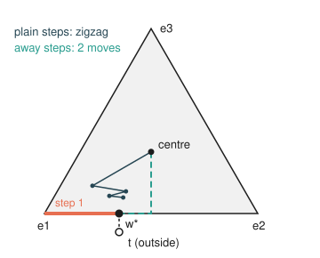
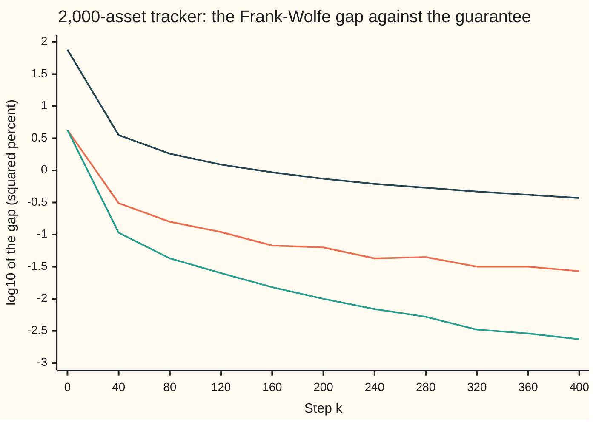

# Frank-Wolfe: step toward the best corner and never project

[Syllabus](../../../SYLLABUS.md) → [Optimization](../README.md) → [First-Order Methods at Scale](../README.md#s08) → Frank-Wolfe

---

## General Overview

An index fund tracks an index of 2,000 shares. Each day it refits its **weights**: the fraction of the fund in each share. The weights must be non-negative (no short selling) and must add up to 1 (every pound invested). The set of all such weight lists is the **simplex**. Here "simplex" means this set of weights, not the simplex method of shelf 04.

The fund **minimises** its **tracking error**: the average, over the last 250 trading days, of the squared gap between the fund's daily return and the index's daily return. That is a smooth bowl over 2,000 numbers, limited by the simplex.

Gradient descent steps straight downhill, and the step usually leaves the simplex: a weight goes negative, or the total drifts from 1. The usual repair is to **project**: move back to the nearest allowed point after every step. That costs a sort of 2,000 numbers per step.

The **Frank-Wolfe** method (also called **conditional gradient**) never leaves the simplex, so it never projects. At each step it asks one question: which single share, held alone, would the gradient like best? That share is a **corner** of the simplex. The method then moves the fund part of the way toward that corner. A mix of allowed weights is allowed, so every step stays inside.

The same question returns a number for free, the **Frank-Wolfe gap**. It is a **duality gap**: the distance from the fund's cost down to a proven floor under the best possible cost. For a convex cost, the gap is a proven upper bound on how far the current fund is above the best possible fund. So the method carries its own stopping test.

For the tracker, 400 steps with the best step length give a fund that holds 287 of the 2,000 shares, misses the index by 0.0058 percent a day (root mean square), and has a gap of 0.002346. That gap certifies the fund is within 0.002346 squared percent of the minimum.

**Frank-Wolfe minimises a smooth convex cost over a region by repeatedly solving a linear problem for the best corner and moving part of the way toward it; every iterate stays feasible, each step adds at most one corner, the linear problem's value gives a certified bound on the error, and with steps 2/(k + 2) the error falls like 1/k.**

**What kind of fact this is:** a method with two theorems, both proved on this card in Why it works: the gap bounds the error, and the error after k steps is at most 2C/(k + 2). The faster, linear rate of the away-step variant needs extra conditions; it is stated in outline with its source (Guélat and Marcotte, 1986).

### The picture: three assets, one step, and the zigzag

<p align="center"></p>

Drawn to scale. Each point of the triangle is a weight list $`(w_1, w_2, w_3)`$: corner e1 is all in asset 1, and the centre is a third in each. The open circle is the target $`t = (0.7, 0.4, -0.1)`$, which lies outside because it shorts asset 3. The orange segment is Frank-Wolfe's first step from e1. It stops at $`w^* = (0.65, 0.35, 0)`$, the allowed point nearest to $`t`$. From the centre, plain steps zigzag (dark line), while away steps (green, dashed) reach $`w^*`$ in two moves.

---

## The formula

Notation first, in words. The region of allowed choices is $`D`$, here the simplex $`\{w : w \ge 0,\ \sum_i w_i = 1\}`$. The cost $`f`$ is smooth and convex, with gradient $`\nabla f`$. As on [Gradient descent](../02-Unconstrained%20Methods/02-gradient-descent-and-its-rate.md), $`w_k`$ is the iterate (the weights after $`k`$ steps, counting from $`k = 0`$ at the start) and $`\alpha_k`$ is the step. The corner $`e_i`$ is "all in asset $`i`$". The minimum value is $`f^*`$.

The **linear minimisation oracle** finds the point of $`D`$ that the gradient's straight-line model likes best:

```math
s_k = \arg\min_{s \in D}\ \nabla f(w_k)^\top s
```

**Read it aloud:** among all allowed points, pick the one with the smallest gradient-weighted total.

On the simplex this is one scan: $`s_k = e_i`$, where $`i`$ is the position of the smallest entry of $`\nabla f(w_k)`$.

The step moves part of the way toward that corner:

```math
w_{k+1} = w_k + \alpha_k\,(s_k - w_k), \qquad \alpha_k = \frac{2}{k+2}\ \text{ or the best } \alpha_k \in [0, 1] \text{ along the segment}
```

**Read it aloud:** the new weights are a blend of the old weights and the chosen corner, with a blend fraction that shrinks like two over k plus two, or is chosen by a line search.

The **Frank-Wolfe gap** comes from the same oracle call:

```math
G(w_k) = \nabla f(w_k)^\top (w_k - s_k) \ \ge\ f(w_k) - f^*
```

**Read it aloud:** the gradient-weighted distance from the current point to the best corner is never smaller than the true error.

The rate, with $`C`$ the region's **curvature constant** (defined in Why it works, Step 3):

```math
f(w_k) - f^* \le \frac{2C}{k+2} \qquad (k \ge 1)
```

**Read it aloud:** after k steps the cost is above the minimum by at most twice the curvature constant over k plus two.

| Symbol | Plain meaning | In our example | Push it up and the answer… |
| --- | --- | --- | --- |
| $`D`$, $`e_i`$, $`i`$ | the allowed region; its corner "all in asset i"; an asset's position | simplex of 3 or 2,000 assets | more corners: more candidates per oracle scan |
| $`w`$, $`w_k`$, $`w^*`$ | weights; weights after k steps; a minimiser | $`w_0 = (1, 0, 0)`$, $`w^* = (0.65, 0.35, 0)`$ | — |
| $`t`$, $`c`$ | the model portfolio's target weights; the triangle's centre | $`(0.7, 0.4, -0.1)`$; a third each | t further outside D: larger final cost |
| $`f`$, $`f^*`$, $`\nabla f`$ | the cost, its minimum, its gradient | $`f(w_0) = 0.26`$, $`f^* = 0.015`$ | — |
| $`s_k`$ | the oracle's corner at step k | $`e_2`$ | — |
| $`\alpha_k`$ | the blend fraction, between 0 and 1 | 0.35 (line search) | too large and fixed: the walk keeps bouncing |
| $`G(w_k)`$ | the Frank-Wolfe gap: a bound on the error | 1.4 at $`w_0`$, 0 at $`w_1`$ | — |
| $`h_k`$ | the true error $`f(w_k) - f^*`$ | 0.245 at $`w_0`$ | — |
| $`L`$, $`\mathrm{diam}(D)`$, $`C`$ | the largest curvature of $`f`$; the longest distance across D; the curvature constant, at most $`L\,\mathrm{diam}(D)^2`$ | toy: 2, $`\sqrt 2`$, $`C = 4`$; tracker: $`C = 75.1941`$ | larger: the guarantee loosens in proportion |
| $`r`$, $`u`$, $`v`$ | a ball's radius; the top singular pair of a gradient matrix (Step 5) | — | — |
| $`R`$, $`b`$, $`T`$, $`n`$ | daily returns of the assets (T days by n assets); the index's daily returns; days; assets | 250 by 2,000 | more days: harder to match exactly |
| $`\rho`$ | the length of the longest asset column of R | gives $`C = 8\rho^2/T`$ | — |

### When it holds

- **The cost is convex.** Then the gap bounds the error. For the concave cost $`-\lVert w - c\rVert^2`$, with $`c`$ the centre, the gap at the centre is 0.0000, yet the centre is 0.6667 above the minimum.
- **The cost is smooth, and the region is bounded.** Both make $`C`$ finite. On an unbounded region the oracle can have no answer, as an unbounded linear program has none.
- **The step shrinks.** With $`2/(k+2)`$ or a line search the rate holds. A fixed step of 0.5 from the centre leaves the gap at 0.8444 after 200 steps.
- **The oracle is solved exactly, or nearly.** The cited analysis (Jaggi, 2013) allows an oracle error that shrinks with the step.
- **A bowl alone does not make it faster than 1/k.** When the bowl's minimum sits on an edge or face, plain steps zigzag toward it: 636,858 steps for a gap of $`10^{-6}`$ in the three-asset example, against 2 with away steps.

---

## Why it works

### Step 0: replace the cost by its tangent plane, and ask a linear question

At the current point, the cost looks like its tangent plane: $`f(w_k) + \nabla f(w_k)^\top(s - w_k)`$. A straight-line cost over a region bounded by flat walls is smallest at a corner ([Corners are enough](../04-Linear%20Programming/02-corners-and-the-fundamental-theorem.md)). So the oracle is a small linear program with a corner for its answer.

Moving all the way to that corner overshoots, because the cost curves. So the method moves only part of the way. Convexity then gives two things at once: a floor under the cost, and a guaranteed drop per step.

### Step 1: the gap bounds the error, for free

For a convex cost, the tangent plane at any point lies on or below the cost everywhere. Apply that at $`w_k`$ and read it at the minimiser $`w^*`$:

```math
f^* = f(w^*) \ge f(w_k) + \nabla f(w_k)^\top(w^* - w_k) \ge f(w_k) + \nabla f(w_k)^\top(s_k - w_k) = f(w_k) - G(w_k)
```

The second inequality holds because $`s_k`$ makes the gradient-weighted total smallest over all of $`D`$, and $`w^*`$ is in $`D`$. Rearranged: $`f(w_k) - f^* \le G(w_k)`$. So $`f(w_k) - G(w_k)`$ is a floor under $`f^*`$, proved afresh at every step, and $`G`$ is the duality gap between the fund's cost and that proven lower bound.

The gap is zero exactly when no allowed direction goes downhill to first order. For a convex cost that is the optimality condition, so a zero gap certifies a minimum. On the simplex, it says: every held asset has the same gradient entry, and no other asset has a smaller one.

### Step 2: the iterates stay feasible, and each step adds one corner

The new point is a blend of two allowed points. The simplex is convex, so the blend is allowed: no projection, ever.

Each step blends in one corner. After $`k`$ steps from a corner, the fund is a blend of at most $`k + 1`$ corners, so it holds at most $`k + 1`$ assets. The tracker holds 287 assets after 400 line-search steps, and at no step more than $`k + 1`$. Sparse weights mean fewer trades and lower dealing costs.

### Step 3: one step's progress, and the curvature constant

Gradient descent's bowl bound says the cost rises above its tangent plane by at most $`\tfrac{L}{2}`$ times the squared move. A Frank-Wolfe move is $`\alpha(s - w)`$, whose length is at most $`\alpha\,\mathrm{diam}(D)`$. So

```math
f\big(w + \alpha(s - w)\big) \le f(w) + \alpha\,\nabla f(w)^\top (s - w) + \frac{\alpha^2}{2}\,C
```

with $`C = L\,\mathrm{diam}(D)^2`$ or any smaller number that still makes this true for every $`w`$, $`s`$ in $`D`$ and $`\alpha`$ in $`[0, 1]`$. That smallest such number is the **curvature constant**. The middle term is $`-\alpha\,G(w)`$. With Step 1's $`G(w) \ge h`$:

```math
h_{k+1} \le (1 - \alpha_k)\,h_k + \frac{\alpha_k^2}{2}\,C
```

**Read it aloud:** each step keeps at most one minus alpha of the old error, plus a curvature charge of alpha squared times C over two.

For the toy, $`f(w) = \lVert w - t\rVert^2`$ has $`L = 2`$, and the triangle's longest side is $`\sqrt 2`$, so $`C = 4`$. For the tracker, $`f(w) = \frac1T\lVert Rw - b\rVert^2`$ rises above its tangent plane by exactly $`\frac{\alpha^2}{T}\lVert R(s - w)\rVert^2`$. Both $`Rs`$ and $`Rw`$ are blends of the columns of $`R`$, so their distance is at most twice the longest column $`\rho`$. That gives $`C \le 8\rho^2/T = 75.1941`$. The checks test the one-step inequality at every one of the 400 steps.

### Step 4: the recursion gives 2C/(k + 2)

Put $`\alpha_k = 2/(k+2)`$ into Step 3. The first step has $`\alpha_0 = 1`$, so $`h_1 \le C/2`$, below $`2C/3`$: for the toy, 2 against 2.6667. Then induction carries the bound forward.

<details>
<summary>Detailed proof: h_k ≤ 2C/(k + 2) for every k ≥ 1</summary>

Assume $`h_k \le 2C/(k+2)`$ for some $`k \ge 1`$. Step 3 with $`\alpha_k = 2/(k+2)`$ gives

$`\displaystyle h_{k+1} \le \Big(1 - \frac{2}{k+2}\Big)\frac{2C}{k+2} + \frac{1}{2}\cdot\frac{4}{(k+2)^2}\,C = \frac{2C\,(k+1)}{(k+2)^2}.`$

Since $`(k+1)(k+3) = k^2 + 4k + 3 \le k^2 + 4k + 4 = (k+2)^2`$,

$`\displaystyle \frac{k+1}{(k+2)^2} \le \frac{1}{k+3},`$

so $`h_{k+1} \le 2C/(k+3)`$, which is the claim at $`k + 1`$. The base case is $`h_1 \le (1 - 1)h_0 + C/2 = C/2 \le 2C/3`$.

A line search picks the $`\alpha`$ that makes $`f`$ smallest along the segment. That is at least as good as $`\alpha = 2/(k+2)`$, so its $`h_{k+1}`$ also satisfies the recursion with $`\alpha_k = 2/(k+2)`$, and the same induction applies.

</details>

The guarantee needs no projection, no step size tuned to $`L`$, and no knowledge of $`C`$ to run. $`C`$ appears only in the bound.

### Step 5: why the oracle is cheaper than a projection

[Proximal gradient](../06-Conic%2C%20Quadratic%20and%20Stochastic%20Programs/06-proximal-methods-ista-fista-and-the-lasso.md) handles a limit by its prox. For the charge "0 inside D, infinite outside", the prox is the projection onto D, and proximal gradient becomes projected gradient. Frank-Wolfe swaps that quadratic sub-problem for a linear one.

| Region D | Projection (projected gradient) | Oracle (Frank-Wolfe) |
| --- | --- | --- |
| simplex of n assets | sort n numbers, shift, clip | the smallest gradient entry: one scan |
| ball of radius r in the sum of sizes $`\lVert w\rVert_1`$ | sort, then a shift | $`\mp r\,e_i`$ at the gradient entry largest in size: minus if that entry is positive, plus if it is negative |
| ball of radius r in the largest entry $`\lVert w\rVert_\infty`$ (a box) | clip each entry to $`[-r, r]`$ | every entry $`-r`$ where the gradient is positive, $`+r`$ where it is negative |
| matrices with sum of singular values at most r (the **trace-norm ball**) | a full singular value decomposition | $`-r\,u v^\top`$ from the top singular pair $`u, v`$ of the gradient |

The trace-norm row is where Frank-Wolfe wins most. Matrix completion (filling in a ratings table from a few known entries) uses that ball. One top singular pair costs a few matrix-vector products, a full decomposition costs far more, and each step adds a rank-one piece, so the iterate stays low rank.

On the three-asset example, one projected-gradient step with step $`1/L = 1/2`$ from $`w_0`$ also lands at $`(0.65, 0.35, 0)`$. The two methods agree on the answer; they differ in the cost per step and in how many weights end up switched on.

### Step 6: the zigzag near a face, and away steps

Frank-Wolfe can only move toward a corner. Suppose the best point lies on an edge, and the current point still holds a little of a third asset. Every step shrinks that weight by the factor $`1 - \alpha_k`$ but never removes it. The walk zigzags between the edge's two corners.

From the centre of the three-asset triangle, plain line-search steps need 636,858 steps to bring the gap below $`10^{-6}`$. The third weight is still 0.0000022.

An **away step** fixes this. Besides the best corner, find the worst corner the fund already holds: the held asset with the largest gradient entry. If moving away from it promises more than moving toward the best corner, shift weight off it, up to the point where its weight hits zero. From the centre, the first step is an away step that removes asset 3 entirely, landing at $`(0.5, 0.5, 0)`$. A normal step then lands at $`w^*`$: 2 steps.

Guélat and Marcotte proved that away steps converge at a fixed ratio per step (a linear rate) for strongly convex costs on a polytope, under extra conditions on the answer. This card states that result in outline and does not prove it.

---

## Worked numbers, by hand

A model portfolio suggests 70 percent in asset 1, 40 percent in asset 2 and −10 percent in asset 3: a short position the fund may not take. The fund wants the allowed weights nearest to it, so it minimises $`f(w) = \lVert w - t\rVert^2`$ over the simplex, starting from $`w_0 = (1, 0, 0)`$, all in asset 1.

| Step | Arithmetic | Value |
| --- | --- | --- |
| cost at the start | $`0.3^2 + 0.4^2 + 0.1^2`$ | 0.2600 |
| gradient $`2(w_0 - t)`$ | $`2 \times (0.3, -0.4, 0.1)`$ | (0.6, −0.8, 0.2) |
| oracle | smallest entry is −0.8, in position 2 | $`s_0 = e_2`$ |
| gap at the start | $`\nabla f^\top w_0 - (-0.8) = 0.6 + 0.8`$ | 1.4000 |
| direction | $`e_2 - w_0`$ | (−1, 1, 0) |
| line search | $`-(w_0 - t)^\top(e_2 - w_0) / \lVert e_2 - w_0\rVert^2 = 0.7 / 2`$ | 0.3500 |
| new weights | $`(1, 0, 0) + 0.35 \times (-1, 1, 0)`$ | (0.65, 0.35, 0) |
| new cost | $`0.05^2 + 0.05^2 + 0.1^2`$ | 0.0150 |
| new gradient | $`2 \times (-0.05, -0.05, 0.1)`$ | (−0.1, −0.1, 0.2) |
| new gap | $`\nabla f^\top w_1 - (-0.1) = -0.1 + 0.1`$ | **0.0000** |

One step, and the gap certifies the minimum: hold 65 percent in asset 1, 35 percent in asset 2 and nothing in asset 3. The error at the start was $`0.26 - 0.015 = 0.245`$, safely under the gap of 1.4. Two other roads agree: projecting $`t`$ onto the simplex (sort, shift by 0.05, clip) gives $`(0.65, 0.35, 0)`$, and a grid of all 5,151 weight lists in steps of 0.01 finds the same point with cost 0.0150.

### The house example: 2,000 assets

The tracker starts with the whole fund in asset 1, the index's largest member at 5.43 percent. Its cost is 1.5362 squared percent, a daily miss of 1.2394 percent. The index's own weights lie on the simplex and give cost 0.0000, so $`f^* = 0`$: a floor the checks know independently of the method.



Orange: the gap with steps $`2/(k+2)`$. Green: the gap with line search. Dark: the guarantee $`2C/(k+2)`$, which bounds the true error. Each unit down is ten times smaller.

| Step k | Error, steps 2/(k+2) | Gap | Guarantee 2C/(k+2) | Held | Error, line search | Gap | Held |
| ---: | ---: | ---: | ---: | ---: | ---: | ---: | ---: |
| 0 | 1.536198 | 4.291795 | 75.1941 | 1 | 1.536198 | 4.291795 | 1 |
| 1 | 5.378222 | 12.801129 | 50.1294 | 1 | 0.970059 | 2.876807 | 2 |
| 10 | 0.356167 | 1.179424 | 12.5323 | 10 | 0.160972 | 0.661165 | 11 |
| 100 | 0.013688 | 0.119114 | 1.4744 | 93 | 0.002434 | 0.031971 | 99 |
| 400 | 0.001267 | 0.026745 | 0.3741 | 282 | 0.000034 | 0.002346 | 287 |

Three things show. The gap always sits above the true error, and the error always sits under the guarantee. The guarantee is loose: at step 400 it allows 0.3741, and the line-search error is 0.000034. And the line search is far better: a daily miss of 0.0058 percent against 0.0356 percent with the fixed schedule.

Each morning the fund refits from the latest 250 days.

### What breaks if you drop a piece

| Mistake | Comes out at | What went wrong |
| --- | --- | --- |
| A fixed step of 0.5 instead of a shrinking one | gap 0.8444 and error 0.2006 after 200 steps, from the centre | Each step jumps halfway to a corner, so the walk keeps bouncing and never settles |
| A concave cost, $`-\lVert w - c\rVert^2`$ | gap 0.0000 at the centre, which is 0.6667 above the minimum | Step 1 needs the tangent plane below the cost; for a concave cost it lies above |
| Plain steps when the answer sits on an edge | 636,858 steps for a gap of $`10^{-6}`$, third weight still 0.0000022 | Toward-corner steps only shrink an unwanted weight; away steps remove it in 2 steps |

---

## Code, from first principles, and it actually runs

Both programs do the same work. On the three assets they take one Frank-Wolfe step and check it against three independent roads: the projection of $`t`$ by sort-and-clip, one projected-gradient step, and a grid of 5,151 weight lists. A central difference of the cost along the first step confirms the gap is minus its slope. They then run the three failures of the table above. On the tracker they build 250 days of returns for 2,000 assets from SplitMix64 (a short random generator, seed 2026) and the Box–Muller recipe for bell-curve noise. They confirm the index weights lie on the simplex and give cost zero, and run 400 steps both ways. The asserts check the gap against the known minimum at every step, the one-step inequality of Step 3, the $`2C/(k+2)`$ bound, and the $`k + 1`$ limit on holdings.

### Python

```python
# Frank-Wolfe (conditional gradient) on the weight simplex -- the check behind the card.
# Standard library only.  Minimise f(w) over weights w >= 0 that sum to 1.
# Part 1: three assets, f(w) = |w - t|^2 with t = (0.7, 0.4, -0.1), start (1, 0, 0).
# Part 2: a 2,000-asset index tracker fitted to 250 simulated daily returns (percent).
import math
from operator import mul

def corner(g): return min(range(len(g)), key=lambda i: g[i])     # the oracle: best corner
def fw_gap(g, w, s): return sum(map(mul, g, w)) - g[s]           # g . (w - e_s)
def fmt(v): return " ".join(f"{x:.4f}" for x in v)

# ---- Part 1: the three-asset example, three roads to one answer ----
t = [0.7, 0.4, -0.1]
def f3(w): return sum((a - b) ** 2 for a, b in zip(w, t))
def g3(w): return [2 * (a - b) for a, b in zip(w, t)]
def line3(w, d): return -sum((a - b) * c for a, b, c in zip(w, t, d)) / sum(c * c for c in d)

w = [1.0, 0.0, 0.0]; g = g3(w); s = corner(g)
d = [(i == s) - w[i] for i in range(3)]; gam = min(1.0, max(0.0, line3(w, d)))
w1 = [a + gam * c for a, c in zip(w, d)]; s1 = corner(g3(w1))
print(f"toy: f(w0) = {f3(w):.4f}, gradient = {fmt(g)}, corner = e{s + 1}, gap = {fw_gap(g, w, s):.4f}")
print(f"toy: step = {gam:.4f}, w1 = {fmt(w1)}, f(w1) = {f3(w1):.4f}, gradient = {fmt(g3(w1))}, "
      f"gap = {fw_gap(g3(w1), w1, s1):.4f}")

def project(v):                                   # projection onto the simplex: sort, shift, clip
    u = sorted(v, reverse=True); run = 0.0; tau = 0.0
    for j, x in enumerate(u):
        run += x
        if x - (run - 1) / (j + 1) > 0: tau = (run - 1) / (j + 1)
    return [max(x - tau, 0.0) for x in v]
pg = project([a - 0.5 * b for a, b in zip(w, g)])  # one projected-gradient step, step 1/L = 1/2
best = min((f3([i / 100, j / 100, (100 - i - j) / 100]), i, j)
           for i in range(101) for j in range(101 - i))
print(f"toy: projection of t = {fmt(project(t))}, projected-gradient step = {fmt(pg)}")
print(f"toy: grid of 5151 points, best = ({best[1] / 100:.2f}, {best[2] / 100:.2f}, "
      f"{(100 - best[1] - best[2]) / 100:.2f}), f = {best[0]:.4f}, f(w0) - f* = {f3(w) - best[0]:.4f}")
C3 = max(2 * sum(((i == k) - (j == k)) ** 2 for k in range(3)) for i in range(3) for j in range(3))
print(f"toy: curvature constant C = 2 * max |e_i - e_j|^2 = {C3:.4f}, bound 2C/(1+2) = {2 * C3 / 3:.4f}")
assert max(abs(a - b) for a, b in zip(w1, project(t))) < 1e-12   # Frank-Wolfe = projection
assert max(abs(a - b) for a, b in zip(w1, pg)) < 1e-12           # = projected gradient
assert abs(best[0] - f3(w1)) < 1e-12                             # = the grid's best
assert fw_gap(g3(w1), w1, s1) < 1e-12 < fw_gap(g, w, s)          # the gap certifies it
assert abs(fw_gap(g, w, s) + (f3([a + 1e-6 * c for a, c in zip(w, d)]) - f3([a - 1e-6 * c for a, c in zip(w, d)])) / 2e-6) < 1e-8

# ---- what breaks, on the same three assets ----
def run3(w, step, away, kmax, tol=1e-6):
    path = [w[:]]
    for k in range(kmax):
        g = g3(w); s = corner(g); gw = sum(map(mul, g, w))
        if gw - g[s] <= tol: return k, w, path, gw - g[s]
        on = [i for i in range(3) if w[i] > 0]; a = max(on, key=lambda i: g[i])
        drop = away and len(on) > 1 and g[a] - gw > gw - g[s]   # away beats toward
        if drop: d = [w[i] - (i == a) for i in range(3)]; top = w[a] / (1 - w[a])
        else: d = [(i == s) - w[i] for i in range(3)]; top = 1.0
        gam = step if step else min(top, max(0.0, line3(w, d)))
        w = [x + gam * c for x, c in zip(w, d)]
        if drop and gam == top: w[a] = 0.0        # the away corner leaves the support
        path.append(w[:])
    return kmax, w, path, fw_gap(g3(w), w, corner(g3(w)))
c3 = [1 / 3, 1 / 3, 1 / 3]
kz, wz, pz, _ = run3(c3[:], None, False, 10 ** 6)
ka, wa, pa, _ = run3(c3[:], None, True, 10 ** 6)
kf, wf, _, gf = run3(c3[:], 0.5, False, 200)
print(f"zigzag from the centre: plain {kz} steps to gap <= 1e-6, third weight {wz[2]:.7f}")
print(f"zigzag from the centre: away steps {ka} steps, third weight {wa[2]:.4f}")
print("figure, plain path " + " | ".join(fmt(p) for p in pz[:5]))
print("figure, away path " + " | ".join(fmt(p) for p in pa))
print(f"fixed step 0.5, 200 steps: gap = {gf:.4f}, f - f* = {f3(wf) - f3(w1):.4f}")
gc = [-2 * (a - b) for a, b in zip(c3, c3)]                       # gradient of -|w - c|^2 at c
lowest = min(-sum(((i == j) - c3[j]) ** 2 for j in range(3)) for i in range(3))
print(f"concave cost -|w - c|^2 at the centre: gap = {fw_gap(gc, c3, corner(gc)):.4f}, "
      f"above the minimum by {0.0 - lowest:.4f}")
assert ka < 10 and wa[2] == 0.0
assert kz > 100 * ka; assert gf > 0.1

# ---- Part 2: the 2,000-asset index tracker ----
N, T, SEED = 2000, 250, 2026
M64, state = (1 << 64) - 1, SEED
def uniform():                                    # SplitMix64: a draw in (0, 1]
    global state
    state = (state + 0x9E3779B97F4A7C15) & M64
    z = ((state ^ (state >> 30)) * 0xBF58476D1CE4E5B9) & M64
    z = ((z ^ (z >> 27)) * 0x94D049BB133111EB) & M64
    return (((z ^ (z >> 31)) >> 11) + 1) * 2.0 ** -53
def normal():                                     # Box-Muller, cosine half only
    u = uniform()
    return math.sqrt(-2.0 * math.log(u)) * math.cos(2.0 * math.pi * uniform())

mkt = [normal() for _ in range(T)]                # the market's daily move, percent
cols = []                                         # cols[i] = asset i's 250 daily returns
for i in range(N):
    beta, sig = 0.5 + uniform(), 1.0 + 1.5 * uniform()
    cols.append([beta * m + sig * normal() for m in mkt])
cap = [(i + 1) ** -0.8 for i in range(N)]; tot = sum(cap); cap = [c / tot for c in cap]
b = [0.0] * T                                     # the index: capitalisation-weighted
for i in range(N):
    b = [x + cap[i] * y for x, y in zip(b, cols[i])]
rho2 = max(sum(map(mul, c, c)) for c in cols)
C = 8 * rho2 / T                                  # curvature bound: (2/T)(2 * longest column)^2
res0 = [y - x for x, y in zip(b, cols[0])]
ri = [-x for x in b]                              # the index weights, summed in reverse order
for i in reversed(range(N)):
    ri = [x + cap[i] * y for x, y in zip(ri, cols[i])]
print(f"tracker: {N} assets, {T} days, index top weight {cap[0]:.4f}, curvature bound C = {C:.4f}")
print(f"tracker: start in asset 1 alone, f(w0) = {sum(map(mul, res0, res0)) / T:.4f}; "
      f"index weights give f = {sum(map(mul, ri, ri)) / T:.4f}")
assert sum(map(mul, ri, ri)) / T < 1e-20; assert abs(sum(cap) - 1) < 1e-12 < min(cap)   # f* = 0: the index is on the simplex

def tracker(line, K):
    w = [0.0] * N; w[0] = 1.0; u = res0[:]; rows = []
    for k in range(K + 1):
        h = sum(map(mul, u, u)) / T               # f(w_k) - f*, since f* = 0
        g = [2 / T * sum(map(mul, c, u)) for c in cols]
        s = corner(g); gap = fw_gap(g, w, s)
        rows.append((k, h, gap, sum(x > 0 for x in w)))
        v = [y - x - z for x, y, z in zip(b, cols[s], u)]   # residual change toward corner s
        gam = 2 / (k + 2)
        if line: gam = min(1.0, max(0.0, -sum(map(mul, u, v)) / sum(map(mul, v, v))))
        w = [(1 - gam) * x for x in w]; w[s] += gam
        u = [x + gam * y for x, y in zip(u, v)]
        if not line:                              # the proof's one-step inequality
            assert sum(map(mul, u, u)) / T <= (1 - gam) * h + gam * gam * C / 2 + 1e-12
    return rows
K = 400; op, ls = tracker(False, K), tracker(True, K)
print("    k   f(w_k) - f*        gap   2C/(k+2)  held | line search: f - f*    gap  held")
for k in [0, 1, 2, 5, 10, 20, 50, 100, 200, 300, 400]:
    (_, h, gap, n), (_, h2, gap2, n2) = op[k], ls[k]
    print(f"{k:5d} {h:12.6f} {gap:10.6f} {2 * C / (k + 2):10.4f} {n:5d} | {h2:12.6f} {gap2:9.6f} {n2:4d}")
print("tracking error, percent a day: " + ", ".join(f"k = {k}: {math.sqrt(op[k][1]):.4f} "
      f"and {math.sqrt(ls[k][1]):.4f}" for k in [0, 100, 400]))
for name, rows in [("open loop", op), ("line search", ls)]:
    print(f"figure, {name}, log10 gap at k = 0, 40, ..., 400: "
          + ", ".join(f"{math.log10(rows[k][2]):.2f}" for k in range(0, K + 1, 40)))
print("figure, log10 2C/(k+2) at k = 0, 40, ..., 400: "
      + ", ".join(f"{math.log10(2 * C / (k + 2)):.2f}" for k in range(0, K + 1, 40)))
for rows in (op, ls):
    assert all(h <= gap + 1e-12 for k, h, gap, n in rows)       # the gap bounds the error
    assert all(n <= k + 1 for k, h, gap, n in rows)             # one new asset per step at most
    assert all(h <= 2 * C / (k + 2) for k, h, gap, n in rows[1:])
print("ALL CHECKS PASS")
```

**Ran 2026-11-24 on macOS, Python 3.14.10, standard library only. All checks passed. Output, pasted from the run:**

```
toy: f(w0) = 0.2600, gradient = 0.6000 -0.8000 0.2000, corner = e2, gap = 1.4000
toy: step = 0.3500, w1 = 0.6500 0.3500 0.0000, f(w1) = 0.0150, gradient = -0.1000 -0.1000 0.2000, gap = 0.0000
toy: projection of t = 0.6500 0.3500 0.0000, projected-gradient step = 0.6500 0.3500 0.0000
toy: grid of 5151 points, best = (0.65, 0.35, 0.00), f = 0.0150, f(w0) - f* = 0.2450
toy: curvature constant C = 2 * max |e_i - e_j|^2 = 4.0000, bound 2C/(1+2) = 2.6667
zigzag from the centre: plain 636858 steps to gap <= 1e-6, third weight 0.0000022
zigzag from the centre: away steps 2 steps, third weight 0.0000
figure, plain path 0.3333 0.3333 0.3333 | 0.7000 0.1500 0.1500 | 0.5583 0.3221 0.1196 | 0.6482 0.2565 0.0953 | 0.5877 0.3260 0.0864
figure, away path 0.3333 0.3333 0.3333 | 0.5000 0.5000 0.0000 | 0.6500 0.3500 0.0000
fixed step 0.5, 200 steps: gap = 0.8444, f - f* = 0.2006
concave cost -|w - c|^2 at the centre: gap = 0.0000, above the minimum by 0.6667
tracker: 2000 assets, 250 days, index top weight 0.0543, curvature bound C = 75.1941
tracker: start in asset 1 alone, f(w0) = 1.5362; index weights give f = 0.0000
    k   f(w_k) - f*        gap   2C/(k+2)  held | line search: f - f*    gap  held
    0     1.536198   4.291795    75.1941     1 |     1.536198  4.291795    1
    1     5.378222  12.801129    50.1294     1 |     0.970059  2.876807    2
    2     3.042388   7.955176    37.5970     2 |     0.664731  2.184718    3
    5     0.981747   2.927118    21.4840     5 |     0.337976  1.161786    6
   10     0.356167   1.179424    12.5323    10 |     0.160972  0.661165   11
   20     0.159148   0.624321     6.8358    20 |     0.050140  0.271624   21
   50     0.041984   0.231781     2.8921    48 |     0.010523  0.079850   51
  100     0.013688   0.119114     1.4744    93 |     0.002434  0.031971   99
  200     0.004657   0.063407     0.7445   168 |     0.000371  0.010012  178
  300     0.002210   0.042698     0.4980   230 |     0.000093  0.004009  242
  400     0.001267   0.026745     0.3741   282 |     0.000034  0.002346  287
tracking error, percent a day: k = 0: 1.2394 and 1.2394, k = 100: 0.1170 and 0.0493, k = 400: 0.0356 and 0.0058
figure, open loop, log10 gap at k = 0, 40, ..., 400: 0.63, -0.51, -0.80, -0.96, -1.17, -1.20, -1.37, -1.35, -1.50, -1.50, -1.57
figure, line search, log10 gap at k = 0, 40, ..., 400: 0.63, -0.97, -1.37, -1.60, -1.82, -2.00, -2.16, -2.28, -2.48, -2.54, -2.63
figure, log10 2C/(k+2) at k = 0, 40, ..., 400: 1.88, 0.55, 0.26, 0.09, -0.03, -0.13, -0.21, -0.27, -0.33, -0.38, -0.43
ALL CHECKS PASS
```

### Rust

```rust
// Frank-Wolfe (conditional gradient) on the weight simplex -- the check behind the card.
// std only.  Minimise f(w) over weights w >= 0 that sum to 1.
// Part 1: three assets, f(w) = |w - t|^2 with t = (0.7, 0.4, -0.1), start (1, 0, 0).
// Part 2: a 2,000-asset index tracker fitted to 250 simulated daily returns (percent).
const T3: [f64; 3] = [0.7, 0.4, -0.1];

fn sum(it: impl Iterator<Item = f64>) -> f64 { // compensated, as Python's sum of floats
    let (mut f, mut c) = (0.0f64, 0.0f64);
    for x in it {
        let t = f + x; c += if f.abs() >= x.abs() { (f - t) + x } else { (x - t) + f }; f = t;
    }
    if c != 0.0 && c.is_finite() { f + c } else { f }
}
fn dot(u: &[f64], v: &[f64]) -> f64 { sum(u.iter().zip(v).map(|(a, b)| a * b)) }
fn corner(g: &[f64]) -> usize { // the oracle: best corner
    let mut s = 0; for i in 1..g.len() { if g[i] < g[s] { s = i } } s
}
fn fw_gap(g: &[f64], w: &[f64], s: usize) -> f64 { dot(g, w) - g[s] }
fn fmt(v: &[f64]) -> String { v.iter().map(|x| format!("{:.4}", x)).collect::<Vec<_>>().join(" ") }
fn f3(w: &[f64]) -> f64 { sum(w.iter().zip(&T3).map(|(a, b)| (a - b) * (a - b))) }
fn g3(w: &[f64]) -> Vec<f64> { w.iter().zip(&T3).map(|(a, b)| 2.0 * (a - b)).collect() }
fn line3(w: &[f64], d: &[f64]) -> f64 {
    -sum((0..3).map(|i| (w[i] - T3[i]) * d[i])) / sum(d.iter().map(|c| c * c))
}
fn ind(i: usize, j: usize) -> f64 { if i == j { 1.0 } else { 0.0 } }
fn project(v: &[f64]) -> Vec<f64> { // projection onto the simplex: sort, shift, clip
    let mut u = v.to_vec(); u.sort_by(|a, b| b.partial_cmp(a).unwrap());
    let (mut run, mut tau) = (0.0, 0.0);
    for (j, x) in u.iter().enumerate() {
        run += x;
        if x - (run - 1.0) / (j as f64 + 1.0) > 0.0 { tau = (run - 1.0) / (j as f64 + 1.0) }
    }
    v.iter().map(|x| (x - tau).max(0.0)).collect()
}
fn run3(mut w: Vec<f64>, step: f64, away: bool, kmax: usize) -> (usize, Vec<f64>, Vec<Vec<f64>>, f64) {
    let mut path = vec![w.clone()];
    for k in 0..kmax {
        let g = g3(&w); let s = corner(&g); let gw = dot(&g, &w);
        if gw - g[s] <= 1e-6 { return (k, w, path, gw - g[s]) }
        let mut a = 3;
        for i in 0..3 { if w[i] > 0.0 && (a == 3 || g[i] > g[a]) { a = i } }
        let on = w.iter().filter(|x| **x > 0.0).count();
        let drop = away && on > 1 && g[a] - gw > gw - g[s]; // away beats toward
        let (d, top): (Vec<f64>, f64) = if drop {
            ((0..3).map(|i| w[i] - ind(i, a)).collect(), w[a] / (1.0 - w[a]))
        } else { ((0..3).map(|i| ind(i, s) - w[i]).collect(), 1.0) };
        let gam = if step > 0.0 { step } else { top.min(line3(&w, &d).max(0.0)) };
        w = (0..3).map(|i| w[i] + gam * d[i]).collect();
        if drop && gam == top { w[a] = 0.0 } // the away corner leaves the support
        path.push(w.clone());
    }
    let g = g3(&w); let gap = fw_gap(&g, &w, corner(&g)); (kmax, w, path, gap)
}

struct Rng(u64);
impl Rng {
    fn uniform(&mut self) -> f64 { // SplitMix64: a draw in (0, 1]
        self.0 = self.0.wrapping_add(0x9E3779B97F4A7C15);
        let mut z = (self.0 ^ (self.0 >> 30)).wrapping_mul(0xBF58476D1CE4E5B9);
        z = (z ^ (z >> 27)).wrapping_mul(0x94D049BB133111EB);
        (((z ^ (z >> 31)) >> 11) + 1) as f64 * 2f64.powi(-53)
    }
    fn normal(&mut self) -> f64 { // Box-Muller, cosine half only
        let u = self.uniform();
        (-2.0 * u.ln()).sqrt() * (2.0 * std::f64::consts::PI * self.uniform()).cos()
    }
}

fn main() {
    // ---- Part 1: the three-asset example, three roads to one answer ----
    let w = vec![1.0, 0.0, 0.0]; let g = g3(&w); let s = corner(&g);
    let d: Vec<f64> = (0..3).map(|i| ind(i, s) - w[i]).collect();
    let gam = 1f64.min(line3(&w, &d).max(0.0));
    let w1: Vec<f64> = (0..3).map(|i| w[i] + gam * d[i]).collect();
    let s1 = corner(&g3(&w1));
    println!("toy: f(w0) = {:.4}, gradient = {}, corner = e{}, gap = {:.4}", f3(&w), fmt(&g), s + 1, fw_gap(&g, &w, s));
    println!("toy: step = {:.4}, w1 = {}, f(w1) = {:.4}, gradient = {}, gap = {:.4}", gam, fmt(&w1), f3(&w1), fmt(&g3(&w1)), fw_gap(&g3(&w1), &w1, s1));
    let pg = project(&(0..3).map(|i| w[i] - 0.5 * g[i]).collect::<Vec<_>>()); // step 1/L = 1/2
    let mut best = (f64::INFINITY, 0, 0);
    for i in 0..=100 { for j in 0..=(100 - i) {
        let v = f3(&[i as f64 / 100.0, j as f64 / 100.0, (100 - i - j) as f64 / 100.0]);
        if v < best.0 { best = (v, i, j) }
    } }
    println!("toy: projection of t = {}, projected-gradient step = {}", fmt(&project(&T3)), fmt(&pg));
    println!("toy: grid of 5151 points, best = ({:.2}, {:.2}, {:.2}), f = {:.4}, f(w0) - f* = {:.4}", best.1 as f64 / 100.0,
             best.2 as f64 / 100.0, (100 - best.1 - best.2) as f64 / 100.0, best.0, f3(&w) - best.0);
    let cc3 = (0..9).map(|p| 2.0 * sum((0..3).map(|k| (ind(p / 3, k) - ind(p % 3, k)).powi(2)))).fold(0.0, f64::max);
    println!("toy: curvature constant C = 2 * max |e_i - e_j|^2 = {:.4}, bound 2C/(1+2) = {:.4}", cc3, 2.0 * cc3 / 3.0);
    let pt = project(&T3); assert!((0..3).map(|i| (w1[i] - pt[i]).abs()).fold(0.0, f64::max) < 1e-12); // = projection
    assert!((0..3).map(|i| (w1[i] - pg[i]).abs()).fold(0.0, f64::max) < 1e-12); // = projected gradient
    assert!((best.0 - f3(&w1)).abs() < 1e-12); // = the grid's best
    assert!(fw_gap(&g3(&w1), &w1, s1) < 1e-12 && 1e-12 < fw_gap(&g, &w, s)); // the gap certifies it
    assert!((fw_gap(&g, &w, s) + (f3(&(0..3).map(|i| w[i] + 1e-6 * d[i]).collect::<Vec<_>>()) - f3(&(0..3).map(|i| w[i] - 1e-6 * d[i]).collect::<Vec<_>>())) / 2e-6).abs() < 1e-8); // gap = minus the slope

    // ---- what breaks, on the same three assets ----
    let c3 = vec![1.0 / 3.0; 3];
    let (kz, wz, pz, _) = run3(c3.clone(), 0.0, false, 1_000_000);
    let (ka, wa, pa, _) = run3(c3.clone(), 0.0, true, 1_000_000);
    let (_, wf, _, gf) = run3(c3.clone(), 0.5, false, 200);
    let paths = |p: &[Vec<f64>]| p.iter().map(|x| fmt(x)).collect::<Vec<_>>().join(" | ");
    println!("zigzag from the centre: plain {} steps to gap <= 1e-6, third weight {:.7}", kz, wz[2]);
    println!("zigzag from the centre: away steps {} steps, third weight {:.4}", ka, wa[2]);
    println!("figure, plain path {}", paths(&pz[..5]));
    println!("figure, away path {}", paths(&pa));
    println!("fixed step 0.5, 200 steps: gap = {:.4}, f - f* = {:.4}", gf, f3(&wf) - f3(&w1));
    let gc: Vec<f64> = (0..3).map(|i| -2.0 * (c3[i] - c3[i])).collect(); // gradient of -|w - c|^2 at c
    let lowest = (0..3).map(|i| -sum((0..3).map(|j| (ind(i, j) - c3[j]).powi(2)))).fold(f64::INFINITY, f64::min);
    println!("concave cost -|w - c|^2 at the centre: gap = {:.4}, above the minimum by {:.4}", fw_gap(&gc, &c3, corner(&gc)), 0.0 - lowest);
    assert!(ka < 10 && wa[2] == 0.0);
    assert!(kz > 100 * ka); assert!(gf > 0.1);

    // ---- Part 2: the 2,000-asset index tracker ----
    let (n, t, tf) = (2000usize, 250usize, 250.0f64);
    let mut rng = Rng(2026);
    let mkt: Vec<f64> = (0..t).map(|_| rng.normal()).collect(); // the market's daily move, percent
    let mut cols: Vec<Vec<f64>> = Vec::new(); // cols[i] = asset i's 250 daily returns
    for _ in 0..n {
        let (beta, sig) = (0.5 + rng.uniform(), 1.0 + 1.5 * rng.uniform());
        cols.push(mkt.iter().map(|m| beta * m + sig * rng.normal()).collect());
    }
    let cap0: Vec<f64> = (0..n).map(|i| ((i + 1) as f64).powf(-0.8)).collect();
    let tot = sum(cap0.iter().copied()); let cap: Vec<f64> = cap0.iter().map(|c| c / tot).collect();
    let mut b = vec![0.0; t]; // the index: capitalisation-weighted
    for i in 0..n { for r in 0..t { b[r] += cap[i] * cols[i][r] } }
    let rho2 = cols.iter().map(|c| dot(c, c)).fold(f64::NEG_INFINITY, f64::max);
    let cc = 8.0 * rho2 / tf; // curvature bound: (2/T)(2 * longest column)^2
    let res0: Vec<f64> = (0..t).map(|r| cols[0][r] - b[r]).collect();
    let mut ri: Vec<f64> = b.iter().map(|x| -x).collect(); // the index weights, summed in reverse order
    for i in (0..n).rev() { for r in 0..t { ri[r] += cap[i] * cols[i][r] } }
    println!("tracker: {} assets, {} days, index top weight {:.4}, curvature bound C = {:.4}", n, t, cap[0], cc);
    println!("tracker: start in asset 1 alone, f(w0) = {:.4}; index weights give f = {:.4}", dot(&res0, &res0) / tf, dot(&ri, &ri) / tf);
    assert!(dot(&ri, &ri) / tf < 1e-20); assert!((sum(cap.iter().copied()) - 1.0).abs() < 1e-12 && cap.iter().all(|&c| c > 1e-12)); // f* = 0: the index is on the simplex

    let tracker = |line: bool, kk: usize| -> Vec<(usize, f64, f64, usize)> {
        let mut w = vec![0.0; n]; w[0] = 1.0; let mut u = res0.clone(); let mut rows = Vec::new();
        for k in 0..=kk {
            let h = dot(&u, &u) / tf; // f(w_k) - f*, since f* = 0
            let g: Vec<f64> = cols.iter().map(|c| 2.0 / tf * dot(c, &u)).collect();
            let s = corner(&g); let gap = fw_gap(&g, &w, s);
            rows.push((k, h, gap, w.iter().filter(|x| **x > 0.0).count()));
            let v: Vec<f64> = (0..t).map(|r| cols[s][r] - b[r] - u[r]).collect(); // residual change toward s
            let mut gam = 2.0 / (k as f64 + 2.0);
            if line { gam = 1f64.min((-dot(&u, &v) / dot(&v, &v)).max(0.0)) }
            for x in w.iter_mut() { *x *= 1.0 - gam } w[s] += gam;
            for r in 0..t { u[r] += gam * v[r] }
            if !line { assert!(dot(&u, &u) / tf <= (1.0 - gam) * h + gam * gam * cc / 2.0 + 1e-12) } // the proof's step
        }
        rows
    };
    let kk = 400; let (op, ls) = (tracker(false, kk), tracker(true, kk));
    println!("    k   f(w_k) - f*        gap   2C/(k+2)  held | line search: f - f*    gap  held");
    for k in [0usize, 1, 2, 5, 10, 20, 50, 100, 200, 300, 400] {
        let ((_, h, gap, m), (_, h2, gap2, m2)) = (op[k], ls[k]);
        println!("{:5} {:12.6} {:10.6} {:10.4} {:5} | {:12.6} {:9.6} {:4}", k, h, gap, 2.0 * cc / (k as f64 + 2.0), m, h2, gap2, m2);
    }
    println!("tracking error, percent a day: {}", [0usize, 100, 400].iter()
        .map(|&k| format!("k = {}: {:.4} and {:.4}", k, op[k].1.sqrt(), ls[k].1.sqrt())).collect::<Vec<_>>().join(", "));
    for (name, rows) in [("open loop", &op), ("line search", &ls)] {
        println!("figure, {}, log10 gap at k = 0, 40, ..., 400: {}", name, (0..=kk).step_by(40)
            .map(|k| format!("{:.2}", rows[k].2.log10())).collect::<Vec<_>>().join(", "));
    }
    println!("figure, log10 2C/(k+2) at k = 0, 40, ..., 400: {}", (0..=kk).step_by(40)
        .map(|k| format!("{:.2}", (2.0 * cc / (k as f64 + 2.0)).log10())).collect::<Vec<_>>().join(", "));
    for rows in [&op, &ls] {
        assert!(rows.iter().all(|&(_, h, gap, _)| h <= gap + 1e-12)); // the gap bounds the error
        assert!(rows.iter().all(|&(k, _, _, m)| m <= k + 1)); // one new asset per step at most
        assert!(rows[1..].iter().all(|&(k, h, _, _)| h <= 2.0 * cc / (k as f64 + 2.0)));
    }
    println!("ALL CHECKS PASS");
}
```

**Ran 2026-11-24 on macOS, rustc 1.98.1, no crates. All checks passed. Output, pasted from the run:**

```
toy: f(w0) = 0.2600, gradient = 0.6000 -0.8000 0.2000, corner = e2, gap = 1.4000
toy: step = 0.3500, w1 = 0.6500 0.3500 0.0000, f(w1) = 0.0150, gradient = -0.1000 -0.1000 0.2000, gap = 0.0000
toy: projection of t = 0.6500 0.3500 0.0000, projected-gradient step = 0.6500 0.3500 0.0000
toy: grid of 5151 points, best = (0.65, 0.35, 0.00), f = 0.0150, f(w0) - f* = 0.2450
toy: curvature constant C = 2 * max |e_i - e_j|^2 = 4.0000, bound 2C/(1+2) = 2.6667
zigzag from the centre: plain 636858 steps to gap <= 1e-6, third weight 0.0000022
zigzag from the centre: away steps 2 steps, third weight 0.0000
figure, plain path 0.3333 0.3333 0.3333 | 0.7000 0.1500 0.1500 | 0.5583 0.3221 0.1196 | 0.6482 0.2565 0.0953 | 0.5877 0.3260 0.0864
figure, away path 0.3333 0.3333 0.3333 | 0.5000 0.5000 0.0000 | 0.6500 0.3500 0.0000
fixed step 0.5, 200 steps: gap = 0.8444, f - f* = 0.2006
concave cost -|w - c|^2 at the centre: gap = 0.0000, above the minimum by 0.6667
tracker: 2000 assets, 250 days, index top weight 0.0543, curvature bound C = 75.1941
tracker: start in asset 1 alone, f(w0) = 1.5362; index weights give f = 0.0000
    k   f(w_k) - f*        gap   2C/(k+2)  held | line search: f - f*    gap  held
    0     1.536198   4.291795    75.1941     1 |     1.536198  4.291795    1
    1     5.378222  12.801129    50.1294     1 |     0.970059  2.876807    2
    2     3.042388   7.955176    37.5970     2 |     0.664731  2.184718    3
    5     0.981747   2.927118    21.4840     5 |     0.337976  1.161786    6
   10     0.356167   1.179424    12.5323    10 |     0.160972  0.661165   11
   20     0.159148   0.624321     6.8358    20 |     0.050140  0.271624   21
   50     0.041984   0.231781     2.8921    48 |     0.010523  0.079850   51
  100     0.013688   0.119114     1.4744    93 |     0.002434  0.031971   99
  200     0.004657   0.063407     0.7445   168 |     0.000371  0.010012  178
  300     0.002210   0.042698     0.4980   230 |     0.000093  0.004009  242
  400     0.001267   0.026745     0.3741   282 |     0.000034  0.002346  287
tracking error, percent a day: k = 0: 1.2394 and 1.2394, k = 100: 0.1170 and 0.0493, k = 400: 0.0356 and 0.0058
figure, open loop, log10 gap at k = 0, 40, ..., 400: 0.63, -0.51, -0.80, -0.96, -1.17, -1.20, -1.37, -1.35, -1.50, -1.50, -1.57
figure, line search, log10 gap at k = 0, 40, ..., 400: 0.63, -0.97, -1.37, -1.60, -1.82, -2.00, -2.16, -2.28, -2.48, -2.54, -2.63
figure, log10 2C/(k+2) at k = 0, 40, ..., 400: 1.88, 0.55, 0.26, 0.09, -0.03, -0.13, -0.21, -0.27, -0.33, -0.38, -0.43
ALL CHECKS PASS
```

### Lean

Lean proves the gap bound and the $`2C/(k+2)`$ rate for every convex region and convex cost.

- Suppose $`D`$ and $`f`$ are convex, $`C`$ is a curvature constant, the oracle is exact, and $`\alpha_k = 2/(k+2)`$. Then every iterate stays in $`D`$, and the error after $`k \ge 1`$ steps is at most $`2C/(k+2)`$.
- Suppose $`f`$ is convex on a convex $`D`$, and $`s_k`$ is the oracle's answer at $`w_k`$. Then $`f(w_k) - f^* \le G(w_k)`$, so a zero gap certifies a minimum.
- Suppose $`D`$ is convex and bounded, and the gradient of $`f`$ changes by at most $`L`$ times the distance moved. Then $`C = L\,\mathrm{diam}(D)^2`$ is a curvature constant.
- The worked numbers hold exactly in fractions: costs 0.26 and 0.015, step 0.35, and gaps 1.4 and 0.
- So do the toy's $`C = 4`$, the grid's 5,151 points, and the concave cost's 0.6667 above the minimum.

The line-search rate, the $`k + 1`$ limit on holdings and the tracker's numbers are left to the Python and Rust checks.

```lean
-- Frank-Wolfe: with steps 2/(k + 2) every iterate stays in the region and the error after k ≥ 1 steps is at most 2C/(k + 2), the Frank-Wolfe gap bounds the error, and a smooth cost on a bounded region has curvature constant at most L·diam(D)².
import Mathlib.Analysis.Calculus.Gradient.Basic
import Mathlib.Analysis.Convex.Function
import Mathlib.Topology.EMetricSpace.Lipschitz
import Mathlib.Topology.MetricSpace.Bounded
import Mathlib.Algebra.BigOperators.Fin
import Mathlib.Analysis.Calculus.Deriv.Slope
import Mathlib.Analysis.Calculus.Deriv.MeanValue
import Mathlib.Analysis.Calculus.FDeriv.Comp
import Mathlib.Analysis.Calculus.Deriv.Pow

open InnerProductSpace
open scoped RealInnerProductSpace

/-! The weights live in a real inner product space `E` (the simplex sits inside `ℝⁿ`).
`D` is the region of allowed choices, `f` the cost, and `g w` the gradient `∇f(w)`, given by
Mathlib's `HasGradientAt`. `⟪a, b⟫` is the dot product `aᵀb`.

The **curvature constant** `C` is, as on the card's Step 3, any number with
`f(w + α(s − w)) ≤ f(w) + α ∇f(w)ᵀ(s − w) + (α²/2) C` for every `w`, `s` in `D` and every
`α` in `[0, 1]`. The card says a smooth cost on a bounded region makes `C` finite; the third
theorem proves that `C = L · diam(D)²` works when the gradient changes at rate at most `L`.

The **oracle** picks `s_k` in `D` with the smallest `∇f(w_k)ᵀ s` over all of `D`, and the
step is `w_{k+1} = w_k + (2/(k + 2)) (s_k − w_k)`, counting from `k = 0`. `w*` is a minimiser
of `f` over `D`, so `f* = f(w*)`. -/

variable {E : Type*} [NormedAddCommGroup E] [InnerProductSpace ℝ E] [CompleteSpace E]

theorem fw_line_hasDerivAt {f : E → ℝ} {x y : E} {t : ℝ} {gz : E}
    (hg : HasGradientAt f gz (x + t • (y - x))) :
    HasDerivAt (fun τ : ℝ => f (x + τ • (y - x))) ⟪gz, y - x⟫ t := by
  have h1 : HasDerivAt (fun τ : ℝ => x + τ • (y - x)) (y - x) t := by
    simpa using ((hasDerivAt_id t).smul_const (y - x)).const_add x
  have h2 := (hasGradientAt_iff_hasFDerivAt.mp hg).comp_hasDerivAt t h1
  simpa [Function.comp_def, toDual_apply_apply] using h2

#print axioms fw_line_hasDerivAt

theorem fw_gradient_inequality {D : Set E} {f : E → ℝ} (hf : ConvexOn ℝ D f) {x : E}
    (hx : x ∈ D) {gx : E} (hg : HasGradientAt f gx x) {y : E} (hy : y ∈ D) :
    f x + ⟪gx, y - x⟫ ≤ f y := by
  have hφ : HasDerivAt (fun τ : ℝ => f (x + τ • (y - x))) ⟪gx, y - x⟫ 0 :=
    fw_line_hasDerivAt (by simpa using hg)
  have ht := hφ.tendsto_slope_zero_right
  have hle : ⟪gx, y - x⟫ ≤ f y - f x := by
    refine le_of_tendsto ht ?_
    filter_upwards [Ioc_mem_nhdsGT (show (0:ℝ) < 1 by norm_num)] with t ht
    obtain ⟨ht0, ht1⟩ := ht
    have hc := hf.2 hx hy (show (0:ℝ) ≤ 1 - t by linarith) ht0.le (by ring)
    have heq : (1 - t) • x + t • y = x + t • (y - x) := by
      rw [smul_sub, sub_smul, one_smul]; abel
    rw [heq] at hc
    simp only [smul_eq_mul, zero_add, zero_smul, add_zero] at hc ⊢
    rw [inv_mul_le_iff₀ ht0]
    nlinarith
  linarith

#print axioms fw_gradient_inequality

/-- **Frank-Wolfe stays feasible and its error falls like 1/k.** Let the region `D` be convex,
the cost `f` convex on `D` with gradient `g`, and `C` a curvature constant for `f` on `D`.
Start at `w₀` in `D`, let each `s_k` be an exact oracle answer at `w_k`, and step with
`α_k = 2/(k + 2)`. Then every iterate `w_k` lies in `D`, and for every `k ≥ 1`
`f(w_k) − f* ≤ 2C/(k + 2)`. -/
theorem frank_wolfe_feasible_and_error_le_two_C_div_k_add_two
    {D : Set E} (hD : Convex ℝ D) {f : E → ℝ} (hf : ConvexOn ℝ D f) {g : E → E}
    (hg : ∀ x ∈ D, HasGradientAt f (g x) x) {C : ℝ}
    (hC : ∀ x ∈ D, ∀ y ∈ D, ∀ α ∈ Set.Icc (0 : ℝ) 1,
      f (x + α • (y - x)) ≤ f x + α * ⟪g x, y - x⟫ + α ^ 2 / 2 * C)
    {wstar : E} (hwstar : wstar ∈ D) (hmin : ∀ y ∈ D, f wstar ≤ f y)
    (w s : ℕ → E) (hw0 : w 0 ∈ D)
    (hs : ∀ k, s k ∈ D) (horacle : ∀ k, ∀ y ∈ D, ⟪g (w k), s k⟫ ≤ ⟪g (w k), y⟫)
    (hstep : ∀ k, w (k + 1) = w k + (2 / ((k : ℝ) + 2)) • (s k - w k)) :
    (∀ k, w k ∈ D) ∧
    (∀ k : ℕ, 1 ≤ k → f (w k) - f wstar ≤ 2 * C / ((k : ℝ) + 2)) := by
  have hαI : ∀ k : ℕ, (2 / ((k : ℝ) + 2)) ∈ Set.Icc (0 : ℝ) 1 := by
    intro k
    have hk : (0:ℝ) ≤ k := Nat.cast_nonneg k
    refine ⟨by positivity, ?_⟩
    rw [div_le_one (by positivity)]; linarith
  have hfeas : ∀ k, w k ∈ D := by
    intro k
    induction k with
    | zero => exact hw0
    | succ k ih => rw [hstep k]; exact hD.add_smul_sub_mem ih (hs k) (hαI k)
  refine ⟨hfeas, ?_⟩
  have hC0 : 0 ≤ C := by
    have := hC (w 0) hw0 (w 0) hw0 1 ⟨zero_le_one, le_rfl⟩
    simp at this
    linarith
  have hrec : ∀ k : ℕ, f (w (k + 1)) - f wstar ≤
      (1 - 2 / ((k : ℝ) + 2)) * (f (w k) - f wstar) + (2 / ((k : ℝ) + 2)) ^ 2 / 2 * C := by
    intro k
    have h1 := hC (w k) (hfeas k) (s k) (hs k) _ (hαI k)
    rw [← hstep k] at h1
    have h2 := horacle k wstar hwstar
    have h3 := fw_gradient_inequality hf (hfeas k) (hg _ (hfeas k)) hwstar
    have h4 : ⟪g (w k), s k - w k⟫ ≤ f wstar - f (w k) := by
      rw [inner_sub_right] at h3 ⊢; linarith
    have h5 := mul_le_mul_of_nonneg_left h4 (hαI k).1
    nlinarith
  intro k hk
  induction k, hk using Nat.le_induction with
  | base =>
    have := hrec 0
    norm_num at this ⊢
    linarith
  | succ k hk ih =>
    have := hrec k
    push_cast
    have hk' : (1:ℝ) ≤ k := by exact_mod_cast hk
    set a : ℝ := (k : ℝ) + 2 with ha
    have ha0 : 0 < a := by linarith
    have hcoef : 0 ≤ 1 - 2 / a := by
      rw [sub_nonneg, div_le_one ha0]; linarith
    have h1 := mul_le_mul_of_nonneg_left ih hcoef
    have hkey : (1 - 2 / a) * (2 * C / a) + (2 / a) ^ 2 / 2 * C ≤ 2 * C / ((k : ℝ) + 1 + 2) := by
      have : (k : ℝ) + 1 + 2 = a + 1 := by rw [ha]; ring
      rw [this]
      have e : (1 - 2 / a) * (2 * C / a) + (2 / a) ^ 2 / 2 * C = 2 * C * (a - 1) / a ^ 2 := by
        field_simp; ring
      rw [e, div_le_div_iff₀ (by positivity) (by positivity)]
      nlinarith [mul_nonneg hC0 (sq_nonneg a)]
    linarith

/-- **The Frank-Wolfe gap bounds the error.** Let `D` be convex and `f` convex on `D` with
gradient `g x` at a point `x` of `D`. If `s` in `D` is an exact oracle answer at `x`, then the
gap `G(x) = ∇f(x)ᵀ(x − s)` satisfies `f(x) − f(y) ≤ G(x)` for every `y` in `D`. So
`f(x) − G(x)` is a floor under the minimum, `f(x) − f* ≤ G(x)`, and a zero gap certifies that
`x` is a minimiser. -/
theorem frank_wolfe_gap_bounds_error
    {D : Set E} (hD : Convex ℝ D) {f : E → ℝ} (hf : ConvexOn ℝ D f) {x : E} (hx : x ∈ D)
    {gx : E} (hg : HasGradientAt f gx x) {s : E} (hs : s ∈ D)
    (horacle : ∀ y ∈ D, ⟪gx, s⟫ ≤ ⟪gx, y⟫) :
    ∀ y ∈ D, f x - f y ≤ ⟪gx, x - s⟫ := by
  intro y hy
  have h1 := fw_gradient_inequality hf hx hg hy
  have h2 := horacle y hy
  rw [inner_sub_right] at h1 ⊢
  linarith

/-- **A smooth cost on a bounded region has curvature constant at most `L · diam(D)²`.**
Let `D` be convex and bounded, `f` have gradient `g` at every point of `D`, and let `g` change
at rate at most `L` on `D` (`‖g x − g y‖ ≤ L‖x − y‖`). Then for all `w`, `s` in `D` and `α` in
`[0, 1]`, `f(w + α(s − w)) ≤ f(w) + α ∇f(w)ᵀ(s − w) + (α²/2) · L · diam(D)²`. -/
theorem curvature_constant_le_L_mul_diam_sq
    {D : Set E} (hD : Convex ℝ D) (hbdd : Bornology.IsBounded D) {f : E → ℝ} {g : E → E}
    (hg : ∀ x ∈ D, HasGradientAt f (g x) x) {L : NNReal} (hL : LipschitzOnWith L g D) :
    ∀ x ∈ D, ∀ y ∈ D, ∀ α ∈ Set.Icc (0 : ℝ) 1,
      f (x + α • (y - x)) ≤ f x + α * ⟪g x, y - x⟫ + α ^ 2 / 2 * ((L : ℝ) * Metric.diam D ^ 2) := by
  intro x hx y hy α hα
  set d := ‖y - x‖ with hd
  let φ : ℝ → ℝ := fun t => f (x + t • (y - x)) - f x - t * ⟪g x, y - x⟫ - (L : ℝ) * t ^ 2 / 2 * d ^ 2
  have hmem : ∀ t ∈ Set.Icc (0:ℝ) α, x + t • (y - x) ∈ D := fun t ht =>
    hD.add_smul_sub_mem hx hy ⟨ht.1, ht.2.trans hα.2⟩
  have hder : ∀ t ∈ Set.Icc (0:ℝ) α, HasDerivAt φ
      (⟪g (x + t • (y - x)), y - x⟫ - ⟪g x, y - x⟫ - (L : ℝ) * t * d ^ 2) t := by
    intro t ht
    have h1 := fw_line_hasDerivAt (hg _ (hmem t ht))
    have h2 := ((h1.sub_const (f x)).sub ((hasDerivAt_id t).mul_const ⟪g x, y - x⟫)).sub
      (((hasDerivAt_pow 2 t).const_mul ((L : ℝ) / 2)).mul_const (d ^ 2))
    convert h2 using 1
    · funext τ; simp only [φ, Pi.sub_apply, id]; ring
    · simp only [show (2:ℕ) - 1 = 1 from rfl, pow_one, Nat.cast_ofNat, one_mul]; ring
  have hanti : AntitoneOn φ (Set.Icc 0 α) := by
    apply antitoneOn_of_deriv_nonpos (convex_Icc 0 α)
    · intro t ht; exact (hder t ht).continuousAt.continuousWithinAt
    · intro t ht
      exact (hder t (interior_subset ht)).differentiableAt.differentiableWithinAt
    · intro t ht
      have ht' := interior_subset ht
      rw [(hder t ht').deriv]
      have hz := hmem t ht'
      have hlip : dist (g (x + t • (y - x))) (g x) ≤ L * dist (x + t • (y - x)) x :=
        hL.dist_le_mul _ hz _ hx
      rw [dist_eq_norm, dist_eq_norm, add_sub_cancel_left, norm_smul,
        Real.norm_of_nonneg ht'.1] at hlip
      have hcs : ⟪g (x + t • (y - x)) - g x, y - x⟫ ≤ ‖g (x + t • (y - x)) - g x‖ * d :=
        real_inner_le_norm _ _
      rw [inner_sub_left] at hcs
      have hd0 : 0 ≤ d := norm_nonneg _
      have := mul_le_mul_of_nonneg_right hlip hd0
      nlinarith
  have h0 : (0:ℝ) ∈ Set.Icc 0 α := ⟨le_rfl, hα.1⟩
  have hα' : α ∈ Set.Icc 0 α := ⟨hα.1, le_rfl⟩
  have key := hanti h0 hα' hα.1
  simp only [φ, zero_smul, add_zero, zero_mul, sub_self] at key
  have hdd : d ≤ Metric.diam D := by
    rw [hd, ← dist_eq_norm]; exact Metric.dist_le_diam_of_mem hbdd hy hx
  have hd0 : 0 ≤ d := norm_nonneg _
  have hsq : d ^ 2 ≤ Metric.diam D ^ 2 := pow_le_pow_left₀ hd0 hdd 2
  have hL0 : (0:ℝ) ≤ L := L.2
  have : (L : ℝ) * α ^ 2 / 2 * d ^ 2 ≤ α ^ 2 / 2 * ((L : ℝ) * Metric.diam D ^ 2) := by
    have := mul_le_mul_of_nonneg_left hsq (mul_nonneg hL0 (sq_nonneg α))
    nlinarith
  linarith

/-! The card's three-asset example, in exact fractions: target `t = (7/10, 4/10, −1/10)`,
cost `f(w) = ‖w − t‖²`, start `w₀ = (1, 0, 0)`. -/

/-- Cost at the start: `0.3² + 0.4² + 0.1² = 0.26`. -/
example : ((1 : ℚ) - 7/10) ^ 2 + (0 - 4/10) ^ 2 + (0 - (-1/10)) ^ 2 = 13/50 := by norm_num

/-- Gradient `2(w₀ − t) = (0.6, −0.8, 0.2)`; its smallest entry is the second, so the oracle
picks `e₂`. -/
example : (2 * ((1 : ℚ) - 7/10), 2 * ((0 : ℚ) - 4/10), 2 * ((0 : ℚ) - (-1/10)))
    = (3/5, -4/5, 1/5) ∧ (-4/5 : ℚ) < 3/5 ∧ (-4/5 : ℚ) < 1/5 := by norm_num

/-- Gap at the start: `∇f(w₀)ᵀ w₀ − (−0.8) = 1.4`. -/
example : (3/5 : ℚ) * 1 + (-4/5) * 0 + (1/5) * 0 - (-4/5) = 7/5 := by norm_num

/-- Line search along `e₂ − w₀ = (−1, 1, 0)`: step `0.7/2 = 0.35`. -/
example : -(((1 : ℚ) - 7/10) * (-1) + (0 - 4/10) * 1 + (0 - (-1/10)) * 0)
    / ((-1) ^ 2 + 1 ^ 2 + 0 ^ 2) = 7/20 := by norm_num

/-- New weights `w₁ = (0.65, 0.35, 0)` and new cost `0.015`. -/
example : ((1 : ℚ) + 7/20 * (-1), (0 : ℚ) + 7/20 * 1, (0 : ℚ) + 7/20 * 0) = (13/20, 7/20, 0) ∧
    ((13/20 : ℚ) - 7/10) ^ 2 + (7/20 - 4/10) ^ 2 + (0 - (-1/10)) ^ 2 = 3/200 := by norm_num

/-- At `w₁` the gradient is `(−0.1, −0.1, 0.2)`, the oracle's best entry is `−0.1`, and the
gap is `0`: the minimum is certified. -/
example : (2 * ((13/20 : ℚ) - 7/10), 2 * ((7/20 : ℚ) - 4/10), 2 * ((0 : ℚ) - (-1/10)))
    = (-1/10, -1/10, 1/5) ∧
    (-1/10 : ℚ) * (13/20) + (-1/10) * (7/20) + (1/5) * 0 - (-1/10) = 0 := by norm_num

/-- The error at the start, `0.26 − 0.015 = 0.245`, is under the gap `1.4`. -/
example : (13/50 : ℚ) - 3/200 = 49/200 ∧ (49/200 : ℚ) ≤ 7/5 := by norm_num

/-- Curvature constant of the toy: `L = 2` and the longest side `‖e₁ − e₂‖² = 2` give `C = 4`;
the first step's bound `C/2 = 2` is below `2C/3`. -/
example : (2 : ℚ) * ((1 - 0) ^ 2 + (0 - 1) ^ 2 + (0 - 0) ^ 2) = 4 ∧ (4 : ℚ) / 2 ≤ 2 * 4 / 3 := by
  norm_num

/-- The induction step's key fact, `(k + 1)(k + 3) ≤ (k + 2)²`, for every whole number `k`. -/
example (k : ℕ) : (k + 1) * (k + 3) ≤ (k + 2) ^ 2 := by nlinarith

/-- The concave cost `−‖w − c‖²` with `c` the centre: at corner `e₁` it is `−2/3`, so the
centre (cost `0`, gap `0`) is `2/3` above the minimum. -/
example : -(((1 : ℚ) - 1/3) ^ 2 + (0 - 1/3) ^ 2 + (0 - 1/3) ^ 2) = -2/3 := by norm_num

/-- The grid of weight lists in steps of `0.01` has `5,151` points: with `i` hundredths in
asset 1 there are `101 − i` choices for asset 2, and asset 3 takes the rest. -/
example : ∑ i ∈ Finset.range 101, (101 - i) = 5151 := by decide

#print axioms frank_wolfe_feasible_and_error_le_two_C_div_k_add_two
#print axioms frank_wolfe_gap_bounds_error
#print axioms curvature_constant_le_L_mul_diam_sq
```

**Checked 2026-11-24 on macOS, Lean 4.36.0-rc2, Mathlib v4.36.0-rc2. Every proof is complete and uses only Lean's standard axioms. Output, pasted from the run:**

```
'fw_line_hasDerivAt' depends on axioms: [propext, Classical.choice, Quot.sound]
'fw_gradient_inequality' depends on axioms: [propext, Classical.choice, Quot.sound]
'frank_wolfe_feasible_and_error_le_two_C_div_k_add_two' depends on axioms: [propext, Classical.choice, Quot.sound]
'frank_wolfe_gap_bounds_error' depends on axioms: [propext, Classical.choice, Quot.sound]
'curvature_constant_le_L_mul_diam_sq' depends on axioms: [propext, Classical.choice, Quot.sound]
```

> [!TIP]
> **Try changing**
> - Guess first: start the three-asset example from the other side. Set the start to `[0.0, 0.0, 1.0]`. The oracle now picks e1, the line search gives step 0.9000, and the fund lands at (0.9, 0, 0.1) with cost 0.2400 and gap 1.2000: not done in one step this time, so the assert that expects the projection after one step fires.
> - Guess first: give the index fewer, bigger members. Change the weight exponent `-0.8` to `-2.0`. The top member is now 60.81 percent of the index. After 400 line-search steps the fund holds 100 assets, not 287, with error 0.000424.
> - Guess first: fit to 60 days instead of 250. Set `T` to 60. With only 60 days to match, a mix of a few dozen assets can match them exactly. The line-search gap prints 0.000000 by step 300, and the fund holds 225 assets at step 400.
> - Guess first: shrink the curvature bound. Change `C = 8 * rho2 / T` to `C = 4 * rho2 / T`: every check still passes, so the bound has room to spare. Change it to `C = 1 * rho2 / T`: the one-step inequality of Step 3 fails on the first steps and the assert fires, because the cost really bends more than that.

---

## The usual mistake

> [!warning]
> **Reading a small step as convergence.** With steps $`2/(k+2)`$ the step shrinks on schedule whether or not the fund is near the minimum. At step 100 the step is down to 2/102, yet the tracker's gap is still 0.119114. Stop on the gap, which bounds the error, never on the step size.
>
> - **Expecting the cost to fall every step.** The fixed schedule's first step moves all the weight to one corner: the tracker's cost rose from 1.5362 to 5.3782. Only the line search never goes uphill.
> - **Trusting the gap without convexity.** For the concave cost the gap is 0.0000 at a point 0.6667 above the minimum.
> - **Projecting after each step "to be safe".** A blend of allowed points is already allowed. A projection adds a sort per step and gives nothing.
> - **Expecting a fast finish when the answer is on a face.** Plain steps took 636,858 steps on three assets; add away steps.

---

## Where you meet it in real life

- **Index tracking and portfolio construction.** Weights on a simplex, a smooth risk or tracking cost, and a wish to hold few names: each step adds at most one, and the gap gives the desk a stopping test it can report.
- **Traffic assignment.** Road planners split drivers across routes so that no driver can save time by switching. The oracle is "every driver takes the current shortest path", one shortest-path search per origin; this was the standard method for decades.
- **Matrix completion.** Filling in a ratings table over a trace-norm ball: each step costs one top singular pair instead of a full decomposition, and the answer is built from rank-one pieces.
- **Training with limits on the weights.** Sparse models and adversarial examples bounded in the sum of sizes or the largest entry use the oracle's closed forms from Step 5.

> **Say it back**
> Frank-Wolfe minimises a smooth convex cost over a region without ever leaving it. Each step solves a linear problem whose answer is a corner, then moves part of the way toward that corner. The linear problem's value gives the gap, a proven upper bound on the error, so the method carries its own certificate. With steps 2/(k + 2) or a line search, the error is at most 2C/(k + 2), and after k steps the iterate uses at most k + 1 corners. When the answer sits on a face, plain steps zigzag, and away steps fix it.

---

## What this builds on

- [Gradient descent](../02-Unconstrained%20Methods/02-gradient-descent-and-its-rate.md): the iterate and step notation, and the bowl bound with curvature $`L`$ that Step 3 turns into the curvature constant.
- [Linear programs](../04-Linear%20Programming/01-linear-programs-and-polyhedra.md): polytopes, their corners and faces, the regions the oracle searches.
- [Corners are enough](../04-Linear%20Programming/02-corners-and-the-fundamental-theorem.md): a straight-line cost is smallest at a corner, which makes the oracle a scan on the simplex.
- [Quadratic programs](../06-Conic%2C%20Quadratic%20and%20Stochastic%20Programs/01-quadratic-programs-and-markowitz.md): the tracker is a quadratic program on the simplex, and its active-set method solves small cases exactly.
- [Proximal gradient](../06-Conic%2C%20Quadratic%20and%20Stochastic%20Programs/06-proximal-methods-ista-fista-and-the-lasso.md): the prox step, which for a region is the projection that Frank-Wolfe replaces.

## Where this goes next

- [Coordinate descent](02-block-coordinate-descent.md): changes one weight or block at a time, another way to make each step cheap on a huge problem.
- [The speed limit](03-lower-bounds-for-first-order-methods.md): what rate any method that uses only gradients can reach, the yardstick for this card's 1/k.
- [Mirror descent](05-mirror-descent-and-bregman-divergences.md): stays on the simplex by a different route, multiplying weights instead of blending toward corners.

On the tracker the guarantee allows 0.3741 at step 400 while the line-search error is 0.000034; how to choose steps and corners so the error falls at a fixed ratio per step on every polytope is the question this card leaves open.

---

## Sources

Verified 2026-11-24: every link below resolves to the publisher's page. Each DOI was checked on Crossref for its title and first author.

- Frank, Marguerite, and Philip Wolfe. "An Algorithm for Quadratic Programming." *Naval Research Logistics Quarterly* 3, no. 1–2 (1956): 95–110. [doi:10.1002/nav.3800030109](https://doi.org/10.1002/nav.3800030109). The method itself: linearise, solve a linear program, move along the segment.
- Dunn, Joseph C., and S. Harshbarger. "Conditional Gradient Algorithms with Open Loop Step Size Rules." *Journal of Mathematical Analysis and Applications* 62, no. 2 (1978): 432–444. [doi:10.1016/0022-247X(78)90137-3](https://doi.org/10.1016/0022-247X(78)90137-3). The fixed schedule of steps such as 2/(k + 2) and its 1/k rate.
- Jaggi, Martin. "Revisiting Frank-Wolfe: Projection-Free Sparse Convex Optimization." *Proceedings of the 30th International Conference on Machine Learning*, PMLR 28, no. 1 (2013): 427–435. [proceedings.mlr.press/v28/jaggi13.html](https://proceedings.mlr.press/v28/jaggi13.html). The gap as a certificate, the curvature constant, the 2C/(k + 2) bound, sparsity, and the oracles for norm balls including the trace norm.
- Guélat, Jacques, and Patrice Marcotte. "Some Comments on Wolfe's 'Away Step'." *Mathematical Programming* 35, no. 1 (1986): 110–119. [doi:10.1007/BF01589445](https://doi.org/10.1007/BF01589445). The zigzag near a face, and the linear rate of away steps under their conditions.
- Beck, Amir. *First-Order Methods in Optimization*. SIAM, 2017, chapter 13, "The Generalized Conditional Gradient Method". [doi:10.1137/1.9781611974997](https://doi.org/10.1137/1.9781611974997). A textbook treatment of the method, its gap and its rates.
