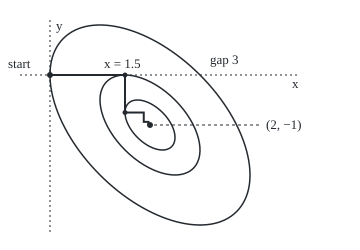
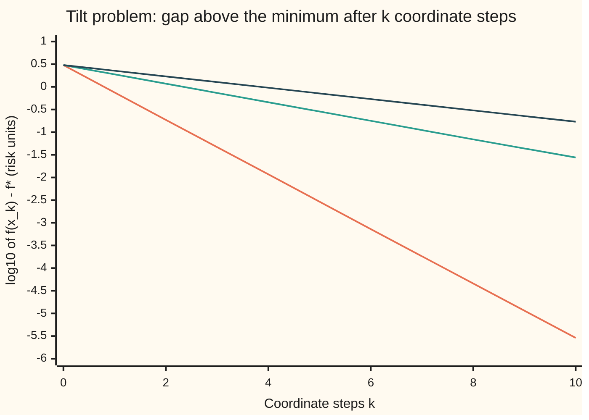

# Coordinate descent: improve one block at a time, and when that is enough

[Syllabus](../../../SYLLABUS.md) → [Optimization](../README.md) → [First-Order Methods at Scale](../README.md#s08) → Coordinate descent

---

## General Overview

An index tracker holds 2,000 assets and refits its weights every day from the last 250 daily returns. Its risk is a quadratic in the 2,000 weights, written with a 2,000 by 2,000 risk matrix (the covariance of the assets' returns). One gradient of that quadratic, the full list of 2,000 slopes, costs 4,000,000 multiply-adds. One slope alone, kept up to date as the weights change, costs 2,000.

**Coordinate descent** spends its effort on that cheap unit. It picks one weight, moves only that weight to its best value with the others held fixed, then picks another. A **coordinate** is one of the unknowns; a **block** is a group of them moved together.

The idea shows on two holdings. A fund tilts asset A by $`x`$ percentage points away from the index and asset B by $`y`$. The tilts carry risk $`x^2 + xy + y^2`$: each asset adds 1 unit of risk per squared point, and the two move together with correlation 0.5, which gives the cross term $`xy`$. A forecast says A will beat the index, worth $`3x`$. The fund **minimises** risk minus gain:

```math
f(x, y) = x^2 + xy + y^2 - 3x
```

Start with no tilts, at $`(0, 0)`$. Hold $`y = 0`$ and choose the best $`x`$: $`x = 1.5`$. Hold that and choose the best $`y`$: $`y = -0.75`$. Again: $`x = 1.875`$, $`y = -0.9375`$. Each step is a one-variable problem solved exactly. The points close in on $`(2, -1)`$: overweight A by 2 points and hedge with B at −1. The distance from $`x`$ to 2 shrinks by a factor of 4 every sweep (one pass through both coordinates).

The method can also stop at the wrong place. For $`|x - y| + 0.1(x + y)^2`$ it sits at $`(1, 1)`$ with value 0.4 for ever, though $`(0, 0)`$ gives 0. No single coordinate can improve, but moving both together can.

**Coordinate descent minimises one coordinate or block at a time; on a smooth convex cost it is a cheap, provably convergent method whose random version closes the expected gap above the minimum in proportion to 1/k after k steps, and it stays correct when the kinked part splits coordinate by coordinate, but it can stall when a kink couples coordinates.**

**What kind of fact this is:** a method, with theorems proved on this card in Why it works: the one-coordinate descent step, the rate for random coordinates, the exact factor of the example, and the rule that a separable kink is safe. The rate for a fixed cyclic order is stated, with its source (Beck and Tetruashvili, 2013). The stall is a computed counterexample.

### The picture: the staircase

<p align="center"></p>

To scale, 50 px per unit; dotted lines are the axes $`x = 0`$ and $`y = 0`$. The ellipses are the points where $`f`$ sits 3, 0.75 and 0.1875 above its minimum. Every move is along an axis, and every corner lands exactly on a contour, because each step cuts the gap by a factor of 4. The tilt of the ellipses, from the cross term $`xy`$, is what makes the path need stairs at all: with no cross term, one sweep would land on the answer.

---

## The formula

Notation first, in words. The unknowns are $`n`$ coordinates, $`x = (x_1, \dots, x_n)`$; in the tilt problem $`n = 2`$ and they are $`x`$ and $`y`$. $`\nabla_i f`$ is the slope of $`f`$ along coordinate $`i`$ alone (the partial derivative), and $`e_i`$ is the unit move along coordinate $`i`$. The **coordinate curvature** $`L_i`$ is the largest rate at which $`\nabla_i f`$ changes as $`x_i`$ alone moves; $`L_{\max}`$ is the largest of them. As on [Gradient descent](../02-Unconstrained%20Methods/02-gradient-descent-and-its-rate.md), $`L`$ is the curvature in the steepest direction of all and $`\mu`$ the gentlest. The iterate is $`x_k`$, from $`x_0`$ at $`k = 0`$; step $`k`$ moves coordinate $`i_k`$. So a subscript on the whole point counts steps, while a subscript $`i`$ inside a point names one coordinate.

One step:

```math
x_{k+1} = x_k - \frac{1}{L_{i_k}}\,\nabla_{i_k} f(x_k)\, e_{i_k}
```

**Read it aloud:** move one coordinate against its own slope, by that slope over the coordinate's own curvature; leave every other coordinate where it is.

On a quadratic this step lands on the exact minimum along the coordinate. Three rules choose $`i_k`$:

- **cyclic:** $`1, 2, \dots, n, 1, 2, \dots`$; one pass is a **sweep**;
- **random:** each coordinate with probability $`1/n`$, independently each step;
- **greedy**, also called **Gauss–Southwell:** the coordinate with the largest $`|\nabla_i f(x_k)|`$.

The rate for the random rule, for convex $`f`$:

```math
\mathbb{E}\,f(x_k) - f^* \le \frac{2\,n\,L_{\max}\,R^2}{k}
```

**Read it aloud:** after k random coordinate steps, the expected height above the minimum is at most 2 times n times the largest coordinate curvature times R squared, over k.

Here $`f^*`$ is the minimum value, $`\mathbb{E}`$ the average over the random choices, and $`R`$ the largest distance from the minimiser $`x^*`$ to any point no higher than the start. With strong convexity $`\mu > 0`$ the gap shrinks by a fixed factor per step instead:

```math
\mathbb{E}\,f(x_k) - f^* \le \Big(1 - \frac{\mu}{n L_{\max}}\Big)^k \big(f(x_0) - f^*\big)
```

**Read it aloud:** each random step keeps, on average, at most a fraction one minus mu over n L-max of the gap.

A kink is allowed when it is **separable**: a sum of one-variable charges, $`F(x) = f(x) + \sum_i h_i(x_i)`$, with each $`h_i`$ convex. Then the step minimises $`F`$ along $`x_i`$ exactly, kink included.

| Symbol | Plain meaning | In our example | Push it up and the answer… |
| --- | --- | --- | --- |
| $`x`$, $`y`$, $`x^*`$ | tilts on assets A and B, percentage points; the minimiser | start $`(0, 0)`$; $`x^* = (2, -1)`$ | — |
| $`f`$, $`f^*`$ | risk minus forecast gain, in risk units; its minimum | $`f(0, 0) = 0`$; $`f^* = -3`$ | — |
| $`F`$, $`h_i`$ | smooth part plus a kinked charge; a charge on coordinate i alone | $`\lvert x - y\rvert`$ is **not** of this form | — |
| $`n`$ | number of coordinates or blocks | 2 (2,000 for the tracker) | the random bound grows in proportion |
| $`x_k`$, $`k`$, $`i_k`$, $`e_i`$, $`\nabla_i f`$ | point after k steps; coordinate moved at step k; unit move along i; slope along i | iterate $`x_2 = (1.5, -0.75)`$, after two steps; $`\nabla f = (2x + y - 3,\ x + 2y)`$ | — |
| $`L_i`$, $`L_{\max}`$ | curvature along one coordinate; the largest of them | $`L_x = L_y = 2`$ | shorter safe step along that coordinate |
| $`L`$, $`\mu`$ | steepest and gentlest curvature over all directions | 3 and 1 | larger L slows gradient descent; coordinate steps need not slow |
| $`R`$ | largest distance from $`x^*`$ to a point with $`f \le f(x_0)`$ | $`R^2 = 6`$ | the bound grows with its square |
| $`\mathbb{E}`$, $`\delta_k`$, $`D_k`$, $`c`$ | average over the random choices; gap after k steps; its average; the constant $`2nL_{\max}R^2`$ | $`D_k = 3(5/8)^k`$; $`c = 48`$ | larger c, slower guaranteed rate |
| $`t`$, $`s`$, $`g_i`$, $`z`$ | a move along one coordinate; a slope of the kink $`\lvert x - y\rvert`$, from −1 to 1; a slope chosen for $`h_i`$; any other point | first move $`t = 1.5`$ | — |
| $`M`$, $`u`$, $`v`$, $`d`$, $`a`$ | a table of returns, percent; its rank-1 fit $`u v^\top`$; day and asset indices | 3 days by 2 assets | — |

### When it holds

- **The smooth part has coordinate curvatures $`L_i`$, and step $`i`$ is at most $`1/L_i`$.** A longer step can overshoot along that coordinate. On a quadratic, exact minimisation along the coordinate is the step $`1/L_i`$ itself.
- **Any kink is separable.** A charge such as $`|x - y|`$ that couples coordinates can freeze the method at a point that is not a minimum: 0.4 against a true minimum of 0.
- **Constraints must separate too.** Bounds on each weight are fine. The tracker's weights live on the **simplex** (non-negative and summing to 1; not the simplex method of linear programming). Moving one weight alone breaks the sum, so methods for it move weight between pairs.
- **Convexity, for a global answer.** Without it, coordinate descent still never goes uphill, but may stop at a point that is only stationary (zero slope, not a minimum). With exact steps it can even circle without settling.
- **The random rate is an average.** One unlucky run can pick the same coordinate many times; the bound holds for the mean over runs.

---

## Why it works

### Step 0: one coordinate is a one-variable problem, and a cheap one

Fix all coordinates but one, and $`f`$ becomes a function of one variable. Its curvature is $`L_i`$, which is never more than $`L`$ and often much less. For the tilt problem $`L_x = 2`$ while $`L = 3`$: a coordinate step may move by half its slope, a safe gradient step by only a third of the gradient.

Each step needs one slope, not $`n`$. On the tracker that is 2,000 multiply-adds against 4,000,000, so $`n`$ coordinate steps cost about one gradient. The fair comparison is a sweep against a gradient step.

### Step 1: one coordinate step goes down by a known amount

Along coordinate $`i`$ the slope changes at rate at most $`L_i`$. The one-variable form of the bowl bound (a smooth function lies under a parabola with its curvature) on [Gradient descent](../02-Unconstrained%20Methods/02-gradient-descent-and-its-rate.md) then gives, for the step $`t = -\nabla_i f(x)/L_i`$:

```math
f(x + t\,e_i) \le f(x) + t\,\nabla_i f(x) + \frac{L_i}{2}\,t^2 = f(x) - \frac{\big(\nabla_i f(x)\big)^2}{2 L_i}
```

**Read it aloud:** one coordinate step lowers f by at least that coordinate's slope squared, over twice its curvature.

At the start, $`\nabla_x f(0, 0) = -3`$ and $`L_x = 2`$, so the drop is at least $`9/4 = 2.25`$. The gap falls from 3 to 0.75, exactly 2.25: on a quadratic the bound is an equality.

### Step 2: a random coordinate is a gradient step on average

Pick $`i`$ at random, each with probability $`1/n`$. Average the drop of Step 1 over the $`n`$ choices, using $`L_i \le L_{\max}`$:

```math
\mathbb{E}\big[f(x_{k+1}) \mid x_k\big] \le f(x_k) - \frac{\lVert\nabla f(x_k)\rVert^2}{2\,n\,L_{\max}}
```

**Read it aloud:** on average, a random coordinate step does what a gradient step of length one over n L-max would do.

That is the whole reason random order is easy to analyse: its expected progress has the same shape as gradient descent's.

### Step 3: convexity turns the drop into a 1/k rate

Convexity gives $`f(x_k) - f^* \le \lVert\nabla f(x_k)\rVert\,R`$: the gap is at most slope times distance. So a large gap forces a large slope, and Step 2 then forces a large drop. Solving that recursion gives the bound in The formula.

<details>
<summary>Detailed proof: the random rate 2nL_max R²/k</summary>

Write $`\delta_k = f(x_k) - f^*`$ and $`D_k = \mathbb{E}\,\delta_k`$. Put $`c = 2 n L_{\max} R^2`$.

Each step goes down or stays (Step 1), so every iterate stays in the set where $`f \le f(x_0)`$, and $`\lVert x_k - x^*\rVert \le R`$. Convexity puts $`f`$ above its tangent plane at $`x_k`$:

$`\displaystyle \delta_k \le \nabla f(x_k)^\top (x_k - x^*) \le \lVert\nabla f(x_k)\rVert\,R.`$

So $`\lVert\nabla f(x_k)\rVert^2 \ge \delta_k^2/R^2`$, and Step 2 becomes

$`\displaystyle \mathbb{E}\big[\delta_{k+1} \mid x_k\big] \le \delta_k - \frac{\delta_k^2}{c}.`$

Average over $`x_k`$. An average of squares is at least the square of the average, so

$`\displaystyle D_{k+1} \le D_k - \frac{D_k^2}{c}.`$

If some $`D_k`$ is 0 the claim holds from then on. Otherwise divide by $`D_k D_{k+1}`$ and use $`D_{k+1} \le D_k`$:

$`\displaystyle \frac{1}{D_{k+1}} - \frac{1}{D_k} \ge \frac{D_k}{c\,D_{k+1}} \ge \frac{1}{c}.`$

Add this for steps $`0`$ to $`k - 1`$: $`1/D_k \ge 1/D_0 + k/c \ge k/c`$. So $`D_k \le c/k`$.

With strong convexity, [Gradient descent](../02-Unconstrained%20Methods/02-gradient-descent-and-its-rate.md) shows $`\lVert\nabla f\rVert^2 \ge 2\mu\,\delta`$. Put that in Step 2: $`\mathbb{E}[\delta_{k+1} \mid x_k] \le (1 - \mu/(n L_{\max}))\,\delta_k`$, the fixed-factor bound.

</details>

For the tilt problem, $`n = 2`$, $`L_{\max} = 2`$ and $`R^2 = 6`$: the set where $`f \le f(0, 0)`$ is the outer ellipse of the picture, and its farthest points from $`(2, -1)`$ are $`\sqrt 6`$ away. They lie along the direction of gentlest curvature, $`\mu = 1`$, where $`\tfrac{\mu}{2}R^2 = 3`$ gives the same $`R^2 = 6`$. So $`c = 48`$, and the bound reads $`48/k`$.

### Step 4: the example, exactly

Exact minimisation along $`x`$ sets $`2x + y - 3 = 0`$, so $`x - 2 = -(y + 1)/2`$. Along $`y`$ it sets $`x + 2y = 0`$, so $`y + 1 = -(x - 2)/2`$. A sweep applies both, and the error is multiplied by $`(-\tfrac12)(-\tfrac12) = \tfrac14`$.

The gap does better still. After an $`x`$ step it is $`\tfrac34 (y + 1)^2`$; after the next $`y`$ step, a quarter of that. Every step cuts the gap by 4: 3, 0.75, 0.1875, 0.046875.

The random rule can waste steps. After any exact step, that coordinate's slope is 0, so choosing it again changes nothing. At the start, $`\nabla_y f(0, 0) = 0`$ too. So at every step exactly one coordinate helps, and the random rule finds it half the time. On average a step keeps $`\tfrac12 \cdot 1 + \tfrac12 \cdot \tfrac14 = \tfrac58`$ of the gap:

```math
\mathbb{E}\,f(x_k) - f^* = 3\,(5/8)^k
```

**Read it aloud:** the expected gap after k random steps is 3 times five eighths to the power k.

Both bounds hold: $`(1 - \mu/(n L_{\max}))^k = (3/4)^k`$, worse than $`5/8`$ per step, and $`48/k`$, far worse. Here $`\mu/(n L_{\max}) = 1/(2 \cdot 2)`$.

### Step 5: which order to use

On the tilt problem the greedy rule picks $`x`$ first (slopes $`-3`$ and 0) and then always the coordinate the last step did not zero: x, y, x, y, … the cyclic order. After 12 steps both sit 0.0000001788 above the minimum. The random rule's average after 10 steps is 0.027285, against cyclic's 0.00000286.



Orange: cyclic (and greedy). Green: the random rule's exact average, $`3(5/8)^k`$. Dark: the guaranteed bound $`3(3/4)^k`$. Each unit down is ten times closer.

So why use random order at all? Because its guarantee holds on every smooth convex problem, with the short proof of Step 3. A fixed cyclic order also closes the gap like $`1/k`$ on smooth convex problems, proved by Beck and Tetruashvili (2013), but with a larger constant; Wright's survey (2015) discusses cases where a fixed order does badly. Greedy makes the most progress per step, but finding the largest slope can cost as much as a gradient.

Against gradient descent at the same cost, one gradient step per sweep, the tilt problem is clear: after 6 gradient steps of length $`1/L`$ the gap is 0.017342; after 6 sweeps it is 0.00000018.

### Step 6: a separable kink is safe, a coupling kink is not

Say $`F = f + \sum_i h_i(x_i)`$ with $`f`$ smooth and convex and each $`h_i`$ convex, and no single coordinate can lower $`F`$ at $`x`$. By the zero-slope rule of [Subgradients](../01-Convexity/07-subgradients.md), applied along each coordinate, there is for each $`i`$ a slope $`g_i`$ of $`h_i`$ at $`x_i`$ with $`\nabla_i f(x) + g_i = 0`$. Then for any point $`z`$:

```math
F(z) - F(x) \ge \nabla f(x)^\top (z - x) + \sum_i g_i\,(z_i - x_i) = \sum_i \big(\nabla_i f(x) + g_i\big)(z_i - x_i) = 0
```

**Read it aloud:** the tangent plane of the smooth part plus a supporting line for each charge lies under F, and with the chosen slopes it is flat, so nothing is lower than F(x).

So "stuck" means "optimal". The key is that each coordinate may choose its own $`g_i`$, because each charge belongs to one coordinate.

Now take $`F(x, y) = |x - y| + 0.1(x + y)^2`$ at $`(1, 1)`$, where $`F = 0.4`$. Along $`x`$, the kink supplies any slope $`s`$ from −1 to 1, and the smooth part adds 0.4. Moving right climbs at 1.4; moving left climbs at 0.6, since the slope there is −0.6. Along $`y`$ it is the same. So $`(1, 1)`$ is a minimum along each coordinate.

But one kink serves both coordinates. Flatness along $`x`$ needs $`s = -0.4`$; along $`y`$ the same term enters as $`-s`$, which needs $`s = 0.4`$. No single $`s`$ does both, so 0 is not a slope of $`F`$ at $`(1, 1)`$. Moving both coordinates together along $`(-1, -1)`$ goes down: $`F(0.5, 0.5) = 0.1`$ and $`F(0, 0) = 0`$. Cyclic coordinate descent stays at 0.4 after 20 sweeps. A random order cannot do better, since neither coordinate move changes anything.

Two changes rescue it. A smooth coupling, $`(x - y)^2 + 0.1(x + y)^2`$, reaches 0.000000 in 20 sweeps. A separable kink, $`|x| + |y| + 0.1(x + y)^2`$, reaches the minimum 0 in one sweep. This is the case the lasso is in, which is why [Proximal gradient](../06-Conic%2C%20Quadratic%20and%20Stochastic%20Programs/06-proximal-methods-ista-fista-and-the-lasso.md) could use coordinate descent as its second road.

### Step 7: blocks, and a fit that is not convex

A block step moves several coordinates at once, solving the block's problem exactly. Alternating least squares (ALS) is the classic two-block case. Take three days of returns, in percent, for two assets:

```math
M = \begin{pmatrix} 3 & 2 \\ 1 & 0 \\ 0 & 1 \end{pmatrix}
```

A one-factor model explains each day's return as the day's factor $`u_d`$ times the asset's loading $`v_a`$: it fits $`u v^\top`$, minimising the squared misses $`\sum (M_{da} - u_d v_a)^2`$. That cost is not convex in $`(u, v)`$ together. But with $`v`$ fixed it is a least-squares fit for $`u`$, solved by $`u = Mv / \lVert v\rVert^2`$, and with $`u`$ fixed, $`v = M^\top u / \lVert u\rVert^2`$.

From $`v = (1, 0)`$, the squared misses go 1.40000000, 1.00210526, 1.00001074, 1.00000005 over four rounds. The certificate does not trust ALS. For a unit-length $`v`$ the best $`u`$ is $`Mv`$, leaving misses $`\lVert M\rVert^2 - \lVert Mv\rVert^2`$. The squares of $`M`$ add up to 15, and the largest $`\lVert Mv\rVert^2`$ is the top eigenvalue of $`M^\top M`$, which is 14. So no rank-1 fit misses by less than 1. A sweep over 100,000 directions of $`v`$ agrees: 1.000000.

---

## Worked numbers, by hand

Cyclic coordinate descent on the tilt problem, from $`(0, 0)`$, with exact steps $`x = (3 - y)/2`$ and $`y = -x/2`$.

| Step | Arithmetic | Value |
| --- | --- | --- |
| start | $`f(0, 0) - f^* = 0 - (-3)`$ | gap 3 |
| 1: move x | $`x = (3 - 0)/2`$ | 1.5; gap 0.75 |
| 2: move y | $`y = -1.5/2`$ | −0.75; gap 0.1875 |
| 3: move x | $`x = (3 + 0.75)/2`$ | 1.875; gap 0.046875 |
| 4: move y | $`y = -1.875/2`$ | −0.9375; gap 0.01171875 |
| error in x per sweep | $`(1.875 - 2)/(1.5 - 2) = -0.125/-0.5`$ | 1/4 |
| after 6 sweeps | $`x = 1.999512`$, $`y = -0.999756`$ | gap 0.00000018 |
| the answer | $`2x + y = 3`$ and $`x + 2y = 0`$ | **x\* = (2, −1), f\* = −3** |

The fund overweights A by 2 points and underweights B by 1, a hedge against the half of A's risk that B shares. The two slopes are zero there, so no tilt does better: $`f`$ is convex, and a zero gradient certifies the minimum.

### What breaks if you drop a piece

| Mistake | Comes out at | What went wrong |
| --- | --- | --- |
| A coupling kink, $`\lvert x - y\rvert + 0.1(x + y)^2`$, from $`(1, 1)`$ | stuck at 0.4 for 20 sweeps; the minimum is 0 | The kink is not separable: each coordinate alone is at its best, the pair is not |
| Random order judged as if it were cyclic | average gap 0.027285 after 10 steps, against 0.00000286 | Half the random picks repeat a coordinate whose slope is already 0 |
| A gradient step instead of a sweep, at the same cost | gap 0.017342 after 6 steps, against 0.00000018 after 6 sweeps | The gradient step must use $`1/L = 1/3`$; a coordinate step uses $`1/L_i = 1/2`$ and solves each coordinate exactly |
| Reading ALS's first round as the answer | squared misses 1.40000000 | The fit is not convex; only the certificate, 15 − 14 = 1, proves the end point best |

---

## Code, from first principles, and it actually runs

Both programs run the tilt problem by cyclic, greedy and random coordinate descent, and compare with gradient descent. They take four independent roads to the answers: the optimality equations solved by elimination; the method itself; the random method's exact average by enumerating all $`2^k`$ choice paths, checked against the formula $`3(5/8)^k`$ and a 20,000-run simulation with the SplitMix64 generator (seed 2024); and for ALS, an eigenvalue certificate against an enumeration of 100,000 directions. The reach $`R^2`$ of the level set comes from a scan of 40,000 directions, checked against the gentlest curvature. A golden-section search (which keeps narrowing an interval around the lowest point) runs the kinked examples, so the stall is not built into the code.

### Python

```python
# Coordinate descent -- the check behind the card.  Standard library only.
# A fund tilts two holdings by x and y percentage points and minimises
# f(x, y) = x^2 + xy + y^2 - 3x  (tracking risk minus forecast gain).
# Roads: exact coordinate steps (cyclic, greedy, random); the optimality equations
# solved by elimination; the random method's expected gap by enumerating every
# choice path, by a closed formula and by simulation; a stall on a kinked coupling;
# alternating least squares for a rank-1 fit against an angle enumeration.
import math

def f(x, y): return x * x + x * y + y * y - 3 * x
def grad(x, y): return (2 * x + y - 3, x + 2 * y)
def step(x, y, i):                       # exact minimisation along coordinate i
    return ((3 - y) / 2, y) if i == 0 else (x, -x / 2)

# road 1: grad f = 0 is 2x + y = 3, x + 2y = 0; eliminate x from the second row
m = 1 / 2
ys = (0 - m * 3) / (2 - m * 1); xs = (3 - ys) / 2; fs = f(xs, ys)
print(f"optimality equations: x* = {xs:.4f}, y* = {ys:.4f}, f* = {fs:.4f}")
h = 1e-3                                 # curvatures by second differences
Lx = (f(1 + h, 0) - 2 * f(1, 0) + f(1 - h, 0)) / h**2
Ly = (f(0, 1 + h) - 2 * f(0, 1) + f(0, 1 - h)) / h**2
disc = math.sqrt((2 - 2)**2 + 4 * 1**2)  # eigenvalues of the Hessian [[2,1],[1,2]]
L, mu = (2 + 2 + disc) / 2, (2 + 2 - disc) / 2
print(f"coordinate curvatures L_x = {Lx:.4f}, L_y = {Ly:.4f}; full L = {L:.4f}, mu = {mu:.4f}")

# road 2: cyclic exact coordinate descent from (0, 0)
x, y = 0.0, 0.0; path = [(x, y)]; errs = []
for s in range(1, 7):
    x, y = step(x, y, 0); path.append((x, y)); x, y = step(x, y, 1); path.append((x, y))
    errs.append(x - xs)
    print(f"sweep {s}: x = {x:.6f}, y = {y:.6f}, x - x* = {x - xs:+.6f}, gap {f(x, y) - fs:.8f}")
gaps = [f(p[0], p[1]) - fs for p in path]
print("gap after each step:", " ".join(f"{g:.6f}" for g in gaps[:7]))
drop, bound = gaps[0] - gaps[1], grad(0, 0)[0]**2 / (2 * Lx)
print(f"first step: drop {drop:.4f}; Step 1's bound slope^2 / (2 L_x) = {bound:.4f}")
assert abs(drop - bound) < 1e-6
for k in range(5):
    assert abs(errs[k + 1] / errs[k] - 0.25) < 1e-9          # 1/4 per sweep
    assert abs(gaps[k + 1] / gaps[k] - 0.25) < 1e-9          # 1/4 per step
assert abs(path[-1][0] - xs) < 1e-3 and abs(grad(*path[-1])[1]) < 1e-12
print("figure,", " ".join(f"({p[0]:.4f},{p[1]:.4f})" for p in path[:7]),
      f"centre ({xs:.1f},{ys:.1f}) axes for gap c: sqrt(2c) along (1,-1), sqrt(2c/3) along (1,1)")

# greedy (Gauss-Southwell): always the coordinate with the larger partial derivative
x, y = 0.0, 0.0; order = ""
for k in range(12):
    g = grad(x, y); i = 0 if abs(g[0]) >= abs(g[1]) else 1
    order += "xy"[i]; x, y = step(x, y, i)
print(f"greedy order: {order}, gap after 12 steps {f(x, y) - fs:.10f} (cyclic {gaps[12]:.10f})")
assert abs((f(x, y) - fs) - gaps[12]) < 1e-15

# road 3: random order, each step picks x or y with probability 1/2
def expected_gap(k):                     # average over all 2^k equally likely paths
    tot = 0.0
    for mask in range(2**k):
        x, y = 0.0, 0.0
        for t in range(k): x, y = step(x, y, (mask >> t) & 1)
        tot += f(x, y) - fs
    return tot / 2**k
R2 = max(3 / (1 + math.cos(t) * math.sin(t)) for t in [j * math.pi / 20000 for j in range(40000)])
n, Lmax = 2, max(Lx, Ly)
print(f"level set f <= f(0,0): R^2 = {R2:.4f}; bound 2 n Lmax R^2 / k = {2 * n * Lmax * R2:.2f}/k")
assert abs(R2 - 2 * gaps[0] / mu) < 1e-9             # the farthest point lies along the gentlest curvature
print("k  enumerated  3(5/8)^k   1/k bound  3(3/4)^k bound")
for k in [1, 2, 4, 6, 8, 10]:
    e = expected_gap(k)
    b1 = 2 * n * Lmax * R2 / k; b2 = 3 * (1 - mu / (n * Lmax))**k
    print(f"{k:<2} {e:.6f}    {3 * 0.625**k:.6f}  {b1:8.4f}   {b2:.6f}")
    assert abs(e - 3 * 0.625**k) < 1e-12 and e <= b1 and e <= b2
ks = [0, 2, 4, 6, 8, 10]
print("chart, log10 gap at k = 0, 2, 4, 6, 8, 10: cyclic", " ".join(f"{math.log10(gaps[k]):.2f}" for k in ks))
print("chart, random", " ".join(f"{math.log10(expected_gap(k)):.2f}" for k in ks),
      "; bound 3(3/4)^k", " ".join(f"{math.log10(3 * 0.75**k):.2f}" for k in ks))
M64 = (1 << 64) - 1
def splitmix(s):
    s = (s + 0x9E3779B97F4A7C15) & M64; z = s
    z = ((z ^ (z >> 30)) * 0xBF58476D1CE4E5B9) & M64
    z = ((z ^ (z >> 27)) * 0x94D049BB133111EB) & M64
    return s, z ^ (z >> 31)
SEED = 2024; seed, N, tot, tot2 = SEED, 20000, 0.0, 0.0
for r in range(N):
    x, y = 0.0, 0.0
    for t in range(10):
        seed, z = splitmix(seed); x, y = step(x, y, z >> 63)
    g = f(x, y) - fs; tot += g; tot2 += g * g
mean = tot / N; se = math.sqrt((tot2 / N - mean * mean) / N)
print(f"simulated, {N} runs, seed {SEED}: mean gap at k = 10 {mean:.6f} (standard error {se:.6f})")
assert abs(mean - expected_gap(10)) < 4 * se

# gradient descent at step 1/L for comparison: one gradient costs two partials
x, y = 0.0, 0.0
for k in range(6):
    g = grad(x, y); x, y = x - g[0] / L, y - g[1] / L
print(f"gradient descent, 6 steps at 1/L: gap {f(x, y) - fs:.6f}; cyclic, 6 sweeps: {gaps[12]:.8f}")
print(f"2,000 assets: full gradient {2000 * 2000} multiply-adds, one coordinate step {2000}")

# what breaks: a kinked coupling |x - y| stalls; a smooth or separable one does not
def argmin1(h, lo=-5.0, hi=5.0):         # golden-section search, convex in one variable
    r = (math.sqrt(5) - 1) / 2
    for _ in range(120):
        a, b = hi - r * (hi - lo), lo + r * (hi - lo)
        if h(a) <= h(b): hi = b
        else: lo = a
    return (lo + hi) / 2
def cd(F, x, y, sweeps):
    for _ in range(sweeps):
        x = argmin1(lambda t: F(t, y)); y = argmin1(lambda t: F(x, t))
    return x, y, F(x, y)
kink = lambda x, y: abs(x - y) + 0.1 * (x + y)**2
smooth = lambda x, y: (x - y)**2 + 0.1 * (x + y)**2
separable = lambda x, y: abs(x) + abs(y) + 0.1 * (x + y)**2
e = 1e-6
print(f"kinked coupling at (1, 1): f = {kink(1, 1):.4f}; slopes along x: right "
      f"{(kink(1 + e, 1) - kink(1, 1)) / e:+.4f}, left {(kink(1, 1) - kink(1 - e, 1)) / e:+.4f}")
xk, yk, vk = cd(kink, 1.0, 1.0, 20)
print(f"  20 sweeps from (1, 1): ({xk:.6f}, {yk:.6f}), f = {vk:.6f}; but f(0, 0) = {kink(0, 0):.4f}"
      f", f(0.5, 0.5) = {kink(0.5, 0.5):.4f}")
assert abs(vk - 0.4) < 1e-8 and kink(0, 0) < vk - 0.39
xs2, ys2, v2 = cd(smooth, 1.0, 1.0, 20)
xs3, ys3, v3 = cd(separable, 1.0, 1.0, 1)
print(f"smooth coupling (x-y)^2, 20 sweeps: f = {v2:.6f}; separable |x|+|y|, 1 sweep: "
      f"largest |coordinate| {max(abs(xs3), abs(ys3)):.6f}, f = {v3:.6f}")
assert v2 < 1e-6 and v3 < 1e-8

# alternating least squares: rank-1 fit to returns M (3 days by 2 assets, percent)
M = [[3.0, 2.0], [1.0, 0.0], [0.0, 1.0]]; v = [1.0, 0.0]
def resid(u, v): return sum((M[i][j] - u[i] * v[j])**2 for i in range(3) for j in range(2))
for r in range(1, 6):
    vv = v[0]**2 + v[1]**2; u = [(M[i][0] * v[0] + M[i][1] * v[1]) / vv for i in range(3)]
    uu = sum(t * t for t in u); v = [sum(M[i][j] * u[i] for i in range(3)) / uu for j in range(2)]
    print(f"ALS round {r}: v = ({v[0]:.6f}, {v[1]:.6f}), squared misses {resid(u, v):.8f}")
G = [[sum(M[i][a] * M[i][b] for i in range(3)) for b in range(2)] for a in range(2)]   # M^T M
tr, det = G[0][0] + G[1][1], G[0][0] * G[1][1] - G[0][1] ** 2
tot = sum(t * t for row in M for t in row); lam1 = (tr + math.sqrt(tr * tr - 4 * det)) / 2
grid = min(tot - sum((row[0] * math.cos(t) + row[1] * math.sin(t))**2 for row in M)
           for t in [j * math.pi / 100000 for j in range(100000)])
print(f"certificate: {tot:.0f} - top eigenvalue {lam1:.4f} = {tot - lam1:.6f}; angle enumeration {grid:.6f}")
assert abs(resid(u, v) - (tot - lam1)) < 1e-6 and abs(grid - (tot - lam1)) < 1e-6
print("ALL CHECKS PASS")
```

**Ran 2026-11-24 on macOS, Python 3.14.10, standard library only. All checks passed. Output, pasted from the run:**

```
optimality equations: x* = 2.0000, y* = -1.0000, f* = -3.0000
coordinate curvatures L_x = 2.0000, L_y = 2.0000; full L = 3.0000, mu = 1.0000
sweep 1: x = 1.500000, y = -0.750000, x - x* = -0.500000, gap 0.18750000
sweep 2: x = 1.875000, y = -0.937500, x - x* = -0.125000, gap 0.01171875
sweep 3: x = 1.968750, y = -0.984375, x - x* = -0.031250, gap 0.00073242
sweep 4: x = 1.992188, y = -0.996094, x - x* = -0.007812, gap 0.00004578
sweep 5: x = 1.998047, y = -0.999023, x - x* = -0.001953, gap 0.00000286
sweep 6: x = 1.999512, y = -0.999756, x - x* = -0.000488, gap 0.00000018
gap after each step: 3.000000 0.750000 0.187500 0.046875 0.011719 0.002930 0.000732
first step: drop 2.2500; Step 1's bound slope^2 / (2 L_x) = 2.2500
figure, (0.0000,0.0000) (1.5000,0.0000) (1.5000,-0.7500) (1.8750,-0.7500) (1.8750,-0.9375) (1.9688,-0.9375) (1.9688,-0.9844) centre (2.0,-1.0) axes for gap c: sqrt(2c) along (1,-1), sqrt(2c/3) along (1,1)
greedy order: xyxyxyxyxyxy, gap after 12 steps 0.0000001788 (cyclic 0.0000001788)
level set f <= f(0,0): R^2 = 6.0000; bound 2 n Lmax R^2 / k = 48.00/k
k  enumerated  3(5/8)^k   1/k bound  3(3/4)^k bound
1  1.875000    1.875000   48.0000   2.250000
2  1.171875    1.171875   24.0000   1.687500
4  0.457764    0.457764   12.0000   0.949219
6  0.178814    0.178814    8.0000   0.533936
8  0.069849    0.069849    6.0000   0.300339
10 0.027285    0.027285    4.8000   0.168941
chart, log10 gap at k = 0, 2, 4, 6, 8, 10: cyclic 0.48 -0.73 -1.93 -3.14 -4.34 -5.54
chart, random 0.48 0.07 -0.34 -0.75 -1.16 -1.56 ; bound 3(3/4)^k 0.48 0.23 -0.02 -0.27 -0.52 -0.77
simulated, 20000 runs, seed 2024: mean gap at k = 10 0.027440 (standard error 0.000853)
gradient descent, 6 steps at 1/L: gap 0.017342; cyclic, 6 sweeps: 0.00000018
2,000 assets: full gradient 4000000 multiply-adds, one coordinate step 2000
kinked coupling at (1, 1): f = 0.4000; slopes along x: right +1.4000, left -0.6000
  20 sweeps from (1, 1): (1.000000, 1.000000), f = 0.400000; but f(0, 0) = 0.0000, f(0.5, 0.5) = 0.1000
smooth coupling (x-y)^2, 20 sweeps: f = 0.000000; separable |x|+|y|, 1 sweep: largest |coordinate| 0.000000, f = 0.000000
ALS round 1: v = (1.000000, 0.600000), squared misses 1.40000000
ALS round 2: v = (0.973474, 0.644211), squared misses 1.00210526
ALS round 3: v = (0.971439, 0.647285), squared misses 1.00001074
ALS round 4: v = (0.971293, 0.647504), squared misses 1.00000005
ALS round 5: v = (0.971283, 0.647520), squared misses 1.00000000
certificate: 15 - top eigenvalue 14.0000 = 1.000000; angle enumeration 1.000000
ALL CHECKS PASS
```

### Rust

```rust
// Coordinate descent -- the check behind the card.  std only, no crates.
// A fund tilts two holdings by x and y percentage points and minimises
// f(x, y) = x^2 + xy + y^2 - 3x  (tracking risk minus forecast gain).
// Roads: exact coordinate steps (cyclic, greedy, random); the optimality equations
// solved by elimination; the random method's expected gap by enumerating every
// choice path, by a closed formula and by simulation; a stall on a kinked coupling;
// alternating least squares for a rank-1 fit against an angle enumeration.
use std::f64::consts::PI;

fn f(x: f64, y: f64) -> f64 { x * x + x * y + y * y - 3.0 * x }
fn grad(x: f64, y: f64) -> (f64, f64) { (2.0 * x + y - 3.0, x + 2.0 * y) }
fn step(x: f64, y: f64, i: u64) -> (f64, f64) { // exact minimisation along coordinate i
    if i == 0 { ((3.0 - y) / 2.0, y) } else { (x, -x / 2.0) }
}
fn expected_gap(k: u32, fs: f64) -> f64 { // average over all 2^k equally likely paths
    let mut tot = 0.0;
    for mask in 0u64..(1u64 << k) {
        let (mut x, mut y) = (0.0, 0.0);
        for t in 0..k { let p = step(x, y, (mask >> t) & 1); x = p.0; y = p.1; }
        tot += f(x, y) - fs;
    }
    tot / (1u64 << k) as f64
}
fn splitmix(s: u64) -> (u64, u64) {
    let s = s.wrapping_add(0x9E3779B97F4A7C15); let mut z = s;
    z = (z ^ (z >> 30)).wrapping_mul(0xBF58476D1CE4E5B9);
    z = (z ^ (z >> 27)).wrapping_mul(0x94D049BB133111EB);
    (s, z ^ (z >> 31))
}
fn argmin1(h: &dyn Fn(f64) -> f64) -> f64 { // golden-section search, convex in one variable
    let (mut lo, mut hi) = (-5.0f64, 5.0f64); let r = (5.0f64.sqrt() - 1.0) / 2.0;
    for _ in 0..120 {
        let (a, b) = (hi - r * (hi - lo), lo + r * (hi - lo));
        if h(a) <= h(b) { hi = b; } else { lo = a; }
    }
    (lo + hi) / 2.0
}
fn cd(fun: &dyn Fn(f64, f64) -> f64, mut x: f64, mut y: f64, sweeps: usize) -> (f64, f64, f64) {
    for _ in 0..sweeps { x = argmin1(&|t| fun(t, y)); y = argmin1(&|t| fun(x, t)); }
    (x, y, fun(x, y))
}
fn main() {
    // road 1: grad f = 0 is 2x + y = 3, x + 2y = 0; eliminate x from the second row
    let m = 1.0 / 2.0;
    let ys = (0.0 - m * 3.0) / (2.0 - m * 1.0); let xs = (3.0 - ys) / 2.0; let fs = f(xs, ys);
    println!("optimality equations: x* = {:.4}, y* = {:.4}, f* = {:.4}", xs, ys, fs);
    let h = 1e-3; // curvatures by second differences
    let lx = (f(1.0 + h, 0.0) - 2.0 * f(1.0, 0.0) + f(1.0 - h, 0.0)) / (h * h);
    let ly = (f(0.0, 1.0 + h) - 2.0 * f(0.0, 1.0) + f(0.0, 1.0 - h)) / (h * h);
    let disc = ((2.0f64 - 2.0).powi(2) + 4.0 * 1.0f64.powi(2)).sqrt(); // eigenvalues of [[2,1],[1,2]]
    let (l, mu) = ((2.0 + 2.0 + disc) / 2.0, (2.0 + 2.0 - disc) / 2.0);
    println!("coordinate curvatures L_x = {:.4}, L_y = {:.4}; full L = {:.4}, mu = {:.4}", lx, ly, l, mu);

    // road 2: cyclic exact coordinate descent from (0, 0)
    let (mut x, mut y) = (0.0f64, 0.0f64); let mut path = vec![(x, y)]; let mut errs = vec![];
    for s in 1..7 {
        let p = step(x, y, 0); x = p.0; y = p.1; path.push((x, y));
        let p = step(x, y, 1); x = p.0; y = p.1; path.push((x, y));
        errs.push(x - xs);
        println!("sweep {}: x = {:.6}, y = {:.6}, x - x* = {:+.6}, gap {:.8}", s, x, y, x - xs, f(x, y) - fs);
    }
    let gaps: Vec<f64> = path.iter().map(|p| f(p.0, p.1) - fs).collect();
    let gs: Vec<String> = gaps[..7].iter().map(|g| format!("{:.6}", g)).collect();
    println!("gap after each step: {}", gs.join(" "));
    let (drop, bound) = (gaps[0] - gaps[1], grad(0.0, 0.0).0.powi(2) / (2.0 * lx));
    println!("first step: drop {:.4}; Step 1's bound slope^2 / (2 L_x) = {:.4}", drop, bound);
    assert!((drop - bound).abs() < 1e-6);
    for k in 0..5 {
        assert!((errs[k + 1] / errs[k] - 0.25).abs() < 1e-9); // 1/4 per sweep
        assert!((gaps[k + 1] / gaps[k] - 0.25).abs() < 1e-9); // 1/4 per step
    }
    let last = path[path.len() - 1];
    assert!((last.0 - xs).abs() < 1e-3 && grad(last.0, last.1).1.abs() < 1e-12);
    let fp: Vec<String> = path[..7].iter().map(|p| format!("({:.4},{:.4})", p.0, p.1)).collect();
    println!("figure, {} centre ({:.1},{:.1}) axes for gap c: sqrt(2c) along (1,-1), sqrt(2c/3) along (1,1)",
             fp.join(" "), xs, ys);

    // greedy (Gauss-Southwell): always the coordinate with the larger partial derivative
    let (mut x, mut y) = (0.0f64, 0.0f64); let mut order = String::new();
    for _ in 0..12 {
        let g = grad(x, y); let i = if g.0.abs() >= g.1.abs() { 0 } else { 1 };
        order.push(if i == 0 { 'x' } else { 'y' }); let p = step(x, y, i); x = p.0; y = p.1;
    }
    println!("greedy order: {}, gap after 12 steps {:.10} (cyclic {:.10})", order, f(x, y) - fs, gaps[12]);
    assert!(((f(x, y) - fs) - gaps[12]).abs() < 1e-15);

    // road 3: random order, each step picks x or y with probability 1/2
    let r2 = (0..40000).map(|j| { let t = j as f64 * PI / 20000.0; 3.0 / (1.0 + t.cos() * t.sin()) })
        .fold(f64::MIN, f64::max);
    let (n, lmax) = (2.0, lx.max(ly));
    println!("level set f <= f(0,0): R^2 = {:.4}; bound 2 n Lmax R^2 / k = {:.2}/k", r2, 2.0 * n * lmax * r2);
    assert!((r2 - 2.0 * gaps[0] / mu).abs() < 1e-9); // the farthest point lies along the gentlest curvature
    println!("k  enumerated  3(5/8)^k   1/k bound  3(3/4)^k bound");
    for k in [1u32, 2, 4, 6, 8, 10] {
        let e = expected_gap(k, fs);
        let b1 = 2.0 * n * lmax * r2 / k as f64; let b2 = 3.0 * (1.0 - mu / (n * lmax)).powi(k as i32);
        println!("{:<2} {:.6}    {:.6}  {:8.4}   {:.6}", k, e, 3.0 * 0.625f64.powi(k as i32), b1, b2);
        assert!((e - 3.0 * 0.625f64.powi(k as i32)).abs() < 1e-12 && e <= b1 && e <= b2);
    }
    let ks = [0u32, 2, 4, 6, 8, 10];
    let lg = |v: Vec<f64>| v.iter().map(|g| format!("{:.2}", g.log10())).collect::<Vec<_>>().join(" ");
    println!("chart, log10 gap at k = 0, 2, 4, 6, 8, 10: cyclic {}", lg(ks.iter().map(|&k| gaps[k as usize]).collect()));
    println!("chart, random {} ; bound 3(3/4)^k {}", lg(ks.iter().map(|&k| expected_gap(k, fs)).collect()),
             lg(ks.iter().map(|&k| 3.0 * 0.75f64.powi(k as i32)).collect()));
    let seed0 = 2024u64; let (mut seed, nruns) = (seed0, 20000); let (mut tot, mut tot2) = (0.0, 0.0);
    for _ in 0..nruns {
        let (mut x, mut y) = (0.0, 0.0);
        for _ in 0..10 { let (s, z) = splitmix(seed); seed = s; let p = step(x, y, z >> 63); x = p.0; y = p.1; }
        let g = f(x, y) - fs; tot += g; tot2 += g * g;
    }
    let mean = tot / nruns as f64; let se = ((tot2 / nruns as f64 - mean * mean) / nruns as f64).sqrt();
    println!("simulated, {} runs, seed {}: mean gap at k = 10 {:.6} (standard error {:.6})", nruns, seed0, mean, se);
    assert!((mean - expected_gap(10, fs)).abs() < 4.0 * se);

    // gradient descent at step 1/L for comparison: one gradient costs two partials
    let (mut x, mut y) = (0.0f64, 0.0f64);
    for _ in 0..6 { let g = grad(x, y); x -= g.0 / l; y -= g.1 / l; }
    println!("gradient descent, 6 steps at 1/L: gap {:.6}; cyclic, 6 sweeps: {:.8}", f(x, y) - fs, gaps[12]);
    println!("2,000 assets: full gradient {} multiply-adds, one coordinate step {}", 2000 * 2000, 2000);

    // what breaks: a kinked coupling |x - y| stalls; a smooth or separable one does not
    let kink = |x: f64, y: f64| (x - y).abs() + 0.1 * (x + y).powi(2);
    let smooth = |x: f64, y: f64| (x - y).powi(2) + 0.1 * (x + y).powi(2);
    let separable = |x: f64, y: f64| x.abs() + y.abs() + 0.1 * (x + y).powi(2);
    let e = 1e-6;
    println!("kinked coupling at (1, 1): f = {:.4}; slopes along x: right {:+.4}, left {:+.4}", kink(1.0, 1.0),
             (kink(1.0 + e, 1.0) - kink(1.0, 1.0)) / e, (kink(1.0, 1.0) - kink(1.0 - e, 1.0)) / e);
    let (xk, yk, vk) = cd(&kink, 1.0, 1.0, 20);
    println!("  20 sweeps from (1, 1): ({:.6}, {:.6}), f = {:.6}; but f(0, 0) = {:.4}, f(0.5, 0.5) = {:.4}",
             xk, yk, vk, kink(0.0, 0.0), kink(0.5, 0.5));
    assert!((vk - 0.4).abs() < 1e-8 && kink(0.0, 0.0) < vk - 0.39);
    let (_, _, v2) = cd(&smooth, 1.0, 1.0, 20);
    let (xs3, ys3, v3) = cd(&separable, 1.0, 1.0, 1);
    println!("smooth coupling (x-y)^2, 20 sweeps: f = {:.6}; separable |x|+|y|, 1 sweep: largest |coordinate| {:.6}, f = {:.6}",
             v2, xs3.abs().max(ys3.abs()), v3);
    assert!(v2 < 1e-6 && v3 < 1e-8);

    // alternating least squares: rank-1 fit to returns M (3 days by 2 assets, percent)
    let mm = [[3.0, 2.0], [1.0, 0.0], [0.0, 1.0f64]]; let mut v = [1.0f64, 0.0]; let mut u = [0.0f64; 3];
    let resid = |u: &[f64; 3], v: &[f64; 2]| -> f64 {
        let mut s = 0.0; for i in 0..3 { for j in 0..2 { s += (mm[i][j] - u[i] * v[j]).powi(2); } } s };
    for r in 1..6 {
        let vv = v[0] * v[0] + v[1] * v[1];
        for i in 0..3 { u[i] = (mm[i][0] * v[0] + mm[i][1] * v[1]) / vv; }
        let uu: f64 = u.iter().map(|t| t * t).sum();
        for j in 0..2 { v[j] = (0..3).map(|i| mm[i][j] * u[i]).sum::<f64>() / uu; }
        println!("ALS round {}: v = ({:.6}, {:.6}), squared misses {:.8}", r, v[0], v[1], resid(&u, &v));
    }
    let g = |a: usize, b: usize| -> f64 { (0..3).map(|i| mm[i][a] * mm[i][b]).sum() }; // M^T M
    let (tr, det) = (g(0, 0) + g(1, 1), g(0, 0) * g(1, 1) - g(0, 1).powi(2));
    let tot: f64 = mm.iter().flatten().map(|t| t * t).sum(); let lam1 = (tr + (tr * tr - 4.0 * det).sqrt()) / 2.0;
    let grid = (0..100000).map(|j| { let t = j as f64 * PI / 100000.0;
        tot - mm.iter().map(|row| (row[0] * t.cos() + row[1] * t.sin()).powi(2)).sum::<f64>() })
        .fold(f64::MAX, f64::min);
    println!("certificate: {:.0} - top eigenvalue {:.4} = {:.6}; angle enumeration {:.6}", tot, lam1, tot - lam1, grid);
    assert!((resid(&u, &v) - (tot - lam1)).abs() < 1e-6 && (grid - (tot - lam1)).abs() < 1e-6);
    println!("ALL CHECKS PASS");
}
```

**Ran 2026-11-24 on macOS, rustc 1.98.1, no crates. All checks passed. Output, pasted from the run:**

```
optimality equations: x* = 2.0000, y* = -1.0000, f* = -3.0000
coordinate curvatures L_x = 2.0000, L_y = 2.0000; full L = 3.0000, mu = 1.0000
sweep 1: x = 1.500000, y = -0.750000, x - x* = -0.500000, gap 0.18750000
sweep 2: x = 1.875000, y = -0.937500, x - x* = -0.125000, gap 0.01171875
sweep 3: x = 1.968750, y = -0.984375, x - x* = -0.031250, gap 0.00073242
sweep 4: x = 1.992188, y = -0.996094, x - x* = -0.007812, gap 0.00004578
sweep 5: x = 1.998047, y = -0.999023, x - x* = -0.001953, gap 0.00000286
sweep 6: x = 1.999512, y = -0.999756, x - x* = -0.000488, gap 0.00000018
gap after each step: 3.000000 0.750000 0.187500 0.046875 0.011719 0.002930 0.000732
first step: drop 2.2500; Step 1's bound slope^2 / (2 L_x) = 2.2500
figure, (0.0000,0.0000) (1.5000,0.0000) (1.5000,-0.7500) (1.8750,-0.7500) (1.8750,-0.9375) (1.9688,-0.9375) (1.9688,-0.9844) centre (2.0,-1.0) axes for gap c: sqrt(2c) along (1,-1), sqrt(2c/3) along (1,1)
greedy order: xyxyxyxyxyxy, gap after 12 steps 0.0000001788 (cyclic 0.0000001788)
level set f <= f(0,0): R^2 = 6.0000; bound 2 n Lmax R^2 / k = 48.00/k
k  enumerated  3(5/8)^k   1/k bound  3(3/4)^k bound
1  1.875000    1.875000   48.0000   2.250000
2  1.171875    1.171875   24.0000   1.687500
4  0.457764    0.457764   12.0000   0.949219
6  0.178814    0.178814    8.0000   0.533936
8  0.069849    0.069849    6.0000   0.300339
10 0.027285    0.027285    4.8000   0.168941
chart, log10 gap at k = 0, 2, 4, 6, 8, 10: cyclic 0.48 -0.73 -1.93 -3.14 -4.34 -5.54
chart, random 0.48 0.07 -0.34 -0.75 -1.16 -1.56 ; bound 3(3/4)^k 0.48 0.23 -0.02 -0.27 -0.52 -0.77
simulated, 20000 runs, seed 2024: mean gap at k = 10 0.027440 (standard error 0.000853)
gradient descent, 6 steps at 1/L: gap 0.017342; cyclic, 6 sweeps: 0.00000018
2,000 assets: full gradient 4000000 multiply-adds, one coordinate step 2000
kinked coupling at (1, 1): f = 0.4000; slopes along x: right +1.4000, left -0.6000
  20 sweeps from (1, 1): (1.000000, 1.000000), f = 0.400000; but f(0, 0) = 0.0000, f(0.5, 0.5) = 0.1000
smooth coupling (x-y)^2, 20 sweeps: f = 0.000000; separable |x|+|y|, 1 sweep: largest |coordinate| 0.000000, f = 0.000000
ALS round 1: v = (1.000000, 0.600000), squared misses 1.40000000
ALS round 2: v = (0.973474, 0.644211), squared misses 1.00210526
ALS round 3: v = (0.971439, 0.647285), squared misses 1.00001074
ALS round 4: v = (0.971293, 0.647504), squared misses 1.00000005
ALS round 5: v = (0.971283, 0.647520), squared misses 1.00000000
certificate: 15 - top eigenvalue 14.0000 = 1.000000; angle enumeration 1.000000
ALL CHECKS PASS
```

### Lean

Lean proves the random rate and the safe separable kink in general, and checks the stall and the tilt problem's numbers exactly.

- Take one step of $`1/L_i`$ along coordinate $`i`$. Then $`f`$ drops by at least $`(\nabla_i f)^2 / (2 L_i)`$, as in Step 1.
- Suppose $`f`$ is smooth and convex, with minimiser $`x^*`$, coordinate curvatures $`L_i`$ and random steps of $`1/L_i`$. Then $`\mathbb{E}\,f(x_k) - f^* \le 2 n L_{\max} R^2 / k`$ after every $`k \ge 1`$ steps.
- Suppose $`F = f + \sum_i h_i(x_i)`$, with $`f`$ smooth and convex and each $`h_i`$ convex. Then a point no single coordinate can improve is a minimum of $`F`$.
- Take $`F(x, y) = \lvert x - y\rvert + 0.1(x + y)^2`$. Then $`F`$ is convex, and $`(1, 1)`$ is best along each coordinate at 0.4. Yet $`F(0, 0) = 0`$.
- The tilt problem's hand numbers hold exactly: the answer $`(2, -1)`$, $`f^* = -3`$, the first two sweeps and their gaps.
- Take one sweep from any point. Then the error in $`x`$ is multiplied by $`1/4`$.
- Take an $`x`$ step with $`y`$ held fixed. Then the gap is $`\tfrac34 (y + 1)^2`$, and the next $`y`$ step leaves a quarter of it.
- Take the random rule from $`(0, 0)`$ and list every run. Then the average gap after 1 and 2 steps is $`3(5/8)^k`$.
- Take ALS from $`v = (1, 0)`$. Then round 1 gives $`v = (1, 0.6)`$ and squared misses 1.4.
- The certificate's arithmetic holds: the squares of $`M`$ add to 15, and $`M^\top M`$ has eigenvalues 14 and 1.

The strong-convexity rate, $`R^2 = 6`$, the long runs, the simulation and later ALS rounds are left to the Python and Rust checks.

```lean
-- Coordinate descent: on a smooth convex cost with coordinate curvatures L_i, random coordinate steps of length 1/L_i close the expected gap above the minimum to at most 2 n L_max R² / k after k steps; a point no single coordinate can improve is a global minimum when the kink is separable, but |x − y| + 0.1 (x + y)² stalls at (1, 1); the card's exact tilt-problem numbers are checked as fractions.
import Mathlib.Analysis.Calculus.Gradient.Basic
import Mathlib.Analysis.InnerProductSpace.PiL2
import Mathlib.Analysis.Convex.Function
import Mathlib.Algebra.BigOperators.Fin
import Mathlib.Tactic.NormNum
import Mathlib.Tactic.Ring
import Mathlib.Analysis.Calculus.Deriv.MeanValue
import Mathlib.Analysis.Calculus.Deriv.Slope
import Mathlib.Analysis.Calculus.Deriv.Pow
import Mathlib.Algebra.Order.Chebyshev

open scoped Gradient

/-! ### How the card's objects are written here

The unknowns are `n` real numbers, a point of `EuclideanSpace ℝ (Fin n)`, with the usual length
`‖v‖`. Coordinate `i` of a point `x` is `x i`, and the unit move along coordinate `i` is
`e_i = EuclideanSpace.single i 1`. `∇ f x` is Mathlib's gradient of `f` at `x`, so the slope
along coordinate `i` alone is `(∇ f x) i`.

One coordinate step moves coordinate `i` against its own slope, by that slope over the
coordinate's curvature `L i`: `x ↦ x - (1 / L i) (∇ f x) i • e_i`. A run of `k` steps is a list
of `k` coordinates, written `p : Fin k → Fin n` (step `j` moves coordinate `p j`). The random
rule picks each coordinate with probability `1/n`, independently at each step, so all `n ^ k`
runs are equally likely, and the expected cost after `k` steps is the plain average of
`f (x_k)` over all of them. -/

/-- One coordinate step of length `1 / L i` along coordinate `i`. -/
noncomputable def coordStep {n : ℕ} (f : EuclideanSpace ℝ (Fin n) → ℝ) (L : Fin n → ℝ)
    (x : EuclideanSpace ℝ (Fin n)) (i : Fin n) : EuclideanSpace ℝ (Fin n) :=
  x - ((L i)⁻¹ * (∇ f x) i) • EuclideanSpace.single i (1 : ℝ)

/-- The point reached from `x0` after the coordinate steps `p 0, p 1, …, p (k - 1)`, in order. -/
noncomputable def coordRun {n k : ℕ} (f : EuclideanSpace ℝ (Fin n) → ℝ) (L : Fin n → ℝ)
    (x0 : EuclideanSpace ℝ (Fin n)) (p : Fin k → Fin n) : EuclideanSpace ℝ (Fin n) :=
  (List.ofFn p).foldl (coordStep f L) x0

/-- The expected cost `𝔼 f(x_k)` after `k` random coordinate steps from `x0`: the average of
`f (x_k)` over all `n ^ k` equally likely runs. -/
noncomputable def expectedCostAfter {n : ℕ} (f : EuclideanSpace ℝ (Fin n) → ℝ) (L : Fin n → ℝ)
    (x0 : EuclideanSpace ℝ (Fin n)) (k : ℕ) : ℝ :=
  (∑ p : Fin k → Fin n, f (coordRun f L x0 p)) / (n : ℝ) ^ k

/-! ### Helper lemmas for the proofs below -/

theorem bcd_line_hasDerivAt {n : ℕ} (f : EuclideanSpace ℝ (Fin n) → ℝ) (hdiff : Differentiable ℝ f)
    (x w : EuclideanSpace ℝ (Fin n)) (s : ℝ) :
    HasDerivAt (fun s : ℝ => f (x + s • w)) (inner ℝ (∇ f (x + s • w)) w) s := by
  have h1 : HasDerivAt (fun s : ℝ => x + s • w) w s := by
    simpa using ((hasDerivAt_id s).smul_const w).const_add x
  have h2 := (hdiff (x + s • w)).hasGradientAt.hasFDerivAt
  exact h2.comp_hasDerivAt s h1

#print axioms bcd_line_hasDerivAt

theorem bcd_inner_single {n : ℕ} (v : EuclideanSpace ℝ (Fin n)) (i : Fin n) :
    inner ℝ v (EuclideanSpace.single i (1 : ℝ)) = v i := by
  simp [EuclideanSpace.inner_single_right]

#print axioms bcd_inner_single

theorem bcd_slope_le {v : ℝ → ℝ} {d C : ℝ} (hv : HasDerivAt v d 0)
    (h : ∀ s : ℝ, 0 < s → s ≤ 1 → v s - v 0 ≤ s * C) : d ≤ C := by
  apply le_of_tendsto hv.tendsto_slope_zero_right
  filter_upwards [Ioo_mem_nhdsGT (show (0:ℝ) < 1 by norm_num)] with s hs
  have h1 := h s hs.1 hs.2.le
  rw [zero_add, smul_eq_mul, inv_mul_le_iff₀ hs.1]
  exact h1

#print axioms bcd_slope_le

theorem bcd_le_slope {v : ℝ → ℝ} {d C : ℝ} (hv : HasDerivAt v d 0)
    (h : ∀ s : ℝ, 0 < s → s ≤ 1 → s * C ≤ v s - v 0) : C ≤ d := by
  apply ge_of_tendsto hv.tendsto_slope_zero_right
  filter_upwards [Ioo_mem_nhdsGT (show (0:ℝ) < 1 by norm_num)] with s hs
  have h1 := h s hs.1 hs.2.le
  rw [zero_add, smul_eq_mul, le_inv_mul_iff₀ hs.1]
  exact h1

#print axioms bcd_le_slope

theorem bcd_convex_grad {n : ℕ} (f : EuclideanSpace ℝ (Fin n) → ℝ) (hdiff : Differentiable ℝ f)
    (hconv : ConvexOn ℝ Set.univ f) (x z : EuclideanSpace ℝ (Fin n)) :
    inner ℝ (∇ f x) (z - x) ≤ f z - f x := by
  have hd := bcd_line_hasDerivAt f hdiff x (z - x) 0
  simp only [zero_smul, add_zero] at hd
  apply bcd_slope_le hd
  intro s hs0 hs1
  have key := hconv.2 (Set.mem_univ x) (Set.mem_univ z) (by linarith : (0:ℝ) ≤ 1 - s) hs0.le
    (by ring : (1 - s) + s = 1)
  have e : (1 - s) • x + s • z = x + s • (z - x) := by
    rw [smul_sub, sub_smul, one_smul]; abel
  rw [e, smul_eq_mul, smul_eq_mul] at key
  simp only [zero_smul, add_zero]
  nlinarith [key]

#print axioms bcd_convex_grad

theorem bcd_descent_1d (φ φ' : ℝ → ℝ) (L : ℝ) (hd : ∀ t, HasDerivAt φ (φ' t) t)
    (hlip : ∀ t, |φ' t - φ' 0| ≤ L * |t|) (t : ℝ) :
    φ t ≤ φ 0 + t * φ' 0 + L / 2 * t ^ 2 := by
  set ψ : ℝ → ℝ := fun s => φ s - φ 0 - s * φ' 0 - L / 2 * s ^ 2 with hψ
  have hψd : ∀ s, HasDerivAt ψ (φ' s - φ' 0 - L * s) s := by
    intro s
    have h1 := (((hd s).sub_const (φ 0)).sub ((hasDerivAt_id s).mul_const (φ' 0))).sub
      ((hasDerivAt_pow 2 s).const_mul (L / 2))
    have e : ψ = ((fun x => φ x - φ 0) - fun y => id y * φ' 0) - fun y => L / 2 * y ^ 2 := by
      funext y; simp [hψ]
    rw [e]
    convert h1 using 1
    norm_num
    ring
  have hcont : Continuous ψ := continuous_iff_continuousAt.2 fun s => (hψd s).continuousAt
  have hψ0 : ψ 0 = 0 := by simp [hψ]
  suffices ψ t ≤ 0 by simp only [hψ] at this; linarith
  rcases lt_trichotomy t 0 with ht | ht | ht
  · obtain ⟨c, hc, hcd⟩ := exists_hasDerivAt_eq_slope ψ (fun s => φ' s - φ' 0 - L * s) ht
      hcont.continuousOn (fun s _ => hψd s)
    have hl := hlip c
    rw [abs_of_neg hc.2] at hl
    have hl2 := neg_abs_le (φ' c - φ' 0)
    have : 0 ≤ (ψ 0 - ψ t) / (0 - t) := by rw [← hcd]; nlinarith
    rw [hψ0] at this
    have h2 : 0 < 0 - t := by linarith
    have := (div_nonneg_iff.1 this)
    rcases this with h | h
    · linarith [h.1]
    · linarith [h.2]
  · rw [ht, hψ0]
  · obtain ⟨c, hc, hcd⟩ := exists_hasDerivAt_eq_slope ψ (fun s => φ' s - φ' 0 - L * s) ht
      hcont.continuousOn (fun s _ => hψd s)
    have hl := hlip c
    rw [abs_of_pos hc.1] at hl
    have hl2 := le_abs_self (φ' c - φ' 0)
    have : (ψ t - ψ 0) / (t - 0) ≤ 0 := by rw [← hcd]; nlinarith
    rw [hψ0, sub_zero, sub_zero] at this
    exact (div_nonpos_iff.1 this).elim (fun h => absurd h.2 (not_le.2 ht)) (fun h => h.1)

#print axioms bcd_descent_1d

theorem bcd_seq (δ : ℕ → ℝ) (D : ℝ) (hD : 0 ≤ D) (hnn : ∀ k, 0 ≤ δ k)
    (hrec : ∀ k, D * δ (k + 1) ≤ D * δ k - δ k ^ 2) : ∀ k : ℕ, 0 < k → δ k * k ≤ D := by
  have hle : ∀ j, δ j ≤ D := by
    intro j
    have := hrec j
    have := hnn j
    have := hnn (j + 1)
    by_contra hc
    rw [not_le] at hc
    nlinarith [mul_nonneg hD (hnn (j+1)), mul_lt_mul_of_pos_left hc (lt_of_le_of_lt hD hc)]
  intro k hk
  induction k with
  | zero => exact absurd hk (lt_irrefl 0)
  | succ k ih =>
    rcases Nat.eq_zero_or_pos k with h0 | hpos
    · subst h0; simpa using hle 1
    have ihk := ih hpos
    rcases hD.eq_or_lt with hD0 | hDpos
    · have := hle (k + 1); have := hnn (k + 1)
      rw [← hD0] at *
      have : δ (k + 1) = 0 := by linarith
      rw [this]; simp
    · have hk1 : (1 : ℝ) ≤ k := by exact_mod_cast hpos
      have hs := hnn k
      set u := D - δ k * k with hu
      have hu0 : 0 ≤ u := by linarith
      have key : (k + 1 : ℝ) * (D * δ k - δ k ^ 2) ≤ D ^ 2 := by
        have e : D = u + δ k * k := by linarith
        rw [e]
        nlinarith [mul_nonneg (mul_nonneg (by linarith : (0:ℝ) ≤ k - 1) hs) hu0, sq_nonneg u,
          sq_nonneg (δ k)]
      have h2 := hrec k
      push_cast
      have : D * (δ (k + 1) * (k + 1)) ≤ D * D := by
        nlinarith
      exact le_of_mul_le_mul_left this hDpos

#print axioms bcd_seq

theorem bcd_step_le {n : ℕ} (f : EuclideanSpace ℝ (Fin n) → ℝ) (hdiff : Differentiable ℝ f)
    (L : Fin n → ℝ) (i : Fin n) (hLi : 0 < L i)
    (hcurv : ∀ (x : EuclideanSpace ℝ (Fin n)) (t : ℝ),
      |(∇ f (x + t • EuclideanSpace.single i (1 : ℝ))) i - (∇ f x) i| ≤ L i * |t|)
    (x : EuclideanSpace ℝ (Fin n)) :
    f (coordStep f L x i) ≤ f x - ((∇ f x) i) ^ 2 / (2 * L i) := by
  have h := bcd_descent_1d (fun t => f (x + t • EuclideanSpace.single i (1 : ℝ)))
    (fun t => (∇ f (x + t • EuclideanSpace.single i (1 : ℝ))) i) (L i)
    (fun t => by
      have := bcd_line_hasDerivAt f hdiff x (EuclideanSpace.single i (1 : ℝ)) t
      rwa [bcd_inner_single] at this)
    (fun t => by simpa only [zero_smul, add_zero] using hcurv x t)
    (-((L i)⁻¹ * (∇ f x) i))
  simp only [zero_smul, add_zero] at h
  have e : coordStep f L x i = x + (-((L i)⁻¹ * (∇ f x) i)) • EuclideanSpace.single i (1 : ℝ) := by
    unfold coordStep; rw [neg_smul, ← sub_eq_add_neg]
  rw [e]
  have e2 : f x + -((L i)⁻¹ * (∇ f x) i) * (∇ f x) i + L i / 2 * (-((L i)⁻¹ * (∇ f x) i)) ^ 2
      = f x - ((∇ f x) i) ^ 2 / (2 * L i) := by
    field_simp; ring
  linarith

#print axioms bcd_step_le

theorem bcd_fold_le {n : ℕ} (f : EuclideanSpace ℝ (Fin n) → ℝ) (hdiff : Differentiable ℝ f)
    (L : Fin n → ℝ) (hLpos : ∀ i, 0 < L i)
    (hcurv : ∀ (x : EuclideanSpace ℝ (Fin n)) (i : Fin n) (t : ℝ),
      |(∇ f (x + t • EuclideanSpace.single i (1 : ℝ))) i - (∇ f x) i| ≤ L i * |t|)
    (l : List (Fin n)) : ∀ x, f (l.foldl (coordStep f L) x) ≤ f x := by
  induction l with
  | nil => intro x; simp
  | cons a l ih =>
    intro x
    rw [List.foldl_cons]
    refine (ih _).trans ?_
    have := bcd_step_le f hdiff L a (hLpos a) (fun x t => hcurv x a t) x
    have : 0 ≤ ((∇ f x) a) ^ 2 / (2 * L a) := div_nonneg (sq_nonneg _) (by linarith [hLpos a])
    linarith

#print axioms bcd_fold_le

theorem bcd_run_snoc {n k : ℕ} (f : EuclideanSpace ℝ (Fin n) → ℝ) (L : Fin n → ℝ)
    (x0 : EuclideanSpace ℝ (Fin n)) (q : Fin k → Fin n) (i : Fin n) :
    coordRun f L x0 (Fin.snoc (α := fun _ => Fin n) q i) = coordStep f L (coordRun f L x0 q) i := by
  unfold coordRun
  rw [List.ofFn_succ']
  simp [Fin.snoc_castSucc, Fin.snoc_last, List.concat_eq_append]

#print axioms bcd_run_snoc

theorem bcd_sum_succ {n k : ℕ} (g : (Fin (k + 1) → Fin n) → ℝ) :
    ∑ p, g p = ∑ q : Fin k → Fin n, ∑ i, g (Fin.snoc (α := fun _ => Fin n) q i) := by
  rw [← (Fin.snocEquiv (fun _ => Fin n)).sum_comp, Fintype.sum_prod_type, Finset.sum_comm]
  rfl

#print axioms bcd_sum_succ

theorem bcd_point {n : ℕ} (hn : 0 < n)
    (f : EuclideanSpace ℝ (Fin n) → ℝ) (hdiff : Differentiable ℝ f)
    (hconv : ConvexOn ℝ Set.univ f)
    (L : Fin n → ℝ) (hLpos : ∀ i, 0 < L i)
    (hcurv : ∀ (x : EuclideanSpace ℝ (Fin n)) (i : Fin n) (t : ℝ),
      |(∇ f (x + t • EuclideanSpace.single i (1 : ℝ))) i - (∇ f x) i| ≤ L i * |t|)
    (Lmax : ℝ) (hLmax : ∀ i, L i ≤ Lmax)
    (xstar : EuclideanSpace ℝ (Fin n))
    (R : ℝ) (x : EuclideanSpace ℝ (Fin n)) (hxR : ‖x - xstar‖ ≤ R) (hxs : f xstar ≤ f x) :
    (2 * n * Lmax * R ^ 2) * ((∑ i, f (coordStep f L x i)) / n - f xstar) ≤
      (2 * n * Lmax * R ^ 2) * (f x - f xstar) - (f x - f xstar) ^ 2 := by
  have hn' : (0 : ℝ) < n := by exact_mod_cast hn
  have hLm : 0 < Lmax := (hLpos ⟨0, hn⟩).trans_le (hLmax _)
  set g := ∇ f x with hg
  have hsum : ∑ i, f (coordStep f L x i) ≤ ∑ i, (f x - (g i) ^ 2 / (2 * Lmax)) := by
    apply Finset.sum_le_sum
    intro i _
    have h1 := bcd_step_le f hdiff L i (hLpos i) (fun x t => hcurv x i t) x
    have h2 : (g i) ^ 2 / (2 * Lmax) ≤ (g i) ^ 2 / (2 * L i) :=
      div_le_div_of_nonneg_left (sq_nonneg _) (by linarith [hLpos i]) (by linarith [hLmax i])
    linarith
  rw [Finset.sum_sub_distrib, ← Finset.sum_div, ← EuclideanSpace.real_norm_sq_eq,
    Finset.sum_const, Finset.card_univ, Fintype.card_fin, nsmul_eq_mul] at hsum
  have havg : (∑ i, f (coordStep f L x i)) / n ≤ f x - ‖g‖ ^ 2 / (2 * n * Lmax) := by
    rw [div_le_iff₀ hn']
    have : (f x - ‖g‖ ^ 2 / (2 * n * Lmax)) * n = n * f x - ‖g‖ ^ 2 / (2 * Lmax) := by
      field_simp
    linarith
  have hgap : f x - f xstar ≤ ‖g‖ * R := by
    have h1 := bcd_convex_grad f hdiff hconv x xstar
    have h2 : inner ℝ g (x - xstar) = - inner ℝ g (xstar - x) := by
      rw [← inner_neg_right, neg_sub]
    have h3 := real_inner_le_norm g (x - xstar)
    have h4 : ‖g‖ * ‖x - xstar‖ ≤ ‖g‖ * R := mul_le_mul_of_nonneg_left hxR (norm_nonneg _)
    rw [← hg] at h1
    linarith
  have hsq : (f x - f xstar) ^ 2 ≤ ‖g‖ ^ 2 * R ^ 2 := by
    rw [← mul_pow]; exact pow_le_pow_left₀ (by linarith) hgap 2
  have hD : 0 ≤ 2 * n * Lmax * R ^ 2 := by positivity
  have h5 := mul_le_mul_of_nonneg_left havg hD
  have h6 : 2 * n * Lmax * R ^ 2 * (f x - ‖g‖ ^ 2 / (2 * n * Lmax)) =
      2 * n * Lmax * R ^ 2 * f x - R ^ 2 * ‖g‖ ^ 2 := by
    field_simp
  nlinarith

#print axioms bcd_point

/-- **The random rate** (Nesterov 2012; proved on the card in Why it works, Steps 1 to 3).
Let `f` on `n` coordinates be smooth (differentiable everywhere) and convex, with a minimiser
`x*`. Let coordinate `i` have curvature `L i > 0`: as coordinate `i` alone moves by `t`, the slope
along it changes by at most `L i * |t|`. Let `L_max` be at least every `L i`, and let `R` be at
least the distance from `x*` to every point no higher than the start `x0`. Run coordinate
descent from `x0`, each step moving a coordinate chosen at random (each with probability `1/n`)
by its slope over its curvature. Then after `k ≥ 1` steps the expected height above the minimum
is at most `2 n L_max R² / k`:
`𝔼 f(x_k) − f* ≤ 2 n L_max R² / k`. -/
theorem random_coordinate_descent_rate {n : ℕ} (hn : 0 < n)
    (f : EuclideanSpace ℝ (Fin n) → ℝ) (hdiff : Differentiable ℝ f)
    (hconv : ConvexOn ℝ Set.univ f)
    (L : Fin n → ℝ) (hLpos : ∀ i, 0 < L i)
    (hcurv : ∀ (x : EuclideanSpace ℝ (Fin n)) (i : Fin n) (t : ℝ),
      |(∇ f (x + t • EuclideanSpace.single i (1 : ℝ))) i - (∇ f x) i| ≤ L i * |t|)
    (Lmax : ℝ) (hLmax : ∀ i, L i ≤ Lmax)
    (xstar : EuclideanSpace ℝ (Fin n)) (hmin : ∀ y, f xstar ≤ f y)
    (x0 : EuclideanSpace ℝ (Fin n)) (R : ℝ) (hR : ∀ y, f y ≤ f x0 → ‖y - xstar‖ ≤ R)
    (k : ℕ) (hk : 0 < k) :
    expectedCostAfter f L x0 k - f xstar ≤ 2 * n * Lmax * R ^ 2 / k := by
  have hn' : (0 : ℝ) < n := by exact_mod_cast hn
  have hLm : 0 < Lmax := (hLpos ⟨0, hn⟩).trans_le (hLmax _)
  have hD : 0 ≤ 2 * n * Lmax * R ^ 2 := by positivity
  set D := 2 * n * Lmax * R ^ 2 with hDdef
  have hcard : ∀ j : ℕ, ((Finset.univ : Finset (Fin j → Fin n)).card : ℝ) = (n : ℝ) ^ j := by
    intro j; simp
  have hlev : ∀ {j : ℕ} (p : Fin j → Fin n), f (coordRun f L x0 p) ≤ f x0 :=
    fun p => bcd_fold_le f hdiff L hLpos hcurv _ x0
  set δ : ℕ → ℝ := fun j => expectedCostAfter f L x0 j - f xstar with hδ
  have hδeq : ∀ j, δ j = (∑ p : Fin j → Fin n, (f (coordRun f L x0 p) - f xstar)) / (n : ℝ) ^ j := by
    intro j
    simp only [hδ, expectedCostAfter, Finset.sum_sub_distrib, Finset.sum_const, nsmul_eq_mul,
      hcard]
    have : (0 : ℝ) < (n : ℝ) ^ j := by positivity
    field_simp
  have hnn : ∀ j, 0 ≤ δ j := by
    intro j
    rw [hδeq]
    apply div_nonneg _ (by positivity)
    exact Finset.sum_nonneg fun p _ => by linarith [hmin (coordRun f L x0 p)]
  have hrec : ∀ j, D * δ (j + 1) ≤ D * δ j - δ j ^ 2 := by
    intro j
    set N : ℝ := (n : ℝ) ^ j with hN
    have hNpos : 0 < N := by positivity
    set a : (Fin j → Fin n) → ℝ := fun q => f (coordRun f L x0 q) - f xstar with ha
    set Sa := ∑ q, a q with hSa
    set Sa2 := ∑ q, a q ^ 2 with hSa2
    set X := ∑ q : Fin j → Fin n, (∑ i, f (coordStep f L (coordRun f L x0 q) i)) / n with hX
    have h1 : δ j = Sa / N := hδeq j
    have h2 : δ (j + 1) = (X - N * f xstar) / N := by
      rw [hδeq, bcd_sum_succ, hX, pow_succ]
      simp only [bcd_run_snoc, Finset.sum_sub_distrib, Finset.sum_const, nsmul_eq_mul,
        Finset.card_univ, Fintype.card_fin, ← Finset.sum_div, Fintype.card_fun, Nat.cast_pow]
      simp only [hN]
      field_simp
    have h3 : D * (X - N * f xstar) ≤ D * Sa - Sa2 := by
      have : D * (X - N * f xstar) = ∑ q : Fin j → Fin n,
          D * ((∑ i, f (coordStep f L (coordRun f L x0 q) i)) / n - f xstar) := by
        rw [← Finset.mul_sum, Finset.sum_sub_distrib, Finset.sum_const, Finset.card_univ, nsmul_eq_mul]
        simp only [Fintype.card_fun, Fintype.card_fin, Nat.cast_pow, hN, hX]
      rw [this, hSa, hSa2, Finset.mul_sum, ← Finset.sum_sub_distrib]
      apply Finset.sum_le_sum
      intro q _
      exact bcd_point hn f hdiff hconv L hLpos hcurv Lmax hLmax xstar R _
        (hR _ (hlev q)) (hmin _)
    have h4 : Sa ^ 2 ≤ N * Sa2 := by
      have := sq_sum_le_card_mul_sum_sq (s := Finset.univ) (f := a)
      rw [hcard j] at this
      exact this
    rw [h1, h2]
    rw [mul_div_assoc', div_pow]
    rw [div_le_iff₀ hNpos]
    have e : (D * (Sa / N) - Sa ^ 2 / N ^ 2) * N = D * Sa - Sa ^ 2 / N := by
      field_simp
    rw [e]
    have : Sa ^ 2 / N ≤ Sa2 := by rw [div_le_iff₀ hNpos]; linarith
    linarith
  have := bcd_seq δ D hD hnn hrec k hk
  have hk' : (0 : ℝ) < k := by exact_mod_cast hk
  show δ k ≤ D / k
  rw [le_div_iff₀ hk']
  exact this

/-- **A separable kink is safe** (the card's Step 6; Tseng 2001). Let the cost be
`F(x) = f(x) + ∑ᵢ hᵢ(xᵢ)`, with `f` smooth (differentiable everywhere) and convex and each
one-variable charge `hᵢ` convex. If no move of a single coordinate, by any amount `t`, lowers
`F` at `x`, then nothing lowers it at all: `x` is a global minimum of `F`. -/
theorem separable_kink_coordinatewise_min_is_global {n : ℕ}
    (f : EuclideanSpace ℝ (Fin n) → ℝ) (hdiff : Differentiable ℝ f)
    (hconv : ConvexOn ℝ Set.univ f)
    (h : Fin n → ℝ → ℝ) (hh : ∀ i, ConvexOn ℝ Set.univ (h i))
    (x : EuclideanSpace ℝ (Fin n))
    (hstuck : ∀ (i : Fin n) (t : ℝ),
      f x + ∑ j, h j (x j) ≤
        f (x + t • EuclideanSpace.single i (1 : ℝ)) +
          ∑ j, h j ((x + t • EuclideanSpace.single i (1 : ℝ)) j)) :
    ∀ z : EuclideanSpace ℝ (Fin n), f x + ∑ j, h j (x j) ≤ f z + ∑ j, h j (z j) := by
  intro z
  set g := ∇ f x with hg
  have hcoord : ∀ (i : Fin n) (t : ℝ), -(g i * t) ≤ h i (x i + t) - h i (x i) := by
    intro i t
    have hsplit : ∀ c : ℝ, ∑ j, h j ((x + c • EuclideanSpace.single i (1 : ℝ)) j) =
        ∑ j, h j (x j) + (h i (x i + c) - h i (x i)) := by
      intro c
      rw [← sub_eq_iff_eq_add', ← Finset.sum_sub_distrib, Finset.sum_eq_single i]
      · simp
      · intro j _ hj; simp [hj]
      · simp
    have hst : ∀ c : ℝ, f x - f (x + c • EuclideanSpace.single i (1 : ℝ)) ≤
        h i (x i + c) - h i (x i) := by
      intro c; have := hstuck i c; rw [hsplit] at this; linarith
    have hd := bcd_line_hasDerivAt f hdiff x (t • EuclideanSpace.single i (1 : ℝ)) 0
    simp only [zero_smul, add_zero, inner_smul_right, bcd_inner_single] at hd
    have key := bcd_le_slope hd (C := -(h i (x i + t) - h i (x i))) (by
      intro s hs0 hs1
      have hc := (hh i).2 (Set.mem_univ (x i)) (Set.mem_univ (x i + t))
        (by linarith : (0 : ℝ) ≤ 1 - s) hs0.le (by ring)
      simp only [smul_eq_mul] at hc
      have e1 : (1 - s) * x i + s * (x i + t) = x i + s * t := by ring
      rw [e1] at hc
      have := hst (s * t)
      simp only [smul_smul, zero_mul, zero_smul, add_zero]
      nlinarith)
    rw [hg] at *
    linarith
  have hconvg := bcd_convex_grad f hdiff hconv x z
  have hinner : inner ℝ g (z - x) = ∑ j, g j * (z j - x j) := by
    simp [PiLp.inner_apply, mul_comm]
  have hsumh : ∑ j, -(g j * (z j - x j)) ≤ ∑ j, (h j (z j) - h j (x j)) :=
    Finset.sum_le_sum fun j _ => by
      have := hcoord j (z j - x j); rwa [add_sub_cancel] at this
  rw [Finset.sum_neg_distrib, Finset.sum_sub_distrib] at hsumh
  rw [← hg] at hconvg
  linarith

/-- The card's coupling kink: `F(x, y) = |x − y| + 0.1 (x + y)²`. -/
noncomputable def stallCost (x y : ℝ) : ℝ := |x - y| + 1 / 10 * (x + y) ^ 2

/-- **A coupling kink can stall** (the card's Step 6 and What breaks). The cost
`F(x, y) = |x − y| + 0.1 (x + y)²` is convex, and at `(1, 1)`, where `F = 0.4`, no move of `x`
alone and no move of `y` alone lowers it, so coordinate descent stays there; yet
`F(0, 0) = 0` is lower. The kink `|x − y|` couples the two coordinates, so the separable rule
does not apply. -/
theorem coupling_kink_stalls :
    ConvexOn ℝ Set.univ (fun q : ℝ × ℝ => stallCost q.1 q.2) ∧
      stallCost 1 1 = 2 / 5 ∧
      (∀ t : ℝ, stallCost 1 1 ≤ stallCost t 1) ∧
      (∀ t : ℝ, stallCost 1 1 ≤ stallCost 1 t) ∧
      stallCost 0 0 = 0 ∧ stallCost 0 0 < stallCost 1 1 := by
  refine ⟨?_, ?_, ?_, ?_, ?_, ?_⟩
  · refine ⟨convex_univ, ?_⟩
    intro p _ q _ a b ha hb hab
    simp only [stallCost, Prod.fst_add, Prod.snd_add, Prod.smul_fst, Prod.smul_snd, smul_eq_mul]
    have h1 : |a * p.1 + b * q.1 - (a * p.2 + b * q.2)| ≤
        a * |p.1 - p.2| + b * |q.1 - q.2| := by
      calc |a * p.1 + b * q.1 - (a * p.2 + b * q.2)|
          = |a * (p.1 - p.2) + b * (q.1 - q.2)| := by ring_nf
        _ ≤ |a * (p.1 - p.2)| + |b * (q.1 - q.2)| := abs_add_le _ _
        _ = a * |p.1 - p.2| + b * |q.1 - q.2| := by
          rw [abs_mul, abs_mul, abs_of_nonneg ha, abs_of_nonneg hb]
    have hb' : b = 1 - a := by linarith
    subst hb'
    nlinarith [mul_nonneg ha hb, sq_nonneg ((p.1 + p.2) - (q.1 + q.2))]
  · norm_num [stallCost]
  · intro t
    simp only [stallCost, sub_self, abs_zero]
    rcases le_total t 1 with ht | ht
    · rw [abs_of_nonpos (by linarith : t - 1 ≤ 0)]; nlinarith
    · rw [abs_of_nonneg (by linarith : 0 ≤ t - 1)]; nlinarith
  · intro t
    simp only [stallCost, sub_self, abs_zero]
    rcases le_total t 1 with ht | ht
    · rw [abs_of_nonneg (by linarith : 0 ≤ 1 - t)]; nlinarith
    · rw [abs_of_nonpos (by linarith : 1 - t ≤ 0)]; nlinarith
  · norm_num [stallCost]
  · norm_num [stallCost]

/-! ### The card's worked numbers, exactly

The tilt problem `f(x, y) = x² + xy + y² − 3x`, with exact coordinate steps `x = (3 − y)/2`
and `y = −x/2`, from `(0, 0)`. -/

/-- The tilt problem's cost. -/
def tilt (x y : ℝ) : ℝ := x ^ 2 + x * y + y ^ 2 - 3 * x

/-- Exact minimisation along `x`, then along `y`, on a point `(x, y)`. -/
noncomputable def stepX (q : ℝ × ℝ) : ℝ × ℝ := ((3 - q.2) / 2, q.2)
noncomputable def stepY (q : ℝ × ℝ) : ℝ × ℝ := (q.1, -q.1 / 2)
/-- Height above the minimum `f* = −3`. -/
def tiltGap (q : ℝ × ℝ) : ℝ := tilt q.1 q.2 + 3

-- The answer: both slopes are zero at (2, −1) and f* = −3.
example : 2 * 2 + (-1 : ℝ) - 3 = 0 ∧ 2 + 2 * (-1 : ℝ) = 0 ∧ tilt 2 (-1) = -3 := by
  norm_num [tilt]

-- The first two sweeps: x = 1.5, y = −0.75, x = 1.875, y = −0.9375.
example : stepX (0, 0) = (3 / 2, 0) ∧ stepY (stepX (0, 0)) = (3 / 2, -3 / 4) ∧
    stepX (stepY (stepX (0, 0))) = (15 / 8, -3 / 4) ∧
    stepY (stepX (stepY (stepX (0, 0)))) = (15 / 8, -15 / 16) := by
  norm_num [stepX, stepY]

-- The gap after each step: 3, 0.75, 0.1875, 0.046875, 0.01171875.
example : tiltGap (0, 0) = 3 ∧ tiltGap (3 / 2, 0) = 3 / 4 ∧ tiltGap (3 / 2, -3 / 4) = 3 / 16 ∧
    tiltGap (15 / 8, -3 / 4) = 3 / 64 ∧ tiltGap (15 / 8, -15 / 16) = 3 / 256 := by
  norm_num [tiltGap, tilt]

-- The error in x per sweep: (1.875 − 2)/(1.5 − 2) = 1/4.
example : ((15 / 8 : ℝ) - 2) / (3 / 2 - 2) = 1 / 4 := by norm_num

-- Step 4 in general: a sweep multiplies the error in x by 1/4, and after an x step the gap is
-- (3/4)(y + 1)², a quarter of which is left after the next y step.
example (y : ℝ) :
    (stepX (stepY (stepX (0, y)))).1 - 2 = ((stepX (0, y)).1 - 2) / 4 ∧
      tiltGap (stepX (0, y)) = 3 / 4 * (y + 1) ^ 2 ∧
      tiltGap (stepY (stepX (0, y))) = tiltGap (stepX (0, y)) / 4 := by
  refine ⟨?_, ?_, ?_⟩ <;> simp only [stepX, stepY, tiltGap, tilt] <;> ring

-- Step 1 at the start: slope −3 and L_x = 2 promise a drop of 9/4, and the drop is 3 − 3/4.
example : (-3 : ℝ) ^ 2 / (2 * 2) = 9 / 4 ∧ tiltGap (0, 0) - tiltGap (3 / 2, 0) = 9 / 4 := by
  norm_num [tiltGap, tilt]

-- The random rule's exact average after 1 and 2 steps is 3 (5/8)^k, by listing every run.
example : (tiltGap (stepX (0, 0)) + tiltGap (stepY (0, 0))) / 2 = 3 * (5 / 8) ∧
    (tiltGap (stepX (stepX (0, 0))) + tiltGap (stepY (stepX (0, 0))) +
        tiltGap (stepX (stepY (0, 0))) + tiltGap (stepY (stepY (0, 0)))) / 4 =
      3 * (5 / 8) ^ 2 := by
  norm_num [stepX, stepY, tiltGap, tilt]

-- The constant of the 1/k bound: 2 n L_max R² = 2 · 2 · 2 · 6 = 48.
example : (2 : ℝ) * 2 * 2 * 6 = 48 := by norm_num

-- The stall: F(0.5, 0.5) = 0.1 on the way down from (1, 1).
example : stallCost (1 / 2) (1 / 2) = 1 / 10 := by norm_num [stallCost]

-- ALS from v = (1, 0): u = Mv = (3, 1, 0), then v = Mᵀu / ‖u‖² = (1, 3/5), squared misses 7/5.
example : ((3 : ℝ) * 3 + 1 * 1 + 0 * 0) / (3 ^ 2 + 1 ^ 2 + 0 ^ 2) = 1 ∧
    ((2 : ℝ) * 3 + 0 * 1 + 1 * 0) / (3 ^ 2 + 1 ^ 2 + 0 ^ 2) = 3 / 5 ∧
    ((3 : ℝ) - 3 * 1) ^ 2 + (2 - 3 * (3 / 5)) ^ 2 + (1 - 1 * 1) ^ 2 + (0 - 1 * (3 / 5)) ^ 2 +
      (0 - 0 * 1) ^ 2 + (1 - 0 * (3 / 5)) ^ 2 = 7 / 5 := by
  norm_num

-- The certificate: the squares of M add to 15; MᵀM = [[10, 6], [6, 5]] has eigenvalues 14 and 1,
-- so no rank-1 fit misses by less than 15 − 14 = 1.
example : (3 : ℤ) ^ 2 + 2 ^ 2 + 1 ^ 2 + 0 ^ 2 + 0 ^ 2 + 1 ^ 2 = 15 ∧
    (3 : ℤ) * 3 + 1 * 1 + 0 * 0 = 10 ∧ (3 : ℤ) * 2 + 1 * 0 + 0 * 1 = 6 ∧
    (2 : ℤ) * 2 + 0 * 0 + 1 * 1 = 5 ∧
    ((10 : ℤ) - 14) * (5 - 14) - 6 * 6 = 0 ∧ ((10 : ℤ) - 1) * (5 - 1) - 6 * 6 = 0 ∧
    (15 : ℤ) - 14 = 1 := by
  decide

#print axioms random_coordinate_descent_rate
#print axioms separable_kink_coordinatewise_min_is_global
#print axioms coupling_kink_stalls
```

**Checked 2026-11-24 on macOS, Lean 4.36.0-rc2, Mathlib v4.36.0-rc2. Every proof is complete and uses only Lean's standard axioms. Output, pasted from the run:**

```
'bcd_line_hasDerivAt' depends on axioms: [propext, Classical.choice, Quot.sound]
'bcd_inner_single' depends on axioms: [propext, Classical.choice, Quot.sound]
'bcd_slope_le' depends on axioms: [propext, Classical.choice, Quot.sound]
'bcd_le_slope' depends on axioms: [propext, Classical.choice, Quot.sound]
'bcd_convex_grad' depends on axioms: [propext, Classical.choice, Quot.sound]
'bcd_descent_1d' depends on axioms: [propext, Classical.choice, Quot.sound]
'bcd_seq' depends on axioms: [propext, Classical.choice, Quot.sound]
'bcd_step_le' depends on axioms: [propext, Classical.choice, Quot.sound]
'bcd_fold_le' depends on axioms: [propext, Classical.choice, Quot.sound]
'bcd_run_snoc' depends on axioms: [propext, Classical.choice, Quot.sound]
'bcd_sum_succ' depends on axioms: [propext, Classical.choice, Quot.sound]
'bcd_point' depends on axioms: [propext, Classical.choice, Quot.sound]
'random_coordinate_descent_rate' depends on axioms: [propext, Classical.choice, Quot.sound]
'separable_kink_coordinatewise_min_is_global' depends on axioms: [propext, Classical.choice, Quot.sound]
'coupling_kink_stalls' depends on axioms: [propext, Classical.choice, Quot.sound]
```

> [!TIP]
> **Try changing**
> - Guess first: a new random seed. Set `SEED = 7`. The simulated mean gap at k = 10 becomes 0.027864, with standard error 0.000946: still within four standard errors of the exact 0.027285, and every check passes.
> - Guess first: a weaker smooth part in the stall. Change `0.1` to `0.01` in `kink`. The slopes along x at $`(1, 1)`$ become +1.04 and −0.96, still uphill both ways, and the method stays at 0.04. Any weight below 0.25 freezes $`(1, 1)`$. The stall assert, written for 0.4, fails.
> - Guess first: a stronger smooth part. Change `0.1` to `0.3`. Now moving left goes down, and the method moves, but it freezes again at $`(0.666667, 0.666667)`$ with value 0.533333, while $`(0, 0)`$ still gives 0. The stall moved; it did not go away.
> - Guess first: start ALS from `v = [0.0, 1.0]`. Round 1 misses by 2.80000000, round 2 by 1.01065089, and round 5 reaches 1.00000000: the same certified best fit from the other side.

---

## The usual mistake

> [!warning]
> **Trusting a point where no coordinate can improve.** On a smooth convex cost, or with a separable kink, that point is a minimum. With a kink that couples coordinates, it need not be: $`|x - y| + 0.1(x + y)^2`$ stays at 0.4 for 20 sweeps from $`(1, 1)`$, while $`(0, 0)`$ gives 0. Check the full optimality condition, or a certificate, before calling it optimal.
>
> - **Counting steps instead of cost.** A coordinate step costs about $`1/n`$ of a gradient. Compare a sweep with a gradient step: 0.00000018 against 0.017342 after 6 of each.
> - **Expecting random order to beat cyclic on every problem.** On the tilt problem the random average after 10 steps is 0.027285; cyclic is at 0.00000286. Random order buys a guarantee, not speed on every example.
> - **Moving one weight on the simplex.** If the weights must sum to 1, a single-coordinate move leaves the feasible set. Move weight from one asset to another, two coordinates at a time.
> - **Using the full $`L`$ for a coordinate step.** The coordinate step may be $`1/L_i = 1/2`$; the full bound $`1/L = 1/3`$ wastes a third of each move on the tilt problem.

---

## Where you meet it in real life

- **Lasso and elastic-net software.** Statistical packages fit these by cyclic coordinate descent with soft thresholding, because the sum-of-sizes charge is separable (Step 6).
- **Support vector machine training.** The dual problem has one equality constraint that couples all the variables, so the standard solver moves two coordinates at a time, the same pair move that keeps simplex weights summing to 1.
- **Index tracking and portfolio refits.** With thousands of assets, a coordinate pass that keeps the risk times weights up to date costs one column per move, not the whole matrix.
- **Recommendation systems.** Ratings tables are fitted as low-rank products by alternating least squares, a two-block method, Step 7 at scale.
- **Large linear systems.** Exact coordinate descent on a quadratic is the Gauss–Seidel method for solving equations; numerical analysis studies its speed.

> **Say it back**
> Coordinate descent moves one coordinate or block at a time to its best value, so each step is a cheap one-variable problem. Each step lowers f by at least the slope squared over twice the coordinate's curvature. Averaged over a random choice, that is a gradient step, and convexity turns it into an expected gap of at most 2nL_max R²/k. On the tilt problem each exact step cuts the gap by 4 and reaches (2, −1); random order wastes half its steps. A kink that splits by coordinate is safe, but one that couples coordinates, like |x − y|, can freeze the method at a point that is not a minimum.

---

## What this builds on

- [Frank-Wolfe](01-frank-wolfe-conditional-gradient.md): the shelf's first method that replaces an expensive step (a projection) with a cheap one (a corner step); coordinate descent makes a cheap step by moving one coordinate instead.
- [Gradient descent](../02-Unconstrained%20Methods/02-gradient-descent-and-its-rate.md): the step against the slope, the bowl bound that Step 1 uses along one coordinate, and the strong-convexity inequality behind the fixed-factor rate.
- [Proximal gradient](../06-Conic%2C%20Quadratic%20and%20Stochastic%20Programs/06-proximal-methods-ista-fista-and-the-lasso.md): smooth plus kinked costs, and the lasso, already fitted there by coordinate descent; this card explains why that is safe.
- [Subgradients](../01-Convexity/07-subgradients.md): slopes at a kink, and the zero-slope rule that Step 6 applies one coordinate at a time.

## Where this goes next

- [The speed limit](03-lower-bounds-for-first-order-methods.md): the next card, on how few gradient calls any first-order method can need, the yardstick for the rates here.
- [SVRG and SAGA](04-variance-reduced-stochastic-gradient.md): another way to pay for a fraction of a gradient per step, by sampling data points instead of coordinates.
- [Iterating instead of factoring](../../16-Numerical%20analysis/03-Numerical%20Linear%20Algebra/09-iterative-methods-jacobi-gauss-seidel-and-conjugate-gradient.md): the Gauss–Seidel method there is exact coordinate descent on a quadratic, studied as a method for solving linear equations.

The random rate needs convexity. On a smooth cost that is not convex, cyclic coordinate descent can circle without settling, and Wright's survey gives such a case; which conditions short of convexity make every limit point useful is the question this card leaves open.

---

## Sources

Verified 2026-11-24: every link below resolves to the publisher's page. Each DOI was checked on Crossref for its title and first author.

- Nesterov, Yu. "Efficiency of Coordinate Descent Methods on Huge-Scale Optimization Problems." *SIAM Journal on Optimization* 22, no. 2 (2012): 341–362. [doi:10.1137/100802001](https://doi.org/10.1137/100802001). The random coordinate method with coordinate curvatures, and its 1/k and fixed-factor rates.
- Wright, Stephen J. "Coordinate Descent Algorithms." *Mathematical Programming* 151, no. 1 (2015): 3–34. [doi:10.1007/s10107-015-0892-3](https://doi.org/10.1007/s10107-015-0892-3). Survey of cyclic, random and greedy orders, block methods and their rates.
- Tseng, P. "Convergence of a Block Coordinate Descent Method for Nondifferentiable Minimization." *Journal of Optimization Theory and Applications* 109, no. 3 (2001): 475–494. [doi:10.1023/A:1017501703105](https://doi.org/10.1023/A:1017501703105). Convergence when the nonsmooth part is separable, the result behind Step 6.
- Beck, Amir, and Luba Tetruashvili. "On the Convergence of Block Coordinate Descent Type Methods." *SIAM Journal on Optimization* 23, no. 4 (2013): 2037–2060. [doi:10.1137/120887679](https://doi.org/10.1137/120887679). The 1/k rate for the cyclic block order, stated in Step 5.
- Beck, Amir. *First-Order Methods in Optimization.* SIAM, 2017. [doi:10.1137/1.9781611974997](https://doi.org/10.1137/1.9781611974997). Textbook treatment of block coordinate descent and its proofs.
