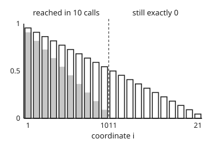
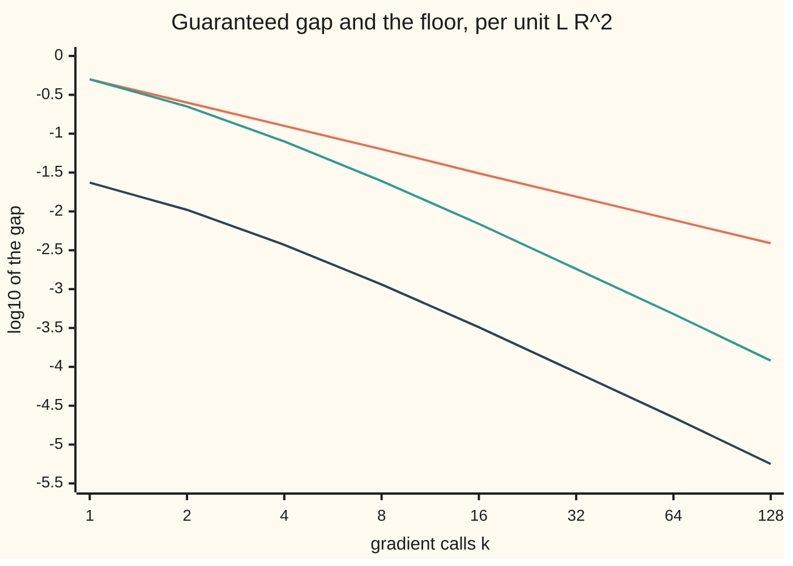

# The speed limit: no gradient method can beat 1/k^2 on smooth convex problems

[Syllabus](../../../SYLLABUS.md) → [Optimization](../README.md) → [First-Order Methods at Scale](../README.md#s08) → The speed limit

---

## General Overview

An index fund tracks 2,000 shares. Each day it refits its holdings: 2,000 weights, chosen to **minimise** the squared gap between the fund's return and the index's return over the last 250 trading days. The cost is a smooth convex bowl in 2,000 unknowns. Every gradient call (one computation of the slope) reads the whole table of 250 × 2,000 = 500,000 daily returns. The weights must also be non-negative and sum to 1; [Frank-Wolfe](01-frank-wolfe-conditional-gradient.md) handles that limit, and this card sets it aside to ask about the smooth cost alone.

So the honest unit of work is the number of gradient calls. Suppose the desk wants a guarantee: after k calls, the cost is within 0.0001 of its lowest value, measured in units of $`LR^2`$. Here $`L`$ is the steepest curvature of the bowl and $`R`$ is the distance from the starting weights to the best weights.

The guarantees on the earlier cards give these call counts:

- Plain gradient descent promises it after **5,000** calls.
- Nesterov's accelerated method promises it after **141** calls.
- **No** method that steps only along gradients it has seen can promise it in fewer than **30** calls.

This card proves the third line. It builds one bad bowl, a **chain**: a quadratic in which each gradient call can uncover only one more coordinate. On a chain of 21 coordinates, after 10 calls every such method has touched at most 10 of them. Its cost is then above the lowest value by at least 0.000831 (per unit of $`LR^2`$). The general formula, $`3/(32 \times 11^2)`$, gives 0.000775.

**A gradient method can only move inside the span of the gradients it has seen; on the chain quadratic each new gradient uncovers one more coordinate, so after k calls half the chain is still zero and the gap is at least $`3LR^2/(32(k+1)^2)`$; Nesterov's method reaches the same $`1/k^2`$ order, so it is optimal.**

**What kind of fact this is:** a theorem, proved on this card in Why it works for smooth convex functions. Its partners for strongly convex functions and for functions with corners are stated with a source (Bubeck, Theorems 3.13 and 3.15), and the checks test both on their own worst cases. The bound is about the worst case over all smooth convex functions. It does not say the fund's own cost is this hard.

### The picture: half the chain is still dark after 10 calls

<p align="center"></p>

Drawn to scale from the printed coordinates. The outlined bars are the best point of the 21-coordinate chain, $`x^*_i = 1 - i/22`$. The shaded bars are the best point any gradient method can reach in 10 calls: $`1 - i/11`$ in the first 10 coordinates and 0 in the rest. The 11 empty coordinates on the right are the gap the theorem counts.

---

## The formula

Notation first, in words. As on [Gradient descent](../02-Unconstrained%20Methods/02-gradient-descent-and-its-rate.md), $`x_k`$ is the point after k steps and $`x^*`$ is the minimiser. A **gradient call** is one computation of $`\nabla f`$ at one point. The **span** of some lists of numbers is every list you can build by scaling them and adding them up. This card introduces the **span condition**: the method's k-th point lies in the start point plus the span of the first k gradients it asked for,

```math
x_k \in x_0 + \mathrm{span}\{\nabla f(x_0), \nabla f(x_1), \dots, \nabla f(x_{k-1})\}.
```

Gradient descent, heavy ball, Nesterov's method and conjugate gradient all meet it. So does any method whose steps are built from past gradients and past moves.

**The lower bound** (Nesterov; Bubeck, Theorem 3.14). For every k with $`2k + 1 \le n`$, there is a convex function on n coordinates, with curvature at most L everywhere, such that every method meeting the span condition has

```math
f(x_k) - f^* \;\ge\; \frac{3\,L\,\lVert x_0 - x^*\rVert^2}{32\,(k+1)^2}.
```

**Read it aloud:** after k gradient calls, some smooth convex problem is still above its lowest value by at least three thirty-seconds of L times the squared starting distance, over k plus one squared.

The function that does it is the **chain quadratic**. Written here on n coordinates; for the bound, use it on the first 2k + 1 coordinates and leave any further coordinates out of the cost:

```math
f(x) = \frac{L}{8}\Big(x_1^2 + \sum_{i=1}^{n-1} (x_i - x_{i+1})^2 + x_n^2\Big) - \frac{L}{4}\,x_1
```

**Read it aloud:** a quarter of L times half the sum of squared jumps along a chain of numbers pinned to zero at both ends, minus a quarter of L times the first number.

The matching guarantees from earlier cards, for comparison:

```math
\text{gradient descent: } f(x_k) - f^* \le \frac{L R^2}{2k}, \qquad \text{Nesterov: } f(x_k) - f^* \le \frac{2 L R^2}{(k+1)^2}
```

**Read it aloud:** plain descent's guaranteed gap falls like one over k; Nesterov's falls like one over k squared, the same order as the floor, with a constant 64/3 times larger.



Orange (top): gradient descent's guarantee $`LR^2/(2k)`$. It falls by 0.30 for each doubling of k, a factor of 2. Green (middle): Nesterov's guarantee $`2LR^2/(k+1)^2`$. Dark (bottom): the floor $`3LR^2/(32(k+1)^2)`$. The last two fall towards 0.60 per doubling, a factor of 4, and stay parallel, 1.33 apart: $`\log_{10}(64/3)`$. No gradient method can promise a point below the dark line.

| Symbol | Plain meaning | In our example | Push it up and the answer… |
| --- | --- | --- | --- |
| $`f`$, $`f^*`$ | the cost being minimised; its lowest value | the chain; $`f^* = -0.119318`$ | — |
| $`x = (x_1, \dots, x_n)`$, $`n`$, $`i`$ | the numbers chosen; how many; the place of one in the chain | n = 21 | larger n allows more calls before the bound stops: k up to (n − 1)/2 |
| $`x_k`$, $`x_0`$, $`x^*`$ | the point after k calls; the start; the minimiser | $`x_0 = 0`$; $`x^*_i = 1 - i/22`$ | — |
| $`k`$ | gradient calls made | 10 | the floor falls like $`1/k^2`$ |
| $`L`$ | steepest curvature: the gradient changes by at most L per unit moved | 1 | floor rises in proportion |
| $`R`$ | starting distance $`\lVert x_0 - x^*\rVert`$ | $`R^2 = 6.840909`$ | floor rises like $`R^2`$ |
| $`A`$, $`e_1`$, $`p`$ | the chain's tridiagonal matrix; the list (1, 0, …, 0); the chain length 2k + 1 | p = 21 | — |
| $`\mu`$, $`\kappa`$, $`q`$ | gentlest curvature; the stretch ratio L/μ; the strongly convex floor's factor $`(\sqrt\kappa - 1)/(\sqrt\kappa + 1)`$ | κ = 100; q = 9/11 | larger κ, q nearer 1, more calls per digit |
| $`G`$, $`t`$, $`s`$ | for a cost with corners: the largest slope size; calls made; one of the first t points | G = 1, t = 10 | floor rises with G and falls like $`1/\sqrt t`$ |
| $`a`$, $`b`$ | the corner case's two weights, on the round bowl and on the largest coordinate | a = 0.2403, b = 0.7597 | — |

### When it holds

- **The method meets the span condition.** A method that uses more than gradients escapes it. One Newton step (a solve with the Hessian matrix of second derivatives) lands on the chain's minimiser at once: gap 0.000000.
- **There are at least 2k + 1 coordinates.** With as many calls as coordinates, conjugate gradient finishes the 21-coordinate chain exactly: gap 0.000000 after 21 calls, below the formula's 0.000194.
- **It is a worst case, not a forecast.** On the round bowl $`\tfrac L2\lVert x - x^*\rVert^2`$, one gradient step of size 1/L lands on $`x^*`$: gap 0.000000 after 1 call.
- **The cost is smooth and convex.** With strong convexity the floor falls geometrically instead. With corners (no L) it falls only like $`1/\sqrt t`$. Both are stated below.
- **The span condition is a simplification.** Bubeck notes that the general model lets a method choose any next point from its history; and that these lower bounds first appeared in Nemirovski and Yudin (1983). This card proves the span version.

---

## Why it works

### Step 0: the method can only see what the gradients show it

A gradient method knows the cost only through the gradients it asks for. If every gradient so far is zero beyond coordinate j, then every point it can build is zero beyond coordinate j too. So the trick is to build a cost whose gradients reveal the coordinates one at a time, like a chain where each link must be pulled before the next one moves.

### Step 1: each gradient uncovers exactly one more coordinate

The chain's gradient is

```math
\nabla f(x) = \frac{L}{4}\,(A x - e_1),
```

where $`e_1`$ is the list $`(1, 0, \dots, 0)`$ and A is the **tridiagonal** matrix (non-zero only on its main diagonal and the two diagonals next to it) with 2 on the diagonal and −1 beside it. Entry i of $`Ax`$ is $`2x_i - x_{i-1} - x_{i+1}`$. It involves only coordinate i and its two neighbours.

Start at $`x_0 = 0`$. The first gradient is $`-\tfrac L4 e_1`$: only coordinate 1 is non-zero. Suppose a point is zero beyond coordinate j. Then $`Ax`$ is zero beyond coordinate j + 1, because each entry looks only one place to the left. So each new gradient can be non-zero in at most one more place.

By the span condition, after k calls $`x_k`$ is zero in coordinates k + 1 to n. The checks print the count of non-zero coordinates after each call: 1, 2, …, 10 for both gradient descent and Nesterov's method.

### Step 2: the best point with only k coordinates

So $`f(x_k)`$ is at least the lowest value of f over points that are zero beyond coordinate k. On those points the chain is the same function with k coordinates. Setting its gradient to zero gives $`Ax = e_1`$ on the first k coordinates. The answer is a straight line falling to zero one place past the end:

```math
x_i = 1 - \frac{i}{k+1}\ (i \le k), \qquad \min = -\frac{L}{8}\Big(1 - \frac{1}{k+1}\Big).
```

Check one row: $`2x_i - x_{i-1} - x_{i+1} = 0`$ on a straight line, and in row 1, $`2(1 - \tfrac1{k+1}) - (1 - \tfrac2{k+1}) = 1`$. At the minimiser $`x^\top A x = x_1`$, so $`f = \tfrac L8 x_1 - \tfrac L4 x_1 = -\tfrac L8 x_1`$.

### Step 3: half the chain is still unreached

Take n = 2k + 1. The full chain's minimum is $`-\tfrac L8\big(1 - \tfrac1{2k+2}\big)`$, so

```math
f(x_k) - f^* \;\ge\; \frac{L}{8}\Big(\frac{1}{k+1} - \frac{1}{2k+2}\Big) = \frac{L}{16(k+1)}.
```

The starting distance is $`R^2 = \sum_{i=1}^{2k+1} \big(1 - \tfrac{i}{2k+2}\big)^2`$, at most $`(2k+2)/3`$. Dividing the gap by $`LR^2`$ gives the floor $`3/(32(k+1)^2)`$.

<details>
<summary>Detailed proof: the chain is smooth and convex, and the distance bound</summary>

**Smooth and convex.** For any x, $`x^\top A x = x_1^2 + \sum_{i=1}^{n-1}(x_i - x_{i+1})^2 + x_n^2`$. This is a sum of squares, so it is at least 0: A is positive semidefinite ($`A \succeq 0`$) and f is convex. Each square of a difference is at most twice the sum of the two squares, so

$`\displaystyle x^\top A x \le x_1^2 + x_n^2 + 2\sum_{i=1}^{n-1}(x_i^2 + x_{i+1}^2) \le 4\lVert x\rVert^2.`$

The Hessian of f is $`\tfrac L4 A`$, whose curvature is therefore between 0 and L. So f has curvature at most L everywhere.

**The span.** Shown in Step 1 by induction: if $`x_0, \dots, x_{j-1}`$ are zero beyond coordinates $`0, \dots, j-1`$, the gradients at them are zero beyond coordinates $`1, \dots, j`$, and so is any point in their span.

**The distance.** With $`p = 2k + 1`$, $`R^2 = \sum_{i=1}^{p}\big(\tfrac{i}{p+1}\big)^2 = \frac{p(2p+1)}{6(p+1)} \le \frac{p+1}{3}`$, since $`p(2p+1) \le 2(p+1)^2`$.

**The ratio.** $`\displaystyle \frac{f(x_k) - f^*}{L R^2} \ge \frac{1/(16(k+1))}{(2k+2)/3} = \frac{3}{32(k+1)^2}.`$

</details>

### Step 4: why this makes "optimal" a theorem

[Momentum and Adam](../06-Conic%2C%20Quadratic%20and%20Stochastic%20Programs/09-momentum-adam-and-step-size-schedules.md) proved Nesterov's rate on a quadratic bowl. [Proximal gradient](../06-Conic%2C%20Quadratic%20and%20Stochastic%20Programs/06-proximal-methods-ista-fista-and-the-lasso.md) stated its guarantee for every smooth convex cost: $`2LR^2/(k+1)^2`$, from Beck and Teboulle. The floor here is $`3LR^2/(32(k+1)^2)`$. Both fall like $`1/k^2`$ and differ by the fixed factor 64/3.

So no gradient method can improve Nesterov's guarantee by more than a constant factor, for every k up to half the dimension. That is what "optimal" means: optimal in the order of its worst-case guarantee, not fastest on every problem.

### Step 5: the two partner bounds, stated

**Strongly convex** (Bubeck, Theorem 3.15). If every curvature lies between μ and L, with κ = L/μ, the chain plus a small round bowl gives, on an unlimited number of coordinates,

```math
f(x_k) - f^* \;\ge\; \frac{\mu}{2}\,q^{2k}\,\lVert x_0 - x^*\rVert^2, \qquad q = \frac{\sqrt\kappa - 1}{\sqrt\kappa + 1}.
```

Its minimiser is $`x^*_i = q^i`$: geometric, not straight. The check builds it on 2,000 coordinates with κ = 100 and finds $`x^*_5 = 0.366648 = q^5`$. After 10 calls the best reachable gap is 6.123e-04, above the floor 1.830e-04.

In calls per tenfold cut of the gap, at κ = 100: the floor allows 5.74, Nesterov's guarantee $`(1 - 1/\sqrt\kappa)^k`$ needs 21.85, and gradient descent's $`(1 - 1/\kappa)^k`$ needs 229.11. Both the floor and Nesterov scale with $`\sqrt\kappa`$; plain descent scales with κ.

**With corners** (Bubeck, Theorem 3.13). For convex functions whose slopes have size at most G, but which may have corners, minimised over a ball of radius R, the best of the first t points queried, $`x_0`$ to $`x_{t-1}`$, satisfies, for t up to n,

```math
\min_{0 \le s \le t-1} f(x_s) - f^* \;\ge\; \frac{R\,G}{2(1 + \sqrt t)}.
```

The worst case is $`b\max_{i \le t} x_i + \tfrac a2\lVert x\rVert^2`$, with $`a = (G/R)/(1 + \sqrt t)`$ and $`b = G\sqrt t/(1 + \sqrt t)`$. At a corner the oracle returns one subgradient (a slope at a corner, as on [The subgradient method](../02-Unconstrained%20Methods/11-subgradient-method-and-polyak-steps.md)): the one on the first largest coordinate, so at 0 it points along $`e_1`$ only.

As on the chain, each call uncovers one more coordinate. So the first t points are zero in coordinate t, their largest coordinate is at least 0, and their cost is at least 0. With t = 10 and R = G = 1, the minimum is −0.120127, and the subgradient method's best is 0.000000. Each point is therefore at least 0.120127 above the minimum, the formula's value. That method's own guarantee is $`RG/\sqrt t = 0.316228`$: the same $`1/\sqrt t`$ order, so it too is optimal for its class.

---

## Worked numbers, by hand

The chain with n = 21, L = 1, start $`x_0 = 0`$, after k = 10 calls.

| Step | Arithmetic | Value |
| --- | --- | --- |
| minimiser | $`x^*_i = 1 - i/22`$, first and last | 0.954545; 0.045455 |
| lowest value | $`-\tfrac18(1 - 1/22)`$ | −0.119318 |
| squared start distance | $`\sum_{i=1}^{21}(i/22)^2 = 3311/484`$ | 6.840909 |
| its bound | (21 + 1)/3 | 7.333333 |
| best point in 10 coordinates | $`1 - i/11`$, first and last | 0.909; 0.091 |
| its value | $`-\tfrac18(1 - 1/11)`$ | −0.113636 |
| gap | $`\tfrac18(\tfrac1{11} - \tfrac1{22}) = 1/176`$ | 0.005682 |
| gap per unit $`LR^2`$ | 0.005682 / 6.840909 | **0.000831** |
| the theorem's floor | $`3/(32 \times 121)`$ | 0.000775 |

After 10 gradient calls, no method meeting the span condition can be closer than 0.000831 (in units of $`LR^2`$) to the bottom of this chain. The formula's 0.000775 is a little lower because it uses the rounder distance bound 7.333333.

### What breaks if you drop a piece

| Mistake | Comes out at | What went wrong |
| --- | --- | --- |
| 21 calls on 21 coordinates | conjugate gradient's gap 0.000000, below the formula's 0.000194 | k > (n − 1)/2: the chain has no unreached half left |
| Count one Newton step as one call | gap 0.000000 after one step | the Hessian solve leaves the span of the gradients |
| Read the floor as a forecast for every problem | round bowl: gap 0.000000 after 1 gradient call | the floor is a worst case over all smooth convex costs |
| Apply the smooth floor to a cost with corners | real floor at t = 10 is 0.120127, not 0.000775 | without L, the floor falls only like $`1/\sqrt t`$ |

The code prints all four.

---

## Code, from first principles, and it actually runs

The script builds the 21-coordinate chain and reaches the best gap after 10 calls by three roads: the closed form of Step 2, elimination on the 10-coordinate system, and 10 steps of conjugate gradient, which on a quadratic finds the lowest point of exactly this span. It then runs gradient descent and Nesterov's method, counts their non-zero coordinates, and checks each gap lies between the best possible and its own guarantee. A fourth road tries 1,000 random heavy-ball methods, with step and momentum drawn by a SplitMix64 generator (seed 2026); none gets below the floor. It also builds the strongly convex chain and the corner case, and prints every number on the card.

### Python

```python
# Lower bounds for first-order methods: the check behind the card.  Standard library only.
# The chain quadratic, its minimiser, the best point any gradient-span method can reach,
# and gradient descent, Nesterov, conjugate gradient and 1000 random span methods on it.
import math
L, N, K = 1.0, 21, 10                      # smoothness, coordinates, gradient calls

def grad(x):                               # gradient of the chain: (L/4)(A x - e1)
    n = len(x)
    return [L/4*(2*x[i] - (x[i-1] if i > 0 else 0.0) - (x[i+1] if i < n-1 else 0.0)
                 - (1.0 if i == 0 else 0.0)) for i in range(n)]
def f(x):
    s = x[0]**2 + x[-1]**2 + sum((x[i] - x[i+1])**2 for i in range(len(x) - 1))
    return L/8*s - L/4*x[0]
def solve(m, d, off, rhs):                 # elimination on an m x m tridiagonal system
    c, r = [0.0]*m, [0.0]*m
    for i in range(m):
        piv = d - (off*c[i-1] if i > 0 else 0.0)
        c[i] = off/piv
        r[i] = (rhs[i] - (off*r[i-1] if i > 0 else 0.0))/piv
    for i in range(m - 2, -1, -1):
        r[i] -= c[i]*r[i+1]
    return r
def pad(v): return v + [0.0]*(N - len(v))
def nnz(x): return sum(1 for v in x if abs(v) > 1e-15)
def lg(v): return f"{math.log10(v):.2f}"

xs = [1 - i/(N+1) for i in range(1, N+1)]
fs, R2 = f(xs), sum(v*v for v in xs)
elim = solve(N, 2.0, -1.0, [1.0] + [0.0]*(N-1))
assert max(abs(a - b) for a, b in zip(elim, xs)) < 1e-12
assert abs(fs + L/8*(1 - 1/(N+1))) < 1e-12 and abs(R2 - N*(2*N+1)/(6*(N+1))) < 1e-12
assert R2 <= (N+1)/3
print(f"chain: {N} coordinates, L {L:.0f}, start x0 = 0, {K} gradient calls")
print(f"minimiser x*_i = 1 - i/{N+1}: x*_1 {xs[0]:.6f}, x*_{N} {xs[-1]:.6f}; f* {fs:.6f}")
print(f"start distance R^2 {R2:.6f} (bound (n+1)/3 = {(N+1)/3:.6f}), R {math.sqrt(R2):.6f}")

def cg(steps):                             # conjugate gradient from 0, one product A p per step
    x = [0.0]*N; r = [-g for g in grad(x)]; p = r[:]
    for _ in range(steps):
        Ap = [g + (L/4 if i == 0 else 0.0) for i, g in enumerate(grad(p))]   # (L/4) A p
        rr = sum(u*u for u in r); a = rr/sum(u*v for u, v in zip(p, Ap))
        x = [u + a*v for u, v in zip(x, p)]; r = [u - a*v for u, v in zip(r, Ap)]
        p = [u + sum(w*w for w in r)/rr*v for u, v in zip(r, p)]
    return x
best_cf = -L/8*(1 - 1/(K+1))
best_el = f(pad(solve(K, 2.0, -1.0, [1.0] + [0.0]*(K-1))))
xcg = cg(K)
assert abs(best_cf - best_el) < 1e-12 and abs(best_cf - f(xcg)) < 1e-12 and nnz(xcg) == K
best, floor = (best_cf - fs)/(L*R2), 3/(32*(K+1)**2)
assert best >= floor
print(f"best after {K} calls: closed form {best_cf:.6f}; elimination {best_el:.6f}; conjugate gradient {f(xcg):.6f}")
print(f"gap after {K} calls: {best_cf - fs:.6f}; per unit L R^2: best possible {best:.6f}; floor 3/(32*{K+1}^2) {floor:.6f}")

def runs(a, b, nest):                      # gradient descent, heavy ball or Nesterov, K calls
    x, xp, z, t, sup = [0.0]*N, [0.0]*N, [0.0]*N, 1.0, []
    for _ in range(K):
        g = grad(z if nest else x)
        if nest:
            xn = [u - v/L for u, v in zip(z, g)]; tn = (1 + math.sqrt(1 + 4*t*t))/2
            z = [u + (t - 1)/tn*(u - v) for u, v in zip(xn, x)]; t = tn
        else:
            xn = [u - a*v/L + b*(u - w) for u, v, w in zip(x, g, xp)]
        xp, x = x, xn; sup.append(nnz(x))
    return (f(x) - fs)/(L*R2), sup
gd, sgd = runs(1.0, 0.0, False)
ne, sne = runs(1.0, 0.0, True)
assert sgd == sne == list(range(1, K+1))
assert best <= ne < gd <= 1/(2*K) and ne <= 2/(K+1)**2
print(f"nonzero coordinates after calls 1..{K}: gd {sgd}; nesterov {sne}")
print(f"gap per unit L R^2 after {K} calls: gd {gd:.6f} (guarantee {1/(2*K):.6f}); nesterov {ne:.6f} (guarantee {2/(K+1)**2:.6f})")

s = 2026                                   # SplitMix64, seed 2026
def rnd():
    global s
    s = (s + 0x9E3779B97F4A7C15) & (2**64 - 1); z = s
    z = ((z ^ (z >> 30))*0xBF58476D1CE4E5B9) & (2**64 - 1)
    z = ((z ^ (z >> 27))*0x94D049BB133111EB) & (2**64 - 1)
    return ((z ^ (z >> 31)) >> 11)/2**53
low = min(runs(0.2 + 1.6*rnd(), 0.9*rnd(), False)[0] for _ in range(1000))
assert low >= best
print(f"1000 random heavy-ball methods (step 0.2..1.8, momentum 0..0.9): smallest gap {low:.6f}")

def calls(bound, eps):
    k = 1
    while bound(k) > eps: k += 1
    return k
for eps, lab in ((1e-4, "0.0001"), (1e-6, "0.000001")):
    c = [calls(lambda k: 3/(32*(k+1)**2), eps), calls(lambda k: 2/(k+1)**2, eps), calls(lambda k: 1/(2*k), eps)]
    assert c[0] < c[1] < c[2] and 2*c[0] + 1 <= 2000
    print(f"calls to promise a gap <= {lab} L R^2: floor {c[0]}, nesterov {c[1]}, gd {c[2]}")
ks = [1, 2, 4, 8, 16, 32, 64, 128]
print("chart k", *ks)
print("chart log10, gd guarantee      ", *[lg(1/(2*k)) for k in ks])
print("chart log10, nesterov guarantee", *[lg(2/(k+1)**2) for k in ks])
print("chart log10, floor             ", *[lg(3/(32*(k+1)**2)) for k in ks], "; nesterov - floor", lg(64/3))

for kap in (100.0, 10000.0):               # strongly convex chain, n = 2000, mu = L/kappa
    mu, m = L/kap, 2000; c = (L - mu)/4; q = (math.sqrt(kap) - 1)/(math.sqrt(kap) + 1)
    xst = solve(m, 2*c + mu, -c, [c] + [0.0]*(m-1)); r2 = sum(v*v for v in xst)
    gap = c/2*(xst[0] - solve(K, 2*c + mu, -c, [c] + [0.0]*(K-1))[0])
    lb = mu/2*q**(2*K)*r2
    assert gap >= lb and abs(xst[4] - q**5) < 1e-9
    d = [math.log(10)/(-2*math.log(q)), math.log(10)/(-math.log(1 - 1/math.sqrt(kap))), math.log(10)/(-math.log(1 - 1/kap))]
    print(f"strongly convex chain, kappa {kap:.0f}: x*_5 {xst[4]:.6f} = q^5 {q**5:.6f}; best gap after {K} calls {gap:.3e} >= floor {lb:.3e}")
    print(f"  calls per tenfold cut: floor {d[0]:.2f}, nesterov {d[1]:.2f}, gd {d[2]:.2f}")

t, R, G = 10, 1.0, 1.0                     # nonsmooth: b max_{i<=t} x_i + (a/2)|x|^2
a, b = (G/R)/(1 + math.sqrt(t)), G*math.sqrt(t)/(1 + math.sqrt(t))
fn = lambda x: b*max(x[:t]) + a/2*sum(v*v for v in x)
fmin = -b**2/(2*a*t)
scan = min(b*c + a*t*c*c/2 for c in [-j*1e-6 for j in range(500001)])
x, fb = [0.0]*t, math.inf
for _ in range(t):                         # subgradient method, step R/(G sqrt t)
    fb = min(fb, fn(x)); i = x.index(max(x))
    x = [v - R/(G*math.sqrt(t))*(a*v + (b if j == i else 0.0)) for j, v in enumerate(x)]
assert abs(scan - fmin) < 1e-9 and fb >= 0 and abs(-fmin - R*G/(2*(1 + math.sqrt(t)))) < 1e-12
print(f"nonsmooth, t {t}, R 1, G 1: weights a {a:.4f}, b {b:.4f}; min {fmin:.6f} (scan {scan:.6f}); best of {t} queried points {fb:.6f}")
print(f"  floor RG/(2(1+sqrt t)) {-fmin:.6f}; subgradient guarantee RG/sqrt t {R*G/math.sqrt(t):.6f}")

print("figure, x*        ", " ".join(f"{v:.3f}" for v in xs))
print("figure, 10 calls  ", " ".join(f"{v:.3f}" for v in pad(solve(K, 2.0, -1.0, [1.0] + [0.0]*(K-1)))))
x0 = [0.0]*N                               # one Newton step x0 - H^-1 grad f(x0), H = (L/4) A
xn = [u - v for u, v in zip(x0, solve(N, L/2, -L/4, grad(x0)))]
g21 = abs(f(cg(N)) - fs)/(L*R2); newton = abs(f(xn) - fs)
def bowl(x): return L/2*sum((u - v)**2 for u, v in zip(x, xs))   # the round bowl (L/2)|x - x*|^2
def gbowl(x): return [L*(u - v) for u, v in zip(x, xs)]           # and its gradient
xr = [u - g/L for u, g in zip(x0, gbowl(x0))]; round_gap = bowl(xr)   # one gradient step 1/L
assert g21 < 1e-12 and newton < 1e-12 and round_gap < 1e-15
print(f"breaks: {N} calls on {N} coordinates: cg gap {g21:.6f}, below the floor {3/(32*(N+1)**2):.6f}")
print(f"breaks: one Newton step (a Hessian solve, outside the span): gap {newton:.6f}")
print(f"breaks: round bowl (L/2)|x - x*|^2: gd lands on x* in 1 call, gap {round_gap:.6f}")
for k in (20, 40):
    r2 = sum((1 - i/(2*k + 2))**2 for i in range(1, 2*k + 2))
    print(f"try: k {k}, chain of {2*k+1}: best possible {1/(16*(k+1)*r2):.6f}, floor {3/(32*(k+1)**2):.6f}")
print("ALL CHECKS PASS")
```

**Ran 2026-11-24 on macOS, Python 3.14.10, standard library only. All checks passed. Output, pasted from the run:**

```
chain: 21 coordinates, L 1, start x0 = 0, 10 gradient calls
minimiser x*_i = 1 - i/22: x*_1 0.954545, x*_21 0.045455; f* -0.119318
start distance R^2 6.840909 (bound (n+1)/3 = 7.333333), R 2.615513
best after 10 calls: closed form -0.113636; elimination -0.113636; conjugate gradient -0.113636
gap after 10 calls: 0.005682; per unit L R^2: best possible 0.000831; floor 3/(32*11^2) 0.000775
nonzero coordinates after calls 1..10: gd [1, 2, 3, 4, 5, 6, 7, 8, 9, 10]; nesterov [1, 2, 3, 4, 5, 6, 7, 8, 9, 10]
gap per unit L R^2 after 10 calls: gd 0.003642 (guarantee 0.050000); nesterov 0.002290 (guarantee 0.016529)
1000 random heavy-ball methods (step 0.2..1.8, momentum 0..0.9): smallest gap 0.001366
calls to promise a gap <= 0.0001 L R^2: floor 30, nesterov 141, gd 5000
calls to promise a gap <= 0.000001 L R^2: floor 306, nesterov 1414, gd 500000
chart k 1 2 4 8 16 32 64 128
chart log10, gd guarantee       -0.30 -0.60 -0.90 -1.20 -1.51 -1.81 -2.11 -2.41
chart log10, nesterov guarantee -0.30 -0.65 -1.10 -1.61 -2.16 -2.74 -3.32 -3.92
chart log10, floor              -1.63 -1.98 -2.43 -2.94 -3.49 -4.07 -4.65 -5.25 ; nesterov - floor 1.33
strongly convex chain, kappa 100: x*_5 0.366648 = q^5 0.366648; best gap after 10 calls 6.123e-04 >= floor 1.830e-04
  calls per tenfold cut: floor 5.74, nesterov 21.85, gd 229.11
strongly convex chain, kappa 10000: x*_5 0.904834 = q^5 0.904834; best gap after 10 calls 9.046e-03 >= floor 8.212e-04
  calls per tenfold cut: floor 57.56, nesterov 229.11, gd 23024.70
nonsmooth, t 10, R 1, G 1: weights a 0.2403, b 0.7597; min -0.120127 (scan -0.120127); best of 10 queried points 0.000000
  floor RG/(2(1+sqrt t)) 0.120127; subgradient guarantee RG/sqrt t 0.316228
figure, x*         0.955 0.909 0.864 0.818 0.773 0.727 0.682 0.636 0.591 0.545 0.500 0.455 0.409 0.364 0.318 0.273 0.227 0.182 0.136 0.091 0.045
figure, 10 calls   0.909 0.818 0.727 0.636 0.545 0.455 0.364 0.273 0.182 0.091 0.000 0.000 0.000 0.000 0.000 0.000 0.000 0.000 0.000 0.000 0.000
breaks: 21 calls on 21 coordinates: cg gap 0.000000, below the floor 0.000194
breaks: one Newton step (a Hessian solve, outside the span): gap 0.000000
breaks: round bowl (L/2)|x - x*|^2: gd lands on x* in 1 call, gap 0.000000
try: k 20, chain of 41: best possible 0.000220, floor 0.000213
try: k 40, chain of 81: best possible 0.000057, floor 0.000056
ALL CHECKS PASS
```

### Rust

```rust
// Lower bounds for first-order methods: the check behind the card.  std only.
// The chain quadratic, its minimiser, the best point any gradient-span method can reach,
// and gradient descent, Nesterov, conjugate gradient and 1000 random span methods on it.
const L: f64 = 1.0;
const N: usize = 21;
const K: usize = 10;

fn grad(x: &[f64]) -> Vec<f64> {            // gradient of the chain: (L/4)(A x - e1)
    let n = x.len();
    (0..n).map(|i| L / 4.0 * (2.0 * x[i] - if i > 0 { x[i - 1] } else { 0.0 }
        - if i < n - 1 { x[i + 1] } else { 0.0 } - if i == 0 { 1.0 } else { 0.0 })).collect()
}
fn f(x: &[f64]) -> f64 {
    let n = x.len();
    let s = x[0].powi(2) + x[n - 1].powi(2) + (0..n - 1).map(|i| (x[i] - x[i + 1]).powi(2)).sum::<f64>();
    L / 8.0 * s - L / 4.0 * x[0]
}
fn solve(m: usize, d: f64, off: f64, rhs: &[f64]) -> Vec<f64> {   // elimination, tridiagonal
    let (mut c, mut r) = (vec![0.0; m], vec![0.0; m]);
    for i in 0..m {
        let piv = d - if i > 0 { off * c[i - 1] } else { 0.0 };
        c[i] = off / piv;
        r[i] = (rhs[i] - if i > 0 { off * r[i - 1] } else { 0.0 }) / piv;
    }
    for i in (0..m - 1).rev() { r[i] -= c[i] * r[i + 1]; }
    r
}
fn e1(m: usize, v: f64) -> Vec<f64> { let mut e = vec![0.0; m]; e[0] = v; e }
fn pad(v: &[f64]) -> Vec<f64> { let mut w = v.to_vec(); w.resize(N, 0.0); w }
fn nnz(x: &[f64]) -> usize { x.iter().filter(|v| v.abs() > 1e-15).count() }
fn dot(a: &[f64], b: &[f64]) -> f64 { a.iter().zip(b).map(|(u, v)| u * v).sum() }
fn lg(v: f64) -> String { format!("{:.2}", v.log10()) }
fn sci(v: f64) -> String {                    // Python's .3e layout
    let s = format!("{:.3e}", v); let (m, e) = s.split_once('e').unwrap(); let e: i32 = e.parse().unwrap();
    format!("{}e{}{:02}", m, if e < 0 { '-' } else { '+' }, e.abs())
}
fn cg(steps: usize) -> Vec<f64> {            // conjugate gradient from 0, one product A p per step
    let mut x = vec![0.0; N];
    let mut r: Vec<f64> = grad(&x).iter().map(|g| -g).collect();
    let mut p = r.clone();
    for _ in 0..steps {
        let ap: Vec<f64> = grad(&p).iter().enumerate().map(|(i, g)| g + if i == 0 { L / 4.0 } else { 0.0 }).collect();
        let rr = dot(&r, &r); let a = rr / dot(&p, &ap);
        x = x.iter().zip(&p).map(|(u, v)| u + a * v).collect();
        r = r.iter().zip(&ap).map(|(u, v)| u - a * v).collect();
        let b = dot(&r, &r) / rr;
        p = r.iter().zip(&p).map(|(u, v)| u + b * v).collect();
    }
    x
}
fn runs(a: f64, b: f64, nest: bool, fs: f64, r2: f64) -> (f64, Vec<usize>) {
    let (mut x, mut xp, mut z, mut t, mut sup) = (vec![0.0; N], vec![0.0; N], vec![0.0; N], 1.0f64, vec![]);
    for _ in 0..K {
        let g = grad(if nest { &z } else { &x });
        let xn: Vec<f64>;
        if nest {
            xn = z.iter().zip(&g).map(|(u, v)| u - v / L).collect();
            let tn = (1.0 + (1.0 + 4.0 * t * t).sqrt()) / 2.0;
            z = xn.iter().zip(&x).map(|(u, v)| u + (t - 1.0) / tn * (u - v)).collect(); t = tn;
        } else {
            xn = (0..N).map(|i| x[i] - a * g[i] / L + b * (x[i] - xp[i])).collect();
        }
        xp = x; x = xn; sup.push(nnz(&x));
    }
    ((f(&x) - fs) / (L * r2), sup)
}
struct Rng(u64);
impl Rng {
    fn next(&mut self) -> f64 {
        self.0 = self.0.wrapping_add(0x9E3779B97F4A7C15); let mut z = self.0;
        z = (z ^ (z >> 30)).wrapping_mul(0xBF58476D1CE4E5B9);
        z = (z ^ (z >> 27)).wrapping_mul(0x94D049BB133111EB);
        ((z ^ (z >> 31)) >> 11) as f64 / 9007199254740992.0
    }
}
fn calls(bound: &dyn Fn(f64) -> f64, eps: f64) -> usize { let mut k = 1; while bound(k as f64) > eps { k += 1; } k }

fn main() {
    let xs: Vec<f64> = (1..=N).map(|i| 1.0 - i as f64 / (N + 1) as f64).collect();
    let (fs, r2) = (f(&xs), dot(&xs, &xs));
    let (nf, kf) = (N as f64, K as f64);
    let elim = solve(N, 2.0, -1.0, &e1(N, 1.0));
    assert!(elim.iter().zip(&xs).map(|(a, b)| (a - b).abs()).fold(0.0, f64::max) < 1e-12);
    assert!((fs + L / 8.0 * (1.0 - 1.0 / (nf + 1.0))).abs() < 1e-12 && (r2 - nf * (2.0 * nf + 1.0) / (6.0 * (nf + 1.0))).abs() < 1e-12);
    assert!(r2 <= (nf + 1.0) / 3.0);
    println!("chain: {} coordinates, L {:.0}, start x0 = 0, {} gradient calls", N, L, K);
    println!("minimiser x*_i = 1 - i/{}: x*_1 {:.6}, x*_{} {:.6}; f* {:.6}", N + 1, xs[0], N, xs[N - 1], fs);
    println!("start distance R^2 {:.6} (bound (n+1)/3 = {:.6}), R {:.6}", r2, (nf + 1.0) / 3.0, r2.sqrt());
    let best_cf = -L / 8.0 * (1.0 - 1.0 / (kf + 1.0));
    let xk = pad(&solve(K, 2.0, -1.0, &e1(K, 1.0)));
    let best_el = f(&xk);
    let xcg = cg(K);
    assert!((best_cf - best_el).abs() < 1e-12 && (best_cf - f(&xcg)).abs() < 1e-12 && nnz(&xcg) == K);
    let (best, floor) = ((best_cf - fs) / (L * r2), 3.0 / (32.0 * (kf + 1.0).powi(2)));
    assert!(best >= floor);
    println!("best after {} calls: closed form {:.6}; elimination {:.6}; conjugate gradient {:.6}", K, best_cf, best_el, f(&xcg));
    println!("gap after {} calls: {:.6}; per unit L R^2: best possible {:.6}; floor 3/(32*{}^2) {:.6}", K, best_cf - fs, best, K + 1, floor);
    let (gd, sgd) = runs(1.0, 0.0, false, fs, r2);
    let (ne, sne) = runs(1.0, 0.0, true, fs, r2);
    assert!(sgd == (1..=K).collect::<Vec<_>>() && sne == sgd);
    assert!(best <= ne && ne < gd && gd <= 1.0 / (2.0 * kf) && ne <= 2.0 / (kf + 1.0).powi(2));
    println!("nonzero coordinates after calls 1..{}: gd {:?}; nesterov {:?}", K, sgd, sne);
    println!("gap per unit L R^2 after {} calls: gd {:.6} (guarantee {:.6}); nesterov {:.6} (guarantee {:.6})", K, gd, 1.0 / (2.0 * kf), ne, 2.0 / (kf + 1.0).powi(2));
    let mut rng = Rng(2026);
    let mut low = f64::INFINITY;
    for _ in 0..1000 { let a = 0.2 + 1.6 * rng.next(); let b = 0.9 * rng.next(); low = low.min(runs(a, b, false, fs, r2).0); }
    assert!(low >= best);
    println!("1000 random heavy-ball methods (step 0.2..1.8, momentum 0..0.9): smallest gap {:.6}", low);
    for (eps, lab) in [(1e-4, "0.0001"), (1e-6, "0.000001")] {
        let c = [calls(&|k| 3.0 / (32.0 * (k + 1.0).powi(2)), eps), calls(&|k| 2.0 / (k + 1.0).powi(2), eps), calls(&|k| 1.0 / (2.0 * k), eps)];
        assert!(c[0] < c[1] && c[1] < c[2] && 2 * c[0] + 1 <= 2000);
        println!("calls to promise a gap <= {} L R^2: floor {}, nesterov {}, gd {}", lab, c[0], c[1], c[2]);
    }
    let ks = [1.0, 2.0, 4.0, 8.0, 16.0, 32.0, 64.0, 128.0];
    let row = |h: &dyn Fn(f64) -> f64| ks.iter().map(|&k| lg(h(k))).collect::<Vec<_>>().join(" ");
    println!("chart k {}", ks.iter().map(|k| format!("{}", k)).collect::<Vec<_>>().join(" "));
    println!("chart log10, gd guarantee       {}", row(&|k| 1.0 / (2.0 * k)));
    println!("chart log10, nesterov guarantee {}", row(&|k| 2.0 / (k + 1.0).powi(2)));
    println!("chart log10, floor              {} ; nesterov - floor {}", row(&|k| 3.0 / (32.0 * (k + 1.0).powi(2))), lg(64.0 / 3.0));
    for kap in [100.0f64, 10000.0] {             // strongly convex chain, n = 2000, mu = L/kappa
        let (mu, m) = (L / kap, 2000); let c = (L - mu) / 4.0; let q = (kap.sqrt() - 1.0) / (kap.sqrt() + 1.0);
        let xst = solve(m, 2.0 * c + mu, -c, &e1(m, c)); let rr = dot(&xst, &xst);
        let gap = c / 2.0 * (xst[0] - solve(K, 2.0 * c + mu, -c, &e1(K, c))[0]);
        let lb = mu / 2.0 * q.powi(2 * K as i32) * rr;
        assert!(gap >= lb && (xst[4] - q.powi(5)).abs() < 1e-9);
        let l10 = 10f64.ln();
        let d = [l10 / (-2.0 * q.ln()), l10 / (-(1.0 - 1.0 / kap.sqrt()).ln()), l10 / (-(1.0 - 1.0 / kap).ln())];
        println!("strongly convex chain, kappa {:.0}: x*_5 {:.6} = q^5 {:.6}; best gap after {} calls {} >= floor {}", kap, xst[4], q.powi(5), K, sci(gap), sci(lb));
        println!("  calls per tenfold cut: floor {:.2}, nesterov {:.2}, gd {:.2}", d[0], d[1], d[2]);
    }
    let (t, r, g) = (10usize, 1.0f64, 1.0f64);    // nonsmooth: b max_{i<=t} x_i + (a/2)|x|^2
    let tf = t as f64;
    let (a, b) = ((g / r) / (1.0 + tf.sqrt()), g * tf.sqrt() / (1.0 + tf.sqrt()));
    let fnn = |x: &[f64]| b * x.iter().cloned().fold(f64::NEG_INFINITY, f64::max) + a / 2.0 * dot(x, x);
    let fmin = -b * b / (2.0 * a * tf);
    let scan = (0..=500000).map(|j| { let c = -(j as f64) * 1e-6; b * c + a * tf * c * c / 2.0 }).fold(f64::INFINITY, f64::min);
    let (mut x, mut fb) = (vec![0.0; t], f64::INFINITY);
    for _ in 0..t {                              // subgradient method, step R/(G sqrt t)
        fb = fb.min(fnn(&x));
        let mx = x.iter().cloned().fold(f64::NEG_INFINITY, f64::max); let i = x.iter().position(|&v| v == mx).unwrap();
        x = x.iter().enumerate().map(|(j, v)| v - r / (g * tf.sqrt()) * (a * v + if j == i { b } else { 0.0 })).collect();
    }
    assert!((scan - fmin).abs() < 1e-9 && fb >= 0.0 && (-fmin - r * g / (2.0 * (1.0 + tf.sqrt()))).abs() < 1e-12);
    println!("nonsmooth, t {}, R 1, G 1: weights a {:.4}, b {:.4}; min {:.6} (scan {:.6}); best of {} queried points {:.6}", t, a, b, fmin, scan, t, fb);
    println!("  floor RG/(2(1+sqrt t)) {:.6}; subgradient guarantee RG/sqrt t {:.6}", -fmin, r * g / tf.sqrt());
    let j3 = |v: &[f64]| v.iter().map(|u| format!("{:.3}", u)).collect::<Vec<_>>().join(" ");
    println!("figure, x*         {}", j3(&xs));
    println!("figure, 10 calls   {}", j3(&xk));
    let x0 = vec![0.0; N];                       // one Newton step x0 - H^-1 grad f(x0), H = (L/4) A
    let xn: Vec<f64> = x0.iter().zip(&solve(N, L / 2.0, -L / 4.0, &grad(&x0))).map(|(u, v)| u - v).collect();
    let g21 = (f(&cg(N)) - fs).abs() / (L * r2); let newton = (f(&xn) - fs).abs();
    let bowl = |x: &[f64]| L / 2.0 * x.iter().zip(&xs).map(|(u, v)| (u - v).powi(2)).sum::<f64>();   // the round bowl (L/2)|x - x*|^2
    let gbowl = |x: &[f64]| -> Vec<f64> { x.iter().zip(&xs).map(|(u, v)| L * (u - v)).collect() };   // and its gradient
    let xr: Vec<f64> = x0.iter().zip(&gbowl(&x0)).map(|(u, g)| u - g / L).collect(); let round_gap = bowl(&xr);   // one step 1/L
    assert!(g21 < 1e-12 && newton < 1e-12 && round_gap < 1e-15);
    println!("breaks: {} calls on {} coordinates: cg gap {:.6}, below the floor {:.6}", N, N, g21, 3.0 / (32.0 * (nf + 1.0).powi(2)));
    println!("breaks: one Newton step (a Hessian solve, outside the span): gap {:.6}", newton);
    println!("breaks: round bowl (L/2)|x - x*|^2: gd lands on x* in 1 call, gap {:.6}", round_gap);
    for k in [20usize, 40] {
        let rk: f64 = (1..2 * k + 2).map(|i| (1.0 - i as f64 / (2 * k + 2) as f64).powi(2)).sum();
        println!("try: k {}, chain of {}: best possible {:.6}, floor {:.6}", k, 2 * k + 1, 1.0 / (16.0 * (k + 1) as f64 * rk), 3.0 / (32.0 * ((k + 1) as f64).powi(2)));
    }
    println!("ALL CHECKS PASS");
}
```

**Ran 2026-11-24 on macOS, rustc 1.98.1, no crates. All checks passed. Output, pasted from the run:**

```
chain: 21 coordinates, L 1, start x0 = 0, 10 gradient calls
minimiser x*_i = 1 - i/22: x*_1 0.954545, x*_21 0.045455; f* -0.119318
start distance R^2 6.840909 (bound (n+1)/3 = 7.333333), R 2.615513
best after 10 calls: closed form -0.113636; elimination -0.113636; conjugate gradient -0.113636
gap after 10 calls: 0.005682; per unit L R^2: best possible 0.000831; floor 3/(32*11^2) 0.000775
nonzero coordinates after calls 1..10: gd [1, 2, 3, 4, 5, 6, 7, 8, 9, 10]; nesterov [1, 2, 3, 4, 5, 6, 7, 8, 9, 10]
gap per unit L R^2 after 10 calls: gd 0.003642 (guarantee 0.050000); nesterov 0.002290 (guarantee 0.016529)
1000 random heavy-ball methods (step 0.2..1.8, momentum 0..0.9): smallest gap 0.001366
calls to promise a gap <= 0.0001 L R^2: floor 30, nesterov 141, gd 5000
calls to promise a gap <= 0.000001 L R^2: floor 306, nesterov 1414, gd 500000
chart k 1 2 4 8 16 32 64 128
chart log10, gd guarantee       -0.30 -0.60 -0.90 -1.20 -1.51 -1.81 -2.11 -2.41
chart log10, nesterov guarantee -0.30 -0.65 -1.10 -1.61 -2.16 -2.74 -3.32 -3.92
chart log10, floor              -1.63 -1.98 -2.43 -2.94 -3.49 -4.07 -4.65 -5.25 ; nesterov - floor 1.33
strongly convex chain, kappa 100: x*_5 0.366648 = q^5 0.366648; best gap after 10 calls 6.123e-04 >= floor 1.830e-04
  calls per tenfold cut: floor 5.74, nesterov 21.85, gd 229.11
strongly convex chain, kappa 10000: x*_5 0.904834 = q^5 0.904834; best gap after 10 calls 9.046e-03 >= floor 8.212e-04
  calls per tenfold cut: floor 57.56, nesterov 229.11, gd 23024.70
nonsmooth, t 10, R 1, G 1: weights a 0.2403, b 0.7597; min -0.120127 (scan -0.120127); best of 10 queried points 0.000000
  floor RG/(2(1+sqrt t)) 0.120127; subgradient guarantee RG/sqrt t 0.316228
figure, x*         0.955 0.909 0.864 0.818 0.773 0.727 0.682 0.636 0.591 0.545 0.500 0.455 0.409 0.364 0.318 0.273 0.227 0.182 0.136 0.091 0.045
figure, 10 calls   0.909 0.818 0.727 0.636 0.545 0.455 0.364 0.273 0.182 0.091 0.000 0.000 0.000 0.000 0.000 0.000 0.000 0.000 0.000 0.000 0.000
breaks: 21 calls on 21 coordinates: cg gap 0.000000, below the floor 0.000194
breaks: one Newton step (a Hessian solve, outside the span): gap 0.000000
breaks: round bowl (L/2)|x - x*|^2: gd lands on x* in 1 call, gap 0.000000
try: k 20, chain of 41: best possible 0.000220, floor 0.000213
try: k 40, chain of 81: best possible 0.000057, floor 0.000056
ALL CHECKS PASS
```

The two outputs match line for line.

### Lean

Lean proves the speed limit for every k, every L > 0 and every n ≥ 2k + 1, and checks the card's worked numbers.

- Take L > 0, any start $`x_0`$, k calls and n ≥ 2k + 1 coordinates. Then some convex cost with curvature at most L has a minimiser $`x^*`$ that is not the start. Every method meeting the span condition is still at least $`3LR^2/(32(k+1)^2)`$ above $`f^*`$ after k calls.
- Suppose a point is zero beyond coordinate j. Then the chain's gradient $`\tfrac L4(Ax - e_1)`$ there is zero beyond coordinate j + 1.
- Take a chain of k coordinates and L > 0. Then the straight line $`x_i = 1 - i/(k+1)`$ solves $`Ax = e_1`$ and minimises the chain. Its value is $`-\tfrac L8(1 - \tfrac1{k+1})`$.
- On the 21-coordinate chain with L = 1, the squared start distance is 3311/484, below its bound 22/3.
- The lowest value is −21/176, and the best in 10 coordinates is −10/88.
- The gap after 10 calls is 1/176, or 11/13244 per unit $`LR^2`$, above the floor $`3/(32 \times 11^2)`$.
- To promise a gap of 0.0001 $`LR^2`$, the floor allows 30 calls, Nesterov needs 141 and gradient descent 5,000.
- For 0.000001 $`LR^2`$ the counts are 306, 1,414 and 500,000.

The method runs, the random methods, the strongly convex and corner bounds, and the decimals are left to the Python and Rust checks.

```lean
-- The speed limit: some smooth convex cost keeps every gradient-span method at least 3 L R^2 / (32 (k+1)^2) above its lowest value after k gradient calls, because on the chain quadratic each gradient uncovers only one more coordinate.
import Mathlib.Analysis.Calculus.Gradient.Basic
import Mathlib.Analysis.Convex.Function
import Mathlib.Analysis.InnerProductSpace.PiL2
import Mathlib.Data.Matrix.Mul
import Mathlib.LinearAlgebra.Span.Defs
import Mathlib.Order.Filter.Extr
import Mathlib.Tactic.NormNum
import Mathlib.Analysis.InnerProductSpace.Calculus
import Mathlib.Analysis.Calculus.FDeriv.Mul

open Matrix

/-- The chain's tridiagonal matrix `A` on `n` coordinates: 2 on the main diagonal,
−1 on the two diagonals next to it, 0 elsewhere. -/
def chainMatrix (n : ℕ) : Matrix (Fin n) (Fin n) ℝ :=
  Matrix.of fun i j =>
    if i = j then 2 else if (i : ℕ) + 1 = j ∨ (j : ℕ) + 1 = i then -1 else 0

/-- The list `e₁ = (1, 0, …, 0)` on `n` coordinates. -/
def firstUnit (n : ℕ) : Fin n → ℝ := fun i => if (i : ℕ) = 0 then 1 else 0

/-- The chain quadratic `f(x) = (L/8) xᵀ A x − (L/4) x₁`. Its quadratic part `xᵀ A x`
equals `x₁² + Σ (xᵢ − xᵢ₊₁)² + xₙ²`, the card's sum of squared jumps. -/
noncomputable def chainCost (n : ℕ) (L : ℝ) (x : Fin n → ℝ) : ℝ :=
  L / 8 * (x ⬝ᵥ (chainMatrix n *ᵥ x)) - L / 4 * (firstUnit n ⬝ᵥ x)

/-- A list on `n` places, read as a sequence on all of `ℕ` that is zero from place `n` on. -/
noncomputable def chainExt {n : ℕ} (x : Fin n → ℝ) (i : ℕ) : ℝ :=
  if h : i < n then x ⟨i, h⟩ else 0

/-- The chain operator on sequences, cut to the first `m` places. -/
noncomputable def chainOp (m : ℕ) (U : ℕ → ℝ) (i : ℕ) : ℝ :=
  if i < m then 2 * U i - (if i = 0 then 0 else U (i - 1)) - (if i + 1 < m then U (i + 1) else 0)
  else 0

/-- The straight line on `s` places: `1 − (i+1)/(s+1)` before place `s`, zero after. -/
noncomputable def chainLine (s : ℕ) (i : ℕ) : ℝ :=
  if i < s then 1 - ((i : ℝ) + 1) / ((s : ℝ) + 1) else 0

lemma chainExt_coe {n : ℕ} (x : Fin n → ℝ) (i : Fin n) : chainExt x i = x i := by
  simp [chainExt]

lemma dotProduct_eq_range {n : ℕ} (x y : Fin n → ℝ) :
    x ⬝ᵥ y = ∑ i ∈ Finset.range n, chainExt x i * chainExt y i := by
  rw [dotProduct, ← Fin.sum_univ_eq_sum_range (fun i => chainExt x i * chainExt y i)]
  simp [chainExt_coe]

lemma chain_mulVec_eq {n : ℕ} (x : Fin n → ℝ) (i : Fin n) :
    (chainMatrix n *ᵥ x) i = chainOp n (chainExt x) i := by
  have hi := i.isLt
  have key : (chainMatrix n *ᵥ x) i = ∑ l ∈ Finset.range n,
      ((if l = (i : ℕ) then 2 * chainExt x l else 0) - (if l + 1 = (i : ℕ) then chainExt x l else 0)
        - (if l = (i : ℕ) + 1 then chainExt x l else 0)) := by
    rw [mulVec, dotProduct,
      ← Fin.sum_univ_eq_sum_range (fun l => ((if l = (i : ℕ) then 2 * chainExt x l else 0)
        - (if l + 1 = (i : ℕ) then chainExt x l else 0)
        - (if l = (i : ℕ) + 1 then chainExt x l else 0)))]
    apply Finset.sum_congr rfl
    intro l _
    rw [chainExt_coe]
    simp only [chainMatrix, of_apply, Fin.ext_iff]
    by_cases h1 : (i : ℕ) = l
    · simp [h1]
    · by_cases h2 : (i : ℕ) + 1 = l
      · simp [h1, h2, show ¬ (l : ℕ) = i by omega, show ¬ (l : ℕ) + 1 = i by omega]
      · by_cases h3 : (l : ℕ) + 1 = i
        · simp [h1, h2, h3, show ¬ (l : ℕ) = i by omega, show ¬ (l : ℕ) = i + 1 by omega]
        · simp [h1, h2, h3, show ¬ (l : ℕ) = i by omega, show ¬ (l : ℕ) = i + 1 by omega]
  rw [key, Finset.sum_sub_distrib, Finset.sum_sub_distrib, Finset.sum_ite_eq', Finset.sum_ite_eq']
  simp only [chainOp, if_pos hi, Finset.mem_range]
  congr 2
  rcases Nat.eq_zero_or_pos (i : ℕ) with h0 | h0
  · simp [h0]
  · obtain ⟨j, hj⟩ : ∃ j, (i : ℕ) = j + 1 := ⟨(i : ℕ) - 1, by omega⟩
    rw [hj]
    simp only [Nat.add_right_cancel_iff, Finset.sum_ite_eq', Finset.mem_range]
    simp [show j < n by omega]

lemma chainOp_sum (m : ℕ) (U V : ℕ → ℝ) :
    ∑ i ∈ Finset.range m, V i * chainOp m U i =
      2 * ∑ i ∈ Finset.range m, V i * U i
        - ∑ i ∈ Finset.range (m - 1), (V (i + 1) * U i + V i * U (i + 1)) := by
  rcases m with _ | p
  · simp
  · simp only [Nat.add_sub_cancel]
    have h1 : ∑ i ∈ Finset.range (p + 1), V i * chainOp (p + 1) U i =
        ∑ i ∈ Finset.range (p + 1), (2 * (V i * U i))
          - ∑ i ∈ Finset.range (p + 1), V i * (if i = 0 then 0 else U (i - 1))
          - ∑ i ∈ Finset.range (p + 1), V i * (if i + 1 < p + 1 then U (i + 1) else 0) := by
      rw [← Finset.sum_sub_distrib, ← Finset.sum_sub_distrib]
      apply Finset.sum_congr rfl
      intro i hi
      rw [Finset.mem_range] at hi
      simp only [chainOp, if_pos hi]; ring
    have h2 : ∑ i ∈ Finset.range (p + 1), V i * (if i = 0 then 0 else U (i - 1)) =
        ∑ i ∈ Finset.range p, V (i + 1) * U i := by
      rw [Finset.sum_range_succ']; simp
    have h3 : ∑ i ∈ Finset.range (p + 1), V i * (if i + 1 < p + 1 then U (i + 1) else 0) =
        ∑ i ∈ Finset.range p, V i * U (i + 1) := by
      rw [Finset.sum_range_succ]
      simp only [lt_irrefl, if_false, mul_zero, add_zero]
      apply Finset.sum_congr rfl
      intro i hi
      rw [Finset.mem_range] at hi
      rw [if_pos (by omega)]
    rw [h1, h2, h3, ← Finset.mul_sum, Finset.sum_add_distrib]; ring

lemma chainOp_quad_nonneg (m : ℕ) (U : ℕ → ℝ) :
    0 ≤ ∑ i ∈ Finset.range m, U i * chainOp m U i := by
  rw [chainOp_sum]
  rcases m with _ | p
  · simp
  · simp only [Nat.add_sub_cancel]
    have hid : 2 * ∑ i ∈ Finset.range (p + 1), U i * U i
        - ∑ i ∈ Finset.range p, (U (i + 1) * U i + U i * U (i + 1)) =
        U 0 ^ 2 + U p ^ 2 + ∑ i ∈ Finset.range p, (U i - U (i + 1)) ^ 2 := by
      have e1 := Finset.sum_range_succ (fun i => U i * U i) p
      have e2 := Finset.sum_range_succ' (fun i => U i * U i) p
      have e3 : ∑ i ∈ Finset.range p, (U i - U (i + 1)) ^ 2 =
          ∑ i ∈ Finset.range p, U i * U i + ∑ i ∈ Finset.range p, U (i + 1) * U (i + 1)
            - ∑ i ∈ Finset.range p, (U (i + 1) * U i + U i * U (i + 1)) := by
        rw [← Finset.sum_add_distrib, ← Finset.sum_sub_distrib]
        apply Finset.sum_congr rfl; intro i _; ring
      rw [e3]; linarith
    rw [hid]
    have := Finset.sum_nonneg (fun i (_ : i ∈ Finset.range p) => sq_nonneg (U i - U (i + 1)))
    positivity

lemma chainOp_line (m s : ℕ) (hs : s ≤ m) (i : ℕ) (hi : i < s) :
    chainOp m (chainLine s) i = if i = 0 then 1 else 0 := by
  have hs1 : (0 : ℝ) < (s : ℝ) + 1 := by positivity
  have hnext : (if i + 1 < m then chainLine s (i + 1) else 0) =
      1 - ((i : ℝ) + 2) / ((s : ℝ) + 1) := by
    by_cases h : i + 1 < s
    · rw [if_pos (by omega)]; simp only [chainLine, if_pos h]; push_cast; ring
    · have : i + 1 = s := by omega
      have hc : ((i : ℝ) + 2) = (s : ℝ) + 1 := by rw [← this]; push_cast; ring
      rw [hc, div_self hs1.ne']
      split_ifs <;> simp [chainLine, show ¬ (i + 1 < s) from h]
  rw [chainOp, if_pos (show i < m by omega), hnext]
  rcases Nat.eq_zero_or_pos i with h0 | h0
  · subst h0; simp [chainLine, hi]; field_simp; ring
  · obtain ⟨j, rfl⟩ : ∃ j, i = j + 1 := ⟨i - 1, by omega⟩
    simp [chainLine, hi, show j < s by omega]
    field_simp; ring


lemma chainExt_mulVec {n : ℕ} (c : Fin n → ℝ) :
    chainExt (chainMatrix n *ᵥ c) = chainOp n (chainExt c) := by
  funext i
  by_cases h : i < n
  · simp only [chainExt, dif_pos h]
    exact chain_mulVec_eq c ⟨i, h⟩
  · simp [chainExt, chainOp, h]

lemma chain_dot_symm {n : ℕ} (a b : Fin n → ℝ) :
    a ⬝ᵥ (chainMatrix n *ᵥ b) = b ⬝ᵥ (chainMatrix n *ᵥ a) := by
  rw [dotProduct_eq_range, dotProduct_eq_range, chainExt_mulVec, chainExt_mulVec,
    chainOp_sum, chainOp_sum]
  congr 1
  · congr 1; apply Finset.sum_congr rfl; intro i _; ring
  · apply Finset.sum_congr rfl; intro i _; ring

lemma chain_dot_nonneg {n : ℕ} (a : Fin n → ℝ) : 0 ≤ a ⬝ᵥ (chainMatrix n *ᵥ a) := by
  rw [dotProduct_eq_range, chainExt_mulVec]
  exact chainOp_quad_nonneg _ _

/-- The chain operator on `m` coordinates, acting on the first `m` of `n` coordinates. -/
noncomputable def padOp (n m : ℕ) :
    EuclideanSpace ℝ (Fin n) →L[ℝ] EuclideanSpace ℝ (Fin n) :=
  LinearMap.toContinuousLinearMap
  { toFun := fun u => WithLp.toLp 2 (fun i : Fin n => chainOp m (chainExt (WithLp.ofLp u)) i)
    map_add' := by
      intro u v; ext i
      simp only [PiLp.toLp_apply, PiLp.add_apply, chainOp, chainExt, WithLp.ofLp_add, Pi.add_apply]
      split_ifs <;> ring
    map_smul' := by
      intro c u; ext i
      simp only [PiLp.toLp_apply, PiLp.smul_apply, chainOp, chainExt, WithLp.ofLp_smul,
        Pi.smul_apply, smul_eq_mul, RingHom.id_apply]
      split_ifs <;> ring }

lemma padOp_ext {n m : ℕ} (hmn : m ≤ n) (u : EuclideanSpace ℝ (Fin n)) :
    chainExt (WithLp.ofLp (padOp n m u)) = chainOp m (chainExt (WithLp.ofLp u)) := by
  funext i
  by_cases h : i < n
  · simp [chainExt, h, padOp]
  · simp [chainExt, chainOp, h, show ¬ i < m by omega]

lemma inner_eq_range {n : ℕ} (u v : EuclideanSpace ℝ (Fin n)) :
    inner ℝ u v = ∑ i ∈ Finset.range n, chainExt (WithLp.ofLp u) i * chainExt (WithLp.ofLp v) i := by
  rw [EuclideanSpace.inner_eq_star_dotProduct, dotProduct_comm, dotProduct_eq_range]
  simp

lemma sum_chainOp_cut {n m : ℕ} (hmn : m ≤ n) (U V : ℕ → ℝ) :
    ∑ i ∈ Finset.range n, V i * chainOp m U i = ∑ i ∈ Finset.range m, V i * chainOp m U i := by
  symm
  apply Finset.sum_subset (Finset.range_subset_range.2 hmn)
  intro i _ hi
  rw [Finset.mem_range] at hi
  simp [chainOp, hi]

lemma padOp_symm {n m : ℕ} (hmn : m ≤ n) (u v : EuclideanSpace ℝ (Fin n)) :
    inner ℝ u (padOp n m v) = inner ℝ (padOp n m u) v := by
  rw [inner_eq_range, inner_eq_range, padOp_ext hmn, padOp_ext hmn, sum_chainOp_cut hmn]
  rw [Finset.sum_congr rfl (fun i _ => mul_comm (chainOp m (chainExt (WithLp.ofLp u)) i) _),
    sum_chainOp_cut hmn, chainOp_sum, chainOp_sum]
  congr 1
  · congr 1; apply Finset.sum_congr rfl; intro i _; ring
  · apply Finset.sum_congr rfl; intro i _; ring

lemma padOp_nonneg {n m : ℕ} (hmn : m ≤ n) (u : EuclideanSpace ℝ (Fin n)) :
    0 ≤ inner ℝ u (padOp n m u) := by
  rw [inner_eq_range, padOp_ext hmn, sum_chainOp_cut hmn]
  exact chainOp_quad_nonneg _ _

lemma chainExt_sq_le {n : ℕ} (x : Fin n → ℝ) (N : ℕ) :
    ∑ i ∈ Finset.range N, chainExt x i ^ 2 ≤ ∑ i ∈ Finset.range n, chainExt x i ^ 2 := by
  have h1 : ∑ i ∈ Finset.range N, chainExt x i ^ 2 ≤
      ∑ i ∈ Finset.range (max N n), chainExt x i ^ 2 :=
    Finset.sum_le_sum_of_subset_of_nonneg (Finset.range_subset_range.2 (le_max_left _ _))
      (fun i _ _ => sq_nonneg _)
  have h2 : ∑ i ∈ Finset.range (max N n), chainExt x i ^ 2 =
      ∑ i ∈ Finset.range n, chainExt x i ^ 2 := by
    symm
    apply Finset.sum_subset (Finset.range_subset_range.2 (le_max_right _ _))
    intro i _ hi
    rw [Finset.mem_range] at hi
    simp [chainExt, hi]
  linarith

lemma padOp_norm_le {n m : ℕ} (hmn : m ≤ n) (u : EuclideanSpace ℝ (Fin n)) :
    ‖padOp n m u‖ ≤ 4 * ‖u‖ := by
  set U := chainExt (WithLp.ofLp u) with hU
  have hn2 : ‖u‖ ^ 2 = ∑ i ∈ Finset.range n, U i ^ 2 := by
    rw [← real_inner_self_eq_norm_sq, inner_eq_range]
    apply Finset.sum_congr rfl; intro i _; ring
  have hT2 : ‖padOp n m u‖ ^ 2 = ∑ i ∈ Finset.range m, chainOp m U i ^ 2 := by
    rw [← real_inner_self_eq_norm_sq, inner_eq_range, padOp_ext hmn, sum_chainOp_cut hmn]
    apply Finset.sum_congr rfl; intro i _; ring
  have hterm : ∀ i ∈ Finset.range m, chainOp m U i ^ 2 ≤
      8 * U i ^ 2 + 4 * (if i = 0 then 0 else U (i - 1)) ^ 2 + 4 * U (i + 1) ^ 2 := by
    intro i hi
    rw [Finset.mem_range] at hi
    simp only [chainOp, if_pos hi]
    split_ifs
    · nlinarith [sq_nonneg (U i), sq_nonneg (U (i + 1)), sq_nonneg (U i + 2 * U (i + 1))]
    · nlinarith [sq_nonneg (U i), sq_nonneg (U (i + 1)), sq_nonneg (U i + 2 * U (i + 1))]
    · nlinarith [sq_nonneg (2 * U i + U (i - 1) + U (i + 1)), sq_nonneg (U (i - 1) - U (i + 1))]
    · nlinarith [sq_nonneg (U i + 2 * U (i - 1)), sq_nonneg (U (i + 1))]
  have hsum := Finset.sum_le_sum hterm
  rw [Finset.sum_add_distrib, Finset.sum_add_distrib, ← Finset.mul_sum, ← Finset.mul_sum,
    ← Finset.mul_sum] at hsum
  have hA : ∑ i ∈ Finset.range m, U i ^ 2 ≤ ∑ i ∈ Finset.range n, U i ^ 2 := chainExt_sq_le _ _
  have hB : ∑ i ∈ Finset.range m, (if i = 0 then 0 else U (i - 1)) ^ 2 ≤
      ∑ i ∈ Finset.range n, U i ^ 2 := by
    rcases m with _ | p
    · simp; exact Finset.sum_nonneg (fun i _ => sq_nonneg _)
    · rw [Finset.sum_range_succ']; simp
      exact chainExt_sq_le _ _
  have hC : ∑ i ∈ Finset.range m, U (i + 1) ^ 2 ≤ ∑ i ∈ Finset.range n, U i ^ 2 := by
    have := Finset.sum_range_succ' (fun i => U i ^ 2) m
    have h2 := chainExt_sq_le (WithLp.ofLp u) (m + 1)
    rw [← hU] at h2
    nlinarith [sq_nonneg (U 0)]
  have hsq : ‖padOp n m u‖ ^ 2 ≤ (4 * ‖u‖) ^ 2 := by
    rw [hT2, mul_pow, hn2]; nlinarith
  nlinarith [norm_nonneg (padOp n m u), norm_nonneg u]

/-- The coordinates from place `j` on are all zero. -/
def zeroFrom (n j : ℕ) : Submodule ℝ (EuclideanSpace ℝ (Fin n)) where
  carrier := {v | ∀ i : Fin n, j ≤ (i : ℕ) → v i = 0}
  add_mem' := by intro a b ha hb i hi; simp [ha i hi, hb i hi]
  zero_mem' := by intro i _; simp
  smul_mem' := by intro c a ha i hi; simp [ha i hi]

lemma zeroFrom_ext {n j : ℕ} {v : EuclideanSpace ℝ (Fin n)} (hv : v ∈ zeroFrom n j) :
    ∀ l, j ≤ l → chainExt (WithLp.ofLp v) l = 0 := by
  intro l hl
  by_cases h : l < n
  · simp only [chainExt, dif_pos h]; exact hv ⟨l, h⟩ hl
  · simp [chainExt, h]

lemma zeroFrom_mono {n j₁ j₂ : ℕ} (h : j₁ ≤ j₂) : zeroFrom n j₁ ≤ zeroFrom n j₂ := by
  intro v hv i hi; exact hv i (le_trans h hi)

lemma padOp_zeroFrom {n m j : ℕ} {v : EuclideanSpace ℝ (Fin n)} (hv : v ∈ zeroFrom n j) :
    padOp n m v ∈ zeroFrom n (j + 1) := by
  intro i hi
  have h0 := zeroFrom_ext hv
  simp only [padOp, LinearMap.coe_toContinuousLinearMap', LinearMap.coe_mk, AddHom.coe_mk,
    PiLp.toLp_apply, chainOp]
  rw [h0 i (by omega), h0 (i - 1) (by omega), h0 (i + 1) (by omega)]
  split_ifs <;> simp

lemma sum_range_sq_affine (a b : ℝ) (N : ℕ) :
    ∑ i ∈ Finset.range N, (a + b * i) ^ 2 =
      N * a ^ 2 + a * b * N * (N - 1) + b ^ 2 * (N - 1) * N * (2 * N - 1) / 6 := by
  induction N with
  | zero => simp
  | succ N ih => rw [Finset.sum_range_succ, ih]; push_cast; ring


/-- The cost used for the lower bound: the chain on the first `m` coordinates, moved to start at `x₀`. -/
noncomputable def lbCost (n m : ℕ) (L : ℝ) (x₀ x : EuclideanSpace ℝ (Fin n)) : ℝ :=
  L / 8 * inner ℝ (x - x₀) (padOp n m (x - x₀))
    - L / 4 * inner ℝ (WithLp.toLp 2 (firstUnit n) : EuclideanSpace ℝ (Fin n)) (x - x₀)

/-- **The lower bound (Nesterov; Bubeck, Theorem 3.14).** Fix a curvature limit `L > 0`,
a number of gradient calls `k` and `n ≥ 2k + 1` coordinates, and a start `x₀`. Then there
is a convex cost `f` on `n` coordinates, differentiable with curvature at most `L`
(its gradient changes by at most `L` per unit moved), with a minimiser `x*` different
from the start, such that every method meeting the span condition
`xⱼ ∈ x₀ + span {∇f(x₀), …, ∇f(xⱼ₋₁)}` (for `j = 0, …, k`) is still above the lowest value
after `k` calls by at least `3 L ‖x₀ − x*‖² / (32 (k + 1)²)`. -/
theorem no_gradient_method_beats_one_over_k_squared
    (n k : ℕ) (hn : 2 * k + 1 ≤ n) (L : ℝ) (hL : 0 < L)
    (x₀ : EuclideanSpace ℝ (Fin n)) :
    ∃ f : EuclideanSpace ℝ (Fin n) → ℝ,
      ConvexOn ℝ Set.univ f ∧ Differentiable ℝ f ∧
      (∀ x y, ‖gradient f x - gradient f y‖ ≤ L * ‖x - y‖) ∧
      ∃ xstar : EuclideanSpace ℝ (Fin n), IsMinOn f Set.univ xstar ∧ xstar ≠ x₀ ∧
        ∀ xs : ℕ → EuclideanSpace ℝ (Fin n),
          (∀ j ≤ k, xs j - x₀ ∈
            Submodule.span ℝ ((fun i => gradient f (xs i)) '' Set.Iio j)) →
          3 * L * ‖x₀ - xstar‖ ^ 2 / (32 * ((k : ℝ) + 1) ^ 2) ≤ f (xs k) - f xstar := by
  set m := 2 * k + 1 with hm
  set T := padOp n m with hT
  set e : EuclideanSpace ℝ (Fin n) := WithLp.toLp 2 (firstUnit n) with he
  set w : ℕ → EuclideanSpace ℝ (Fin n) :=
    fun s => WithLp.toLp 2 (fun i : Fin n => chainLine s i) with hw
  set f := lbCost n m L x₀ with hf
  have hmn : m ≤ n := hn
  have he_ext : chainExt (WithLp.ofLp e) = fun i => if i = 0 then (1 : ℝ) else 0 := by
    funext i
    by_cases h : i < n
    · simp [chainExt, h, e, firstUnit]
    · simp [chainExt, h, show i ≠ 0 by omega]
  have hw_ext : ∀ s, s ≤ n → chainExt (WithLp.ofLp (w s)) = chainLine s := by
    intro s hs; funext i
    by_cases h : i < n
    · simp [chainExt, h, w]
    · simp [chainExt, h, chainLine, show ¬ i < s by omega]
  have hsymm : ∀ u v, inner ℝ u (T v) = inner ℝ (T u) v := padOp_symm hmn
  have hpsd : ∀ u, 0 ≤ inner ℝ u (T u) := padOp_nonneg hmn
  have hmatch : ∀ s, s ≤ m → ∀ u ∈ zeroFrom n s, inner ℝ (T (w s)) u = inner ℝ e u := by
    intro s hs u hu
    rw [inner_eq_range, inner_eq_range, hT, padOp_ext hmn, hw_ext s (by omega), he_ext]
    apply Finset.sum_congr rfl
    intro i _
    by_cases hi : i < s
    · rw [chainOp_line m s hs i hi]
    · rw [zeroFrom_ext hu i (by omega)]; simp
  have hw_mem : ∀ s, w s ∈ zeroFrom n s := by
    intro s i hi; simp [w, chainLine, show ¬ (i : ℕ) < s by omega]
  have he_mem : e ∈ zeroFrom n 1 := by
    intro i hi; simp [e, firstUnit]; omega
  have he_w : ∀ s, s ≤ n → inner ℝ e (w s) = 1 - 1 / ((s : ℝ) + 1) := by
    intro s hs
    rw [inner_eq_range, he_ext, hw_ext s hs]
    simp only [ite_mul, one_mul, zero_mul, Finset.sum_ite_eq', Finset.mem_range,
      if_pos (show 0 < n by omega)]
    rcases Nat.eq_zero_or_pos s with h0 | h0
    · subst h0; simp [chainLine]
    · simp [chainLine, h0]
  have hkey : ∀ u v, inner ℝ (T v) u = inner ℝ e u → inner ℝ (T v) v = inner ℝ e v →
      L / 8 * inner ℝ u (T u) - L / 4 * inner ℝ e u =
        L / 8 * inner ℝ (u - v) (T (u - v)) - L / 8 * inner ℝ e v := by
    intro u v h1 h2
    have a1 : inner ℝ u (T v) = inner ℝ e u := by rw [real_inner_comm]; exact h1
    have a2 : inner ℝ v (T u) = inner ℝ e u := by rw [hsymm]; exact h1
    have a3 : inner ℝ v (T v) = inner ℝ e v := by rw [real_inner_comm]; exact h2
    rw [map_sub, inner_sub_left, inner_sub_right, inner_sub_right, a1, a2, a3]; ring
  have hlow : ∀ u v, inner ℝ (T v) u = inner ℝ e u → inner ℝ (T v) v = inner ℝ e v →
      -(L / 8) * inner ℝ e v ≤ L / 8 * inner ℝ u (T u) - L / 4 * inner ℝ e u := by
    intro u v h1 h2
    rw [hkey u v h1 h2]
    nlinarith [mul_nonneg hL.le (hpsd (u - v))]
  have hTw : T (w m) = e := by
    ext i
    have := congrFun (padOp_ext hmn (w m)) i
    simp only [chainExt, dif_pos i.isLt] at this
    rw [← hT, hw_ext m hmn] at this
    rw [this]
    by_cases hi : (i : ℕ) < m
    · rw [chainOp_line m m le_rfl i hi]; simp [e, firstUnit]
    · simp [chainOp, hi, e, firstUnit]; omega
  have hgrad : ∀ x, HasGradientAt f ((L / 4) • (T (x - x₀) - e)) x := by
    intro x
    rw [hasGradientAt_iff_hasFDerivAt]
    have hu : HasFDerivAt (fun y : EuclideanSpace ℝ (Fin n) => y - x₀)
        (ContinuousLinearMap.id ℝ (EuclideanSpace ℝ (Fin n))) x :=
      hasFDerivAt_sub_const x₀
    have hTu : HasFDerivAt (fun y : EuclideanSpace ℝ (Fin n) => T (y - x₀))
        (T.comp (ContinuousLinearMap.id ℝ (EuclideanSpace ℝ (Fin n)))) x :=
      T.hasFDerivAt.comp x hu
    have hq := HasFDerivAt.inner ℝ hu hTu
    have hl : HasFDerivAt (fun y : EuclideanSpace ℝ (Fin n) => inner ℝ e (y - x₀))
        ((innerSL ℝ e).comp (ContinuousLinearMap.id ℝ (EuclideanSpace ℝ (Fin n)))) x :=
      (innerSL ℝ e).hasFDerivAt.comp x hu
    have hfd := (hq.const_mul (L / 8)).sub (hl.const_mul (L / 4))
    refine HasFDerivAt.congr_fderiv hfd ?_
    ext h
    simp only [InnerProductSpace.toDual_apply_apply, ContinuousLinearMap.sub_apply,
      ContinuousLinearMap.smul_apply, ContinuousLinearMap.coe_comp', Function.comp_apply,
      ContinuousLinearMap.prod_apply, fderivInnerCLM_apply, ContinuousLinearMap.coe_id', id,
      innerSL_apply_apply, smul_eq_mul]
    rw [real_inner_smul_left, hsymm (x - x₀) h, real_inner_comm (T (x - x₀)) h, inner_sub_left]
    ring
  refine ⟨f, ?_, fun x => (hgrad x).differentiableAt, ?_, x₀ + w m, ?_, ?_, ?_⟩
  · -- convexity
    refine ⟨convex_univ, ?_⟩
    intro x _ y _ a b ha hb hab
    obtain rfl : b = 1 - a := by linarith
    have hxy : a • x + (1 - a) • y - x₀ = a • (x - x₀) + (1 - a) • (y - x₀) := by module
    simp only [hf, lbCost, smul_eq_mul, hxy, ← hT, ← he]
    set u := x - x₀
    set v := y - x₀
    have e1 : inner ℝ (a • u + (1 - a) • v) (T (a • u + (1 - a) • v)) =
        a * a * inner ℝ u (T u) + a * (1 - a) * inner ℝ u (T v)
          + (1 - a) * a * inner ℝ v (T u) + (1 - a) * (1 - a) * inner ℝ v (T v) := by
      simp only [map_add, map_smul, inner_add_left, inner_add_right, real_inner_smul_left,
        real_inner_smul_right]; ring
    have e2 : inner ℝ e (a • u + (1 - a) • v) = a * inner ℝ e u + (1 - a) * inner ℝ e v := by
      simp only [inner_add_right, real_inner_smul_right]
    have e4 : inner ℝ v (T u) = inner ℝ u (T v) := by
      rw [hsymm v u]; exact real_inner_comm _ _
    have hp := hpsd (u - v)
    simp only [map_sub, inner_sub_left, inner_sub_right] at hp
    rw [e4] at hp
    rw [e1, e2, e4]
    nlinarith [mul_nonneg (mul_nonneg (mul_nonneg hL.le ha) hb) hp]
  · -- gradient changes by at most L per unit
    intro x y
    have hd : T (x - x₀) - e - (T (y - x₀) - e) = T (x - y) := by
      rw [sub_sub_sub_cancel_right, ← map_sub, sub_sub_sub_cancel_right]
    rw [(hgrad x).gradient, (hgrad y).gradient, ← smul_sub, hd, norm_smul, Real.norm_eq_abs, abs_of_pos (by positivity)]
    have := padOp_norm_le hmn (x - y)
    rw [← hT] at this
    nlinarith
  · -- x₀ + w m is a minimiser
    intro x _
    have h1 := hlow (x - x₀) (w m) (by rw [hTw]) (by rw [hTw])
    have h2 := hkey (w m) (w m) (by rw [hTw]) (by rw [hTw])
    simp only [sub_self, map_zero, inner_zero_left, mul_zero, zero_sub] at h2
    show f (x₀ + w m) ≤ f x
    simp only [hf, lbCost, add_sub_cancel_left, ← hT, ← he]
    linarith
  · -- it is not the start
    intro h
    have h0 : w m = 0 := by simpa using h
    have := congrArg (fun v : EuclideanSpace ℝ (Fin n) => v ⟨0, by omega⟩) h0
    simp [w, chainLine] at this
    have h3 := this (by omega)
    have h4' : ((m : ℝ) + 1)⁻¹ = 1 := by linarith
    rw [inv_eq_one] at h4'
    have h4 : (m : ℝ) = 0 := by linarith
    have h5 : m = 0 := by exact_mod_cast h4
    omega
  · -- the lower bound
    intro xs hspan
    have hsupp : ∀ j, j ≤ k → xs j - x₀ ∈ zeroFrom n j := by
      intro j
      induction j using Nat.strong_induction_on with
      | _ j ih =>
        intro hj
        refine Submodule.span_le.2 ?_ (hspan j hj)
        rintro _ ⟨i, hi, rfl⟩
        rw [Set.mem_Iio] at hi
        show gradient f (xs i) ∈ zeroFrom n j
        rw [(hgrad (xs i)).gradient]
        have h1 : T (xs i - x₀) ∈ zeroFrom n j :=
          zeroFrom_mono (by omega) (padOp_zeroFrom (ih i hi (by omega)))
        have h2 : e ∈ zeroFrom n j := zeroFrom_mono (show 1 ≤ j by omega) he_mem
        exact (zeroFrom n j).smul_mem _ ((zeroFrom n j).sub_mem h1 h2)
    have hlowk := hlow (xs k - x₀) (w k) (hmatch k (by omega) _ (hsupp k le_rfl))
      (hmatch k (by omega) _ (hw_mem k))
    rw [he_w k (by omega)] at hlowk
    have h2 := hkey (w m) (w m) (by rw [hTw]) (by rw [hTw])
    simp only [sub_self, map_zero, inner_zero_left, mul_zero, zero_sub] at h2
    rw [he_w m hmn] at h2
    have hfk : f (xs k) = L / 8 * inner ℝ (xs k - x₀) (T (xs k - x₀))
        - L / 4 * inner ℝ e (xs k - x₀) := rfl
    have hfs : f (x₀ + w m) = -(L / 8) * (1 - 1 / ((m : ℝ) + 1)) := by
      simp only [hf, lbCost, add_sub_cancel_left, ← hT, ← he]
      rw [he_w m hmn]; linarith
    have hK : (0 : ℝ) < (k : ℝ) + 1 := by positivity
    have hmK : (m : ℝ) + 1 = 2 * ((k : ℝ) + 1) := by rw [hm]; push_cast; ring
    have hgap : L / (16 * ((k : ℝ) + 1)) ≤ f (xs k) - f (x₀ + w m) := by
      rw [hfs, hmK]
      have : L / (16 * ((k : ℝ) + 1)) =
          -(L / 8) * (1 - 1 / ((k : ℝ) + 1)) + L / 8 * (1 - 1 / (2 * ((k : ℝ) + 1))) := by
        field_simp; ring
      rw [this]; linarith
    -- the squared distance
    have hR : ‖x₀ - (x₀ + w m)‖ ^ 2 =
        (m : ℝ) * (1 - 1 / ((m : ℝ) + 1)) ^ 2
          + (1 - 1 / ((m : ℝ) + 1)) * (-1 / ((m : ℝ) + 1)) * m * (m - 1)
          + (-1 / ((m : ℝ) + 1)) ^ 2 * (m - 1) * m * (2 * m - 1) / 6 := by
      rw [sub_add_cancel_left, norm_neg, ← real_inner_self_eq_norm_sq, inner_eq_range,
        hw_ext m hmn, ← sum_range_sq_affine]
      symm
      rw [← Finset.sum_subset (Finset.range_subset_range.2 hmn)]
      · apply Finset.sum_congr rfl
        intro i hi
        rw [Finset.mem_range] at hi
        simp only [chainLine, if_pos hi]
        field_simp; ring
      · intro i _ hi
        rw [Finset.mem_range] at hi
        simp [chainLine, hi]
    have hR2 : 3 * ‖x₀ - (x₀ + w m)‖ ^ 2 ≤ 2 * ((k : ℝ) + 1) := by
      rw [hR]
      have hmc : (m : ℝ) = 2 * ((k : ℝ) + 1) - 1 := by linarith
      rw [hmK, hmc]
      field_simp
      nlinarith
    calc 3 * L * ‖x₀ - (x₀ + w m)‖ ^ 2 / (32 * ((k : ℝ) + 1) ^ 2)
        ≤ L * (2 * ((k : ℝ) + 1)) / (32 * ((k : ℝ) + 1) ^ 2) := by
          apply div_le_div_of_nonneg_right _ (by positivity)
          nlinarith
      _ = L / (16 * ((k : ℝ) + 1)) := by field_simp; ring
      _ ≤ f (xs k) - f (x₀ + w m) := hgap

/-- **Each gradient uncovers one more coordinate (Step 1).** The chain's gradient is
`(L/4)(A x − e₁)`. If a point `x` is zero in every coordinate from place `j` on
(counting places from 0), then that gradient is zero in every coordinate from place
`j + 1` on: each entry of `A x` looks only one place to each side. -/
theorem chain_gradient_uncovers_one_coordinate (n j : ℕ) (L : ℝ) (x : Fin n → ℝ)
    (hx : ∀ i : Fin n, j ≤ (i : ℕ) → x i = 0) :
    ∀ i : Fin n, j + 1 ≤ (i : ℕ) →
      (L / 4) * ((chainMatrix n *ᵥ x) i - firstUnit n i) = 0 := by
  intro i hi
  have h1 : (chainMatrix n *ᵥ x) i = 0 := by
    simp only [mulVec, dotProduct]
    apply Finset.sum_eq_zero
    intro l _
    by_cases hl : j ≤ (l : ℕ)
    · simp [hx l hl]
    · have hne : i ≠ l := by intro h; subst h; omega
      have : ¬ ((i : ℕ) + 1 = l ∨ (l : ℕ) + 1 = i) := by omega
      simp [chainMatrix, hne, this]
  have h2 : firstUnit n i = 0 := by simp [firstUnit]; omega
  rw [h1, h2]; ring

/-- **The best point with k coordinates is a straight line (Step 2).** On a chain of
`k` coordinates with `L > 0`, the point `xᵢ = 1 − i/(k+1)` (for `i = 1, …, k`) solves
`A x = e₁`, it minimises the chain, and the lowest value is `−(L/8)(1 − 1/(k+1))`. -/
theorem chain_minimiser_is_a_straight_line (k : ℕ) (L : ℝ) (hL : 0 < L) :
    let xline : Fin k → ℝ := fun i => 1 - ((i : ℕ) + 1 : ℝ) / ((k : ℝ) + 1)
    chainMatrix k *ᵥ xline = firstUnit k ∧
      chainCost k L xline = -(L / 8) * (1 - 1 / ((k : ℝ) + 1)) ∧
      ∀ y : Fin k → ℝ, chainCost k L xline ≤ chainCost k L y := by
  intro xline
  have hext : chainExt xline = chainLine k := by
    funext i; simp only [chainExt, chainLine, xline]; split_ifs <;> rfl
  have hA : chainMatrix k *ᵥ xline = firstUnit k := by
    funext i
    rw [chain_mulVec_eq, hext, chainOp_line k k le_rfl i i.isLt]
    simp [firstUnit]
  have he : firstUnit k ⬝ᵥ xline = 1 - 1 / ((k : ℝ) + 1) := by
    rw [dotProduct_eq_range, hext]
    have : ∀ i ∈ Finset.range k, chainExt (firstUnit k) i * chainLine k i =
        if i = 0 then chainLine k i else 0 := by
      intro i hi
      rw [Finset.mem_range] at hi
      simp only [chainExt, dif_pos hi, firstUnit]
      split_ifs <;> simp
    rw [Finset.sum_congr rfl this, Finset.sum_ite_eq']
    rcases Nat.eq_zero_or_pos k with h0 | h0
    · subst h0; simp
    · simp [Finset.mem_range, h0, chainLine]
  have hcost : chainCost k L xline = -(L / 8) * (1 - 1 / ((k : ℝ) + 1)) := by
    rw [chainCost, hA, dotProduct_comm, he]; ring
  refine ⟨hA, hcost, fun y => ?_⟩
  have h := chain_dot_nonneg (y - xline)
  rw [mulVec_sub, dotProduct_sub, sub_dotProduct, sub_dotProduct, hA,
    chain_dot_symm xline y, hA] at h
  have h2 : chainCost k L y - chainCost k L xline =
      L / 8 * (y ⬝ᵥ (chainMatrix k *ᵥ y) - y ⬝ᵥ firstUnit k - (y ⬝ᵥ firstUnit k
        - xline ⬝ᵥ firstUnit k)) := by
    rw [chainCost, chainCost, hA, dotProduct_comm (firstUnit k) y,
      dotProduct_comm (firstUnit k) xline]; ring
  nlinarith [mul_nonneg hL.le h]


-- The card's worked numbers: chain of 21 coordinates, L = 1, start 0, k = 10 calls.
-- Squared start distance: the sum of (i/22)^2 for i = 1..21 is 3311/484, below (21 + 1)/3.
example : (∑ i ∈ Finset.range 22, ((i : ℚ) / 22) ^ 2) = 3311 / 484 := by
  norm_num [Finset.sum_range_succ]
example : (3311 : ℚ) / 484 ≤ 22 / 3 := by norm_num
-- Lowest value of the full chain, and of the best point in 10 coordinates.
example : -(1 : ℚ) / 8 * (1 - 1 / 22) = -21 / 176 := by norm_num
example : -(1 : ℚ) / 8 * (1 - 1 / 11) = -10 / 88 := by norm_num
-- The gap 1/176, the gap per unit L R^2, and the theorem's floor 3/(32 * 11^2) below it.
example : (1 : ℚ) / 8 * (1 / 11 - 1 / 22) = 1 / 176 := by norm_num
example : ((1 : ℚ) / 176) / (3311 / 484) = 11 / 13244 := by norm_num
example : (3 : ℚ) / (32 * 11 ^ 2) ≤ 11 / 13244 := by norm_num
-- Calls to promise a gap at most 0.0001 L R^2: floor 30, Nesterov 141, gradient descent 5000.
example : (3 : ℚ) / (32 * 31 ^ 2) ≤ 1 / 10000 ∧ 1 / 10000 < (3 : ℚ) / (32 * 30 ^ 2) := by norm_num
example : (2 : ℚ) / 142 ^ 2 ≤ 1 / 10000 ∧ 1 / 10000 < (2 : ℚ) / 141 ^ 2 := by norm_num
example : (1 : ℚ) / (2 * 5000) ≤ 1 / 10000 ∧ 1 / 10000 < (1 : ℚ) / (2 * 4999) := by norm_num
-- Calls to promise a gap at most 0.000001 L R^2: floor 306, Nesterov 1414, gradient descent 500000.
example : (3 : ℚ) / (32 * 307 ^ 2) ≤ 1 / 1000000 ∧ 1 / 1000000 < (3 : ℚ) / (32 * 306 ^ 2) := by
  norm_num
example : (2 : ℚ) / 1415 ^ 2 ≤ 1 / 1000000 ∧ 1 / 1000000 < (2 : ℚ) / 1414 ^ 2 := by norm_num
example : (1 : ℚ) / (2 * 500000) ≤ 1 / 1000000 ∧ 1 / 1000000 < (1 : ℚ) / (2 * 499999) := by
  norm_num

#print axioms no_gradient_method_beats_one_over_k_squared
#print axioms chain_gradient_uncovers_one_coordinate
#print axioms chain_minimiser_is_a_straight_line
#print axioms chainExt_coe
#print axioms dotProduct_eq_range
#print axioms chain_mulVec_eq
#print axioms chainOp_sum
#print axioms chainOp_quad_nonneg
#print axioms chainOp_line
#print axioms chainExt_mulVec
#print axioms chain_dot_symm
#print axioms chain_dot_nonneg
#print axioms padOp_ext
#print axioms inner_eq_range
#print axioms sum_chainOp_cut
#print axioms padOp_symm
#print axioms padOp_nonneg
#print axioms chainExt_sq_le
#print axioms padOp_norm_le
#print axioms zeroFrom_ext
#print axioms zeroFrom_mono
#print axioms padOp_zeroFrom
#print axioms sum_range_sq_affine
```

**Checked 2026-11-24 on macOS, Lean 4.36.0-rc2, Mathlib v4.36.0-rc2. Every proof is complete and uses only Lean's standard axioms. Output, pasted from the run:**

```
'no_gradient_method_beats_one_over_k_squared' depends on axioms: [propext, Classical.choice, Quot.sound]
'chain_gradient_uncovers_one_coordinate' depends on axioms: [propext, Classical.choice, Quot.sound]
'chain_minimiser_is_a_straight_line' depends on axioms: [propext, Classical.choice, Quot.sound]
'chainExt_coe' depends on axioms: [propext, Classical.choice, Quot.sound]
'dotProduct_eq_range' depends on axioms: [propext, Classical.choice, Quot.sound]
'chain_mulVec_eq' depends on axioms: [propext, Classical.choice, Quot.sound]
'chainOp_sum' depends on axioms: [propext, Classical.choice, Quot.sound]
'chainOp_quad_nonneg' depends on axioms: [propext, Classical.choice, Quot.sound]
'chainOp_line' depends on axioms: [propext, Classical.choice, Quot.sound]
'chainExt_mulVec' depends on axioms: [propext, Classical.choice, Quot.sound]
'chain_dot_symm' depends on axioms: [propext, Classical.choice, Quot.sound]
'chain_dot_nonneg' depends on axioms: [propext, Classical.choice, Quot.sound]
'padOp_ext' depends on axioms: [propext, Classical.choice, Quot.sound]
'inner_eq_range' depends on axioms: [propext, Classical.choice, Quot.sound]
'sum_chainOp_cut' depends on axioms: [propext, Classical.choice, Quot.sound]
'padOp_symm' depends on axioms: [propext, Classical.choice, Quot.sound]
'padOp_nonneg' depends on axioms: [propext, Classical.choice, Quot.sound]
'chainExt_sq_le' depends on axioms: [propext, Classical.choice, Quot.sound]
'padOp_norm_le' depends on axioms: [propext, Classical.choice, Quot.sound]
'zeroFrom_ext' depends on axioms: [propext, Classical.choice, Quot.sound]
'zeroFrom_mono' depends on axioms: [propext, Classical.choice, Quot.sound]
'padOp_zeroFrom' depends on axioms: [propext, Classical.choice, Quot.sound]
'sum_range_sq_affine' depends on axioms: [propext, Classical.choice, Quot.sound]
```

> [!TIP]
> **Try changing**
> - **Twice the calls.** Guess first: how much does the floor drop? Change the script's `L, N, K = 1.0, 21, 10` to `L, N, K = 1.0, 41, 20`: 20 calls on a chain of 41. The floor is 0.000213 and the best possible 0.000220: about a quarter of the k = 10 values, as $`1/(k+1)^2`$ says.
> - **A much more stretched bowl.** Guess first: which call count grows a hundredfold when κ goes from 100 to 10,000? The script runs both; at κ = 10,000 the calls per tenfold cut are floor 57.56, Nesterov 229.11, gradient descent 23,024.70. Only plain descent grows with κ; the others grow with $`\sqrt\kappa`$, tenfold.
> - **The fund wants 100 times more accuracy.** Guess first: how many calls? For a gap of 0.000001 $`LR^2`$: floor 306, Nesterov 1,414, gradient descent 500,000. With 2,000 shares the floor still applies, since 2 × 306 + 1 is below 2,000.
> - **Random methods.** Guess first: can luck beat the floor? The best of 1,000 random heavy-ball methods reaches 0.001366 after 10 calls, above the best possible 0.000831.

---

## The usual mistake

> [!warning]
> **Reading "optimal" as "fastest on my problem".** The floor is a worst case over every smooth convex cost. Nesterov's method is optimal because its guarantee has the same $`1/k^2`$ order as the floor. On a given cost it can lose: on the chain after 10 calls it is at 0.002290, while conjugate gradient reaches the best possible 0.000831. On the round bowl, plain gradient descent finishes in one call.
>
> - **Forgetting the dimension.** The floor needs k ≤ (n − 1)/2. On 21 coordinates, 21 calls of conjugate gradient give gap 0.000000.
> - **Counting a Newton step as one gradient call.** It solves with the Hessian, leaves the span, and lands on the minimiser: gap 0.000000.
> - **Using the smooth floor on a cost with corners.** At t = 10 the real floor is 0.120127, far above the smooth 0.000775.
> - **Using the $`1/k^2`$ floor on a strongly convex cost.** There the floor falls geometrically: one tenfold cut per 5.74 calls at κ = 100.

---

## Where you meet it in real life

- **Index tracking and portfolio refits.** The fund above refits 2,000 weights daily. The floor says no gradient method can promise a gap of 0.0001 $`LR^2`$ in under 30 passes over the data, while Nesterov's promise needs 141. The search for a better method ends at the constant.
- **Fitting a convex model to a whole data set.** When each gradient is a full pass over a large, fixed data set, as when a logistic regression computes every gradient from every record, gradient calls are the cost. The floor says that any claim of a faster rate for every smooth convex cost, using gradients alone, must be false.
- **Image deblurring and the lasso.** FISTA on [Proximal gradient](../06-Conic%2C%20Quadratic%20and%20Stochastic%20Programs/06-proximal-methods-ista-fista-and-the-lasso.md) carries Nesterov's $`1/k^2`$ to costs with a kinked penalty, such as the lasso's, and so meets this floor's order.
- **Designing new methods.** To beat the floor a method must use more than gradients (second derivatives), or a problem must have more structure (strong convexity, or a sum of many small costs, as on [SVRG and SAGA](04-variance-reduced-stochastic-gradient.md)).

> **Say it back**
> A gradient method can only move within the span of the gradients it has seen. The chain quadratic is built so that each gradient uncovers one more coordinate. After k calls on a chain of 2k + 1 coordinates, half the chain is untouched, and the gap is at least $`3LR^2/(32(k+1)^2)`$: 0.000775 at k = 10, and 0.000831 on the 21-coordinate chain itself. Nesterov's method guarantees $`2LR^2/(k+1)^2`$, the same order, so it is optimal up to the constant 64/3. Strongly convex costs have a geometric floor set by $`\sqrt\kappa`$, and costs with corners a $`1/\sqrt t`$ floor.

---

## What this builds on

- [Gradient descent](../02-Unconstrained%20Methods/02-gradient-descent-and-its-rate.md): the iterate $`x_k`$, the curvature bound L and the plain step that the floor is measured against.
- [Conjugate gradient](../02-Unconstrained%20Methods/07-conjugate-gradient-method.md): the method that reaches the lowest point of the span on a quadratic, the best any span method can do on the chain.
- [Momentum and Adam](../06-Conic%2C%20Quadratic%20and%20Stochastic%20Programs/09-momentum-adam-and-step-size-schedules.md): Nesterov's method and its rate on a quadratic bowl; this card shows no method beats its order.
- [Proximal gradient](../06-Conic%2C%20Quadratic%20and%20Stochastic%20Programs/06-proximal-methods-ista-fista-and-the-lasso.md): the $`LR^2/(2k)`$ guarantee proved for the plain step, and FISTA's $`2LR^2/(k+1)^2`$.
- [The subgradient method](../02-Unconstrained%20Methods/11-subgradient-method-and-polyak-steps.md): the $`RG/\sqrt t`$ guarantee that the corner-case floor matches.

## Where this goes next

- [SVRG and SAGA](04-variance-reduced-stochastic-gradient.md), on this shelf: when the cost is a sum of many small costs, calls to single pieces are cheaper, and the counting changes.
- [Mirror descent](05-mirror-descent-and-bregman-divergences.md), on this shelf: measuring distance in a way suited to the simplex of portfolio weights, which changes what R means.
- [Online convex optimisation](06-online-convex-optimisation-and-regret.md), on this shelf: when the costs arrive one day at a time, and a method is judged by its regret.

This card counts a call as a full pass over the data; what the floor becomes when the cost is a sum of many small pieces, and a call may read just one of them, is the question it leaves open.

---

## Sources

Verified 2026-11-24: every link below resolves to the publisher's page.

- Nesterov, Yurii. *Lectures on Convex Optimization*, 2nd ed. Springer, 2018. [DOI 10.1007/978-3-319-91578-4](https://doi.org/10.1007/978-3-319-91578-4). Chapter 2: the chain function, the lower bound for smooth convex functions and the accelerated method that meets it.
- Bubeck, Sébastien. "Convex Optimization: Algorithms and Complexity." *Foundations and Trends in Machine Learning* 8, no. 3–4 (2015): 231–357. [DOI 10.1561/2200000050](https://doi.org/10.1561/2200000050); open copy [arXiv 1405.4980](https://arxiv.org/abs/1405.4980). Section 3.5: the span condition, Theorems 3.13 (corners), 3.14 (smooth, the proof followed here) and 3.15 (strongly convex), and the note that these bounds first appeared in Nemirovski and Yudin (1983).
- Beck, Amir, and Marc Teboulle. "A Fast Iterative Shrinkage-Thresholding Algorithm for Linear Inverse Problems." *SIAM Journal on Imaging Sciences* 2, no. 1 (2009): 183–202. [DOI 10.1137/080716542](https://doi.org/10.1137/080716542). The $`LR^2/(2k)`$ and $`2LR^2/(k+1)^2`$ guarantees compared with the floor.
