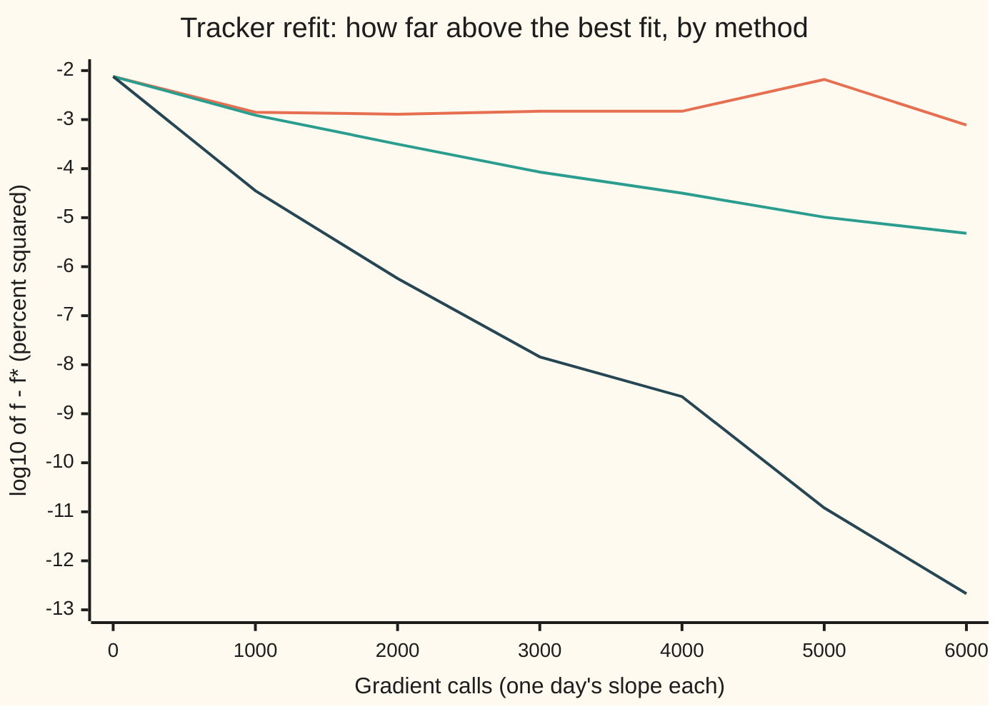

# SVRG and SAGA: stochastic steps whose noise dies out near the answer

[Syllabus](../../../SYLLABUS.md) → [Optimization](../README.md) → [First-Order Methods at Scale](../README.md#s08) → SVRG and SAGA

---

## General Overview

An index fund holds stocks so that its daily return follows an index. Each evening it refits its **weights**: the share of the fund in each stock. The weights are non-negative and add up to 1, a set called the **simplex** here (not the simplex method of linear programming). The fit uses the last 250 trading days. The fund **minimises** the average over those days of half the squared miss, where the miss is the fund's return minus the index's return. There is no other limit.

The real fund has 2,000 stocks. The card works a 10-stock version on synthetic returns, so every number fits on the page. The best weights run from 6.10% to 14.16%, and the best daily tracking error is 0.4890%.

The full gradient of the average needs all 250 days: 250 **gradient calls**, where one call is the slope of one day's loss. [Stochastic gradient](../06-Conic%2C%20Quadratic%20and%20Stochastic%20Programs/08-stochastic-gradient-and-sample-average-approximation.md) uses one random day per step instead. It is cheap, but even at the best weights one day's slope is not zero, so a fixed step never settles. Here the fit's **excess**, how far its average loss sits above the best possible value, stalls near $`10^{-3}`$ whatever the run length.

**SVRG** (stochastic variance-reduced gradient) adds a correction. Every 500 steps it takes a **snapshot**: it stores the current weights and pays for one full gradient there. The 500 steps between snapshots are an **epoch**. Each cheap step then uses the drawn day's slope, minus that same day's slope at the snapshot, plus the full gradient at the snapshot. The correction has average zero, so the step still points the right way on average. Near the answer the two slopes of the same day almost cancel, so the noise dies. With the same fixed step, the excess falls in a straight line on a log scale, to $`10^{-6.66}`$ after 10,000 calls.

**SAGA** keeps a table of every day's slope from the last time that day was drawn, and corrects with the table instead of a snapshot. It needs no full passes after the first, at the cost of memory.

**SVRG and SAGA subtract from a random day's slope a correction with average zero that cancels most of its noise, so the estimate stays unbiased while its variance shrinks to zero at the optimum, and a fixed step then converges linearly instead of stalling at a noise floor.**

**What kind of fact this is:** two methods, three results proved on this card in Why it works and one stated. Proved: both estimates are unbiased, both noise bounds vanish at the optimum, and SVRG's epoch rate. SAGA's rate is stated with its source. The noise-floor formula for plain stochastic gradient is a first-order estimate, checked against a long run.

### The picture: error against gradient calls



Orange: plain stochastic gradient, fixed step 0.000815. It drops once, then wanders near $`10^{-3}`$. Green: SVRG with the same step and a snapshot every 500 steps. It falls steadily. Dark: SAGA, with its own theorem's step 0.002718. It falls fastest. All three start from equal weights, 10% each, where the fit is 0.007618 above the best.

---

## The formula

Notation first, in words. Day $`i`$ has loss $`f_i(w)`$, half its squared miss at weights $`w`$. The fund minimises the average $`f(w) = \frac{1}{n}\sum_{i=1}^{n} f_i(w)`$ over $`n = 250`$ days. The best weights are $`w^*`$ and the least value is $`f^*`$. The step counter $`k`$ starts at 0, $`w_k`$ is the iterate (the wing's $`x_k`$), $`\alpha`$ is the fixed step size and $`i_k`$ is the day drawn at random at step $`k`$. Each method steps along an estimate $`g_k`$ of the gradient:

```math
w_{k+1} = w_k - \alpha\, g_k.
```

Plain stochastic gradient uses $`g_k = \nabla f_{i_k}(w_k)`$. SVRG, with snapshot $`\tilde w`$:

```math
g_k^{\mathrm{SVRG}} = \nabla f_{i_k}(w_k) - \nabla f_{i_k}(\tilde w) + \nabla f(\tilde w).
```

SAGA, where $`\phi_j`$ is the point at which day $`j`$'s stored slope was taken:

```math
g_k^{\mathrm{SAGA}} = \nabla f_{i_k}(w_k) - \nabla f_{i_k}(\phi_{i_k}) + \frac{1}{n}\sum_{j=1}^{n} \nabla f_j(\phi_j).
```

**Read it aloud:** take today's slope, subtract what the same day said at a stored point, and add back the average of what all days said at their stored points.

Write $`E`$ for the average over the day drawn. If every $`f_i`$ is convex with curvature at most $`L`$ (its slope changes by at most $`L`$ per unit move), the SVRG estimate is unbiased and its noise is bounded by how far both points are from the best:

```math
E\big[g_k\big] = \nabla f(w_k), \qquad E\big[\lVert g_k - \nabla f(w_k)\rVert^2\big] \le 4L\big(f(w_k) - f^* + f(\tilde w) - f^*\big).
```

**Read it aloud:** right on average, and the mean squared noise is at most four times the steepest curvature times the two distances above the best value.

If also $`f`$ has curvature at least $`\mu > 0`$, and the new snapshot is the average of an epoch's $`m`$ iterates, each epoch shrinks the expected excess by a fixed ratio:

```math
E\big[f(\tilde w_{\mathrm{new}})\big] - f^* \le R\,\big(f(\tilde w) - f^*\big), \qquad R = \frac{1}{\mu\alpha(1 - 2L\alpha)\,m} + \frac{2L\alpha}{1 - 2L\alpha}.
```

**Read it aloud:** one epoch multiplies the expected excess by at most $`R`$; a small step and a long epoch make $`R`$ below 1.

| Symbol | Plain meaning | In our example | Push it up and the answer… |
| --- | --- | --- | --- |
| $`i`$, $`n`$ | a day; the number of days | $`n`$ = 250 | larger $`n`$: a full gradient costs more |
| $`w`$, $`w^*`$; $`x`$ | the weights, adding to 1; the best weights; the one variable of the two-day hand example | start 10% each; best 6.10% to 14.16% | — |
| $`E`$ | the average over the day drawn at random | — | — |
| $`f_i`$, $`f`$, $`f^*`$ | one day's half squared miss; their average; its least value, in percent squared | $`f^*`$ = 0.1195; tracking error 0.4890% a day | — |
| $`k`$, $`w_k`$, $`\alpha`$ | step count; iterate; fixed step size | $`\alpha`$ = 0.000815, which is 0.1/$`L`$ | faster, until it breaks the theorem's $`1/(2L)`$ = 0.004077 |
| $`i_k`$, $`g_k`$ | the day drawn at step $`k`$; the gradient estimate used | — | — |
| $`\tilde w`$, $`m`$ | the snapshot; steps per epoch | $`m`$ = 500, so 1,250 calls an epoch | larger $`m`$: fewer full passes, staler snapshot |
| $`\phi_j`$ | SAGA's stored point for day $`j`$ | the table holds 250 numbers here | — |
| $`L`$ | the steepest curvature of any single day's loss, $`L_{\max}`$ in the code | 122.65 | smaller safe step |
| $`L_f`$, $`\mu`$ | the steepest and the least curvature of the average $`f`$ | 22.99 and 1.1464 | larger $`\mu`$: faster |
| $`\kappa`$ | the condition number, steepest over least curvature | $`\kappa_{\max} = L/\mu`$ = 107.0; $`\kappa_f = L_f/\mu`$ = 20.1 | slower |
| $`\sigma^2`$ | plain SGD's noise at the best weights: the mean squared single-day slope there | 8.4953 | higher noise floor |
| $`R`$ | the theorem's ratio per epoch | 2.9246 at $`m`$ = 500 (no promise); 0.8749 at $`m`$ = 2,140 | slower guaranteed fall |

### When it holds

- **A finite sum, passed in full at each snapshot.** The correction is unbiased only because $`\nabla f(\tilde w)`$ is the exact average. Estimate it from 25 random days and the fit ends worse than it started.
- **A snapshot that moves.** The noise bound shrinks only if $`\tilde w`$ approaches $`w^*`$. Keep the first snapshot for ever and the error stalls at 0.000708.
- **Each day's loss convex with curvature at most $`L`$.** Here day $`i`$'s curvature is the squared length of its return differences, at most 122.65. The bound needs the steepest day, not the average one.
- **A step under $`1/(2L)`$ and a long enough epoch.** The theorem needs $`R < 1`$. At step 5/$`L`$ the steep days overshoot and the excess grows to 1954.8 in 2,500 calls.
- **Curvature at least $`\mu > 0`$ for the linear rate.** With 250 days and 9 free weights the average loss is a strict bowl, $`\mu`$ = 1.1464. Without it, this proof gives no linear rate.

---

## Why it works

### Step 0: subtract a noise whose average you know

This is the **control variate** trick of [Variance reduction](../../09-Probability%20and%20statistics/11-Simulation/05-variance-reduction.md): to estimate an average, subtract a second random quantity that moves with the first and whose average is known, then add that known average back. The estimate stays unbiased. Its variance falls by as much as the two quantities move together.

Here the first quantity is the drawn day's slope at $`w_k`$. The second is the same day's slope at the snapshot. Its average over days is the full gradient at the snapshot, computed once. When $`w_k`$ and $`\tilde w`$ are close, the same day's two slopes are nearly equal, so the subtraction removes nearly all the noise.

### Step 1: the estimate is right on average

Average over the day drawn. The first term averages to $`\nabla f(w_k)`$. The second averages to $`\nabla f(\tilde w)`$, which the third term cancels exactly. So $`E[g_k] = \nabla f(w_k)`$.

For SAGA the same holds with the table: a random day's stored slope averages to the table's mean, which the last term adds back.

By hand, with two "days" $`f_1 = (x - 1)^2`$ and $`f_2 = (x + 1)^2`$, best $`x^* = 0`$: at $`x = 0`$ the slopes are −2 and +2, so plain SGD's variance is 4 even at the answer, while SVRG with snapshot 0 corrects both to exactly 0.

### Step 2: the noise is bounded by the distance from the best

The key fact is a lemma: for convex $`f_i`$ with curvature at most $`L`$,

```math
\frac{1}{n}\sum_{i=1}^{n} \big\lVert \nabla f_i(w) - \nabla f_i(w^*) \big\rVert^2 \le 2L\,\big(f(w) - f^*\big).
```

Each day's slope can drift from its value at the best weights only as far as the height above the best allows. Write the SVRG noise as the difference of two such drifts, one at $`w_k`$ and one at $`\tilde w`$. A variance is at most a mean square, and $`\lVert a - b\rVert^2 \le 2\lVert a\rVert^2 + 2\lVert b\rVert^2`$, so the noise is at most $`4L`$ times the two heights. That is the bound in The formula.

SAGA's noise splits the same way, with each day's stored point $`\phi_j`$ in place of the snapshot:

```math
E\big[\lVert g_k - \nabla f(w_k)\rVert^2\big] \le 4L\big(f(w_k) - f^*\big) + \frac{2}{n}\sum_{j=1}^{n} \big\lVert \nabla f_j(\phi_j) - \nabla f_j(w^*) \big\rVert^2.
```

Once $`w_k`$ and every stored point equal $`w^*`$, both terms are 0, so SAGA's noise vanishes at the optimum too.

<details>
<summary>Detailed proof: the lemma and the variance bounds</summary>

Fix a day $`i`$ and set $`h(x) = f_i(x) - f_i(w^*) - \nabla f_i(w^*)^{\mathsf T}(x - w^*)`$. It is convex, so it never goes below its tangent at $`w^*`$, which is 0. It has curvature at most $`L`$, and its gradient is $`\nabla f_i(x) - \nabla f_i(w^*)`$.

The descent lemma of [Gradient descent](../02-Unconstrained%20Methods/02-gradient-descent-and-its-rate.md), used with step $`1/L`$ from $`x`$, gives

$`\displaystyle 0 \le h\big(x - \tfrac{1}{L}\nabla h(x)\big) \le h(x) - \frac{1}{2L}\lVert \nabla h(x)\rVert^2.`$

So $`\lVert \nabla f_i(x) - \nabla f_i(w^*)\rVert^2 \le 2L\,h(x)`$. Average over $`i`$. The average of the $`h`$ terms is $`f(x) - f^* - \nabla f(w^*)^{\mathsf T}(x - w^*)`$, and $`\nabla f(w^*) = 0`$, so it is $`f(x) - f^*`$. That is the lemma.

For the variance, let $`X = \big(\nabla f_i(w_k) - \nabla f_i(w^*)\big) - \big(\nabla f_i(\tilde w) - \nabla f_i(w^*)\big)`$. Then $`g_k - \nabla f(w_k) = X - E[X]`$, since $`E[X] = \nabla f(w_k) - \nabla f(\tilde w)`$. A variance is at most a mean square:

$`\displaystyle E\lVert X - E X\rVert^2 \le E\lVert X\rVert^2 \le 2E\lVert \nabla f_i(w_k) - \nabla f_i(w^*)\rVert^2 + 2E\lVert \nabla f_i(\tilde w) - \nabla f_i(w^*)\rVert^2.`$

The lemma bounds each mean square by $`2L`$ times its height. Together: $`4L\big(f(w_k) - f^* + f(\tilde w) - f^*\big)`$.

For SAGA, put the drawn day's stored point $`\phi_i`$ in place of $`\tilde w`$ in $`X`$. Then $`E[X] = \nabla f(w_k) - \frac1n\sum_j \nabla f_j(\phi_j)`$, so again $`g_k - \nabla f(w_k) = X - E[X]`$ and the same two inequalities hold. The lemma bounds the first mean square; the second is the average of $`\lVert \nabla f_j(\phi_j) - \nabla f_j(w^*)\rVert^2`$ over the days.

</details>

On the tracker the code computes these noises exactly, as averages over all 250 days:

- At the best weights, plain SGD's noise is $`\sigma^2`$ = 8.4953, for ever.
- At the best weights with the snapshot still at the start, SVRG's noise is 0.532683, under its bound 3.737435.
- With the snapshot at the best weights too, SVRG's noise is 0.
- SAGA at the best weights with its whole table stored at the start has SVRG's noise, 0.532683, since one stored point makes the two estimates equal; its own bound is 1.271321. Re-store half the days at the best weights and it is 0.297222, under 0.646672; re-store all of them and it is 0.

### Step 3: a fixed step now converges linearly

Follow the squared distance $`\lVert w_k - w^*\rVert^2`$ through one step. Expand the square and average over the day:

```math
E\lVert w_{k+1} - w^*\rVert^2 = \lVert w_k - w^*\rVert^2 - 2\alpha\, (w_k - w^*)^{\mathsf T}\nabla f(w_k) + \alpha^2 E\lVert g_k\rVert^2.
```

The middle term pulls in: by convexity it is at least $`2\alpha\,(f(w_k) - f^*)`$. The last term pushes out, and Step 2 bounds it by the two heights. Add up the $`m`$ steps of an epoch, then use strong convexity (curvature at least $`\mu`$) to turn the start distance into a height. The result is the ratio $`R`$.

<details>
<summary>Detailed proof: the epoch ratio R</summary>

Split the estimate in two: $`g_k = \big(\nabla f_i(w_k) - \nabla f_i(w^*)\big) - X'`$, with $`X' = \nabla f_i(\tilde w) - \nabla f_i(w^*) - \nabla f(\tilde w)`$. The average of $`X'`$ is zero, because $`\nabla f(w^*) = 0`$. So the mean square of $`X'`$ is at most that of $`\nabla f_i(\tilde w) - \nabla f_i(w^*)`$. Use $`\lVert a - b\rVert^2 \le 2\lVert a\rVert^2 + 2\lVert b\rVert^2`$ and the lemma twice:

$`\displaystyle E\lVert g_k\rVert^2 \le 4L\big(f(w_k) - f^*\big) + 4L\big(f(\tilde w) - f^*\big).`$

Convexity gives $`(w_k - w^*)^{\mathsf T}\nabla f(w_k) \ge f(w_k) - f^*`$. Put both into the expanded square:

$`\displaystyle E\lVert w_{k+1} - w^*\rVert^2 \le \lVert w_k - w^*\rVert^2 - 2\alpha(1 - 2L\alpha)\big(f(w_k) - f^*\big) + 4L\alpha^2\big(f(\tilde w) - f^*\big).`$

Start the epoch at $`w_0 = \tilde w`$ and add the $`m`$ steps. The distances telescope, and the final distance is at least 0:

$`\displaystyle 2\alpha(1 - 2L\alpha)\sum_{k=0}^{m-1} E\big(f(w_k) - f^*\big) \le \lVert \tilde w - w^*\rVert^2 + 4L\alpha^2 m\,\big(f(\tilde w) - f^*\big).`$

Strong convexity bounds the distance by the height: $`\lVert \tilde w - w^*\rVert^2 \le \frac{2}{\mu}\big(f(\tilde w) - f^*\big)`$. The new snapshot is the average of $`w_0, \dots, w_{m-1}`$, and by convexity $`f`$ at an average is at most the average of $`f`$. Divide by $`2\alpha(1 - 2L\alpha)m`$:

$`\displaystyle E f(\tilde w_{\mathrm{new}}) - f^* \le \Big(\frac{1}{\mu\alpha(1 - 2L\alpha)m} + \frac{2L\alpha}{1 - 2L\alpha}\Big)\big(f(\tilde w) - f^*\big).`$

</details>

With the theorem's step $`\alpha = 1/(10L)`$ the second part of $`R`$ is 0.25, and $`m = 20\kappa`$ makes the first part 0.625. This is the textbook setting: $`R = 1/1.6 + 1/4`$ = 0.875, under 0.9.

On the tracker, $`\kappa_{\max}`$ = 107.0:

| Epoch length $`m`$ | Calls an epoch | Theorem's $`R`$ | Measured ratio per epoch, mean of 6 |
| ---: | ---: | ---: | ---: |
| 500 | 1,250 | 2.9246: no promise | 0.4207 |
| 2,140 ($`20\kappa`$, rounded up) | 4,530 | 0.8749 | 0.1122 |

The theorem is a safe ceiling, not a forecast. With $`m`$ = 500, the practical choice of twice the number of days, it promises nothing, yet the run still falls by a steady factor each epoch.

### Step 4: SAGA swaps the snapshot for a table

SAGA keeps, for every day $`j`$, the slope from the last time that day was drawn. After each step it overwrites the drawn day's entry and updates the table's mean. That costs no full passes after the first, but it needs memory for $`n`$ slopes.

For a least-squares fit, each day's slope is that day's miss times that day's return differences, so the table needs only the 250 misses. A general model stores a whole gradient per day.

**SAGA's rate, stated.** With step $`1/(3L)`$ and $`f`$ strongly convex, the expected squared distance to $`w^*`$ after $`k`$ steps is at most $`\big(1 - \min\big(\tfrac{1}{4n}, \tfrac{\mu}{3L}\big)\big)^k`$ times a constant set by the start. The 2014 SAGA paper in Sources states this in the remark after the proof of its Theorem 1; this card does not prove it. Here $`1/(4n)`$ = 0.001000 and $`\mu/(3L)`$ = 0.003116, so the $`1/(4n)`$ term sets a slow guarantee. The run does better: it reaches $`10^{-10}`$ in 5,000 calls.

### Step 5: why plain SGD stalls, and where

Without the correction, the push-out term in Step 3 is about $`\alpha^2\sigma^2`$ near the optimum, and it never shrinks. For this quadratic loss, the pull-in term is $`2\alpha(w_k - w^*)^{\mathsf T}\nabla f(w_k) = 4\alpha(f(w_k) - f^*)`$. The two balance when

```math
E\big[f(w_k)\big] - f^* \approx \frac{\alpha\,\sigma^2}{4}.
```

At $`\alpha`$ = 0.000815 that is 0.001732. A run of 200,000 steps started at the optimum averages 0.001809. The small gap is the neglected term: away from the optimum the slopes are a little noisier than $`\sigma^2`$. A shorter step lowers the floor but slows the pull-in, which is why [Stochastic gradient](../06-Conic%2C%20Quadratic%20and%20Stochastic%20Programs/08-stochastic-gradient-and-sample-average-approximation.md) needs steps that shrink to zero.

### Step 6: when variance reduction pays

Count gradient calls, not steps. To cut the excess by a factor $`e`$ (about 2.718), full gradient descent needs about $`\kappa_f`$ steps of $`n`$ calls each: $`n\kappa_f`$ = 5,014 calls here. SVRG and SAGA need a number of calls of order $`n + \kappa_{\max}`$, here 357, with constants left out. The two costs add instead of multiply, so the gain grows with the number of days $`n`$.

The bounds hide constants, so the measured gain is smaller: 21,000 calls for SVRG and 5,000 for SAGA against 38,000 for full gradient descent, to reach $`10^{-10}`$. Plain SGD stays the better tool in two cases. If an excess near $`10^{-3}`$ is enough, it gets there within 1,000 calls with no full pass and no table. If the data never stop arriving, there is no fixed sum to pass over.

---

## Worked numbers, by hand

The spec's two-day example, $`f_1 = (x - 1)^2`$, $`f_2 = (x + 1)^2`$, $`f'(x) = 2x`$, then the tracker's key numbers.

| Step | Arithmetic | Value |
| --- | --- | --- |
| SGD slopes at $`x = 0`$ | $`2(0 - 1)`$ and $`2(0 + 1)`$ | −2 and +2, variance 4 |
| SVRG at $`x = 0`$, snapshot 0 | $`-2 - (-2) + 0`$ and $`2 - 2 + 0`$ | 0 and 0 |
| SGD slopes at $`x = 0.5`$ | $`2(0.5 - 1)`$ and $`2(0.5 + 1)`$ | −1 and +3, variance 4 |
| SVRG at $`x = 0.5`$, snapshot 0 | $`-1 - (-2) + 0`$ and $`3 - 2 + 0`$ | +1 and +1, the true $`f'(0.5)`$ |
| SAGA at $`x = 0.25`$, both stored at 0.5 | $`-1.5 - (-1) + 1`$ and $`2.5 - 3 + 1`$ | +0.5 and +0.5, the true $`f'(0.25)`$ |
| tracker: SVRG step | 0.1 ÷ 122.65 | 0.000815 |
| tracker: SGD floor | 0.000815 × 8.4953 ÷ 4 | 0.001732 |
| tracker: one SVRG epoch | 250 + 2 × 500 | 1,250 calls |
| tracker: calls to reach $`10^{-10}`$ | SVRG; SAGA; full gradient descent | 21,000; **5,000**; 38,000 |

In the two-day example both days have the same curvature, so the correction removes the noise completely, not only near the answer. On the tracker the days differ, and the noise only shrinks as the snapshot nears the best weights.

### What breaks if you drop a piece

| Mistake | Comes out at | What went wrong |
| --- | --- | --- |
| Plain SGD, fixed step 0.000815 | $`f - f^*`$ near 0.001809 for ever | No correction: the noise $`\sigma^2`$ = 8.4953 never shrinks |
| Snapshot never refreshed | 0.000708 after 10,000 calls | The noise bound keeps the term $`f(\tilde w) - f^*`$ of the start |
| Snapshot gradient from 25 random days | 0.047496, worse than the start's 0.007618 | Not the exact sum: the correction carries a fixed error for a whole epoch |
| SVRG step 5/$`L`$ | 1954.8 after 2,500 calls | Far past $`1/(2L)`$: the steep days overshoot |

---

## Ten thousand gradient calls, four ways

The puzzle: every method here spends the same currency, one day's slope per call, yet one stalls near $`10^{-3}`$ and another passes $`10^{-20}`$. Two forces act on each step. The pull towards $`w^*`$ shrinks the error by a fixed fraction. The noise in the estimate kicks it out again. The methods differ only in the noise.

### One story: the refit, checkpoint by checkpoint

$`\log_{10}(f - f^*)`$ after the given number of gradient calls, from the same equal-weight start:

| Calls | 0 | 2,000 | 4,000 | 6,000 | 8,000 | 10,000 |
| --- | ---: | ---: | ---: | ---: | ---: | ---: |
| Full gradient descent, step 1/$`L_f`$ = 0.0435 | −2.12 | −3.07 | −3.76 | −4.28 | −4.71 | −5.10 |
| Plain SGD, step 0.000815 | −2.12 | −2.89 | −2.83 | −3.11 | −3.10 | −3.03 |
| SVRG, step 0.000815, $`m`$ = 500 | −2.12 | −3.50 | −4.50 | −5.32 | −5.93 | −6.66 |
| SAGA, step 0.002718 | −2.12 | −6.24 | −8.65 | −12.67 | −16.20 | −20.17 |

Full gradient descent uses the gentler curvature of the average, $`L_f`$, so it may take a longer step. But each of its steps costs 250 calls.

### One force at a time: the noise left at the best weights

The mean square of (estimate − true gradient), at $`w^*`$:

```
plain SGD                     ████████████████████████████████████████  8.4953
SVRG, snapshot at the start   ██▌                                       0.532683
SVRG, snapshot at the best    ▏                                         0.000000
SAGA, table at the start      ██▌                                       0.532683
SAGA, half the table at best  █▍                                        0.297222
SAGA, table at the best       ▏                                         0.000000
```

The pull is the same for SGD and SVRG at the same step. What differs is this bar. SGD's noise is a property of the data and never moves. SVRG's shrinks with the snapshot's distance from the best, and every epoch moves the snapshot closer. SAGA's shrinks day by day, as each drawn day's stored point is refreshed.

### Both forces in one picture

The chart in the overview is the two forces combined. The SGD line flattens where its pull balances the fixed noise, near $`\alpha\sigma^2/4`$. The SVRG and SAGA lines never meet a floor, because the noise they carry falls as fast as the error does.

---

## Code, from first principles, and it actually runs

The code builds 250 days of returns for 10 stocks from a written-out SplitMix64 generator with seed 2026, so Python and Rust draw the same days. The weights add to 1, so the tenth weight is 1 minus the other nine, and day $`t`$'s loss is a half squared miss in the nine free weights.

It takes four roads. The best weights come from the normal equations, solved by Gaussian elimination, with a zero gradient and all-positive weights as the certificate: the simplex limit does not bind, so the fit is the best on the simplex too. The excess $`f - f^*`$ is computed twice, by subtraction and by the exact quadratic form. The variance bounds, SVRG's and SAGA's, are checked against exact averages over all 250 days. The four methods race on the same start, and the theorem's ratio, the SGD floor formula and SAGA's rate are each compared with a measured run.

### Python

```python
# SVRG and SAGA -- the check behind the card.  Standard library only.
# A 10-stock index tracker refit on 250 daily returns (synthetic, SplitMix64 seed 2026).
# The card MINIMISES f(w) = average over days of (1/2)(tracker return - index return)^2,
# in percent squared, with the weights summing to 1.  Put w10 = 1 - (w1 + ... + w9): the
# free variables are v = (w1, ..., w9) and day t's loss is f_t(v) = (1/2)(a_t . v - b_t)^2.
import functools, math
M64 = (1 << 64) - 1
class Rng:                                  # SplitMix64, written out so Rust can match it
    def __init__(self, seed): self.s = seed
    def next(self):
        self.s = (self.s + 0x9E3779B97F4A7C15) & M64; z = self.s
        z = ((z ^ (z >> 30)) * 0xBF58476D1CE4E5B9) & M64
        z = ((z ^ (z >> 27)) * 0x94D049BB133111EB) & M64
        return z ^ (z >> 31)
    def u(self): return (self.next() >> 11) * 2.0 ** -53
N, S, D, R3, rng = 250, 10, 9, 1.7320508075688772, Rng(2026)
beta = [0.8 + 0.4 * rng.u() for _ in range(S)]       # each stock's market sensitivity
sig = [1.0 + rng.u() for _ in range(S)]              # its own noise, sd in % a day
A, B = [], []
for t in range(N):
    m = 0.04 + R3 * (2 * rng.u() - 1)                # market move, % (sd 1)
    r = [beta[j] * m + sig[j] * R3 * (2 * rng.u() - 1) for j in range(S)]
    y = m + 0.3 * R3 * (2 * rng.u() - 1)             # the index's return, %
    A.append([r[j] - r[S - 1] for j in range(D)]); B.append(y - r[S - 1])
def tot(xs): return functools.reduce(lambda s, x: s + x, xs, 0.0)   # left to right, as in Rust
def dot(u, v): return tot(p * q for p, q in zip(u, v))
def res(t, v): return dot(A[t], v) - B[t]           # day t's miss, %; its gradient is res * a_t
def full(v): q = [res(t, v) for t in range(N)]; return [tot(q[t] * A[t][k] / N for t in range(N)) for k in range(D)]   # N calls
def fval(v): return tot(res(t, v) ** 2 / (2 * N) for t in range(N))
H = [[dot([A[t][i] for t in range(N)], [A[t][j] for t in range(N)]) / N for j in range(D)] for i in range(D)]
def mul(v): return [dot(H[k], v) for k in range(D)]
def solve(b):                                        # H x = b by Gaussian elimination, partial pivots
    M = [H[i][:] + [b[i]] for i in range(D)]
    for k in range(D):
        p = max(range(k, D), key=lambda r: abs(M[r][k])); M[k], M[p] = M[p], M[k]
        for r in range(k + 1, D):
            f = M[r][k] / M[k][k]
            for q in range(k, D + 1): M[r][q] -= f * M[k][q]
    x = [0.0] * D
    for k in range(D - 1, -1, -1): x[k] = (M[k][D] - dot(M[k][k + 1:D], x[k + 1:D])) / M[k][k]
    return x
vs = solve([dot([A[t][i] for t in range(N)], B) / N for i in range(D)]); fs = fval(vs)
def gap(v):                                          # f(v) - f*, exact for a quadratic
    e = [v[k] - vs[k] for k in range(D)]; return 0.5 * dot(e, mul(e))
def unit(x): n = math.sqrt(dot(x, x)); return [q / n for q in x]
x, z = [1.0] * D, [1.0] * D
for _ in range(300): x, z = unit(solve(x)), unit(mul(z))      # inverse and plain power iteration
mu, Lf = 1 / math.sqrt(dot(solve(x), solve(x))), math.sqrt(dot(mul(z), mul(z)))
Lmax = max(dot(A[t], A[t]) for t in range(N))                  # the steepest single day
sig2 = tot(res(t, vs) ** 2 * dot(A[t], A[t]) / N for t in range(N))   # SGD's noise at the optimum
w, v0 = vs + [1.0 - dot(vs, [1.0] * D)], [0.1] * D
print("optimal weights, %:", " ".join("%.2f" % (100 * q) for q in w))
print("f* = %.4f, tracking error sqrt(2 f*) = %.4f %% a day" % (fs, math.sqrt(2 * fs)))
print("start (equal weights): f - f* = %.6f by subtraction, %.6f by the quadratic form" % (fval(v0) - fs, gap(v0)))
print("L_max %.2f  L_f %.2f  mu %.4f  kappa_max %.1f  kappa_f %.1f  sigma^2 %.4f" % (Lmax, Lf, mu, Lmax / mu, Lf / mu, sig2))
print("steps: 0.1/L_max = %.6f, 1/(2 L_max) = %.6f, 1/(3 L_max) = %.6f, 1/L_f = %.4f" % (0.1 / Lmax, 0.5 / Lmax, 1 / (3 * Lmax), 1 / Lf))
assert min(w) > 0 and max(abs(q) for q in full(vs)) < 1e-12 and abs(fval(v0) - fs - gap(v0)) < 1e-12
d = [lambda x: 2 * (x - 1), lambda x: 2 * (x + 1)]  # by hand: f1 = (x-1)^2, f2 = (x+1)^2, f'(x) = 2x
for x, s in ((0.0, 0.0), (0.5, 0.0), (0.25, 0.5)):  # the point, and where the stored slopes were taken
    e, sgv = [g(x) - g(s) + (d[0](s) + d[1](s)) / 2 for g in d], ((d[0](x) - 2 * x) ** 2 + (d[1](x) - 2 * x) ** 2) / 2
    print("hand x = %.2f, stored at %.1f: SGD %+.1f %+.1f (variance %.0f), corrected %+.1f %+.1f, f'(x) %+.1f" % (x, s, d[0](x), d[1](x), sgv, e[0], e[1], 2 * x))
    assert e[0] == e[1] == 2 * x and sgv == 4
def table(pts): return [res(t, p) for t, p in enumerate(pts)]   # each day's miss at its stored point
def variance(v, tab):                                # mean square of (estimate - grad f) over the day drawn
    gv, gs, sg, sv = full(v), [tot(tab[t] * A[t][k] / N for t in range(N)) for k in range(D)], 0.0, 0.0
    for t in range(N):
        q, p = res(t, v), tab[t]
        e1 = [q * A[t][k] - gv[k] for k in range(D)]; e2 = [(q - p) * A[t][k] + gs[k] - gv[k] for k in range(D)]
        sg += dot(e1, e1) / N; sv += dot(e2, e2) / N
    return sg, sv
for name, v, snap in (("start, snapshot start", v0, v0), ("optimum, snapshot start", vs, v0), ("optimum, snapshot optimum", vs, vs)):
    sg, sv = variance(v, table([snap] * N)); bound = 4 * Lmax * (gap(v) + gap(snap))
    print("variance at %-25s SGD %.4f  SVRG %.6f  bound %.6f" % (name, sg, sv, bound))
    assert sv <= bound + 1e-12
assert abs(variance(vs, table([vs] * N))[0] - sig2) < 1e-12 and variance(vs, table([v0] * N))[1] > 0
for name, pts in (("at the start", [v0] * N), ("half at optimum", [vs if t % 2 else v0 for t in range(N)]), ("at the optimum", [vs] * N)):
    sv = variance(vs, table(pts))[1]; bound = 4 * Lmax * gap(vs) + 2 * tot((res(t, p) - res(t, vs)) ** 2 * dot(A[t], A[t]) / N for t, p in enumerate(pts))
    print("variance at optimum, SAGA table %-15s SAGA %.6f  bound %.6f" % (name, sv, bound)); assert sv <= bound + 1e-12
def run(method, calls, alpha, m=500, refresh=True, snap_days=N, avg=False, seed=7):
    r, v, c, marks, epochs = Rng(seed), v0[:], 0, [gap(v0)], []   # marks: gap every 1000 calls
    snap, gs, tab, tavg = v0[:], None, None, None
    def tick(n, u):
        nonlocal c
        for _ in range(n):
            c += 1
            if c % 1000 == 0: marks.append(gap(u))
    while c < calls:
        if method == "gd": g = full(v); v = [v[k] - alpha * g[k] for k in range(D)]; tick(N, v)
        elif method == "sgd":
            t = r.next() % N; q = res(t, v); v = [v[k] - alpha * q * A[t][k] for k in range(D)]; tick(1, v)
        elif method == "saga" and tab is None: tab = [res(t, v) for t in range(N)]; tavg = full(v); tick(N, v)
        elif method == "saga":                       # the table holds each day's miss at its last visit
            t = r.next() % N; q = res(t, v); dq = q - tab[t]; tab[t] = q
            v = [v[k] - alpha * (dq * A[t][k] + tavg[k]) for k in range(D)]
            tavg = [tavg[k] + dq * A[t][k] / N for k in range(D)]; tick(1, v)
        else:                                        # svrg: one epoch of m inner steps
            if gs is None or refresh:
                days = [r.next() % N for _ in range(snap_days)] if snap_days < N else list(range(N))
                gs = [0.0] * D
                for t in days:
                    q = res(t, snap)
                    for k in range(D): gs[k] += q * A[t][k] / len(days)
                tick(snap_days, snap)
            v, acc = snap[:], [0.0] * D
            for _ in range(m):
                acc = [acc[k] + v[k] / m for k in range(D)]
                t = r.next() % N; q = res(t, v) - res(t, snap)
                v = [v[k] - alpha * (q * A[t][k] + gs[k]) for k in range(D)]; tick(2, v)
            if refresh: snap = acc if avg else v[:]
            epochs.append(gap(snap))
    return marks, epochs, gap(v)
a = 0.1 / Lmax
runs = [("GD, step 1/L_f", run("gd", 10000, 1 / Lf)), ("SGD, step 0.1/L_max", run("sgd", 10000, a)),
        ("SVRG, step 0.1/L_max, m 500", run("svrg", 10000, a)), ("SAGA, step 1/(3 L_max)", run("saga", 10000, 1 / (3 * Lmax)))]
print("log10(f - f*) after 0, 1000, ..., 10000 gradient calls:")
for name, h in runs: print("%-28s" % name, " ".join("%.2f" % math.log10(q) for q in h[0]))
end = [h[2] for _, h in runs]; assert end[2] < 1e-3 * end[1] and end[2] < end[0] and end[3] < end[2]
r, v, fl = Rng(11), vs[:], 0.0                       # SGD's floor: time average from the optimum
for k in range(200000):
    t = r.next() % N; q = res(t, v); v = [v[j] - a * q * A[t][j] for j in range(D)]; fl += gap(v) / 200000
print("SGD floor at step 0.1/L_max: time average %.6f, formula alpha sigma^2 / 4 = %.6f" % (fl, a * sig2 / 4))
assert abs(fl / (a * sig2 / 4) - 1) < 0.1
def ratio(al, m): return 1 / (mu * al * (1 - 2 * Lmax * al) * m) + 2 * Lmax * al / (1 - 2 * Lmax * al)   # the theorem's R
assert abs(ratio(0.1 / Lmax, 20 * Lmax / mu) - 0.875) < 1e-12              # the textbook setting, by hand: 1/1.6 + 1/4
for m in (500, math.ceil(20 * Lmax / mu)):          # the epoch theorem, snapshot = the epoch's average
    bound = ratio(a, m)
    ep = run("svrg", 6 * (N + 2 * m), a, m=m, avg=True, seed=5)[1]
    meas = (ep[-1] / gap(v0)) ** (1 / len(ep))
    print("m = %d (%d calls an epoch): theorem's ratio %.4f; measured, mean of %d epochs %.4f" % (m, N + 2 * m, bound, len(ep), meas))
    assert meas < 1 and (bound > 1 or meas <= bound)
stale, batch = run("svrg", 10000, a, refresh=False)[2], run("svrg", 10000, a, snap_days=25)[2]
big = run("svrg", 2500, 5 / Lmax)[2]                 # far past the theorem's step limit 1/(2 L_max)
print("SVRG gap: snapshot never refreshed %.6f; snapshot gradient from 25 days %.6f; step 5/L_max %.1f" % (stale, batch, big))
assert stale > 1e3 * end[2] and batch > gap(v0) and big > 1e5 * gap(v0); need = []
for name, h in (("GD", run("gd", 60000, 1 / Lf)), ("SVRG", run("svrg", 60000, a)), ("SAGA", run("saga", 60000, 1 / (3 * Lmax)))):
    need.append(1000 * min(i for i, q in enumerate(h[0]) if q < 1e-10)); print("calls to reach f - f* < 1e-10: %s %d" % (name, need[-1]))
print("calls per factor e in the bounds: GD n kappa_f = %.0f; SVRG, SAGA of order n + kappa_max = %.0f" % (N * Lf / mu, N + Lmax / mu))
print("SAGA bound per step: 1 - min(1/(4n) = %.6f, mu/(3 L_max) = %.6f)" % (1 / (4 * N), mu / (3 * Lmax)))
assert need[2] < need[1] < need[0]; print("SAGA table: %d numbers here (one miss a day); a general gradient table for 2,000 assets: %d" % (N, N * 2000))
print("ALL CHECKS PASS")
```

**Ran 2026-11-24 on macOS, Python 3.14.10, standard library only. All checks passed. Output, pasted from the run:**

```
optimal weights, %: 14.16 6.28 9.76 10.05 9.54 13.29 9.82 12.17 8.84 6.10
f* = 0.1195, tracking error sqrt(2 f*) = 0.4890 % a day
start (equal weights): f - f* = 0.007618 by subtraction, 0.007618 by the quadratic form
L_max 122.65  L_f 22.99  mu 1.1464  kappa_max 107.0  kappa_f 20.1  sigma^2 8.4953
steps: 0.1/L_max = 0.000815, 1/(2 L_max) = 0.004077, 1/(3 L_max) = 0.002718, 1/L_f = 0.0435
hand x = 0.00, stored at 0.0: SGD -2.0 +2.0 (variance 4), corrected +0.0 +0.0, f'(x) +0.0
hand x = 0.50, stored at 0.0: SGD -1.0 +3.0 (variance 4), corrected +1.0 +1.0, f'(x) +1.0
hand x = 0.25, stored at 0.5: SGD -1.5 +2.5 (variance 4), corrected +0.5 +0.5, f'(x) +0.5
variance at start, snapshot start     SGD 8.6600  SVRG 0.000000  bound 7.474870
variance at optimum, snapshot start   SGD 8.4953  SVRG 0.532683  bound 3.737435
variance at optimum, snapshot optimum SGD 8.4953  SVRG 0.000000  bound 0.000000
variance at optimum, SAGA table at the start    SAGA 0.532683  bound 1.271321
variance at optimum, SAGA table half at optimum SAGA 0.297222  bound 0.646672
variance at optimum, SAGA table at the optimum  SAGA 0.000000  bound 0.000000
log10(f - f*) after 0, 1000, ..., 10000 gradient calls:
GD, step 1/L_f               -2.12 -2.66 -3.07 -3.43 -3.76 -4.04 -4.28 -4.51 -4.71 -4.91 -5.10
SGD, step 0.1/L_max          -2.12 -2.85 -2.89 -2.83 -2.83 -2.18 -3.11 -2.96 -3.10 -3.05 -3.03
SVRG, step 0.1/L_max, m 500  -2.12 -2.91 -3.50 -4.07 -4.50 -4.99 -5.32 -5.63 -5.93 -6.23 -6.66
SAGA, step 1/(3 L_max)       -2.12 -4.45 -6.24 -7.84 -8.65 -10.92 -12.67 -13.54 -16.20 -18.53 -20.17
SGD floor at step 0.1/L_max: time average 0.001809, formula alpha sigma^2 / 4 = 0.001732
m = 500 (1250 calls an epoch): theorem's ratio 2.9246; measured, mean of 6 epochs 0.4207
m = 2140 (4530 calls an epoch): theorem's ratio 0.8749; measured, mean of 6 epochs 0.1122
SVRG gap: snapshot never refreshed 0.000708; snapshot gradient from 25 days 0.047496; step 5/L_max 1954.8
calls to reach f - f* < 1e-10: GD 38000
calls to reach f - f* < 1e-10: SVRG 21000
calls to reach f - f* < 1e-10: SAGA 5000
calls per factor e in the bounds: GD n kappa_f = 5014; SVRG, SAGA of order n + kappa_max = 357
SAGA bound per step: 1 - min(1/(4n) = 0.001000, mu/(3 L_max) = 0.003116)
SAGA table: 250 numbers here (one miss a day); a general gradient table for 2,000 assets: 500000
ALL CHECKS PASS
```

### Rust

```rust
// SVRG and SAGA -- the check behind the card.  std only.
// A 10-stock index tracker refit on 250 daily returns (synthetic, SplitMix64 seed 2026).
// The card MINIMISES f(w) = average over days of (1/2)(tracker return - index return)^2,
// in percent squared, with the weights summing to 1.  Put w10 = 1 - (w1 + ... + w9): the
// free variables are v = (w1, ..., w9) and day t's loss is f_t(v) = (1/2)(a_t . v - b_t)^2.
struct Rng { s: u64 }
impl Rng {
    fn next(&mut self) -> u64 {
        self.s = self.s.wrapping_add(0x9E3779B97F4A7C15);
        let mut z = self.s;
        z = (z ^ (z >> 30)).wrapping_mul(0xBF58476D1CE4E5B9);
        z = (z ^ (z >> 27)).wrapping_mul(0x94D049BB133111EB);
        z ^ (z >> 31)
    }
    fn u(&mut self) -> f64 { (self.next() >> 11) as f64 / 9007199254740992.0 }
}
const N: usize = 250; const S: usize = 10; const D: usize = 9; const R3: f64 = 1.7320508075688772;
type V = Vec<f64>;
fn dot(u: &[f64], v: &[f64]) -> f64 { let mut s = 0.0; for i in 0..u.len().min(v.len()) { s += u[i] * v[i]; } s }
fn unit(x: &[f64]) -> V { let n = dot(x, x).sqrt(); x.iter().map(|q| q / n).collect() }
struct P { a: Vec<V>, b: V, h: Vec<V>, vs: V, v0: V }
impl P {
    fn res(&self, t: usize, v: &[f64]) -> f64 { dot(&self.a[t], v) - self.b[t] }
    fn full(&self, v: &[f64]) -> V { let mut g = vec![0.0; D]; for t in 0..N { let q = self.res(t, v); for k in 0..D { g[k] += q * self.a[t][k] / N as f64; } } g }
    fn fval(&self, v: &[f64]) -> f64 { let mut s = 0.0; for t in 0..N { let r = self.res(t, v); s += r * r / 500.0; } s }
    fn mul(&self, v: &[f64]) -> V { (0..D).map(|k| dot(&self.h[k], v)).collect() }
    fn solve(&self, b: &[f64]) -> V {
        let mut m: Vec<V> = (0..D).map(|i| { let mut r = self.h[i].clone(); r.push(b[i]); r }).collect();
        for k in 0..D {
            let mut p = k;
            for r in k..D { if m[r][k].abs() > m[p][k].abs() { p = r; } }
            m.swap(k, p);
            for r in k + 1..D { let f = m[r][k] / m[k][k]; for q in k..D + 1 { m[r][q] -= f * m[k][q]; } }
        }
        let mut x = vec![0.0; D];
        for k in (0..D).rev() { x[k] = (m[k][D] - dot(&m[k][k + 1..D], &x[k + 1..D])) / m[k][k]; }
        x
    }
    fn gap(&self, v: &[f64]) -> f64 { let e: V = (0..D).map(|k| v[k] - self.vs[k]).collect(); 0.5 * dot(&e, &self.mul(&e)) }
    fn table(&self, pts: &[&[f64]]) -> V { (0..N).map(|t| self.res(t, pts[t])).collect() }   // each day's miss at its stored point
    fn variance(&self, v: &[f64], tab: &[f64]) -> (f64, f64) {
        let gv = self.full(v); let (mut sg, mut sv, mut gs) = (0.0, 0.0, vec![0.0; D]);
        for t in 0..N { for k in 0..D { gs[k] += tab[t] * self.a[t][k] / N as f64; } }
        for t in 0..N {
            let (q, p) = (self.res(t, v), tab[t]);
            let e1: V = (0..D).map(|k| q * self.a[t][k] - gv[k]).collect();
            let e2: V = (0..D).map(|k| (q - p) * self.a[t][k] + gs[k] - gv[k]).collect();
            sg += dot(&e1, &e1) / N as f64; sv += dot(&e2, &e2) / N as f64;
        }
        (sg, sv)
    }
    fn tick(&self, c: &mut usize, n: usize, u: &[f64], marks: &mut V) { for _ in 0..n { *c += 1; if *c % 1000 == 0 { marks.push(self.gap(u)); } } }
    fn run(&self, method: &str, calls: usize, alpha: f64, m: usize, refresh: bool, snap_days: usize, avg: bool, seed: u64) -> (V, V, f64) {
        let (mut r, mut v, mut c, mut marks, mut epochs) = (Rng { s: seed }, self.v0.clone(), 0usize, vec![self.gap(&self.v0)], vec![]);
        let (mut snap, mut gs, mut tab, mut tavg): (V, Option<V>, Option<V>, V) = (self.v0.clone(), None, None, vec![]);
        while c < calls {
            if method == "gd" {
                let g = self.full(&v); v = (0..D).map(|k| v[k] - alpha * g[k]).collect(); self.tick(&mut c, N, &v, &mut marks);
            } else if method == "sgd" {
                let t = (r.next() % N as u64) as usize; let q = self.res(t, &v);
                v = (0..D).map(|k| v[k] - alpha * q * self.a[t][k]).collect(); self.tick(&mut c, 1, &v, &mut marks);
            } else if method == "saga" && tab.is_none() {
                tab = Some((0..N).map(|t| self.res(t, &v)).collect()); tavg = self.full(&v); self.tick(&mut c, N, &v, &mut marks);
            } else if method == "saga" {                 // the table holds each day's miss at its last visit
                let t = (r.next() % N as u64) as usize; let q = self.res(t, &v);
                let tb = tab.as_mut().unwrap(); let dq = q - tb[t]; tb[t] = q;
                v = (0..D).map(|k| v[k] - alpha * (dq * self.a[t][k] + tavg[k])).collect();
                tavg = (0..D).map(|k| tavg[k] + dq * self.a[t][k] / N as f64).collect(); self.tick(&mut c, 1, &v, &mut marks);
            } else {                                     // svrg: one epoch of m inner steps
                if gs.is_none() || refresh {
                    let days: Vec<usize> = if snap_days < N { (0..snap_days).map(|_| (r.next() % N as u64) as usize).collect() } else { (0..N).collect() };
                    let mut g = vec![0.0; D];
                    for &t in &days { let q = self.res(t, &snap); for k in 0..D { g[k] += q * self.a[t][k] / days.len() as f64; } }
                    gs = Some(g); self.tick(&mut c, snap_days, &snap, &mut marks);
                }
                let g = gs.clone().unwrap(); v = snap.clone(); let mut acc = vec![0.0; D];
                for _ in 0..m {
                    acc = (0..D).map(|k| acc[k] + v[k] / m as f64).collect();
                    let t = (r.next() % N as u64) as usize; let q = self.res(t, &v) - self.res(t, &snap);
                    v = (0..D).map(|k| v[k] - alpha * (q * self.a[t][k] + g[k])).collect(); self.tick(&mut c, 2, &v, &mut marks);
                }
                if refresh { snap = if avg { acc } else { v.clone() }; }
                epochs.push(self.gap(&snap));
            }
        }
        let e = self.gap(&v); (marks, epochs, e)
    }
}
fn main() {
    let mut rng = Rng { s: 2026 };
    let beta: V = (0..S).map(|_| 0.8 + 0.4 * rng.u()).collect();
    let sig: V = (0..S).map(|_| 1.0 + rng.u()).collect();
    let (mut a, mut b) = (vec![], vec![]);
    for _ in 0..N {
        let m = 0.04 + R3 * (2.0 * rng.u() - 1.0);
        let r: V = (0..S).map(|j| beta[j] * m + sig[j] * R3 * (2.0 * rng.u() - 1.0)).collect();
        let y = m + 0.3 * R3 * (2.0 * rng.u() - 1.0);
        a.push((0..D).map(|j| r[j] - r[S - 1]).collect::<V>()); b.push(y - r[S - 1]);
    }
    let col = |i: usize| -> V { (0..N).map(|t| a[t][i]).collect() };
    let h: Vec<V> = (0..D).map(|i| (0..D).map(|j| dot(&col(i), &col(j)) / N as f64).collect()).collect();
    let rhs: V = (0..D).map(|i| dot(&col(i), &b) / N as f64).collect();
    let mut p = P { a: a.clone(), b: b.clone(), h, vs: vec![0.0; D], v0: vec![0.1; D] };
    p.vs = p.solve(&rhs); let (vs, v0) = (p.vs.clone(), p.v0.clone()); let fs = p.fval(&vs);
    let (mut x, mut z) = (vec![1.0; D], vec![1.0; D]);
    for _ in 0..300 { x = unit(&p.solve(&x)); z = unit(&p.mul(&z)); }
    let mu = 1.0 / dot(&p.solve(&x), &p.solve(&x)).sqrt(); let lf = dot(&p.mul(&z), &p.mul(&z)).sqrt();
    let lmax = (0..N).map(|t| dot(&a[t], &a[t])).fold(f64::MIN, f64::max);
    let mut sig2 = 0.0; for t in 0..N { let r = p.res(t, &vs); sig2 += r * r * dot(&a[t], &a[t]) / N as f64; }
    let mut w = vs.clone(); w.push(1.0 - dot(&vs, &vec![1.0; D]));
    println!("optimal weights, %: {}", w.iter().map(|q| format!("{:.2}", 100.0 * q)).collect::<Vec<_>>().join(" "));
    println!("f* = {:.4}, tracking error sqrt(2 f*) = {:.4} % a day", fs, (2.0 * fs).sqrt());
    println!("start (equal weights): f - f* = {:.6} by subtraction, {:.6} by the quadratic form", p.fval(&v0) - fs, p.gap(&v0));
    println!("L_max {:.2}  L_f {:.2}  mu {:.4}  kappa_max {:.1}  kappa_f {:.1}  sigma^2 {:.4}", lmax, lf, mu, lmax / mu, lf / mu, sig2);
    println!("steps: 0.1/L_max = {:.6}, 1/(2 L_max) = {:.6}, 1/(3 L_max) = {:.6}, 1/L_f = {:.4}", 0.1 / lmax, 0.5 / lmax, 1.0 / (3.0 * lmax), 1.0 / lf);
    assert!(w.iter().all(|&q| q > 0.0) && p.full(&vs).iter().all(|q| q.abs() < 1e-12) && (p.fval(&v0) - fs - p.gap(&v0)).abs() < 1e-12);
    let d = [|x: f64| 2.0 * (x - 1.0), |x: f64| 2.0 * (x + 1.0)];   // by hand: f1 = (x-1)^2, f2 = (x+1)^2, f'(x) = 2x
    for (x, s) in [(0.0, 0.0), (0.5, 0.0), (0.25, 0.5)] {   // the point, and where the stored slopes were taken
        let e: V = d.iter().map(|g| g(x) - g(s) + (d[0](s) + d[1](s)) / 2.0).collect();
        let sgv = ((d[0](x) - 2.0 * x).powi(2) + (d[1](x) - 2.0 * x).powi(2)) / 2.0;
        println!("hand x = {:.2}, stored at {:.1}: SGD {:+.1} {:+.1} (variance {:.0}), corrected {:+.1} {:+.1}, f'(x) {:+.1}", x, s, d[0](x), d[1](x), sgv, e[0], e[1], 2.0 * x);
        assert!(e[0] == 2.0 * x && e[1] == 2.0 * x && sgv == 4.0);
    }
    for (name, v, snap) in [("start, snapshot start", &v0, &v0), ("optimum, snapshot start", &vs, &v0), ("optimum, snapshot optimum", &vs, &vs)] {
        let (sg, sv) = p.variance(v, &p.table(&vec![snap.as_slice(); N])); let bound = 4.0 * lmax * (p.gap(v) + p.gap(snap));
        println!("variance at {:<25} SGD {:.4}  SVRG {:.6}  bound {:.6}", name, sg, sv, bound);
        assert!(sv <= bound + 1e-12);
    }
    assert!((p.variance(&vs, &p.table(&vec![vs.as_slice(); N])).0 - sig2).abs() < 1e-12 && p.variance(&vs, &p.table(&vec![v0.as_slice(); N])).1 > 0.0);
    for (name, pts) in [("at the start", vec![v0.as_slice(); N]), ("half at optimum", (0..N).map(|t| if t % 2 == 1 { vs.as_slice() } else { v0.as_slice() }).collect()), ("at the optimum", vec![vs.as_slice(); N])] {
        let sv = p.variance(&vs, &p.table(&pts)).1; let bound = 4.0 * lmax * p.gap(&vs) + 2.0 * (0..N).map(|t| (p.res(t, pts[t]) - p.res(t, &vs)).powi(2) * dot(&a[t], &a[t]) / N as f64).fold(0.0, |s, x| s + x);
        println!("variance at optimum, SAGA table {:<15} SAGA {:.6}  bound {:.6}", name, sv, bound); assert!(sv <= bound + 1e-12);
    }
    let al = 0.1 / lmax;
    let runs = [("GD, step 1/L_f", p.run("gd", 10000, 1.0 / lf, 500, true, N, false, 7)), ("SGD, step 0.1/L_max", p.run("sgd", 10000, al, 500, true, N, false, 7)),
        ("SVRG, step 0.1/L_max, m 500", p.run("svrg", 10000, al, 500, true, N, false, 7)), ("SAGA, step 1/(3 L_max)", p.run("saga", 10000, 1.0 / (3.0 * lmax), 500, true, N, false, 7))];
    println!("log10(f - f*) after 0, 1000, ..., 10000 gradient calls:");
    for (name, h) in &runs { println!("{:<28} {}", name, h.0.iter().map(|q| format!("{:.2}", q.log10())).collect::<Vec<_>>().join(" ")); }
    let end: V = runs.iter().map(|(_, h)| h.2).collect(); assert!(end[2] < 1e-3 * end[1] && end[2] < end[0] && end[3] < end[2]);
    let (mut r, mut v, mut fl) = (Rng { s: 11 }, vs.clone(), 0.0);   // SGD's floor: time average from the optimum
    for _ in 0..200000 {
        let t = (r.next() % N as u64) as usize; let q = p.res(t, &v);
        v = (0..D).map(|j| v[j] - al * q * a[t][j]).collect(); fl += p.gap(&v) / 200000.0;
    }
    println!("SGD floor at step 0.1/L_max: time average {:.6}, formula alpha sigma^2 / 4 = {:.6}", fl, al * sig2 / 4.0);
    assert!((fl / (al * sig2 / 4.0) - 1.0).abs() < 0.1);
    let ratio = |al: f64, m: f64| 1.0 / (mu * al * (1.0 - 2.0 * lmax * al) * m) + 2.0 * lmax * al / (1.0 - 2.0 * lmax * al);   // the theorem's R
    assert!((ratio(0.1 / lmax, 20.0 * lmax / mu) - 0.875).abs() < 1e-12);   // the textbook setting, by hand: 1/1.6 + 1/4
    for m in [500usize, (20.0 * lmax / mu).ceil() as usize] {   // the epoch theorem, snapshot = the epoch's average
        let bound = ratio(al, m as f64);
        let ep = p.run("svrg", 6 * (N + 2 * m), al, m, true, N, true, 5).1;
        let meas = (ep[ep.len() - 1] / p.gap(&v0)).powf(1.0 / ep.len() as f64);
        println!("m = {} ({} calls an epoch): theorem's ratio {:.4}; measured, mean of {} epochs {:.4}", m, N + 2 * m, bound, ep.len(), meas);
        assert!(meas < 1.0 && (bound > 1.0 || meas <= bound));
    }
    let (stale, batch) = (p.run("svrg", 10000, al, 500, false, N, false, 7).2, p.run("svrg", 10000, al, 500, true, 25, false, 7).2);
    let big = p.run("svrg", 2500, 5.0 / lmax, 500, true, N, false, 7).2;   // far past the theorem's step limit 1/(2 L_max)
    println!("SVRG gap: snapshot never refreshed {:.6}; snapshot gradient from 25 days {:.6}; step 5/L_max {:.1}", stale, batch, big);
    assert!(stale > 1e3 * end[2] && batch > p.gap(&v0) && big > 1e5 * p.gap(&v0));
    let mut need = vec![];
    for (name, h) in [("GD", p.run("gd", 60000, 1.0 / lf, 500, true, N, false, 7)), ("SVRG", p.run("svrg", 60000, al, 500, true, N, false, 7)), ("SAGA", p.run("saga", 60000, 1.0 / (3.0 * lmax), 500, true, N, false, 7))] {
        need.push(1000 * h.0.iter().position(|&q| q < 1e-10).unwrap()); println!("calls to reach f - f* < 1e-10: {} {}", name, need[need.len() - 1]);
    }
    assert!(need[2] < need[1] && need[1] < need[0]);
    println!("calls per factor e in the bounds: GD n kappa_f = {:.0}; SVRG, SAGA of order n + kappa_max = {:.0}", N as f64 * lf / mu, N as f64 + lmax / mu);
    println!("SAGA bound per step: 1 - min(1/(4n) = {:.6}, mu/(3 L_max) = {:.6})", 1.0 / (4.0 * N as f64), mu / (3.0 * lmax));
    println!("SAGA table: {} numbers here (one miss a day); a general gradient table for 2,000 assets: {}", N, N * 2000);
    println!("ALL CHECKS PASS");
}
```

**Ran 2026-11-24 on macOS, rustc 1.98.1, no crates. All checks passed. Output, pasted from the run:**

```
optimal weights, %: 14.16 6.28 9.76 10.05 9.54 13.29 9.82 12.17 8.84 6.10
f* = 0.1195, tracking error sqrt(2 f*) = 0.4890 % a day
start (equal weights): f - f* = 0.007618 by subtraction, 0.007618 by the quadratic form
L_max 122.65  L_f 22.99  mu 1.1464  kappa_max 107.0  kappa_f 20.1  sigma^2 8.4953
steps: 0.1/L_max = 0.000815, 1/(2 L_max) = 0.004077, 1/(3 L_max) = 0.002718, 1/L_f = 0.0435
hand x = 0.00, stored at 0.0: SGD -2.0 +2.0 (variance 4), corrected +0.0 +0.0, f'(x) +0.0
hand x = 0.50, stored at 0.0: SGD -1.0 +3.0 (variance 4), corrected +1.0 +1.0, f'(x) +1.0
hand x = 0.25, stored at 0.5: SGD -1.5 +2.5 (variance 4), corrected +0.5 +0.5, f'(x) +0.5
variance at start, snapshot start     SGD 8.6600  SVRG 0.000000  bound 7.474870
variance at optimum, snapshot start   SGD 8.4953  SVRG 0.532683  bound 3.737435
variance at optimum, snapshot optimum SGD 8.4953  SVRG 0.000000  bound 0.000000
variance at optimum, SAGA table at the start    SAGA 0.532683  bound 1.271321
variance at optimum, SAGA table half at optimum SAGA 0.297222  bound 0.646672
variance at optimum, SAGA table at the optimum  SAGA 0.000000  bound 0.000000
log10(f - f*) after 0, 1000, ..., 10000 gradient calls:
GD, step 1/L_f               -2.12 -2.66 -3.07 -3.43 -3.76 -4.04 -4.28 -4.51 -4.71 -4.91 -5.10
SGD, step 0.1/L_max          -2.12 -2.85 -2.89 -2.83 -2.83 -2.18 -3.11 -2.96 -3.10 -3.05 -3.03
SVRG, step 0.1/L_max, m 500  -2.12 -2.91 -3.50 -4.07 -4.50 -4.99 -5.32 -5.63 -5.93 -6.23 -6.66
SAGA, step 1/(3 L_max)       -2.12 -4.45 -6.24 -7.84 -8.65 -10.92 -12.67 -13.54 -16.20 -18.53 -20.17
SGD floor at step 0.1/L_max: time average 0.001809, formula alpha sigma^2 / 4 = 0.001732
m = 500 (1250 calls an epoch): theorem's ratio 2.9246; measured, mean of 6 epochs 0.4207
m = 2140 (4530 calls an epoch): theorem's ratio 0.8749; measured, mean of 6 epochs 0.1122
SVRG gap: snapshot never refreshed 0.000708; snapshot gradient from 25 days 0.047496; step 5/L_max 1954.8
calls to reach f - f* < 1e-10: GD 38000
calls to reach f - f* < 1e-10: SVRG 21000
calls to reach f - f* < 1e-10: SAGA 5000
calls per factor e in the bounds: GD n kappa_f = 5014; SVRG, SAGA of order n + kappa_max = 357
SAGA bound per step: 1 - min(1/(4n) = 0.001000, mu/(3 L_max) = 0.003116)
SAGA table: 250 numbers here (one miss a day); a general gradient table for 2,000 assets: 500000
ALL CHECKS PASS
```

### Lean

Lean proves the noise bounds and the epoch ratio $`R`$ for any number of days and weights, plus the hand example.

- Suppose each day's loss is convex with curvature at most $`L`$. Then SVRG's and SAGA's estimates both average to the true gradient $`\nabla f(w)`$.
- Suppose also that $`w^*`$ minimises $`f`$. Then SVRG's mean squared noise is at most $`4L(f(w) - f^* + f(\tilde w) - f^*)`$.
- Take the same hypotheses and SAGA's stored points $`\phi_j`$. Then its mean squared noise is at most $`4L(f(w) - f^*)`$ plus the stored-point term of Step 2.
- So both noises are 0 once the iterate, the snapshot and every stored point sit at $`w^*`$.
- Suppose also $`f`$ has curvature at least $`\mu > 0`$ and the step $`\alpha`$ is under $`1/(2L)`$. Then the new snapshot, the epoch's average, has expected excess at most $`R`$ times the old one.
- Every slope in the hand example's table checks exactly, with SGD's variance 4 at $`x = 0`$ and $`x = 0.5`$.
- The calls per epoch check: 1,250 at $`m`$ = 500 and 4,530 at $`m`$ = 2,140.

The tracker's numbers, the runs and their ratios, SGD's floor and SAGA's stated rate are left to the Python and Rust checks.

```lean
-- SVRG and SAGA: for an average of convex losses whose slopes change by at most L, both corrected gradient estimates are right on average with noise bounded by the heights above the best value, so it vanishes at the optimum, and one SVRG epoch with a step under 1/(2L) shrinks the expected excess by the ratio R; the card's two-day hand example is checked exactly.
import Mathlib.Analysis.Calculus.Gradient.Basic
import Mathlib.Analysis.InnerProductSpace.PiL2
import Mathlib.Analysis.Convex.Function
import Mathlib.Analysis.Convex.Strong
import Mathlib.Topology.EMetricSpace.Lipschitz
import Mathlib.Data.Fintype.Pi
import Mathlib.Tactic.NormNum
import Mathlib

open scoped Gradient NNReal

/-! ### How the card's objects are written here

The weights are a point of `EuclideanSpace ℝ (Fin d)`. There are `n` days, numbered by `Fin n`,
and day `i` has loss `f i`. The fund minimises the average `fullLoss f w = (∑ i, f i w) / n`, and
`wstar` is a point where it is smallest, so `f* = fullLoss f wstar`. `∇ g w` is Mathlib's gradient.

"Each day's loss convex with curvature at most `L`" is: `f i` is convex, differentiable, and its
gradient changes by at most `L` times the distance moved (`LipschitzWith L (∇ (f i))`).

`E` over the day drawn is the plain average over all `n` days, each equally likely. Over a whole
epoch of `m` steps the days drawn are a list `s : Fin m → Fin n`, and all `n ^ m` lists are
equally likely, so `E` is the sum over all lists divided by `n ^ m`. -/

/-- The average loss over the `n` days: `f(w) = (1/n) ∑ f_i(w)`. -/
noncomputable def fullLoss {d n : ℕ} (f : Fin n → EuclideanSpace ℝ (Fin d) → ℝ)
    (w : EuclideanSpace ℝ (Fin d)) : ℝ :=
  (∑ i, f i w) / n

/-- SVRG's estimate when day `i` is drawn at the point `w`, with snapshot `wt`:
`∇f_i(w) − ∇f_i(w̃) + ∇f(w̃)`. -/
noncomputable def svrgEst {d n : ℕ} (f : Fin n → EuclideanSpace ℝ (Fin d) → ℝ)
    (wt : EuclideanSpace ℝ (Fin d)) (i : Fin n) (w : EuclideanSpace ℝ (Fin d)) :
    EuclideanSpace ℝ (Fin d) :=
  ∇ (f i) w - ∇ (f i) wt + ∇ (fullLoss f) wt

/-- SAGA's estimate when day `i` is drawn at the point `w`, with day `j`'s stored slope taken at
`φ j`: `∇f_i(w) − ∇f_i(φ_i) + (1/n) ∑_j ∇f_j(φ_j)`. -/
noncomputable def sagaEst {d n : ℕ} (f : Fin n → EuclideanSpace ℝ (Fin d) → ℝ)
    (φ : Fin n → EuclideanSpace ℝ (Fin d)) (i : Fin n) (w : EuclideanSpace ℝ (Fin d)) :
    EuclideanSpace ℝ (Fin d) :=
  ∇ (f i) w - ∇ (f i) (φ i) + (n : ℝ)⁻¹ • ∑ j, ∇ (f j) (φ j)

/-- One SVRG epoch: start at the snapshot `wt`, and at step `k < m` move from `w_k` to
`w_{k+1} = w_k − α g_k`, using the day `s k`. -/
noncomputable def svrgPath {d n m : ℕ} (f : Fin n → EuclideanSpace ℝ (Fin d) → ℝ) (α : ℝ)
    (wt : EuclideanSpace ℝ (Fin d)) (s : Fin m → Fin n) : ℕ → EuclideanSpace ℝ (Fin d)
  | 0 => wt
  | k + 1 =>
    if h : k < m then svrgPath f α wt s k - α • svrgEst f wt (s ⟨k, h⟩) (svrgPath f α wt s k)
    else svrgPath f α wt s k

/-! ### Helper lemmas -/

theorem vr_line_hasDerivAt {d : ℕ} {g : EuclideanSpace ℝ (Fin d) → ℝ}
    (y v : EuclideanSpace ℝ (Fin d)) (t : ℝ) (hg : DifferentiableAt ℝ g (y + t • v)) :
    HasDerivAt (fun t : ℝ => g (y + t • v)) (inner ℝ (∇ g (y + t • v)) v) t := by
  have h2 : HasDerivAt (fun t : ℝ => y + t • v) v t := by
    simpa using ((hasDerivAt_id t).smul_const v).const_add y
  have h3 := hg.hasFDerivAt.comp_hasDerivAt t h2
  rw [inner_gradient_left]
  exact h3

#print axioms vr_line_hasDerivAt

/-- The descent lemma: a function whose gradient changes by at most `L` lies under its tangent
plus `L/2` times the squared distance. -/
theorem vr_descent_lemma {d : ℕ} {g : EuclideanSpace ℝ (Fin d) → ℝ}
    (hdiff : Differentiable ℝ g) {L : ℝ≥0} (hL : LipschitzWith L (∇ g))
    (y z : EuclideanSpace ℝ (Fin d)) :
    g z ≤ g y + inner ℝ (∇ g y) (z - y) + (L : ℝ) / 2 * ‖z - y‖ ^ 2 := by
  set v := z - y with hv
  let h : ℝ → ℝ := fun t => g (y + t • v) - t * inner ℝ (∇ g y) v - (L : ℝ) / 2 * t ^ 2 * ‖v‖ ^ 2
  have hderiv : ∀ t : ℝ, HasDerivAt h
      (inner ℝ (∇ g (y + t • v)) v - inner ℝ (∇ g y) v - (L : ℝ) * t * ‖v‖ ^ 2) t := by
    intro t
    have h1 := vr_line_hasDerivAt y v t (hdiff _)
    have h2 := ((hasDerivAt_id t).mul_const (inner ℝ (∇ g y) v))
    have h3 := (((hasDerivAt_id t).pow 2).const_mul ((L : ℝ) / 2)).mul_const (‖v‖ ^ 2)
    convert (h1.sub h2).sub h3 using 1
    · funext u; simp only [h, Pi.sub_apply, id, Pi.pow_apply]
    · simp only [id, Nat.cast_ofNat, show (2:ℕ) - 1 = 1 from rfl, pow_one]; ring
  have hanti : AntitoneOn h (Set.Icc (0 : ℝ) 1) := by
    apply antitoneOn_of_hasDerivWithinAt_nonpos (convex_Icc 0 1)
    · exact fun t _ => (hderiv t).continuousAt.continuousWithinAt
    · intro t _
      exact (hderiv t).hasDerivWithinAt
    · intro t ht
      rw [interior_Icc] at ht
      have hlip := hL.dist_le_mul (y + t • v) y
      rw [dist_eq_norm, dist_eq_norm] at hlip
      simp only [add_sub_cancel_left, norm_smul, Real.norm_eq_abs, abs_of_pos ht.1] at hlip
      have hcs : inner ℝ (∇ g (y + t • v) - ∇ g y) v ≤ ‖∇ g (y + t • v) - ∇ g y‖ * ‖v‖ :=
        real_inner_le_norm _ _
      rw [inner_sub_left] at hcs
      have := mul_le_mul_of_nonneg_right hlip (norm_nonneg v)
      nlinarith
  have h01 := hanti (Set.left_mem_Icc.2 zero_le_one) (Set.right_mem_Icc.2 zero_le_one) zero_le_one
  simp only [h, zero_smul, add_zero, zero_mul, one_smul, one_mul, sub_zero, one_pow] at h01
  have : y + v = z := by rw [hv]; abel
  rw [this] at h01
  ring_nf at h01 ⊢
  linarith

#print axioms vr_descent_lemma

/-- First-order bound for a strongly convex differentiable function. -/
theorem vr_strong_first_order {d : ℕ} {g : EuclideanSpace ℝ (Fin d) → ℝ}
    {μ : ℝ} (hsc : StrongConvexOn Set.univ μ g)
    (x y : EuclideanSpace ℝ (Fin d)) (hgx : DifferentiableAt ℝ g x) :
    g x + inner ℝ (∇ g x) (y - x) + μ / 2 * ‖y - x‖ ^ 2 ≤ g y := by
  rw [strongConvexOn_iff_convex] at hsc
  have hc := hsc.comp_affineMap (AffineMap.lineMap x y)
  set v := y - x with hv
  let φ : ℝ → ℝ := fun t => g (x + t • v) - μ / 2 * ‖x + t • v‖ ^ 2
  have hφ : ((fun x => g x - μ / (2 : ℝ) * ‖x‖ ^ 2) ∘ AffineMap.lineMap x y) = φ := by
    funext t
    simp only [Function.comp, AffineMap.lineMap_apply_module', φ, hv, add_comm]
  rw [hφ] at hc
  have h0 : (0 : ℝ) ∈ (AffineMap.lineMap x y : ℝ →ᵃ[ℝ] _) ⁻¹' Set.univ := by simp
  have h1 : (1 : ℝ) ∈ (AffineMap.lineMap x y : ℝ →ᵃ[ℝ] _) ⁻¹' Set.univ := by simp
  have hgx' : DifferentiableAt ℝ g (x + (0 : ℝ) • v) := by simpa using hgx
  have hl := vr_line_hasDerivAt x v 0 hgx'
  have hn : HasDerivAt (fun t : ℝ => x + t • v) v 0 := by
    simpa using ((hasDerivAt_id (0 : ℝ)).smul_const v).const_add x
  have hder := hl.sub (hn.norm_sq.const_mul (μ / 2))
  have key := hc.le_slope_of_hasDerivAt h0 h1 zero_lt_one hder
  simp only [slope, φ, zero_smul, add_zero, one_smul, sub_zero, inv_one] at key
  have : x + v = y := by rw [hv]; abel
  rw [this] at key
  have hyn : ‖y‖ ^ 2 = ‖x‖ ^ 2 + 2 * inner ℝ x v + ‖v‖ ^ 2 := by
    rw [← this, norm_add_sq_real]
  rw [hyn, vsub_eq_sub] at key
  nlinarith [key]

#print axioms vr_strong_first_order

/-- A convex differentiable function lies above its tangent planes. -/
theorem vr_convex_first_order {d : ℕ} {g : EuclideanSpace ℝ (Fin d) → ℝ}
    (hc : ConvexOn ℝ Set.univ g) (hdiff : Differentiable ℝ g) (x y : EuclideanSpace ℝ (Fin d)) :
    g x + inner ℝ (∇ g x) (y - x) ≤ g y := by
  have := vr_strong_first_order (μ := 0) (strongConvexOn_zero.2 hc) x y (hdiff x)
  simpa using this

#print axioms vr_convex_first_order

/-- Co-coercivity: for a convex function whose gradient changes by at most `L`,
`‖∇g x − ∇g z‖² ≤ 2L (g x − g z − ⟨∇g z, x − z⟩)`. -/
theorem vr_cocoercive {d : ℕ} {g : EuclideanSpace ℝ (Fin d) → ℝ} (hc : ConvexOn ℝ Set.univ g)
    (hdiff : Differentiable ℝ g) {L : ℝ≥0} (hL : LipschitzWith L (∇ g))
    (x z : EuclideanSpace ℝ (Fin d)) :
    ‖∇ g x - ∇ g z‖ ^ 2 ≤ 2 * L * (g x - g z - inner ℝ (∇ g z) (x - z)) := by
  set v := ∇ g x - ∇ g z with hv
  have hfo := vr_convex_first_order hc hdiff z x
  rcases eq_or_lt_of_le (L.coe_nonneg) with h0 | hpos
  · have hle : ‖v‖ ≤ L * ‖x - z‖ := by simpa [dist_eq_norm] using hL.dist_le_mul x z
    rw [← h0, zero_mul] at hle
    have hv0 : ‖v‖ = 0 := le_antisymm hle (norm_nonneg _)
    rw [hv0, ← h0]; simp
  · set y := x - (L : ℝ)⁻¹ • v with hy
    have h1 := vr_convex_first_order hc hdiff z y
    have h2 := vr_descent_lemma hdiff hL x y
    have e1 : y - z = (x - z) - (L : ℝ)⁻¹ • v := by rw [hy]; abel
    have e2 : y - x = -((L : ℝ)⁻¹ • v) := by rw [hy]; abel
    rw [e1, inner_sub_right, inner_smul_right] at h1
    rw [e2, inner_neg_right, inner_smul_right, norm_neg, norm_smul, Real.norm_eq_abs, abs_inv,
      abs_of_pos hpos, mul_pow] at h2
    have hvv : inner ℝ (∇ g x) v - inner ℝ (∇ g z) v = ‖v‖ ^ 2 := by
      rw [← inner_sub_left, ← hv, real_inner_self_eq_norm_sq]
    have hvv' : (L : ℝ)⁻¹ * inner ℝ (∇ g x) v - (L : ℝ)⁻¹ * inner ℝ (∇ g z) v
        = (L : ℝ)⁻¹ * ‖v‖ ^ 2 := by rw [← mul_sub, hvv]
    have key : (L : ℝ)⁻¹ * ‖v‖ ^ 2 - (L : ℝ) / 2 * ((L : ℝ)⁻¹ ^ 2 * ‖v‖ ^ 2)
        ≤ g x - g z - inner ℝ (∇ g z) (x - z) := by linarith
    have e3 : (L : ℝ)⁻¹ * ‖v‖ ^ 2 - (L : ℝ) / 2 * ((L : ℝ)⁻¹ ^ 2 * ‖v‖ ^ 2)
        = ‖v‖ ^ 2 / (2 * L) := by field_simp; ring
    rw [e3, div_le_iff₀ (by positivity)] at key
    linarith

#print axioms vr_cocoercive

/-- `‖a − c‖² ≤ 2‖a‖² + 2‖c‖²`. -/
theorem vr_norm_sub_sq_le {d : ℕ} (a c : EuclideanSpace ℝ (Fin d)) :
    ‖a - c‖ ^ 2 ≤ 2 * ‖a‖ ^ 2 + 2 * ‖c‖ ^ 2 := by
  have h := norm_sub_le a c
  have h0 := norm_nonneg (a - c)
  nlinarith [norm_nonneg a, norm_nonneg c, sq_nonneg (‖a‖ - ‖c‖)]

#print axioms vr_norm_sub_sq_le

/-- The spread about the mean is at most the spread about zero. -/
theorem vr_var_le {d n : ℕ} (x : Fin n → EuclideanSpace ℝ (Fin d)) :
    ∑ i, ‖x i - (n : ℝ)⁻¹ • ∑ j, x j‖ ^ 2 ≤ ∑ i, ‖x i‖ ^ 2 := by
  rcases Nat.eq_zero_or_pos n with rfl | hn
  · simp
  set m := (n : ℝ)⁻¹ • ∑ j, x j with hm
  have hn' : (n : ℝ) ≠ 0 := by positivity
  have hS : ∑ j, x j = (n : ℝ) • m := by
    rw [hm, smul_smul, mul_inv_cancel₀ hn', one_smul]
  have e : ∀ i, ‖x i - m‖ ^ 2 = ‖x i‖ ^ 2 - 2 * inner ℝ (x i) m + ‖m‖ ^ 2 :=
    fun i => norm_sub_sq_real _ _
  simp_rw [e]
  rw [Finset.sum_add_distrib, Finset.sum_sub_distrib, ← Finset.mul_sum, ← sum_inner, hS,
    inner_smul_left, real_inner_self_eq_norm_sq]
  simp only [Finset.sum_const, Finset.card_univ, Fintype.card_fin, nsmul_eq_mul,
    RCLike.conj_to_real]
  nlinarith [sq_nonneg ‖m‖, (Nat.cast_pos.2 hn : (0 : ℝ) < n)]

#print axioms vr_var_le

/-- The average of the days' losses has gradient the average of their gradients. -/
theorem vr_hasGradient_fullLoss {d n : ℕ} (f : Fin n → EuclideanSpace ℝ (Fin d) → ℝ)
    (hdiff : ∀ i, Differentiable ℝ (f i)) (w : EuclideanSpace ℝ (Fin d)) :
    HasGradientAt (fullLoss f) ((n : ℝ)⁻¹ • ∑ i, ∇ (f i) w) w := by
  rw [hasGradientAt_iff_hasFDerivAt]
  have h : HasFDerivAt (fun w => ∑ i, f i w) (∑ i, fderiv ℝ (f i) w) w :=
    HasFDerivAt.fun_sum (fun i _ => (hdiff i w).hasFDerivAt)
  have h2 := h.const_mul ((n : ℝ)⁻¹)
  have e : (fun w => (n : ℝ)⁻¹ * ∑ i, f i w) = fullLoss f := by
    funext v; unfold fullLoss; ring
  rw [e] at h2
  convert h2 using 1
  ext v
  simp [map_sum, toDual_gradient, Finset.mul_sum]

#print axioms vr_hasGradient_fullLoss

theorem vr_grad_fullLoss {d n : ℕ} (f : Fin n → EuclideanSpace ℝ (Fin d) → ℝ)
    (hdiff : ∀ i, Differentiable ℝ (f i)) (w : EuclideanSpace ℝ (Fin d)) :
    ∇ (fullLoss f) w = (n : ℝ)⁻¹ • ∑ i, ∇ (f i) w :=
  (vr_hasGradient_fullLoss f hdiff w).gradient

#print axioms vr_grad_fullLoss

theorem vr_diff_fullLoss {d n : ℕ} (f : Fin n → EuclideanSpace ℝ (Fin d) → ℝ)
    (hdiff : ∀ i, Differentiable ℝ (f i)) : Differentiable ℝ (fullLoss f) :=
  fun w => (vr_hasGradient_fullLoss f hdiff w).differentiableAt

#print axioms vr_diff_fullLoss

/-- At a minimiser of the average, the days' gradients sum to zero. -/
theorem vr_sum_grad_star {d n : ℕ} (hn : 0 < n) (f : Fin n → EuclideanSpace ℝ (Fin d) → ℝ)
    (hdiff : ∀ i, Differentiable ℝ (f i))
    (wstar : EuclideanSpace ℝ (Fin d)) (hmin : ∀ v, fullLoss f wstar ≤ fullLoss f v) :
    ∑ i, ∇ (f i) wstar = 0 := by
  have hloc : IsLocalMin (fullLoss f) wstar := Filter.Eventually.of_forall hmin
  have h0 : ∇ (fullLoss f) wstar = 0 := by
    simp [gradient, hloc.fderiv_eq_zero]
  rw [vr_grad_fullLoss f hdiff] at h0
  exact (smul_eq_zero.1 h0).resolve_left (by positivity)

#print axioms vr_sum_grad_star

theorem vr_sum_eq_mul_fullLoss {d n : ℕ} (hn : 0 < n) (f : Fin n → EuclideanSpace ℝ (Fin d) → ℝ)
    (w : EuclideanSpace ℝ (Fin d)) : ∑ i, f i w = n * fullLoss f w := by
  unfold fullLoss
  have : (n : ℝ) ≠ 0 := by positivity
  field_simp

#print axioms vr_sum_eq_mul_fullLoss

/-- Summed co-coercivity against the minimiser:
`∑ ‖∇f_i(w) − ∇f_i(w*)‖² ≤ 2 L n (f(w) − f*)`. -/
theorem vr_sum_cocoercive {d n : ℕ} (hn : 0 < n)
    (f : Fin n → EuclideanSpace ℝ (Fin d) → ℝ) (L : ℝ≥0)
    (hconv : ∀ i, ConvexOn ℝ Set.univ (f i)) (hdiff : ∀ i, Differentiable ℝ (f i))
    (hsmooth : ∀ i, LipschitzWith L (∇ (f i)))
    (wstar : EuclideanSpace ℝ (Fin d)) (hmin : ∀ v, fullLoss f wstar ≤ fullLoss f v)
    (w : EuclideanSpace ℝ (Fin d)) :
    ∑ i, ‖∇ (f i) w - ∇ (f i) wstar‖ ^ 2 ≤
      2 * L * n * (fullLoss f w - fullLoss f wstar) := by
  calc ∑ i, ‖∇ (f i) w - ∇ (f i) wstar‖ ^ 2
      ≤ ∑ i, 2 * (L : ℝ) * (f i w - f i wstar - inner ℝ (∇ (f i) wstar) (w - wstar)) :=
        Finset.sum_le_sum (fun i _ => vr_cocoercive (hconv i) (hdiff i) (hsmooth i) w wstar)
    _ = 2 * L * (∑ i, f i w - ∑ i, f i wstar - inner ℝ (∑ i, ∇ (f i) wstar) (w - wstar)) := by
        rw [← Finset.mul_sum, Finset.sum_sub_distrib, Finset.sum_sub_distrib, sum_inner]
    _ = 2 * L * n * (fullLoss f w - fullLoss f wstar) := by
        rw [vr_sum_grad_star hn f hdiff wstar hmin, inner_zero_left,
          vr_sum_eq_mul_fullLoss hn, vr_sum_eq_mul_fullLoss hn]
        ring

#print axioms vr_sum_cocoercive

/-- SVRG's estimate averages to the true gradient. -/
theorem vr_svrg_mean {d n : ℕ} (hn : 0 < n) (f : Fin n → EuclideanSpace ℝ (Fin d) → ℝ)
    (hdiff : ∀ i, Differentiable ℝ (f i)) (w wt : EuclideanSpace ℝ (Fin d)) :
    (n : ℝ)⁻¹ • ∑ i, svrgEst f wt i w = ∇ (fullLoss f) w := by
  have hn' : (n : ℝ) ≠ 0 := by positivity
  simp only [svrgEst, Finset.sum_add_distrib, Finset.sum_sub_distrib, Finset.sum_const,
    Finset.card_univ, Fintype.card_fin, smul_add, smul_sub, ← vr_grad_fullLoss f hdiff]
  rw [← Nat.cast_smul_eq_nsmul ℝ, smul_smul, inv_mul_cancel₀ hn', one_smul]
  abel

#print axioms vr_svrg_mean

/-- SAGA's estimate averages to the true gradient. -/
theorem vr_saga_mean {d n : ℕ} (hn : 0 < n) (f : Fin n → EuclideanSpace ℝ (Fin d) → ℝ)
    (hdiff : ∀ i, Differentiable ℝ (f i)) (φ : Fin n → EuclideanSpace ℝ (Fin d))
    (w : EuclideanSpace ℝ (Fin d)) :
    (n : ℝ)⁻¹ • ∑ i, sagaEst f φ i w = ∇ (fullLoss f) w := by
  have hn' : (n : ℝ) ≠ 0 := by positivity
  simp only [sagaEst, Finset.sum_add_distrib, Finset.sum_sub_distrib, Finset.sum_const,
    Finset.card_univ, Fintype.card_fin, smul_add, smul_sub, ← vr_grad_fullLoss f hdiff]
  rw [← Nat.cast_smul_eq_nsmul ℝ, smul_smul, inv_mul_cancel₀ hn', one_smul]
  abel

#print axioms vr_saga_mean

/-- The second moment of SVRG's estimate:
`∑ ‖g_i‖² ≤ 4 L n (f(w) − f*) + 4 L n (f(w̃) − f*)`. -/
theorem vr_svrg_second_moment {d n : ℕ} (hn : 0 < n)
    (f : Fin n → EuclideanSpace ℝ (Fin d) → ℝ) (L : ℝ≥0)
    (hconv : ∀ i, ConvexOn ℝ Set.univ (f i)) (hdiff : ∀ i, Differentiable ℝ (f i))
    (hsmooth : ∀ i, LipschitzWith L (∇ (f i)))
    (wstar : EuclideanSpace ℝ (Fin d)) (hmin : ∀ v, fullLoss f wstar ≤ fullLoss f v)
    (w wt : EuclideanSpace ℝ (Fin d)) :
    ∑ i, ‖svrgEst f wt i w‖ ^ 2 ≤
      4 * L * n * (fullLoss f w - fullLoss f wstar) +
        4 * L * n * (fullLoss f wt - fullLoss f wstar) := by
  let a : Fin n → EuclideanSpace ℝ (Fin d) := fun i => ∇ (f i) w - ∇ (f i) wstar
  let b : Fin n → EuclideanSpace ℝ (Fin d) := fun i => ∇ (f i) wt - ∇ (f i) wstar
  have hb : (n : ℝ)⁻¹ • ∑ j, b j = ∇ (fullLoss f) wt := by
    simp only [b, Finset.sum_sub_distrib, vr_sum_grad_star hn f hdiff wstar hmin, sub_zero,
      vr_grad_fullLoss f hdiff]
  have hg : ∀ i, svrgEst f wt i w = a i - (b i - (n : ℝ)⁻¹ • ∑ j, b j) := by
    intro i; rw [hb]; simp only [svrgEst, a, b]; abel
  have h1 : ∑ i, ‖a i‖ ^ 2 ≤ 2 * L * n * (fullLoss f w - fullLoss f wstar) :=
    vr_sum_cocoercive hn f L hconv hdiff hsmooth wstar hmin w
  have h2 : ∑ i, ‖b i‖ ^ 2 ≤ 2 * L * n * (fullLoss f wt - fullLoss f wstar) :=
    vr_sum_cocoercive hn f L hconv hdiff hsmooth wstar hmin wt
  have h3 := vr_var_le b
  calc ∑ i, ‖svrgEst f wt i w‖ ^ 2
      ≤ ∑ i, (2 * ‖a i‖ ^ 2 + 2 * ‖b i - (n : ℝ)⁻¹ • ∑ j, b j‖ ^ 2) :=
        Finset.sum_le_sum fun i _ => by rw [hg i]; exact vr_norm_sub_sq_le _ _
    _ = 2 * ∑ i, ‖a i‖ ^ 2 + 2 * ∑ i, ‖b i - (n : ℝ)⁻¹ • ∑ j, b j‖ ^ 2 := by
        rw [Finset.sum_add_distrib, Finset.mul_sum, Finset.mul_sum]
    _ ≤ _ := by linarith

#print axioms vr_svrg_second_moment

/-- One SVRG step, averaged over the day drawn, in squared distance to the minimiser. -/
theorem vr_svrg_step {d n : ℕ} (hn : 0 < n)
    (f : Fin n → EuclideanSpace ℝ (Fin d) → ℝ) (L : ℝ≥0) (μ α : ℝ)
    (hconv : ∀ i, ConvexOn ℝ Set.univ (f i)) (hdiff : ∀ i, Differentiable ℝ (f i))
    (hsmooth : ∀ i, LipschitzWith L (∇ (f i)))
    (hμ : 0 ≤ μ) (hstrong : StrongConvexOn Set.univ μ (fullLoss f)) (hα : 0 ≤ α)
    (wstar : EuclideanSpace ℝ (Fin d)) (hmin : ∀ v, fullLoss f wstar ≤ fullLoss f v)
    (wt w : EuclideanSpace ℝ (Fin d)) :
    (n : ℝ)⁻¹ * ∑ i, ‖w - α • svrgEst f wt i w - wstar‖ ^ 2 ≤
      ‖w - wstar‖ ^ 2 - 2 * α * (1 - 2 * L * α) * (fullLoss f w - fullLoss f wstar) +
        4 * L * α ^ 2 * (fullLoss f wt - fullLoss f wstar) := by
  have hn' : (0 : ℝ) < n := by exact_mod_cast hn
  have e : ∀ i, ‖w - α • svrgEst f wt i w - wstar‖ ^ 2 = ‖w - wstar‖ ^ 2
      - 2 * α * inner ℝ (w - wstar) (svrgEst f wt i w) + α ^ 2 * ‖svrgEst f wt i w‖ ^ 2 := by
    intro i
    rw [show w - α • svrgEst f wt i w - wstar = (w - wstar) - α • svrgEst f wt i w by abel,
      norm_sub_sq_real, inner_smul_right, norm_smul, Real.norm_eq_abs, mul_pow, sq_abs]
    ring
  simp_rw [e]
  rw [Finset.sum_add_distrib, Finset.sum_sub_distrib, ← Finset.mul_sum, ← Finset.mul_sum,
    ← inner_sum]
  have hsum : ∑ i, svrgEst f wt i w = (n : ℝ) • ∇ (fullLoss f) w := by
    rw [← vr_svrg_mean hn f hdiff w wt, smul_smul, mul_inv_cancel₀ hn'.ne', one_smul]
  rw [hsum, inner_smul_right]
  simp only [Finset.sum_const, Finset.card_univ, Fintype.card_fin, nsmul_eq_mul]
  have hfo := vr_strong_first_order hstrong w wstar (vr_diff_fullLoss f hdiff w)
  have hneg : inner ℝ (∇ (fullLoss f) w) (wstar - w) = - inner ℝ (w - wstar) (∇ (fullLoss f) w) := by
    rw [show wstar - w = -(w - wstar) by abel, inner_neg_right, real_inner_comm]
  rw [hneg] at hfo
  have hI : fullLoss f w - fullLoss f wstar ≤ inner ℝ (w - wstar) (∇ (fullLoss f) w) := by
    nlinarith [sq_nonneg ‖wstar - w‖]
  have hM := vr_svrg_second_moment hn f L hconv hdiff hsmooth wstar hmin w wt
  have k1 := mul_le_mul_of_nonneg_left hI (by positivity : (0 : ℝ) ≤ 2 * α * n)
  have k2 := mul_le_mul_of_nonneg_left hM (by positivity : (0 : ℝ) ≤ α ^ 2)
  rw [inv_mul_le_iff₀ hn']
  nlinarith

#print axioms vr_svrg_step

/-- The SVRG path up to step `k` depends only on the days drawn before step `k`. -/
theorem vr_path_congr {d n m : ℕ} (f : Fin n → EuclideanSpace ℝ (Fin d) → ℝ) (α : ℝ)
    (wt : EuclideanSpace ℝ (Fin d)) (s s' : Fin m → Fin n) (k : ℕ)
    (h : ∀ j : Fin m, (j : ℕ) < k → s j = s' j) :
    svrgPath f α wt s k = svrgPath f α wt s' k := by
  induction k with
  | zero => rfl
  | succ k ih =>
    have ih' := ih (fun j hj => h j (Nat.lt_succ_of_lt hj))
    simp only [svrgPath]
    split_ifs with hk
    · rw [ih', h ⟨k, hk⟩ (Nat.lt_succ_self k)]
    · exact ih'

#print axioms vr_path_congr

/-- Averaging over all day lists: when the rest of the summand does not depend on the day in
slot `k`, that day may be replaced by a plain average over all days. -/
theorem vr_sum_shift {n m : ℕ} (hn : 0 < n) {X : Type*} (P : (Fin m → Fin n) → X) (k : Fin m)
    (hP : ∀ s s' : Fin m → Fin n, (∀ j, j ≠ k → s j = s' j) → P s = P s')
    (H : X → Fin n → ℝ) :
    ∑ s : Fin m → Fin n, H (P s) (s k) = ∑ s : Fin m → Fin n, (n : ℝ)⁻¹ * ∑ i, H (P s) i := by
  have : NeZero n := ⟨hn.ne'⟩
  have key : ∀ c : Fin n, ∑ s : Fin m → Fin n, H (P s) (s k + c) =
      ∑ s : Fin m → Fin n, H (P s) (s k) := by
    intro c
    let σ : (Fin m → Fin n) ≃ (Fin m → Fin n) :=
      Equiv.piCongrRight (fun j => if j = k then Equiv.addRight c else Equiv.refl (Fin n))
    have hσk : ∀ s, σ s k = s k + c := by intro s; simp [σ]
    have hσj : ∀ s j, j ≠ k → σ s j = s j := by intro s j hj; simp [σ, hj]
    symm
    rw [← Equiv.sum_comp σ]
    apply Finset.sum_congr rfl
    intro s _
    rw [hσk, hP (σ s) s (fun j hj => hσj s j hj)]
  have h2 : (n : ℝ) * ∑ s : Fin m → Fin n, H (P s) (s k) =
      ∑ s : Fin m → Fin n, ∑ i, H (P s) i := by
    calc (n : ℝ) * ∑ s : Fin m → Fin n, H (P s) (s k)
        = ∑ c : Fin n, ∑ s : Fin m → Fin n, H (P s) (s k + c) := by
          rw [Finset.sum_congr rfl (fun c _ => key c)]
          simp only [Finset.sum_const, Finset.card_univ, Fintype.card_fin, nsmul_eq_mul]
      _ = ∑ s : Fin m → Fin n, ∑ c : Fin n, H (P s) (s k + c) := Finset.sum_comm
      _ = ∑ s : Fin m → Fin n, ∑ i, H (P s) i := by
          apply Finset.sum_congr rfl; intro s _
          exact Equiv.sum_comp (Equiv.addLeft (s k)) (fun i => H (P s) i)
  rw [← Finset.mul_sum, ← h2, ← mul_assoc, inv_mul_cancel₀ (by positivity), one_mul]

#print axioms vr_sum_shift

/-- **SVRG is unbiased and its noise dies at the optimum.** If every day's loss is convex with
slope changing by at most `L`, and `w*` minimises the average `f`, then averaged over the day
drawn the SVRG estimate equals the true gradient `∇f(w)`, and its mean squared error is at most
`4L (f(w) − f* + f(w̃) − f*)`, which is 0 when `w` and the snapshot `w̃` are both at `w*`. -/
theorem svrg_unbiased_and_variance_bound {d n : ℕ} (hn : 0 < n)
    (f : Fin n → EuclideanSpace ℝ (Fin d) → ℝ) (L : ℝ≥0)
    (hconv : ∀ i, ConvexOn ℝ Set.univ (f i)) (hdiff : ∀ i, Differentiable ℝ (f i))
    (hsmooth : ∀ i, LipschitzWith L (∇ (f i)))
    (wstar : EuclideanSpace ℝ (Fin d)) (hmin : ∀ v, fullLoss f wstar ≤ fullLoss f v)
    (w wt : EuclideanSpace ℝ (Fin d)) :
    (n : ℝ)⁻¹ • ∑ i, svrgEst f wt i w = ∇ (fullLoss f) w ∧
    (∑ i, ‖svrgEst f wt i w - ∇ (fullLoss f) w‖ ^ 2) / n ≤
      4 * L * (fullLoss f w - fullLoss f wstar + (fullLoss f wt - fullLoss f wstar)) := by
  have hmean := vr_svrg_mean hn f hdiff w wt
  refine ⟨hmean, ?_⟩
  have hn' : (0 : ℝ) < n := by exact_mod_cast hn
  let z : Fin n → EuclideanSpace ℝ (Fin d) := fun i => ∇ (f i) w - ∇ (f i) wt
  have hz : ∀ i, svrgEst f wt i w - ∇ (fullLoss f) w = z i - (n : ℝ)⁻¹ • ∑ j, z j := by
    intro i
    simp only [z, svrgEst, Finset.sum_sub_distrib, smul_sub, ← vr_grad_fullLoss f hdiff]
    abel
  have h1 := vr_var_le z
  have h2 : ∑ i, ‖z i‖ ^ 2 ≤ ∑ i, (2 * ‖∇ (f i) w - ∇ (f i) wstar‖ ^ 2 +
      2 * ‖∇ (f i) wt - ∇ (f i) wstar‖ ^ 2) := by
    apply Finset.sum_le_sum; intro i _
    have : z i = (∇ (f i) w - ∇ (f i) wstar) - (∇ (f i) wt - ∇ (f i) wstar) := by
      simp only [z]; abel
    rw [this]; exact vr_norm_sub_sq_le _ _
  rw [Finset.sum_add_distrib, ← Finset.mul_sum, ← Finset.mul_sum] at h2
  have h3 := vr_sum_cocoercive hn f L hconv hdiff hsmooth wstar hmin w
  have h4 := vr_sum_cocoercive hn f L hconv hdiff hsmooth wstar hmin wt
  simp_rw [hz]
  rw [div_le_iff₀ hn']
  linarith

/-- **SAGA is unbiased and its noise dies at the optimum.** Under the same hypotheses, with day
`j`'s stored slope taken at `φ_j`, the SAGA estimate averages to `∇f(w)`, and its mean squared
error is at most `4L (f(w) − f*) + (2/n) ∑_j ‖∇f_j(φ_j) − ∇f_j(w*)‖²`, which is 0 once `w` and
every stored point are at `w*`. -/
theorem saga_unbiased_and_variance_bound {d n : ℕ} (hn : 0 < n)
    (f : Fin n → EuclideanSpace ℝ (Fin d) → ℝ) (L : ℝ≥0)
    (hconv : ∀ i, ConvexOn ℝ Set.univ (f i)) (hdiff : ∀ i, Differentiable ℝ (f i))
    (hsmooth : ∀ i, LipschitzWith L (∇ (f i)))
    (wstar : EuclideanSpace ℝ (Fin d)) (hmin : ∀ v, fullLoss f wstar ≤ fullLoss f v)
    (φ : Fin n → EuclideanSpace ℝ (Fin d)) (w : EuclideanSpace ℝ (Fin d)) :
    (n : ℝ)⁻¹ • ∑ i, sagaEst f φ i w = ∇ (fullLoss f) w ∧
    (∑ i, ‖sagaEst f φ i w - ∇ (fullLoss f) w‖ ^ 2) / n ≤
      4 * L * (fullLoss f w - fullLoss f wstar) +
        2 / n * ∑ j, ‖∇ (f j) (φ j) - ∇ (f j) wstar‖ ^ 2 := by
  have hmean := vr_saga_mean hn f hdiff φ w
  refine ⟨hmean, ?_⟩
  have hn' : (0 : ℝ) < n := by exact_mod_cast hn
  let z : Fin n → EuclideanSpace ℝ (Fin d) := fun i => ∇ (f i) w - ∇ (f i) (φ i)
  have hz : ∀ i, sagaEst f φ i w - ∇ (fullLoss f) w = z i - (n : ℝ)⁻¹ • ∑ j, z j := by
    intro i
    simp only [z, sagaEst, Finset.sum_sub_distrib, smul_sub, ← vr_grad_fullLoss f hdiff]
    abel
  have h1 := vr_var_le z
  have h2 : ∑ i, ‖z i‖ ^ 2 ≤ ∑ i, (2 * ‖∇ (f i) w - ∇ (f i) wstar‖ ^ 2 +
      2 * ‖∇ (f i) (φ i) - ∇ (f i) wstar‖ ^ 2) := by
    apply Finset.sum_le_sum; intro i _
    have : z i = (∇ (f i) w - ∇ (f i) wstar) - (∇ (f i) (φ i) - ∇ (f i) wstar) := by
      simp only [z]; abel
    rw [this]; exact vr_norm_sub_sq_le _ _
  rw [Finset.sum_add_distrib, ← Finset.mul_sum, ← Finset.mul_sum] at h2
  have h3 := vr_sum_cocoercive hn f L hconv hdiff hsmooth wstar hmin w
  simp_rw [hz]
  rw [div_le_iff₀ hn']
  set X := ∑ j, ‖∇ (f j) (φ j) - ∇ (f j) wstar‖ ^ 2 with hX
  have e : 2 / (n : ℝ) * X * n = 2 * X := by field_simp
  linarith

/-- **SVRG's epoch rate.** Add that the average `f` has curvature at least `μ > 0`, take a step
`α` under `1/(2L)` and an epoch of `m ≥ 1` steps from the snapshot `w̃`, with each step's day
drawn uniformly at random, and let the new snapshot be the average of `w_0, …, w_{m−1}`. Then
`E f(w̃_new) − f* ≤ R (f(w̃) − f*)` with `R = 1/(μα(1 − 2Lα)m) + 2Lα/(1 − 2Lα)`. -/
theorem svrg_epoch_rate {d n m : ℕ} (hn : 0 < n) (hm : 0 < m)
    (f : Fin n → EuclideanSpace ℝ (Fin d) → ℝ) (L : ℝ≥0) (μ α : ℝ)
    (hconv : ∀ i, ConvexOn ℝ Set.univ (f i)) (hdiff : ∀ i, Differentiable ℝ (f i))
    (hsmooth : ∀ i, LipschitzWith L (∇ (f i)))
    (hμ : 0 < μ) (hstrong : StrongConvexOn Set.univ μ (fullLoss f))
    (hα : 0 < α) (hstep : 2 * L * α < 1)
    (wstar : EuclideanSpace ℝ (Fin d)) (hmin : ∀ v, fullLoss f wstar ≤ fullLoss f v)
    (wt : EuclideanSpace ℝ (Fin d)) :
    (∑ s : Fin m → Fin n,
        fullLoss f ((m : ℝ)⁻¹ • ∑ k : Fin m, svrgPath f α wt s k)) / (n : ℝ) ^ m
        - fullLoss f wstar ≤
      (1 / (μ * α * (1 - 2 * L * α) * m) + 2 * L * α / (1 - 2 * L * α)) *
        (fullLoss f wt - fullLoss f wstar) := by
  have hn' : (0 : ℝ) < n := by exact_mod_cast hn
  have hm' : (0 : ℝ) < m := by exact_mod_cast hm
  have hD0 : 0 ≤ fullLoss f wt - fullLoss f wstar := sub_nonneg.2 (hmin wt)
  have hN0 : (0 : ℝ) < (n : ℝ) ^ m := by positivity
  have hc0 : 0 < 1 - 2 * (L : ℝ) * α := by linarith
  have hsum_const : ∀ x : ℝ, ∑ _s : Fin m → Fin n, x = (n : ℝ) ^ m * x := by
    intro x
    simp [Finset.sum_const, Finset.card_univ, Fintype.card_fin, nsmul_eq_mul]
  let A : ℕ → ℝ := fun k => ∑ s : Fin m → Fin n, ‖svrgPath f α wt s k - wstar‖ ^ 2
  let B : ℕ → ℝ := fun k =>
    ∑ s : Fin m → Fin n, (fullLoss f (svrgPath f α wt s k) - fullLoss f wstar)
  have hstep : ∀ k, k < m → A (k + 1) ≤ A k - 2 * α * (1 - 2 * L * α) * B k +
      (n : ℝ) ^ m * (4 * L * α ^ 2 * (fullLoss f wt - fullLoss f wstar)) := by
    intro k hk
    have e1 : A (k + 1) = ∑ s : Fin m → Fin n,
        (fun (x : EuclideanSpace ℝ (Fin d)) (i : Fin n) =>
          ‖x - α • svrgEst f wt i x - wstar‖ ^ 2) (svrgPath f α wt s k) (s ⟨k, hk⟩) := by
      simp only [A, svrgPath, hk, ↓reduceDIte]
    have hP : ∀ s s' : Fin m → Fin n, (∀ j, j ≠ (⟨k, hk⟩ : Fin m) → s j = s' j) →
        svrgPath f α wt s k = svrgPath f α wt s' k := by
      intro s s' h
      apply vr_path_congr
      intro j hj
      apply h
      intro hjk
      rw [hjk] at hj
      exact lt_irrefl _ hj
    rw [e1]
    refine (vr_sum_shift hn (fun s => svrgPath f α wt s k) ⟨k, hk⟩ hP
      (fun (x : EuclideanSpace ℝ (Fin d)) (i : Fin n) =>
          ‖x - α • svrgEst f wt i x - wstar‖ ^ 2)).trans_le ?_
    calc _ ≤ ∑ s : Fin m → Fin n, (‖svrgPath f α wt s k - wstar‖ ^ 2 -
          2 * α * (1 - 2 * L * α) * (fullLoss f (svrgPath f α wt s k) - fullLoss f wstar) +
          4 * L * α ^ 2 * (fullLoss f wt - fullLoss f wstar)) :=
          Finset.sum_le_sum (fun s _ => vr_svrg_step hn f L μ α hconv hdiff hsmooth hμ.le hstrong
            hα.le wstar hmin wt (svrgPath f α wt s k))
      _ = _ := by
          simp only [A, B, Finset.sum_add_distrib, Finset.sum_sub_distrib, ← Finset.mul_sum,
            hsum_const]
  have htel : ∀ k, k ≤ m → A k + 2 * α * (1 - 2 * L * α) * ∑ j ∈ Finset.range k, B j ≤
      A 0 + k * ((n : ℝ) ^ m * (4 * L * α ^ 2 * (fullLoss f wt - fullLoss f wstar))) := by
    intro k
    induction k with
    | zero => intro _; simp
    | succ k ih =>
      intro hk
      have h1 := ih (by omega)
      have h2 := hstep k (by omega)
      rw [Finset.sum_range_succ]
      push_cast
      linarith
  have hA0 : A 0 = (n : ℝ) ^ m * ‖wt - wstar‖ ^ 2 := by
    simp only [A, svrgPath, hsum_const]
  have hAm : 0 ≤ A m := Finset.sum_nonneg (fun s _ => sq_nonneg _)
  -- strong convexity bounds the starting distance
  have hgrad0 : ∇ (fullLoss f) wstar = 0 := by
    rw [vr_grad_fullLoss f hdiff, vr_sum_grad_star hn f hdiff wstar hmin, smul_zero]
  have hsc := vr_strong_first_order hstrong wstar wt (vr_diff_fullLoss f hdiff wstar)
  rw [hgrad0, inner_zero_left, add_zero] at hsc
  have hdist : μ * ‖wt - wstar‖ ^ 2 ≤ 2 * (fullLoss f wt - fullLoss f wstar) := by linarith
  -- Jensen for each list of days
  have hconvF : ConvexOn ℝ Set.univ (fullLoss f) :=
    UniformConvexOn.convexOn hstrong (fun r => by simp only [Pi.zero_apply]; positivity)
  have hJ : ∀ s : Fin m → Fin n,
      fullLoss f ((m : ℝ)⁻¹ • ∑ k : Fin m, svrgPath f α wt s k) ≤
        (m : ℝ)⁻¹ * ∑ k : Fin m, fullLoss f (svrgPath f α wt s k) := by
    intro s
    have := hconvF.map_sum_le (t := Finset.univ) (w := fun _ => (m : ℝ)⁻¹)
      (p := fun k : Fin m => svrgPath f α wt s k) (fun _ _ => by positivity)
      (by simp [Finset.sum_const, Finset.card_univ, Fintype.card_fin]; field_simp)
      (fun _ _ => Set.mem_univ _)
    simpa [← Finset.smul_sum, ← Finset.mul_sum] using this
  set S := ∑ j ∈ Finset.range m, B j with hS
  have hBk : ∀ k : ℕ, ∑ s : Fin m → Fin n, fullLoss f (svrgPath f α wt s k) =
      B k + (n : ℝ) ^ m * fullLoss f wstar := by
    intro k
    simp only [B, Finset.sum_sub_distrib, hsum_const]
    ring
  have hT : ∑ s : Fin m → Fin n, (m : ℝ)⁻¹ * ∑ k : Fin m, fullLoss f (svrgPath f α wt s k) =
      (m : ℝ)⁻¹ * (S + m * ((n : ℝ) ^ m * fullLoss f wstar)) := by
    rw [← Finset.mul_sum, Finset.sum_comm]
    simp_rw [hBk]
    rw [Finset.sum_add_distrib, Fin.sum_univ_eq_sum_range (fun k => B k) m]
    simp [Finset.sum_const, Finset.card_univ, Fintype.card_fin, nsmul_eq_mul, hS]
  have hfin := htel m le_rfl
  rw [hA0] at hfin
  have hSb : 2 * α * (1 - 2 * L * α) * S ≤ (n : ℝ) ^ m *
      (2 * (fullLoss f wt - fullLoss f wstar) / μ +
        4 * L * α ^ 2 * m * (fullLoss f wt - fullLoss f wstar)) := by
    have : ‖wt - wstar‖ ^ 2 ≤ 2 * (fullLoss f wt - fullLoss f wstar) / μ := by
      rw [le_div_iff₀ hμ]; linarith
    have := mul_le_mul_of_nonneg_left this hN0.le
    nlinarith
  have hS' : S ≤ (n : ℝ) ^ m * (2 * (fullLoss f wt - fullLoss f wstar) / μ +
        4 * L * α ^ 2 * m * (fullLoss f wt - fullLoss f wstar)) / (2 * α * (1 - 2 * L * α)) := by
    rw [le_div_iff₀ (by positivity)]; linarith
  have hsumJ := Finset.sum_le_sum (fun s (_ : s ∈ Finset.univ) => hJ s)
  rw [hT] at hsumJ
  calc (∑ s : Fin m → Fin n,
        fullLoss f ((m : ℝ)⁻¹ • ∑ k : Fin m, svrgPath f α wt s k)) / (n : ℝ) ^ m
        - fullLoss f wstar
      ≤ (m : ℝ)⁻¹ * (S + m * ((n : ℝ) ^ m * fullLoss f wstar)) / (n : ℝ) ^ m
        - fullLoss f wstar := by gcongr
    _ = S / (m * (n : ℝ) ^ m) := by field_simp; ring
    _ ≤ ((n : ℝ) ^ m * (2 * (fullLoss f wt - fullLoss f wstar) / μ +
        4 * L * α ^ 2 * m * (fullLoss f wt - fullLoss f wstar)) / (2 * α * (1 - 2 * L * α)))
          / (m * (n : ℝ) ^ m) := by gcongr
    _ = _ := by field_simp; ring

/-! The card's hand example: two days, `f₁ = (x − 1)²` and `f₂ = (x + 1)²`, with slopes
`2(x − 1)` and `2(x + 1)` and average slope `f'(x) = 2x`; best `x* = 0`. -/

-- At x = 0: SGD's slopes are −2 and +2, variance 4; SVRG with snapshot 0 corrects both to 0.
example :
    let d1 : ℚ → ℚ := fun x => 2 * (x - 1)
    let d2 : ℚ → ℚ := fun x => 2 * (x + 1)
    d1 0 = -2 ∧ d2 0 = 2 ∧ ((d1 0 - 2 * 0) ^ 2 + (d2 0 - 2 * 0) ^ 2) / 2 = 4 ∧
      d1 0 - d1 0 + (d1 0 + d2 0) / 2 = 0 ∧ d2 0 - d2 0 + (d1 0 + d2 0) / 2 = 0 := by
  norm_num

-- At x = 1/2: SGD's slopes are −1 and +3, variance still 4; SVRG with snapshot 0 gives +1 twice,
-- the true f'(1/2).
example :
    let d1 : ℚ → ℚ := fun x => 2 * (x - 1)
    let d2 : ℚ → ℚ := fun x => 2 * (x + 1)
    d1 (1/2) = -1 ∧ d2 (1/2) = 3 ∧
      ((d1 (1/2) - 2 * (1/2)) ^ 2 + (d2 (1/2) - 2 * (1/2)) ^ 2) / 2 = 4 ∧
      d1 (1/2) - d1 0 + (d1 0 + d2 0) / 2 = 2 * (1/2) ∧
      d2 (1/2) - d2 0 + (d1 0 + d2 0) / 2 = 2 * (1/2) := by
  norm_num

-- SAGA at x = 1/4 with both slopes stored at 1/2: +1/2 twice, the true f'(1/4).
example :
    let d1 : ℚ → ℚ := fun x => 2 * (x - 1)
    let d2 : ℚ → ℚ := fun x => 2 * (x + 1)
    d1 (1/4) - d1 (1/2) + (d1 (1/2) + d2 (1/2)) / 2 = 2 * (1/4) ∧
      d2 (1/4) - d2 (1/2) + (d1 (1/2) + d2 (1/2)) / 2 = 2 * (1/4) := by
  norm_num

-- Calls per SVRG epoch, n + 2m: 1,250 at m = 500 and 4,530 at m = 2,140.
example : 250 + 2 * 500 = 1250 ∧ 250 + 2 * 2140 = 4530 := by decide

#print axioms svrg_unbiased_and_variance_bound
#print axioms saga_unbiased_and_variance_bound
#print axioms svrg_epoch_rate
```

**Checked 2026-11-24 on macOS, Lean 4.36.0-rc2, Mathlib v4.36.0-rc2. Every proof is complete and uses only Lean's standard axioms. Output, pasted from the run:**

```
'vr_line_hasDerivAt' depends on axioms: [propext, Classical.choice, Quot.sound]
'vr_descent_lemma' depends on axioms: [propext, Classical.choice, Quot.sound]
'vr_strong_first_order' depends on axioms: [propext, Classical.choice, Quot.sound]
'vr_convex_first_order' depends on axioms: [propext, Classical.choice, Quot.sound]
'vr_cocoercive' depends on axioms: [propext, Classical.choice, Quot.sound]
'vr_norm_sub_sq_le' depends on axioms: [propext, Classical.choice, Quot.sound]
'vr_var_le' depends on axioms: [propext, Classical.choice, Quot.sound]
'vr_hasGradient_fullLoss' depends on axioms: [propext, Classical.choice, Quot.sound]
'vr_grad_fullLoss' depends on axioms: [propext, Classical.choice, Quot.sound]
'vr_diff_fullLoss' depends on axioms: [propext, Classical.choice, Quot.sound]
'vr_sum_grad_star' depends on axioms: [propext, Classical.choice, Quot.sound]
'vr_sum_eq_mul_fullLoss' depends on axioms: [propext, Classical.choice, Quot.sound]
'vr_sum_cocoercive' depends on axioms: [propext, Classical.choice, Quot.sound]
'vr_svrg_mean' depends on axioms: [propext, Classical.choice, Quot.sound]
'vr_saga_mean' depends on axioms: [propext, Classical.choice, Quot.sound]
'vr_svrg_second_moment' depends on axioms: [propext, Classical.choice, Quot.sound]
'vr_svrg_step' depends on axioms: [propext, Classical.choice, Quot.sound]
'vr_path_congr' depends on axioms: [propext, Classical.choice, Quot.sound]
'vr_sum_shift' depends on axioms: [propext, Classical.choice, Quot.sound]
'svrg_unbiased_and_variance_bound' depends on axioms: [propext, Classical.choice, Quot.sound]
'saga_unbiased_and_variance_bound' depends on axioms: [propext, Classical.choice, Quot.sound]
'svrg_epoch_rate' depends on axioms: [propext, Classical.choice, Quot.sound]
```

> [!TIP]
> **Try changing**
> - Guess first: does a bolder step help SVRG? Set `a = 0.25 / Lmax`. SVRG now reaches $`10^{-10}`$ in 9,000 calls instead of 21,000. The theorem no longer promises anything even at $`m`$ = 2,140 ($`R`$ = 1.3999), yet the measured ratio falls to 0.0218. Plain SGD's floor rises to 0.004674.
> - Guess first: is a shorter epoch better? Change `m=500` to `m=250` in `run`. SVRG needs 25,000 calls: the snapshot is fresher, but the full pass is paid twice as often.
> - Guess first: how far can SAGA's step go? Replace both `1 / (3 * Lmax)` with `1 / Lmax`: it still converges, in 7,000 calls. With `3 / Lmax` it blows up to $`10^{21.81}`$ and the run stops at an assert.
> - Guess first: does a timid step help SVRG beat SGD by more? Set `a = 0.05 / Lmax`. SVRG reaches only $`10^{-4.95}`$ at 10,000 calls. SGD's floor $`\alpha\sigma^2/4`$ halves, to 0.000866 or about $`10^{-3.06}`$, though its reading at 10,000 calls happens to be $`10^{-3.49}`$. The assert that SVRG ends a thousand times lower stops the run.

---

## The usual mistake

> [!warning]
> **Estimating the snapshot gradient from a sample.** Averaging 25 days instead of 250 looks like a cheap shortcut, but then the correction no longer has average zero. The same wrong vector is added at every step of the epoch, and the fit is dragged to the wrong place: 0.047496 above the best, worse than the equal-weight start at 0.007618. Variance reduction needs a finite sum whose full gradient is computed exactly.
>
> - **Counting steps instead of gradient calls.** An SVRG step costs two day-slopes, and each epoch adds a full pass: 1,250 calls for 500 steps. Compared per step, SVRG looks far better than it is.
> - **Taking the theorem's step as a speed limit in practice.** It is a safe choice. Here a step of 0.25/$`L`$ reaches $`10^{-10}`$ in 9,000 calls instead of 21,000. But at 5/$`L`$ it blows up.
> - **Forgetting SAGA's memory.** A general model stores one gradient per day: 500,000 numbers for the 2,000-asset tracker. A least-squares fit needs only 250, one miss a day.

---

## Where you meet it in real life

- **Fitting linear and logistic models.** Open-source machine-learning libraries ship SAGA as a solver for logistic regression and the lasso, where the data are a long, fixed list of examples.
- **Index tracking and portfolio refits.** A daily refit over a fixed window of returns is a finite sum. Variance-reduced steps give a high-accuracy fit without a full pass over every day at every step.

> **Say it back**
> Plain stochastic gradient uses one random day's slope, which is right on average but noisy even at the best weights, so a fixed step stalls at a floor near ασ²/4. SVRG subtracts the same day's slope at a stored snapshot and adds back the snapshot's full gradient. The estimate stays unbiased, and its noise is bounded by 4L times how far the iterate and the snapshot sit above the best value, so it dies out near the answer. Each epoch then shrinks the error by a fixed ratio, and SAGA gets the same effect from a table of stored slopes instead of full passes.

---

## What this builds on

- [Stochastic gradient](../06-Conic%2C%20Quadratic%20and%20Stochastic%20Programs/08-stochastic-gradient-and-sample-average-approximation.md): the method this card repairs, its noise floor for a fixed step, and why it otherwise needs steps that shrink.
- [Gradient descent](../02-Unconstrained%20Methods/02-gradient-descent-and-its-rate.md): the iterate and step notation, the descent lemma used in the proof, and the linear rate under strong convexity.
- [The speed limit](03-lower-bounds-for-first-order-methods.md): how fast any method using full gradients can go; counted in single-day calls instead, variance reduction can need fewer calls than that floor allows.
- [Variance reduction](../../09-Probability%20and%20statistics/11-Simulation/05-variance-reduction.md): the control variate, the same trick in simulation.

## Where this goes next

- [Mirror descent](05-mirror-descent-and-bregman-divergences.md): steps measured in a geometry that suits weights on the simplex.
- [Online convex optimisation](06-online-convex-optimisation-and-regret.md): when the days arrive one at a time and there is no fixed sum to pass over.
- [Monotone operators](07-monotone-operators-and-splitting.md): splitting a problem into a smooth part and a constraint, the frame for proximal versions of SVRG and SAGA.

Both methods need the whole sum to be fixed and visible; what can a method promise when the data never stop arriving?

---

## Sources

Verified 2026-11-24: every link below resolves to the publisher's page.

- Johnson, Rie, and Tong Zhang. "Accelerating Stochastic Gradient Descent using Predictive Variance Reduction." *Advances in Neural Information Processing Systems* 26 (2013). [proceedings.neurips.cc](https://proceedings.neurips.cc/paper_files/paper/2013/hash/ac1dd209cbcc5e5d1c6e28598e8cbbe8-Abstract.html). SVRG, the epoch ratio $`R`$ of Theorem 1, the cost of $`2m + n`$ gradient calls an epoch and the choice $`m = 2n`$.
- Defazio, Aaron, Francis Bach, and Simon Lacoste-Julien. "SAGA: A Fast Incremental Gradient Method With Support for Non-Strongly Convex Composite Objectives." *Advances in Neural Information Processing Systems* 27 (2014). [proceedings.neurips.cc](https://proceedings.neurips.cc/paper_files/paper/2014/hash/937964195d6fb3a55cd7cc578165f058-Abstract.html). SAGA, its rate with step $`1/(3L)`$, and storing one weighting number per example for least squares.
- Bubeck, Sébastien. "Convex Optimization: Algorithms and Complexity." *Foundations and Trends in Machine Learning* 8, no. 3–4 (2015): 231–357. [doi:10.1561/2200000050](https://doi.org/10.1561/2200000050). Section 6.3: the lemma of Step 2, the averaged snapshot, and the setting $`\alpha = 1/(10L)`$, $`m = 20\kappa`$ with ratio 0.9.
