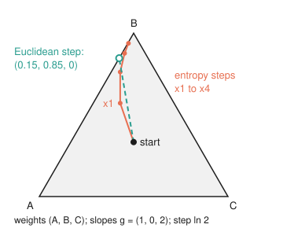
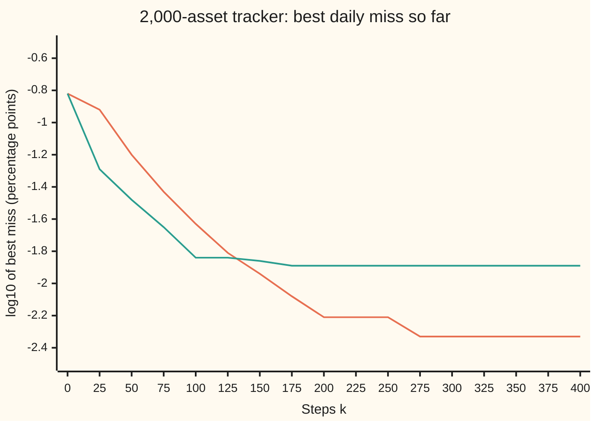

# Mirror descent: measure distance the way the constraint set wants, and the simplex gets multiplicative updates

[Syllabus](../../../SYLLABUS.md) → [Optimization](../README.md) → [First-Order Methods at Scale](../README.md#s08) → Mirror descent

---

## General Overview

An index tracker holds 2,000 assets. Every day it refits its weights from the last 250 daily returns. The weights must stay on the **simplex**: none negative, all summing to 1. (This simplex is a set of weights, not the simplex method of linear programming.) The tracker **minimises** its tracking miss, the average size of the gap between its own daily return and the index's.

Shrink it to three assets, A, B and C, at 1/3 each. Today's slopes of the miss are $`g = (1, 0, 2)`$: one more unit of weight on A raises the miss by 1, on B by 0, on C by 2. A gradient step subtracts a multiple of $`g`$ from the weights. With a step of $`\ln 2`$ that gives $`1/3 - \ln 2 \times (1, 0, 2)`$, two negative weights, and the step must then be pushed back onto the simplex. The pushed-back weights are $`(0.1534, 0.8466, 0)`$: asset C is dropped entirely after one step.

**Mirror descent** with the entropy map takes the same slopes and does something else. It multiplies each weight by $`2^{-g_i}`$, so by $`(1/2, 1, 1/4)`$. That gives $`(0.1667, 0.3333, 0.0833)`$, which sums to 0.5833. Dividing by 0.5833 gives $`(0.2857, 0.5714, 0.1429)`$. Every weight stays positive, the sum stays 1, and no projection is needed. Bad assets shrink by a factor; they are never cut to zero in one step.

The payoff shows at full size. A method's guarantee depends on how its geometry measures the slopes and the distance to travel. With ordinary straight-line distance, the worst case on 2,000 assets carries a factor $`\sqrt{2000 - 1} = 44.71`$. With the entropy geometry the factor is $`\sqrt{2 \ln 2000} = 3.90`$. For the same guarantee the Euclidean method needs 131.5 times as many steps.

**Mirror descent replaces the squared distance in a gradient step by a Bregman divergence fitted to the constraint set; on the simplex the entropy divergence is the KL divergence, the step becomes "multiply each weight by e to the minus step times slope, then rescale", and the proved rate grows with √(ln n) instead of √n.**

**What kind of fact this is:** a method, with theorems proved on this card in Why it works: the closed form of the step, the three-point identity, Pinsker's inequality in the form the proof needs, and the rate. The bound for the projected Euclidean method is stated, with its source. The tracker's returns are synthetic, drawn from a stated generator.

### The picture: one step each way on three assets

<p align="center"></p>

To scale: each point sits at its weights' mix of the corners. The solid orange path is four entropy steps with the slopes held at $`(1, 0, 2)`$. It curves towards B, the asset with the smallest slope, and never touches an edge. The dashed green Euclidean step of the same size hits edge AB, where C's weight is 0.

---

## The formula

Notation first, in words. There are $`n`$ assets, with weights $`x = (x_1, \dots, x_n)`$ on the simplex $`\Delta = \{x : x \ge 0,\ x_1 + \dots + x_n = 1\}`$. The cost $`f`$ is convex, with least value $`f(x^*)`$ at a minimiser $`x^*`$. As on [The subgradient method](../02-Unconstrained%20Methods/11-subgradient-method-and-polyak-steps.md), $`x_k`$ is the point after $`k`$ steps, counted from $`x_0`$, $`g_k`$ is a subgradient of $`f`$ at $`x_k`$ (a slope list whose plane stays under the graph), and $`\alpha`$ is the step size.

The **entropy map** is $`h(x) = \sum_i x_i \ln x_i`$ for $`x`$ in $`\Delta`$, with $`0 \ln 0 = 0`$. It is convex. Its **Bregman divergence** is the gap between $`h`$ and its tangent plane:

```math
D_h(x, y) = h(x) - h(y) - \nabla h(y)^{\top}(x - y) = \sum_i x_i \ln\frac{x_i}{y_i} = D(x \,\|\, y) \quad \text{for } x, y \in \Delta
```

**Read it aloud:** the Bregman divergence from y to x is how far h at x sits above the tangent plane of h taken at y; for the entropy map on the simplex it is the KL divergence of x from y.

The **mirror descent step** pays for each move with that divergence instead of a squared distance:

```math
x_{k+1} = \mathrm{argmin}_{x \in \Delta}\, \Big(\alpha\, g_k^{\top} x + D(x \,\|\, x_k)\Big), \qquad\text{which is}\qquad x_{k+1,i} = \frac{x_{k,i}\, e^{-\alpha g_{k,i}}}{Z_k}, \quad Z_k = \sum_j x_{k,j}\, e^{-\alpha g_{k,j}}
```

**Read it aloud:** the next weights make the slope times the step plus the divergence from today's weights as small as possible; the answer is each weight times e to the minus step times its slope, divided by the total of those products.

This entropy version is also called the **exponentiated gradient** method. The rate, for a fixed step $`\alpha`$ over $`K`$ steps from equal weights $`x_0 = (1/n, \dots, 1/n)`$, when every subgradient has all entries of size at most $`G`$:

```math
\min_{0 \le k < K} f(x_k) - f(x^*) \le \frac{\ln n}{\alpha K} + \frac{\alpha G^2}{2}, \qquad \alpha = \frac{\sqrt{2\ln n}}{G\sqrt{K}} \;\Longrightarrow\; \min_{0 \le k < K} f(x_k) - f(x^*) \le G\,\sqrt{\frac{2 \ln n}{K}}
```

**Read it aloud:** the best of the first K points is above the least value by at most log n over step times K, plus half the step times G squared; with the best fixed step, by at most G times the square root of two log n over K.

For comparison, the **projected subgradient method** steps $`x_{k+1} = \Pi_\Delta(x_k - \alpha g_k)`$, where $`\Pi_\Delta`$ moves a point to the nearest point of the simplex. Its bound is $`R\,G_2/\sqrt{K}`$, with $`R`$ the straight-line distance to travel and $`G_2`$ a bound on the length $`\lVert g_k\rVert_2`$. From equal weights $`R`$ can be $`\sqrt{1 - 1/n}`$, and $`G_2`$ can be $`\sqrt{n}\,G`$, so the worst case is $`\sqrt{n - 1}\, G/\sqrt{K}`$.

| Symbol | Plain meaning | In our example | Push it up and the answer… |
| --- | --- | --- | --- |
| $`n`$, $`i`$ | number of assets; one asset | 3 by hand; 2,000 in the tracker | bound grows like $`\sqrt{\ln n}`$ |
| $`x`$, $`x_i`$, $`\Delta`$, $`\Pi_\Delta`$ | weights; weight of asset $`i`$; the simplex; the map to its nearest point | $`(1/3, 1/3, 1/3)`$ at the start | — |
| $`f`$, $`x^*`$, $`f(x^*)`$ | tracking miss, percentage points a day; a minimiser; the least miss | tracker: 0.151039 at equal weights, 0 at the index weights | — |
| $`x_k`$, $`k`$, $`K`$ | weights after $`k`$ steps; step count from 0; steps budgeted | $`x_1 = (0.2857, 0.5714, 0.1429)`$; $`K = 400`$ | larger $`K`$, smaller guaranteed gap |
| $`g_k`$ | a subgradient: slope of the miss per unit of each weight | $`(1, 0, 2)`$ | that weight shrinks faster |
| $`\alpha`$, $`Z_k`$ | step size; total of the multiplied weights | $`\ln 2`$, $`Z_0 = 0.5833`$; tracker $`\alpha = 0.14982`$ | bolder multipliers; too bold and the second term of the bound grows |
| $`h`$, $`\nabla h`$, $`h^*`$ | entropy map; its slopes $`\ln x_i + 1`$; its conjugate | $`h^*(\theta) = \ln \sum_i e^{\theta_i}`$ | — |
| $`D_h(x, y)`$, $`D(x \,\Vert\, y)`$ | Bregman divergence; KL divergence, in nats (natural-log units) | $`D(x_1 \,\Vert\, x_0) = 0.142912`$ | — |
| $`\lVert v\rVert_1`$, $`\lVert v\rVert_\infty`$, $`\lVert v\rVert_2`$ | sum of the sizes of the entries; largest size; length | $`\lVert x_1 - x_0\rVert_1 = 0.476190`$ | — |
| $`G`$, $`G_2`$, $`R`$ | bound on $`\lVert g_k\rVert_\infty`$; bound on $`\lVert g_k\rVert_2`$; bound on $`\lVert x_0 - x^*\rVert_2`$ | tracker: 1.3012, 48.8796, 0.9997 | larger guaranteed gap |
| $`r_t`$, $`I_t`$, $`w`$, $`m`$ | asset returns on day $`t`$, percent; index return; index weights; days | $`m = 250`$; largest index weight 0.1223 | — |
| $`u`$, $`d`$, $`\theta`$, $`v`$, $`s`$, $`z_s`$ | in the proofs only: any comparison weights; a move's $`\lVert\cdot\rVert_1`$ size; a list of log-weights; a move, a fraction of it and the point reached | $`u = (0, 1, 0)`$ in the three-point check | — |

### When it holds

- **$`f`$ is convex on the simplex.** The proof uses $`f(x_k) - f(u) \le g_k^{\top}(x_k - u)`$, the tangent-plane test of [Convex functions](../01-Convexity/03-convex-functions-and-their-tests.md). Without it the rate promises nothing.
- **Every subgradient has entries of size at most $`G`$.** The tracker's slopes are averages of returns times $`\pm 1`$, so $`G = 1.3012`$ covers every weight list. A cost such as $`-\ln x_1`$ has slopes that grow without limit near the edge, and no $`G`$ exists.
- **The start has every weight above zero.** A weight at 0 is multiplied, and stays 0 for ever. From $`(0.5, 0, 0.5)`$ with the slopes $`(1, 0, 2)`$, 20 steps reach a miss of 1.0000, though 0 is possible.
- **The start is spread out.** The bound's $`\ln n`$ is $`D(x^* \,\|\, x_0)`$ at its worst, which needs equal weights. From $`(0.998, 0.001, 0.001)`$ the divergence to B is 6.9078, not 1.0986, and reaching a miss below 0.01 takes 17 steps instead of 7.
- **The step is fixed in advance for the budget $`K`$.** The bound holds for the best point seen, not the last one, as for the subgradient method.

---

## Why it works

### Step 0: change the ruler, and the step changes shape

A gradient step goes downhill by the slope but pays $`\tfrac{1}{2\alpha}\lVert x - x_k\rVert_2^2`$ for moving. That ruler prices a move from 0.0005 to 0.0010 like one from 0.5000 to 0.5005, though the first doubles a holding and the second barely changes one.

Mirror descent keeps the slope term and swaps the ruler for a divergence that measures change by ratios. The proof of the rate is the subgradient method's proof, line by line, with that divergence in place of half the squared distance. Two facts make the swap work: the divergence obeys an exact three-point identity, and it is at least half the squared $`\lVert\cdot\rVert_1`$ size of the move.

### Step 1: a Bregman divergence is a tangent gap

For any convex $`h`$, the tangent plane at $`y`$ lies under the graph ([Convex functions](../01-Convexity/03-convex-functions-and-their-tests.md)). So $`D_h(x, y) \ge 0`$, with 0 at $`x = y`$. With $`h(x) = \tfrac12\lVert x\rVert_2^2`$, the divergence is $`\tfrac12\lVert x - y\rVert_2^2`$: ordinary gradient descent is the special case.

With the entropy map, $`\nabla h(y)_i = \ln y_i + 1`$. Put that in the definition. The terms $`\sum_i x_i - \sum_i y_i`$ cancel on the simplex, and what is left is $`\sum_i x_i \ln(x_i/y_i)`$, the [KL divergence](../../14-Applied%20and%20computational/03-Information%20Theory/03-kl-divergence-and-cross-entropy.md) in nats. On the example, the definition and the KL sum both give $`D(x_1 \,\|\, x_0) = 0.142912`$.

The divergence is not symmetric. The other way round, $`D(x_0 \,\|\, x_1) = 0.154151`$. The first argument is the point being priced; the second is where the ruler is laid down.

### Step 2: the step has a closed form, and a mirror inside it

Multiply out the KL divergence from the new point $`x_{k+1}`$. For every $`x`$ on the simplex:

```math
\alpha\, g_k^{\top} x + D(x \,\|\, x_k) = D(x \,\|\, x_{k+1}) - \ln Z_k
```

**Read it aloud:** the step's cost at any weights x equals the divergence of x from the new point, minus the log of the total Z.

The right side is smallest when $`D(x \,\|\, x_{k+1}) = 0`$, that is at $`x = x_{k+1}`$ (Gibbs' inequality, proved on the KL card). So the multiplicative rule really solves the step's problem, and its least value is $`-\ln Z_k`$. On the example, $`-\ln(7/12) = 0.538997`$. A brute-force search over every grid point of the simplex in steps of 1/840 finds the same point, $`(240, 480, 120)/840`$, with the same value.

The name "mirror" comes from where the step happens. The map $`\nabla h`$ sends weights to log-weights. There the step is a plain gradient step, $`\ln x_{k+1} = \ln x_k - \alpha g_k`$, up to a constant. The way back is the gradient of the conjugate of $`h`$ on the simplex, $`h^*(\theta) = \ln \sum_i e^{\theta_i}`$ (over all positive lists, not just the simplex, it would be $`\sum_i e^{\theta_i - 1}`$), which is $`e^{\theta_i}/\sum_j e^{\theta_j}`$: the rescaling ([Convex conjugates](../01-Convexity/08-conjugates-and-fenchel-duality.md)). Step in the mirror image, then come back.

### Step 3: the three-point identity

Write the identity of Step 2 at a comparison point $`u`$ and at $`x_{k+1}`$, and subtract. The $`\ln Z_k`$ cancels:

```math
D(u \,\|\, x_k) - D(u \,\|\, x_{k+1}) - D(x_{k+1} \,\|\, x_k) = \alpha\, g_k^{\top}(x_{k+1} - u)
```

**Read it aloud:** how much closer the step brings you to u, minus the price of the step itself, equals the step times the slope's gain from the new point to u.

On the example, with $`u = (0, 1, 0)`$: $`1.098612 - 0.559616 - 0.142912 = 0.396084`$, and $`\ln 2 \times g^{\top}(x_1 - u) = 0.396084`$. It is an exact identity, not a bound. For Euclidean steps the same identity is the cosine rule.

### Step 4: entropy is strongly convex in the sum-of-sizes ruler

The proof needs the divergence to be at least half a squared size of the move. For entropy the right size is $`\lVert\cdot\rVert_1`$, and the fact is **Pinsker's inequality**:

```math
D(x \,\|\, y) \ge \tfrac12\,\lVert x - y\rVert_1^2 \qquad \text{for } x, y \in \Delta
```

**Read it aloud:** the KL divergence is at least half the square of the total change in weights.

On the example, $`\lVert x_1 - x_0\rVert_1 = 0.476190`$, half its square is 0.113379, and the divergence is 0.142912.

<details>
<summary>Detailed proof: Pinsker's inequality from the curvature of entropy</summary>

Let $`v = x - y`$ and $`z_s = y + s\,v`$ for $`0 \le s \le 1`$; every $`z_s`$ is on the simplex. First take every $`y_i > 0`$ and $`x_i > 0`$. Taylor's theorem with the integral remainder, applied to $`h`$ along the segment, gives

$`\displaystyle D_h(x, y) = \int_0^1 (1 - s)\, v^{\top} \nabla^2 h(z_s)\, v \, ds.`$

The Hessian of $`h`$ is diagonal with entries $`1/z_i`$, so $`v^{\top}\nabla^2 h(z)\,v = \sum_i v_i^2/z_i`$. By the Cauchy–Schwarz inequality,

$`\displaystyle \Big(\sum_i \lvert v_i\rvert\Big)^2 = \Big(\sum_i \frac{\lvert v_i\rvert}{\sqrt{z_i}}\sqrt{z_i}\Big)^2 \le \sum_i \frac{v_i^2}{z_i}\,\sum_i z_i = \sum_i \frac{v_i^2}{z_i},`$

because $`\sum_i z_i = 1`$. So the integrand is at least $`(1 - s)\lVert v\rVert_1^2`$, and $`\int_0^1 (1 - s)\,ds = 1/2`$ gives

$`\displaystyle D_h(x, y) \ge \tfrac12 \lVert x - y\rVert_1^2.`$

If some $`x_i = 0`$, let $`x_i`$ rise to 0 as a limit of positive weights: both sides are continuous in $`x`$, so the inequality survives. If some $`y_i = 0`$ while $`x_i > 0`$, the divergence is infinite and there is nothing to prove.

</details>

### Step 5: one step gains, up to a small price

Take $`u = x^*`$. Convexity, then the identity of Step 3:

```math
\alpha\big(f(x_k) - f(x^*)\big) \le \alpha\, g_k^{\top}(x_k - x_{k+1}) + D(x^* \,\|\, x_k) - D(x^* \,\|\, x_{k+1}) - D(x_{k+1} \,\|\, x_k)
```

The first term pairs the slopes with the move. A sum of products is at most the largest slope size times the total move size: $`g^{\top}v \le \lVert g\rVert_\infty \lVert v\rVert_1`$. With $`d = \lVert x_k - x_{k+1}\rVert_1`$, the first term is at most $`\alpha G d`$. Step 4 makes the last term at most $`-d^2/2`$. And $`\alpha G d - d^2/2 \le \alpha^2 G^2/2`$ for every $`d`$, since the difference is $`\tfrac12(d - \alpha G)^2 \ge 0`$. So:

```math
\alpha\big(f(x_k) - f(x^*)\big) \le D(x^* \,\|\, x_k) - D(x^* \,\|\, x_{k+1}) + \frac{\alpha^2 G^2}{2}
```

**Read it aloud:** each step's excess cost, times the step, is paid for by how much closer the weights get to the minimiser, plus half the step squared times G squared.

The tracker run tests this inequality at every one of its 400 entropy steps, with $`x^*`$ the index weights, using that step's own largest slope in place of $`G`$. It is broken 0 times.

### Step 6: add up the steps, and log n appears

Add Step 5 over $`k = 0`$ to $`K - 1`$. The divergence terms telescope to $`D(x^* \,\|\, x_0) - D(x^* \,\|\, x_K) \le D(x^* \,\|\, x_0)`$. From equal weights, $`D(x^* \,\|\, x_0) = \ln n + \sum_i x^*_i \ln x^*_i \le \ln n`$, since every $`x^*_i \ln x^*_i \le 0`$. Divide by $`\alpha K`$, and bound the average gap below by the best:

```math
\min_{0 \le k < K} f(x_k) - f(x^*) \le \frac{1}{K}\sum_{k=0}^{K-1}\big(f(x_k) - f(x^*)\big) \le \frac{\ln n}{\alpha K} + \frac{\alpha G^2}{2}
```

The two terms pull the step in opposite directions. They balance at $`\alpha = \sqrt{2\ln n}/(G\sqrt{K})`$, which gives $`G\sqrt{2\ln n / K}`$: the rate in The formula. For three assets and $`u`$ a corner, $`\ln 3`$ is the 1.098612 of Step 3.

### Step 7: why the logarithm beats the dimension

The Euclidean proof pairs the length of the slopes, $`\lVert g\rVert_2`$, with the straight-line distance. On the simplex the distance is at most about 1, but the length of 2,000 slopes of size 1 is $`\sqrt{2000}`$. The entropy proof pairs the largest slope, $`\lVert g\rVert_\infty`$, with the $`\lVert\cdot\rVert_1`$ size of moves, which is at most 2 on the simplex. Its only price for dimension is the starting divergence $`\ln n`$, and that enters under a square root.

For $`n = 2000`$ the worst-case constants are $`\sqrt{2\ln n} = 3.8989`$ and $`\sqrt{n - 1} = 44.7102`$, a ratio of 11.47. The bounds fall like $`1/\sqrt{K}`$, so the Euclidean method needs 131.5 times as many steps for the same guarantee. [The speed limit](03-lower-bounds-for-first-order-methods.md) shows that no first-order method can do much better than order $`1/\sqrt{K}`$ on costs with kinks.

---

## Worked numbers, by hand

One mirror descent step on three assets, from equal weights, with slopes $`g = (1, 0, 2)`$ and step $`\ln 2`$.

| Step | Arithmetic | Value |
| --- | --- | --- |
| multipliers | $`e^{-\ln 2 \cdot g} = (2^{-1}, 2^{0}, 2^{-2})`$ | $`(0.5000, 1.0000, 0.2500)`$ |
| multiply | $`\tfrac13 \times (0.5, 1, 0.25)`$ | $`(0.1667, 0.3333, 0.0833)`$ |
| total | $`Z_0 = 0.1667 + 0.3333 + 0.0833 = 7/12`$ | 0.5833 |
| rescale | $`(1/6, 1/3, 1/12) \div (7/12) = (2/7, 4/7, 1/7)`$ | $`(0.2857, 0.5714, 0.1429)`$ |
| price of the move | $`\tfrac27\ln\tfrac67 + \tfrac47\ln\tfrac{12}7 + \tfrac17\ln\tfrac37`$ | 0.142912 |
| Pinsker | $`\tfrac12\big(\tfrac1{21} + \tfrac5{21} + \tfrac4{21}\big)^2 = \tfrac12\big(\tfrac{10}{21}\big)^2`$ | 0.113379, below 0.142912 |
| cost after k steps, slopes fixed | $`(2^{-k} + 2 \cdot 4^{-k})/(2^{-k} + 1 + 4^{-k})`$ for k = 1, 2, 3 | 0.5714, 0.2857, 0.1370 |
| same step, Euclidean | $`\Pi_\Delta\big(\tfrac13 - \ln 2 \times (1, 0, 2)\big)`$ | $`(0.1534, 0.8466, 0.0000)`$ |
| guarantee constant, n = 2000 | $`\sqrt{2\ln 2000}`$ against $`\sqrt{1999}`$ | **3.8989 against 44.7102** |

After one step the fund holds 57% in B, the asset whose weight does not add to the miss, and still keeps 14% in C. With the slopes held at $`(1, 0, 2)`$ the miss halves about every step, and the cost $`x_A + 2x_C`$ has least value 0 at corner B: no weights do better, because the cost is never negative.

On the real tracker, both methods start from equal weights, at a miss of 0.151039 percentage points a day. The index weights give a miss of 0, and no weights can give less, so 0 is the certified least value. With the theory's steps for $`K = 400`$:

| Steps | Best miss, entropy | Best miss, Euclidean |
| --- | --- | --- |
| 0 | 0.151039 | 0.151039 |
| 50 | 0.062599 | 0.033290 |
| 100 | 0.023317 | 0.014431 |
| 200 | 0.006176 | 0.012908 |
| 400 | **0.004683** | 0.012908 |

The Euclidean method moves faster at first, then stalls; the entropy method ends lower. The 400-step guarantees, 0.2537 for entropy and 2.4434 for Euclidean, are both above the starting miss of 0.151039, so on this tracker they promise nothing: holding equal weights would meet them. The entropy guarantee first falls below the starting miss at a budget of 1,129 steps, the Euclidean one at 104,680, 92.7 times as many. That is the gap of Step 7 measured on this tracker's own slopes, against 131.5 in the worst case. The largest index weight, 0.1223, ends at 0.1138 under entropy steps and 0.0647 under Euclidean ones: multiplying moves a big weight in big moves.



The orange line is mirror descent with the entropy map, step 0.14982. The green line is the projected Euclidean method, step 0.001023. Each point is the base-10 logarithm of the best miss so far; −2 is a miss of 0.01 percentage points a day.

### What breaks if you drop a piece

| Mistake | Comes out at | What went wrong |
| --- | --- | --- |
| Start with a weight at 0: $`(0.5, 0, 0.5)`$, slopes $`(1, 0, 2)`$ | miss 1.0000 after 20 steps; least value 0 | A zero weight times any multiplier stays 0, and $`D(x^* \,\Vert\, x_0)`$ is infinite |
| Start near a corner: $`(0.998, 0.001, 0.001)`$ | 17 steps to a miss below 0.01, against 7 | $`D(x^* \,\Vert\, x_0) = 6.9078`$, not $`\ln 3 = 1.0986`$ |
| Multiply but skip the rescaling | weights summing to 0.5833 | The point has left the simplex |
| Euclidean steps on 2,000 assets | guarantee 2.4434 against 0.2537; best miss 0.012908 against 0.004683 | The slope length $`\lVert g\rVert_2`$ grows with $`\sqrt{n}`$; the largest slope does not |
| The divergence read the wrong way round | $`D(x_0 \,\Vert\, x_1) = 0.154151`$, not 0.142912 | The Bregman divergence is not symmetric |

---

## Code, from first principles, and it actually runs

Both programs check the three-asset step against exact fractions and against a brute-force search of the simplex in steps of 1/840. They compute the divergence two ways and check the three-point identity, Pinsker's inequality and a fixed-slope run against its closed form. On the 2,000-asset tracker (returns from a SplitMix64 generator, seed 2024) they run both methods, find the first budget at which each guarantee falls below the starting miss (by search, checked against the closed form), test Step 5 at every step, and certify the least value 0 by the index weights.

### Python

```python
# Mirror descent -- the check behind the card.  Standard library only.
# Weights live on the simplex (non-negative, summing to 1).  Mirror descent with the
# entropy map multiplies each weight by exp(-step * slope), then rescales to sum 1.
# Roads: the closed-form step against a brute-force grid minimisation of
# step*g.x + KL(x||x0); the Bregman divergence from its definition against the KL sum;
# the three-point identity and Pinsker's bound; a constant-slope run against its
# closed form; on a 2,000-asset tracker, entropy against Euclidean steps, the one-step
# inequality, the certificate f >= 0 = f(index weights), and the first K with bound < f(x0).
import math
from operator import mul

def kl(x, y): return sum(a * math.log(a / b) for a, b in zip(x, y) if a > 0)
def h(x): return sum(a * math.log(a) for a in x if a > 0)
def md_step(x, g, a):
    y = [xi * math.exp(-a * gi) for xi, gi in zip(x, g)]
    z = sum(y)
    return [v / z for v in y]
def proj(v):  # nearest point of the simplex: subtract one level tau, clip at 0
    c, tau = 0.0, 0.0
    for j, u in enumerate(sorted(v, reverse=True)):
        c += u
        if u - (c - 1) / (j + 1) > 0: tau = (c - 1) / (j + 1)
    return [max(vi - tau, 0.0) for vi in v]
def show(x): return " ".join(f"{v:.4f}" for v in x)

# 1. one step on three assets: weights 1/3 each, slopes g = (1, 0, 2), step ln 2
x0, g, a = [1 / 3] * 3, [1.0, 0.0, 2.0], math.log(2)
mult = [math.exp(-a * gi) for gi in g]
raw = [xi * m for xi, m in zip(x0, mult)]
x1 = md_step(x0, g, a)
print("multipliers 2^(-g):", show(mult))
print("unnormalised:", show(raw), f"sum {sum(raw):.4f}")
print("mirror step x1:", show(x1))
assert max(abs(p - q) for p, q in zip(x1, [2 / 7, 4 / 7, 1 / 7])) < 1e-12
N, best = 840, (9.0, None)  # brute force: every grid point of the simplex, step 1/840
for i in range(N + 1):
    for j in range(N + 1 - i):
        x = [i / N, j / N, (N - i - j) / N]
        val = a * (x[0] + 2 * x[2]) + kl(x, x0)
        if val < best[0]: best = (val, (i, j, N - i - j))
print(f"grid 1/840: best point {best[1]} / 840, value {best[0]:.6f}; -ln(7/12) = {-math.log(7 / 12):.6f}")
assert best[1] == (240, 480, 120) and abs(best[0] + math.log(7 / 12)) < 1e-12
d10 = kl(x1, x0)
d_def = h(x1) - h(x0) - sum((math.log(q) + 1) * (p - q) for p, q in zip(x1, x0))
l1 = sum(abs(p - q) for p, q in zip(x1, x0))
print(f"D(x1,x0) by KL sum {d10:.6f}, by definition {d_def:.6f}; D(x0,x1) = {kl(x0, x1):.6f}")
print(f"Pinsker: |x1 - x0|_1 = {l1:.6f}, half its square {l1 * l1 / 2:.6f} <= {d10:.6f}")
assert abs(d10 - d_def) < 1e-12 and l1 * l1 / 2 <= d10 and abs(kl(x0, x1) - d10) > 0.01
u = [0.0, 1.0, 0.0]
lhs = kl(u, x0) - kl(u, x1) - d10
rhs = a * sum(gi * (p - q) for gi, p, q in zip(g, x1, u))
print(f"three-point: D(u,x0) {kl(u, x0):.6f} - D(u,x1) {kl(u, x1):.6f} - D(x1,x0) = {lhs:.6f}; a g.(x1-u) = {rhs:.6f}")
assert abs(lhs - rhs) < 1e-12
v = [p - a * gi for p, gi in zip(x0, g)]
xe = proj(v)
tau2 = (v[0] + v[1] - 1) / 2  # by hand: two weights stay positive
print("Euclidean step, same size:", show(xe))
assert abs(xe[0] - (v[0] - tau2)) < 1e-12 and xe[2] == 0.0

# 2. the slopes held fixed: cost f(x) = x_A + 2 x_C, least value 0 at asset B
x, fs, path = x0, [], [x0]
for k in range(1, 8):
    x = md_step(x, g, a)
    z = 2.0 ** -k + 1 + 4.0 ** -k
    closed = [2.0 ** -k / z, 1 / z, 4.0 ** -k / z]
    assert max(abs(p - q) for p, q in zip(x, closed)) < 1e-12
    fs.append(x[0] + 2 * x[2]); path.append(x)
print("figure, mirror path k = 0..4:", " | ".join(show(q) for q in path[:5]), "; Euclidean step:", show(xe))
print("constant slopes, f(x_k) for k = 1..7:", " ".join(f"{v:.4f}" for v in fs))
def steps_to(x, tol):
    for k in range(1, 200):
        x = md_step(x, g, a)
        if x[0] + 2 * x[2] < tol: return k, x
    return None, x
ku, _ = steps_to(x0, 0.01)
xc = [0.998, 0.001, 0.001]
kc, _ = steps_to(xc, 0.01)
print(f"steps to f < 0.01: from equal weights {ku} (D(u,x0) = {kl(u, x0):.4f}),"
      f" from (0.998, 0.001, 0.001) {kc} (D = {kl(u, xc):.4f})")
xz = [0.5, 0.0, 0.5]
for _ in range(20): xz = md_step(xz, g, a)
print(f"start (0.5, 0, 0.5), 20 steps: x = {show(xz)}, f = {xz[0] + 2 * xz[2]:.4f}; least value 0")
assert ku == 7 and kc > ku and xz[1] == 0.0 and xz[0] + 2 * xz[2] > 0.99

# 3. the tracker: n = 2,000 assets, m = 250 days of returns (percent), SplitMix64 seed 2024
M64 = (1 << 64) - 1
state = 2024
def unif():
    global state
    state = (state + 0x9E3779B97F4A7C15) & M64
    z = state
    z = ((z ^ (z >> 30)) * 0xBF58476D1CE4E5B9) & M64
    z = ((z ^ (z >> 27)) * 0x94D049BB133111EB) & M64
    return ((z ^ (z >> 31)) >> 11) / 9007199254740992.0
n, m, K = 2000, 250, 400
beta = [0.5 + unif() for _ in range(n)]
R = []
for t in range(m):
    mt = 2 * unif() - 1
    R.append([b * mt + 4 * unif() - 2 for b in beta])
cols = list(zip(*R))
zw = sum(1 / (i + 1) for i in range(n))
w = [1 / (i + 1) / zw for i in range(n)]
index = [sum(map(mul, r, w)) for r in R]
def fg(x):  # mean absolute daily miss, and a subgradient
    e = [sum(map(mul, r, x)) - it for r, it in zip(R, index)]
    s = [(v > 0) - (v < 0) for v in e]
    return sum(map(abs, e)) / m, [sum(map(mul, c, s)) / m for c in cols]
col_abs = [sum(map(abs, c)) / m for c in cols]
G_inf, G_2, Rad = max(col_abs), math.sqrt(sum(v * v for v in col_abs)), math.sqrt(1 - 1 / n)
a_m, a_e = math.sqrt(2 * math.log(n)) / (G_inf * math.sqrt(K)), Rad / (G_2 * math.sqrt(K))
bound_m, bound_e = G_inf * math.sqrt(2 * math.log(n) / K), Rad * G_2 / math.sqrt(K)
print(f"tracker: G_inf = {G_inf:.4f}, G_2 = {G_2:.4f}, R = {Rad:.4f}; steps: entropy {a_m:.5f}, Euclidean {a_e:.6f}")
print(f"certificate: f >= 0 everywhere and f(index weights) = {fg(w)[0]:.6f}, so f* = 0")
xm, xe = [1 / n] * n, [1 / n] * n
bm, be, hist, bad = math.inf, math.inf, [], 0
for k in range(K + 1):
    fm, gm = fg(xm)
    fe, ge = fg(xe)
    bm, be = min(bm, fm), min(be, fe)
    if k % 25 == 0: hist.append((k, bm, be))
    if k == K: break
    xn = md_step(xm, gm, a_m)  # one-step inequality of the proof, with u = index weights
    if a_m * fm > kl(w, xm) - kl(w, xn) + a_m ** 2 * max(map(abs, gm)) ** 2 / 2 + 1e-12: bad += 1
    xm, xe = xn, proj([p - a_e * q for p, q in zip(xe, ge)])
for k, p, q in hist:
    if k in (0, 50, 100, 200, 400): print(f"k = {k:3d}: best miss entropy {p:.6f}, Euclidean {q:.6f}")
print("chart, log10 best miss, entropy:", " ".join(f"{math.log10(p):.2f}" for _, p, _ in hist))
print("chart, log10 best miss, Euclidean:", " ".join(f"{math.log10(q):.2f}" for _, _, q in hist))
print(f"bounds after {K} steps: entropy {bound_m:.4f}, Euclidean {bound_e:.4f}; one-step inequality broken {bad} times")
f0, c_m, c_e = hist[0][1], math.sqrt(2 * math.log(n)), math.sqrt(n - 1)  # f0: the miss at equal weights
km, ke = (next(k for k in range(1, 10 ** 6) if b * math.sqrt(K / k) < f0) for b in (bound_m, bound_e))
print(f"first budget K whose bound is below the starting miss {f0:.6f}: entropy {km}, Euclidean {ke}, ratio {ke / km:.1f}")
assert K < km < ke and km == int(2 * math.log(n) * (G_inf / f0) ** 2) + 1 and ke == int((Rad * G_2 / f0) ** 2) + 1
print(f"after {K} steps, weight on asset 1: entropy {xm[0]:.4f}, Euclidean {xe[0]:.4f}, index {w[0]:.4f}")
assert fg(w)[0] < 1e-12 and bad == 0 and bm < be and min(xm) > 0
print(f"worst-case constants for n = 2000: entropy sqrt(2 ln n) = {c_m:.4f}, Euclidean sqrt(n - 1) = {c_e:.4f},"
      f" ratio {c_e / c_m:.2f}, steps ratio {(c_e / c_m) ** 2:.1f}")
assert abs(c_m - 3.90) < 0.005
print("ALL CHECKS PASS")
```

**Ran 2026-11-24 on macOS, Python 3.14.10, standard library only. All checks passed. Output, pasted from the run:**

```
multipliers 2^(-g): 0.5000 1.0000 0.2500
unnormalised: 0.1667 0.3333 0.0833 sum 0.5833
mirror step x1: 0.2857 0.5714 0.1429
grid 1/840: best point (240, 480, 120) / 840, value 0.538997; -ln(7/12) = 0.538997
D(x1,x0) by KL sum 0.142912, by definition 0.142912; D(x0,x1) = 0.154151
Pinsker: |x1 - x0|_1 = 0.476190, half its square 0.113379 <= 0.142912
three-point: D(u,x0) 1.098612 - D(u,x1) 0.559616 - D(x1,x0) = 0.396084; a g.(x1-u) = 0.396084
Euclidean step, same size: 0.1534 0.8466 0.0000
figure, mirror path k = 0..4: 0.3333 0.3333 0.3333 | 0.2857 0.5714 0.1429 | 0.1905 0.7619 0.0476 | 0.1096 0.8767 0.0137 | 0.0586 0.9377 0.0037 ; Euclidean step: 0.1534 0.8466 0.0000
constant slopes, f(x_k) for k = 1..7: 0.5714 0.2857 0.1370 0.0659 0.0322 0.0159 0.0079
steps to f < 0.01: from equal weights 7 (D(u,x0) = 1.0986), from (0.998, 0.001, 0.001) 17 (D = 6.9078)
start (0.5, 0, 0.5), 20 steps: x = 1.0000 0.0000 0.0000, f = 1.0000; least value 0
tracker: G_inf = 1.3012, G_2 = 48.8796, R = 0.9997; steps: entropy 0.14982, Euclidean 0.001023
certificate: f >= 0 everywhere and f(index weights) = 0.000000, so f* = 0
k =   0: best miss entropy 0.151039, Euclidean 0.151039
k =  50: best miss entropy 0.062599, Euclidean 0.033290
k = 100: best miss entropy 0.023317, Euclidean 0.014431
k = 200: best miss entropy 0.006176, Euclidean 0.012908
k = 400: best miss entropy 0.004683, Euclidean 0.012908
chart, log10 best miss, entropy: -0.82 -0.92 -1.20 -1.43 -1.63 -1.81 -1.94 -2.08 -2.21 -2.21 -2.21 -2.33 -2.33 -2.33 -2.33 -2.33 -2.33
chart, log10 best miss, Euclidean: -0.82 -1.29 -1.48 -1.65 -1.84 -1.84 -1.86 -1.89 -1.89 -1.89 -1.89 -1.89 -1.89 -1.89 -1.89 -1.89 -1.89
bounds after 400 steps: entropy 0.2537, Euclidean 2.4434; one-step inequality broken 0 times
first budget K whose bound is below the starting miss 0.151039: entropy 1129, Euclidean 104680, ratio 92.7
after 400 steps, weight on asset 1: entropy 0.1138, Euclidean 0.0647, index 0.1223
worst-case constants for n = 2000: entropy sqrt(2 ln n) = 3.8989, Euclidean sqrt(n - 1) = 44.7102, ratio 11.47, steps ratio 131.5
ALL CHECKS PASS
```

### Rust

```rust
// Mirror descent -- the check behind the card.  std only, no crates.
// Weights live on the simplex (non-negative, summing to 1).  Mirror descent with the
// entropy map multiplies each weight by exp(-step * slope), then rescales to sum 1.
// Roads: the closed-form step against a brute-force grid minimisation of
// step*g.x + KL(x||x0); the Bregman divergence from its definition against the KL sum;
// the three-point identity and Pinsker's bound; a constant-slope run against its
// closed form; on a 2,000-asset tracker, entropy against Euclidean steps, the one-step
// inequality, the certificate f >= 0 = f(index weights), and the first K with bound < f(x0).

fn kl(x: &[f64], y: &[f64]) -> f64 {
    x.iter().zip(y).filter(|(a, _)| **a > 0.0).map(|(a, b)| a * (a / b).ln()).sum()
}
fn h(x: &[f64]) -> f64 { x.iter().filter(|a| **a > 0.0).map(|a| a * a.ln()).sum() }
fn md_step(x: &[f64], g: &[f64], a: f64) -> Vec<f64> {
    let y: Vec<f64> = x.iter().zip(g).map(|(xi, gi)| xi * (-a * gi).exp()).collect();
    let z: f64 = y.iter().sum();
    y.iter().map(|v| v / z).collect()
}
fn proj(v: &[f64]) -> Vec<f64> { // nearest point of the simplex: subtract one level tau, clip at 0
    let mut u = v.to_vec();
    u.sort_by(|p, q| q.partial_cmp(p).unwrap());
    let (mut c, mut tau) = (0.0, 0.0);
    for (j, uj) in u.iter().enumerate() {
        c += uj;
        if uj - (c - 1.0) / (j as f64 + 1.0) > 0.0 { tau = (c - 1.0) / (j as f64 + 1.0); }
    }
    v.iter().map(|vi| (vi - tau).max(0.0)).collect()
}
fn show(x: &[f64]) -> String { x.iter().map(|v| format!("{:.4}", v)).collect::<Vec<_>>().join(" ") }
fn dot(a: &[f64], b: &[f64]) -> f64 { a.iter().zip(b).map(|(p, q)| p * q).sum() }
fn fcost(x: &[f64]) -> f64 { x[0] + 2.0 * x[2] }

struct Rng(u64);
impl Rng {
    fn unif(&mut self) -> f64 {
        self.0 = self.0.wrapping_add(0x9E3779B97F4A7C15);
        let mut z = self.0;
        z = (z ^ (z >> 30)).wrapping_mul(0xBF58476D1CE4E5B9);
        z = (z ^ (z >> 27)).wrapping_mul(0x94D049BB133111EB);
        ((z ^ (z >> 31)) >> 11) as f64 / 9007199254740992.0
    }
}

fn main() {
    // 1. one step on three assets: weights 1/3 each, slopes g = (1, 0, 2), step ln 2
    let (x0, g, a) = (vec![1.0 / 3.0; 3], vec![1.0, 0.0, 2.0], 2f64.ln());
    let mult: Vec<f64> = g.iter().map(|gi| (-a * gi).exp()).collect();
    let raw: Vec<f64> = x0.iter().zip(&mult).map(|(x, m)| x * m).collect();
    let x1 = md_step(&x0, &g, a);
    println!("multipliers 2^(-g): {}", show(&mult));
    println!("unnormalised: {} sum {:.4}", show(&raw), raw.iter().sum::<f64>());
    println!("mirror step x1: {}", show(&x1));
    let exact = [2.0 / 7.0, 4.0 / 7.0, 1.0 / 7.0];
    assert!((0..3).all(|i| (x1[i] - exact[i]).abs() < 1e-12));
    let n3 = 840usize;
    let (mut bv, mut bp) = (9.0, (0, 0, 0)); // brute force: every grid point, step 1/840
    for i in 0..=n3 {
        for j in 0..=(n3 - i) {
            let x = [i as f64 / n3 as f64, j as f64 / n3 as f64, (n3 - i - j) as f64 / n3 as f64];
            let val = a * (x[0] + 2.0 * x[2]) + kl(&x, &x0);
            if val < bv { bv = val; bp = (i, j, n3 - i - j); }
        }
    }
    println!("grid 1/840: best point {:?} / 840, value {:.6}; -ln(7/12) = {:.6}", bp, bv, -(7.0f64 / 12.0).ln());
    assert!(bp == (240, 480, 120) && (bv + (7.0f64 / 12.0).ln()).abs() < 1e-12);
    let d10 = kl(&x1, &x0);
    let d_def = h(&x1) - h(&x0) - (0..3).map(|i| (x0[i].ln() + 1.0) * (x1[i] - x0[i])).sum::<f64>();
    let l1: f64 = (0..3).map(|i| (x1[i] - x0[i]).abs()).sum();
    println!("D(x1,x0) by KL sum {:.6}, by definition {:.6}; D(x0,x1) = {:.6}", d10, d_def, kl(&x0, &x1));
    println!("Pinsker: |x1 - x0|_1 = {:.6}, half its square {:.6} <= {:.6}", l1, l1 * l1 / 2.0, d10);
    assert!((d10 - d_def).abs() < 1e-12 && l1 * l1 / 2.0 <= d10 && (kl(&x0, &x1) - d10).abs() > 0.01);
    let u = [0.0, 1.0, 0.0];
    let lhs = kl(&u, &x0) - kl(&u, &x1) - d10;
    let rhs = a * (0..3).map(|i| g[i] * (x1[i] - u[i])).sum::<f64>();
    println!("three-point: D(u,x0) {:.6} - D(u,x1) {:.6} - D(x1,x0) = {:.6}; a g.(x1-u) = {:.6}",
             kl(&u, &x0), kl(&u, &x1), lhs, rhs);
    assert!((lhs - rhs).abs() < 1e-12);
    let v: Vec<f64> = (0..3).map(|i| x0[i] - a * g[i]).collect();
    let xe = proj(&v);
    let tau2 = (v[0] + v[1] - 1.0) / 2.0; // by hand: two weights stay positive
    println!("Euclidean step, same size: {}", show(&xe));
    assert!((xe[0] - (v[0] - tau2)).abs() < 1e-12 && xe[2] == 0.0);

    // 2. the slopes held fixed: cost f(x) = x_A + 2 x_C, least value 0 at asset B
    let mut x = x0.clone();
    let (mut fs, mut path) = (vec![], vec![show(&x0)]);
    for k in 1..8 {
        x = md_step(&x, &g, a);
        let (p, q) = (2f64.powi(-k), 4f64.powi(-k));
        let z = p + 1.0 + q;
        let closed = [p / z, 1.0 / z, q / z];
        assert!((0..3).all(|i| (x[i] - closed[i]).abs() < 1e-12));
        fs.push(format!("{:.4}", fcost(&x)));
        path.push(show(&x));
    }
    println!("figure, mirror path k = 0..4: {} ; Euclidean step: {}", path[..5].join(" | "), show(&xe));
    println!("constant slopes, f(x_k) for k = 1..7: {}", fs.join(" "));
    let steps_to = |start: &[f64], tol: f64| -> usize {
        let mut x = start.to_vec();
        for k in 1..200 { x = md_step(&x, &g, a); if fcost(&x) < tol { return k; } }
        0
    };
    let xc = [0.998, 0.001, 0.001];
    let (ku, kc) = (steps_to(&x0, 0.01), steps_to(&xc, 0.01));
    println!("steps to f < 0.01: from equal weights {} (D(u,x0) = {:.4}), from (0.998, 0.001, 0.001) {} (D = {:.4})",
             ku, kl(&u, &x0), kc, kl(&u, &xc));
    let mut xz = vec![0.5, 0.0, 0.5];
    for _ in 0..20 { xz = md_step(&xz, &g, a); }
    println!("start (0.5, 0, 0.5), 20 steps: x = {}, f = {:.4}; least value 0", show(&xz), fcost(&xz));
    assert!(ku == 7 && kc > ku && xz[1] == 0.0 && fcost(&xz) > 0.99);

    // 3. the tracker: n = 2,000 assets, m = 250 days of returns (percent), SplitMix64 seed 2024
    let (n, m, kk) = (2000usize, 250usize, 400usize);
    let mut rng = Rng(2024);
    let beta: Vec<f64> = (0..n).map(|_| 0.5 + rng.unif()).collect();
    let mut rr: Vec<Vec<f64>> = vec![];
    for _ in 0..m {
        let mt = 2.0 * rng.unif() - 1.0;
        rr.push(beta.iter().map(|b| b * mt + 4.0 * rng.unif() - 2.0).collect());
    }
    let cols: Vec<Vec<f64>> = (0..n).map(|i| rr.iter().map(|r| r[i]).collect()).collect();
    let zw: f64 = (0..n).map(|i| 1.0 / (i as f64 + 1.0)).sum();
    let w: Vec<f64> = (0..n).map(|i| 1.0 / (i as f64 + 1.0) / zw).collect();
    let index: Vec<f64> = rr.iter().map(|r| dot(r, &w)).collect();
    let fg = |x: &[f64]| -> (f64, Vec<f64>) { // mean absolute daily miss, and a subgradient
        let e: Vec<f64> = rr.iter().zip(&index).map(|(r, it)| dot(r, x) - it).collect();
        let s: Vec<f64> = e.iter().map(|v| if *v > 0.0 { 1.0 } else if *v < 0.0 { -1.0 } else { 0.0 }).collect();
        (e.iter().map(|v| v.abs()).sum::<f64>() / m as f64, cols.iter().map(|c| dot(c, &s) / m as f64).collect())
    };
    let col_abs: Vec<f64> = cols.iter().map(|c| c.iter().map(|v| v.abs()).sum::<f64>() / m as f64).collect();
    let g_inf = col_abs.iter().cloned().fold(0.0, f64::max);
    let g_2 = col_abs.iter().map(|v| v * v).sum::<f64>().sqrt();
    let rad = (1.0 - 1.0 / n as f64).sqrt();
    let ln_n = (n as f64).ln();
    let (a_m, a_e) = ((2.0 * ln_n).sqrt() / (g_inf * (kk as f64).sqrt()), rad / (g_2 * (kk as f64).sqrt()));
    let (bound_m, bound_e) = (g_inf * (2.0 * ln_n / kk as f64).sqrt(), rad * g_2 / (kk as f64).sqrt());
    println!("tracker: G_inf = {:.4}, G_2 = {:.4}, R = {:.4}; steps: entropy {:.5}, Euclidean {:.6}", g_inf, g_2, rad, a_m, a_e);
    println!("certificate: f >= 0 everywhere and f(index weights) = {:.6}, so f* = 0", fg(&w).0);
    let (mut xm, mut xe) = (vec![1.0 / n as f64; n], vec![1.0 / n as f64; n]);
    let (mut bm, mut be, mut hist, mut bad) = (f64::INFINITY, f64::INFINITY, vec![], 0);
    for k in 0..=kk {
        let (fm, gm) = fg(&xm);
        let (fe, ge) = fg(&xe);
        bm = bm.min(fm); be = be.min(fe);
        if k % 25 == 0 { hist.push((k, bm, be)); }
        if k == kk { break; }
        let xn = md_step(&xm, &gm, a_m); // one-step inequality of the proof, with u = index weights
        let gmax = gm.iter().fold(0.0f64, |acc, v| acc.max(v.abs()));
        if a_m * fm > kl(&w, &xm) - kl(&w, &xn) + a_m * a_m * gmax * gmax / 2.0 + 1e-12 { bad += 1; }
        xe = proj(&xe.iter().zip(&ge).map(|(p, q)| p - a_e * q).collect::<Vec<f64>>());
        xm = xn;
    }
    for (k, p, q) in &hist {
        if [0, 50, 100, 200, 400].contains(k) { println!("k = {:3}: best miss entropy {:.6}, Euclidean {:.6}", k, p, q); }
    }
    let line = |sel: usize| hist.iter().map(|t| format!("{:.2}", (if sel == 0 { t.1 } else { t.2 }).log10())).collect::<Vec<_>>().join(" ");
    println!("chart, log10 best miss, entropy: {}", line(0));
    println!("chart, log10 best miss, Euclidean: {}", line(1));
    println!("bounds after {} steps: entropy {:.4}, Euclidean {:.4}; one-step inequality broken {} times", kk, bound_m, bound_e, bad);
    let (f0, c_m, c_e) = (hist[0].1, (2.0 * ln_n).sqrt(), (n as f64 - 1.0).sqrt()); // f0: the miss at equal weights
    let [km, ke] = [bound_m, bound_e].map(|b| (1..1_000_000usize).find(|&k| b * (kk as f64 / k as f64).sqrt() < f0).unwrap());
    println!("first budget K whose bound is below the starting miss {:.6}: entropy {}, Euclidean {}, ratio {:.1}", f0, km, ke, ke as f64 / km as f64);
    assert!(kk < km && km < ke && km == (2.0 * ln_n * (g_inf / f0).powi(2)) as usize + 1 && ke == (rad * g_2 / f0).powi(2) as usize + 1);
    println!("after {} steps, weight on asset 1: entropy {:.4}, Euclidean {:.4}, index {:.4}", kk, xm[0], xe[0], w[0]);
    assert!(fg(&w).0 < 1e-12 && bad == 0 && bm < be && xm.iter().all(|v| *v > 0.0));
    println!("worst-case constants for n = 2000: entropy sqrt(2 ln n) = {:.4}, Euclidean sqrt(n - 1) = {:.4}, ratio {:.2}, steps ratio {:.1}",
             c_m, c_e, c_e / c_m, (c_e / c_m).powi(2));
    assert!((c_m - 3.90).abs() < 0.005);
    println!("ALL CHECKS PASS");
}
```

**Ran 2026-11-24 on macOS, rustc 1.98.1, no crates. All checks passed. Output, pasted from the run:**

```
multipliers 2^(-g): 0.5000 1.0000 0.2500
unnormalised: 0.1667 0.3333 0.0833 sum 0.5833
mirror step x1: 0.2857 0.5714 0.1429
grid 1/840: best point (240, 480, 120) / 840, value 0.538997; -ln(7/12) = 0.538997
D(x1,x0) by KL sum 0.142912, by definition 0.142912; D(x0,x1) = 0.154151
Pinsker: |x1 - x0|_1 = 0.476190, half its square 0.113379 <= 0.142912
three-point: D(u,x0) 1.098612 - D(u,x1) 0.559616 - D(x1,x0) = 0.396084; a g.(x1-u) = 0.396084
Euclidean step, same size: 0.1534 0.8466 0.0000
figure, mirror path k = 0..4: 0.3333 0.3333 0.3333 | 0.2857 0.5714 0.1429 | 0.1905 0.7619 0.0476 | 0.1096 0.8767 0.0137 | 0.0586 0.9377 0.0037 ; Euclidean step: 0.1534 0.8466 0.0000
constant slopes, f(x_k) for k = 1..7: 0.5714 0.2857 0.1370 0.0659 0.0322 0.0159 0.0079
steps to f < 0.01: from equal weights 7 (D(u,x0) = 1.0986), from (0.998, 0.001, 0.001) 17 (D = 6.9078)
start (0.5, 0, 0.5), 20 steps: x = 1.0000 0.0000 0.0000, f = 1.0000; least value 0
tracker: G_inf = 1.3012, G_2 = 48.8796, R = 0.9997; steps: entropy 0.14982, Euclidean 0.001023
certificate: f >= 0 everywhere and f(index weights) = 0.000000, so f* = 0
k =   0: best miss entropy 0.151039, Euclidean 0.151039
k =  50: best miss entropy 0.062599, Euclidean 0.033290
k = 100: best miss entropy 0.023317, Euclidean 0.014431
k = 200: best miss entropy 0.006176, Euclidean 0.012908
k = 400: best miss entropy 0.004683, Euclidean 0.012908
chart, log10 best miss, entropy: -0.82 -0.92 -1.20 -1.43 -1.63 -1.81 -1.94 -2.08 -2.21 -2.21 -2.21 -2.33 -2.33 -2.33 -2.33 -2.33 -2.33
chart, log10 best miss, Euclidean: -0.82 -1.29 -1.48 -1.65 -1.84 -1.84 -1.86 -1.89 -1.89 -1.89 -1.89 -1.89 -1.89 -1.89 -1.89 -1.89 -1.89
bounds after 400 steps: entropy 0.2537, Euclidean 2.4434; one-step inequality broken 0 times
first budget K whose bound is below the starting miss 0.151039: entropy 1129, Euclidean 104680, ratio 92.7
after 400 steps, weight on asset 1: entropy 0.1138, Euclidean 0.0647, index 0.1223
worst-case constants for n = 2000: entropy sqrt(2 ln n) = 3.8989, Euclidean sqrt(n - 1) = 44.7102, ratio 11.47, steps ratio 131.5
ALL CHECKS PASS
```

### Lean

Lean proves the rate, the three-point identity and Pinsker's inequality for any number of assets, and checks the fractions worked by hand.

- Suppose $`f`$ is convex on the simplex, every subgradient has entries of size at most $`G`$, and the step $`\alpha > 0`$ is fixed. Then $`K`$ steps from equal weights have a best point within $`\ln n/(\alpha K) + \alpha G^2/2`$ of the least value.
- Suppose every weight of $`x_k`$ is above zero, and $`u`$ is any weights on the simplex. Then the three-point identity of Step 3 holds exactly.
- Suppose $`x`$ and $`y`$ are on the simplex, and $`y_i = 0`$ only where $`x_i = 0`$, so the divergence is finite. Then $`D(x \,\|\, y) \ge \tfrac12\lVert x - y\rVert_1^2`$.
- Take one step from equal weights, with multipliers $`(1/2, 1, 1/4)`$. Then the total is $`Z_0 = 7/12`$, and the new weights are $`(2/7, 4/7, 1/7)`$.
- The total change in weights is $`\lVert x_1 - x_0\rVert_1 = 1/21 + 5/21 + 4/21 = 10/21`$.
- Hold the slopes at $`(1, 0, 2)`$. Then the cost $`x_A + 2x_C`$ after 1, 2 and 3 steps is 4/7, 2/7 and 10/73.

The rate with the best fixed step, the decimals, the tracker run and the failures are left to the Python and Rust checks.

```lean
-- Mirror descent: on the simplex, entropy mirror descent from equal weights keeps the best of its first K points within log n/(αK) + αG²/2 of the least cost.
import Mathlib.Analysis.Convex.StdSimplex
import Mathlib.Analysis.Convex.Function
import Mathlib.Analysis.SpecialFunctions.Log.Basic
import Mathlib.Analysis.SpecialFunctions.Exp
import Mathlib.Order.Filter.Extr
import Mathlib.Analysis.SpecialFunctions.Log.Deriv
import Mathlib.Analysis.Calculus.Deriv.MeanValue
import Mathlib.Algebra.BigOperators.Field

open Finset

lemma md_kfun_hasDeriv (t : ℝ) (ht : 0 < t) :
    HasDerivAt (fun s : ℝ => Real.log s - (5 * s ^ 2 - 4 * s - 1) / (2 * s ^ 2 + 4 * s))
      ((t - 1) ^ 3 / (t ^ 2 * (t + 2) ^ 2)) t := by
  have h1 : HasDerivAt (fun s : ℝ => 5 * s ^ 2 - 4 * s - 1) (5 * (2 * t) - 4) t := by
    have := (((hasDerivAt_pow 2 t).const_mul 5).sub ((hasDerivAt_id t).const_mul 4)).sub_const 1
    convert this using 1; simp; ring
  have h2 : HasDerivAt (fun s : ℝ => 2 * s ^ 2 + 4 * s) (2 * (2 * t) + 4) t := by
    have := (((hasDerivAt_pow 2 t).const_mul 2).add ((hasDerivAt_id t).const_mul 4))
    convert this using 1
    · funext s; simp
    · simp
  have hne : 2 * t ^ 2 + 4 * t ≠ 0 := by positivity
  have := (Real.hasDerivAt_log ht.ne').sub (h1.div h2 hne)
  convert this using 1
  field_simp
  ring

lemma md_log_ge (t : ℝ) (ht : 0 < t) :
    (5 * t ^ 2 - 4 * t - 1) / (2 * t ^ 2 + 4 * t) ≤ Real.log t := by
  set k : ℝ → ℝ := fun s => Real.log s - (5 * s ^ 2 - 4 * s - 1) / (2 * s ^ 2 + 4 * s) with hk
  have hk1 : k 1 = 0 := by simp [hk]; norm_num
  have hcont : ContinuousOn k (Set.Ioi 0) := fun s hs =>
    (md_kfun_hasDeriv s hs).continuousAt.continuousWithinAt
  suffices 0 ≤ k t by simp only [hk] at this; linarith
  rcases le_total 1 t with h | h
  · have hmono : MonotoneOn k (Set.Ici 1) := by
      apply monotoneOn_of_deriv_nonneg (convex_Ici 1)
      · exact hcont.mono (fun s (hs : (1:ℝ) ≤ s) => (show (0:ℝ) < s by linarith))
      · intro s hs
        rw [interior_Ici] at hs
        exact (md_kfun_hasDeriv s (lt_trans one_pos hs)).differentiableAt.differentiableWithinAt
      · intro s hs
        rw [interior_Ici] at hs
        have hs' : (1:ℝ) < s := hs
        rw [(md_kfun_hasDeriv s (by linarith)).deriv]
        apply div_nonneg
        · exact pow_nonneg (by linarith) 3
        · positivity
    have := hmono (Set.self_mem_Ici) h h
    linarith
  · have hanti : AntitoneOn k (Set.Icc t 1) := by
      apply antitoneOn_of_deriv_nonpos (convex_Icc t 1)
      · exact hcont.mono (fun s hs => lt_of_lt_of_le ht hs.1)
      · intro s hs
        rw [interior_Icc] at hs
        exact (md_kfun_hasDeriv s (lt_trans ht hs.1)).differentiableAt.differentiableWithinAt
      · intro s hs
        rw [interior_Icc] at hs
        rw [(md_kfun_hasDeriv s (lt_trans ht hs.1)).deriv]
        apply div_nonpos_of_nonpos_of_nonneg
        · have : s - 1 ≤ 0 := by linarith [hs.2]
          nlinarith [sq_nonneg (s - 1)]
        · have := lt_trans ht hs.1
          positivity
    have := hanti ⟨le_refl t, h⟩ ⟨h, le_refl 1⟩ h
    linarith

lemma md_kl_term_ge (a b : ℝ) (ha : 0 ≤ a) (hb : 0 ≤ b) (hab : b = 0 → a = 0) :
    3 / 2 * ((a - b) ^ 2 / (a + 2 * b)) ≤ a * Real.log (a / b) - a + b := by
  rcases hb.eq_or_lt with hb0 | hbpos
  · have ha0 := hab hb0.symm
    subst ha0; rw [← hb0]; simp
  rcases ha.eq_or_lt with ha0 | hapos
  · subst ha0
    have : (0 - b) ^ 2 / (0 + 2 * b) = b / 2 := by field_simp; ring
    rw [this]; simp; linarith
  have ht : 0 < a / b := div_pos hapos hbpos
  have hl := md_log_ge (a / b) ht
  have key : a * ((5 * (a / b) ^ 2 - 4 * (a / b) - 1) / (2 * (a / b) ^ 2 + 4 * (a / b)))
      = a - b + 3 / 2 * ((a - b) ^ 2 / (a + 2 * b)) := by
    field_simp
    ring
  have := mul_le_mul_of_nonneg_left hl ha
  linarith

lemma md_pinsker (n : ℕ) (x y : Fin n → ℝ)
    (hx : x ∈ stdSimplex ℝ (Fin n)) (hy : y ∈ stdSimplex ℝ (Fin n))
    (hfin : ∀ i, y i = 0 → x i = 0) :
    (∑ i, |x i - y i|) ^ 2 / 2 ≤ ∑ i, x i * Real.log (x i / y i) := by
  have hx0 := hx.1
  have hy0 := hy.1
  have hxs := hx.2
  have hys := hy.2
  set Q := ∑ i, (x i - y i) ^ 2 / (x i + 2 * y i) with hQ
  have hCS : (∑ i, |x i - y i|) ^ 2 ≤ Q * ∑ i, (x i + 2 * y i) := by
    apply Finset.sum_sq_le_sum_mul_sum_of_sq_le_mul
    · intro i _
      have := hx0 i; have := hy0 i
      positivity
    · intro i _
      have := hx0 i; have := hy0 i
      positivity
    · intro i _
      have h1 := hx0 i; have h2 := hy0 i
      rcases (add_nonneg h1 (mul_nonneg zero_le_two h2)).eq_or_lt with h | h
      · have hyi : y i = 0 := by linarith
        have hxi : x i = 0 := by linarith
        simp [hxi, hyi]
      · rw [div_mul_cancel₀ _ h.ne', sq_abs]
  have hsum3 : ∑ i, (x i + 2 * y i) = 3 := by
    rw [Finset.sum_add_distrib, ← Finset.mul_sum, hxs, hys]; norm_num
  rw [hsum3] at hCS
  have hKL : 3 / 2 * Q ≤ ∑ i, x i * Real.log (x i / y i) := by
    have h1 : ∑ i, x i * Real.log (x i / y i)
        = ∑ i, (x i * Real.log (x i / y i) - x i + y i) := by
      rw [Finset.sum_add_distrib, Finset.sum_sub_distrib, hxs, hys]; ring
    rw [h1, hQ, Finset.mul_sum]
    exact Finset.sum_le_sum (fun i _ => md_kl_term_ge (x i) (y i) (hx0 i) (hy0 i) (hfin i))
  linarith

lemma md_three_point (n : ℕ) (y u g : Fin n → ℝ) (α : ℝ)
    (hy : y ∈ stdSimplex ℝ (Fin n)) (hypos : ∀ i, 0 < y i)
    (hu : u ∈ stdSimplex ℝ (Fin n)) :
    (∑ i, u i * Real.log (u i / y i))
        - (∑ i, u i * Real.log (u i / (y i * Real.exp (-(α * g i)) /
            ∑ j, y j * Real.exp (-(α * g j)))))
        - (∑ i, (y i * Real.exp (-(α * g i)) / ∑ j, y j * Real.exp (-(α * g j))) *
            Real.log ((y i * Real.exp (-(α * g i)) / ∑ j, y j * Real.exp (-(α * g j))) / y i))
      = α * ∑ i, g i * ((y i * Real.exp (-(α * g i)) / ∑ j, y j * Real.exp (-(α * g j)))
          - u i) := by
  set Z := ∑ j, y j * Real.exp (-(α * g j)) with hZ
  set z : Fin n → ℝ := fun i => y i * Real.exp (-(α * g i)) / Z with hzdef
  have hne : (univ : Finset (Fin n)).Nonempty := by
    by_contra h
    rw [Finset.not_nonempty_iff_eq_empty] at h
    have := hy.2
    rw [h] at this
    simp at this
  have hZpos : 0 < Z := Finset.sum_pos (fun i _ => mul_pos (hypos i) (Real.exp_pos _)) hne
  have hzpos : ∀ i, 0 < z i := fun i => div_pos (mul_pos (hypos i) (Real.exp_pos _)) hZpos
  have hzsum : ∑ i, z i = 1 := by
    simp only [hzdef]
    rw [← Finset.sum_div, div_self hZpos.ne']
  have hlog : ∀ i, Real.log (z i / y i) = -(α * g i) - Real.log Z := by
    intro i
    have : z i / y i = Real.exp (-(α * g i)) / Z := by
      simp only [hzdef]; field_simp [(hypos i).ne']
    rw [this, Real.log_div (Real.exp_pos _).ne' hZpos.ne', Real.log_exp]
  have hterm : ∀ i, u i * Real.log (u i / y i) - u i * Real.log (u i / z i)
      = u i * (-(α * g i) - Real.log Z) := by
    intro i
    rcases (hu.1 i).eq_or_lt with h0 | hpos
    · rw [← h0]; simp
    · rw [Real.log_div hpos.ne' (hypos i).ne', Real.log_div hpos.ne' (hzpos i).ne', ← hlog i,
        Real.log_div (hzpos i).ne' (hypos i).ne']
      ring
  show (∑ i, u i * Real.log (u i / y i)) - (∑ i, u i * Real.log (u i / z i))
        - (∑ i, z i * Real.log (z i / y i)) = α * ∑ i, g i * (z i - u i)
  rw [← Finset.sum_sub_distrib, ← Finset.sum_sub_distrib]
  simp_rw [hterm, hlog]
  have hus := hu.2
  have : ∀ i, u i * (-(α * g i) - Real.log Z) - z i * (-(α * g i) - Real.log Z)
      = α * (g i * (z i - u i)) + Real.log Z * (z i - u i) := fun i => by ring
  simp_rw [this]
  rw [Finset.sum_add_distrib, ← Finset.mul_sum, ← Finset.mul_sum, Finset.sum_sub_distrib,
    hzsum, hus]
  ring

#print axioms md_kfun_hasDeriv
#print axioms md_log_ge
#print axioms md_kl_term_ge
#print axioms md_pinsker
#print axioms md_three_point

/-- The rate of mirror descent with the entropy map (exponentiated gradient).
Let `f` be convex on the simplex with a minimiser `xstar`. Start from equal weights
`x 0 = (1/n, …, 1/n)`, and at each step multiply each weight by `exp (-α * g k i)`,
where `g k` is a subgradient of `f` at `x k` with every entry of size at most `G`,
then rescale so the weights sum to 1. With a fixed step `α > 0` and a budget of `K ≥ 1`
steps, the best of the points `x 0, …, x (K-1)` has cost at most
`f xstar + log n / (α K) + α G² / 2`. -/
theorem mirror_descent_entropy_rate (n : ℕ) (hn : 0 < n)
    (f : (Fin n → ℝ) → ℝ) (hf : ConvexOn ℝ (stdSimplex ℝ (Fin n)) f)
    (xstar : Fin n → ℝ) (hxstar : xstar ∈ stdSimplex ℝ (Fin n))
    (hmin : IsMinOn f (stdSimplex ℝ (Fin n)) xstar)
    (x g : ℕ → Fin n → ℝ) (α G : ℝ) (hα : 0 < α) (K : ℕ) (hK : 0 < K)
    (h0 : ∀ i, x 0 i = 1 / n)
    (hstep : ∀ k i, x (k + 1) i =
      x k i * Real.exp (-(α * g k i)) / ∑ j, x k j * Real.exp (-(α * g k j)))
    (hsub : ∀ k, ∀ y ∈ stdSimplex ℝ (Fin n), f (x k) + ∑ i, g k i * (y i - x k i) ≤ f y)
    (hG : ∀ k i, |g k i| ≤ G) :
    ∃ k < K, f (x k) - f xstar ≤ Real.log n / (α * K) + α * G ^ 2 / 2 := by
  have hnR : (0 : ℝ) < n := Nat.cast_pos.mpr hn
  have hne : (univ : Finset (Fin n)).Nonempty := ⟨⟨0, hn⟩, Finset.mem_univ _⟩
  -- every iterate is on the simplex with positive weights
  have hpos : ∀ k, x k ∈ stdSimplex ℝ (Fin n) ∧ ∀ i, 0 < x k i := by
    intro k
    induction k with
    | zero =>
      refine ⟨⟨fun i => by rw [h0]; positivity, ?_⟩, fun i => by rw [h0]; positivity⟩
      simp only [h0, Finset.sum_const, Finset.card_univ, Fintype.card_fin, nsmul_eq_mul]
      field_simp
    | succ k ih =>
      have hZ : 0 < ∑ j, x k j * Real.exp (-(α * g k j)) :=
        Finset.sum_pos (fun j _ => mul_pos (ih.2 j) (Real.exp_pos _)) hne
      have hp : ∀ i, 0 < x (k + 1) i := fun i => by
        rw [hstep]; exact div_pos (mul_pos (ih.2 i) (Real.exp_pos _)) hZ
      refine ⟨⟨fun i => (hp i).le, ?_⟩, hp⟩
      simp only [hstep]
      rw [← Finset.sum_div, div_self hZ.ne']
  set D : (Fin n → ℝ) → ℝ := fun v => ∑ i, xstar i * Real.log (xstar i / v i) with hD
  -- the one-step bound
  have hone : ∀ k, α * ∑ i, g k i * (x k i - xstar i)
      ≤ D (x k) - D (x (k + 1)) + α ^ 2 * G ^ 2 / 2 := by
    intro k
    have h3 := md_three_point n (x k) xstar (g k) α (hpos k).1 (hpos k).2 hxstar
    have hz : ∀ i, x k i * Real.exp (-(α * g k i)) / ∑ j, x k j * Real.exp (-(α * g k j))
        = x (k + 1) i := fun i => (hstep k i).symm
    simp only [hz] at h3
    -- h3 : D (x k) - D (x (k+1)) - KL(x(k+1) ‖ x k) = α * Σ g (x(k+1) - xstar)
    have hP := md_pinsker n (x (k + 1)) (x k) (hpos (k + 1)).1 (hpos k).1
      (fun i h => absurd h ((hpos k).2 i).ne')
    set L := ∑ i, |x (k + 1) i - x k i| with hL
    have hlin : ∑ i, g k i * (x k i - x (k + 1) i) ≤ G * L := by
      rw [hL, Finset.mul_sum]
      apply Finset.sum_le_sum
      intro i _
      calc g k i * (x k i - x (k + 1) i) ≤ |g k i * (x k i - x (k + 1) i)| := le_abs_self _
        _ = |g k i| * |x (k + 1) i - x k i| := by rw [abs_mul, abs_sub_comm]
        _ ≤ G * |x (k + 1) i - x k i| := mul_le_mul_of_nonneg_right (hG k i) (abs_nonneg _)
    have hsplit : ∑ i, g k i * (x k i - xstar i)
        = ∑ i, g k i * (x (k + 1) i - xstar i) + ∑ i, g k i * (x k i - x (k + 1) i) := by
      rw [← Finset.sum_add_distrib]; apply Finset.sum_congr rfl; intro i _; ring
    rw [hsplit, mul_add]
    have hsq : 0 ≤ (L - α * G) ^ 2 := sq_nonneg _
    have := mul_le_mul_of_nonneg_left hlin hα.le
    simp only [hD]
    nlinarith
  -- telescoping
  have htel : ∀ m, α * ∑ k ∈ range m, ∑ i, g k i * (x k i - xstar i)
      ≤ D (x 0) - D (x m) + m * (α ^ 2 * G ^ 2 / 2) := by
    intro m
    induction m with
    | zero => simp
    | succ m ih =>
      rw [Finset.sum_range_succ, mul_add]
      have := hone m
      push_cast
      linarith
  -- the start and the end
  have hD0 : D (x 0) ≤ Real.log n := by
    have : ∀ i, xstar i * Real.log (xstar i / x 0 i) ≤ xstar i * Real.log n := by
      intro i
      rw [h0]
      rcases (hxstar.1 i).eq_or_lt with h | h
      · rw [← h]; simp
      · apply mul_le_mul_of_nonneg_left _ h.le
        apply Real.log_le_log (by positivity)
        have hle : xstar i ≤ 1 := by
          have := hxstar.2
          rw [← this]
          exact Finset.single_le_sum (fun j _ => hxstar.1 j) (Finset.mem_univ i)
        rw [div_div_eq_mul_div, div_one]
        nlinarith
    calc D (x 0) ≤ ∑ i, xstar i * Real.log n := Finset.sum_le_sum (fun i _ => this i)
      _ = Real.log n := by rw [← Finset.sum_mul, hxstar.2, one_mul]
  have hDK : 0 ≤ D (x K) := by
    have := md_pinsker n xstar (x K) hxstar (hpos K).1 (fun i h => absurd h ((hpos K).2 i).ne')
    have h2 : 0 ≤ (∑ i, |xstar i - x K i|) ^ 2 / 2 := by positivity
    exact le_trans h2 this
  -- the gap at each step is at most the linear term
  have hgap : ∀ k, f (x k) - f xstar ≤ ∑ i, g k i * (x k i - xstar i) := by
    intro k
    have := hsub k xstar hxstar
    have he : ∑ i, g k i * (x k i - xstar i) = -∑ i, g k i * (xstar i - x k i) := by
      rw [← Finset.sum_neg_distrib]; apply Finset.sum_congr rfl; intro i _; ring
    rw [he]; linarith
  by_contra hcon
  push_neg at hcon
  set B := Real.log n / (α * K) + α * G ^ 2 / 2 with hB
  have hKR : (0 : ℝ) < K := Nat.cast_pos.mpr hK
  have hrne : (range K).Nonempty := ⟨0, Finset.mem_range.mpr hK⟩
  have hlt : ∑ _k ∈ range K, B < ∑ k ∈ range K, ∑ i, g k i * (x k i - xstar i) := by
    apply Finset.sum_lt_sum_of_nonempty hrne
    intro k hk
    exact lt_of_lt_of_le (hcon k (Finset.mem_range.mp hk)) (hgap k)
  rw [Finset.sum_const, Finset.card_range, nsmul_eq_mul] at hlt
  have hαKB : α * (K * B) = Real.log n + K * (α ^ 2 * G ^ 2 / 2) := by
    rw [hB]; field_simp
  have := htel K
  have := mul_lt_mul_of_pos_left hlt hα
  linarith

/-- The three-point identity for the entropy step. If every weight of `y` is positive and
`z` is the mirror descent step from `y` with slopes `g` and step `α`
(`z i = y i * exp (-α g i) / Z`), then for any comparison weights `u` on the simplex
`D(u ‖ y) - D(u ‖ z) - D(z ‖ y) = α g ⬝ (z - u)`, where `D(p ‖ q) = ∑ p i log (p i / q i)`
is the KL divergence. -/
theorem kl_three_point_identity (n : ℕ) (y u g : Fin n → ℝ) (α : ℝ)
    (hy : y ∈ stdSimplex ℝ (Fin n)) (hypos : ∀ i, 0 < y i)
    (hu : u ∈ stdSimplex ℝ (Fin n)) :
    let Z := ∑ j, y j * Real.exp (-(α * g j))
    let z : Fin n → ℝ := fun i => y i * Real.exp (-(α * g i)) / Z
    (∑ i, u i * Real.log (u i / y i)) - (∑ i, u i * Real.log (u i / z i))
        - (∑ i, z i * Real.log (z i / y i))
      = α * ∑ i, g i * (z i - u i) := by
  intro Z z
  exact md_three_point n y u g α hy hypos hu

/-- Pinsker's inequality: for weights `x` and `y` on the simplex with finite divergence
(no weight of `y` is zero where `x` has weight), the KL divergence
`D(x ‖ y) = ∑ x i log (x i / y i)` is at least half the square of `‖x - y‖₁`. -/
theorem pinsker_kl_ge_half_l1_sq (n : ℕ) (x y : Fin n → ℝ)
    (hx : x ∈ stdSimplex ℝ (Fin n)) (hy : y ∈ stdSimplex ℝ (Fin n))
    (hfin : ∀ i, y i = 0 → x i = 0) :
    (∑ i, |x i - y i|) ^ 2 / 2 ≤ ∑ i, x i * Real.log (x i / y i) := by
  exact md_pinsker n x y hx hy hfin

-- The card's step on three assets: weights 1/3 each, multipliers 2^(-g) = (1/2, 1, 1/4).
example : (1/3 : ℚ) * (1/2) + 1/3 * 1 + 1/3 * (1/4) = 7/12 := by norm_num
example : ((1/3 : ℚ) * (1/2)) / (7/12) = 2/7 := by norm_num
example : ((1/3 : ℚ) * 1) / (7/12) = 4/7 := by norm_num
example : ((1/3 : ℚ) * (1/4)) / (7/12) = 1/7 := by norm_num
-- The l1 size of the move in the Pinsker row: 1/21 + 5/21 + 4/21 = 10/21.
example : |(2/7 : ℚ) - 1/3| + |4/7 - 1/3| + |1/7 - 1/3| = 10/21 := by norm_num [abs_of_nonneg, abs_of_nonpos]
-- Cost x_A + 2 x_C after k = 1, 2, 3 steps with the slopes held at (1, 0, 2).
example : ((1/2 : ℚ) + 2 * (1/4)) / (1/2 + 1 + 1/4) = 4/7 := by norm_num
example : ((1/4 : ℚ) + 2 * (1/16)) / (1/4 + 1 + 1/16) = 2/7 := by norm_num
example : ((1/8 : ℚ) + 2 * (1/64)) / (1/8 + 1 + 1/64) = 10/73 := by norm_num

#print axioms mirror_descent_entropy_rate
#print axioms kl_three_point_identity
#print axioms pinsker_kl_ge_half_l1_sq
```

**Checked 2026-11-24 on macOS, Lean 4.36.0-rc2, Mathlib v4.36.0-rc2. Every proof is complete and uses only Lean's standard axioms. Output, pasted from the run:**

```
'md_kfun_hasDeriv' depends on axioms: [propext, Classical.choice, Quot.sound]
'md_log_ge' depends on axioms: [propext, Classical.choice, Quot.sound]
'md_kl_term_ge' depends on axioms: [propext, Classical.choice, Quot.sound]
'md_pinsker' depends on axioms: [propext, Classical.choice, Quot.sound]
'md_three_point' depends on axioms: [propext, Classical.choice, Quot.sound]
'mirror_descent_entropy_rate' depends on axioms: [propext, Classical.choice, Quot.sound]
'kl_three_point_identity' depends on axioms: [propext, Classical.choice, Quot.sound]
'pinsker_kl_ge_half_l1_sq' depends on axioms: [propext, Classical.choice, Quot.sound]
```

> [!TIP]
> **Try changing**
> - Guess first: a smaller budget. Set `K = 100` in the tracker. The theory's steps double, to 0.29965 and 0.002045. Entropy reaches 0.012331 and Euclidean 0.028017: with the shorter budget entropy is ahead from step 50 on. The guarantees rise to 0.5073 and 4.8867. Every check passes.
> - Guess first: other returns. Set `state = 7`. The start misses by 0.164207; after 400 steps entropy is at 0.006049 and Euclidean at 0.011841. The pattern holds and every check passes.
> - Guess first: a smaller index. Set `n` to 200. The worst-case constants become 3.2552 and 14.1067, a ratio of 4.33 instead of 11.47, and the two runs end close together, 0.007237 and 0.008874. The budgets at which the guarantees first fall below the start, 453 and 6,092, differ 13.4 times instead of 92.7. The last assert, written for 2,000 assets, fails.
> - Guess first: a bolder hand step. Change `a` from `math.log(2)` to `math.log(4)`. One step now lands on $`(0.1905, 0.7619, 0.0476)`$, the point two steps of $`\ln 2`$ reach, because multipliers compound. The first assert, written for $`\ln 2`$, fails.

---

## The usual mistake

> [!warning]
> **Letting a weight reach zero.** Mirror descent only multiplies, so a weight at 0 is 0 for ever, and the method can never buy that asset again. From $`(0.5, 0, 0.5)`$ with slopes $`(1, 0, 2)`$, 20 steps give a miss of 1.0000 while 0 is possible. Start with every weight positive, and never round small weights to 0 during the run.
>
> - **Reading the guarantee as a forecast.** The entropy guarantee after 400 steps is 0.2537, above even the starting miss of 0.151039; the run reaches 0.004683. The bound protects the worst case; it does not predict this one.
> - **Forgetting to rescale.** The multiplied weights $`(0.1667, 0.3333, 0.0833)`$ sum to 0.5833, not 1.
> - **Using the Euclidean step size.** The theory's Euclidean step on the tracker is 0.001023, against 0.14982 for entropy, because $`G_2 = 48.8796`$ is so much larger than $`G = 1.3012`$. Each method has its own step.
> - **Treating the divergence as a distance.** $`D(x_1 \,\|\, x_0) = 0.142912`$ but $`D(x_0 \,\|\, x_1) = 0.154151`$. The proof uses the order $`D(x^* \,\|\, x_k)`$, with the minimiser first.

---

## Where you meet it in real life

- **Index funds and portfolio rebalancing.** Exponentiated-gradient rules update long-only weights by multiplying, so they never go short and need no projection onto the budget.
- **Learning from expert advice.** The multiplicative weights rule, also called Hedge, keeps one weight per forecaster and shrinks each by $`e^{-\alpha \times \text{loss}}`$. It is mirror descent with the entropy map, run one day at a time.
- **Boosting.** AdaBoost reweights training examples multiplicatively, raising the weight of the ones the last classifier got wrong; that update is an entropy step.
- **Large linear programs and games.** Multiplicative weights finds approximate solutions of zero-sum games and packing and covering programs with millions of variables, where each step needs only a slope list.

> **Say it back**
> Mirror descent is a gradient step that pays for moving with a Bregman divergence instead of a squared distance. On the simplex, the entropy map's divergence is the KL divergence, and the step becomes "multiply each weight by e to the minus step times slope, then rescale". From equal weights, slopes (1, 0, 2) and step ln 2, that gives (0.2857, 0.5714, 0.1429). The three-point identity and Pinsker's inequality turn the subgradient method's proof into a guarantee of G √(2 ln n / K). For 2,000 assets that constant is 3.90 against 44.71 for Euclidean steps.

---

## What this builds on

- [The subgradient method](../02-Unconstrained%20Methods/11-subgradient-method-and-polyak-steps.md): the step against a subgradient, the best-point-so-far rule, and the $`RG/\sqrt{K}`$ proof that this card repeats with a divergence in place of the squared distance.
- [Convex conjugates](../01-Convexity/08-conjugates-and-fenchel-duality.md): the conjugate $`h^*`$, whose gradient, the softmax, carries log-weights back to weights.
- [Convex functions](../01-Convexity/03-convex-functions-and-their-tests.md): the tangent-plane test that makes every Bregman divergence non-negative and drives Step 5.
- [KL divergence](../../14-Applied%20and%20computational/03-Information%20Theory/03-kl-divergence-and-cross-entropy.md): the divergence itself, and Gibbs' inequality that it is never negative.
- [Frank-Wolfe](01-frank-wolfe-conditional-gradient.md): the shelf's other way to stay on the simplex without a projection, by stepping towards a corner.

## Where this goes next

- [Online convex optimisation](06-online-convex-optimisation-and-regret.md): the next card. The same entropy step, run as the slopes arrive one day at a time, and its regret bound.
- [Sinkhorn](08-entropic-optimal-transport-and-sinkhorn.md): KL divergence used again, as a penalty that turns a transport plan into rescalings.
- [Monotone operators](07-monotone-operators-and-splitting.md): the proximal step read as a resolvent; the mirror step is a proximal step with a Bregman divergence in place of the squared distance.

The rate here needs only bounded slopes. When the cost is also smooth, faster accelerated mirror methods exist; how much of that speed survives the entropy geometry in a given problem is the question this card leaves open.

---

## Sources

Verified 2026-11-24: every link below resolves to the publisher's page. Each DOI was checked on Crossref for its title and first author.

- Beck, Amir, and Marc Teboulle. "Mirror Descent and Nonlinear Projected Subgradient Methods for Convex Optimization." *Operations Research Letters* 31, no. 3 (2003): 167–175. [doi:10.1016/S0167-6377(02)00231-6](https://doi.org/10.1016/S0167-6377(02)00231-6). The step as a proximal step in a Bregman divergence, and the entropy method's √(ln n) rate on the simplex.
- Kivinen, Jyrki, and Manfred K. Warmuth. "Exponentiated Gradient versus Gradient Descent for Linear Predictors." *Information and Computation* 132, no. 1 (1997): 1–63. [doi:10.1006/inco.1996.2612](https://doi.org/10.1006/inco.1996.2612). The multiplicative update, compared with additive gradient steps.
- Bregman, L. M. "The Relaxation Method of Finding the Common Point of Convex Sets and Its Application to the Solution of Problems in Convex Programming." *USSR Computational Mathematics and Mathematical Physics* 7, no. 3 (1967): 200–217. [doi:10.1016/0041-5553(67)90040-7](https://doi.org/10.1016/0041-5553(67)90040-7). The divergence that bears his name.
- Bubeck, Sébastien. "Convex Optimization: Algorithms and Complexity." *Foundations and Trends in Machine Learning* 8, no. 3–4 (2015): 231–357. [doi:10.1561/2200000050](https://doi.org/10.1561/2200000050). Chapter 4: mirror maps, the three-point identity and the rate in non-Euclidean geometry.
- Beck, Amir. *First-Order Methods in Optimization.* SIAM, 2017. [doi:10.1137/1.9781611974997](https://doi.org/10.1137/1.9781611974997). Chapters 8 and 9: the projected subgradient bound stated in The formula, and mirror descent with its proofs.
