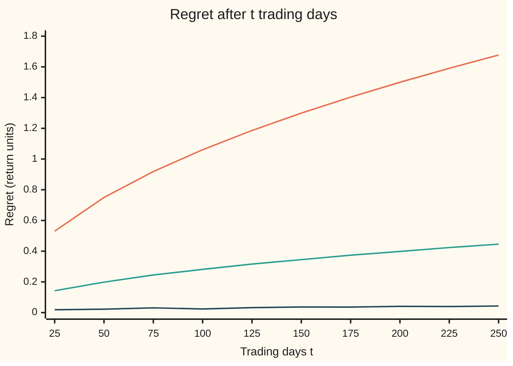

# Online convex optimisation: commit, then see the loss, and keep regret below sqrt(T)

[Syllabus](../../../SYLLABUS.md) → [Optimization](../README.md) → [First-Order Methods at Scale](../README.md#s08) → Online convex optimisation

---

## General Overview

An index tracker holds 2,000 assets, grouped into three sector **sleeves** (a sleeve is the part of the fund that holds one sector). The index itself puts 50% in sleeve A, 30% in B and 20% in C. A small overlay may tilt that mix each morning. It must choose the day's mix before the market opens, and it learns the day's returns only that evening. The day's **loss** is the mix's shortfall against an equal split across the sleeves, plus a small charge for drifting from the index mix.

Nobody knows in advance which mix will do best. The overlay therefore cannot be judged against the best mix of each day. It is judged against something fairer: the **best fixed mix in hindsight**, the one mix that would have done best if held for all 250 trading days of the year. The overlay's total loss minus that mix's total loss is its **regret**.

**Online gradient descent** (OGD) is the rule studied here. Each evening it computes the slope of that day's loss at the mix it held (the slope is the gradient: the direction in which the loss rises fastest, and how fast), steps against the slope, and pulls the result back to the nearest valid mix. The step shrinks like one over the square root of the day number.

The overlay **minimises** its total loss over the year. The guarantee needs only two numbers. Any two mixes are at most $`D = \sqrt 2 = 1.4142`$ apart, and the slope of any day's loss is at most $`G = 0.05`$ long. Then, however the 250 days turn out, even if a hostile market chose them, OGD's regret is at most $`1.5 \times 1.4142 \times 0.05 \times 15.8114 = 1.677051`$, which is $`0.006708`$ a day. On this year's simulated returns its actual regret is $`0.042853`$.

**Commit to a mix, see the day's convex loss, step against its slope and project back: with steps $`D/(G\sqrt t)`$ the total loss after T days is at most $`\tfrac32 DG\sqrt T`$ above the best fixed mix in hindsight, a strongly convex loss brings that down to order $`\log T`$, and the average mix of such a run is a near-best answer to the offline problem.**

**What kind of fact this is:** a method with theorems proved on this card in Why it works: the $`\tfrac32 DG\sqrt T`$ bound, the $`\log T`$ bound under strong convexity, the online-to-batch conversion, and a floor that no method beats on coin-flip days. The bound for exponentiated gradient is stated with its source. The best fixed mix is certified by a projection formula and by enumerating 180,901 mixes.

### The picture: what OGD promises, what any method must concede, and what it did



Orange: OGD's guarantee $`1.5\,DG\sqrt t`$, good against any sequence of days. Green: the floor on coin-flip days (Step 5), which every method must expect to concede. Dark: OGD's actual regret on this year's returns. Regret is in return units: 0.01 is one percentage point of a day's return.

---

## The formula

Notation first, in words. Days are counted $`t = 1, \dots, T`$, because regret is a sum over days. The wing writes $`x_k`$ for an iterate; here the iterate is the **mix** $`w_t`$, the three sleeve weights held on day $`t`$. The set of valid mixes is the **simplex** $`\Delta`$: weights that are non-negative and sum to 1 (not the simplex method of linear programming). $`\Pi_\Delta(v)`$ is the **projection**: the mix nearest to the point $`v`$.

The day's loss $`f_t`$ is convex, and is revealed only after $`w_t`$ is chosen. Its gradient at the held mix is $`g_t = \nabla f_t(w_t)`$. The step size is $`\alpha_t`$, as elsewhere in the wing.

Each day's loss is to be **minimised**, so lower is better throughout. The method, online gradient descent:

```math
w_{t+1} = \Pi_\Delta\big(w_t - \alpha_t\, g_t\big), \qquad \alpha_t = \frac{D}{G\sqrt t}
```

**Read it aloud:** tomorrow's mix is today's mix moved against today's slope by D over G root t, then pulled back to the nearest valid mix.

Regret, and its bound:

```math
\mathrm{Regret}_T = \sum_{t=1}^{T} f_t(w_t) - \min_{u \in \Delta} \sum_{t=1}^{T} f_t(u) \;\le\; \frac32\, D\, G\, \sqrt T
```

**Read it aloud:** the total loss of the mixes actually held, minus the total loss of the best single mix chosen after the fact, is at most one and a half times D times G times root T.

Divided by $`T`$, the bound is $`1.5\,DG/\sqrt T`$ a day, which goes to zero. A method with that property is called **no-regret**.

If every $`f_t`$ is **$`\mu`$-strongly convex** (it curves up at least as fast as $`\tfrac{\mu}{2}`$ times the squared distance), the step $`\alpha_t = 1/(\mu t)`$ gives

```math
\mathrm{Regret}_T \;\le\; \frac{G^2}{2\mu}\,\big(1 + \ln T\big)
```

**Read it aloud:** with strong convexity, regret grows only like the logarithm of the number of days.

If the days are random draws from one fixed distribution, with average loss $`F(w)`$ and best mix $`u^*`$, the **average mix** $`\bar w_T = \tfrac1T \sum_t w_t`$ satisfies

```math
\mathbb{E}\,F(\bar w_T) - F(u^*) \;\le\; \frac{\mathbb{E}\,\mathrm{Regret}_T}{T} \;\le\; \frac{3 D G}{2 \sqrt T}
```

**Read it aloud:** the average of the online mixes is, on average, within the regret per day of the best mix for the whole distribution.

The example's loss. Write $`c_t`$ for the day's sleeve returns minus their average (the **centred returns**), and $`z`$ for the index mix. Then

```math
f_t(w) = -c_t^\top w + \frac{\mu}{2}\,\lVert w - z\rVert^2, \qquad \mu = 0.01
```

The first term is the mix's shortfall against an equal-weighted mix of the sleeves. The second is a charge for drifting from the index mix.

| Symbol | Plain meaning | In our example | Push it up and the answer… |
| --- | --- | --- | --- |
| $`t`$, $`T`$, $`n`$ | day number from 1; days in the run; number of sleeves | $`T = 250`$, $`n = 3`$ | regret bound grows like $`\sqrt T`$ |
| $`w_t`$, $`z`$ | mix held on day t; the index mix | $`w_1 = z = (0.5, 0.3, 0.2)`$ | — |
| $`\Delta`$, $`D`$, $`\Pi_\Delta`$ | valid mixes; largest distance between two; nearest valid mix | $`D = \sqrt 2 = 1.4142`$ | larger D, larger bound |
| $`c_t`$ | day t's sleeve returns minus their average | $`c_1 = (+0.00896, -0.00720, -0.00176)`$ | — |
| $`f_t`$ | day t's loss, in return units | shortfall plus drift charge | — |
| $`g_t`$, $`G`$, $`G_\infty`$ | slope of $`f_t`$ at $`w_t`$; bound on its length; bound on each entry | $`G = G_\infty = 0.05`$; this year's slopes are at most 0.0364 long | larger bound |
| $`\alpha_t`$, $`\alpha`$ | OGD's step on day t; exponentiated gradient's fixed rate | $`\alpha_1 = 28.2843`$; $`\alpha = 1.8750`$ | longer steps chase noise |
| $`u`$, $`\hat u`$ | any fixed mix to compare with; the best fixed mix in hindsight | $`\hat u = (0.5249, 0.2678, 0.2073)`$ | — |
| $`\mathrm{Regret}_T`$ | total loss minus the hindsight mix's total loss | 0.042853; bound 1.677051 | — |
| $`\mu`$ | strong-convexity constant, the weight on the drift charge | 0.01 | log bound $`G^2(1 + \ln T)/(2\mu)`$ falls |
| $`F`$, $`u^*`$, $`\bar w_T`$ | expected daily loss; its true best mix; average of the online mixes | $`u^* = (0.5467, 0.3067, 0.1467)`$ | — |
| $`a`$, $`\varepsilon_t`$, $`S_T`$ | coin-day slope size; fair coin ±1; sum of the coins | $`a = 0.035355`$, $`\mathbb{E}\lvert S_T\rvert = 12.6031`$ | — |

### When it holds

- **Each day's loss is convex in the mix.** Step 1 uses the tangent plane lying under $`f_t`$. A loss with two dips can sit below that plane, and the guarantee is lost.
- **The mix is chosen before the loss is seen, from past losses only.** If the market could see $`w_t`$ and pick a loss against it, the bound still holds; that is the point. But the method may not peek at $`f_t`$.
- **Every slope is at most $`G`$ long and the set has diameter $`D`$.** The step uses both. Guess $`G`$ four times too small and the steps are four times too long: regret doubles to 0.089620, and the proof's second part exceeds its budget (Try changing).
- **The comparison is with one fixed mix.** Against a mix that may change every day, no method has small regret: a market can always hurt the mix just chosen.
- **Strong convexity for the log bound, with $`\mu`$ known.** With $`\mu = 0.002`$ instead of 0.01, the log bound becomes 4.075913, worse than the $`\sqrt T`$ bound at $`T = 250`$.

---

## Why it works

### Step 0: why "follow the best so far" fails, and what replaces it

The obvious rule is **follow the leader**: each morning, hold the mix that would have done best on all days so far. On linear losses that is always a corner, all in one sleeve. A market that alternates can then punish every switch. On 250 alternating days with two sleeves (What breaks), follow the leader has regret 8.8212, while OGD has 1.0701.

The leader jumps because nothing ties tomorrow's mix to today's. OGD keeps each move small: one step against one slope. As on [The subgradient method](../02-Unconstrained%20Methods/11-subgradient-method-and-polyak-steps.md), progress is measured by distance to a fixed comparison mix $`u`$, not by loss. That works even though the losses change every day, because $`u`$ does not.

### Step 1: one day, one inequality

Convexity puts $`f_t`$ above its tangent plane at $`w_t`$. At any fixed mix $`u`$:

```math
f_t(w_t) - f_t(u) \;\le\; g_t^\top (w_t - u)
```

So it is enough to bound the right side, the **linearised regret**.

Projection never moves a point away from a valid mix: $`\lVert \Pi_\Delta(v) - u\rVert \le \lVert v - u\rVert`$ for every $`u \in \Delta`$. (If it did, the nearest point would not be nearest: moving from it a little towards $`u`$, inside the convex set, would get closer to $`v`$.) Expanding the squared distance after one step then gives

```math
g_t^\top (w_t - u) \;\le\; \frac{\lVert w_t - u\rVert^2 - \lVert w_{t+1} - u\rVert^2}{2\alpha_t} + \frac{\alpha_t}{2}\,\lVert g_t\rVert^2
```

**Read it aloud:** each day's linearised regret is paid for by the drop in squared distance to u, scaled by one over twice the step, plus half the step times the squared slope.

The check tests this on all 250 days with $`u = \hat u`$, and it holds every day. The projection did real work on 7 of the 250 days, when a step pushed a sleeve below zero.

### Step 2: add the days, and see why the step shrinks like 1/√t

Add Step 1 over all days. Two parts appear.

- **The distance part.** The squared distances telescope (each cancels against the next) except where the step changes. Because the step only shrinks, the part is at most $`D^2/(2\alpha_T)`$. With $`\alpha_T = D/(G\sqrt T)`$ that is $`\tfrac12 DG\sqrt T = 0.559017`$.
- **The slope part.** It is at most $`\tfrac{G^2}{2}\sum_t \alpha_t`$. Since $`\sum_{t \le T} 1/\sqrt t \le 2\sqrt T`$, this is at most $`DG\sqrt T = 1.118034`$. On the example it is 1.067520.

Together: $`\tfrac32 DG\sqrt T = 1.677051`$. Long steps shrink the first part and grow the second; $`D/(G\sqrt t)`$ balances them on every day at once, without knowing $`T`$ in advance.

<details>
<summary>Detailed proof: the 3/2 DG√T bound for online gradient descent</summary>

Fix $`u \in \Delta`$. Let $`v = w_t - \alpha_t g_t`$, so $`w_{t+1} = \Pi_\Delta(v)`$.

**Projection.** Let $`p = \Pi_\Delta(v)`$. For $`s \in (0, 1]`$ the point $`p + s(u - p)`$ is in $`\Delta`$, so it is no closer to $`v`$ than $`p`$. Expanding $`\lVert v - p - s(u - p)\rVert^2 \ge \lVert v - p\rVert^2`$ and letting $`s \to 0`$ gives $`(v - p)^\top (u - p) \le 0`$. Then

$`\displaystyle \lVert v - u\rVert^2 = \lVert v - p\rVert^2 + \lVert p - u\rVert^2 - 2(v - p)^\top(u - p) \ge \lVert p - u\rVert^2.`$

**One day.** So $`\lVert w_{t+1} - u\rVert^2 \le \lVert w_t - \alpha_t g_t - u\rVert^2 = \lVert w_t - u\rVert^2 - 2\alpha_t\, g_t^\top(w_t - u) + \alpha_t^2 \lVert g_t\rVert^2`$. Rearranged, this is the inequality of Step 1.

**Sum.** Write $`d_t = \lVert w_t - u\rVert^2 \le D^2`$ and put $`1/\alpha_0 = 0`$. Then

$`\displaystyle \sum_{t=1}^{T} \frac{d_t - d_{t+1}}{2\alpha_t} \le \sum_{t=1}^{T} d_t\Big(\frac{1}{2\alpha_t} - \frac{1}{2\alpha_{t-1}}\Big) \le D^2 \sum_{t=1}^{T}\Big(\frac{1}{2\alpha_t} - \frac{1}{2\alpha_{t-1}}\Big) = \frac{D^2}{2\alpha_T}.`$

The second step uses that every bracket is at least 0, because the steps shrink.

**The step.** With $`\alpha_t = D/(G\sqrt t)`$, $`D^2/(2\alpha_T) = DG\sqrt T/2`$. Each $`1/\sqrt t \le \int_{t-1}^{t} s^{-1/2}\,ds`$, so $`\sum_{t \le T} 1/\sqrt t \le 2\sqrt T`$ and $`\tfrac{G^2}{2}\sum_t \alpha_t \le DG\sqrt T`$.

**Convexity.** $`f_t(w_t) - f_t(u) \le g_t^\top(w_t - u)`$ for each $`t`$. Adding, the regret against $`u`$ is at most $`\tfrac32 DG\sqrt T`$, for every $`u \in \Delta`$, so also for the best one.

</details>

### Step 3: strong convexity buys log T

A $`\mu`$-strongly convex loss sits above its tangent plane by at least $`\tfrac{\mu}{2}\lVert w_t - u\rVert^2`$. That extra term is subtracted on every day. With $`\alpha_t = 1/(\mu t)`$, it cancels the whole distance part exactly, and only the slope part is left:

```math
\mathrm{Regret}_T \le \frac{G^2}{2}\sum_{t=1}^{T} \frac{1}{\mu t} \le \frac{G^2}{2\mu}\,(1 + \ln T) = 0.815183
```

**Read it aloud:** with steps one over mu t, the regret is at most G squared over twice mu, times one plus the log of T.

On the example's year the $`1/(\mu t)`$ rule has regret 0.039280, against 0.042853 for the $`\sqrt t`$ rule.

<details>
<summary>Detailed proof: the log T bound</summary>

Strong convexity gives $`f_t(w_t) - f_t(u) \le g_t^\top(w_t - u) - \tfrac{\mu}{2} d_t`$. Add Step 1's inequality over the days, with $`1/\alpha_0 = 0`$:

$`\displaystyle \mathrm{Regret}_T(u) \le \sum_{t=1}^{T} d_t\Big(\frac{1}{2\alpha_t} - \frac{1}{2\alpha_{t-1}} - \frac{\mu}{2}\Big) + \frac{G^2}{2}\sum_{t=1}^{T}\alpha_t.`$

With $`\alpha_t = 1/(\mu t)`$ the bracket is $`\mu t/2 - \mu(t-1)/2 - \mu/2 = 0`$ for every $`t`$. The rest is $`\tfrac{G^2}{2\mu}\sum_{t \le T} 1/t \le \tfrac{G^2}{2\mu}(1 + \ln T)`$, since $`1/t \le \int_{t-1}^{t} ds/s`$ for $`t \ge 2`$.

</details>

The log bound wins only when $`\mu`$ is large enough compared with $`G`$: with $`\mu = 0.002`$ it is 4.075913, worse than the $`\sqrt T`$ bound (Try changing).

### Step 4: a better distance for many assets

The bound $`\tfrac32 DG\sqrt T`$ uses the ordinary length of the slope. If the overlay weighted all 2,000 assets one by one, a slope whose every entry is up to 0.05 could be $`0.05\sqrt{2000}`$ long, and the bound would become 75.00.

[Mirror descent](05-mirror-descent-and-bregman-divergences.md) replaces squared distance by a distance suited to the simplex. With the entropy distance, the step becomes **exponentiated gradient**: multiply each weight by $`e^{-\alpha g_{t,i}}`$, then rescale the weights to sum to 1. Its regret, started from equal weights, is

```math
\mathrm{Regret}_T \le G_\infty \sqrt{2\,T \ln n}, \qquad \alpha = \frac{1}{G_\infty}\sqrt{\frac{2 \ln n}{T}}
```

**Read it aloud:** with each slope entry at most G-infinity, exponentiated gradient's regret is at most G-infinity times the root of two T log n.

Here $`G_\infty`$ is what [Mirror descent](05-mirror-descent-and-bregman-divergences.md) calls $`G`$: a bound on each entry of the slope, where this card's $`G`$ bounds its length. The bound is stated here with its source (Shalev-Shwartz, Sources). It grows only with $`\ln n`$. For 2,000 assets it is 3.08, against OGD's 75.00. For the three sleeves it is 1.171864. Adding up the one-step inequality of [Mirror descent](05-mirror-descent-and-bregman-divergences.md) over the days gives a sharper form that uses the year's own numbers: the KL divergence of $`\hat u`$ from the equal starting weights, divided by $`\alpha`$, plus $`\alpha/2`$ times the sum over days of each slope's largest entry squared. On this year it is 0.067976, and the actual regret is 0.036259. With linear losses, and the weights read as the probabilities of following each of $`n`$ experts, it is the weighted-majority rule.

### Step 5: no method beats √T

Take two sleeves and **coin-flip days**: each day a fair coin $`\varepsilon_t = \pm 1`$ sets the slope to $`\varepsilon_t(a, -a)`$, with $`a = G/\sqrt2 = 0.035355`$ so its length is exactly $`G`$. Any mix chosen before the coin has expected loss 0. But the best fixed mix in hindsight puts everything in the sleeve the coins favoured, and gains $`a\lvert S_T\rvert`$, where $`S_T = \sum_t \varepsilon_t`$.

So every method, OGD or any other, has expected regret exactly $`a\,\mathbb{E}\lvert S_T\rvert = 0.035355 \times 12.6031 = 0.4456`$. Some sequence of coin days must then cost it at least that. For large $`T`$ this floor is close to $`G\sqrt{T/\pi} = 0.4460`$. OGD's guarantee is within a factor of 3.764 of it. So $`\sqrt T`$ is the true rate; only the constant in front can improve. [The speed limit](03-lower-bounds-for-first-order-methods.md) asks the offline version of this question: how few gradient calls any method can need.

### Step 6: low regret gives a good offline answer

Suppose the days are independent draws from one distribution, and write $`F(w)`$ for the expected daily loss. Each $`w_t`$ depends only on days before $`t`$, so the loss it meets on day $`t`$ is, on average, $`F(w_t)`$. Adding up, the average of $`F(w_t) - F(u^*)`$ over the days is at most the regret per day. Since $`F`$ is convex, the expected loss at the average mix is at most the average of the mixes' expected losses (Jensen's inequality).

This is the **online-to-batch conversion**. It is the same reason one pass of [Stochastic gradient](../06-Conic%2C%20Quadratic%20and%20Stochastic%20Programs/08-stochastic-gradient-and-sample-average-approximation.md) over the data, averaged, solves the offline problem.

For the tracker, the offline problem is the house example's refit: the best mix for the year's returns. The true best mix, from the known mean returns, is $`u^* = (0.5467, 0.3067, 0.1467)`$. Over 200 simulated years, OGD's average mix misses its expected daily loss by 0.0000290 on average, while a full refit on the year misses by 0.0000305. One pass and no refit give an answer as good as the refit; on these 200 years it is slightly better. [SVRG and SAGA](04-variance-reduced-stochastic-gradient.md) go further when the whole data set can be revisited: they cut the noise in each slope.

---

## Worked numbers, by hand

Day 1, then the year's guarantee. $`w_1 = z`$, so the drift charge has slope 0 and $`g_1 = -c_1`$.

| Step | Arithmetic | Value |
| --- | --- | --- |
| largest slope length | $`\max_t \lVert c_t\rVert + \mu\sqrt2`$ | 0.0364, under $`G = 0.05`$ |
| first step | $`\alpha_1 = 1.4142 / (0.05 \times 1)`$ | 28.2843 |
| move | $`(0.5, 0.3, 0.2) + 28.2843 \times (+0.00896, -0.00720, -0.00176)`$ | $`(0.7535, 0.0963, 0.1502)`$ |
| project | all three weights positive, sum 1 | $`w_2 = (0.7535, 0.0963, 0.1502)`$ |
| distance part | $`\tfrac12 \times 1.4142 \times 0.05 \times 15.8114`$ | 0.559017 |
| slope part, at most | $`1.4142 \times 0.05 \times 15.8114`$ | 1.118034 |
| the guarantee | $`0.559017 + 1.118034`$ | 1.677051 = 0.006708 a day |
| best fixed mix in hindsight | projection of $`z + \sum_t c_t/(\mu T)`$ | $`\hat u = (0.5249, 0.2678, 0.2073)`$ |
| OGD's regret | 0.030111 − (−0.012741) | **0.042853, or 0.000171 a day** |

Over the year the overlay lost 0.042853 in return units, about 4.3 percentage points of daily return added up, to a mix nobody could have known in January. That is 1.7 basis points a day (a basis point is one hundredth of a percentage point), far inside the 67 basis points a day the guarantee allows on the worst possible year.

### What breaks if you drop a piece

| Mistake | Comes out at | What went wrong |
| --- | --- | --- |
| Follow the leader on alternating days | regret 8.8212 against OGD's 1.0701 | The leader jumps to a corner each day, and the market hits it the next |
| A fixed step 28.2843 that never shrinks | regret 8.8212 on the same days | Each step jumps corner to corner; the slope part grows with $`T`$, not $`\sqrt T`$ |
| Reporting OGD's last mix as the offline answer | excess 0.0000751 a day, against 0.0000290 for the average | The last mix carries the last few days' noise; Jensen's inequality protects only the average |
| Euclidean steps for 2,000 assets | bound 75.00, against 3.08 for exponentiated gradient | Slope length grows with $`\sqrt n`$; the entropy distance pays only $`\ln n`$ |

---

## Code, from first principles, and it actually runs

Both programs build a year of returns with SplitMix64, a small published random-number generator written out in both languages (seed 2024), run OGD with both step rules and exponentiated gradient, and score each against the best fixed mix in hindsight. They take four independent roads. The hindsight mix comes from a projection formula and, separately, from enumerating 180,901 mixes on a grid. The gradient is checked against central differences, and Step 1's inequality on every day. Exponentiated gradient's regret is checked against its proof's bound evaluated on the year's own slopes. The coin-day floor comes from a recursion over the coin sums and, separately, from binomial weights. Online-to-batch is tested over 200 simulated years against the true best mix, found from the known mean returns.

### Python

```python
# Online convex optimisation and regret -- the check behind the card.  Standard library only.
# Each morning a tracker overlay commits to a mix w of three sector sleeves (w on the simplex),
# then sees the day's loss f_t(w) = -c_t.w + (mu/2)|w - z|^2, where c_t is each sleeve's return
# minus the sleeves' average and z is the index mix.  Roads: online gradient descent (two step
# rules) and exponentiated gradient, scored against the best fixed mix in hindsight, which is
# found by a projection formula and by enumerating a grid of mixes; the proved bounds; the floor
# on coin-flip days, by a recursion and by binomial sums; online-to-batch over 200 simulated years.
import math

T, n, mu, D, G = 250, 3, 0.01, math.sqrt(2), 0.05
z, m = [0.5, 0.3, 0.2], [0.0006, 0.0002, -0.0004]   # index mix; mean daily return of each sleeve
M64 = (1 << 64) - 1
def splitmix(s):
    s = (s + 0x9E3779B97F4A7C15) & M64; x = s
    x = ((x ^ (x >> 30)) * 0xBF58476D1CE4E5B9) & M64
    x = ((x ^ (x >> 27)) * 0x94D049BB133111EB) & M64
    return s, x ^ (x >> 31)
def dot(a, b): return sum(x * y for x, y in zip(a, b))
def proj(v):              # nearest point of the simplex: shift every entry by one amount, clip at 0
    cs, th = 0.0, 0.0
    for i, x in enumerate(sorted(v, reverse=True)):
        cs += x
        if x > (cs - 1) / (i + 1): th = (cs - 1) / (i + 1)
    return [max(x - th, 0.0) for x in v]
def year(seed):           # 250 days of centred returns: sleeve mean plus uniform noise of +-1.5 %
    C = []
    for t in range(T):
        r = []
        for i in range(n):
            seed, x = splitmix(seed); r.append(m[i] + 0.015 * (2 * (x >> 11) / 2**53 - 1))
        C.append([x - sum(r) / n for x in r])
    return C
def f(c, w): return -dot(c, w) + mu / 2 * sum((a - b)**2 for a, b in zip(w, z))
def grad(c, w): return [-a + mu * (b - y) for a, b, y in zip(c, w, z)]
def ogd(C, step):         # commit w_t, see f_t, step against its gradient, project back
    w, L, W = z[:], 0.0, []
    for t, c in enumerate(C, 1):
        W.append(w); L += f(c, w); g = grad(c, w)
        w = proj([a - step(t) * b for a, b in zip(w, g)])
    return L, W + [w]         # mixes w_1 .. w_(T+1)
def best_fixed(C):        # sum of f_t = (mu t/2)|w - z - S/(mu t)|^2 + const, so project
    S = [sum(c[i] for c in C) for i in range(n)]
    u = proj([z[i] + S[i] / (mu * len(C)) for i in range(n)])
    return u, sum(f(c, u) for c in C), S

C = year(2024)
print(f"gradient bound: max |c_t| + mu sqrt(2) = {max(math.sqrt(dot(c, c)) for c in C) + mu * D:.4f} <= G = {G}")
u, best, S = best_fixed(C)
N = 600; grid = min(-dot(S, w) + mu * T / 2 * sum((a - b)**2 for a, b in zip(w, z))
                    for i in range(N + 1) for j in range(N + 1 - i) for w in [[i / N, j / N, (N - i - j) / N]])
print(f"best fixed mix in hindsight: ({u[0]:.4f}, {u[1]:.4f}, {u[2]:.4f}), total loss {best:.6f}; "
      f"grid of {(N + 1) * (N + 2) // 2} mixes: {grid:.6f}")
assert best <= grid + 1e-12 and grid - best < 1e-6
eta = lambda t: D / (G * math.sqrt(t))
h, w0 = 1e-6, [0.2, 0.3, 0.5]         # the gradient against central differences
for i in range(n):
    up, dn = ([y + s * h * (k == i) for k, y in enumerate(w0)] for s in (1, -1))
    assert abs((f(C[0], up) - f(C[0], dn)) / (2 * h) - grad(C[0], w0)[i]) < 1e-9
c, g = C[0], grad(C[0], z); v = [a - eta(1) * b for a, b in zip(z, g)]; w2 = proj(v)
print(f"day 1: c_1 = ({c[0]:+.5f}, {c[1]:+.5f}, {c[2]:+.5f}), step {eta(1):.4f}, "
      f"w_1 - step g_1 = ({v[0]:.4f}, {v[1]:.4f}, {v[2]:.4f}), w_2 = ({w2[0]:.4f}, {w2[1]:.4f}, {w2[2]:.4f})")
L, W = ogd(C, eta)
clip = 0
for t in range(T):        # the one-step inequality of Step 1, every day, against the hindsight mix
    g = grad(C[t], W[t]); clip += min(a - eta(t + 1) * b for a, b in zip(W[t], g)) < 0
    d0, d1 = (sum((a - b)**2 for a, b in zip(W[k], u)) for k in (t, t + 1))
    assert abs(sum(W[t + 1]) - 1) < 1e-12 and min(W[t + 1]) >= 0      # each mix is on the simplex
    assert dot(g, [a - b for a, b in zip(W[t], u)]) <= (d0 - d1) / (2 * eta(t + 1)) + eta(t + 1) * dot(g, g) / 2 + 1e-15
bound = 1.5 * D * G * math.sqrt(T)
print(f"OGD, step D/(G sqrt t): loss {L:.6f}, regret {L - best:.6f} ({(L - best) / T:.6f} a day); "
      f"bound 1.5 D G sqrt(T) = 1.5 x {D:.4f} x {G} x {math.sqrt(T):.4f} = {bound:.6f} ({bound / T:.6f} a day)")
p2 = G * G / 2 * sum(eta(t) for t in range(1, T + 1)); L4 = ogd(C, lambda t: 4 * eta(t))[0]   # G guessed 4x too small
print(f"bound parts: D^2/(2 alpha_T) = {D * D / (2 * eta(T)):.6f}, (G^2/2) sum alpha_t = {p2:.6f} <= D G sqrt(T) = "
      f"{D * G * math.sqrt(T):.6f}; steps 4 times too long: regret {L4 - best:.6f}, slope part {4 * p2:.6f}")
assert p2 <= D * G * math.sqrt(T) < 4 * p2 and L4 - best > L - best
print(f"the projection clipped a sleeve to 0 on {clip} of {T} days; the one-step inequality held on all {T}")
assert 0 < L - best <= bound
ts = list(range(25, T + 1, 25)); reg = []
for t in ts: reg.append(ogd(C[:t], eta)[0] - best_fixed(C[:t])[1])
print("chart, days", ts); print("chart, regret", " ".join(f"{r:.4f}" for r in reg))
print("chart, bound", " ".join(f"{1.5 * D * G * math.sqrt(t):.4f}" for t in ts))
Ls = ogd(C, lambda t: 1 / (mu * t))[0]; bsc = G * G / (2 * mu) * (1 + math.log(T))
print(f"OGD, step 1/(mu t): regret {Ls - best:.6f}; bound G^2/(2 mu) (1 + ln T) = {bsc:.6f}; "
      f"with mu = 0.002 it would be {G * G / (2 * 0.002) * (1 + math.log(T)):.6f}")
assert 0 < Ls - best <= bsc < bound
e = math.sqrt(2 * math.log(n) / T) / G; w, Le, gi = [1 / n] * n, 0.0, 0.0   # exponentiated gradient
for c in C:               # gi: sum over days of the squared largest slope entry
    Le += f(c, w); g = grad(c, w); gi += max(map(abs, g)) ** 2
    w = [a * math.exp(-e * b) for a, b in zip(w, g)]; w = [a / sum(w) for a in w]
beg = G * math.sqrt(2 * T * math.log(n))
dd = sum(x * math.log(n * x) for x in u if x > 0) / e + e * gi / 2   # the proof's bound, D(u||w_1)/e + e gi/2
print(f"exponentiated gradient, rate {e:.4f}: regret {Le - best:.6f}; bound G sqrt(2 T ln n) = {beg:.6f}; "
      f"on this year's slopes {dd:.6f}")
assert 0 < Le - best <= dd <= beg and abs(sum(w) - 1) < 1e-12
print(f"2,000 assets, each gradient entry within {G}: OGD bound {1.5 * D * G * math.sqrt(2000) * math.sqrt(T):.2f}, "
      f"exponentiated gradient bound {G * math.sqrt(2 * T * math.log(2000)):.2f}")

# floor: two sleeves, gradient +-(a, -a) on fair coin days; every method expects loss 0
a = G / math.sqrt(2); P = {0: 1.0}; fl = []
for t in range(1, T + 1):
    Q = {}
    for s, p in P.items(): Q[s + 1] = Q.get(s + 1, 0) + p / 2; Q[s - 1] = Q.get(s - 1, 0) + p / 2
    P = Q
    if t % 25 == 0: fl.append(a * sum(abs(s) * p for s, p in P.items()))
p, E = 0.5**T, 0.0
for k in range(T + 1): E += p * abs(2 * k - T); p = p * (T - k) / (k + 1)
print("chart, coin-day floor", " ".join(f"{x:.4f}" for x in fl))
print(f"coin days: a = {a:.6f}, E|S_T| = {E:.4f}, floor a E|S_T| = {a * E:.4f}; G sqrt(T/pi) = "
      f"{G * math.sqrt(T / math.pi):.4f}; bound / floor = {bound / (a * E):.3f}")
assert abs(fl[-1] - a * E) < 1e-12 and a * E < bound

# what breaks: follow the leader, and a step that never shrinks, on alternating days
alt = [[-a / 2, a / 2]] + [[a, -a] if t % 2 else [-a, a] for t in range(1, T)]
def lin(step, leader=False):
    w, L, S2 = [0.5, 0.5], 0.0, [0.0, 0.0]
    for t, c in enumerate(alt, 1):
        if leader: w = [0.5, 0.5] if S2[0] == S2[1] else ([1.0, 0.0] if S2[0] > S2[1] else [0.0, 1.0])
        L -= dot(c, w); S2 = [S2[0] + c[0], S2[1] + c[1]]
        w = proj([x + step(t) * y for x, y in zip(w, c)])
    return L + max(S2)
ftl, fix, og = lin(eta, True), lin(lambda t: D / G), lin(eta)
print(f"alternating days: follow the leader regret {ftl:.4f}, fixed step {D / G:.4f} regret {fix:.4f}, OGD regret {og:.4f}")
assert ftl > 8 and fix > 8 and og <= bound

# online-to-batch: 200 independent years; F(w) = E f(w) has the true best mix u*
mc = [x - sum(m) / n for x in m]; us = proj([z[i] + mc[i] / mu for i in range(n)])
F = lambda w: -dot(mc, w) + mu / 2 * sum((a - b)**2 for a, b in zip(w, z))
ex, rg, last, fit, seed = [], [], [], [], 7
for r in range(200):
    seed, s0 = splitmix(seed); Cr = year(s0); Lr, Wr = ogd(Cr, eta)
    wb = [sum(w[i] for w in Wr[:T]) / T for i in range(n)]
    ex.append(F(wb) - F(us)); rg.append((Lr - sum(f(c, us) for c in Cr)) / T)
    last.append(F(Wr[-1]) - F(us)); fit.append(F(best_fixed(Cr)[0]) - F(us))
mean = lambda x: sum(x) / len(x); se = math.sqrt((mean([x * x for x in rg]) - mean(rg)**2) / 200)
print(f"true best mix u* = ({us[0]:.4f}, {us[1]:.4f}, {us[2]:.4f}); over 200 years, excess daily loss of")
print(f"  OGD's average mix {mean(ex):.7f}, its last mix {mean(last):.7f}, refit on the year {mean(fit):.7f}")
print(f"  OGD's regret against u* per day {mean(rg):.7f} (standard error {se:.7f}); bound per day {bound / T:.6f}")
assert mean(ex) <= mean(rg) + 4 * se and mean(ex) < mean(last)
print("ALL CHECKS PASS")
```

**Ran 2026-11-24 on macOS, Python 3.14.10, standard library only. All checks passed. Output, pasted from the run:**

```
gradient bound: max |c_t| + mu sqrt(2) = 0.0364 <= G = 0.05
best fixed mix in hindsight: (0.5249, 0.2678, 0.2073), total loss -0.012741; grid of 180901 mixes: -0.012740
day 1: c_1 = (+0.00896, -0.00720, -0.00176), step 28.2843, w_1 - step g_1 = (0.7535, 0.0963, 0.1502), w_2 = (0.7535, 0.0963, 0.1502)
OGD, step D/(G sqrt t): loss 0.030111, regret 0.042853 (0.000171 a day); bound 1.5 D G sqrt(T) = 1.5 x 1.4142 x 0.05 x 15.8114 = 1.677051 (0.006708 a day)
bound parts: D^2/(2 alpha_T) = 0.559017, (G^2/2) sum alpha_t = 1.067520 <= D G sqrt(T) = 1.118034; steps 4 times too long: regret 0.089620, slope part 4.270081
the projection clipped a sleeve to 0 on 7 of 250 days; the one-step inequality held on all 250
chart, days [25, 50, 75, 100, 125, 150, 175, 200, 225, 250]
chart, regret 0.0186 0.0223 0.0310 0.0236 0.0326 0.0367 0.0361 0.0407 0.0394 0.0429
chart, bound 0.5303 0.7500 0.9186 1.0607 1.1859 1.2990 1.4031 1.5000 1.5910 1.6771
OGD, step 1/(mu t): regret 0.039280; bound G^2/(2 mu) (1 + ln T) = 0.815183; with mu = 0.002 it would be 4.075913
exponentiated gradient, rate 1.8750: regret 0.036259; bound G sqrt(2 T ln n) = 1.171864; on this year's slopes 0.067976
2,000 assets, each gradient entry within 0.05: OGD bound 75.00, exponentiated gradient bound 3.08
chart, coin-day floor 0.1425 0.1985 0.2451 0.2814 0.3160 0.3449 0.3737 0.3984 0.4236 0.4456
coin days: a = 0.035355, E|S_T| = 12.6031, floor a E|S_T| = 0.4456; G sqrt(T/pi) = 0.4460; bound / floor = 3.764
alternating days: follow the leader regret 8.8212, fixed step 28.2843 regret 8.8212, OGD regret 1.0701
true best mix u* = (0.5467, 0.3067, 0.1467); over 200 years, excess daily loss of
  OGD's average mix 0.0000290, its last mix 0.0000751, refit on the year 0.0000305
  OGD's regret against u* per day 0.0001272 (standard error 0.0000039); bound per day 0.006708
ALL CHECKS PASS
```

### Rust

```rust
// Online convex optimisation and regret -- the check behind the card.  std only, no crates.
// Each morning a tracker overlay commits to a mix w of three sector sleeves (w on the simplex),
// then sees the day's loss f_t(w) = -c_t.w + (mu/2)|w - z|^2, where c_t is each sleeve's return
// minus the sleeves' average and z is the index mix.  Roads: online gradient descent (two step
// rules) and exponentiated gradient, scored against the best fixed mix in hindsight, which is
// found by a projection formula and by enumerating a grid of mixes; the proved bounds; the floor
// on coin-flip days, by a recursion and by binomial sums; online-to-batch over 200 simulated years.
use std::collections::HashMap;

const T: usize = 250; const N3: usize = 3; const MU: f64 = 0.01; const G: f64 = 0.05;
const Z: [f64; 3] = [0.5, 0.3, 0.2]; // index mix
const M: [f64; 3] = [0.0006, 0.0002, -0.0004]; // mean daily return of each sleeve
type V = Vec<f64>;

fn splitmix(s: u64) -> (u64, u64) {
    let s = s.wrapping_add(0x9E3779B97F4A7C15); let mut x = s;
    x = (x ^ (x >> 30)).wrapping_mul(0xBF58476D1CE4E5B9);
    x = (x ^ (x >> 27)).wrapping_mul(0x94D049BB133111EB);
    (s, x ^ (x >> 31))
}
fn dot(a: &[f64], b: &[f64]) -> f64 { a.iter().zip(b).map(|(x, y)| x * y).sum() }
fn sq(a: &[f64], b: &[f64]) -> f64 { a.iter().zip(b).map(|(x, y)| (x - y).powi(2)).sum() }
fn proj(v: &[f64]) -> V { // nearest point of the simplex: shift every entry by one amount, clip at 0
    let mut u = v.to_vec(); u.sort_by(|a, b| b.partial_cmp(a).unwrap());
    let (mut cs, mut th) = (0.0, 0.0);
    for (i, x) in u.iter().enumerate() { cs += x; if *x > (cs - 1.0) / (i as f64 + 1.0) { th = (cs - 1.0) / (i as f64 + 1.0); } }
    v.iter().map(|x| (x - th).max(0.0)).collect()
}
fn year(mut seed: u64) -> Vec<V> { // 250 days of centred returns: sleeve mean plus uniform noise of +-1.5 %
    let mut c = vec![];
    for _ in 0..T {
        let mut r = vec![];
        for i in 0..N3 { let (s, x) = splitmix(seed); seed = s; r.push(M[i] + 0.015 * (2.0 * (x >> 11) as f64 / 2f64.powi(53) - 1.0)); }
        let rb: f64 = r.iter().sum::<f64>() / N3 as f64; c.push(r.iter().map(|x| x - rb).collect());
    }
    c
}
fn f(c: &[f64], w: &[f64]) -> f64 { -dot(c, w) + MU / 2.0 * sq(w, &Z) }
fn grad(c: &[f64], w: &[f64]) -> V { (0..N3).map(|i| -c[i] + MU * (w[i] - Z[i])).collect() }
fn ogd(c: &[V], step: &dyn Fn(usize) -> f64) -> (f64, Vec<V>) { // commit, see f_t, step, project back
    let (mut w, mut l, mut ws) = (Z.to_vec(), 0.0, vec![]);
    for (t, ct) in c.iter().enumerate() {
        ws.push(w.clone()); l += f(ct, &w); let g = grad(ct, &w);
        w = proj(&(0..N3).map(|i| w[i] - step(t + 1) * g[i]).collect::<V>());
    }
    ws.push(w); (l, ws) // mixes w_1 .. w_(T+1)
}
fn best_fixed(c: &[V]) -> (V, f64, V) { // sum of f_t = (mu t/2)|w - z - S/(mu t)|^2 + const, so project
    let s: V = (0..N3).map(|i| c.iter().map(|ct| ct[i]).sum()).collect();
    let u = proj(&(0..N3).map(|i| Z[i] + s[i] / (MU * c.len() as f64)).collect::<V>());
    let b = c.iter().map(|ct| f(ct, &u)).sum(); (u, b, s)
}
fn j(v: &[f64], p: usize) -> String { v.iter().map(|x| format!("{:.*}", p, x)).collect::<Vec<_>>().join(" ") }

fn main() {
    let d = 2f64.sqrt(); let tf = T as f64;
    let c = year(2024);
    let gm = c.iter().map(|ct| dot(ct, ct).sqrt()).fold(f64::MIN, f64::max) + MU * d;
    println!("gradient bound: max |c_t| + mu sqrt(2) = {:.4} <= G = {}", gm, G);
    let (u, best, s) = best_fixed(&c);
    let n = 600; let mut grid = f64::MAX;
    for i in 0..=n { for k in 0..=(n - i) {
        let w = [i as f64 / n as f64, k as f64 / n as f64, (n - i - k) as f64 / n as f64];
        grid = grid.min(-dot(&s, &w) + MU * tf / 2.0 * sq(&w, &Z));
    } }
    println!("best fixed mix in hindsight: ({:.4}, {:.4}, {:.4}), total loss {:.6}; grid of {} mixes: {:.6}",
             u[0], u[1], u[2], best, (n + 1) * (n + 2) / 2, grid);
    assert!(best <= grid + 1e-12 && grid - best < 1e-6);
    let eta = |t: usize| d / (G * (t as f64).sqrt());
    let (h, w0) = (1e-6, [0.2, 0.3, 0.5]); let gw = grad(&c[0], &w0);
    for i in 0..N3 { // gradient against central differences
        let (mut wp, mut wm) = (w0, w0); wp[i] += h; wm[i] -= h;
        assert!(((f(&c[0], &wp) - f(&c[0], &wm)) / (2.0 * h) - gw[i]).abs() < 1e-9);
    }
    let g1 = grad(&c[0], &Z); let v: V = (0..N3).map(|i| Z[i] - eta(1) * g1[i]).collect(); let w2 = proj(&v);
    println!("day 1: c_1 = ({:+.5}, {:+.5}, {:+.5}), step {:.4}, w_1 - step g_1 = ({:.4}, {:.4}, {:.4}), w_2 = ({:.4}, {:.4}, {:.4})",
             c[0][0], c[0][1], c[0][2], eta(1), v[0], v[1], v[2], w2[0], w2[1], w2[2]);
    let (l, w) = ogd(&c, &eta);
    let mut clip = 0;
    for t in 0..T { // the one-step inequality of Step 1, every day, against the hindsight mix
        let g = grad(&c[t], &w[t]);
        if (0..N3).map(|i| w[t][i] - eta(t + 1) * g[i]).fold(f64::MAX, f64::min) < 0.0 { clip += 1; }
        let (d0, d1) = (sq(&w[t], &u), sq(&w[t + 1], &u));
        assert!((w[t + 1].iter().sum::<f64>() - 1.0).abs() < 1e-12 && w[t + 1].iter().all(|x| *x >= 0.0)); // on the simplex
        let diff: V = (0..N3).map(|i| w[t][i] - u[i]).collect();
        assert!(dot(&g, &diff) <= (d0 - d1) / (2.0 * eta(t + 1)) + eta(t + 1) * dot(&g, &g) / 2.0 + 1e-15);
    }
    let bound = 1.5 * d * G * tf.sqrt();
    println!("OGD, step D/(G sqrt t): loss {:.6}, regret {:.6} ({:.6} a day); bound 1.5 D G sqrt(T) = 1.5 x {:.4} x {} x {:.4} = {:.6} ({:.6} a day)",
             l, l - best, (l - best) / tf, d, G, tf.sqrt(), bound, bound / tf);
    let part2 = G * G / 2.0 * (1..=T).map(|t| eta(t)).sum::<f64>(); let l4 = ogd(&c, &|t| 4.0 * eta(t)).0; // G guessed 4x too small
    println!("bound parts: D^2/(2 alpha_T) = {:.6}, (G^2/2) sum alpha_t = {:.6} <= D G sqrt(T) = {:.6}; steps 4 times too long: regret {:.6}, slope part {:.6}",
             d * d / (2.0 * eta(T)), part2, d * G * tf.sqrt(), l4 - best, 4.0 * part2);
    assert!(part2 <= d * G * tf.sqrt() && d * G * tf.sqrt() < 4.0 * part2 && l4 - best > l - best);
    println!("the projection clipped a sleeve to 0 on {} of {} days; the one-step inequality held on all {}", clip, T, T);
    assert!(0.0 < l - best && l - best <= bound);
    let ts: Vec<usize> = (25..=T).step_by(25).collect();
    let reg: V = ts.iter().map(|&t| ogd(&c[..t], &eta).0 - best_fixed(&c[..t]).1).collect();
    println!("chart, days [{}]", ts.iter().map(|t| t.to_string()).collect::<Vec<_>>().join(", "));
    println!("chart, regret {}", j(&reg, 4));
    println!("chart, bound {}", j(&ts.iter().map(|&t| 1.5 * d * G * (t as f64).sqrt()).collect::<V>(), 4));
    let ls = ogd(&c, &|t| 1.0 / (MU * t as f64)).0; let bsc = G * G / (2.0 * MU) * (1.0 + tf.ln());
    println!("OGD, step 1/(mu t): regret {:.6}; bound G^2/(2 mu) (1 + ln T) = {:.6}; with mu = 0.002 it would be {:.6}", ls - best, bsc, G * G / (2.0 * 0.002) * (1.0 + tf.ln()));
    assert!(0.0 < ls - best && ls - best <= bsc && bsc < bound);
    let e = (2.0 * (N3 as f64).ln() / tf).sqrt() / G; let (mut w, mut le, mut gi) = (vec![1.0 / N3 as f64; N3], 0.0, 0.0);
    for ct in &c { // exponentiated gradient; gi: sum over days of the squared largest slope entry
        le += f(ct, &w); let g = grad(ct, &w); gi += g.iter().fold(0.0f64, |m, x| m.max(x.abs())).powi(2);
        w = (0..N3).map(|i| w[i] * (-e * g[i]).exp()).collect(); let sw: f64 = w.iter().sum(); w = w.iter().map(|a| a / sw).collect();
    }
    let beg = G * (2.0 * tf * (N3 as f64).ln()).sqrt();
    let dd = u.iter().filter(|&&x| x > 0.0).map(|x| x * (N3 as f64 * x).ln()).sum::<f64>() / e + e * gi / 2.0; // the proof's bound
    println!("exponentiated gradient, rate {:.4}: regret {:.6}; bound G sqrt(2 T ln n) = {:.6}; on this year's slopes {:.6}", e, le - best, beg, dd);
    assert!(0.0 < le - best && le - best <= dd && dd <= beg && (w.iter().sum::<f64>() - 1.0).abs() < 1e-12);
    println!("2,000 assets, each gradient entry within {}: OGD bound {:.2}, exponentiated gradient bound {:.2}",
             G, 1.5 * d * G * 2000f64.sqrt() * tf.sqrt(), G * (2.0 * tf * 2000f64.ln()).sqrt());

    // floor: two sleeves, gradient +-(a, -a) on fair coin days; every method expects loss 0
    let a = G / d; let mut pm: HashMap<i64, f64> = HashMap::new(); pm.insert(0, 1.0); let mut fl = vec![];
    for t in 1..=T {
        let mut q: HashMap<i64, f64> = HashMap::new();
        let mut keys: Vec<i64> = pm.keys().cloned().collect(); keys.sort();
        for sk in keys { let p = pm[&sk]; *q.entry(sk + 1).or_insert(0.0) += p / 2.0; *q.entry(sk - 1).or_insert(0.0) += p / 2.0; }
        pm = q;
        if t % 25 == 0 { let mut keys: Vec<i64> = pm.keys().cloned().collect(); keys.sort();
            fl.push(a * keys.iter().map(|k| (*k as f64).abs() * pm[k]).sum::<f64>()); }
    }
    let (mut p, mut ee) = (0.5f64.powi(T as i32), 0.0);
    for k in 0..=T { ee += p * (2.0 * k as f64 - tf).abs(); p = p * (tf - k as f64) / (k as f64 + 1.0); }
    println!("chart, coin-day floor {}", j(&fl, 4));
    println!("coin days: a = {:.6}, E|S_T| = {:.4}, floor a E|S_T| = {:.4}; G sqrt(T/pi) = {:.4}; bound / floor = {:.3}",
             a, ee, a * ee, G * (tf / std::f64::consts::PI).sqrt(), bound / (a * ee));
    assert!((fl[fl.len() - 1] - a * ee).abs() < 1e-12 && a * ee < bound);

    // what breaks: follow the leader, and a step that never shrinks, on alternating days
    let mut alt = vec![vec![-a / 2.0, a / 2.0]];
    for t in 1..T { alt.push(if t % 2 == 1 { vec![a, -a] } else { vec![-a, a] }); }
    let lin = |step: &dyn Fn(usize) -> f64, leader: bool| -> f64 {
        let (mut w, mut l, mut s2) = (vec![0.5, 0.5], 0.0, [0.0f64, 0.0]);
        for (t, ct) in alt.iter().enumerate() {
            if leader { w = if s2[0] == s2[1] { vec![0.5, 0.5] } else if s2[0] > s2[1] { vec![1.0, 0.0] } else { vec![0.0, 1.0] }; }
            l -= dot(ct, &w); s2 = [s2[0] + ct[0], s2[1] + ct[1]];
            w = proj(&[w[0] + step(t + 1) * ct[0], w[1] + step(t + 1) * ct[1]]);
        }
        l + s2[0].max(s2[1])
    };
    let (ftl, fix, og) = (lin(&eta, true), lin(&|_| d / G, false), lin(&eta, false));
    println!("alternating days: follow the leader regret {:.4}, fixed step {:.4} regret {:.4}, OGD regret {:.4}", ftl, d / G, fix, og);
    assert!(ftl > 8.0 && fix > 8.0 && og <= bound);

    // online-to-batch: 200 independent years; F(w) = E f(w) has the true best mix u*
    let mb = M.iter().sum::<f64>() / N3 as f64; let mc: V = M.iter().map(|x| x - mb).collect();
    let us = proj(&(0..N3).map(|i| Z[i] + mc[i] / MU).collect::<V>());
    let ff = |w: &[f64]| -dot(&mc, w) + MU / 2.0 * sq(w, &Z);
    let (mut ex, mut rg, mut last, mut fit, mut seed) = (vec![], vec![], vec![], vec![], 7u64);
    for _ in 0..200 {
        let (s1, s0) = splitmix(seed); seed = s1; let cr = year(s0); let (lr, wr) = ogd(&cr, &eta);
        let wb: V = (0..N3).map(|i| wr[..T].iter().map(|w| w[i]).sum::<f64>() / tf).collect();
        ex.push(ff(&wb) - ff(&us)); rg.push((lr - cr.iter().map(|ct| f(ct, &us)).sum::<f64>()) / tf);
        last.push(ff(&wr[T]) - ff(&us)); fit.push(ff(&best_fixed(&cr).0) - ff(&us));
    }
    let mean = |x: &V| x.iter().sum::<f64>() / x.len() as f64;
    let se = ((mean(&rg.iter().map(|x| x * x).collect()) - mean(&rg).powi(2)) / 200.0).sqrt();
    println!("true best mix u* = ({:.4}, {:.4}, {:.4}); over 200 years, excess daily loss of", us[0], us[1], us[2]);
    println!("  OGD's average mix {:.7}, its last mix {:.7}, refit on the year {:.7}", mean(&ex), mean(&last), mean(&fit));
    println!("  OGD's regret against u* per day {:.7} (standard error {:.7}); bound per day {:.6}", mean(&rg), se, bound / tf);
    assert!(mean(&ex) <= mean(&rg) + 4.0 * se && mean(&ex) < mean(&last));
    println!("ALL CHECKS PASS");
}
```

**Ran 2026-11-24 on macOS, rustc 1.98.1, no crates. All checks passed. Output, pasted from the run:**

```
gradient bound: max |c_t| + mu sqrt(2) = 0.0364 <= G = 0.05
best fixed mix in hindsight: (0.5249, 0.2678, 0.2073), total loss -0.012741; grid of 180901 mixes: -0.012740
day 1: c_1 = (+0.00896, -0.00720, -0.00176), step 28.2843, w_1 - step g_1 = (0.7535, 0.0963, 0.1502), w_2 = (0.7535, 0.0963, 0.1502)
OGD, step D/(G sqrt t): loss 0.030111, regret 0.042853 (0.000171 a day); bound 1.5 D G sqrt(T) = 1.5 x 1.4142 x 0.05 x 15.8114 = 1.677051 (0.006708 a day)
bound parts: D^2/(2 alpha_T) = 0.559017, (G^2/2) sum alpha_t = 1.067520 <= D G sqrt(T) = 1.118034; steps 4 times too long: regret 0.089620, slope part 4.270081
the projection clipped a sleeve to 0 on 7 of 250 days; the one-step inequality held on all 250
chart, days [25, 50, 75, 100, 125, 150, 175, 200, 225, 250]
chart, regret 0.0186 0.0223 0.0310 0.0236 0.0326 0.0367 0.0361 0.0407 0.0394 0.0429
chart, bound 0.5303 0.7500 0.9186 1.0607 1.1859 1.2990 1.4031 1.5000 1.5910 1.6771
OGD, step 1/(mu t): regret 0.039280; bound G^2/(2 mu) (1 + ln T) = 0.815183; with mu = 0.002 it would be 4.075913
exponentiated gradient, rate 1.8750: regret 0.036259; bound G sqrt(2 T ln n) = 1.171864; on this year's slopes 0.067976
2,000 assets, each gradient entry within 0.05: OGD bound 75.00, exponentiated gradient bound 3.08
chart, coin-day floor 0.1425 0.1985 0.2451 0.2814 0.3160 0.3449 0.3737 0.3984 0.4236 0.4456
coin days: a = 0.035355, E|S_T| = 12.6031, floor a E|S_T| = 0.4456; G sqrt(T/pi) = 0.4460; bound / floor = 3.764
alternating days: follow the leader regret 8.8212, fixed step 28.2843 regret 8.8212, OGD regret 1.0701
true best mix u* = (0.5467, 0.3067, 0.1467); over 200 years, excess daily loss of
  OGD's average mix 0.0000290, its last mix 0.0000751, refit on the year 0.0000305
  OGD's regret against u* per day 0.0001272 (standard error 0.0000039); bound per day 0.006708
ALL CHECKS PASS
```

### Lean

Lean proves Step 1's inequality and both regret bounds on any convex set, not only the simplex of valid mixes.

- Projection never moves a point away from a valid mix.
- Step 1's one-day inequality holds for any positive step, any valid mix held and any fixed valid mix $`u`$.
- Suppose each day's loss is convex, any two valid mixes are at most $`D`$ apart, and every slope is at most $`G`$ long. Then steps $`D/(G\sqrt t)`$ keep regret against every fixed valid mix at most $`\tfrac32 DG\sqrt T`$. This holds however the losses are chosen.
- Suppose each day's loss is $`\mu`$-strongly convex, with $`\mu > 0`$, and every slope is at most $`G`$ long. Then steps $`1/(\mu t)`$ keep regret at most $`\tfrac{G^2}{2\mu}(1 + \ln T)`$.
- Take any number of days $`T`$. Then $`\sum_{t \le T} 1/t \le 1 + \ln T`$.
- The check's grid, with weights in multiples of 1/600, holds exactly 180,901 mixes.

The year's numbers, the floor on coin-flip days, exponentiated gradient's bound and online-to-batch are left to the Python and Rust checks.

```lean
-- Online convex optimisation: online gradient descent with steps D/(G√t) on a convex set of diameter D, against convex losses with gradients no longer than G, has regret at most (3/2) D G √T against every fixed point of the set, and steps 1/(μ t) bring this down to G²/(2μ) (1 + ln T) when every loss is μ-strongly convex.
import Mathlib.Analysis.Calculus.Gradient.Basic
import Mathlib.Analysis.Convex.Strong
import Mathlib.Analysis.SpecialFunctions.Sqrt
import Mathlib.Analysis.SpecialFunctions.Log.Basic
import Mathlib.Data.Sym.Card
import Mathlib.Analysis.InnerProductSpace.Projection.Minimal
import Mathlib.Analysis.Calculus.LineDeriv.Basic

open scoped RealInnerProductSpace

/-! The card's notation.
* `E` is the space of mixes, with inner product `⟪u, v⟫` (the card's `u^T v`) and length `‖u‖`.
* `K` is the set of valid mixes (the card's simplex `Δ`); it is convex, and any two of its
  points are at most `D` apart.
* `P` is the projection `Π_Δ`: `P v` is a point of `K` nearest to `v`.
* Days are counted `t = 1, …, T`. `w t` is the mix held on day `t`, chosen before day `t`'s
  loss `f t` is seen; `g t` is the gradient of `f t` at `w t`, at most `G` long.
* Day `t`'s step is `D / (G √t)` (or `1 / (μ t)` under strong convexity), and
  `w (t + 1) = P (w t - α_t • g t)`.
* The regret against a fixed mix `u` is `∑_{t=1}^{T} (f t (w t) - f t u)`. The card's regret is
  this against the best fixed mix in hindsight; a bound for every `u ∈ K` covers that mix. -/

/-- A nearest point of a convex set is no farther from any point of the set. -/
theorem ogd_proj_sq_le
    {E : Type*} [NormedAddCommGroup E] [InnerProductSpace ℝ E]
    (K : Set E) (hK : Convex ℝ K)
    (P : E → E) (hPK : ∀ v, P v ∈ K) (hPnear : ∀ v, ∀ u ∈ K, ‖v - P v‖ ≤ ‖v - u‖)
    (v u : E) (hu : u ∈ K) : ‖P v - u‖ ^ 2 ≤ ‖v - u‖ ^ 2 := by
  have hinf : ‖v - P v‖ = ⨅ w : K, ‖v - w‖ := by
    have : Nonempty K := ⟨⟨P v, hPK v⟩⟩
    apply le_antisymm
    · exact le_ciInf fun w => hPnear v w w.2
    · have hb : BddBelow (Set.range fun w : K => ‖v - (w : E)‖) :=
        ⟨0, by rintro _ ⟨w, rfl⟩; exact norm_nonneg _⟩
      exact ciInf_le hb ⟨P v, hPK v⟩
  have hvi := (norm_eq_iInf_iff_real_inner_le_zero hK (hPK v)).1 hinf u hu
  have h1 : v - u = (v - P v) + (P v - u) := by abel
  rw [h1, norm_add_sq_real]
  have h2 : ⟪v - P v, P v - u⟫ = -⟪v - P v, u - P v⟫ := by
    rw [← inner_neg_right, neg_sub]
  nlinarith [sq_nonneg ‖v - P v‖]

#print axioms ogd_proj_sq_le

open Filter Topology in
/-- A gradient lower-bounds a function along a segment, given a quadratic upper bound
on its increments. -/
theorem ogd_inner_le_of_increment
    {E : Type*} [NormedAddCommGroup E] [InnerProductSpace ℝ E] [CompleteSpace E]
    (f : E → ℝ) (g w v : E) (hgrad : HasGradientAt f g w) (A B : ℝ)
    (h : ∀ t : ℝ, 0 < t → t ≤ 1 → f (w + t • v) - f w ≤ t * A + t ^ 2 * B) :
    ⟪g, v⟫ ≤ A := by
  have hF := (hasGradientAt_iff_hasFDerivAt.1 hgrad).hasLineDerivAt v
  have hT := hF.tendsto_slope_zero_right
  simp only [InnerProductSpace.toDual_apply_apply, smul_eq_mul] at hT
  have hlim : Tendsto (fun t : ℝ => A + t * B) (𝓝[>] 0) (𝓝 (A + 0 * B)) :=
    (tendsto_const_nhds.add (tendsto_id.mul tendsto_const_nhds)).mono_left
      nhdsWithin_le_nhds
  rw [zero_mul, add_zero] at hlim
  refine le_of_tendsto_of_tendsto hT hlim ?_
  filter_upwards [Ioo_mem_nhdsGT (show (0:ℝ) < 1 by norm_num)] with t ht
  have := h t ht.1 ht.2.le
  rw [inv_mul_le_iff₀ ht.1]
  nlinarith

#print axioms ogd_inner_le_of_increment

/-- The card's Step 1 inequality (used by the regret bounds below). -/
theorem ogd_one_step_helper
    {E : Type*} [NormedAddCommGroup E] [InnerProductSpace ℝ E]
    (K : Set E) (hK : Convex ℝ K)
    (P : E → E) (hPK : ∀ v, P v ∈ K) (hPnear : ∀ v, ∀ u ∈ K, ‖v - P v‖ ≤ ‖v - u‖)
    (w g u : E) (_hw : w ∈ K) (hu : u ∈ K) (α : ℝ) (hα : 0 < α) :
    ⟪g, w - u⟫ ≤ (‖w - u‖ ^ 2 - ‖P (w - α • g) - u‖ ^ 2) / (2 * α) + α / 2 * ‖g‖ ^ 2 := by
  have h := ogd_proj_sq_le K hK P hPK hPnear (w - α • g) u hu
  have e : w - α • g - u = (w - u) - α • g := by abel
  rw [e, norm_sub_sq_real (w - u) (α • g), inner_smul_right, norm_smul, Real.norm_eq_abs, abs_of_pos hα,
    real_inner_comm] at h
  rw [← sub_nonneg]
  have key : (‖w - u‖ ^ 2 - ‖P (w - α • g) - u‖ ^ 2) / (2 * α) + α / 2 * ‖g‖ ^ 2 - ⟪g, w - u⟫
      = (‖w - u‖ ^ 2 - 2 * (α * ⟪g, w - u⟫) + (α * ‖g‖) ^ 2 - ‖P (w - α • g) - u‖ ^ 2)
        / (2 * α) := by
    field_simp
    ring
  rw [key]
  apply div_nonneg _ (by positivity)
  linarith

/-- First-order bound for a strongly convex function with a gradient. -/
theorem ogd_strong_first_order
    {E : Type*} [NormedAddCommGroup E] [InnerProductSpace ℝ E] [CompleteSpace E]
    (K : Set E) (μ : ℝ) (f : E → ℝ) (hconv : StrongConvexOn K μ f)
    (g w : E) (hw : w ∈ K) (hgrad : HasGradientAt f g w) (u : E) (hu : u ∈ K) :
    f w - f u ≤ ⟪g, w - u⟫ - μ / 2 * ‖w - u‖ ^ 2 := by
  have h := ogd_inner_le_of_increment f g w (u - w) hgrad
    (f u - f w - μ / 2 * ‖w - u‖ ^ 2) (μ / 2 * ‖w - u‖ ^ 2) (by
      intro t ht0 ht1
      have hc := hconv.2 hw hu (show (0:ℝ) ≤ 1 - t by linarith) ht0.le (show (1 - t) + t = 1 by ring)
      have e : w + t • (u - w) = (1 - t) • w + t • u := by
        rw [smul_sub, sub_smul, one_smul]; abel
      rw [e]
      simp only [smul_eq_mul] at hc
      nlinarith)
  have e2 : ⟪g, w - u⟫ = -⟪g, u - w⟫ := by rw [← inner_neg_right, neg_sub]
  linarith

/-- First-order bound for a convex function with a gradient. -/
theorem ogd_convex_first_order
    {E : Type*} [NormedAddCommGroup E] [InnerProductSpace ℝ E] [CompleteSpace E]
    (K : Set E) (f : E → ℝ) (hconv : ConvexOn ℝ K f)
    (g w : E) (hw : w ∈ K) (hgrad : HasGradientAt f g w) (u : E) (hu : u ∈ K) :
    f w - f u ≤ ⟪g, w - u⟫ := by
  have h := ogd_inner_le_of_increment f g w (u - w) hgrad (f u - f w) 0 (by
      intro t ht0 ht1
      have hc := hconv.2 hw hu (show (0:ℝ) ≤ 1 - t by linarith) ht0.le (show (1 - t) + t = 1 by ring)
      have e : w + t • (u - w) = (1 - t) • w + t • u := by
        rw [smul_sub, sub_smul, one_smul]; abel
      rw [e]
      simp only [smul_eq_mul] at hc
      nlinarith)
  have e2 : ⟪g, w - u⟫ = -⟪g, u - w⟫ := by rw [← inner_neg_right, neg_sub]
  linarith

/-- The harmonic sum is at most `1 + ln T`. -/
theorem ogd_harmonic_le (T : ℕ) :
    ∑ t ∈ Finset.Icc 1 T, (1 / (t : ℝ)) ≤ 1 + Real.log T := by
  induction T with
  | zero => simp
  | succ n ih =>
    rw [Finset.sum_Icc_succ_top (by omega)]
    rcases Nat.eq_zero_or_pos n with rfl | hn
    · simp
    · have hn' : (0 : ℝ) < n := by exact_mod_cast hn
      have hlog : 1 / ((n + 1 : ℕ) : ℝ) ≤ Real.log ((n + 1 : ℕ) : ℝ) - Real.log n := by
        push_cast
        rw [← Real.log_div (by positivity) hn'.ne']
        have := Real.one_sub_inv_le_log_of_pos (x := ((n : ℝ) + 1) / n) (by positivity)
        rw [inv_div] at this
        have e : 1 - (n : ℝ) / (n + 1) = 1 / (n + 1) := by field_simp; ring
        linarith
      linarith

#print axioms ogd_one_step_helper
#print axioms ogd_strong_first_order
#print axioms ogd_convex_first_order
#print axioms ogd_harmonic_le

/-- The `(3/2) D G √T` regret bound for online gradient descent. Let every day's loss be
convex on the set of valid mixes, which is convex and has diameter at most `D`; let each day's
mix be chosen before that day's loss is seen, by stepping against the previous day's gradient
with step `D / (G √t)` and projecting back to the nearest valid mix; and let every gradient be
at most `G` long. Then, however the losses are chosen, the total loss over `T` days exceeds the
total loss of any fixed valid mix by at most `(3/2) D G √T`. -/
theorem ogd_regret_le_three_halves_D_G_sqrt_T
    {E : Type*} [NormedAddCommGroup E] [InnerProductSpace ℝ E] [CompleteSpace E]
    (K : Set E) (hK : Convex ℝ K)
    (D G : ℝ) (hD : ∀ x ∈ K, ∀ y ∈ K, ‖x - y‖ ≤ D)
    (P : E → E) (hPK : ∀ v, P v ∈ K) (hPnear : ∀ v, ∀ u ∈ K, ‖v - P v‖ ≤ ‖v - u‖)
    (f : ℕ → E → ℝ) (hconv : ∀ t, ConvexOn ℝ K (f t))
    (w g : ℕ → E) (hw1 : w 1 ∈ K)
    (hgrad : ∀ t, 1 ≤ t → HasGradientAt (f t) (g t) (w t))
    (hG : ∀ t, 1 ≤ t → ‖g t‖ ≤ G)
    (hstep : ∀ t, 1 ≤ t → w (t + 1) = P (w t - (D / (G * Real.sqrt t)) • g t))
    (T : ℕ) :
    ∀ u ∈ K, ∑ t ∈ Finset.Icc 1 T, (f t (w t) - f t u) ≤ 3 / 2 * D * G * Real.sqrt T := by
  intro u hu
  have hwK : ∀ t, 1 ≤ t → w t ∈ K := by
    intro t ht
    obtain ⟨n, rfl⟩ : ∃ n, t = n + 1 := ⟨t - 1, by omega⟩
    rcases Nat.eq_zero_or_pos n with rfl | hn
    · exact hw1
    · obtain ⟨m, rfl⟩ : ∃ m, n = m + 1 := ⟨n - 1, by omega⟩
      rw [hstep (m + 1) (by omega)]
      exact hPK _
  have hterm : ∀ t, 1 ≤ t → f t (w t) - f t u ≤ ⟪g t, w t - u⟫ := fun t ht =>
    ogd_convex_first_order K (f t) (hconv t) (g t) (w t) (hwK t ht) (hgrad t ht) u hu
  rcases Nat.eq_zero_or_pos T with rfl | hT
  · simp
  have hG0 : 0 ≤ G := le_trans (norm_nonneg _) (hG 1 le_rfl)
  have hD0 : 0 ≤ D := by have := hD u hu u hu; simp at this; linarith
  by_cases hDG : 0 < D ∧ 0 < G
  swap
  · have hz : D * G = 0 := by
      rcases not_and_or.1 hDG with h | h
      · rw [le_antisymm (not_lt.1 h) hD0, zero_mul]
      · rw [le_antisymm (not_lt.1 h) hG0, mul_zero]
    have : 3 / 2 * D * G * Real.sqrt T = 0 := by
      rw [mul_assoc (3 / 2 : ℝ), hz]; simp
    rw [this]
    apply Finset.sum_nonpos
    intro t ht
    have ht1 : 1 ≤ t := (Finset.mem_Icc.1 ht).1
    calc f t (w t) - f t u ≤ ⟪g t, w t - u⟫ := hterm t ht1
      _ ≤ ‖g t‖ * ‖w t - u‖ := real_inner_le_norm _ _
      _ ≤ G * D := mul_le_mul (hG t ht1) (hD _ (hwK t ht1) u hu) (norm_nonneg _) hG0
      _ = 0 := by rw [mul_comm, hz]
  obtain ⟨hDp, hGp⟩ := hDG
  have claim : ∀ n : ℕ, ∑ t ∈ Finset.Icc 1 n, (f t (w t) - f t u)
      + G * Real.sqrt n / (2 * D) * ‖w (n + 1) - u‖ ^ 2 ≤ 3 / 2 * D * G * Real.sqrt n := by
    intro n
    induction n with
    | zero => simp
    | succ n ih =>
      rw [Finset.sum_Icc_succ_top (by omega)]
      set s := Real.sqrt ((n + 1 : ℕ) : ℝ) with hs
      set r := Real.sqrt (n : ℝ) with hr
      have hs2 : s ^ 2 = (n : ℝ) + 1 := by
        rw [hs, Real.sq_sqrt (Nat.cast_nonneg _)]; push_cast; ring
      have hr2 : r ^ 2 = (n : ℝ) := Real.sq_sqrt (Nat.cast_nonneg _)
      have hr0 : 0 ≤ r := Real.sqrt_nonneg _
      have hs0 : 0 < s := Real.sqrt_pos.2 (by positivity)
      have hrs : r ≤ s := Real.sqrt_le_sqrt (by push_cast; linarith)
      set α := D / (G * s) with hα
      have hαp : 0 < α := by positivity
      set d1 := ‖w (n + 1) - u‖ with hd1
      set d2 := ‖w (n + 1 + 1) - u‖ with hd2
      have hone := ogd_one_step_helper K hK P hPK hPnear (w (n + 1)) (g (n + 1)) u
        (hwK _ (by omega)) hu α hαp
      rw [← hstep (n + 1) (by omega)] at hone
      have hdd : d1 ≤ D := hD _ (hwK _ (by omega)) u hu
      have hd10 : 0 ≤ d1 := norm_nonneg _
      have hgn : ‖g (n + 1)‖ ≤ G := hG _ (by omega)
      have h1 : (d1 ^ 2 - d2 ^ 2) / (2 * α) = G * s / (2 * D) * (d1 ^ 2 - d2 ^ 2) := by
        rw [hα]; field_simp
      have h2 : α / 2 * ‖g (n + 1)‖ ^ 2 ≤ D * G / (2 * s) := by
        calc α / 2 * ‖g (n + 1)‖ ^ 2 ≤ α / 2 * G ^ 2 := by
              apply mul_le_mul_of_nonneg_left _ (by positivity)
              exact pow_le_pow_left₀ (norm_nonneg _) hgn 2
          _ = D * G / (2 * s) := by rw [hα]; field_simp
      have h3 : G * (s - r) / (2 * D) * d1 ^ 2 ≤ G * (s - r) / (2 * D) * D ^ 2 := by
        apply mul_le_mul_of_nonneg_left _ (by
          apply div_nonneg (mul_nonneg hGp.le (by linarith)) (by positivity))
        exact pow_le_pow_left₀ hd10 hdd 2
      have h3' : G * (s - r) / (2 * D) * D ^ 2 = D * G * (s - r) / 2 := by
        field_simp
      have h4 : D * G / (2 * s) ≤ D * G * (s - r) := by
        have hrs2 : 2 * (r * s) ≤ 2 * n + 1 := by nlinarith [sq_nonneg (s - r)]
        rw [div_le_iff₀ (by positivity)]
        have : 1 ≤ 2 * s * (s - r) := by nlinarith
        have hDG : 0 < D * G := mul_pos hDp hGp
        nlinarith
      have hsplit1 : G * s / (2 * D) * (d1 ^ 2 - d2 ^ 2)
          = G * r / (2 * D) * d1 ^ 2 + G * (s - r) / (2 * D) * d1 ^ 2
            - G * s / (2 * D) * d2 ^ 2 := by ring
      have hterm' := hterm (n + 1) (by omega)
      have hlast : 3 / 2 * D * G * r + D * G * (s - r) / 2 + D * G * (s - r)
          = 3 / 2 * D * G * s := by ring
      linarith
  have := claim T
  have hnn : 0 ≤ G * Real.sqrt T / (2 * D) * ‖w (T + 1) - u‖ ^ 2 := by positivity
  linarith

/-- Strong convexity buys `log T`. Let every day's loss be `μ`-strongly convex on the convex
set of valid mixes, with `μ > 0` known; let each day's mix be chosen before that day's loss is
seen, by stepping against the previous day's gradient with step `1 / (μ t)` and projecting back
to the nearest valid mix; and let every gradient be at most `G` long. Then the total loss over
`T` days exceeds the total loss of any fixed valid mix by at most `G² / (2μ) · (1 + ln T)`. -/
theorem ogd_regret_le_log_T_of_strongConvex
    {E : Type*} [NormedAddCommGroup E] [InnerProductSpace ℝ E] [CompleteSpace E]
    (K : Set E) (μ G : ℝ) (hμ : 0 < μ)
    (P : E → E) (hPK : ∀ v, P v ∈ K) (hPnear : ∀ v, ∀ u ∈ K, ‖v - P v‖ ≤ ‖v - u‖)
    (f : ℕ → E → ℝ) (hconv : ∀ t, StrongConvexOn K μ (f t))
    (w g : ℕ → E) (hw1 : w 1 ∈ K)
    (hgrad : ∀ t, 1 ≤ t → HasGradientAt (f t) (g t) (w t))
    (hG : ∀ t, 1 ≤ t → ‖g t‖ ≤ G)
    (hstep : ∀ t, 1 ≤ t → w (t + 1) = P (w t - (1 / (μ * t)) • g t))
    (T : ℕ) :
    ∀ u ∈ K, ∑ t ∈ Finset.Icc 1 T, (f t (w t) - f t u)
      ≤ G ^ 2 / (2 * μ) * (1 + Real.log T) := by
  intro u hu
  have hK : Convex ℝ K := (hconv 0).1
  have hwK : ∀ t, 1 ≤ t → w t ∈ K := by
    intro t ht
    obtain ⟨n, rfl⟩ : ∃ n, t = n + 1 := ⟨t - 1, by omega⟩
    rcases Nat.eq_zero_or_pos n with rfl | hn
    · exact hw1
    · obtain ⟨m, rfl⟩ : ∃ m, n = m + 1 := ⟨n - 1, by omega⟩
      rw [hstep (m + 1) (by omega)]
      exact hPK _
  have hterm : ∀ t, 1 ≤ t →
      f t (w t) - f t u ≤ ⟪g t, w t - u⟫ - μ / 2 * ‖w t - u‖ ^ 2 := fun t ht =>
    ogd_strong_first_order K μ (f t) (hconv t) (g t) (w t) (hwK t ht) (hgrad t ht) u hu
  have hc0 : 0 ≤ G ^ 2 / (2 * μ) := by positivity
  have claim : ∀ n : ℕ, ∑ t ∈ Finset.Icc 1 n, (f t (w t) - f t u)
      + μ * n / 2 * ‖w (n + 1) - u‖ ^ 2
      ≤ G ^ 2 / (2 * μ) * ∑ t ∈ Finset.Icc 1 n, (1 / (t : ℝ)) := by
    intro n
    induction n with
    | zero => simp
    | succ n ih =>
      rw [Finset.sum_Icc_succ_top (by omega), Finset.sum_Icc_succ_top (by omega), mul_add]
      set m : ℝ := ((n + 1 : ℕ) : ℝ) with hm
      have hm' : m = (n : ℝ) + 1 := by rw [hm]; push_cast; ring
      have hm0 : 0 < m := by rw [hm']; positivity
      set α := 1 / (μ * m) with hα
      have hαp : 0 < α := by positivity
      set d1 := ‖w (n + 1) - u‖ with hd1
      set d2 := ‖w (n + 1 + 1) - u‖ with hd2
      have hone := ogd_one_step_helper K hK P hPK hPnear (w (n + 1)) (g (n + 1)) u
        (hwK _ (by omega)) hu α hαp
      rw [← hstep (n + 1) (by omega)] at hone
      have hgn : ‖g (n + 1)‖ ≤ G := hG _ (by omega)
      have h1 : (d1 ^ 2 - d2 ^ 2) / (2 * α) = μ * m / 2 * (d1 ^ 2 - d2 ^ 2) := by
        rw [hα]; field_simp
      have h2 : α / 2 * ‖g (n + 1)‖ ^ 2 ≤ G ^ 2 / (2 * μ) * (1 / m) := by
        calc α / 2 * ‖g (n + 1)‖ ^ 2 ≤ α / 2 * G ^ 2 := by
              apply mul_le_mul_of_nonneg_left _ (by positivity)
              exact pow_le_pow_left₀ (norm_nonneg _) hgn 2
          _ = G ^ 2 / (2 * μ) * (1 / m) := by rw [hα]; field_simp
      have hterm' := hterm (n + 1) (by omega)
      have hsplit : μ * m / 2 * (d1 ^ 2 - d2 ^ 2) - μ / 2 * d1 ^ 2
          = μ * n / 2 * d1 ^ 2 - μ * m / 2 * d2 ^ 2 := by rw [hm']; ring
      linarith
  have h := claim T
  have hnn : 0 ≤ μ * T / 2 * ‖w (T + 1) - u‖ ^ 2 := by positivity
  have hH := mul_le_mul_of_nonneg_left (ogd_harmonic_le T) hc0
  linarith

/-- One day, one inequality (the card's Step 1). If the set of valid mixes is convex, `w` and
`u` are valid mixes, `α > 0` is the step and `w⁺ = Π(w - α g)` is the nearest valid mix to the
stepped point, then the linearised regret `g^T (w - u)` is paid for by the drop in squared
distance to `u`, divided by `2α`, plus `α/2` times the squared slope:
`⟪g, w - u⟫ ≤ (‖w - u‖² - ‖w⁺ - u‖²) / (2α) + (α/2) ‖g‖²`. -/
theorem ogd_one_step_inequality
    {E : Type*} [NormedAddCommGroup E] [InnerProductSpace ℝ E]
    (K : Set E) (hK : Convex ℝ K)
    (P : E → E) (hPK : ∀ v, P v ∈ K) (hPnear : ∀ v, ∀ u ∈ K, ‖v - P v‖ ≤ ‖v - u‖)
    (w g u : E) (hw : w ∈ K) (hu : u ∈ K) (α : ℝ) (hα : 0 < α) :
    ⟪g, w - u⟫ ≤ (‖w - u‖ ^ 2 - ‖P (w - α • g) - u‖ ^ 2) / (2 * α) + α / 2 * ‖g‖ ^ 2 := by
  exact ogd_one_step_helper K hK P hPK hPnear w g u hw hu α hα

/-! The card's whole-number check. The best fixed mix in hindsight is confirmed by enumerating
every mix of three sleeves whose weights are multiples of 1/600: a mix is 600 equal units
shared among 3 sleeves, a multiset of size 600 from 3 sleeves, and there are
`(600 + 1)(600 + 2)/2 = 180,901` of them. -/
example : (600 + 1) * (600 + 2) / 2 = 180901 := by norm_num
example : Nat.multichoose 3 600 = 180901 := by
  rw [Nat.multichoose_eq, Nat.choose_symm_of_eq_add (show 3 + 600 - 1 = 600 + 2 by norm_num),
    Nat.choose_two_right]
example : Fintype.card (Sym (Fin 3) 600) = 180901 := by
  rw [Sym.card_sym_eq_multichoose, Fintype.card_fin, Nat.multichoose_eq,
    Nat.choose_symm_of_eq_add (show 3 + 600 - 1 = 600 + 2 by norm_num), Nat.choose_two_right]

#print axioms ogd_regret_le_three_halves_D_G_sqrt_T
#print axioms ogd_regret_le_log_T_of_strongConvex
#print axioms ogd_one_step_inequality
```

**Checked 2026-11-24 on macOS, Lean 4.36.0-rc2, Mathlib v4.36.0-rc2. Every proof is complete and uses only Lean's standard axioms. Output, pasted from the run:**

```
'ogd_proj_sq_le' depends on axioms: [propext, Classical.choice, Quot.sound]
'ogd_inner_le_of_increment' depends on axioms: [propext, Classical.choice, Quot.sound]
'ogd_one_step_helper' depends on axioms: [propext, Classical.choice, Quot.sound]
'ogd_strong_first_order' depends on axioms: [propext, Classical.choice, Quot.sound]
'ogd_convex_first_order' depends on axioms: [propext, Classical.choice, Quot.sound]
'ogd_harmonic_le' depends on axioms: [propext, Classical.choice, Quot.sound]
'ogd_regret_le_three_halves_D_G_sqrt_T' depends on axioms: [propext, Classical.choice, Quot.sound]
'ogd_regret_le_log_T_of_strongConvex' depends on axioms: [propext, Classical.choice, Quot.sound]
'ogd_one_step_inequality' depends on axioms: [propext, Classical.choice, Quot.sound]
```

> [!TIP]
> **Try changing**
> - Guess first: a new year. Set `C = year(99)`. The hindsight mix becomes $`(0.5861, 0.2587, 0.1552)`$, OGD's regret 0.045664, and every check passes: the guarantee does not depend on the year.
> - Guess first: steps four times too long. Write `4 * D` in `eta`. Day 1 jumps to the corner $`(1, 0, 0)`$, regret doubles to 0.089620, and the slope part of the proof reaches 4.270081, over its budget of 1.118034, so that assert stops the run.
> - Guess first: steps four times too short. Write `4 * G` in `eta`. Regret falls to 0.018700 on this calm year, but the distance part of the guarantee rises to 2.236068, so the promise for a bad year is weaker. The assert on the bound parts stops the run: four times these shorter steps are just the original ones, whose slope part, 1.067520, stays inside its budget of 1.118034. Comment out that assert and the last online-to-batch assert fails instead: the last mix (0.0000257) now beats the average (0.0000312).
> - Guess first: a weaker drift charge. Set `mu` to `0.002`. The log bound becomes 4.075913, above the $`\sqrt T`$ bound 1.677051, and the $`1/(\mu t)`$ rule's regret rises to 0.072385; the assert that the log bound is the smaller one stops the run.

---

## The usual mistake

> [!warning]
> **Reading regret as distance from the best possible play.** Regret compares with the best *fixed* mix chosen after the fact, not with the best mix for each day. A regret of 0.042853 says the overlay nearly matched the best single mix for the year. It says nothing about a rule that switches each day, and against that no method has small regret.
>
> - **Following the leader.** With linear losses the leader is a corner and flips. On alternating days its regret is 8.8212, against OGD's 1.0701.
> - **A step that never shrinks.** The fixed step 28.2843 has regret 8.8212 on the same days. The step must shrink like $`1/\sqrt t`$, or like $`1/t`$ under strong convexity.
> - **Taking the last mix as the offline answer.** Its excess daily loss is 0.0000751; the average mix's is 0.0000290. The conversion is proved for the average.
> - **Using the $`\log T`$ step without enough curvature.** With $`\mu = 0.002`$ the log bound is 4.075913, worse than the $`\sqrt T`$ bound 1.677051.

---

## Where you meet it in real life

- **Online portfolio choice.** Rules that rebalance each day and are judged against the best constant mix in hindsight are this card with returns as losses.
- **Ad pricing and bidding.** A platform sets bids before each auction and sees the outcome after; no-regret methods are the standard tools.
- **Training on a data stream.** A model updated once per incoming example is OGD. The online-to-batch conversion is why its averaged weights generalise to new data.
- **Solving games.** When both players of a zero-sum game use a no-regret rule, their average plays approach a saddle point of the game, the minimax solution ([Saddle points](../03-Constrained%20Optimisation/06-saddle-points-and-minimax.md)).
- **Spam and fraud filters.** The data shift as attackers adapt, so no distribution can be assumed; the regret bound holds anyway.

> **Say it back**
> Online convex optimisation commits to a choice, then sees a convex loss, every day. Regret is the total loss minus that of the best fixed choice in hindsight. Online gradient descent steps against each day's slope by D/(G√t) and projects back, which keeps regret below 1.5 DG√T: 1.6771 for the tracker's 250 days, against an actual 0.042853. Strong convexity with steps 1/(μt) brings the bound down to order log T, and coin-flip days show no method beats √T in general. When the days are random, the average of the online mixes is a near-best answer to the offline problem.

---

## What this builds on

- [Mirror descent](05-mirror-descent-and-bregman-divergences.md): the step in a distance suited to the set; its entropy case gives the exponentiated gradient of Step 4.
- [The subgradient method](../02-Unconstrained%20Methods/11-subgradient-method-and-polyak-steps.md): the step against a slope, the distance-to-the-minimiser argument, and the $`RG/\sqrt K`$ rate that Step 2 extends to losses that change every day.
- [Stochastic gradient](../06-Conic%2C%20Quadratic%20and%20Stochastic%20Programs/08-stochastic-gradient-and-sample-average-approximation.md): random slopes that are right on average; Step 6 turns its one-pass method into an online-to-batch guarantee.

## Where this goes next

- [Monotone operators](07-monotone-operators-and-splitting.md): the next card on this shelf, which splits a problem into parts that are each easy to handle, and moves from single minimisers to saddle points and equilibria.
- [Regret](../../24-Computability%20and%20complexity/06-Data%2C%20Learning%20and%20Fine-Grained%20Complexity/05-online-learning-and-regret.md): the finite case, a handful of routes or experts, with the weighted-majority rule's bound proved and the matching floor.
- [Multi-armed bandits](../07-Dynamic%20Programming%20and%20Learning/11-multi-armed-bandits-ucb-and-thompson-sampling.md): the same game when only the loss of the choice made is seen, never its slope. That card handles rewards drawn by chance; its adversarial version, Exp3, runs this card's exponentiated gradient on estimated slopes and pays more regret for the missing information.

Online gradient descent needs the whole slope of each day's loss; how much regret is the unavoidable price when only the loss of the mix actually held is revealed is the question this card leaves open.

---

## Sources

Verified 2026-11-24: every link below resolves to the publisher's page. Each DOI was checked on Crossref for its title and first author.

- Zinkevich, Martin. "Online Convex Programming and Generalized Infinitesimal Gradient Ascent." *Proceedings of the Twentieth International Conference on Machine Learning (ICML)*, 2003. [AAAI Press PDF](https://cdn.aaai.org/ICML/2003/ICML03-120.pdf). The online setting, the projected gradient step with $`1/\sqrt t`$ steps, and its $`\sqrt T`$ regret bound.
- Hazan, Elad. "Introduction to Online Convex Optimization." *Foundations and Trends in Optimization* 2, no. 3–4 (2016): 157–325. [doi:10.1561/2400000013](https://doi.org/10.1561/2400000013). The $`\tfrac32 DG\sqrt T`$ bound in the form used here, the lower bound by random losses, and the log T bound.
- Hazan, Elad, Amit Agarwal, and Satyen Kale. "Logarithmic Regret Algorithms for Online Convex Optimization." *Machine Learning* 69, no. 2–3 (2007): 169–192. [doi:10.1007/s10994-007-5016-8](https://doi.org/10.1007/s10994-007-5016-8). The $`1/(\mu t)`$ step and its $`\tfrac{G^2}{2\mu}(1 + \ln T)`$ bound for strongly convex losses.
- Shalev-Shwartz, Shai. "Online Learning and Online Convex Optimization." *Foundations and Trends in Machine Learning* 4, no. 2 (2012): 107–194. [doi:10.1561/2200000018](https://doi.org/10.1561/2200000018). Follow the leader's failure, online mirror descent, and the exponentiated gradient bound of Step 4.
- Cesa-Bianchi, Nicolò, Alex Conconi, and Claudio Gentile. "On the Generalization Ability of On-Line Learning Algorithms." *IEEE Transactions on Information Theory* 50, no. 9 (2004): 2050–2057. [doi:10.1109/TIT.2004.833339](https://doi.org/10.1109/TIT.2004.833339). The online-to-batch conversion of Step 6.
