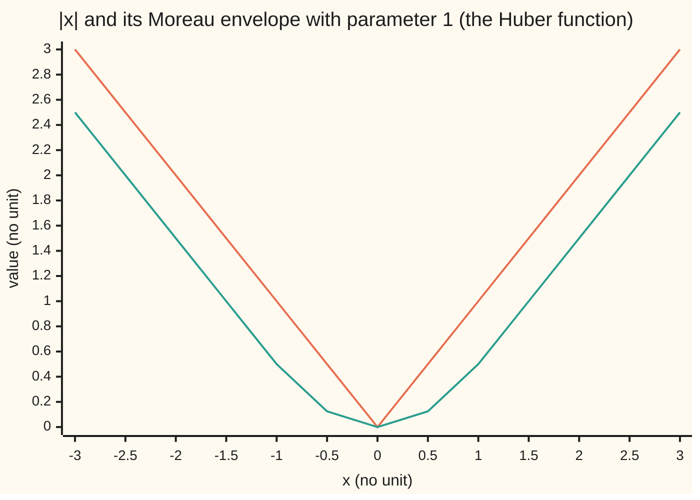
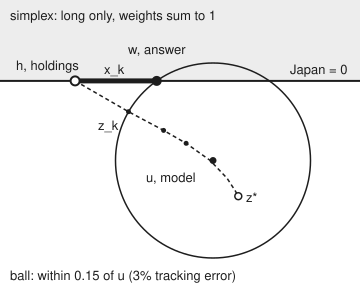

# Monotone operators: the prox is a resolvent, and Douglas-Rachford and Chambolle-Pock split the work

[Syllabus](../../../SYLLABUS.md) → [Optimization](../README.md) → [First-Order Methods at Scale](../README.md#s08) → Monotone operators

---

## General Overview

An index tracker holds 2,000 assets and refits its weights every day. The weights must lie on the **simplex**: none negative, summing to 1 (long-only and fully invested; not the simplex method of linear programming). They must also stay inside a **tracking-error ball** round a model portfolio. Projecting onto either set (finding its nearest point) is cheap: one sort, or one rescaling. Projecting onto both at once has no formula.

Take three holdings: UK, US and Japanese shares. Yesterday's weights are $`h = (0.6, 0.4, 0)`$. A model asks for $`u = (0.5, 0.6, -0.1)`$, with a 10% short sale in Japan that the fund may not make. The fund must stay within distance 0.15 of the model; with three uncorrelated assets of 20% yearly volatility each, that is a tracking error of at most 3% a year. It **minimises** the trade: the distance from yesterday's weights.

**Douglas-Rachford** splitting solves this with the two cheap projections only, one after the other, plus an averaging step. Its governing point $`z`$ (an internal point, not a portfolio) starts at $`z_0 = h`$; stopped when $`z`$ moves less than $`10^{-12}`$, after 161 steps it returns $`w = (0.511237, 0.488763, 0)`$: sell 8.88 points of UK shares and buy US. A closed form and KKT multipliers (prices on each rule, all of the right sign) certify that no smaller trade meets both rules.

Why does this work? Each step is a **resolvent**: a step backwards along a **monotone operator**, the many-variable version of a slope that never decreases. Resolvents never push two points further apart, and that makes the iteration settle. Every projection, and the prox of [Proximal gradient](../06-Conic%2C%20Quadratic%20and%20Stochastic%20Programs/06-proximal-methods-ista-fista-and-the-lasso.md), is a resolvent. Smoothing $`|x|`$ by its prox gives the Huber function. **Chambolle-Pock** uses the same machinery on a saddle-point problem, to clean a noisy series of trading costs into flat regimes.

**Gradients, subdifferentials and KKT systems are monotone operators; the prox is the resolvent of a subdifferential, it never moves two points further apart, and averaging such steps forces convergence, which is why Douglas-Rachford and Chambolle-Pock find a point solving a split problem using only each piece's own prox.**

**What kind of fact this is:** methods with theorems inside them. Firm nonexpansiveness, the envelope's gradient, the Huber formula, convergence of averaged iterations and Douglas-Rachford's fixed-point property are proved on this card in Why it works. Minty's theorem, Chambolle-Pock's convergence and the ADMM link are stated with their sources.

### The picture: smoothing a kink by its prox



Orange: $`|x|`$, with its corner at 0. Green: its Moreau envelope, $`x^2/2`$ between −1 and 1 and $`|x| - 1/2`$ outside. The corner is rounded off and the minimum stays at 0.

---

## The formula

Notation first, in words. An **operator** $`A`$ takes a point $`x`$ (a list of numbers) to a set of points $`A(x)`$: a gradient $`\nabla f`$ gives one point, the subdifferential $`\partial f`$ of [Subgradients](../01-Convexity/07-subgradients.md) a whole set. $`\langle a, c\rangle`$ is the dot product, and $`\lVert v\rVert`$ the ordinary length. $`I`$ is the identity, which leaves every point where it is.

**Monotone.** $`A`$ is monotone when, for any two points and any choices $`a \in A(x)`$, $`a' \in A(y)`$:

```math
\langle a - a',\; x - y\rangle \;\ge\; 0
```

**Read it aloud:** moving from y to x, the operator's value moves with you, never against you. For the derivative of a one-variable function, this says the slope never decreases, which is convexity. It is **maximal monotone** when no extra pair can be added to its graph without breaking that inequality; the subdifferential of a convex, closed, somewhere-finite function is maximal (Rockafellar's theorem, in Bauschke and Combettes).

**Resolvent.** For a step $`\alpha > 0`$, the resolvent is the backward step:

```math
J_{\alpha A} = (I + \alpha A)^{-1}, \qquad \mathrm{prox}_{\alpha f} = J_{\alpha\,\partial f}
```

**Read it aloud:** the resolvent of v is the point x with v in x plus alpha times A of x; for a subdifferential, that point is the prox. Minty's theorem: for a maximal monotone A it exists at every $`v`$ and is unique.

**Firm nonexpansiveness.** Every resolvent of a monotone operator satisfies, for all $`v`$, $`v'`$:

```math
\lVert J v - J v'\rVert^2 \;\le\; \langle J v - J v',\; v - v'\rangle
```

**Read it aloud:** the outputs are never further apart than the inputs, and move the same way the inputs did.

**Moreau envelope.** The smoothed copy of $`f`$, with parameter $`\alpha`$:

```math
\mathrm{env}_{\alpha f}(x) = \min_{v}\Big( f(v) + \frac{1}{2\alpha}\lVert v - x\rVert^2 \Big), \qquad \nabla\,\mathrm{env}_{\alpha f}(x) = \frac{x - \mathrm{prox}_{\alpha f}(x)}{\alpha}
```

**Read it aloud:** the envelope at x is the best value of f plus a distance charge; its slope is the arrow from the prox back to x, over alpha. For $`|x|`$ with $`\alpha = 1`$ it is the Huber function.

**Douglas-Rachford**, for minimising $`f + g`$, from $`z_0`$, for $`k = 0, 1, 2, \dots`$:

```math
x_k = \mathrm{prox}_{\alpha f}(z_k), \qquad y_k = \mathrm{prox}_{\alpha g}(2x_k - z_k), \qquad z_{k+1} = z_k + y_k - x_k
```

**Read it aloud:** take f's prox of z; take g's prox of the point reflected through it; move z by the disagreement. The answer is $`x_k`$, never $`z_k`$.

**Chambolle-Pock**, for minimising $`G(x) + F(Kx)`$ with a matrix $`K`$, read as the saddle problem $`\min_x \max_p\, G(x) + \langle Kx, p\rangle - F^*(p)`$ with $`F^*`$ the conjugate of [Convex conjugates](../01-Convexity/08-conjugates-and-fenchel-duality.md):

```math
p_{k+1} = \mathrm{prox}_{\sigma F^*}(p_k + \sigma K\bar x_k), \qquad x_{k+1} = \mathrm{prox}_{\tau G}(x_k - \tau K^{\mathsf T} p_{k+1}), \qquad \bar x_{k+1} = 2x_{k+1} - x_k
```

**Read it aloud:** prices take a prox step up, the plan takes a prox step down against the new prices, and the plan is extrapolated one step ahead; the steps need $`\sigma\tau\lVert K\rVert^2 < 1`$.

| Symbol | Plain meaning | In our example | Push it up and the answer… |
| --- | --- | --- | --- |
| $`A`$, $`J_{\alpha A}`$, $`\alpha`$ | monotone operator; its resolvent; step (ADMM's $`\rho`$, on the dual) | $`\partial\lvert x\rvert`$; soft thresholding; 1 | Huber's quadratic zone widens |
| $`\langle a, c\rangle`$, $`\lVert v\rVert`$, $`I`$ | dot product; length; identity map ($`v`$, $`v'`$, $`a`$, $`a'`$, $`c`$: any points) | — | — |
| $`\mathrm{prox}_{\alpha f}`$, $`\mathrm{env}_{\alpha f}`$ | prox of f; Moreau envelope | 2 and 2.5 at x = 3 | — |
| $`R`$, $`N`$, $`T`$, $`z^*`$ | reflection $`2J - I`$; nonexpansive map; average $`\tfrac12(I + N)`$; fixed point | — | — |
| $`\Delta`$, $`B`$, $`P_\Delta`$, $`\iota_C`$ | simplex; tracking ball; projection onto $`\Delta`$; indicator (0 on C, $`+\infty`$ off) | — | — |
| $`h`$, $`u`$, $`r`$ | yesterday's weights; model weights; radius | $`(0.6, 0.4, 0)`$; $`(0.5, 0.6, -0.1)`$; 0.15 | smaller trade: 3.82 points at 0.20 |
| $`f`$, $`g`$ | DR's pieces | $`\tfrac12\lVert w - h\rVert^2 + \iota_\Delta`$; $`\iota_B`$ | — |
| $`x_k`$, $`y_k`$, $`z_k`$, $`w`$ | DR's prox outputs; governing point; answer | $`z_0 = h`$; $`w = (0.511237, 0.488763, 0)`$ | — |
| $`b`$, $`\lambda`$, $`D`$ | daily spreads in basis points (bp, hundredths of a percent); charge per bp of jump; day-to-day differences | $`(2, 4, 3, 10, 12, 9, 11, 3)`$; 3; $`\lVert D\rVert^2 = 3.847759`$ | larger $`\lambda`$: fewer jumps |
| $`G`$, $`F`$, $`F^*`$, $`K`$ | fit; jump charge $`\lambda\lVert\cdot\rVert_1`$; its conjugate; the matrix inside F | $`K = D`$; total 38 | — |
| $`p`$, $`M`$, $`x_a`$, $`x_b`$, $`p_a`$, $`p_b`$ | jump prices, $`\lvert p_i\rvert \le \lambda`$; saddle operator; test plans and prices | $`p = (2, 2, 3, 2, -1, -1, -3)`$ | — |
| $`\tau`$, $`\sigma`$, $`\bar x_k`$ | CP's plan and price steps; extrapolated plan | 0.45 each; 93 steps | above the limit, no guarantee |

### When it holds

- **The pieces are convex, closed and somewhere finite, so their operators are maximal monotone.** Then every prox exists and is unique. For a function with two dips the prox can jump between them, and the averaging argument fails.
- **A solution exists.** Douglas-Rachford needs a fixed point. With the radius cut to 0.10 the ball misses the simplex, and $`z_k`$ keeps moving 0.0225 a step after 400 steps.
- **The answer is read from $`x_k`$.** The governing point $`z_k`$ is not a portfolio: it ends at $`(0.494949, 0.65, -0.144949)`$, a 14.49% short sale.
- **Chambolle-Pock's steps satisfy $`\sigma\tau\lVert K\rVert^2 < 1`$.** At $`\tau = \sigma = 1`$ the product is 3.847759 and the run cycles for ever: 54.888889 above the minimum after 2999 steps, 35.222222 after 3000. The condition is sufficient, not necessary.
- **Backward steps, not forward ones, on a kink.** A subgradient step of length 1 on $`|x|`$ from 0.4 bounces between 0.4 and −0.6 for ever; the prox step reaches 0 at once.

---

## Why it works

### Step 0: turn "minimise" into "find a zero", then step backwards

A convex $`f`$ is smallest at $`x`$ exactly when $`0 \in \partial f(x)`$ ([Subgradients](../01-Convexity/07-subgradients.md)). So minimising is finding a zero of a monotone operator. A forward step, $`x - \alpha g`$ with $`g \in \partial f(x)`$, can overshoot a kink. A backward step solves $`v \in x + \alpha\,\partial f(x)`$ for $`x`$: the point from which a step lands at $`v`$. That is the resolvent. It never expands distances, and averaging such maps gives points whose distance to every solution never grows. Everything below applies that idea to different operators.

### Step 1: three monotone operators

- **Gradients and subdifferentials of convex functions.** Add the two tangent-line inequalities $`f(y) \ge f(x) + \langle g, y - x\rangle`$ and its mirror, for subgradients $`g`$ at $`x`$ and $`g'`$ at $`y`$: the result is $`\langle g - g', x - y\rangle \ge 0`$. For $`|x|`$ the slopes run −1, then $`[-1, 1]`$ at 0, then +1.
- **KKT systems and saddle points.** For the [Saddle points](../03-Constrained%20Optimisation/06-saddle-points-and-minimax.md) problem $`\min_x\max_p\, G(x) + \langle Kx, p\rangle - F^*(p)`$, the operator $`M(x, p) = (\partial G(x) + K^{\mathsf T}p,\; \partial F^*(p) - Kx)`$ is monotone. Its coupling part $`(K^{\mathsf T}p, -Kx)`$ adds $`\langle K^{\mathsf T}p, x\rangle - \langle Kx, p\rangle = 0`$ to the inner product. The code checks this at two test points $`(x_a, p_a)`$, $`(x_b, p_b)`$ of the spreads problem: the inner product is $`31 = \lVert x_a - x_b\rVert^2`$.

### Step 2: the prox is a resolvent

The prox of $`f`$ at $`v`$ minimises $`f(x) + \tfrac{1}{2\alpha}\lVert x - v\rVert^2`$. By the zero-subgradient rule its point $`x`$ satisfies $`0 \in \partial f(x) + (x - v)/\alpha`$, which is $`v \in x + \alpha\,\partial f(x)`$, which is $`x = J_{\alpha\partial f}(v)`$.

For $`|x|`$ with $`\alpha = 1`$: from $`v = 3`$, the point $`x = 2`$ works, since $`2 + 1 = 3`$. From $`v = 0.4`$, the point $`x = 0`$ works, since $`0.4 \in 0 + [-1, 1]`$. That is soft thresholding. For an indicator $`\iota_C`$ the prox is the nearest point of C, so every projection is a resolvent too.

### Step 3: monotone gives firmly nonexpansive

Take inputs $`v`$, $`v'`$ with resolvent outputs $`a`$, $`a'`$. By Step 2, $`(v - a)/\alpha`$ is in $`A(a)`$ and $`(v' - a')/\alpha`$ in $`A(a')`$. Monotonicity on that pair, rearranged, is firm nonexpansiveness. Then the **reflection** $`R = 2J - I`$ is nonexpansive: it never moves two points further apart. The code checks soft thresholding on 6561 pairs of grid points: the worst slack is 0, reached where both points sit in the flat zone.

<details>
<summary>Detailed proof: the resolvent is firmly nonexpansive, and the reflection is nonexpansive</summary>

Monotonicity at $`a`$ and $`a'`$, multiplied by $`\alpha > 0`$, gives:

$`\displaystyle \big\langle (v - v') - (a - a'),\; a - a'\big\rangle \ge 0, \quad\text{so}\quad \lVert a - a'\rVert^2 \le \langle a - a',\; v - v'\rangle.`$

By the Cauchy-Schwarz inequality the right side is at most $`\lVert a - a'\rVert\,\lVert v - v'\rVert`$, so $`\lVert a - a'\rVert \le \lVert v - v'\rVert`$.

For the reflection, $`Rv - Rv' = 2(a - a') - (v - v')`$. Expand the square:

$`\displaystyle \lVert Rv - Rv'\rVert^2 = 4\lVert a - a'\rVert^2 - 4\langle a - a', v - v'\rangle + \lVert v - v'\rVert^2 \le \lVert v - v'\rVert^2,`$

because the first two terms together are at most 0 by the line above.

</details>

### Step 4: the Moreau envelope is a smooth stand-in with the same minimisers

The envelope replaces a kinked $`f`$ by a function with a gradient everywhere, $`(x - \mathrm{prox}_{\alpha f}(x))/\alpha`$. That gradient changes at most at rate $`1/\alpha`$, because $`I - \mathrm{prox}`$ is firmly nonexpansive too. The envelope has the same minimisers as $`f`$.

For $`|x|`$ at $`x = 3`$: the prox is 2, the envelope is $`|2| + \tfrac12(1)^2 = 2.5`$, and the gradient is $`3 - 2 = 1`$. A central difference agrees: 1. At $`x = 0.4`$: prox 0, envelope 0.08, gradient 0.4, central difference 0.4.

Two consequences:

- **The proximal point method is gradient descent on the envelope.** The step $`x_{k+1} = \mathrm{prox}_{\alpha f}(x_k)`$ equals $`x_k - \alpha\nabla\mathrm{env}_{\alpha f}(x_k)`$. From 3 on $`|x|`$ it runs 3, 2, 1, 0.
- **Moreau's decomposition.** With $`\alpha = 1`$, $`x = \mathrm{prox}_f(x) + \mathrm{prox}_{f^*}(x)`$. For $`|x|`$, $`f^*`$ is the indicator of $`[-1, 1]`$, whose prox clips: $`3 = 2 + 1`$ and $`0.4 = 0 + 0.4`$.

<details>
<summary>Detailed proof: the envelope's gradient, and the Huber formula</summary>

Write $`p = \mathrm{prox}_{\alpha f}(x)`$ and $`e(x) = \mathrm{env}_{\alpha f}(x)`$. At any other point $`x'`$, using the same $`p`$ in the minimum gives an upper bound:

$`\displaystyle e(x') \le f(p) + \frac{1}{2\alpha}\lVert p - x'\rVert^2 = e(x) + \frac{1}{\alpha}\langle x - p,\; x' - x\rangle + \frac{1}{2\alpha}\lVert x' - x\rVert^2.`$

The same bound written from $`x'`$'s side, with $`p' = \mathrm{prox}_{\alpha f}(x')`$, together with $`\langle (x' - p') - (x - p),\, x' - x\rangle \ge 0`$ (true because the prox never expands distances, Step 3, and Cauchy-Schwarz), gives a lower bound with the same linear term and an error of at most $`\lVert x' - x\rVert^2/(2\alpha)`$. A function caught between two such bounds is differentiable, with gradient $`(x - p)/\alpha`$.

For $`f = |x|`$ and $`\alpha = 1`$: if $`|x| \le 1`$, then $`p = 0`$ and $`e(x) = 0 + \tfrac12 x^2`$. If $`x > 1`$, then $`p = x - 1`$ and $`e(x) = (x - 1) + \tfrac12 = x - \tfrac12`$; the case $`x < -1`$ is the mirror image. A direct search over 10,001 candidates in the code gives the same 13 values to within $`10^{-6}`$.

</details>

### Step 5: averaging a nonexpansive map makes it converge

Iterating a nonexpansive map $`N`$ alone can circle for ever, as a quarter turn of the plane does. The cure is to average: $`z_{k+1} = Tz_k`$ with $`T = \tfrac12(I + N)`$, the **Krasnoselskii-Mann** iteration. A resolvent is already such an average, $`J = \tfrac12(I + R)`$.

For any fixed point $`z^*`$ (with $`Tz^* = z^*`$):

```math
\lVert z_{k+1} - z^*\rVert^2 \;\le\; \lVert z_k - z^*\rVert^2 - \lVert z_{k+1} - z_k\rVert^2
```

**Read it aloud:** the squared distance to the answer drops by at least the squared length of the step just taken.

Adding these up gives $`\lVert z_{k+1} - z_k\rVert \le \lVert z_0 - z^*\rVert/\sqrt{k + 1}`$: steps shrink at rate $`O(1/\sqrt{k})`$, and the points converge to a fixed point. The code asserts both inequalities at every Douglas-Rachford step.

<details>
<summary>Detailed proof: the distance inequality, the step bound and convergence</summary>

Use the identity, true for any two vectors $`a`$ and $`c`$:

$`\displaystyle \Big\lVert \tfrac12(a + c)\Big\rVert^2 = \tfrac12\lVert a\rVert^2 + \tfrac12\lVert c\rVert^2 - \tfrac14\lVert a - c\rVert^2.`$

Put $`a = z - z^*`$ and $`c = Nz - z^*`$, so $`\tfrac12(a + c) = Tz - z^*`$, using $`Nz^* = z^*`$. Since $`N`$ is nonexpansive, $`\lVert c\rVert \le \lVert a\rVert`$. Also $`a - c = z - Nz = 2(z - Tz)`$. So

$`\displaystyle \lVert Tz - z^*\rVert^2 \le \lVert z - z^*\rVert^2 - \lVert z - Tz\rVert^2.`$

Summing from step 0 to step k: $`\sum_{j=0}^{k}\lVert z_{j+1} - z_j\rVert^2 \le \lVert z_0 - z^*\rVert^2`$. Each step is no longer than the one before, because $`T`$ is nonexpansive. So $`(k + 1)\lVert z_{k+1} - z_k\rVert^2`$ is at most that sum, which gives the step bound.

Convergence: the points stay within $`\lVert z_0 - z^*\rVert`$ of $`z^*`$, so some subsequence converges (Bolzano-Weierstrass), to $`\hat z`$ say. Steps shrink to 0 and $`T`$ is continuous, so $`T\hat z = \hat z`$. The distance inequality holds with $`\hat z`$ in place of $`z^*`$, so the distance to $`\hat z`$ never grows; it is small along the subsequence, so it is small for good.

</details>

### Step 6: Douglas-Rachford is an averaged map whose fixed points solve the problem

The Douglas-Rachford step is $`z_{k+1} = \tfrac12(I + R_g R_f)z_k`$, where $`R_f`$ and $`R_g`$ are the reflections of the two proxes. Two reflections in a row are nonexpansive, so Step 5 applies. At a fixed point, $`y = x`$, and then the two prox conditions add up to $`0 \in \partial f(x) + \partial g(x)`$: the point $`x`$ minimises $`f + g`$. The fold proves both facts.

<p align="center"></p>

Drawn to scale (650 units per unit of weight) in the plane of weights summing to 1. Shaded: the simplex. Circle: the ball. The answer $`w`$ is the corner of the thin lens where they overlap. Thick: the path of $`x_k`$. Dashed: $`z_k`$, which settles at $`z^*`$, off the simplex.

In the tracker, $`f(w) = \tfrac12\lVert w - h\rVert^2 + \iota_\Delta(w)`$ has prox $`P_\Delta((v + h)/2)`$ with $`\alpha = 1`$, and $`g = \iota_B`$ has the ball projection.

<details>
<summary>Detailed proof: the step is an average of two reflections, and its fixed points are minimisers</summary>

Write $`x = \mathrm{prox}_{\alpha f}(z)`$, so $`R_f z = 2x - z`$, and $`y = \mathrm{prox}_{\alpha g}(2x - z)`$, so $`R_g R_f z = 2y - (2x - z)`$. Then

$`\displaystyle \tfrac12\big(z + R_g R_f z\big) = \tfrac12\big(z + 2y - 2x + z\big) = z + y - x,`$

which is the Douglas-Rachford step. At a fixed point $`y = x`$. By Step 2, $`z - x \in \alpha\,\partial f(x)`$, and $`(2x - z) - x = x - z \in \alpha\,\partial g(x)`$. Adding, $`0 \in \alpha\big(\partial f(x) + \partial g(x)\big) \subseteq \alpha\,\partial(f + g)(x)`$, so $`x`$ minimises $`f + g`$. The sum rule needs no extra condition in this direction.

</details>

**ADMM is Douglas-Rachford on the dual problem.** [ADMM](../06-Conic%2C%20Quadratic%20and%20Stochastic%20Programs/07-admm.md) is this averaged step applied to the Fenchel dual, with ADMM's penalty $`\rho`$ as the step $`\alpha`$ (Eckstein and Bertsekas); its primal prox steps use $`1/\rho`$. That is why it needs no step limit.

### Step 7: Chambolle-Pock is a proximal point step on the saddle operator

The trading desk records eight daily spreads (the gap between buying and selling prices) on its index trades: $`b = (2, 4, 3, 10, 12, 9, 11, 3)`$ bp. It wants a flat-by-regime summary $`x`$ that **minimises** fit plus jumps: $`\tfrac12\lVert x - b\rVert^2 + 3\sum_i\lvert x_{i+1} - x_i\rvert`$. This is **total-variation** (TV) smoothing: the total variation is the sum of the sizes of the jumps.

Here $`G(x) = \tfrac12\lVert x - b\rVert^2`$, $`K = D`$ and $`F = 3\lVert\cdot\rVert_1`$. Its conjugate is the indicator of the box $`\lvert p_i\rvert \le 3`$, whose prox clips each price. The prox of $`\tau G`$ is $`(v + \tau b)/(1 + \tau)`$.

Why it converges: Chambolle-Pock is the proximal point method for the saddle operator $`M`$ of Step 1, in a weighted length with $`1/\tau`$ on $`x`$, $`1/\sigma`$ on $`p`$ and a cross term $`-K`$. That weighting is a genuine length (positive definite) exactly when $`\sigma\tau\lVert K\rVert^2 < 1`$. The theorem: with that condition and a saddle point, $`(x_k, p_k)`$ converges to a saddle point (Chambolle and Pock 2011, Theorem 1). It is stated here, not proved.

The **certificate** is the duality gap. Minimising the Lagrangian over $`x`$ gives $`x = b - D^{\mathsf T}p`$, and the dual value $`\tfrac12\lVert b\rVert^2 - \tfrac12\lVert b - D^{\mathsf T}p\rVert^2`$ is a lower bound for any $`\lvert p_i\rvert \le 3`$. Started at $`x = 0`$, $`p = 0`$ with $`\tau = \sigma = 0.45`$ ($`\sigma\tau\lVert D\rVert^2 = 0.779171`$), and stopped when no entry of $`x`$ moves more than $`10^{-12}`$, the run ends after 93 steps with primal and dual both 38: no summary scores lower.

---

## Worked numbers, by hand

| Step | Arithmetic | Value |
| --- | --- | --- |
| prox of $`\lvert x\rvert`$ at 3 | 3 − 1 | 2 |
| envelope at 3 | $`\lvert 2\rvert + \tfrac12 \cdot 1^2`$ = 3 − 0.5 | 2.5 |
| envelope at 0.4 | prox 0; $`\tfrac12 \cdot 0.4^2`$ | 0.08 |
| DR step 0 | $`x_0 = P_\Delta(h) = h`$; h is $`\sqrt{0.06}`$ from u | 0.244949 |
| $`y_0 = z_1`$ | u + scale 0.15/0.244949 = 0.612372 times (0.1, −0.2, 0.1) | $`(0.561237, 0.477526, -0.038763)`$ |
| DR step 1 | midpoint $`(z_1 + h)/2`$ | $`(0.580619, 0.438763, -0.019381)`$ |
| $`x_1`$ | drop the negative entry; split the excess | $`(0.570928, 0.429072, 0)`$ |
| closed form | $`w_3 = 0`$, $`(w_1 - 0.5)^2 + (0.4 - w_1)^2 + 0.01 = 0.0225`$: $`w_1 = 0.45 + \sqrt{0.06}/4`$ | $`(0.511237, 0.488763, 0)`$ |
| KKT prices | $`h - w = 1.449490\,(w - u) + 0.072474\,(1, 1, 1) - 0.217423\,(0, 0, 1)`$ | ball 1.449490, budget 0.072474, Japan 0.217423 |
| TV regimes | (2 + 4 + 3 + 3)/3, (10 + 12 + 9 + 11 − 3 − 3)/4, (3 + 3)/1 | 4, 9, 6 bp |
| TV total | fit 14 plus 3 × jumps 8 | **38** |

**The fund moves 8.88 points from UK to US shares, ending exactly 0.15 from the model; the spreads ran at 4 bp, then 9 bp from day 4, then 6 bp on day 8.**

KKT requires the inequality prices to be non-negative; both are positive, so both rules bind and the answer is certified. Each TV regime's level is the mean of its days, moved toward each neighbouring regime by 3 (the jump charge) divided by the regime's length. In the TV problem the jump prices sit at exactly +3 on the rise into day 4 and −3 on the fall into day 8.

### What breaks if you drop a piece

| Mistake | Comes out at | What went wrong |
| --- | --- | --- |
| Read the answer off $`z_k`$ | $`(0.494949, 0.65, -0.144949)`$ | only $`x = P_\Delta((z + h)/2)`$ is a portfolio |
| Radius 0.10: the sets do not meet | $`z_k`$ moves 0.0225 a step after 400 steps; $`x_k`$ is 0.122495 from the model | no fixed point; $`x_k`$ looks settled but breaks the rule |
| Forward subgradient steps on $`\lvert x\rvert`$, length 1 | 0.4, −0.6, 0.4, −0.6 | a forward step overshoots the kink |
| Chambolle-Pock with $`\tau = \sigma = 1`$ | cycles: 54.888889 above the minimum at step 2999, 35.222222 at 3000 | $`\sigma\tau\lVert D\rVert^2 = 3.847759 > 1`$ |

---

## Code, from first principles, and it actually runs

Both programs compute the Huber envelope three ways (through the prox, by the closed formula and by a direct search), and check its gradient against a central difference. They run Douglas-Rachford on the three-asset tracker and check the answer against the closed form and the KKT prices, asserting the distance inequality and the step bound of Step 5 at every step. They run Chambolle-Pock on the spreads and certify the answer two independent ways: a zero duality gap, and an enumeration of all 2187 patterns of up, down or flat between days, of which exactly one satisfies the optimality conditions. $`\lVert D\rVert^2`$ comes from a power iteration (applying $`D^{\mathsf T}D`$ and rescaling, 2000 times) and matches $`2 + 2\cos(\pi/8)`$.

### Python

```python
# Monotone operators and splitting -- the check behind the card.  Standard library only.
# Roads: the Moreau envelope of |x| by its prox, by the Huber formula and by a grid search;
# Douglas-Rachford against the closed-form answer and its KKT multipliers;
# Chambolle-Pock against a duality gap and an enumeration of every jump pattern.
import math, itertools
F = lambda v: "%.6f" % (0.0 if abs(v) < 5e-7 else v)
L = lambda vs: "(" + ", ".join(F(v) for v in vs) + ")"
nm = lambda v: math.sqrt(sum(a * a for a in v))
sub = lambda a, b: [p - q for p, q in zip(a, b)]
print("monotone operators and splitting")
# 1. the prox of |x| is soft thresholding; its Moreau envelope is the Huber function
prox = lambda x: math.copysign(max(abs(x) - 1, 0), x)
env = lambda x: abs(prox(x)) + 0.5 * (x - prox(x)) ** 2
huber = lambda x: x * x / 2 if abs(x) <= 1 else abs(x) - 0.5
grid = [i / 1000 for i in range(-5000, 5001)]
xs = [i / 2 for i in range(-6, 7)]
for x in xs:
    g = min(abs(t) + 0.5 * (x - t) ** 2 for t in grid)
    assert abs(env(x) - huber(x)) < 1e-12 and abs(env(x) - g) < 1e-6
print("chart_abs, " + ", ".join(F(abs(x)) for x in xs))
print("chart_env, " + ", ".join(F(env(x)) for x in xs))
for x in [3.0, 0.4]:
    cd = (env(x + 1e-5) - env(x - 1e-5)) / 2e-5
    clip = max(-1.0, min(1.0, x))
    assert abs(cd - (x - prox(x))) < 1e-6 and abs(prox(x) + clip - x) < 1e-15
    print("x = %s: prox %s, envelope %s, gradient x - prox %s, central difference %s, clip %s"
          % (F(x), F(prox(x)), F(env(x)), F(x - prox(x)), F(cd), F(clip)))
pts = [i / 10 for i in range(-40, 41)]
slack = min((a - b) * (prox(a) - prox(b)) - (prox(a) - prox(b)) ** 2 for a in pts for b in pts)
assert slack >= 0
print("firm nonexpansiveness, worst slack over 6561 pairs:", F(slack))
pp, fw = [3.0], [0.4]
for k in range(3): pp.append(prox(pp[-1])); fw.append(fw[-1] - math.copysign(1, fw[-1]))
assert pp[-1] == 0 and abs(fw[-1] + 0.6) < 1e-12
print("proximal point from 3:", L(pp), "| subgradient step 1 from 0.4:", L(fw))
# 2. Douglas-Rachford: simplex (budget, long only) and a ball round the model weights
def p_simplex(v):
    s, c = sorted(v, reverse=True), 0.0
    for i, a in enumerate(s):
        c += a; t = (c - 1) / (i + 1)
        if i == len(s) - 1 or s[i + 1] <= t: break
    return [max(a - t, 0.0) for a in v]
u, h = [0.5, 0.6, -0.1], [0.6, 0.4, 0.0]
def p_ball(v, r):
    d = sub(v, u); n = nm(d)
    return v[:] if n <= r else [b + r * x / n for b, x in zip(u, d)]
p_f = lambda v: p_simplex([(a + b) / 2 for a, b in zip(v, h)])
def dr(r, steps, zstar=None):
    z, hist = h[:], []
    for k in range(steps):
        x = p_f(z); y = p_ball(sub([2 * a for a in x], z), r); zn = [a + b - c for a, b, c in zip(z, y, x)]
        hist.append((x, y, zn))
        if zstar is not None:  # firm nonexpansiveness: Fejer decrease, residual bound
            assert nm(sub(zn, zstar)) ** 2 <= nm(sub(z, zstar)) ** 2 - nm(sub(zn, z)) ** 2 + 1e-15
            assert nm(sub(zn, z)) <= nm(sub(h, zstar)) / math.sqrt(k + 1) + 1e-15
        if nm(sub(zn, z)) < 1e-12: return k + 1, zn, hist
        z = zn
    return steps, z, hist
for k in range(2):
    print("DR step %d: x %s, y %s, z %s" % ((k,) + tuple(L(v) for v in dr(0.15, 2)[2][k])))
n, zs, hist = dr(0.15, 5000)
dr(0.15, 5000, zs)
w = p_f(zs)
e = math.sqrt(0.06) / 4; exact = [0.45 + e, 0.55 - e, 0.0]
assert nm(sub(w, exact)) < 1e-9
# KKT: h - w = mu (w - u) + nu (1,1,1) - eta e3, with mu, eta >= 0
mu = ((h[0] - w[0]) - (h[1] - w[1])) / ((w[0] - u[0]) - (w[1] - u[1]))
nu = h[0] - w[0] - mu * (w[0] - u[0])
eta = mu * (w[2] - u[2]) + nu - (h[2] - w[2])
assert mu > 0 and eta > 0 and abs(nm(sub(w, u)) - 0.15) < 1e-9 and abs(sum(w) - 1) < 1e-12
print("DR converged in", n, "steps: w", L(w), "closed form", L(exact))
print("KKT multipliers: ball", F(mu), "budget", F(nu), "Japan >= 0", F(eta))
print("distance to model", F(nm(sub(w, u))), "tracking error %", F(20 * nm(sub(w, u))), "trade", F(w[0] - h[0]))
print("Fejer decrease and residual bound held at all", n, "steps")
q2 = lambda v: L([(v[1] - v[0]) / math.sqrt(2), (2 * v[2] - v[0] - v[1]) / math.sqrt(6)])
print("figure, plane coordinates: u", q2(u), "h", q2(h), "w", q2(w))
print("figure, z path:", " ".join(q2(hist[k][2]) for k in (0, 1, 2, 4, 8, 16, 32)))
print("what breaks: read off z: %s, sum %s" % (L(zs), F(sum(zs))))
n10, z10, hist10 = dr(0.10, 400)
drift = nm(sub(hist10[-1][2], hist10[-2][2]))
assert n10 == 400 and drift > 0.02 and nm(sub(hist10[-1][0], u)) > 0.12
print("what breaks: radius 0.10, z still moving %s per step after 400; x %s is %s from the model"
      % (F(drift), L(hist10[-1][0]), F(nm(sub(hist10[-1][0], u)))))
# 3. Chambolle-Pock: total-variation smoothing of eight days of trading spreads (bp)
y, lam, m = [2, 4, 3, 10, 12, 9, 11, 3], 3, 8
Dx = lambda x: [x[i + 1] - x[i] for i in range(m - 1)]
DT = lambda p: [(p[k - 1] if k > 0 else 0) - (p[k] if k < m - 1 else 0) for k in range(m)]
P = lambda x: 0.5 * sum((a - b) ** 2 for a, b in zip(x, y)) + lam * sum(abs(d) for d in Dx(x))
Q = lambda p: 0.5 * sum(a * a for a in y) - 0.5 * sum((a - b) ** 2 for a, b in zip(y, DT(p)))
def cp(tau, sig, steps):
    x, xb, p = [0.0] * m, [0.0] * m, [0.0] * (m - 1)
    for k in range(steps):
        p = [max(-lam, min(lam, a + sig * b)) for a, b in zip(p, Dx(xb))]
        xn = [(a - tau * b + tau * c) / (1 + tau) for a, b, c in zip(x, DT(p), y)]
        xb = [2 * a - b for a, b in zip(xn, x)]
        if max(abs(a - b) for a, b in zip(xn, x)) < 1e-12: return k + 1, xn, p
        x = xn
    return steps, x, p
v = [1.0] + [0.0] * (m - 1)
for _ in range(2000):
    v = DT(Dx(v)); s = nm(v); v = [a / s for a in v]
norm2 = nm(DT(Dx(v)))
assert abs(norm2 - (2 + 2 * math.cos(math.pi / m))) < 1e-9
print("||D||^2 by power iteration", F(norm2), "closed form", F(2 + 2 * math.cos(math.pi / m)), "tau sigma ||D||^2", F(0.45 * 0.45 * norm2))
k, x, p = cp(0.45, 0.45, 100000)
gap = P(x) - Q(p)
assert 0 <= gap < 1e-6 and max(abs(a) for a in p) <= lam
print("CP converged in", k, "steps: x", L(x))
print("primal", F(P(x)), "dual", F(Q(p)), "gap", F(gap), "prices p", L(p))
found = []
for s in itertools.product([-1, 0, 1], repeat=m - 1):
    xs, a = [0.0] * m, 0
    while a < m:
        b = a
        while b < m - 1 and s[b] == 0: b += 1
        val = (sum(y[a:b + 1]) + lam * (s[b] if b < m - 1 else 0) - lam * (s[a - 1] if a > 0 else 0)) / (b - a + 1)
        xs[a:b + 1] = [val] * (b - a + 1); a = b + 1
    ok = all((d > 1e-12) if t == 1 else (d < -1e-12) if t == -1 else abs(d) < 1e-12 for d, t in zip(Dx(xs), s))
    run = 0.0
    for i in range(m - 1):
        run += xs[i] - y[i]
        ok = ok and (abs(run - lam * s[i]) < 1e-9 if s[i] else abs(run) <= lam + 1e-9)
    if ok: found.append(xs)
assert len(found) == 1 and max(abs(a - b) for a, b in zip(found[0], x)) < 1e-9
print("enumeration: 2187 jump patterns, 1 passes:", L(found[0]))
print("hand: |h - u| %s, scale %s, (z1 + h)/2 %s; TV fit %s, total jump %s" % (F(nm(sub(h, u))), F(0.15 / nm(sub(h, u))),
      L([(a + b) / 2 for a, b in zip(dr(0.15, 2)[2][0][2], h)]), F(0.5 * sum((a - b) ** 2 for a, b in zip(x, y))), F(sum(abs(d) for d in Dx(x)))))
a1, b1, a2, b2 = [1.0, 0, 2, 5, 3, 1, 0, 4], [0.5, -1, 2, 0, 1, -2, 0], [2.0, 1, 1, 3, 3, 3, 2, 0], [0.0, 1, -1, 2, -2, 0, 0.5]
op = lambda xx, pq: (sub(xx, sub(y, DT(pq))), [-d for d in Dx(xx)])
(g1, h1), (g2, h2) = op(a1, b1), op(a2, b2)
inner = sum(c * d for c, d in zip(sub(g1, g2), sub(a1, a2))) + sum(c * d for c, d in zip(sub(h1, h2), sub(b1, b2)))
assert abs(inner - nm(sub(a1, a2)) ** 2) < 1e-12
print("saddle operator: <Ma - Mb, a - b> =", F(inner), "= ||x_a - x_b||^2 =", F(nm(sub(a1, a2)) ** 2))
(k1, x1, p1), x9, x8 = cp(1.0, 1.0, 3000), cp(1.0, 1.0, 2999)[1], cp(1.0, 1.0, 2998)[1]
assert P(x1) - P(x) > 1 and P(x9) - P(x1) > 1 and abs(P(x8) - P(x1)) < 1e-9   # stuck in a two-step cycle
print("what breaks: tau = sigma = 1 (tau sigma ||D||^2 = %s): after %d steps %s above the minimum, after %d steps %s"
      % (F(norm2), k1, F(P(x1) - P(x)), k1 - 1, F(P(x9) - P(x))))
k6, x6, p6 = cp(0.6, 0.6, 100000); w20 = p_f(dr(0.20, 5000)[1])
print("try: CP at tau = sigma = 0.6 (tau sigma ||D||^2 = %s): %d steps, gap %s; DR at radius 0.20: w %s" % (F(0.36 * norm2), k6, F(P(x6) - Q(p6)), L(w20)))
print("ALL CHECKS PASS")
```

**Ran 2026-11-24 on macOS, Python 3.14.10, standard library only. All checks passed. Output, pasted from the run:**

```
monotone operators and splitting
chart_abs, 3.000000, 2.500000, 2.000000, 1.500000, 1.000000, 0.500000, 0.000000, 0.500000, 1.000000, 1.500000, 2.000000, 2.500000, 3.000000
chart_env, 2.500000, 2.000000, 1.500000, 1.000000, 0.500000, 0.125000, 0.000000, 0.125000, 0.500000, 1.000000, 1.500000, 2.000000, 2.500000
x = 3.000000: prox 2.000000, envelope 2.500000, gradient x - prox 1.000000, central difference 1.000000, clip 1.000000
x = 0.400000: prox 0.000000, envelope 0.080000, gradient x - prox 0.400000, central difference 0.400000, clip 0.400000
firm nonexpansiveness, worst slack over 6561 pairs: 0.000000
proximal point from 3: (3.000000, 2.000000, 1.000000, 0.000000) | subgradient step 1 from 0.4: (0.400000, -0.600000, 0.400000, -0.600000)
DR step 0: x (0.600000, 0.400000, 0.000000), y (0.561237, 0.477526, -0.038763), z (0.561237, 0.477526, -0.038763)
DR step 1: x (0.570928, 0.429072, 0.000000), y (0.544489, 0.478935, -0.023424), z (0.534799, 0.527388, -0.062187)
DR converged in 161 steps: w (0.511237, 0.488763, 0.000000) closed form (0.511237, 0.488763, 0.000000)
KKT multipliers: ball 1.449490 budget 0.072474 Japan >= 0 0.217423
distance to model 0.150000 tracking error % 3.000000 trade -0.088763
Fejer decrease and residual bound held at all 161 steps
figure, plane coordinates: u (0.070711, -0.530723) h (-0.141421, -0.408248) w (-0.015892, -0.408248)
figure, z path: (-0.059193, -0.455723) (-0.005240, -0.484411) (0.029310, -0.504359) (0.066343, -0.530659) (0.092492, -0.558090) (0.105268, -0.577807) (0.109242, -0.585028)
what breaks: read off z: (0.494949, 0.650000, -0.144949), sum 1.000000
what breaks: radius 0.10, z still moving 0.022500 per step after 400; x (0.451597, 0.548403, 0.000000) is 0.122495 from the model
||D||^2 by power iteration 3.847759 closed form 3.847759 tau sigma ||D||^2 0.779171
CP converged in 93 steps: x (4.000000, 4.000000, 4.000000, 9.000000, 9.000000, 9.000000, 9.000000, 6.000000)
primal 38.000000 dual 38.000000 gap 0.000000 prices p (2.000000, 2.000000, 3.000000, 2.000000, -1.000000, -1.000000, -3.000000)
enumeration: 2187 jump patterns, 1 passes: (4.000000, 4.000000, 4.000000, 9.000000, 9.000000, 9.000000, 9.000000, 6.000000)
hand: |h - u| 0.244949, scale 0.612372, (z1 + h)/2 (0.580619, 0.438763, -0.019381); TV fit 14.000000, total jump 8.000000
saddle operator: <Ma - Mb, a - b> = 31.000000 = ||x_a - x_b||^2 = 31.000000
what breaks: tau = sigma = 1 (tau sigma ||D||^2 = 3.847759): after 3000 steps 35.222222 above the minimum, after 2999 steps 54.888889
try: CP at tau = sigma = 0.6 (tau sigma ||D||^2 = 1.385193): 66 steps, gap 0.000000; DR at radius 0.20: w (0.561803, 0.438197, 0.000000)
ALL CHECKS PASS
```

### Rust

```rust
// Monotone operators and splitting -- the check behind the card.  std only.
// Roads: the Moreau envelope of |x| by its prox, by the Huber formula and by a grid search;
// Douglas-Rachford against the closed-form answer and its KKT multipliers;
// Chambolle-Pock against a duality gap and an enumeration of every jump pattern.
fn f(v: f64) -> String { format!("{:.6}", if v.abs() < 5e-7 { 0.0 } else { v }) }
fn l(vs: &[f64]) -> String { format!("({})", vs.iter().map(|&v| f(v)).collect::<Vec<_>>().join(", ")) }
fn nm(v: &[f64]) -> f64 { v.iter().map(|a| a * a).sum::<f64>().sqrt() } fn sub(a: &[f64], b: &[f64]) -> Vec<f64> { a.iter().zip(b).map(|(p, q)| p - q).collect() }
fn prox(x: f64) -> f64 { (x.abs() - 1.0).max(0.0).copysign(x) }
fn env(x: f64) -> f64 { prox(x).abs() + 0.5 * (x - prox(x)).powi(2) } fn huber(x: f64) -> f64 { if x.abs() <= 1.0 { x * x / 2.0 } else { x.abs() - 0.5 } }
fn p_simplex(v: &[f64]) -> Vec<f64> {
    let mut s = v.to_vec();
    s.sort_by(|a, b| b.partial_cmp(a).unwrap());
    let (mut c, mut t) = (0.0, 0.0);
    for i in 0..s.len() {
        c += s[i]; t = (c - 1.0) / (i as f64 + 1.0);
        if i == s.len() - 1 || s[i + 1] <= t { break; }
    }
    v.iter().map(|a| (a - t).max(0.0)).collect()
}
const U: [f64; 3] = [0.5, 0.6, -0.1]; const H: [f64; 3] = [0.6, 0.4, 0.0];
fn p_ball(v: &[f64], r: f64) -> Vec<f64> {
    let d = sub(v, &U); let n = nm(&d); if n <= r { v.to_vec() } else { U.iter().zip(&d).map(|(b, x)| b + r * x / n).collect() }
}
fn p_f(v: &[f64]) -> Vec<f64> { p_simplex(&v.iter().zip(&H).map(|(a, b)| (a + b) / 2.0).collect::<Vec<_>>()) }
type Hist = Vec<(Vec<f64>, Vec<f64>, Vec<f64>)>;
fn dr(r: f64, steps: usize, zstar: Option<&[f64]>) -> (usize, Vec<f64>, Hist) {
    let (mut z, mut hist): (Vec<f64>, Hist) = (H.to_vec(), vec![]);
    for k in 0..steps {
        let x = p_f(&z);
        let y = p_ball(&sub(&x.iter().map(|a| 2.0 * a).collect::<Vec<_>>(), &z), r);
        let zn: Vec<f64> = (0..3).map(|i| z[i] + y[i] - x[i]).collect();
        hist.push((x, y, zn.clone()));
        if let Some(zs) = zstar { // firm nonexpansiveness: Fejer decrease, residual bound
            assert!(nm(&sub(&zn, zs)).powi(2) <= nm(&sub(&z, zs)).powi(2) - nm(&sub(&zn, &z)).powi(2) + 1e-15);
            assert!(nm(&sub(&zn, &z)) <= nm(&sub(&H, zs)) / ((k + 1) as f64).sqrt() + 1e-15);
        }
        if nm(&sub(&zn, &z)) < 1e-12 { return (k + 1, zn, hist); }
        z = zn;
    }
    (steps, z, hist)
}
const Y: [f64; 8] = [2.0, 4.0, 3.0, 10.0, 12.0, 9.0, 11.0, 3.0]; const LAM: f64 = 3.0; const M: usize = 8;
fn dx(x: &[f64]) -> Vec<f64> { (0..M - 1).map(|i| x[i + 1] - x[i]).collect() }
fn dt(p: &[f64]) -> Vec<f64> {
    (0..M).map(|k| (if k > 0 { p[k - 1] } else { 0.0 }) - (if k < M - 1 { p[k] } else { 0.0 })).collect()
}
fn pr(x: &[f64]) -> f64 {
    0.5 * x.iter().zip(&Y).map(|(a, b)| (a - b).powi(2)).sum::<f64>() + LAM * dx(x).iter().map(|d| d.abs()).sum::<f64>()
}
fn qd(p: &[f64]) -> f64 {
    0.5 * Y.iter().map(|a| a * a).sum::<f64>() - 0.5 * Y.iter().zip(dt(p)).map(|(a, b)| (a - b).powi(2)).sum::<f64>()
}
fn cp(tau: f64, sig: f64, steps: usize) -> (usize, Vec<f64>, Vec<f64>) {
    let (mut x, mut xb, mut p) = (vec![0.0; M], vec![0.0; M], vec![0.0; M - 1]);
    for k in 0..steps {
        p = p.iter().zip(dx(&xb)).map(|(a, b)| (a + sig * b).min(LAM).max(-LAM)).collect();
        let d = dt(&p);
        let xn: Vec<f64> = (0..M).map(|i| (x[i] - tau * d[i] + tau * Y[i]) / (1.0 + tau)).collect();
        xb = (0..M).map(|i| 2.0 * xn[i] - x[i]).collect();
        if (0..M).map(|i| (xn[i] - x[i]).abs()).fold(0.0, f64::max) < 1e-12 { return (k + 1, xn, p); }
        x = xn;
    }
    (steps, x, p)
}
fn main() {
    println!("monotone operators and splitting");
    // 1. the prox of |x| is soft thresholding; its Moreau envelope is the Huber function
    let xs: Vec<f64> = (-6..7).map(|i| i as f64 / 2.0).collect();
    for &x in &xs {
        let g = (-5000..5001).map(|i| { let t = i as f64 / 1000.0; t.abs() + 0.5 * (x - t).powi(2) }).fold(f64::INFINITY, f64::min);
        assert!((env(x) - huber(x)).abs() < 1e-12 && (env(x) - g).abs() < 1e-6);
    }
    println!("chart_abs, {}", xs.iter().map(|&x| f(x.abs())).collect::<Vec<_>>().join(", "));
    println!("chart_env, {}", xs.iter().map(|&x| f(env(x))).collect::<Vec<_>>().join(", "));
    for x in [3.0, 0.4] {
        let cd = (env(x + 1e-5) - env(x - 1e-5)) / 2e-5;
        let clip = x.min(1.0).max(-1.0);
        assert!((cd - (x - prox(x))).abs() < 1e-6 && (prox(x) + clip - x).abs() < 1e-15);
        println!("x = {}: prox {}, envelope {}, gradient x - prox {}, central difference {}, clip {}",
                 f(x), f(prox(x)), f(env(x)), f(x - prox(x)), f(cd), f(clip));
    }
    let pts: Vec<f64> = (-40..41).map(|i| i as f64 / 10.0).collect();
    let mut slack = f64::INFINITY;
    for &a in &pts { for &b in &pts { slack = slack.min((a - b) * (prox(a) - prox(b)) - (prox(a) - prox(b)).powi(2)); } }
    assert!(slack >= 0.0);
    println!("firm nonexpansiveness, worst slack over 6561 pairs: {}", f(slack));
    let (mut pp, mut fw) = (vec![3.0], vec![0.4]);
    for _ in 0..3 { let (a, b) = (*pp.last().unwrap(), *fw.last().unwrap()); pp.push(prox(a)); fw.push(b - 1f64.copysign(b)); }
    assert!(pp[3] == 0.0 && (fw[3] + 0.6).abs() < 1e-12);
    println!("proximal point from 3: {} | subgradient step 1 from 0.4: {}", l(&pp), l(&fw));
    // 2. Douglas-Rachford: simplex (budget, long only) and a ball round the model weights
    let h2 = dr(0.15, 2, None).2;
    for k in 0..2 { println!("DR step {}: x {}, y {}, z {}", k, l(&h2[k].0), l(&h2[k].1), l(&h2[k].2)); }
    let (n, zs, hist) = dr(0.15, 5000, None);
    dr(0.15, 5000, Some(&zs));
    let w = p_f(&zs);
    let e = 0.06f64.sqrt() / 4.0; let exact = [0.45 + e, 0.55 - e, 0.0];
    assert!(nm(&sub(&w, &exact)) < 1e-9);
    // KKT: h - w = mu (w - u) + nu (1,1,1) - eta e3, with mu, eta >= 0
    let mu = ((H[0] - w[0]) - (H[1] - w[1])) / ((w[0] - U[0]) - (w[1] - U[1]));
    let nu = H[0] - w[0] - mu * (w[0] - U[0]);
    let eta = mu * (w[2] - U[2]) + nu - (H[2] - w[2]);
    assert!(mu > 0.0 && eta > 0.0 && (nm(&sub(&w, &U)) - 0.15).abs() < 1e-9 && (w.iter().sum::<f64>() - 1.0).abs() < 1e-12);
    println!("DR converged in {} steps: w {} closed form {}", n, l(&w), l(&exact));
    println!("KKT multipliers: ball {} budget {} Japan >= 0 {}", f(mu), f(nu), f(eta));
    println!("distance to model {} tracking error % {} trade {}", f(nm(&sub(&w, &U))), f(20.0 * nm(&sub(&w, &U))), f(w[0] - H[0]));
    println!("Fejer decrease and residual bound held at all {} steps", n);
    let q2 = |v: &[f64]| l(&[(v[1] - v[0]) / 2f64.sqrt(), (2.0 * v[2] - v[0] - v[1]) / 6f64.sqrt()]);
    println!("figure, plane coordinates: u {} h {} w {}", q2(&U), q2(&H), q2(&w));
    println!("figure, z path: {}", [0, 1, 2, 4, 8, 16, 32].iter().map(|&k| q2(&hist[k].2)).collect::<Vec<_>>().join(" "));
    println!("what breaks: read off z: {}, sum {}", l(&zs), f(zs.iter().sum()));
    let (n10, _, hist10) = dr(0.10, 400, None);
    let (drift, x10) = (nm(&sub(&hist10[399].2, &hist10[398].2)), &hist10[399].0);
    assert!(n10 == 400 && drift > 0.02 && nm(&sub(x10, &U)) > 0.12);
    println!("what breaks: radius 0.10, z still moving {} per step after 400; x {} is {} from the model",
             f(drift), l(x10), f(nm(&sub(x10, &U))));
    // 3. Chambolle-Pock: total-variation smoothing of eight days of trading spreads (bp)
    let mut v = vec![0.0; M]; v[0] = 1.0;
    for _ in 0..2000 { v = dt(&dx(&v)); let s = nm(&v); v = v.iter().map(|a| a / s).collect(); }
    let norm2 = nm(&dt(&dx(&v)));
    let cf = 2.0 + 2.0 * (std::f64::consts::PI / M as f64).cos();
    assert!((norm2 - cf).abs() < 1e-9);
    println!("||D||^2 by power iteration {} closed form {} tau sigma ||D||^2 {}", f(norm2), f(cf), f(0.45 * 0.45 * norm2));
    let (k, x, p) = cp(0.45, 0.45, 100000);
    let gap = pr(&x) - qd(&p);
    assert!(gap >= 0.0 && gap < 1e-6 && p.iter().all(|a| a.abs() <= LAM));
    println!("CP converged in {} steps: x {}", k, l(&x));
    println!("primal {} dual {} gap {} prices p {}", f(pr(&x)), f(qd(&p)), f(gap), l(&p));
    let mut found: Vec<Vec<f64>> = vec![];
    for code in 0..3usize.pow(7) {
        let s: Vec<i32> = (0..M - 1).map(|i| ((code / 3usize.pow((M - 2 - i) as u32)) % 3) as i32 - 1).collect();
        let (mut xs, mut a) = (vec![0.0; M], 0);
        while a < M {
            let mut b = a;
            while b < M - 1 && s[b] == 0 { b += 1; }
            let sb = if b < M - 1 { s[b] as f64 } else { 0.0 };
            let sa = if a > 0 { s[a - 1] as f64 } else { 0.0 };
            let val = (Y[a..=b].iter().sum::<f64>() + LAM * sb - LAM * sa) / (b - a + 1) as f64;
            for i in a..=b { xs[i] = val; }
            a = b + 1;
        }
        let mut ok = dx(&xs).iter().zip(&s).all(|(&d, &t)| if t == 1 { d > 1e-12 } else if t == -1 { d < -1e-12 } else { d.abs() < 1e-12 });
        let mut run = 0.0;
        for i in 0..M - 1 {
            run += xs[i] - Y[i];
            ok = ok && if s[i] != 0 { (run - LAM * s[i] as f64).abs() < 1e-9 } else { run.abs() <= LAM + 1e-9 };
        }
        if ok { found.push(xs); }
    }
    assert!(found.len() == 1 && (0..M).all(|i| (found[0][i] - x[i]).abs() < 1e-9));
    println!("enumeration: 2187 jump patterns, 1 passes: {}", l(&found[0]));
    let (hu, z1) = (nm(&sub(&H, &U)), dr(0.15, 2, None).2[0].2.clone());
    println!("hand: |h - u| {}, scale {}, (z1 + h)/2 {}; TV fit {}, total jump {}", f(hu), f(0.15 / hu), l(&(0..3).map(|i| (z1[i] + H[i]) / 2.0).collect::<Vec<_>>()),
             f(0.5 * x.iter().zip(&Y).map(|(a, b)| (a - b).powi(2)).sum::<f64>()), f(dx(&x).iter().map(|d| d.abs()).sum()));
    let (a1, b1) = ([1.0, 0.0, 2.0, 5.0, 3.0, 1.0, 0.0, 4.0], [0.5, -1.0, 2.0, 0.0, 1.0, -2.0, 0.0]);
    let (a2, b2) = ([2.0, 1.0, 1.0, 3.0, 3.0, 3.0, 2.0, 0.0], [0.0, 1.0, -1.0, 2.0, -2.0, 0.0, 0.5]);
    let op = |xx: &[f64], pq: &[f64]| (sub(xx, &sub(&Y, &dt(pq))), dx(xx).iter().map(|d| -d).collect::<Vec<f64>>());
    let ((g1, h1), (g2, h2)) = (op(&a1, &b1), op(&a2, &b2));
    let inner: f64 = sub(&g1, &g2).iter().zip(sub(&a1, &a2)).map(|(c, d)| c * d).sum::<f64>()
        + sub(&h1, &h2).iter().zip(sub(&b1, &b2)).map(|(c, d)| c * d).sum::<f64>();
    assert!((inner - nm(&sub(&a1, &a2)).powi(2)).abs() < 1e-12);
    println!("saddle operator: <Ma - Mb, a - b> = {} = ||x_a - x_b||^2 = {}", f(inner), f(nm(&sub(&a1, &a2)).powi(2)));
    let ((k1, x1, _), x9, x8) = (cp(1.0, 1.0, 3000), cp(1.0, 1.0, 2999).1, cp(1.0, 1.0, 2998).1);
    assert!(pr(&x1) - pr(&x) > 1.0 && pr(&x9) - pr(&x1) > 1.0 && (pr(&x8) - pr(&x1)).abs() < 1e-9); // stuck in a two-step cycle
    println!("what breaks: tau = sigma = 1 (tau sigma ||D||^2 = {}): after {} steps {} above the minimum, after {} steps {}",
             f(norm2), k1, f(pr(&x1) - pr(&x)), k1 - 1, f(pr(&x9) - pr(&x)));
    let ((k6, x6, p6), w20) = (cp(0.6, 0.6, 100000), p_f(&dr(0.20, 5000, None).1));
    println!("try: CP at tau = sigma = 0.6 (tau sigma ||D||^2 = {}): {} steps, gap {}; DR at radius 0.20: w {}", f(0.36 * norm2), k6, f(pr(&x6) - qd(&p6)), l(&w20));
    println!("ALL CHECKS PASS");
}
```

**Ran 2026-11-24 on macOS, rustc 1.98.1, no crates. All checks passed. Output, pasted from the run:**

```
monotone operators and splitting
chart_abs, 3.000000, 2.500000, 2.000000, 1.500000, 1.000000, 0.500000, 0.000000, 0.500000, 1.000000, 1.500000, 2.000000, 2.500000, 3.000000
chart_env, 2.500000, 2.000000, 1.500000, 1.000000, 0.500000, 0.125000, 0.000000, 0.125000, 0.500000, 1.000000, 1.500000, 2.000000, 2.500000
x = 3.000000: prox 2.000000, envelope 2.500000, gradient x - prox 1.000000, central difference 1.000000, clip 1.000000
x = 0.400000: prox 0.000000, envelope 0.080000, gradient x - prox 0.400000, central difference 0.400000, clip 0.400000
firm nonexpansiveness, worst slack over 6561 pairs: 0.000000
proximal point from 3: (3.000000, 2.000000, 1.000000, 0.000000) | subgradient step 1 from 0.4: (0.400000, -0.600000, 0.400000, -0.600000)
DR step 0: x (0.600000, 0.400000, 0.000000), y (0.561237, 0.477526, -0.038763), z (0.561237, 0.477526, -0.038763)
DR step 1: x (0.570928, 0.429072, 0.000000), y (0.544489, 0.478935, -0.023424), z (0.534799, 0.527388, -0.062187)
DR converged in 161 steps: w (0.511237, 0.488763, 0.000000) closed form (0.511237, 0.488763, 0.000000)
KKT multipliers: ball 1.449490 budget 0.072474 Japan >= 0 0.217423
distance to model 0.150000 tracking error % 3.000000 trade -0.088763
Fejer decrease and residual bound held at all 161 steps
figure, plane coordinates: u (0.070711, -0.530723) h (-0.141421, -0.408248) w (-0.015892, -0.408248)
figure, z path: (-0.059193, -0.455723) (-0.005240, -0.484411) (0.029310, -0.504359) (0.066343, -0.530659) (0.092492, -0.558090) (0.105268, -0.577807) (0.109242, -0.585028)
what breaks: read off z: (0.494949, 0.650000, -0.144949), sum 1.000000
what breaks: radius 0.10, z still moving 0.022500 per step after 400; x (0.451597, 0.548403, 0.000000) is 0.122495 from the model
||D||^2 by power iteration 3.847759 closed form 3.847759 tau sigma ||D||^2 0.779171
CP converged in 93 steps: x (4.000000, 4.000000, 4.000000, 9.000000, 9.000000, 9.000000, 9.000000, 6.000000)
primal 38.000000 dual 38.000000 gap 0.000000 prices p (2.000000, 2.000000, 3.000000, 2.000000, -1.000000, -1.000000, -3.000000)
enumeration: 2187 jump patterns, 1 passes: (4.000000, 4.000000, 4.000000, 9.000000, 9.000000, 9.000000, 9.000000, 6.000000)
hand: |h - u| 0.244949, scale 0.612372, (z1 + h)/2 (0.580619, 0.438763, -0.019381); TV fit 14.000000, total jump 8.000000
saddle operator: <Ma - Mb, a - b> = 31.000000 = ||x_a - x_b||^2 = 31.000000
what breaks: tau = sigma = 1 (tau sigma ||D||^2 = 3.847759): after 3000 steps 35.222222 above the minimum, after 2999 steps 54.888889
try: CP at tau = sigma = 0.6 (tau sigma ||D||^2 = 1.385193): 66 steps, gap 0.000000; DR at radius 0.20: w (0.561803, 0.438197, 0.000000)
ALL CHECKS PASS
```

### Lean

Lean proves Steps 3 and 5 in general and the Huber formula for every x, and checks the hand numbers exactly.

- Take a monotone operator $`A`$, a step $`\alpha > 0`$, and resolvent outputs $`a`$, $`a'`$ for inputs $`v`$, $`v'`$. Then $`\lVert a - a'\rVert^2 \le \langle a - a', v - v'\rangle`$.
- With the same operator and step, the outputs are never further apart than the inputs.
- With the same operator and step, the reflection $`R = 2J - I`$ never moves two points further apart.
- Take any $`x`$. Then the smallest value of $`|v| + (v - x)^2/2`$ over all $`v`$ is the Huber function at $`x`$.
- Soft thresholding reaches that smallest value, so it is the prox of $`|x|`$.
- The Huber function has slope $`x - \mathrm{prox}(x)`$ at every $`x`$.
- Suppose $`N`$ is nonexpansive, has a fixed point $`z^*`$, and $`z_{k+1} = \tfrac12(z_k + Nz_k)`$. Then $`\lVert z_{k+1} - z_k\rVert \le \lVert z_0 - z^*\rVert/\sqrt{k + 1}`$ for every $`k`$.
- With the same map and run, the points $`z_k`$ converge to a fixed point of $`N`$.
- The prox is 2 and the envelope 2.5 at 3. The envelope is 0.08 at 0.4.
- The proximal point method from 3 runs 3, 2, 1, 0.
- Moreau's decomposition holds at both points: 3 = 2 + 1 and 0.4 = 0 + 0.4.
- The closed-form answer $`w`$ sums to 1 and lies exactly 0.15 from the model.
- The spreads' regimes are 4, 9 and 6 bp, with total 38. The prices $`p`$ give a dual value of 38 too.

The Douglas-Rachford and Chambolle-Pock runs, the KKT prices, the enumeration and the grid searches are left to the Python and Rust checks.

```lean
-- Monotone operators: the resolvent of a monotone operator never moves two points further apart, the Moreau envelope of |x| is the Huber function with gradient x minus the prox, and averaging a nonexpansive map converges to a fixed point.
import Mathlib.Analysis.InnerProductSpace.Basic
import Mathlib.Analysis.Calculus.Deriv.Basic
import Mathlib.Analysis.Real.Sqrt
import Mathlib.Topology.Algebra.Module.FiniteDimension
import Mathlib.Order.Filter.AtTopBot.Basic
import Mathlib.Tactic.NormNum
import Mathlib.Tactic.Ring
import Mathlib.Tactic.Module
import Mathlib.Analysis.Asymptotics.Lemmas
import Mathlib.Analysis.Normed.Module.FiniteDimension
import Mathlib.Analysis.SpecificLimits.Basic
import Mathlib.Topology.MetricSpace.Sequences

open Filter Topology

/-- **The resolvent is firmly nonexpansive (Step 3).** Let `A` be a monotone operator on a
real inner product space: it sends each point to a set of points, and
`⟪a - a', x - y⟫ ≥ 0` whenever `a ∈ A x` and `a' ∈ A y`. Take a step `α > 0`. If `a` is a
resolvent output for the input `v` (that is, `v = a + α g` for some `g ∈ A a`, so
`a = J_{αA} v`) and `a'` is one for `v'`, then
`‖a - a'‖² ≤ ⟪a - a', v - v'⟫`, so `‖a - a'‖ ≤ ‖v - v'‖`, and the reflection
`R = 2J - I` is nonexpansive: `‖(2a - v) - (2a' - v')‖ ≤ ‖v - v'‖`. With `A` the
subdifferential of a convex function, `a` is the prox of `v`. -/
theorem resolvent_firmly_nonexpansive {E : Type*} [NormedAddCommGroup E] [InnerProductSpace ℝ E]
    (A : E → Set E)
    (hA : ∀ x y a a', a ∈ A x → a' ∈ A y → 0 ≤ inner ℝ (a - a') (x - y))
    (α : ℝ) (hα : 0 < α) (v v' a a' : E)
    (ha : ∃ g ∈ A a, v = a + α • g) (ha' : ∃ g' ∈ A a', v' = a' + α • g') :
    ‖a - a'‖ ^ 2 ≤ inner ℝ (a - a') (v - v') ∧
      ‖a - a'‖ ≤ ‖v - v'‖ ∧
      ‖((2 : ℝ) • a - v) - ((2 : ℝ) • a' - v')‖ ≤ ‖v - v'‖ := by
  obtain ⟨g, hg, rfl⟩ := ha
  obtain ⟨g', hg', rfl⟩ := ha'
  have hm : 0 ≤ inner ℝ (g - g') (a - a') := hA a a' g g' hg hg'
  have hsplit : a + α • g - (a' + α • g') = (a - a') + α • (g - g') := by
    rw [smul_sub]; abel
  have h1 : ‖a - a'‖ ^ 2 ≤ inner ℝ (a - a') (a + α • g - (a' + α • g')) := by
    rw [hsplit, inner_add_right, inner_smul_right, real_inner_self_eq_norm_sq,
      real_inner_comm]
    nlinarith [mul_nonneg hα.le hm]
  set w := a + α • g - (a' + α • g')
  set d := a - a'
  have hcs : inner ℝ d w ≤ ‖d‖ * ‖w‖ := real_inner_le_norm d w
  have h2 : ‖d‖ ≤ ‖w‖ := by
    rcases (norm_nonneg d).eq_or_lt with h | h
    · rw [← h]; exact norm_nonneg _
    · nlinarith
  refine ⟨h1, h2, ?_⟩
  have hr : (2 : ℝ) • a - (a + α • g) - ((2 : ℝ) • a' - (a' + α • g')) = (2 : ℝ) • d - w := by
    simp only [d, w, smul_sub, two_smul]; abel
  rw [hr]
  have hsq : ‖(2 : ℝ) • d - w‖ ^ 2 ≤ ‖w‖ ^ 2 := by
    rw [norm_sub_sq_real, norm_smul, inner_smul_left]
    simp only [Real.norm_eq_abs, abs_two, RCLike.conj_to_real]
    nlinarith
  exact (pow_le_pow_iff_left₀ (norm_nonneg _) (norm_nonneg _) two_ne_zero).mp hsq

/-- The prox of `|x|` with step 1: soft thresholding. It moves `x` toward 0 by 1, and
sends every point between −1 and 1 to 0. -/
noncomputable def softThreshold (x : ℝ) : ℝ :=
  if 1 < x then x - 1 else if x < -1 then x + 1 else 0

/-- The Huber function: `x²/2` for `|x| ≤ 1` and `|x| - 1/2` otherwise. -/
noncomputable def huber (x : ℝ) : ℝ :=
  if |x| ≤ 1 then x ^ 2 / 2 else |x| - 1 / 2

theorem huber_soft_cases (x : ℝ) :
    (1 < x ∧ huber x = x - 1 / 2 ∧ softThreshold x = x - 1) ∨
    (x < -1 ∧ huber x = -x - 1 / 2 ∧ softThreshold x = x + 1) ∨
    (-1 ≤ x ∧ x ≤ 1 ∧ huber x = x ^ 2 / 2 ∧ softThreshold x = 0) := by
  unfold huber softThreshold
  rcases lt_or_ge 1 x with h | h
  · left
    have : ¬ |x| ≤ 1 := by rw [abs_le]; intro h'; linarith [h'.2]
    refine ⟨h, ?_, ?_⟩
    · rw [ite_eq_right this, abs_of_pos (by linarith : (0:ℝ) < x)]
    · rw [ite_eq_left h]
  · rcases lt_or_ge x (-1) with h' | h'
    · right; left
      have : ¬ |x| ≤ 1 := by rw [abs_le]; intro h''; linarith [h''.1]
      refine ⟨h', ?_, ?_⟩
      · rw [ite_eq_right this, abs_of_neg (by linarith : x < 0)]
      · rw [ite_eq_right (not_lt.mpr h), ite_eq_left h']
    · right; right
      have : |x| ≤ 1 := abs_le.mpr ⟨h', h⟩
      refine ⟨h', h, ?_, ?_⟩
      · rw [ite_eq_left this]
      · rw [ite_eq_right (not_lt.mpr h), ite_eq_right (not_lt.mpr h')]

theorem huber_le (x v : ℝ) : huber x ≤ |v| + (v - x) ^ 2 / 2 := by
  rcases le_or_gt 0 v with hv | hv
  · rw [abs_of_nonneg hv]
    rcases huber_soft_cases x with ⟨h1, h2, _⟩ | ⟨h1, h2, _⟩ | ⟨h1, h1', h2, _⟩ <;> rw [h2]
    · nlinarith [sq_nonneg (v - x + 1)]
    · nlinarith [sq_nonneg (v - x - 1)]
    · nlinarith [mul_nonneg hv (by linarith : (0:ℝ) ≤ 1 - x)]
  · rw [abs_of_neg hv]
    rcases huber_soft_cases x with ⟨h1, h2, _⟩ | ⟨h1, h2, _⟩ | ⟨h1, h1', h2, _⟩ <;> rw [h2]
    · nlinarith [sq_nonneg (v - x + 1)]
    · nlinarith [sq_nonneg (v - x - 1)]
    · nlinarith [mul_nonneg (neg_nonneg.mpr hv.le) (by linarith : (0:ℝ) ≤ 1 + x)]

theorem huber_value (x : ℝ) : |softThreshold x| + (softThreshold x - x) ^ 2 / 2 = huber x := by
  rcases huber_soft_cases x with ⟨h1, h2, h3⟩ | ⟨h1, h2, h3⟩ | ⟨h1, h1', h2, h3⟩ <;> rw [h2, h3]
  · rw [abs_of_nonneg (by linarith)]; ring
  · rw [abs_of_neg (by linarith)]; ring
  · simp

theorem huber_taylor (x y : ℝ) :
    |huber y - huber x - (y - x) * (x - softThreshold x)| ≤ (y - x) ^ 2 := by
  rw [abs_le]
  rcases huber_soft_cases x with ⟨h1, h2, h3⟩ | ⟨h1, h2, h3⟩ | ⟨h1, h1', h2, h3⟩ <;>
  rcases huber_soft_cases y with ⟨k1, k2, k3⟩ | ⟨k1, k2, k3⟩ | ⟨k1, k1', k2, k3⟩ <;>
  rw [h2, h3, k2] <;> constructor <;>
  nlinarith [sq_nonneg (y - x + 1), sq_nonneg (y - x - 1), sq_nonneg (y - x), sq_nonneg (y-1),
    sq_nonneg (y+1), sq_nonneg (x-1), sq_nonneg (x+1)]

/-- **The Moreau envelope of `|x|` is the Huber function (Step 4).** For every real `x`,
the smallest value of `|v| + (v - x)²/2` over all real `v` is `huber x`; that smallest
value is reached at the prox `v = softThreshold x`; and the Huber function has slope
`x - prox(x)` at `x`. -/
theorem moreau_envelope_of_abs_is_huber (x : ℝ) :
    IsLeast (Set.range fun v : ℝ => |v| + (v - x) ^ 2 / 2) (huber x) ∧
      |softThreshold x| + (softThreshold x - x) ^ 2 / 2 = huber x ∧
      HasDerivAt huber (x - softThreshold x) x := by
  refine ⟨⟨⟨softThreshold x, huber_value x⟩, ?_⟩, huber_value x, ?_⟩
  · rintro _ ⟨v, rfl⟩
    exact huber_le x v
  · rw [hasDerivAt_iff_isLittleO]
    have hO : (fun y => huber y - huber x - (y - x) • (x - softThreshold x)) =O[𝓝 x]
        (fun y => ‖y - x‖ ^ 2) := by
      refine Asymptotics.IsBigO.of_bound 1 (Eventually.of_forall fun y => ?_)
      simp only [smul_eq_mul, Real.norm_eq_abs, one_mul, sq_abs, abs_pow]
      exact huber_taylor x y
    exact hO.trans_isLittleO (Asymptotics.isLittleO_pow_sub_sub x (by norm_num))

theorem averaged_step_fejer {E : Type*} [NormedAddCommGroup E] [InnerProductSpace ℝ E]
    (N : E → E) (hN : ∀ x y, ‖N x - N y‖ ≤ ‖x - y‖) (zs : E) (hzs : N zs = zs) (x : E) :
    ‖(1 / 2 : ℝ) • (x + N x) - zs‖ ^ 2 + ‖(1 / 2 : ℝ) • (x + N x) - x‖ ^ 2 ≤ ‖x - zs‖ ^ 2 := by
  have hb : ‖N x - zs‖ ≤ ‖x - zs‖ := by
    have := hN x zs; rwa [hzs] at this
  have e1 : (1 / 2 : ℝ) • (x + N x) - zs = (1 / 2 : ℝ) • ((x - zs) + (N x - zs)) := by module
  have e2 : (1 / 2 : ℝ) • (x + N x) - x = -((1 / 2 : ℝ) • ((x - zs) - (N x - zs))) := by module
  rw [e1, e2, norm_neg, norm_smul, norm_smul, mul_pow, mul_pow]
  generalize x - zs = a at hb ⊢
  generalize N x - zs = b at hb ⊢
  have hp := parallelogram_law_with_norm ℝ a b
  have : ‖b‖ ^ 2 ≤ ‖a‖ ^ 2 := pow_le_pow_left₀ (norm_nonneg _) hb 2
  norm_num
  nlinarith

theorem averaged_map_nonexpansive {E : Type*} [NormedAddCommGroup E] [InnerProductSpace ℝ E]
    (N : E → E) (hN : ∀ x y, ‖N x - N y‖ ≤ ‖x - y‖) (x y : E) :
    ‖(1 / 2 : ℝ) • (x + N x) - (1 / 2 : ℝ) • (y + N y)‖ ≤ ‖x - y‖ := by
  rw [← smul_sub, norm_smul, add_sub_add_comm]
  have := norm_add_le (x - y) (N x - N y)
  have := hN x y
  norm_num
  linarith

/-- **Averaging a nonexpansive map converges (Step 5, Krasnoselskii-Mann).** Let `N` be a
nonexpansive map (`‖N x - N y‖ ≤ ‖x - y‖`) on a finite-dimensional real inner product space,
with at least one fixed point. Run `z_{k+1} = (z_k + N z_k)/2` from any start `z_0`. Then
every step is short, `‖z_{k+1} - z_k‖ ≤ ‖z_0 - z*‖ / √(k + 1)` for each fixed point `z*`,
and the points `z_k` converge to a fixed point of `N`. -/
theorem averaged_nonexpansive_iteration_converges {E : Type*} [NormedAddCommGroup E]
    [InnerProductSpace ℝ E] [FiniteDimensional ℝ E]
    (N : E → E) (hN : ∀ x y, ‖N x - N y‖ ≤ ‖x - y‖) (hfix : ∃ zs, N zs = zs)
    (z : ℕ → E) (hz : ∀ k, z (k + 1) = (1 / 2 : ℝ) • (z k + N (z k))) :
    (∀ zs, N zs = zs → ∀ k : ℕ, ‖z (k + 1) - z k‖ ≤ ‖z 0 - zs‖ / Real.sqrt ((k : ℝ) + 1)) ∧
      ∃ zbar, N zbar = zbar ∧ Tendsto z atTop (𝓝 zbar) := by
  -- Fejér monotonicity: distance to any fixed point shrinks, by at least the step.
  have fejer : ∀ zs, N zs = zs → ∀ k,
      ‖z (k + 1) - zs‖ ^ 2 + ‖z (k + 1) - z k‖ ^ 2 ≤ ‖z k - zs‖ ^ 2 := by
    intro zs hzs k
    rw [hz k]
    exact averaged_step_fejer N hN zs hzs (z k)
  -- Steps never grow.
  have step_anti : Antitone fun k => ‖z (k + 1) - z k‖ := by
    refine antitone_nat_of_succ_le fun k => ?_
    rw [hz (k + 1), hz k]
    exact averaged_map_nonexpansive N hN _ _
  have rate : ∀ zs, N zs = zs → ∀ k : ℕ,
      ‖z (k + 1) - z k‖ ≤ ‖z 0 - zs‖ / Real.sqrt ((k : ℝ) + 1) := by
    intro zs hzs k
    have hsum : ∀ n, ‖z n - zs‖ ^ 2 + ∑ j ∈ Finset.range n, ‖z (j + 1) - z j‖ ^ 2 ≤
        ‖z 0 - zs‖ ^ 2 := by
      intro n
      induction n with
      | zero => simp
      | succ n ih =>
        rw [Finset.sum_range_succ]
        have := fejer zs hzs n
        linarith
    have hlow : ((k : ℝ) + 1) * ‖z (k + 1) - z k‖ ^ 2 ≤
        ∑ j ∈ Finset.range (k + 1), ‖z (j + 1) - z j‖ ^ 2 := by
      have : ∀ j ∈ Finset.range (k + 1), ‖z (k + 1) - z k‖ ^ 2 ≤ ‖z (j + 1) - z j‖ ^ 2 := by
        intro j hj
        have hjk : j ≤ k := Nat.lt_succ_iff.mp (Finset.mem_range.mp hj)
        exact pow_le_pow_left₀ (norm_nonneg _) (step_anti hjk) 2
      have h := Finset.card_nsmul_le_sum (Finset.range (k + 1)) _ _ this
      simp only [Finset.card_range, nsmul_eq_mul] at h
      push_cast at h
      linarith
    have htot := hsum (k + 1)
    have hd : 0 ≤ ‖z (k + 1) - zs‖ ^ 2 := by positivity
    have hsq : 0 < Real.sqrt ((k : ℝ) + 1) := Real.sqrt_pos.mpr (by positivity)
    have hsq2 : Real.sqrt ((k : ℝ) + 1) ^ 2 = (k : ℝ) + 1 := Real.sq_sqrt (by positivity)
    rw [le_div_iff₀ hsq]
    have hs0 := norm_nonneg (z (k + 1) - z k)
    have hz0 := norm_nonneg (z 0 - zs)
    by_contra hcon
    rw [not_le] at hcon
    have : ‖z 0 - zs‖ ^ 2 < (‖z (k + 1) - z k‖ * Real.sqrt ((k : ℝ) + 1)) ^ 2 := by
      exact pow_lt_pow_left₀ hcon hz0 two_ne_zero
    rw [mul_pow, hsq2] at this
    nlinarith
  refine ⟨rate, ?_⟩
  obtain ⟨zs, hzs⟩ := hfix
  -- The distance to zs never grows, so the sequence is bounded.
  have dist_anti : ∀ w, N w = w → Antitone fun k => ‖z k - w‖ := by
    intro w hw
    refine antitone_nat_of_succ_le fun k => ?_
    have h := fejer w hw k
    have h2 : ‖z (k + 1) - w‖ ^ 2 ≤ ‖z k - w‖ ^ 2 := by
      nlinarith [sq_nonneg ‖z (k + 1) - z k‖]
    exact (pow_le_pow_iff_left₀ (norm_nonneg _) (norm_nonneg _) two_ne_zero).mp h2
  have hbdd : Bornology.IsBounded (Metric.closedBall zs ‖z 0 - zs‖) := Metric.isBounded_closedBall
  have hmem : ∀ n, z n ∈ Metric.closedBall zs ‖z 0 - zs‖ := by
    intro n
    rw [Metric.mem_closedBall, dist_eq_norm]
    exact dist_anti zs hzs (Nat.zero_le n)
  obtain ⟨zbar, -, φ, hφ, hlim⟩ := tendsto_subseq_of_bounded hbdd hmem
  -- Steps tend to zero.
  have hstep : Tendsto (fun k => z (k + 1) - z k) atTop (𝓝 0) := by
    rw [tendsto_zero_iff_norm_tendsto_zero]
    have hinv : Tendsto (fun k : ℕ => ‖z 0 - zs‖ / Real.sqrt ((k : ℝ) + 1)) atTop (𝓝 0) := by
      have h1 : Tendsto (fun k : ℕ => Real.sqrt ((k : ℝ) + 1)) atTop atTop := by
        refine Real.tendsto_sqrt_atTop.comp ?_
        exact tendsto_atTop_add_const_right _ 1 tendsto_natCast_atTop_atTop
      exact h1.const_div_atTop _
    exact squeeze_zero (fun k => norm_nonneg _) (rate zs hzs) hinv
  -- z_k - N z_k = 2 (z_k - z_{k+1}), so it tends to zero.
  have hres : Tendsto (fun k => z k - N (z k)) atTop (𝓝 0) := by
    have heq : ∀ k, z k - N (z k) = (-2 : ℝ) • (z (k + 1) - z k) := by
      intro k
      rw [hz k, smul_sub, smul_smul]
      norm_num
      rw [two_smul]; abel
    simp_rw [heq]
    simpa using hstep.const_smul (-2 : ℝ)
  have hNcont : Continuous N := by
    refine LipschitzWith.continuous (K := 1) (LipschitzWith.of_dist_le_mul fun x y => ?_)
    simp only [NNReal.coe_one, one_mul, dist_eq_norm]
    exact hN x y
  have hfixbar : N zbar = zbar := by
    have h1 : Tendsto (fun n => z (φ n) - N (z (φ n))) atTop (𝓝 (zbar - N zbar)) :=
      hlim.sub ((hNcont.tendsto zbar).comp hlim)
    have h2 : Tendsto (fun n => z (φ n) - N (z (φ n))) atTop (𝓝 0) :=
      hres.comp hφ.tendsto_atTop
    have := tendsto_nhds_unique h1 h2
    exact (sub_eq_zero.mp this).symm
  refine ⟨zbar, hfixbar, ?_⟩
  rw [tendsto_iff_norm_sub_tendsto_zero]
  have hsub : Tendsto (fun n => ‖z (φ n) - zbar‖) atTop (𝓝 0) :=
    (tendsto_iff_norm_sub_tendsto_zero.mp hlim)
  rw [Metric.tendsto_atTop] at hsub ⊢
  intro ε hε
  obtain ⟨n0, hn0⟩ := hsub ε hε
  refine ⟨φ n0, fun k hk => ?_⟩
  have h1 := hn0 n0 le_rfl
  simp only [Real.dist_eq, sub_zero, abs_norm] at h1 ⊢
  exact lt_of_le_of_lt (dist_anti zbar hfixbar hk) h1

-- The card's worked numbers for |x|: prox at 3 is 2, envelope at 3 is 5/2,
-- envelope at 0.4 = 2/5 is 2/25, and the proximal point method runs 3, 2, 1, 0.
example : softThreshold 3 = 2 := by norm_num [softThreshold]
example : huber 3 = 5 / 2 := by norm_num [huber, abs_of_pos]
example : softThreshold (2 / 5) = 0 := by norm_num [softThreshold]
example : huber (2 / 5) = 2 / 25 := by norm_num [huber, abs_of_pos]
example : softThreshold 2 = 1 ∧ softThreshold 1 = 0 := by norm_num [softThreshold]
-- Moreau's decomposition: x = prox(x) + clip(x), so 3 = 2 + 1 and 2/5 = 0 + 2/5.
example : softThreshold 3 + max (-1) (min 1 3) = (3 : ℝ) := by norm_num [softThreshold]
example : softThreshold (2 / 5) + max (-1) (min 1 (2 / 5)) = (2 / 5 : ℝ) := by
  norm_num [softThreshold]
-- Douglas-Rachford: yesterday's weights h = (0.6, 0.4, 0) are sqrt 0.06 from the model
-- u = (0.5, 0.6, -0.1); squared distance 3/50.
example : ((6 : ℚ) / 10 - 5 / 10) ^ 2 + (4 / 10 - 6 / 10) ^ 2 + (0 + 1 / 10) ^ 2 = 3 / 50 := by
  norm_num
-- The answer w = (0.45 + e, 0.55 - e, 0) with e = sqrt 0.06 / 4 sums to 1 and lies
-- exactly 0.15 from the model.
example : let e := Real.sqrt (3 / 50) / 4
    (9 / 20 + e) + (11 / 20 - e) + 0 = 1 ∧
      (9 / 20 + e - 1 / 2) ^ 2 + (11 / 20 - e - 3 / 5) ^ 2 + (0 + 1 / 10) ^ 2 = (3 / 20) ^ 2 := by
  intro e
  have he : e ^ 2 = 3 / 800 := by
    simp only [e, div_pow, Real.sq_sqrt (by norm_num : (0 : ℝ) ≤ 3 / 50)]
    norm_num
  constructor
  · ring
  · nlinarith [he]
-- Total-variation smoothing of the spreads b = (2, 4, 3, 10, 12, 9, 11, 3) bp with charge 3:
-- regimes 4, 9, 6 bp; fit 14 plus 3 times jumps 8 gives 38.
example : ((2 : ℚ) + 4 + 3 + 3) / 3 = 4 ∧ ((10 : ℚ) + 12 + 9 + 11 - 3 - 3) / 4 = 9 ∧
    ((3 : ℚ) + 3) / 1 = 6 := by norm_num
example : (1 / 2 : ℚ) * ((4 - 2) ^ 2 + (4 - 4) ^ 2 + (4 - 3) ^ 2 + (9 - 10) ^ 2 + (9 - 12) ^ 2 +
      (9 - 9) ^ 2 + (9 - 11) ^ 2 + (6 - 3) ^ 2) + 3 * (|(9 : ℚ) - 4| + |(6 : ℚ) - 9|) = 38 := by
  norm_num [abs_of_pos, abs_of_neg]
-- The dual certificate: the jump prices p = (2, 2, 3, 2, -1, -1, -3), all within 3, give
-- x = b - Dᵀp = (4, 4, 4, 9, 9, 9, 9, 6), and the dual value |b|²/2 - |x|²/2 = 242 - 204 = 38.
example : ((2 : ℤ) + 2, (4 : ℤ) - (2 - 2), (3 : ℤ) - (2 - 3), (10 : ℤ) - (3 - 2),
    (12 : ℤ) - (2 - (-1)), (9 : ℤ) - (-1 - (-1)), (11 : ℤ) - (-1 - (-3)), (3 : ℤ) - (-3)) =
    (4, 4, 4, 9, 9, 9, 9, 6) := by norm_num
example : ((2 : ℚ) ^ 2 + 4 ^ 2 + 3 ^ 2 + 10 ^ 2 + 12 ^ 2 + 9 ^ 2 + 11 ^ 2 + 3 ^ 2) / 2 -
    ((4 : ℚ) ^ 2 * 3 + 9 ^ 2 * 4 + 6 ^ 2) / 2 = 38 := by norm_num

#print axioms huber_soft_cases
#print axioms huber_le
#print axioms huber_value
#print axioms huber_taylor
#print axioms averaged_step_fejer
#print axioms averaged_map_nonexpansive
#print axioms resolvent_firmly_nonexpansive
#print axioms moreau_envelope_of_abs_is_huber
#print axioms averaged_nonexpansive_iteration_converges
```

**Checked 2026-11-24 on macOS, Lean 4.36.0-rc2, Mathlib v4.36.0-rc2. Every proof is complete and uses only Lean's standard axioms. Output, pasted from the run:**

```
'huber_soft_cases' depends on axioms: [propext, Classical.choice, Quot.sound]
'huber_le' depends on axioms: [propext, Classical.choice, Quot.sound]
'huber_value' depends on axioms: [propext, Classical.choice, Quot.sound]
'huber_taylor' depends on axioms: [propext, Classical.choice, Quot.sound]
'averaged_step_fejer' depends on axioms: [propext, Classical.choice, Quot.sound]
'averaged_map_nonexpansive' depends on axioms: [propext, Classical.choice, Quot.sound]
'resolvent_firmly_nonexpansive' depends on axioms: [propext, Classical.choice, Quot.sound]
'moreau_envelope_of_abs_is_huber' depends on axioms: [propext, Classical.choice, Quot.sound]
'averaged_nonexpansive_iteration_converges' depends on axioms: [propext, Classical.choice, Quot.sound]
```

> [!TIP]
> **Try changing**
> - Guess first: does Chambolle-Pock fail as soon as $`\sigma\tau\lVert D\rVert^2`$ passes 1? Set both steps to 0.6, a product of 1.385193. It still converges, in 66 steps with gap 0: the condition guarantees convergence, and breaking it only removes the guarantee.
> - Guess first: loosen the tracking limit to 0.20 (4% a year). The answer moves to $`(0.561803, 0.438197, 0)`$: a trade of 3.82 points instead of 8.88.
> - Guess first: what does the envelope of $`|x|`$ give at the edge of the quadratic zone, x = 1? Both formulas give 0.5, and both have slope 1. Equal values only rule out a jump; equal slopes rule out a corner, which $`|x|`$ has at 0, where slopes −1 and 1 meet.

---

## The usual mistake

> [!warning]
> **Reporting $`z_k`$ as the answer.** Douglas-Rachford's governing point $`z_k`$ converges, but to $`z^* = (0.494949, 0.65, -0.144949)`$: a 14.49% short sale in Japan. The answer is the prox output $`x_k`$, here $`(0.511237, 0.488763, 0)`$.
>
> - **Taking a settled $`x_k`$ as proof of a solution.** With radius 0.10, $`x_k`$ barely moves, yet it sits 0.122495 from the model, outside the ball. Check that $`z_k`$ has stopped moving: here it still moves 0.0225 a step.
> - **Reading "monotone" as "increasing in every entry".** Monotone is the dot-product inequality. The skew coupling $`(K^{\mathsf T}p, -Kx)`$ is monotone, adding exactly 0: 31 = 31.
> - **Forward steps where a backward step is needed.** A subgradient step of length 1 on $`|x|`$ from 0.4 bounces between 0.4 and −0.6. The prox lands on 0 in one step.
> - **Ignoring $`\lVert K\rVert`$ when choosing Chambolle-Pock's steps.** At $`\tau = \sigma = 1`$ on the spreads, the run cycles for ever between 54.888889 and 35.222222 above the minimum. Estimate $`\lVert K\rVert^2`$ first.

---

## Where you meet it in real life

- **Portfolio construction at scale.** Long-only, budget, sector and tracking-error rules each have a cheap projection; splitting combines them for thousands of assets.
- **Medical imaging.** CT and MRI reconstruction use total-variation charges, solved by Chambolle-Pock: every step is a prox or a matrix product.
- **Robust regression.** The Huber loss, the envelope of $`|x|`$, squares small misses and counts large ones by size, so outliers pull less.
- **Conic and quadratic solvers.** Several open-source solvers are built on Douglas-Rachford and ADMM, reusing one factorised linear system at every step.
- **Distributed fitting.** Data on many machines are fitted by ADMM, each machine computing its own prox.

> **Say it back**
> Minimising a convex function is finding a zero of its subdifferential, a monotone operator. The prox is its resolvent, a backward step that never moves two points further apart. Averaging such maps shrinks the distance to every solution, so the iteration converges. Douglas-Rachford alternates two proxes with a reflection and returns weights 0.511237, 0.488763 and 0, certified by KKT prices. Chambolle-Pock does the same for a saddle problem and finds spread regimes of 4, 9 and 6 bp, certified by a zero duality gap.

---

## What this builds on

- [ADMM](../06-Conic%2C%20Quadratic%20and%20Stochastic%20Programs/07-admm.md): the two-block method, with copies, a running price and residuals; this card states it is Douglas-Rachford applied to the dual.
- [Proximal gradient](../06-Conic%2C%20Quadratic%20and%20Stochastic%20Programs/06-proximal-methods-ista-fista-and-the-lasso.md): the prox and soft thresholding; this card reads the prox as a resolvent and explains why it never expands distances.
- [Convex conjugates](../01-Convexity/08-conjugates-and-fenchel-duality.md): $`f^*`$ and Fenchel duality, used in Moreau's decomposition and in Chambolle-Pock's price step.
- [Saddle points](../03-Constrained%20Optimisation/06-saddle-points-and-minimax.md): min-max problems and the saddle-point theorem, the form Chambolle-Pock solves.
- [Subgradients](../01-Convexity/07-subgradients.md): the subdifferential and the zero-subgradient rule, the operator and the equation of Step 0.

## Where this goes next

- [Sinkhorn](08-entropic-optimal-transport-and-sinkhorn.md): the next card, on matching supply to demand with an entropy charge, solved by alternating scalings that are projections in a different geometry.

Douglas-Rachford's step bound is $`O(1/\sqrt{k})`$, and here the run ended in 161 steps, far faster; which property of the two sets turns that bound into a fixed factor per step is the question this card leaves open.

---

## Sources

Verified 2026-11-24: every link below resolves to the publisher's page. Each DOI was checked on Crossref for its title and first author.

- Parikh, Neal, and Stephen Boyd. "Proximal Algorithms." *Foundations and Trends in Optimization* 1, no. 3 (2014): 127–239. [doi:10.1561/2400000003](https://doi.org/10.1561/2400000003). The prox as a resolvent, the Moreau envelope, Moreau's decomposition and the Huber example.
- Bauschke, Heinz H., and Patrick L. Combettes. *Convex Analysis and Monotone Operator Theory in Hilbert Spaces*, 2nd ed. Springer, 2017. [doi:10.1007/978-3-319-48311-5](https://doi.org/10.1007/978-3-319-48311-5). Monotone operators, Minty's theorem, firm nonexpansiveness, Krasnoselskii-Mann.
- Lions, P.-L., and B. Mercier. "Splitting Algorithms for the Sum of Two Nonlinear Operators." *SIAM Journal on Numerical Analysis* 16, no. 6 (1979): 964–979. [doi:10.1137/0716071](https://doi.org/10.1137/0716071). Douglas-Rachford splitting for two maximal monotone operators, and its convergence.
- Eckstein, Jonathan, and Dimitri P. Bertsekas. "On the Douglas–Rachford Splitting Method and the Proximal Point Algorithm for Maximal Monotone Operators." *Mathematical Programming* 55 (1992): 293–318. [doi:10.1007/BF01581204](https://doi.org/10.1007/BF01581204). Douglas-Rachford as a proximal point method, and ADMM as Douglas-Rachford on the dual.
- Chambolle, Antonin, and Thomas Pock. "A First-Order Primal-Dual Algorithm for Convex Problems with Applications to Imaging." *Journal of Mathematical Imaging and Vision* 40 (2011): 120–145. [doi:10.1007/s10851-010-0251-1](https://doi.org/10.1007/s10851-010-0251-1). The primal-dual method, its step condition and convergence theorem, with total-variation examples.
