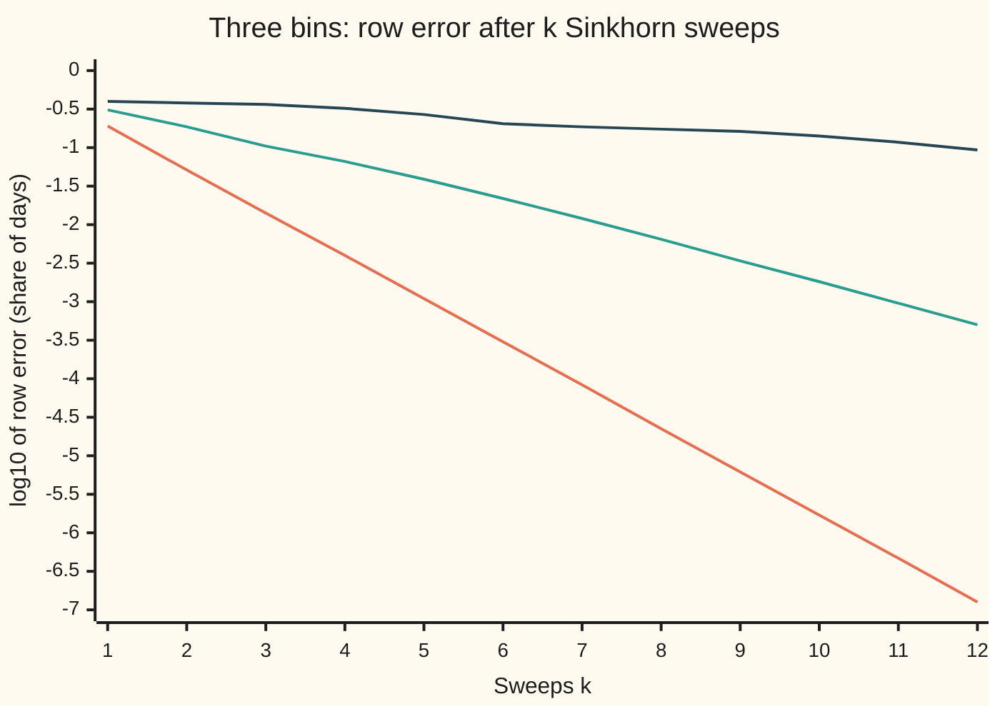

# Sinkhorn: transport made smooth by entropy, solved by rescaling rows and columns

[Syllabus](../../../SYLLABUS.md) → [Optimization](../README.md) → [First-Order Methods at Scale](../README.md#s08) → Sinkhorn

---

## General Overview

An index tracker refits its weights every day from the last 250 daily returns. A risk desk wants one number for how far the market has moved since last year. It sorts each year's 250 daily returns into three bins: **down** (below −0.5%), **flat** (−0.5% to +0.5%) and **up** (above +0.5%). Last year had 75, 100 and 75 days. This year has 50, 75 and 125.

One fair measure is the least work needed to turn last year's histogram into this year's. Work means moving days between bins. The bin centres are −1%, 0% and +1%, so moving a share of days one bin costs 1 percentage point per unit of share, and two bins costs 2. This is a shipping problem, the transport linear program of [Network flows](../04-Linear%20Programming/06-network-flows-as-linear-programs.md), and it **minimises** the total work. Here the answer is **0.3 percentage points**: on balance, the daily return has shifted up by 0.3 of a point.

With 1,000 bins in place of three, the linear program has a million unknowns, and the desk wants it every day. **Entropic transport** changes the problem slightly. It adds a reward for spreading the plan out, weighted by a number $`\varepsilon`$ (epsilon). Then the best plan has a fixed shape: a known matrix, with each row scaled by one number and each column by another. **Sinkhorn's algorithm** finds those numbers. It scales the rows to the right totals, then the columns, then the rows again. Each pass costs only multiplications, and the error shrinks by a steady factor per pass.

The smallest case shows the price. Take two bins, down and up, with half the days in each, in both years. Nothing moved, so the exact work is 0. With entropy weight 1, Sinkhorn returns a plan that moves 26.9% of the days, for a work of 0.268941. That gap is the **bias** of the smoothing. It shrinks to 0 as $`\varepsilon`$ shrinks.

**Adding ε times the entropy to a transport problem makes its best plan a kernel matrix e^(−cost/ε) with its rows and columns rescaled, and Sinkhorn's alternating row and column scaling finds that plan with an error that shrinks by a fixed factor per sweep, at the price of a bias of at most ε times an entropy.**

**What kind of fact this is:** a method with theorems. Proved on this card in Why it works: the scaled-kernel form, the dual bound that certifies it, the row step as a KL projection, and the bound on the bias. The linear rate is stated with its source (Franklin and Lorenz, 1989) and a proof outline. The day counts are a synthetic example in the rough shape of equity returns.

### The picture: last year's and this year's returns

```
down  last year  ███████████████            30%   (75 days)
      this year  ██████████                 20%   (50 days)
flat  last year  ████████████████████       40%  (100 days)
      this year  ███████████████            30%   (75 days)
up    last year  ███████████████            30%   (75 days)
      this year  █████████████████████████  50%  (125 days)
```

One block is 2% of the year's days. The transport problem asks for the cheapest way to reshape the top bar of each pair into the bottom one.

---

## The formula

Notation first, in words. Bins are numbered $`i`$ for last year (rows) and $`j`$ for this year (columns). $`a_i`$ is the share of last year's days in bin $`i`$, and $`b_j`$ the share of this year's in bin $`j`$; both lists add up to 1. $`C_{ij}`$ is the cost of moving one unit of share from bin $`i`$ to bin $`j`$, in percentage points.

A **plan** $`P`$ is a table whose entry $`P_{ij}`$ is the share of days moved from bin $`i`$ to bin $`j`$ (on [Network flows](../04-Linear%20Programming/06-network-flows-as-linear-programs.md) it was $`x_{ij}`$). A plan is feasible when its row sums are $`a`$ and its column sums are $`b`$. Its **entropy** is $`H(P) = -\sum_{ij} P_{ij}\log P_{ij}`$, in nats (natural-log units; [KL divergence](../../14-Applied%20and%20computational/03-Information%20Theory/03-kl-divergence-and-cross-entropy.md) counts bits). A spread-out plan has high entropy; a plan on few routes has low entropy.

The entropic transport problem:

```math
\min_{P \ge 0}\ \sum_{i,j} C_{ij}P_{ij} - \varepsilon\,H(P) \quad\text{such that}\quad \sum_j P_{ij} = a_i,\quad \sum_i P_{ij} = b_j
```

**Read it aloud:** choose how much to move along every route so that the old totals become the new totals, and make the moving cost minus epsilon times the plan's entropy as small as possible.

Its answer has the **scaled-kernel form**, and Sinkhorn computes it:

```math
P_{ij} = u_i\,K_{ij}\,v_j,\quad K_{ij} = e^{-C_{ij}/\varepsilon};\qquad u^{(k+1)}_i = \frac{a_i}{\sum_j K_{ij}\,v^{(k)}_j},\quad v^{(k+1)}_j = \frac{b_j}{\sum_i K_{ij}\,u^{(k+1)}_i}
```

**Read it aloud:** the best plan is the kernel with row i multiplied by u-i and column j by v-j; to find them, divide each row's target by the row's current total, then each column's target by the column's current total, and repeat.

The guarantee on speed and the price in bias:

```math
d_H\big(v^{(k+1)}, v^*\big) \le \tanh^2\!\Big(\frac{\theta}{4\varepsilon}\Big)\, d_H\big(v^{(k)}, v^*\big), \qquad 0 \le \sum_{ij} C_{ij}P^{\varepsilon}_{ij} - W \le \varepsilon\,\min\big(H(a), H(b)\big)
```

Here $`d_H`$ is the Hilbert distance between two scalings and $`\theta`$ the largest swap saving in the costs, both defined in Step 4. $`v^*`$ is the limit of the column scalings, $`P^\varepsilon`$ the entropic best plan and $`W`$ the exact transport cost.

**Read it aloud:** each sweep shrinks the distance of the column scaling to its limit by at least the square of tanh of theta over four epsilon; and the entropic plan's moving cost exceeds the exact transport cost W by at most epsilon times the smaller of the two histograms' entropies.

| Symbol | Plain meaning | In our example | Push it up and the answer… |
| --- | --- | --- | --- |
| $`i`$, $`j`$, $`a_i`$, $`b_j`$ | bin numbers, last year's (rows) and this year's (columns); share of days in bin i last year; in bin j this year | $`a = (0.3, 0.4, 0.3)`$, $`b = (0.2, 0.3, 0.5)`$; two bins: $`(0.5, 0.5)`$ both | a bigger gap between a and b raises W |
| $`C_{ij}`$ | cost to move one unit of share from bin i to bin j, percentage points | $`\lvert i - j\rvert`$; two bins: `[[0, 1], [1, 0]]` | costlier routes carry less |
| $`P`$, $`P^\varepsilon`$, $`P^*`$ | a plan; the entropic best plan; an exact best plan | two bins: $`P^\varepsilon_{12} = 0.134471`$ | — |
| $`W`$ | the exact transport cost (entropy weight 0) | 0.3; two bins: 0 | — |
| $`\varepsilon`$ | entropy weight, percentage points per nat | 1 | more spread, more bias, fewer sweeps |
| $`H(P)`$, $`H(a)`$ | entropy of a plan; of a histogram, nats | $`H(P^\varepsilon) = 1.275350`$ on two bins | — |
| $`K_{ij}`$ | the kernel, $`e^{-C_{ij}/\varepsilon}`$ | off-diagonal 0.367879 at $`\varepsilon = 1`$ | — |
| $`u_i`$, $`v_j`$ | row and column scaling factors | $`u = (0.365529, 0.365529)`$, $`v = (1, 1)`$ | — |
| $`\varphi_i`$, $`\psi_j`$, $`q`$, $`\mathcal{L}`$, $`s`$, $`p`$, $`p_0`$ | dual prices on rows and columns; the dual value; the Lagrangian; a row price plus a column price; one entry of a plan; the best single entry for that sum | $`q = -1.006409`$ on two bins | higher prices on a row pull more share out of it |
| $`k`$, $`v^{(k)}`$, $`v^*`$ | sweep count from the start $`v^{(0)} = (1, \dots, 1)`$ at $`k = 0`$; scaling after k sweeps; its limit | 22 sweeps to row error below $`10^{-12}`$ | — |
| $`d_H`$, $`x`$, $`y`$, $`\theta`$, $`\eta`$ | Hilbert distance between positive lists x and y; the largest swap saving in $`C`$; the largest cross-ratio of K, with $`\log\eta = \theta/\varepsilon`$ | $`\theta = 4`$ on three bins | larger θ, slower guaranteed rate |
| $`D(P\,\Vert\,Q)`$, $`Q`$, $`R`$, $`c_i`$, $`\nu_i`$ | KL divergence of P from Q, nats; the table being projected; any table with row totals a; the factor for row i; its multiplier | $`D(R\,\Vert\,Q) = 0.273286`$ in the projection check | — |

### When it holds

- **ε is above zero.** At $`\varepsilon = 0`$ there is no kernel and the problem is the plain linear program. As $`\varepsilon`$ falls, the sweeps needed grow: 44 at 0.5, 334 at 0.01, 2,885 at 0.001.
- **The totals agree: $`\sum a_i = \sum b_j`$.** If this year's shares add up to 1.1, rows and columns fight for ever, and the row error stays at 0.100000 after 1,000 sweeps.
- **Every route is allowed, so every $`K_{ij} > 0`$.** With zeros in $`K`$ a scaling may not exist. In floating point, $`e^{-C/\varepsilon}`$ becomes exactly 0 when $`C/\varepsilon`$ is large: at $`\varepsilon = 0.001`$ the plain method is stuck at row error 0.400000. Working with logarithms (Step 6) removes this failure.
- **The rate bound needs finite costs.** The factor $`\tanh^2(\theta/(4\varepsilon))`$ is below 1 only when θ is finite, and it creeps towards 1 as $`\varepsilon`$ shrinks.

---

## Why it works

### Step 0: entropy turns "add up" conditions into "multiply" conditions

The plain transport problem is a linear program: its best plans sit at corners, and finding a corner needs pivots. The entropy term $`-\varepsilon H(P)`$ is strictly convex and its slope, $`\varepsilon(\log P_{ij} + 1)`$, runs to minus infinity at 0. So the best plan is unique, has every entry positive, and is fixed by a zero-slope condition.

That condition holds a logarithm. Taking exponentials turns a sum of prices into a product of factors: one for the row, one for the route, one for the column. Matching the totals then means choosing the row and column factors. With the columns fixed, the rows are one division each, and the other way round.

### Step 1: the best plan is a scaled kernel

Attach a price $`\varphi_i`$ to each row total and $`\psi_j`$ to each column total (the dual prices $`y`$ of [LP duality](../04-Linear%20Programming/04-lp-duality-and-complementary-slackness.md), split by row and column). The Lagrangian (cost plus price times violation, from [Lagrange multipliers](../../06-Calculus%20and%20analysis/07-Several%20Variables/08-lagrange-multipliers.md)) is

```math
\mathcal{L} = \sum_{ij} \big(C_{ij}P_{ij} + \varepsilon P_{ij}\log P_{ij}\big) - \sum_i \varphi_i\Big(\sum_j P_{ij} - a_i\Big) - \sum_j \psi_j\Big(\sum_i P_{ij} - b_j\Big)
```

**Read it aloud:** moving cost plus epsilon times the entries' P-log-P terms, minus each row price times its row's excess, minus each column price times its column's excess.

Setting its slope in $`P_{ij}`$ to zero gives $`C_{ij} + \varepsilon(\log P_{ij} + 1) = \varphi_i + \psi_j`$, so

```math
P_{ij} = e^{\varphi_i/\varepsilon - 1}\; e^{-C_{ij}/\varepsilon}\; e^{\psi_j/\varepsilon} = u_i\,K_{ij}\,v_j
```

**Read it aloud:** the best plan is the kernel with a factor for each row and a factor for each column.

A quick test needs no algorithm. A scaled kernel keeps the kernel's cross-ratios: on two bins, $`P_{11}P_{22}/(P_{12}P_{21}) = K_{11}K_{22}/(K_{12}K_{21}) = e^{2/\varepsilon}`$. A brute-force golden-section search over all feasible two-bin plans finds the same plan, with cross-ratio 7.38906 against $`e^2 = 7.389056`$.

### Step 2: the dual gives a certificate

For any prices $`\varphi`$, $`\psi`$ define the dual value

```math
q(\varphi, \psi) = \sum_i a_i\varphi_i + \sum_j b_j\psi_j - \varepsilon\sum_{ij} e^{(\varphi_i + \psi_j - C_{ij})/\varepsilon - 1}
```

**Read it aloud:** the value of the old totals at the row prices, plus the new totals at the column prices, minus epsilon times the total mass of the plan those prices describe.

**Weak duality:** every feasible plan's objective is at least $`q`$. So a plan and prices with equal values prove the plan is best: that is the certificate the wing asks for. On two bins at $`\varepsilon = 1`$ both sides equal −1.006409. On three bins the gap at the stopping point is at most $`7.4 \times 10^{-13}`$.

<details>
<summary>Detailed proof: weak duality, entry by entry</summary>

Fix one entry and write $`s = \varphi_i + \psi_j`$. For $`p \ge 0`$ the function $`C_{ij}p + \varepsilon p\log p - s p`$ is convex. Its slope $`C_{ij} + \varepsilon(\log p + 1) - s`$ is zero at $`p_0 = e^{(s - C_{ij})/\varepsilon - 1}`$. There $`\varepsilon\log p_0 = s - C_{ij} - \varepsilon`$, so the smallest value is

$`\displaystyle C_{ij}p_0 + p_0(s - C_{ij} - \varepsilon) - s p_0 = -\varepsilon\,p_0.`$

So every entry satisfies $`C_{ij}P_{ij} + \varepsilon P_{ij}\log P_{ij} - (\varphi_i + \psi_j)P_{ij} \ge -\varepsilon\,e^{(\varphi_i + \psi_j - C_{ij})/\varepsilon - 1}`$. Add over all entries. For a feasible plan, $`\sum_{ij}(\varphi_i + \psi_j)P_{ij} = \sum_i a_i\varphi_i + \sum_j b_j\psi_j`$, because the rows add to $`a`$ and the columns to $`b`$. Moving that term to the right gives

$`\displaystyle \sum_{ij} C_{ij}P_{ij} - \varepsilon H(P) \ge q(\varphi, \psi).`$

Equality holds when every entry sits at its $`p_0`$, which is the scaled-kernel form of Step 1 with $`u_i = e^{\varphi_i/\varepsilon - 1}`$ and $`v_j = e^{\psi_j/\varepsilon}`$.

</details>

### Step 3: each half-sweep is an exact step on the dual, and a KL projection

The dual $`q`$ is concave. Its slope in $`\varphi_i`$ is $`a_i - \sum_j u_iK_{ij}v_j`$: the target row total minus the current one. Setting all row slopes to zero with $`\psi`$ held fixed gives $`u_i = a_i / \sum_j K_{ij}v_j`$, the row step. The column step is the same with the roles swapped. So Sinkhorn is exact two-block coordinate ascent on the dual, the method of [Coordinate descent](02-block-coordinate-descent.md) run uphill. Each half-sweep raises $`q`$, and no step size is needed.

The same step has a primal reading. Among all tables whose rows add to $`a`$, the one closest to the current table $`Q`$ in KL divergence is $`Q`$ with each row rescaled: $`P_{ij} = Q_{ij}\,a_i/\sum_j Q_{ij}`$. That makes Sinkhorn an alternating **KL projection**: onto the right row totals, then onto the right column totals. KL divergence is the Bregman divergence of entropy, the distance of [Mirror descent](05-mirror-descent-and-bregman-divergences.md).

A projection of this kind obeys a Pythagoras rule: for any table $`R`$ with the right row totals, $`D(R\,\Vert\,Q) = D(R\,\Vert\,P) + D(P\,\Vert\,Q)`$. The checks test it on a three-bin table: both sides are 0.273286.

<details>
<summary>Detailed proof: the row rescaling is the KL projection, with Pythagoras</summary>

Minimise $`D(P\,\Vert\,Q) = \sum_{ij} P_{ij}\log(P_{ij}/Q_{ij})`$ subject to $`\sum_j P_{ij} = a_i`$. With a multiplier $`\nu_i`$ per row, the zero-slope condition is $`\log(P_{ij}/Q_{ij}) + 1 = \nu_i`$. So $`P_{ij} = c_i Q_{ij}`$ with one constant per row, and the row total fixes $`c_i = a_i/\sum_j Q_{ij}`$.

For Pythagoras, write $`\log(R_{ij}/Q_{ij}) = \log(R_{ij}/P_{ij}) + \log c_i`$. Multiply by $`R_{ij}`$ and add:

$`\displaystyle D(R\,\Vert\,Q) = D(R\,\Vert\,P) + \sum_i \Big(\sum_j R_{ij}\Big)\log c_i = D(R\,\Vert\,P) + \sum_i a_i \log c_i.`$

The same sum with $`P`$ in place of $`R`$ gives $`D(P\,\Vert\,Q) = \sum_i a_i\log c_i`$, since $`P`$ also has row totals $`a`$. Substituting proves the rule.

</details>

### Step 4: the error shrinks by a fixed factor per sweep

The yardstick is the **Hilbert distance** between two positive lists $`x`$ and $`y`$:

```math
d_H(x, y) = \log\max_j\frac{x_j}{y_j} - \log\min_j\frac{x_j}{y_j}
```

**Read it aloud:** the log of the largest ratio of the two lists minus the log of the smallest ratio.

It ignores an overall scale, which suits scaling factors: $`v`$ and $`2v`$ give the same plan once $`u`$ halves. Let $`\theta`$, the largest **swap saving**, be the most that two routes can save by swapping destinations. Routes $`i \to j'`$ and $`i' \to j`$, swapped into $`i \to j`$ and $`i' \to j'`$, save $`C_{ij'} + C_{i'j} - C_{ij} - C_{i'j'}`$, and $`\theta`$ is the largest such saving over all bins.

**Theorem (stated; Franklin and Lorenz, 1989):** for $`\varepsilon > 0`$ and finite costs, $`d_H(v^{(k+1)}, v^*) \le \tanh^2(\theta/(4\varepsilon))\, d_H(v^{(k)}, v^*)`$. The error is linear in the optimisation sense: it shrinks by a fixed factor per sweep.

<details>
<summary>Proof outline: why every sweep contracts</summary>

Two facts carry the proof.

1. Dividing a fixed positive list by $`x`$, entry by entry, does not change Hilbert distances: $`d_H(a/x, a/y) = d_H(x, y)`$.
2. Birkhoff's theorem: a matrix with positive entries shrinks Hilbert distances by at least the factor $`\tanh(\log\eta/4)`$, where $`\eta = \max K_{ij'}K_{i'j}/(K_{ij}K_{i'j'})`$. For the kernel, $`\log\eta = \theta/\varepsilon`$.

The row step is $`u = a/(Kv)`$: a contraction by $`\tanh(\theta/(4\varepsilon))`$ followed by a division. The column step is the same with $`K`$ turned on its side. Since the limit $`v^*`$ is a fixed point of the sweep, a sweep shrinks $`d_H(v, v^*)`$ by at least the square of the factor. Franklin and Lorenz give the full proof, including Birkhoff's theorem.

</details>

On three bins, $`\theta = 4`$: the routes 1 to 3 and 3 to 1 cost 2 each, and swapping them into 1 to 1 and 3 to 3 saves all 4. At $`\varepsilon = 1`$ the bound is $`\tanh^2(1) = 0.580026`$. The measured ratios of Hilbert distance per sweep are 0.3114, 0.2919, 0.2798, 0.2756, 0.2743 and 0.2739: well inside the bound, and settling at a fixed factor.



Orange: $`\varepsilon = 1`$. Green: $`\varepsilon = 0.5`$. Dark: $`\varepsilon = 0.2`$. The row error is the total miss of the row sums after the column step. Straight lines on this log scale mean a fixed factor per sweep; smaller $`\varepsilon`$ gives a flatter line.

### Step 5: the bias, and what it costs to shrink it

Compare the entropic plan $`P^\varepsilon`$ with an exact best plan $`P^*`$. $`P^\varepsilon`$ wins on the entropic objective, so

```math
\sum_{ij} C_{ij}P^\varepsilon_{ij} - W \le \varepsilon\,\big(H(P^\varepsilon) - H(P^*)\big) \le \varepsilon\,\min\big(H(a), H(b)\big)
```

**Read it aloud:** the extra moving cost is at most epsilon times the entropy the smoothing gained, which is at most epsilon times the smaller histogram entropy.

The last step uses two facts from [Conditional entropy and mutual information](../../14-Applied%20and%20computational/03-Information%20Theory/02-conditional-entropy-and-mutual-information.md): a table's entropy is at most the sum of its two margins' entropies, and at least the larger one. The left side is never negative, because $`P^\varepsilon`$ is a feasible plan and $`W`$ is the least cost.

On three bins, $`H(a) = 1.088900`$ and $`H(b) = 1.029653`$ nats, with a stopping test of row error below $`10^{-12}`$:

| ε | Sweeps | Moving cost | Bias bound $`\varepsilon\min(H(a), H(b))`$ |
| --- | ---: | ---: | ---: |
| 1 | 22 | 0.500543 | 1.029653 |
| 0.5 | 44 | 0.340397 | 0.514827 |
| 0.2 | 65 | 0.300113 | 0.205931 |
| 0.1 | 79 | 0.300000 | 0.102965 |
| 0.05 | 107 | 0.300000 | 0.051483 |

The bias here falls much faster than the bound, and the sweeps rise: a small $`\varepsilon`$ buys accuracy with sweeps.

As $`\varepsilon \to 0`$ the plan tends to `[[0.2, 0.06, 0.04], [0, 0.24, 0.16], [0, 0, 0.3]]`. It costs 0.3, like the exact plan `[[0.2, 0.1, 0], [0, 0.2, 0.2], [0, 0, 0.3]]`. Under the cost $`\lvert i - j\rvert`$ a two-bin jump costs the same as two one-bin moves, so many plans tie, and entropy picks the most spread-out of them.

### Step 6: log-domain stabilisation

At $`\varepsilon = 0.001`$, $`e^{-1/0.001} = e^{-1000}`$ is smaller than the smallest positive floating-point number, so it is stored as exactly 0. The kernel becomes the identity table. No scaling of the identity can turn $`a`$ into $`b`$, and the plain method sits at row error 0.400000.

The cure is to keep the prices $`\varphi`$, $`\psi`$ instead of $`u`$, $`v`$. The row step becomes

```math
\varphi_i = \varepsilon\log a_i - \varepsilon\,\log\sum_j e^{(\psi_j - C_{ij})/\varepsilon}
```

**Read it aloud:** the new row price is epsilon log a-i minus epsilon times the log of the summed exponentials of column price minus cost, over epsilon.

The log of a sum of exponentials is computed by first subtracting the largest exponent, so nothing overflows or underflows. (This form drops the "−1" of Step 1 into $`\varphi`$; the plan is $`e^{(\varphi_i + \psi_j - C_{ij})/\varepsilon}`$.) At $`\varepsilon = 0.5`$ it gives the plain method's plan to $`10^{-12}`$, in the same 44 sweeps. At $`\varepsilon = 0.001`$ it reaches cost 0.300000 in 2,885 sweeps.

---

## Worked numbers, by hand

Two bins, down and up, half the days in each in both years; cost `[[0, 1], [1, 0]]`, entropy weight $`\varepsilon = 1`$, start $`v^{(0)} = (1, 1)`$.

| Step | Arithmetic | Value |
| --- | --- | --- |
| kernel, off the diagonal | $`e^{-1/1}`$ | 0.367879 |
| row totals of $`K v^{(0)}`$ | $`1 + 0.367879`$ | 1.367879 |
| row scaling $`u_1 = u_2`$ | $`0.5 / 1.367879`$ | 0.365529 |
| column totals of $`u_iK_{ij}`$ | $`0.365529 \times 1.367879`$ | 0.5, so $`v = (1, 1)`$ |
| plan, on the diagonal | $`0.365529 \times 1 \times 1`$ | 0.365529 |
| plan, off the diagonal | $`0.365529 \times 0.367879`$ | 0.134471 |
| moving cost | $`0.134471 + 0.134471`$ | 0.268941 |
| entropy | $`-2(0.365529\log 0.365529 + 0.134471\log 0.134471)`$ | 1.275350 nats |
| objective | $`0.268941 - 1 \times 1.275350`$ | −1.006409 |
| dual value, $`\varphi = \log u + 1`$, $`\psi = 0`$ | $`2 \times 0.5\,(\log 0.365529 + 1) + 0 - 1`$ | −1.006409 |
| the answer | one sweep, row error 0 | **plan `[[0.3655, 0.1345], [0.1345, 0.3655]]`, cost 0.2689; exact cost 0** |

The rows and columns match after one sweep, and the dual value equals the objective, so this plan is the entropic optimum. Its cost of 0.2689 percentage points is pure bias: the histograms are identical. The exact plan, moving nothing, has objective $`0 - \log 2 = -0.693147`$, higher than −1.006409, because it has less entropy.

The bias on two bins has a closed form, $`1/(1 + e^{1/\varepsilon})`$: 0.268941 at $`\varepsilon = 1`$, 0.119203 at 0.5, 0.017986 at 0.25 and 0.000045 at 0.1. Each is inside the bound $`\varepsilon\log 2`$.

### What breaks if you drop a piece

| Mistake | Comes out at | What went wrong |
| --- | --- | --- |
| This year's shares add up to 1.1 (0.2, 0.3, 0.6) | row error 0.100000 after 1,000 sweeps | The totals disagree, so no plan exists; rows and columns undo each other |
| Plain kernel at $`\varepsilon = 0.001`$ | $`K_{12} = 0.0`$; row error 0.400000 after 1,000 sweeps | $`e^{-1000}`$ underflows to 0; the log-domain form gets 0.300000 |
| Entropic moving cost read as the transport distance | 0.500543 at $`\varepsilon = 1`$, against 0.3; two bins 0.268941, against 0 | The entropy term pays for spreading; the bias needs a small ε |
| Expecting the $`\varepsilon = 0.5`$ speed at small ε | 2,885 sweeps at 0.001, against 44 at 0.5 | The rate factor $`\tanh^2(\theta/(4\varepsilon))`$ tends to 1 |

---

## Code, from first principles, and it actually runs

Both programs solve the two-bin example and the three-bin returns example with Sinkhorn, and print the same lines. They take five independent roads. On two bins: a closed form and a golden-section search over all feasible plans. On three bins: the exact transport cost from a plan, a fair set of LP dual prices and a running-sum formula, all 0.3; and the entropic dual value meeting the primal value. The rate is checked against the Hilbert-distance bound, the KL projection against its Pythagoras rule, and log-domain Sinkhorn against plain Sinkhorn. Python's `sum` adds with a compensation term, so the Rust program uses the same compensated sum and the outputs agree digit for digit.

### Python

```python
# Entropic optimal transport and Sinkhorn -- the check behind the card.  Standard library only.
# Minimise transport cost minus eps times entropy over plans P with row sums a and
# column sums b.  Roads: Sinkhorn scaling; a closed form and a golden-section search
# on the 2-by-2 example; the dual value (a lower bound) meeting the primal value; the
# exact transport cost from an LP plan, its dual prices and a running-sum formula;
# the Hilbert-metric rate bound; log-domain Sinkhorn against plain Sinkhorn.
import math

def kernel(C, eps): return [[math.exp(-c / eps) for c in row] for row in C]
def plan(u, K, v): return [[u[i] * K[i][j] * v[j] for j in range(len(v))] for i in range(len(u))]
def rowerr(P, a): return sum(abs(sum(P[i]) - a[i]) for i in range(len(a)))
def cost(C, P): return sum(C[i][j] * P[i][j] for i in range(len(P)) for j in range(len(P[0])))
def ent(p): return -sum(x * math.log(x) for x in p if x > 0)
def H(P): return ent([x for row in P for x in row])
def sinkhorn(a, b, K, iters, tol=0.0):
    v, errs = [1.0] * len(b), []
    for k in range(iters):
        u = [a[i] / sum(K[i][j] * v[j] for j in range(len(b))) for i in range(len(a))]
        v = [b[j] / sum(K[i][j] * u[i] for i in range(len(a))) for j in range(len(b))]
        errs.append(rowerr(plan(u, K, v), a))
        if errs[-1] < tol: break
    return u, v, errs
def dual(a, b, C, u, v, eps):   # q(phi, psi) with phi = eps(log u + 1), psi = eps log v
    phi = [eps * (math.log(x) + 1) for x in u]; psi = [eps * math.log(x) for x in v]
    return (sum(p * x for p, x in zip(phi, a)) + sum(p * x for p, x in zip(psi, b))
            - eps * sum(math.exp((phi[i] + psi[j] - C[i][j]) / eps - 1)
                        for i in range(len(a)) for j in range(len(b))))
def sci(x): return f"{x:.1e}"
f6 = lambda M: "[" + ", ".join("[" + ", ".join(f"{x:.6f}" for x in r) + "]" for r in M) + "]"

# 1. the 2-by-2 example: down days and up days, half each, both years; eps = 1
a2, C2, eps = [0.5, 0.5], [[0.0, 1.0], [1.0, 0.0]], 1.0
K = kernel(C2, eps); u, v, e = sinkhorn(a2, a2, K, 1)
P = plan(u, K, v); val = cost(C2, P) - eps * H(P)
print(f"2x2, eps = 1: K = {f6(K)}; after sweep 1: u = ({u[0]:.6f}, {u[1]:.6f}), v = ({v[0]:.6f}, {v[1]:.6f})")
print(f"  row sums of K v_0 = K (1, 1): {sum(K[0]):.6f}, {sum(K[1]):.6f}")
print(f"  plan {f6(P)}, row error {sci(e[0])}")
print(f"  cost {cost(C2, P):.6f}, entropy {H(P):.6f} nats, value {val:.6f}; dual value {dual(a2, a2, C2, u, v, eps):.6f}")
def val2(t, eps): Q = [[0.5 - t, t], [t, 0.5 - t]]; return cost(C2, Q) - eps * H(Q)
lo, hi, r = 1e-12, 0.5 - 1e-12, (math.sqrt(5) - 1) / 2   # golden-section on the off-diagonal t
for _ in range(200):
    x1, x2 = hi - r * (hi - lo), lo + r * (hi - lo)
    if val2(x1, eps) <= val2(x2, eps): hi = x2
    else: lo = x1
t = (lo + hi) / 2; closed = 0.5 / (1 + math.exp(1 / eps))
print(f"  search: off-diagonal {t:.6f}; closed form 0.5/(1 + e^(1/eps)) = {closed:.6f}; value {val2(t, eps):.6f}")
cr = lambda Q: Q[0][0] * Q[1][1] / (Q[0][1] * Q[1][0])
print(f"  cross-ratio P00 P11/(P01 P10): Sinkhorn {cr(P):.6f}, search {cr([[0.5 - t, t], [t, 0.5 - t]]):.5f}, e^2 = {math.exp(2):.6f}")
assert abs(t - P[0][1]) < 1e-7 and abs(closed - P[0][1]) < 1e-12 and abs(cr(P) - math.exp(2)) < 1e-9
assert abs(dual(a2, a2, C2, u, v, eps) - val) < 1e-12 and val < val2(0.0, eps)
print(f"  exact plan [[0.5, 0], [0, 0.5]]: cost 0, value {-math.log(2):.6f}; bias bound eps*min(H(a), H(b)) = {ent(a2):.6f}")
for ep in [1.0, 0.5, 0.25, 0.1]:
    K = kernel(C2, ep); u, v, e = sinkhorn(a2, a2, K, 1); c = cost(C2, plan(u, K, v))
    print(f"  eps = {ep:<4g}: cost {c:.6f}, 1/(1 + e^(1/eps)) = {1 / (1 + math.exp(1 / ep)):.6f}, bound {ep * ent(a2):.6f}")
    assert abs(c - 1 / (1 + math.exp(1 / ep))) < 1e-12 and c <= ep * ent(a2)

# 2. the tracker's returns in three bins (down, flat, up), last year a, this year b
a, b = [0.3, 0.4, 0.3], [0.2, 0.3, 0.5]
print("returns: last year days", " ".join(f"{250 * x:.0f}" for x in a), "of 250; this year",
      " ".join(f"{250 * x:.0f}" for x in b))
C = [[float(abs(i - j)) for j in range(3)] for i in range(3)]   # percentage points apart
P0 = [[0.2, 0.1, 0.0], [0.0, 0.2, 0.2], [0.0, 0.0, 0.3]]       # move up one bin at a time
phi, psi = [0.0, -1.0, -2.0], [0.0, 1.0, 2.0]                   # LP dual prices
ok = all(phi[i] + psi[j] <= C[i][j] for i in range(3) for j in range(3))
lpdual = sum(p * x for p, x in zip(phi, a)) + sum(p * x for p, x in zip(psi, b))
runs = sum(abs(sum(a[:k + 1]) - sum(b[:k + 1])) for k in range(2))
print(f"3 bins: exact plan {f6(P0)} costs {cost(C, P0):.6f}; dual prices give {lpdual:.6f} "
      f"(fair: {'yes' if ok else 'no'}); running sums {runs:.6f}")
assert ok and abs(cost(C, P0) - lpdual) < 1e-12 and abs(runs - lpdual) < 1e-12
assert rowerr(P0, a) < 1e-12 and rowerr([list(c) for c in zip(*P0)], b) < 1e-12
Hmin = min(ent(a), ent(b))
print(f"  H(a) = {ent(a):.6f}, H(b) = {ent(b):.6f} nats")
print("  eps    sweeps  cost      bias bound  |dual gap|")
for ep in [1.0, 0.5, 0.2, 0.1, 0.05]:
    K = kernel(C, ep); u, v, e = sinkhorn(a, b, K, 100000, 1e-12); P = plan(u, K, v)
    gap = cost(C, P) - ep * H(P) - dual(a, b, C, u, v, ep)
    print(f"  {ep:<5g}  {len(e):>6}  {cost(C, P):.6f}  {ep * Hmin:.6f}    {sci(abs(gap))}")
    assert -1e-9 < cost(C, P) - 0.3 <= ep * Hmin and abs(gap) < 1e-8

# 3. the linear rate at eps = 1: Hilbert distance of v_k to its limit, against the bound
K = kernel(C, 1.0); vs = sinkhorn(a, b, K, 200)[1]
dH = lambda x, y: math.log(max(p / q for p, q in zip(x, y))) - math.log(min(p / q for p, q in zip(x, y)))
theta = max(C[i][l] + C[j][k] - C[i][k] - C[j][l] for i in range(3) for j in range(3) for k in range(3) for l in range(3))
kap = math.tanh(theta / 4); kap2 = kap * kap; v, d = [1.0] * 3, []
for k in range(7):
    d.append(dH(v, vs))
    u = [a[i] / sum(K[i][j] * v[j] for j in range(3)) for i in range(3)]
    v = [b[j] / sum(K[i][j] * u[i] for i in range(3)) for j in range(3)]
ratios = [d[k + 1] / d[k] for k in range(6)]
print(f"rate, eps = 1: swap saving {theta:.0f}, bound tanh(1)^2 = {kap2:.6f}; ratios", " ".join(f"{x:.4f}" for x in ratios))
assert all(x <= kap2 for x in ratios) and abs(ratios[-1] - ratios[-2]) < 0.01
for ep in [1.0, 0.5, 0.2]:
    e = sinkhorn(a, b, kernel(C, ep), 12)[2]
    print(f"chart, eps = {ep:g}: log10 row error after sweeps 1..12:", " ".join(f"{math.log10(x):.2f}" for x in e))

# 4. a row scaling is a KL projection: Pythagoras D(R||Q) = D(R||P) + D(P||Q) for R with row sums a
D = lambda X, Y: sum(x * math.log(x / y) for rx, ry in zip(X, Y) for x, y in zip(rx, ry) if x > 0)
Q = [[x / 3 for x in row] for row in kernel(C, 0.5)]
Pr = [[Q[i][j] * a[i] / sum(Q[i]) for j in range(3)] for i in range(3)]
R = [[0.1, 0.1, 0.1], [0.1, 0.2, 0.1], [0.0, 0.1, 0.2]]
print(f"KL projection: D(R||Q) = {D(R, Q):.6f}, D(R||P) + D(P||Q) = {D(R, Pr) + D(Pr, Q):.6f}")
assert abs(D(R, Q) - D(R, Pr) - D(Pr, Q)) < 1e-12

# 5. what breaks
e = sinkhorn(a, [0.2, 0.3, 0.6], kernel(C, 0.5), 1000)[2]
print(f"unequal totals (b sums to 1.1): row error after 1000 sweeps {e[-1]:.6f}")
K = kernel(C, 0.001); e = sinkhorn(a, b, K, 1000)[2]
print(f"eps = 0.001, plain kernel: K[0][1] = {K[0][1]:.1f}, row error after 1000 sweeps {e[-1]:.6f}")
assert abs(e[-1] - 0.4) < 1e-12
def lse(xs): m = max(xs); return m + math.log(sum(math.exp(x - m) for x in xs))
def logsink(a, b, C, ep, tol):
    f, g = [0.0] * 3, [0.0] * 3
    for k in range(1, 100000):
        f = [ep * math.log(a[i]) - ep * lse([(g[j] - C[i][j]) / ep for j in range(3)]) for i in range(3)]
        g = [ep * math.log(b[j]) - ep * lse([(f[i] - C[i][j]) / ep for i in range(3)]) for j in range(3)]
        P = [[math.exp((f[i] + g[j] - C[i][j]) / ep) for j in range(3)] for i in range(3)]
        if rowerr(P, a) < tol: return k, P
for ep in [0.5, 0.01, 0.001]:
    k, P = logsink(a, b, C, ep, 1e-12)
    print(f"log-domain, eps = {ep:g}: {k} sweeps, cost {cost(C, P):.6f}, plan {f6(P)}")
    assert rowerr([list(c) for c in zip(*P)], b) < 1e-12 and (ep > 0.01 or abs(cost(C, P) - lpdual) < 1e-8)
K = kernel(C, 0.5); u, v, e = sinkhorn(a, b, K, 100000, 1e-12); Pl = plan(u, K, v)
k, P = logsink(a, b, C, 0.5, 1e-12)
assert max(abs(P[i][j] - Pl[i][j]) for i in range(3) for j in range(3)) < 1e-12
print("ALL CHECKS PASS")
```

**Ran 2026-11-24 on macOS, Python 3.14.10, standard library only. All checks passed. Output, pasted from the run:**

```
2x2, eps = 1: K = [[1.000000, 0.367879], [0.367879, 1.000000]]; after sweep 1: u = (0.365529, 0.365529), v = (1.000000, 1.000000)
  row sums of K v_0 = K (1, 1): 1.367879, 1.367879
  plan [[0.365529, 0.134471], [0.134471, 0.365529]], row error 0.0e+00
  cost 0.268941, entropy 1.275350 nats, value -1.006409; dual value -1.006409
  search: off-diagonal 0.134471; closed form 0.5/(1 + e^(1/eps)) = 0.134471; value -1.006409
  cross-ratio P00 P11/(P01 P10): Sinkhorn 7.389056, search 7.38906, e^2 = 7.389056
  exact plan [[0.5, 0], [0, 0.5]]: cost 0, value -0.693147; bias bound eps*min(H(a), H(b)) = 0.693147
  eps = 1   : cost 0.268941, 1/(1 + e^(1/eps)) = 0.268941, bound 0.693147
  eps = 0.5 : cost 0.119203, 1/(1 + e^(1/eps)) = 0.119203, bound 0.346574
  eps = 0.25: cost 0.017986, 1/(1 + e^(1/eps)) = 0.017986, bound 0.173287
  eps = 0.1 : cost 0.000045, 1/(1 + e^(1/eps)) = 0.000045, bound 0.069315
returns: last year days 75 100 75 of 250; this year 50 75 125
3 bins: exact plan [[0.200000, 0.100000, 0.000000], [0.000000, 0.200000, 0.200000], [0.000000, 0.000000, 0.300000]] costs 0.300000; dual prices give 0.300000 (fair: yes); running sums 0.300000
  H(a) = 1.088900, H(b) = 1.029653 nats
  eps    sweeps  cost      bias bound  |dual gap|
  1          22  0.500543  1.029653    1.1e-13
  0.5        44  0.340397  0.514827    2.9e-13
  0.2        65  0.300113  0.205931    4.6e-13
  0.1        79  0.300000  0.102965    5.9e-13
  0.05      107  0.300000  0.051483    7.4e-13
rate, eps = 1: swap saving 4, bound tanh(1)^2 = 0.580026; ratios 0.3114 0.2919 0.2798 0.2756 0.2743 0.2739
chart, eps = 1: log10 row error after sweeps 1..12: -0.72 -1.29 -1.85 -2.40 -2.96 -3.52 -4.08 -4.65 -5.21 -5.77 -6.33 -6.90
chart, eps = 0.5: log10 row error after sweeps 1..12: -0.51 -0.73 -0.98 -1.18 -1.41 -1.66 -1.92 -2.19 -2.47 -2.74 -3.02 -3.30
chart, eps = 0.2: log10 row error after sweeps 1..12: -0.40 -0.42 -0.44 -0.49 -0.57 -0.69 -0.73 -0.76 -0.79 -0.85 -0.93 -1.03
KL projection: D(R||Q) = 0.273286, D(R||P) + D(P||Q) = 0.273286
unequal totals (b sums to 1.1): row error after 1000 sweeps 0.100000
eps = 0.001, plain kernel: K[0][1] = 0.0, row error after 1000 sweeps 0.400000
log-domain, eps = 0.5: 44 sweeps, cost 0.340397, plan [[0.187721, 0.065626, 0.046653], [0.011885, 0.226849, 0.161266], [0.000394, 0.007525, 0.292081]]
log-domain, eps = 0.01: 334 sweeps, cost 0.300000, plan [[0.200000, 0.060000, 0.040000], [0.000000, 0.240000, 0.160000], [0.000000, 0.000000, 0.300000]]
log-domain, eps = 0.001: 2885 sweeps, cost 0.300000, plan [[0.200000, 0.060000, 0.040000], [0.000000, 0.240000, 0.160000], [0.000000, 0.000000, 0.300000]]
ALL CHECKS PASS
```

### Rust

```rust
// Entropic optimal transport and Sinkhorn -- the check behind the card.  std only, no crates.
// The same roads as the Python check, printing the same lines.
type M = Vec<Vec<f64>>;
fn psum(xs: &[f64]) -> f64 { // compensated sum, as Python's sum() does it
    let (mut s, mut c) = (0.0f64, 0.0f64);
    for &x in xs { let t = s + x; if s.abs() >= x.abs() { c += (s - t) + x } else { c += (x - t) + s } s = t; }
    if c != 0.0 && c.is_finite() { s + c } else { s }
}
fn kernel(c: &M, eps: f64) -> M { c.iter().map(|r| r.iter().map(|x| (-x / eps).exp()).collect()).collect() }
fn plan(u: &[f64], k: &M, v: &[f64]) -> M { (0..u.len()).map(|i| (0..v.len()).map(|j| u[i] * k[i][j] * v[j]).collect()).collect() }
fn tr(p: &M) -> M { (0..p[0].len()).map(|j| p.iter().map(|r| r[j]).collect()).collect() }
fn rowerr(p: &M, a: &[f64]) -> f64 { psum(&(0..a.len()).map(|i| (psum(&p[i]) - a[i]).abs()).collect::<Vec<_>>()) }
fn cost(c: &M, p: &M) -> f64 { psum(&(0..p.len()).flat_map(|i| (0..p[0].len()).map(move |j| (i, j))).map(|(i, j)| c[i][j] * p[i][j]).collect::<Vec<_>>()) }
fn ent(p: &[f64]) -> f64 { -psum(&p.iter().filter(|&&x| x > 0.0).map(|&x| x * x.ln()).collect::<Vec<_>>()) }
fn hh(p: &M) -> f64 { ent(&p.concat()) }
fn sinkhorn(a: &[f64], b: &[f64], k: &M, iters: usize, tol: f64) -> (Vec<f64>, Vec<f64>, Vec<f64>) {
    let (mut u, mut v, mut errs) = (vec![], vec![1.0; b.len()], vec![]);
    for _ in 0..iters {
        u = (0..a.len()).map(|i| a[i] / psum(&(0..b.len()).map(|j| k[i][j] * v[j]).collect::<Vec<_>>())).collect();
        v = (0..b.len()).map(|j| b[j] / psum(&(0..a.len()).map(|i| k[i][j] * u[i]).collect::<Vec<_>>())).collect();
        errs.push(rowerr(&plan(&u, k, &v), a));
        if *errs.last().unwrap() < tol { break; }
    }
    (u, v, errs)
}
fn dot(x: &[f64], y: &[f64]) -> f64 { psum(&x.iter().zip(y).map(|(p, q)| p * q).collect::<Vec<_>>()) }
fn dual(a: &[f64], b: &[f64], c: &M, u: &[f64], v: &[f64], eps: f64) -> f64 {
    let phi: Vec<f64> = u.iter().map(|x| eps * (x.ln() + 1.0)).collect();
    let psi: Vec<f64> = v.iter().map(|x| eps * x.ln()).collect();
    let ex: Vec<f64> = (0..a.len()).flat_map(|i| (0..b.len()).map(move |j| (i, j))).map(|(i, j)| ((phi[i] + psi[j] - c[i][j]) / eps - 1.0).exp()).collect();
    dot(&phi, a) + dot(&psi, b) - eps * psum(&ex)
}
fn sci(x: f64) -> String {
    let s = format!("{:.1e}", x); let (m, e) = s.split_once('e').unwrap(); let e: i32 = e.parse().unwrap();
    format!("{}e{}{:02}", m, if e < 0 { '-' } else { '+' }, e.abs())
}
fn f6(m: &M) -> String { format!("[{}]", m.iter().map(|r| format!("[{}]", r.iter().map(|x| format!("{:.6}", x)).collect::<Vec<_>>().join(", "))).collect::<Vec<_>>().join(", ")) }
fn lse(xs: &[f64]) -> f64 { let m = xs.iter().cloned().fold(f64::NEG_INFINITY, f64::max); m + psum(&xs.iter().map(|x| (x - m).exp()).collect::<Vec<_>>()).ln() }
fn logsink(a: &[f64], b: &[f64], c: &M, ep: f64, tol: f64) -> (usize, M) {
    let mut g = vec![0.0; 3];
    for k in 1..100000 {
        let f: Vec<f64> = (0..3).map(|i| ep * a[i].ln() - ep * lse(&(0..3).map(|j| (g[j] - c[i][j]) / ep).collect::<Vec<_>>())).collect();
        g = (0..3).map(|j| ep * b[j].ln() - ep * lse(&(0..3).map(|i| (f[i] - c[i][j]) / ep).collect::<Vec<_>>())).collect();
        let p: M = (0..3).map(|i| (0..3).map(|j| ((f[i] + g[j] - c[i][j]) / ep).exp()).collect()).collect();
        if rowerr(&p, a) < tol { return (k, p); }
    }
    panic!("no convergence")
}
fn main() {
    // 1. the 2-by-2 example: down days and up days, half each, both years; eps = 1
    let (a2, c2, eps) = (vec![0.5, 0.5], vec![vec![0.0, 1.0], vec![1.0, 0.0]], 1.0f64);
    let k = kernel(&c2, eps); let (u, v, e) = sinkhorn(&a2, &a2, &k, 1, 0.0);
    let p = plan(&u, &k, &v); let val = cost(&c2, &p) - eps * hh(&p);
    println!("2x2, eps = 1: K = {}; after sweep 1: u = ({:.6}, {:.6}), v = ({:.6}, {:.6})", f6(&k), u[0], u[1], v[0], v[1]);
    println!("  row sums of K v_0 = K (1, 1): {:.6}, {:.6}", psum(&k[0]), psum(&k[1]));
    println!("  plan {}, row error {}", f6(&p), sci(e[0]));
    println!("  cost {:.6}, entropy {:.6} nats, value {:.6}; dual value {:.6}", cost(&c2, &p), hh(&p), val, dual(&a2, &a2, &c2, &u, &v, eps));
    let q2 = |t: f64| vec![vec![0.5 - t, t], vec![t, 0.5 - t]];
    let val2 = |t: f64, eps: f64| { let q = q2(t); cost(&c2, &q) - eps * hh(&q) };
    let (mut lo, mut hi, r) = (1e-12, 0.5 - 1e-12, (5.0f64.sqrt() - 1.0) / 2.0);
    for _ in 0..200 {
        let (x1, x2) = (hi - r * (hi - lo), lo + r * (hi - lo));
        if val2(x1, eps) <= val2(x2, eps) { hi = x2 } else { lo = x1 }
    }
    let t = (lo + hi) / 2.0; let closed = 0.5 / (1.0 + (1.0 / eps).exp());
    println!("  search: off-diagonal {:.6}; closed form 0.5/(1 + e^(1/eps)) = {:.6}; value {:.6}", t, closed, val2(t, eps));
    let cr = |q: &M| q[0][0] * q[1][1] / (q[0][1] * q[1][0]);
    println!("  cross-ratio P00 P11/(P01 P10): Sinkhorn {:.6}, search {:.5}, e^2 = {:.6}", cr(&p), cr(&q2(t)), 2.0f64.exp());
    assert!((t - p[0][1]).abs() < 1e-7 && (closed - p[0][1]).abs() < 1e-12 && (cr(&p) - 2.0f64.exp()).abs() < 1e-9);
    assert!((dual(&a2, &a2, &c2, &u, &v, eps) - val).abs() < 1e-12 && val < val2(0.0, eps));
    println!("  exact plan [[0.5, 0], [0, 0.5]]: cost 0, value {:.6}; bias bound eps*min(H(a), H(b)) = {:.6}", -(2.0f64.ln()), ent(&a2));
    for ep in [1.0, 0.5, 0.25, 0.1] {
        let k = kernel(&c2, ep); let (u, v, _) = sinkhorn(&a2, &a2, &k, 1, 0.0); let c = cost(&c2, &plan(&u, &k, &v));
        println!("  eps = {:<4}: cost {:.6}, 1/(1 + e^(1/eps)) = {:.6}, bound {:.6}", format!("{}", ep), c, 1.0 / (1.0 + (1.0 / ep).exp()), ep * ent(&a2));
        assert!((c - 1.0 / (1.0 + (1.0 / ep).exp())).abs() < 1e-12 && c <= ep * ent(&a2));
    }
    // 2. the tracker's returns in three bins (down, flat, up), last year a, this year b
    let (a, b) = (vec![0.3, 0.4, 0.3], vec![0.2, 0.3, 0.5]);
    let days = |x: &[f64]| x.iter().map(|y| format!("{:.0}", 250.0 * y)).collect::<Vec<_>>().join(" ");
    println!("returns: last year days {} of 250; this year {}", days(&a), days(&b));
    let c: M = (0..3).map(|i| (0..3).map(|j| (i as f64 - j as f64).abs()).collect()).collect();
    let p0: M = vec![vec![0.2, 0.1, 0.0], vec![0.0, 0.2, 0.2], vec![0.0, 0.0, 0.3]];
    let (phi, psi) = ([0.0, -1.0, -2.0], [0.0, 1.0, 2.0]);
    let ok = (0..3).all(|i| (0..3).all(|j| phi[i] + psi[j] <= c[i][j]));
    let lpdual = dot(&phi, &a) + dot(&psi, &b);
    let runs = psum(&(0..2).map(|k| (psum(&a[..k + 1]) - psum(&b[..k + 1])).abs()).collect::<Vec<_>>());
    println!("3 bins: exact plan {} costs {:.6}; dual prices give {:.6} (fair: {}); running sums {:.6}", f6(&p0), cost(&c, &p0), lpdual, if ok { "yes" } else { "no" }, runs);
    assert!(ok && (cost(&c, &p0) - lpdual).abs() < 1e-12 && (runs - lpdual).abs() < 1e-12);
    assert!(rowerr(&p0, &a) < 1e-12 && rowerr(&tr(&p0), &b) < 1e-12);
    let hmin = ent(&a).min(ent(&b));
    println!("  H(a) = {:.6}, H(b) = {:.6} nats", ent(&a), ent(&b));
    println!("  eps    sweeps  cost      bias bound  |dual gap|");
    for ep in [1.0, 0.5, 0.2, 0.1, 0.05] {
        let k = kernel(&c, ep); let (u, v, e) = sinkhorn(&a, &b, &k, 100000, 1e-12); let p = plan(&u, &k, &v);
        let gap = cost(&c, &p) - ep * hh(&p) - dual(&a, &b, &c, &u, &v, ep);
        println!("  {:<5}  {:>6}  {:.6}  {:.6}    {}", format!("{}", ep), e.len(), cost(&c, &p), ep * hmin, sci(gap.abs()));
        assert!(-1e-9 < cost(&c, &p) - 0.3 && cost(&c, &p) - 0.3 <= ep * hmin && gap.abs() < 1e-8);
    }
    // 3. the linear rate at eps = 1: Hilbert distance of v_k to its limit, against the bound
    let k = kernel(&c, 1.0); let vs = sinkhorn(&a, &b, &k, 200, 0.0).1;
    let dh = |x: &[f64], y: &[f64]| { let r: Vec<f64> = x.iter().zip(y).map(|(p, q)| p / q).collect();
        r.iter().cloned().fold(f64::NEG_INFINITY, f64::max).ln() - r.iter().cloned().fold(f64::INFINITY, f64::min).ln() };
    let mut theta = f64::NEG_INFINITY;
    for i in 0..3 { for j in 0..3 { for kk in 0..3 { for l in 0..3 { theta = theta.max(c[i][l] + c[j][kk] - c[i][kk] - c[j][l]); } } } }
    let kap = (theta / 4.0).tanh(); let kap2 = kap * kap; let (mut v, mut d) = (vec![1.0; 3], vec![]);
    for _ in 0..7 {
        d.push(dh(&v, &vs));
        let u: Vec<f64> = (0..3).map(|i| a[i] / psum(&(0..3).map(|j| k[i][j] * v[j]).collect::<Vec<_>>())).collect();
        v = (0..3).map(|j| b[j] / psum(&(0..3).map(|i| k[i][j] * u[i]).collect::<Vec<_>>())).collect();
    }
    let ratios: Vec<f64> = (0..6).map(|k| d[k + 1] / d[k]).collect();
    println!("rate, eps = 1: swap saving {:.0}, bound tanh(1)^2 = {:.6}; ratios {}", theta, kap2, ratios.iter().map(|x| format!("{:.4}", x)).collect::<Vec<_>>().join(" "));
    assert!(ratios.iter().all(|&x| x <= kap2) && (ratios[5] - ratios[4]).abs() < 0.01);
    for ep in [1.0, 0.5, 0.2] {
        let e = sinkhorn(&a, &b, &kernel(&c, ep), 12, 0.0).2;
        println!("chart, eps = {}: log10 row error after sweeps 1..12: {}", ep, e.iter().map(|x| format!("{:.2}", x.log10())).collect::<Vec<_>>().join(" "));
    }
    // 4. a row scaling is a KL projection: Pythagoras D(R||Q) = D(R||P) + D(P||Q) for R with row sums a
    let dkl = |x: &M, y: &M| psum(&(0..3).flat_map(|i| (0..3).map(move |j| (i, j))).filter(|&(i, j)| x[i][j] > 0.0).map(|(i, j)| x[i][j] * (x[i][j] / y[i][j]).ln()).collect::<Vec<_>>());
    let q: M = kernel(&c, 0.5).iter().map(|r| r.iter().map(|x| x / 3.0).collect()).collect();
    let pr: M = (0..3).map(|i| (0..3).map(|j| q[i][j] * a[i] / psum(&q[i])).collect()).collect();
    let rr: M = vec![vec![0.1, 0.1, 0.1], vec![0.1, 0.2, 0.1], vec![0.0, 0.1, 0.2]];
    println!("KL projection: D(R||Q) = {:.6}, D(R||P) + D(P||Q) = {:.6}", dkl(&rr, &q), dkl(&rr, &pr) + dkl(&pr, &q));
    assert!((dkl(&rr, &q) - dkl(&rr, &pr) - dkl(&pr, &q)).abs() < 1e-12);
    // 5. what breaks
    let e = sinkhorn(&a, &[0.2, 0.3, 0.6], &kernel(&c, 0.5), 1000, 0.0).2;
    println!("unequal totals (b sums to 1.1): row error after 1000 sweeps {:.6}", e[e.len() - 1]);
    let k = kernel(&c, 0.001); let e = sinkhorn(&a, &b, &k, 1000, 0.0).2;
    println!("eps = 0.001, plain kernel: K[0][1] = {:.1}, row error after 1000 sweeps {:.6}", k[0][1], e[e.len() - 1]);
    assert!((e[e.len() - 1] - 0.4).abs() < 1e-12);
    for ep in [0.5, 0.01, 0.001] {
        let (k, p) = logsink(&a, &b, &c, ep, 1e-12);
        println!("log-domain, eps = {}: {} sweeps, cost {:.6}, plan {}", ep, k, cost(&c, &p), f6(&p));
        assert!(rowerr(&tr(&p), &b) < 1e-12 && (ep > 0.01 || (cost(&c, &p) - lpdual).abs() < 1e-8));
    }
    let k = kernel(&c, 0.5); let (u, v, _) = sinkhorn(&a, &b, &k, 100000, 1e-12); let pl = plan(&u, &k, &v);
    let (_, p) = logsink(&a, &b, &c, 0.5, 1e-12);
    assert!((0..3).all(|i| (0..3).all(|j| (p[i][j] - pl[i][j]).abs() < 1e-12)));
    println!("ALL CHECKS PASS");
}
```

**Ran 2026-11-24 on macOS, rustc 1.98.1, no crates. All checks passed. Output, pasted from the run:**

```
2x2, eps = 1: K = [[1.000000, 0.367879], [0.367879, 1.000000]]; after sweep 1: u = (0.365529, 0.365529), v = (1.000000, 1.000000)
  row sums of K v_0 = K (1, 1): 1.367879, 1.367879
  plan [[0.365529, 0.134471], [0.134471, 0.365529]], row error 0.0e+00
  cost 0.268941, entropy 1.275350 nats, value -1.006409; dual value -1.006409
  search: off-diagonal 0.134471; closed form 0.5/(1 + e^(1/eps)) = 0.134471; value -1.006409
  cross-ratio P00 P11/(P01 P10): Sinkhorn 7.389056, search 7.38906, e^2 = 7.389056
  exact plan [[0.5, 0], [0, 0.5]]: cost 0, value -0.693147; bias bound eps*min(H(a), H(b)) = 0.693147
  eps = 1   : cost 0.268941, 1/(1 + e^(1/eps)) = 0.268941, bound 0.693147
  eps = 0.5 : cost 0.119203, 1/(1 + e^(1/eps)) = 0.119203, bound 0.346574
  eps = 0.25: cost 0.017986, 1/(1 + e^(1/eps)) = 0.017986, bound 0.173287
  eps = 0.1 : cost 0.000045, 1/(1 + e^(1/eps)) = 0.000045, bound 0.069315
returns: last year days 75 100 75 of 250; this year 50 75 125
3 bins: exact plan [[0.200000, 0.100000, 0.000000], [0.000000, 0.200000, 0.200000], [0.000000, 0.000000, 0.300000]] costs 0.300000; dual prices give 0.300000 (fair: yes); running sums 0.300000
  H(a) = 1.088900, H(b) = 1.029653 nats
  eps    sweeps  cost      bias bound  |dual gap|
  1          22  0.500543  1.029653    1.1e-13
  0.5        44  0.340397  0.514827    2.9e-13
  0.2        65  0.300113  0.205931    4.6e-13
  0.1        79  0.300000  0.102965    5.9e-13
  0.05      107  0.300000  0.051483    7.4e-13
rate, eps = 1: swap saving 4, bound tanh(1)^2 = 0.580026; ratios 0.3114 0.2919 0.2798 0.2756 0.2743 0.2739
chart, eps = 1: log10 row error after sweeps 1..12: -0.72 -1.29 -1.85 -2.40 -2.96 -3.52 -4.08 -4.65 -5.21 -5.77 -6.33 -6.90
chart, eps = 0.5: log10 row error after sweeps 1..12: -0.51 -0.73 -0.98 -1.18 -1.41 -1.66 -1.92 -2.19 -2.47 -2.74 -3.02 -3.30
chart, eps = 0.2: log10 row error after sweeps 1..12: -0.40 -0.42 -0.44 -0.49 -0.57 -0.69 -0.73 -0.76 -0.79 -0.85 -0.93 -1.03
KL projection: D(R||Q) = 0.273286, D(R||P) + D(P||Q) = 0.273286
unequal totals (b sums to 1.1): row error after 1000 sweeps 0.100000
eps = 0.001, plain kernel: K[0][1] = 0.0, row error after 1000 sweeps 0.400000
log-domain, eps = 0.5: 44 sweeps, cost 0.340397, plan [[0.187721, 0.065626, 0.046653], [0.011885, 0.226849, 0.161266], [0.000394, 0.007525, 0.292081]]
log-domain, eps = 0.01: 334 sweeps, cost 0.300000, plan [[0.200000, 0.060000, 0.040000], [0.000000, 0.240000, 0.160000], [0.000000, 0.000000, 0.300000]]
log-domain, eps = 0.001: 2885 sweeps, cost 0.300000, plan [[0.200000, 0.060000, 0.040000], [0.000000, 0.240000, 0.160000], [0.000000, 0.000000, 0.300000]]
ALL CHECKS PASS
```

### Lean

Lean proves the card's three general facts for any finite bins and costs, and checks the three-bin example's exact numbers.

- Suppose ε is above zero, and positive factors $`u`$ and $`v`$ make the scaled kernel a feasible plan. Then it is the best plan: no feasible plan has a lower objective, and only it ties.
- Take ε above zero and any prices $`\varphi`$ and $`\psi`$. Then every feasible plan's objective is at least the dual value $`q(\varphi, \psi)`$.
- Suppose $`a`$ and $`b`$ each add up to 1, $`P^\varepsilon`$ is an entropic best plan and $`P^*`$ an exact best plan. Then the entropic plan's moving cost minus $`W`$ lies between 0 and $`\varepsilon\min(H(a), H(b))`$.
- The three-bin numbers hold exactly: the day counts, the exact plan's totals, its cost 0.3, and dual prices that prove no plan costs less.
- On three bins, the largest swap saving is θ = 4.

Finding the factors, the sweep rate, the KL projection, the log-domain runs and the decimal results are left to the Python and Rust checks.

```lean
-- Sinkhorn: a feasible plan of scaled-kernel form u_i e^(-C_ij/ε) v_j is the one and only best plan of entropic transport, every feasible plan's entropic value is at least the dual value, and the entropic plan's moving cost exceeds the exact transport cost by at most ε times the smaller histogram entropy.
import Mathlib.Analysis.SpecialFunctions.Log.NegMulLog
import Mathlib.LinearAlgebra.Matrix.Notation
import Mathlib.Algebra.BigOperators.Fin
import Mathlib.Tactic.NormNum
import Mathlib.Tactic.FinCases

open Finset Real

/-! ### How the card's objects are written here

Bins of last year are a finite type `ι` (rows), bins of this year a finite type `κ` (columns).
`a i` and `b j` are the shares, `C i j` the cost of moving one unit of share from `i` to `j`.

A plan is a table `P : ι → κ → ℝ`. It is feasible when every entry is `≥ 0`, its row sums are
`a` (`∀ i, ∑ j, P i j = a i`) and its column sums are `b` (`∀ j, ∑ i, P i j = b j`).

The entropy of a plan is `H(P) = ∑ i, ∑ j, negMulLog (P i j)`, where Mathlib's
`Real.negMulLog x = -x * log x` (natural log, with `negMulLog 0 = 0`). The entropic objective is
the moving cost minus `ε` times the entropy:
`∑ i, ∑ j, C i j * P i j - ε * ∑ i, ∑ j, negMulLog (P i j)`.

The kernel is `K i j = exp (-C i j / ε)`; a scaled-kernel plan is `u i * exp (-C i j / ε) * v j`
with row factors `u i > 0` and column factors `v j > 0`.

The dual value at row prices `φ` and column prices `ψ` is
`q(φ, ψ) = ∑ i, a i * φ i + ∑ j, b j * ψ j - ε * ∑ i, ∑ j, exp ((φ i + ψ j - C i j) / ε - 1)`. -/

/-- Gibbs' pointwise inequality: `q log q - q log p - q + p ≥ 0` for `p > 0`, `q ≥ 0`. -/
lemma eot_gibbs_nonneg (p q : ℝ) (hp : 0 < p) (hq : 0 ≤ q) :
    0 ≤ q * log q - q * log p - q + p := by
  rcases hq.eq_or_lt with h | h
  · subst h; simp; linarith
  · have h1 := Real.log_le_sub_one_of_pos (div_pos hp h)
    rw [Real.log_div hp.ne' h.ne'] at h1
    have h2 : q * (log p - log q) ≤ q * (p / q - 1) := mul_le_mul_of_nonneg_left h1 h.le
    have h3 : q * (p / q - 1) = p - q := by field_simp
    nlinarith

#print axioms eot_gibbs_nonneg

/-- Equality case of Gibbs' pointwise inequality. -/
lemma eot_gibbs_eq (p q : ℝ) (hp : 0 < p) (hq : 0 ≤ q)
    (h0 : q * log q - q * log p - q + p = 0) : q = p := by
  by_contra hne
  rcases hq.eq_or_lt with h | h
  · subst h; simp at h0; linarith
  · have hx : p / q ≠ 1 := by
      intro h'; rw [div_eq_one_iff_eq h.ne'] at h'; exact hne h'.symm
    have h1 := Real.log_lt_sub_one_of_pos (div_pos hp h) hx
    rw [Real.log_div hp.ne' h.ne'] at h1
    have h2 : q * (log p - log q) < q * (p / q - 1) := mul_lt_mul_of_pos_left h1 h
    have h3 : q * (p / q - 1) = p - q := by field_simp
    nlinarith

#print axioms eot_gibbs_eq

/-- One entry of the entropic objective, compared with a scaled-kernel entry. -/
lemma eot_entry (c ε q u v : ℝ) (hε : 0 < ε) (hu : 0 < u) (hv : 0 < v) :
    (c * q - ε * negMulLog q) - (c * (u * exp (-c / ε) * v) - ε * negMulLog (u * exp (-c / ε) * v))
      = ε * (q - u * exp (-c / ε) * v) * (log u + log v + 1)
        + ε * (q * log q - q * log (u * exp (-c / ε) * v) - q + u * exp (-c / ε) * v) := by
  have hlog : log (u * exp (-c / ε) * v) = log u + (-c / ε) + log v := by
    rw [Real.log_mul (by positivity) hv.ne', Real.log_mul hu.ne' (exp_pos _).ne', Real.log_exp]
  have hc : ε * (-c / ε) = -c := by field_simp
  simp only [negMulLog, hlog]
  linear_combination (q - u * exp (-c / ε) * v) * hc

#print axioms eot_entry

/-- Pointwise Fenchel inequality behind weak duality. -/
lemma eot_fenchel (q t : ℝ) (hq : 0 ≤ q) : q * t - exp (t - 1) ≤ q * log q := by
  rcases hq.eq_or_lt with h | h
  · subst h; simp; exact (exp_pos _).le
  · have h1 := Real.add_one_le_exp (t - 1 - log q)
    rw [Real.exp_sub, Real.exp_log h] at h1
    have h2 : q * (t - 1 - log q + 1) ≤ q * (exp (t - 1) / q) := mul_le_mul_of_nonneg_left h1 h.le
    have h3 : q * (exp (t - 1) / q) = exp (t - 1) := by field_simp
    nlinarith

#print axioms eot_fenchel

/-- An entry of a plan is at most its row total. -/
lemma eot_entry_le_row {ι κ : Type*} [Fintype ι] [Fintype κ] (a : ι → ℝ) (P : ι → κ → ℝ)
    (hP : ∀ i j, 0 ≤ P i j) (hrow : ∀ i, ∑ j, P i j = a i) (i : ι) (j : κ) : P i j ≤ a i := by
  rw [← hrow i]; exact Finset.single_le_sum (fun j _ => hP i j) (Finset.mem_univ j)

#print axioms eot_entry_le_row

/-- A plan's entropy is at least the entropy of its row totals. -/
lemma eot_row_entropy_le {ι κ : Type*} [Fintype ι] [Fintype κ] (a : ι → ℝ) (P : ι → κ → ℝ)
    (hP : ∀ i j, 0 ≤ P i j) (hrow : ∀ i, ∑ j, P i j = a i) :
    ∑ i, negMulLog (a i) ≤ ∑ i, ∑ j, negMulLog (P i j) := by
  refine Finset.sum_le_sum fun i _ => ?_
  have e : negMulLog (a i) = ∑ j, -(P i j * log (a i)) := by
    rw [Finset.sum_neg_distrib, ← Finset.sum_mul, hrow i, negMulLog, neg_mul]
  rw [e]
  refine Finset.sum_le_sum fun j _ => ?_
  rcases (hP i j).eq_or_lt with h | h
  · rw [← h]; simp
  · have hle := eot_entry_le_row a P hP hrow i j
    have hl : log (P i j) ≤ log (a i) := Real.log_le_log h hle
    rw [negMulLog]
    nlinarith

#print axioms eot_row_entropy_le

/-- A plan's entropy is at most the sum of the entropies of its row and column totals. -/
lemma eot_joint_entropy_le {ι κ : Type*} [Fintype ι] [Fintype κ] (a : ι → ℝ) (b : κ → ℝ)
    (ha1 : ∑ i, a i = 1) (hb1 : ∑ j, b j = 1) (P : ι → κ → ℝ)
    (hP : ∀ i j, 0 ≤ P i j) (hrow : ∀ i, ∑ j, P i j = a i) (hcol : ∀ j, ∑ i, P i j = b j) :
    ∑ i, ∑ j, negMulLog (P i j) ≤ ∑ i, negMulLog (a i) + ∑ j, negMulLog (b j) := by
  have hpt : ∀ i j, 0 ≤ P i j * log (P i j) - P i j * log (a i) - P i j * log (b j) - P i j
      + a i * b j := by
    intro i j
    have hai : P i j ≤ a i := eot_entry_le_row a P hP hrow i j
    have hbj : P i j ≤ b j :=
      eot_entry_le_row b (fun j i => P i j) (fun j i => hP i j) hcol j i
    rcases (hP i j).eq_or_lt with h | h
    · rw [← h]; simp; exact mul_nonneg (h ▸ hai) (h ▸ hbj)
    · have ha : 0 < a i := lt_of_lt_of_le h hai
      have hb : 0 < b j := lt_of_lt_of_le h hbj
      have g := eot_gibbs_nonneg (a i * b j) (P i j) (mul_pos ha hb) h.le
      rw [Real.log_mul ha.ne' hb.ne'] at g
      linarith
  have hsum := Finset.sum_nonneg fun i (_ : i ∈ Finset.univ) =>
    Finset.sum_nonneg fun j (_ : j ∈ Finset.univ) => hpt i j
  simp only [Finset.sum_add_distrib, Finset.sum_sub_distrib] at hsum
  have hA : ∑ i, ∑ j, P i j * log (a i) = ∑ i, a i * log (a i) :=
    Finset.sum_congr rfl fun i _ => by rw [← Finset.sum_mul, hrow i]
  have hB : ∑ i, ∑ j, P i j * log (b j) = ∑ j, b j * log (b j) := by
    rw [Finset.sum_comm]; exact Finset.sum_congr rfl fun j _ => by rw [← Finset.sum_mul, hcol j]
  have hAB : ∑ i, ∑ j, a i * b j = 1 := by rw [← Finset.sum_mul_sum, ha1, hb1, one_mul]
  have hS : ∑ i, ∑ j, P i j = 1 := by simp only [hrow]; exact ha1
  have hHP : ∑ i, ∑ j, negMulLog (P i j) = -∑ i, ∑ j, P i j * log (P i j) := by
    simp only [negMulLog, neg_mul, Finset.sum_neg_distrib]
  have hHa : ∑ i, negMulLog (a i) = -∑ i, a i * log (a i) := by
    simp only [negMulLog, neg_mul, Finset.sum_neg_distrib]
  have hHb : ∑ j, negMulLog (b j) = -∑ j, b j * log (b j) := by
    simp only [negMulLog, neg_mul, Finset.sum_neg_distrib]
  rw [hA, hB, hAB, hS] at hsum
  rw [hHP, hHa, hHb]
  linarith

#print axioms eot_joint_entropy_le

/-- The card's main claim (Step 1 with the certificate of Step 2). With entropy weight `ε > 0`,
totals that agree, and every route allowed (every kernel entry `e^(-C_ij/ε)` is positive), take
positive row factors `u` and column factors `v` for which the scaled kernel
`P_ij = u_i e^(-C_ij/ε) v_j` has row sums `a` and column sums `b`. Then this plan is the best plan
of entropic transport: every feasible plan `Q` has entropic value (moving cost minus `ε` times
entropy) at least that of `P`, and a feasible plan with the same value is `P` itself. -/
theorem scaled_kernel_plan_is_unique_entropic_optimum {ι κ : Type*} [Fintype ι] [Fintype κ]
    (a : ι → ℝ) (b : κ → ℝ) (C : ι → κ → ℝ) (ε : ℝ) (hε : 0 < ε)
    (htot : ∑ i, a i = ∑ j, b j)
    (u : ι → ℝ) (v : κ → ℝ) (hu : ∀ i, 0 < u i) (hv : ∀ j, 0 < v j)
    (hProw : ∀ i, ∑ j, u i * exp (-C i j / ε) * v j = a i)
    (hPcol : ∀ j, ∑ i, u i * exp (-C i j / ε) * v j = b j)
    (Q : ι → κ → ℝ) (hQ : ∀ i j, 0 ≤ Q i j)
    (hQrow : ∀ i, ∑ j, Q i j = a i) (hQcol : ∀ j, ∑ i, Q i j = b j) :
    (∑ i, ∑ j, C i j * (u i * exp (-C i j / ε) * v j)
        - ε * ∑ i, ∑ j, negMulLog (u i * exp (-C i j / ε) * v j)
      ≤ ∑ i, ∑ j, C i j * Q i j - ε * ∑ i, ∑ j, negMulLog (Q i j)) ∧
    (∑ i, ∑ j, C i j * Q i j - ε * ∑ i, ∑ j, negMulLog (Q i j)
        = ∑ i, ∑ j, C i j * (u i * exp (-C i j / ε) * v j)
          - ε * ∑ i, ∑ j, negMulLog (u i * exp (-C i j / ε) * v j) →
      ∀ i j, Q i j = u i * exp (-C i j / ε) * v j) := by
  have hPpos : ∀ i j, 0 < u i * exp (-C i j / ε) * v j := fun i j =>
    mul_pos (mul_pos (hu i) (exp_pos _)) (hv j)
  have hlin : ∑ i, ∑ j, ε * (Q i j - u i * exp (-C i j / ε) * v j) * (log (u i) + log (v j) + 1)
      = 0 := by
    have e1 : ∀ i, ∑ j, ε * (Q i j - u i * exp (-C i j / ε) * v j) * (log (u i) + log (v j) + 1)
        = ε * (log (u i) + 1) * (∑ j, Q i j - ∑ j, u i * exp (-C i j / ε) * v j)
          + ∑ j, ε * log (v j) * (Q i j - u i * exp (-C i j / ε) * v j) := by
      intro i
      rw [← Finset.sum_sub_distrib, Finset.mul_sum, ← Finset.sum_add_distrib]
      exact Finset.sum_congr rfl fun j _ => by ring
    simp only [e1, hQrow, hProw, sub_self, mul_zero, zero_add]
    rw [Finset.sum_comm]
    refine Finset.sum_eq_zero fun j _ => ?_
    rw [← Finset.mul_sum, Finset.sum_sub_distrib, hQcol, hPcol, sub_self, mul_zero]
  have key : (∑ i, ∑ j, C i j * Q i j - ε * ∑ i, ∑ j, negMulLog (Q i j))
      - (∑ i, ∑ j, C i j * (u i * exp (-C i j / ε) * v j)
        - ε * ∑ i, ∑ j, negMulLog (u i * exp (-C i j / ε) * v j))
      = ∑ i, ∑ j, ε * (Q i j * log (Q i j) - Q i j * log (u i * exp (-C i j / ε) * v j) - Q i j
          + u i * exp (-C i j / ε) * v j) := by
    have hexp : (∑ i, ∑ j, C i j * Q i j - ε * ∑ i, ∑ j, negMulLog (Q i j))
        - (∑ i, ∑ j, C i j * (u i * exp (-C i j / ε) * v j)
          - ε * ∑ i, ∑ j, negMulLog (u i * exp (-C i j / ε) * v j))
        = ∑ i, ∑ j, ((C i j * Q i j - ε * negMulLog (Q i j))
          - (C i j * (u i * exp (-C i j / ε) * v j)
            - ε * negMulLog (u i * exp (-C i j / ε) * v j))) := by
      simp only [Finset.mul_sum, Finset.sum_sub_distrib]
    rw [hexp]
    have hent : ∀ i j, ((C i j * Q i j - ε * negMulLog (Q i j))
          - (C i j * (u i * exp (-C i j / ε) * v j)
            - ε * negMulLog (u i * exp (-C i j / ε) * v j)))
        = ε * (Q i j - u i * exp (-C i j / ε) * v j) * (log (u i) + log (v j) + 1)
          + ε * (Q i j * log (Q i j) - Q i j * log (u i * exp (-C i j / ε) * v j) - Q i j
            + u i * exp (-C i j / ε) * v j) := fun i j =>
      eot_entry (C i j) ε (Q i j) (u i) (v j) hε (hu i) (hv j)
    simp only [hent, Finset.sum_add_distrib, hlin, zero_add]
  have hg : ∀ i j, 0 ≤ ε * (Q i j * log (Q i j) - Q i j * log (u i * exp (-C i j / ε) * v j)
      - Q i j + u i * exp (-C i j / ε) * v j) := fun i j =>
    mul_nonneg hε.le (eot_gibbs_nonneg _ _ (hPpos i j) (hQ i j))
  have hsum := Finset.sum_nonneg fun i (_ : i ∈ Finset.univ) =>
    Finset.sum_nonneg fun j (_ : j ∈ Finset.univ) => hg i j
  refine ⟨by linarith, fun heq i j => ?_⟩
  have h0 : ∑ i, ∑ j, ε * (Q i j * log (Q i j) - Q i j * log (u i * exp (-C i j / ε) * v j)
      - Q i j + u i * exp (-C i j / ε) * v j) = 0 := by linarith
  rw [Finset.sum_eq_zero_iff_of_nonneg fun i _ =>
    Finset.sum_nonneg fun j (_ : j ∈ Finset.univ) => hg i j] at h0
  have h1 := h0 i (Finset.mem_univ i)
  rw [Finset.sum_eq_zero_iff_of_nonneg fun j _ => hg i j] at h1
  have h2 := h1 j (Finset.mem_univ j)
  rcases mul_eq_zero.1 h2 with h3 | h3
  · exact absurd h3 hε.ne'
  · exact eot_gibbs_eq _ _ (hPpos i j) (hQ i j) h3

/-- Weak duality (Step 2). With `ε > 0`, for any row prices `φ` and column prices `ψ`, every
feasible plan `Q` has entropic value at least the dual value
`q(φ, ψ) = ∑ a_i φ_i + ∑ b_j ψ_j - ε ∑ e^((φ_i + ψ_j - C_ij)/ε - 1)`. -/
theorem entropic_value_ge_dual_value {ι κ : Type*} [Fintype ι] [Fintype κ]
    (a : ι → ℝ) (b : κ → ℝ) (C : ι → κ → ℝ) (ε : ℝ) (hε : 0 < ε)
    (φ : ι → ℝ) (ψ : κ → ℝ)
    (Q : ι → κ → ℝ) (hQ : ∀ i j, 0 ≤ Q i j)
    (hQrow : ∀ i, ∑ j, Q i j = a i) (hQcol : ∀ j, ∑ i, Q i j = b j) :
    ∑ i, a i * φ i + ∑ j, b j * ψ j - ε * ∑ i, ∑ j, exp ((φ i + ψ j - C i j) / ε - 1)
      ≤ ∑ i, ∑ j, C i j * Q i j - ε * ∑ i, ∑ j, negMulLog (Q i j) := by
  have hA : ∑ i, a i * φ i = ∑ i, ∑ j, Q i j * φ i :=
    Finset.sum_congr rfl fun i _ => by rw [← Finset.sum_mul, hQrow i]
  have hB : ∑ j, b j * ψ j = ∑ i, ∑ j, Q i j * ψ j := by
    rw [Finset.sum_comm]; exact Finset.sum_congr rfl fun j _ => by rw [← Finset.sum_mul, hQcol j]
  have hL : ∑ i, a i * φ i + ∑ j, b j * ψ j - ε * ∑ i, ∑ j, exp ((φ i + ψ j - C i j) / ε - 1)
      = ∑ i, ∑ j, (Q i j * φ i + Q i j * ψ j - ε * exp ((φ i + ψ j - C i j) / ε - 1)) := by
    rw [hA, hB]; simp only [Finset.mul_sum, Finset.sum_sub_distrib, Finset.sum_add_distrib]
  have hR : ∑ i, ∑ j, C i j * Q i j - ε * ∑ i, ∑ j, negMulLog (Q i j)
      = ∑ i, ∑ j, (C i j * Q i j - ε * negMulLog (Q i j)) := by
    simp only [Finset.mul_sum, Finset.sum_sub_distrib]
  rw [hL, hR]
  refine Finset.sum_le_sum fun i _ => Finset.sum_le_sum fun j _ => ?_
  have hf := eot_fenchel (Q i j) ((φ i + ψ j - C i j) / ε) (hQ i j)
  have hf' := mul_le_mul_of_nonneg_left hf hε.le
  have ht : ε * ((φ i + ψ j - C i j) / ε) = φ i + ψ j - C i j := by field_simp
  have ht' : ε * (Q i j * ((φ i + ψ j - C i j) / ε)) = Q i j * (φ i + ψ j - C i j) := by
    rw [mul_left_comm, ht]
  rw [negMulLog]
  nlinarith

/-- The bias bound (Step 5). Let the histograms `a` and `b` each add up to 1, and `ε > 0`. If `P`
is a best plan of entropic transport and `Ps` is an exact best plan (least moving cost `W` among
feasible plans), then `0 ≤ cost(P) - W ≤ ε · min(H(a), H(b))`. -/
theorem entropic_bias_le_eps_min_entropy {ι κ : Type*} [Fintype ι] [Fintype κ]
    (a : ι → ℝ) (b : κ → ℝ) (C : ι → κ → ℝ) (ε : ℝ) (hε : 0 < ε)
    (ha1 : ∑ i, a i = 1) (hb1 : ∑ j, b j = 1)
    (P : ι → κ → ℝ) (hP : ∀ i j, 0 ≤ P i j)
    (hProw : ∀ i, ∑ j, P i j = a i) (hPcol : ∀ j, ∑ i, P i j = b j)
    (hPopt : ∀ Q : ι → κ → ℝ, (∀ i j, 0 ≤ Q i j) → (∀ i, ∑ j, Q i j = a i) →
      (∀ j, ∑ i, Q i j = b j) →
      ∑ i, ∑ j, C i j * P i j - ε * ∑ i, ∑ j, negMulLog (P i j)
        ≤ ∑ i, ∑ j, C i j * Q i j - ε * ∑ i, ∑ j, negMulLog (Q i j))
    (Ps : ι → κ → ℝ) (hPs : ∀ i j, 0 ≤ Ps i j)
    (hPsrow : ∀ i, ∑ j, Ps i j = a i) (hPscol : ∀ j, ∑ i, Ps i j = b j)
    (hPsopt : ∀ Q : ι → κ → ℝ, (∀ i j, 0 ≤ Q i j) → (∀ i, ∑ j, Q i j = a i) →
      (∀ j, ∑ i, Q i j = b j) → ∑ i, ∑ j, C i j * Ps i j ≤ ∑ i, ∑ j, C i j * Q i j) :
    0 ≤ ∑ i, ∑ j, C i j * P i j - ∑ i, ∑ j, C i j * Ps i j ∧
    ∑ i, ∑ j, C i j * P i j - ∑ i, ∑ j, C i j * Ps i j
      ≤ ε * min (∑ i, negMulLog (a i)) (∑ j, negMulLog (b j)) := by
  have h0 := hPsopt P hP hProw hPcol
  have h1 := hPopt Ps hPs hPsrow hPscol
  have hJ := eot_joint_entropy_le a b ha1 hb1 P hP hProw hPcol
  have hRa := eot_row_entropy_le a Ps hPs hPsrow
  have hRb := eot_row_entropy_le b (fun j i => Ps i j) (fun j i => hPs i j) hPscol
  rw [Finset.sum_comm] at hRb
  refine ⟨by linarith, ?_⟩
  have hm : ∑ i, ∑ j, negMulLog (P i j) - ∑ i, ∑ j, negMulLog (Ps i j)
      ≤ min (∑ i, negMulLog (a i)) (∑ j, negMulLog (b j)) := le_min (by linarith) (by linarith)
  have hm' := mul_le_mul_of_nonneg_left hm hε.le
  rw [mul_sub] at hm'
  linarith

/-! ### The card's three-bin returns example, exactly

Last year `a = (3/10, 4/10, 3/10)` (75, 100, 75 of 250 days), this year
`b = (2/10, 3/10, 5/10)` (50, 75, 125 days), cost `|i - j|` percentage points. -/

-- The day counts: 250 days times each share.
example : (250 : ℚ) * (3/10) = 75 ∧ (250 : ℚ) * (4/10) = 100 ∧ (250 : ℚ) * (2/10) = 50 ∧
    (250 : ℚ) * (5/10) = 125 := by norm_num

-- The exact plan [[0.2, 0.1, 0], [0, 0.2, 0.2], [0, 0, 0.3]] has row sums a and column sums b.
example :
    let P0 : Matrix (Fin 3) (Fin 3) ℚ := !![2/10, 1/10, 0; 0, 2/10, 2/10; 0, 0, 3/10]
    let a : Fin 3 → ℚ := ![3/10, 4/10, 3/10]
    let b : Fin 3 → ℚ := ![2/10, 3/10, 5/10]
    (∀ i, ∑ j, P0 i j = a i) ∧ (∀ j, ∑ i, P0 i j = b j) := by
  intro P0 a b
  refine ⟨fun i => ?_, fun j => ?_⟩
  · fin_cases i <;> simp [P0, a, Fin.sum_univ_three] <;> norm_num
  · fin_cases j <;> simp [P0, b, Fin.sum_univ_three] <;> norm_num

-- The exact plan's moving cost is 0.3 percentage points.
example :
    let P0 : Matrix (Fin 3) (Fin 3) ℚ := !![2/10, 1/10, 0; 0, 2/10, 2/10; 0, 0, 3/10]
    let C : Matrix (Fin 3) (Fin 3) ℚ := !![0, 1, 2; 1, 0, 1; 2, 1, 0]
    ∑ i, ∑ j, C i j * P0 i j = 3/10 := by
  intro P0 C
  simp [P0, C, Fin.sum_univ_three]
  norm_num

-- The LP dual prices φ = (0, -1, -2), ψ = (0, 1, 2) are fair (φ_i + ψ_j ≤ C_ij) and give 0.3,
-- so no plan costs less than 0.3.
example :
    let φ : Fin 3 → ℚ := ![0, -1, -2]
    let ψ : Fin 3 → ℚ := ![0, 1, 2]
    let C : Matrix (Fin 3) (Fin 3) ℚ := !![0, 1, 2; 1, 0, 1; 2, 1, 0]
    let a : Fin 3 → ℚ := ![3/10, 4/10, 3/10]
    let b : Fin 3 → ℚ := ![2/10, 3/10, 5/10]
    (∀ i j, φ i + ψ j ≤ C i j) ∧ ∑ i, a i * φ i + ∑ j, b j * ψ j = 3/10 := by
  intro φ ψ C a b
  refine ⟨fun i j => ?_, ?_⟩
  · fin_cases i <;> fin_cases j <;> norm_num [φ, ψ, C]
  · simp [φ, ψ, a, b, Fin.sum_univ_three]
    norm_num

-- The running-sum formula: |0.3 - 0.2| + |0.7 - 0.5| = 0.3.
example : |(3/10 : ℚ) - 2/10| + |(7/10 : ℚ) - 5/10| = 3/10 := by norm_num [abs_of_pos]

-- The largest swap saving on three bins is θ = 4: every swap saves at most 4, and swapping the
-- routes 1 → 3 and 3 → 1 into 1 → 1 and 3 → 3 saves exactly 4.
example :
    let C : Fin 3 → Fin 3 → ℤ := fun i j => |(i : ℤ) - j|
    (∀ i i' j j' : Fin 3, C i j' + C i' j - C i j - C i' j' ≤ 4) ∧
      C 0 2 + C 2 0 - C 0 0 - C 2 2 = 4 := by
  decide

#print axioms scaled_kernel_plan_is_unique_entropic_optimum
#print axioms entropic_value_ge_dual_value
#print axioms entropic_bias_le_eps_min_entropy
```

**Checked 2026-11-24 on macOS, Lean 4.36.0-rc2, Mathlib v4.36.0-rc2. Every proof is complete and uses only Lean's standard axioms. Output, pasted from the run:**

```
'eot_gibbs_nonneg' depends on axioms: [propext, Classical.choice, Quot.sound]
'eot_gibbs_eq' depends on axioms: [propext, Classical.choice, Quot.sound]
'eot_entry' depends on axioms: [propext, Classical.choice, Quot.sound]
'eot_fenchel' depends on axioms: [propext, Classical.choice, Quot.sound]
'eot_entry_le_row' depends on axioms: [propext, Classical.choice, Quot.sound]
'eot_row_entropy_le' depends on axioms: [propext, Classical.choice, Quot.sound]
'eot_joint_entropy_le' depends on axioms: [propext, Classical.choice, Quot.sound]
'scaled_kernel_plan_is_unique_entropic_optimum' depends on axioms: [propext, Classical.choice, Quot.sound]
'entropic_value_ge_dual_value' depends on axioms: [propext, Classical.choice, Quot.sound]
'entropic_bias_le_eps_min_entropy' depends on axioms: [propext, Classical.choice, Quot.sound]
```

> [!TIP]
> **Try changing**
> - Guess first: nothing changes between the years. Set `b = a` in the three-bin block and comment out the two exact-plan asserts. The exact cost is 0, but at $`\varepsilon = 1`$ Sinkhorn reports 0.423346 after 12 sweeps, and 0.174381 at $`\varepsilon = 0.5`$, where the assert written for a cost of 0.3 fails.
> - Guess first: squared costs. Use `float((i - j) ** 2)` for `C`. A two-bin jump now costs 4, more than two one-bin moves, so the tie of Step 5 breaks. At $`\varepsilon = 0.1`$ Sinkhorn returns the step-by-step plan `[[0.2, 0.1, 0], [0, 0.2, 0.2], [0, 0, 0.3]]`, cost 0.3, in 108 sweeps.
> - Guess first: a far-off start. Start the three-bin run at $`v^{(0)} = (100, 1, 1)`$ at $`\varepsilon = 0.5`$. It takes 46 sweeps instead of 44: a linear rate forgets a bad start quickly.
> - Guess first: a tenfold smaller weight in the log domain. At $`\varepsilon = 0.0001`$ it needs 28,391 sweeps, about ten times the 2,885 at 0.001, for the same cost 0.300000.

---

## The usual mistake

> [!warning]
> **Reading the Sinkhorn cost as the transport distance.** The entropic plan pays to spread out, so its moving cost is too high. Two identical histograms give 0.268941 at $`\varepsilon = 1`$, not 0, and the three-bin example gives 0.500543 against the true 0.3. Report $`\varepsilon`$ with the number, or shrink it until the bias bound is small enough.
>
> - **Running the plain kernel at a small weight.** At $`\varepsilon = 0.001`$ the off-diagonal kernel entries are exactly 0.0 in floating point, and the row error stays at 0.400000. Use the log-domain form.
> - **Testing convergence on the columns.** After the column step the column totals are right by construction. The rows carry the error: its log10 is still −0.72 after the first sweep at $`\varepsilon = 1`$.
> - **Feeding totals that disagree.** Shares that add up to 1 and 1.1 leave a row error of 0.100000 for ever. Normalise both histograms first.
> - **Taking the bound's factor as the speed.** The guarantee at $`\varepsilon = 1`$ is 0.580026 per sweep; the measured factor is 0.2739. The bound promises at least that progress, not exactly that.

---

## Where you meet it in real life

- **Machine learning.** Losses and distances between histograms, images and point clouds use entropic transport, because a sweep is two matrix–vector products and runs well on graphics processors (Cuturi, 2013).
- **Traffic planning.** The doubly constrained gravity model spreads trips from home zones to work zones in proportion to $`e^{-\text{cost}/\varepsilon}`$, matching both zone totals. Planners fit it by the same alternating row and column scaling, known there as the Furness method.
- **Official statistics and economics.** Raking (iterative proportional fitting) rescales a survey table to known row and column totals, and the RAS method updates input–output tables the same way. Both are the KL projections of Step 3, with a prior table in place of the kernel.
- **Risk monitoring.** The card's example: a transport distance between this year's and last year's return histograms measures how far the market an index tracker sees has shifted.

> **Say it back**
> The transport problem moves one histogram onto another at least cost, and it is a linear program. Subtracting ε times the plan's entropy makes the best plan a kernel e^(−cost/ε) with each row and each column rescaled. Sinkhorn finds the scalings by fixing the row totals, then the column totals, again and again; each half-step is an exact dual step and a KL projection. The error shrinks by a fixed factor per sweep, and the factor tends to 1 as ε shrinks, so small ε needs many sweeps and the log-domain form. The price is a bias of at most ε times the smaller histogram entropy: two identical histograms show 0.268941 at ε = 1 instead of 0.

---

## What this builds on

- [Network flows](../04-Linear%20Programming/06-network-flows-as-linear-programs.md): the transport problem as a linear program, with row and column totals and prices at each end of a route.
- [LP duality](../04-Linear%20Programming/04-lp-duality-and-complementary-slackness.md): dual prices and weak duality, used here to certify both the exact cost of 0.3 and the entropic optimum.
- [Mirror descent](05-mirror-descent-and-bregman-divergences.md): Bregman divergences, of which KL divergence is the one Sinkhorn projects in.
- [KL divergence](../../14-Applied%20and%20computational/03-Information%20Theory/03-kl-divergence-and-cross-entropy.md): the divergence of one table from another, never negative; that card counts bits, this one nats.
- [Coordinate descent](02-block-coordinate-descent.md): exact minimisation one block at a time; Sinkhorn is its two-block form on the dual.

## Where this goes next

- [Optimal transport](../../25-Frontier/07-Physics%2C%20Finance%20and%20Machines/04-optimal-transport-and-machine-learning-theory.md): the theory behind the problem, from Monge and Kantorovich to Wasserstein distances between continuous distributions, and its open questions in learning.

The bias falls fast on these examples, but the sweeps grow like 1/ε. How to reach the exact transport cost to a given accuracy in the fewest operations, by shrinking ε in stages or by removing the bias directly, is the question this card leaves open.

---

## Sources

Verified 2026-11-24: every link below resolves to the publisher's page. Each DOI was checked on Crossref for its title and first author.

- Cuturi, Marco. "Sinkhorn Distances: Lightspeed Computation of Optimal Transport." *Advances in Neural Information Processing Systems* 26 (2013). [NeurIPS proceedings page](https://proceedings.neurips.cc/paper/2013/hash/af21d0c97db2e27e13572cbf59eb343d-Abstract.html). Entropic regularisation of transport, the scaled-kernel form, and Sinkhorn as a fast method for it.
- Peyré, Gabriel, and Marco Cuturi. "Computational Optimal Transport with Applications to Data Sciences." *Foundations and Trends in Machine Learning* 11, no. 5–6 (2019): 355–607. [doi:10.1561/2200000073](https://doi.org/10.1561/2200000073). Chapter 4: the entropic problem, its dual, Sinkhorn as KL projections, the bias and log-domain computation.
- Sinkhorn, Richard, and Paul Knopp. "Concerning Nonnegative Matrices and Doubly Stochastic Matrices." *Pacific Journal of Mathematics* 21, no. 2 (1967): 343–348. [doi:10.2140/pjm.1967.21.343](https://doi.org/10.2140/pjm.1967.21.343). Square nonnegative matrices scaled to doubly stochastic form (every total 1): when possible, and when alternating scaling converges.
- Franklin, Joel, and Jens Lorenz. "On the Scaling of Multidimensional Matrices." *Linear Algebra and its Applications* 114–115 (1989): 717–735. [doi:10.1016/0024-3795(89)90490-4](https://doi.org/10.1016/0024-3795(89)90490-4). The linear rate of Step 4, by Birkhoff's contraction in the Hilbert metric.
- Schmitzer, Bernhard. "Stabilized Sparse Scaling Algorithms for Entropy Regularized Transport Problems." *SIAM Journal on Scientific Computing* 41, no. 3 (2019): A1443–A1481. [doi:10.1137/16M1106018](https://doi.org/10.1137/16M1106018). Log-domain stabilisation for small ε, the method of Step 6.
