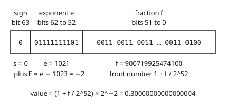

# IEEE 754: sign, exponent and fraction, and the numbers a computer cannot hold

[Syllabus](../../../SYLLABUS.md) → [Numerical analysis](../README.md) → [Floating Point and Error](../README.md#s01) → IEEE 754

---

## General Overview

Type `0.1 + 0.2` into Python and it prints **0.30000000000000004**. Rust and JavaScript give the same digits. They agree because all of them store numbers in one shared layout, set by a standard called IEEE 754.

The layout is a **double** (a double-precision number): 64 bits split into three fields. One bit is the sign. Eleven bits say how far to scale. Fifty-two bits hold the digits. Together they cover numbers from 5e-324 up to 1.7976931348623157e308, with about 16 significant decimal digits at every normal size. It is scientific notation in base two.

Read the three fields of the sum and the mystery shrinks. The sum has fraction field 900719925474100. The stored 0.3 has 900719925474099. The two doubles are neighbours, one step apart. The machine did not make a mistake. One tenth has no exact double, so the inputs were rounded, and their sum rounded to the neighbour above 0.3.

The [Floating point](../../14-Applied%20and%20computational/08-Scientific%20Computing%20Practice/01-floating-point-in-practice.md) card shows these pitfalls in practice and how check scripts live with them. This card opens the box: how to read the fields, how rounding picks a neighbour in each **rounding mode** (the rule that chooses between the two nearest doubles), and what the leftover bit patterns mean: infinity, NaN and the tiny subnormal numbers.

**A double is a sign, a power of two and 53 binary digits; every real number that is not one of these patterns is replaced by a neighbour that the rounding mode picks, and the patterns at the two ends of the exponent field hold zero, the subnormals, infinity and NaN.**

**What kind of fact this is:** the layout and the rounding rules are a standard, IEEE 754-2019: an engineering agreement, not a law of nature. The error bound that follows from them, at most half a step, is a theorem, proved on this card in Why it works.

### The picture: the 64 bits of 0.1 + 0.2

<p align="center"></p>

Schematic, not to scale: the sign is 1 bit, the exponent 11 bits and the fraction 52 bits.

---

## The formula

A double has a sign bit $s$, an exponent field $e$ (an 11-bit whole number from 0 to 2047) and a fraction field $f$ (a 52-bit whole number). The exponent field decides which of four kinds the pattern is.

$$
x =
\begin{cases}
(-1)^{s} \times \left(1 + \dfrac{f}{2^{52}}\right) \times 2^{\,e-1023} & 1 \le e \le 2046 \quad \text{(normal)} \\[2mm]
(-1)^{s} \times \dfrac{f}{2^{52}} \times 2^{-1022} & e = 0 \quad \text{(zero if } f = 0\text{, subnormal otherwise)} \\[2mm]
\pm\infty \text{ if } f = 0, \quad \text{NaN if } f \ne 0 & e = 2047
\end{cases}
$$

**Read it aloud:** for an ordinary number, the sign, times a front number between 1 and 2 whose binary digits after the point are the fraction field, times two raised to the exponent field minus 1023; the two end values of the exponent field are kept for tiny numbers, zero, infinity and "not a number".

A real number $x$ that is not a double is stored as a neighbour $\hat{x}$. On the first card $\hat{x}$ was read "the computed x"; here it is the stored double. In the default mode, round to nearest, the promise is

$$
|\hat{x} - x| \le \tfrac{1}{2}\,\mathrm{ulp}(x), \qquad \mathrm{ulp}(x) = 2^{\max(E,\,-1022) - 52}.
$$

**Read it aloud:** the stored number is never further from the true one than half the gap between neighbouring doubles at that size.

| Symbol | Plain meaning | In our example | Push it up and the answer… |
| --- | --- | --- | --- |
| $s$ | sign bit: 0 for plus, 1 for minus | 0 for 0.1 + 0.2 | flips the sign |
| $e$ | exponent field, 11 bits read as a whole number | 1021 for 0.1 + 0.2 | each step up doubles the number |
| $f$ | fraction field, 52 bits read as a whole number | 900719925474100 for 0.1 + 0.2; 900719925474099 for the stored 0.3 | the front number creeps from 1 toward 2 |
| $E$ | the power of two with $2^E \le \lvert x \rvert < 2^{E+1}$; for a normal double it is $e - 1023$ | −2, since 0.3 is between 0.25 and 0.5 | the gap between neighbours doubles |
| $x$ | the real number wanted | one tenth | — |
| $\hat{x}$ | the double actually stored for $x$ | 7205759403792794 / 2^56 for one tenth | — |
| $\mathrm{ulp}(x)$ | unit in the last place: the gap between neighbouring doubles at the size of $x$ | 2^−56 at one tenth; 1.164e-10 at 1,000,000 | doubles at every power of two |
| $u$ | unit roundoff, $2^{-53}$: the largest relative error of one rounding to nearest, for normal numbers (Step 3) | 2^−53 | — |
| $a$, $b$; $y$; $p$, $q$; $z$, $\hat{z}$ | the two doubles either side of $x$ (Step 3); a second double (Step 4); the random top and bottom of a test fraction, and an exact result with its rounded value (Step 3's proof) | $a$ = 7205759403792793 / 2^56 and $b$ = 7205759403792794 / 2^56 around one tenth; $y = 2^{-1022}$ | — |

### When it holds

- **Round to nearest, ties to even.** This is the default mode. In the other modes the error can approach a whole ulp: rounded down, one tenth is stored 0.6 ulp low.
- **Inside the range.** Above the largest double, 1.7976931348623157e308, the result is infinity, not a nearby number. Doubling 1 a total of 1024 times reaches infinity.
- **Relative accuracy needs the normal range.** The half-ulp promise still holds among the subnormals, but the gap there is fixed at 2^−1074, so relative accuracy falls. 0.1 × 2^−1060 keeps 11 significant bits, a relative error of −2.441e-4.
- **The input is already a double.** The promise is about one rounding. The decimal you typed was rounded once on the way in, before any arithmetic.
- **The hardware follows the standard.** Some graphics cards and "fast math" compiler settings flush subnormals to zero. Then the guarantees in Step 4 below fail.

---

## Why it works

### Step 0: a fixed number of patterns, spread so the gaps grow with the numbers

Sixty-four bits make 2^64 patterns, so almost every real number is missing. The standard fixes two things. The layout spaces the doubles so that each gap is a near-fixed fraction of the numbers around it. And one rule picks a neighbour for a missing number. Every guarantee on this card follows from those two choices.

### Step 1: the three fields are scientific notation in base two

Scientific notation writes 300 as 3 × 10^2: a front number and a power of the base. A double does the same in base two. Take 0.1 + 0.2 from the picture:

- The **sign** bit is 0, so the number is positive.
- The **exponent field** 01111111101 is 1021. Subtract the **bias** (a fixed offset) of 1023 to get $E = -2$: multiply by 2^−2, a quarter.
- The **fraction field** holds the binary digits after the point of a front number between 1 and 2.

The leading 1 of the front number is not stored. Every normal number in base two starts with a 1, so writing it would waste a bit. This is the **hidden bit**, and it gives 53 significant bits from 52 stored ones.

The bias lets the exponent field be an unsigned whole number. A useful result follows. The exponent sits above the fraction, so for positive doubles a bigger number always has a bigger bit pattern. Sorting the patterns as whole numbers sorts the doubles.

### Step 2: one tenth falls between two doubles

A fraction ends in base two only when its bottom is a power of two. One tenth has a factor 5 in its bottom, so its binary digits repeat forever ([Floating point](../../14-Applied%20and%20computational/08-Scientific%20Computing%20Practice/01-floating-point-in-practice.md) gives the long division).

One tenth lies between 2^−4 and 2^−3, where the doubles are whole multiples of 2^−56. Multiply one tenth by 2^56 and it falls between the whole numbers 7205759403792793 and 7205759403792794. It is not a whole number itself, so it is not a double. It sits 0.6 of a gap above the lower neighbour and 0.4 below the upper.

Each rounding mode picks one of those two neighbours:

| Mode | Picks | Error |
| --- | --- | --- |
| round to nearest (default) | 7205759403792794 / 2^56 | +0.4 ulp |
| round down, toward minus infinity | 7205759403792793 / 2^56 | −0.6 ulp |
| round up, toward plus infinity | 7205759403792794 / 2^56 | +0.4 ulp |
| round toward zero | the same as down, for a positive number | −0.6 ulp |

The standard also lists a fifth mode, ties away from zero. It is required only for decimal formats.

### Step 3: rounding to nearest costs at most half a gap

Take a real $x$ between two neighbouring doubles $a < x < b$. They are one ulp apart, so $(x - a) + (b - x) = \mathrm{ulp}(x)$. The smaller of the two distances is at most half the sum. Round to nearest picks that one, so $|\hat{x} - x| \le \tfrac12\,\mathrm{ulp}(x)$.

For a normal $x$, $|x| \ge 2^E$ and the gap is $2^{E-52}$. Divide the half-gap by $|x|$:

$$
\frac{|\hat{x} - x|}{|x|} \le \frac{2^{E-53}}{2^{E}} = 2^{-53}.
$$

That number, 2^−53, is the **unit roundoff**, written $u$. [Machine epsilon and cancellation](03-rounding-cancellation-and-machine-epsilon.md) turns it into the standard error model for every operation.

<details>
<summary>Detailed proof: every basic operation keeps the same promise</summary>

The standard requires each of $+$, $-$, $\times$, $\div$ and square root to return the exact answer to its stored inputs, rounded once by the current mode. So the result of one operation is $\hat{z}$ for the exact $z$, and Step 3 applies to $z$ directly: $|\hat{z} - z| \le \tfrac12\,\mathrm{ulp}(z)$ in round to nearest, and less than one ulp in the other modes.

The code tests the requirement. It draws 20,000 fractions $p/q$, with $p$ and $q$ random whole numbers below 2^53. Each is a double already, so the machine's $p \div q$ is one rounding of the exact fraction. The scripts round the same fraction with whole-number arithmetic only. Half the draws are scaled by 2^−1022 to land 5042 results among the subnormals. There are 0 disagreements.

</details>

**Ties go to even.** A **tie** is a number exactly halfway between two neighbours. The default mode then picks the neighbour whose last bit is 0. Above 2^53 the doubles are 2 apart, so 2^53 + 1 is a tie; it rounds to 9007199254740992, whose last bit is 0. The exact sum of the stored 0.1 and 0.2 is also a tie, and its even neighbour is the one above. Ties to even sends about half of all ties up and half down, so long sums do not drift one way.

### Step 4: subnormals fill the gap at the bottom

The smallest positive normal double is 2^−1022, about 2.2250738585072014e-308, and the next one up is only 2^−1074 bigger. Without more patterns, the hole between zero and 2^−1022 would be 2^52 times wider than the gaps just above it.

The exponent field 0 fills the hole. There the hidden bit is 0, not 1, and the scale stays at 2^−1022. The result is a run of **subnormal** numbers, evenly spaced 2^−1074 apart, down to the smallest, 5e-324. Halving 1 a total of 1074 times reaches it; one more halving gives zero. This filling-in is called **gradual underflow**.

Gradual underflow keeps one simple law true: **$x - y$ computes to zero only when $x = y$.** Take $x = 1.5 \times 2^{-1022}$ and $y = 2^{-1022}$. The difference is 2^−1023, about 1.1125369292536007e-308. It is subnormal, and stored exactly. Hardware that flushes subnormals to zero returns 0.0, so a test `if x != y: divide by x - y` divides by zero.

<details>
<summary>Detailed proof: with subnormals, a difference of two different doubles is never zero</summary>

Every finite double is a whole multiple of 2^−1074: the normal ones are $(2^{52} + f) \times 2^{E-52}$ with $E \ge -1022$, and the subnormal ones are $f \times 2^{-1074}$. So $x - y$ is an exact whole multiple of 2^−1074.

If $|x - y| < 2^{-1022}$, that multiple has fewer than 53 bits, so it is a subnormal double itself and is stored with no rounding at all. It is not zero when $x \ne y$.

If $|x - y| \ge 2^{-1022}$, the exact difference is a normal-sized number. Round to nearest returns a double within half an ulp of it, and that double is at least 2^−1022 in size, not zero. Either way $x \ne y$ gives a nonzero computed $x - y$.

</details>

The price is precision. A subnormal has leading zeros where a normal number has digits. The product 0.1 × 2^−1060 stores fraction field 1638, a number with 11 bits, so its relative error is −2.441e-4 instead of at most 2^−53.

### Step 5: the top of the exponent field holds infinity and NaN

The exponent field 2047 is not a number at all.

- **Infinity** is field 2047 with $f = 0$. The largest double times 2 gives the pattern 0x7ff0000000000000, infinity. It behaves like a limit: 1 divided by infinity is 0.0.
- **NaN** ("not a number") is field 2047 with $f \ne 0$. It answers questions with no sensible value, such as infinity minus infinity. NaN spreads: NaN + 1 is NaN.
- **Every `==`, `<` and `>` test with NaN is false.** NaN == NaN, NaN < 1 and NaN > 1 all print "no". The bad value cannot slip through a test and look like a number.
- **Zero has a sign.** 1e-200 × −1e-200 is too small even for a subnormal, so it **underflows** (rounds to zero), and keeps the sign: the result is −0.0, sign bit 1. The test −0.0 == 0.0 is true, but the bit patterns differ.

---

## Worked numbers, by hand

Decode the 64 bits of 0.1 + 0.2, then round the exact sum three ways.

| Step | Arithmetic | Value |
| --- | --- | --- |
| sign bit | 0 | plus |
| exponent field | 01111111101 in binary | 1021 |
| power of two | $E = 1021 - 1023$ | −2 |
| fraction field | the last 52 bits as a whole number | 900719925474100 |
| whole significand | $2^{52} + f$, the hidden bit put back | 5404319552844596 |
| stored value | 5404319552844596 / 2^54 | 0.3000000000000000444089209850062616169452667236328125 |
| stored 0.3 | the same exponent, fraction one less | 900719925474099 |
| exact sum of the stored inputs | 0.1 and 0.2 as whole numbers over 2^56, added | 21617278211378382 / 2^56 |
| bits past the 53 | the last 2 bits, out of a step of 4 | 2 of 4: a tie |
| round to nearest, ties to even | the even neighbour is above | 0.30000000000000004 |
| round down | the neighbour below | 0.3 |
| round up | the neighbour above | 0.30000000000000004 |
| **printed, default mode** | the shortest decimal that reads back to the same double | **0.30000000000000004** |

The add met its promise: it missed the exact sum of its inputs by half an ulp, exactly the bound, because the sum was a tie. That tie was set up earlier: rounding one tenth and two tenths on the way in left their exact sum halfway between two doubles, and ties to even picked the one above. It takes both, the inputs' roundings and the add's, to print 0.30000000000000004.

### What breaks if you drop a piece

| Mistake | Comes out at | What went wrong |
| --- | --- | --- |
| Read 0.3's fields without the hidden 1 | 0.0500 | The front number is 1 + f/2^52, not f/2^52 |
| Read 0.3's fields without the bias 1023 | 2.697e307 | The exponent field 1021 means 2^−2, not 2^1021 |
| Chop (round down) instead of rounding to nearest | one tenth stored 0.6 ulp low | Chopping errs up to a whole ulp, always the same way |
| Flush subnormals to zero (simulated in the checks) | 1.5 × 2^−1022 − 2^−1022 = 0.0 | Two different numbers now have a difference of zero |
| Test for NaN with `x == nan` | no, even when `x` is that NaN | NaN is unequal to everything, itself included |

---

## Code, from first principles, and it actually runs

The scripts take the machine's doubles apart into their three fields. They also round any fraction into a double, in any of three modes, using whole numbers only, which cannot round. The machine's answers are checked bit for bit against that rounding, by four independent roads. The parser's 0.1, 0.2 and 0.3 match the scripts' own rounding of one, two and three tenths. The machine's 0.1 + 0.2 matches the scripts' rounding of the exact sum. The range ends found by doubling and halving loops match the ends read from the layout. And 20,000 random divisions, about a quarter of them subnormal, match with no disagreement. `math.ulp` and `math.nextafter` are not used.

### Python

```python
# IEEE 754 doubles -- the check behind the card.  Standard library only.
# struct only hands over the 64 stored bits.  Reading the fields and rounding a fraction
# in each mode are done in whole numbers, which cannot round; then the machine is checked.
import struct

def bits(x):      return struct.unpack(">Q", struct.pack(">d", x))[0]
def from_bits(b): return struct.unpack(">d", struct.pack(">Q", b))[0]
def fields(b):    return b >> 63, (b >> 52) & 0x7FF, b & ((1 << 52) - 1)

def kind(b):                           # what the exponent field says the pattern is
    s, e, f = fields(b)
    if e == 2047: return "NaN" if f else "infinity"
    if e == 0:    return "subnormal" if f else "zero"
    return "normal"

def exact(b):                          # a positive finite double as m / 2^k, from its fields alone
    s, e, f = fields(b)
    return (f, 1074) if e == 0 else ((1 << 52) + f, 1075 - e)

def encode(p, q, k, mode):             # the double for p / q / 2^k (p, q > 0), as 64 bits
    L = p.bit_length() - q.bit_length()
    if (p << max(-L, 0)) < (q << max(L, 0)): L -= 1
    E = L - k                          # the value lies in [2^E, 2^(E+1))
    if E > 1023: return 0x7FEFFFFFFFFFFFFF if mode == "down" else 0x7FF << 52
    sc = max(E, -1022) - 52            # the grid there: whole multiples of 2^sc
    t = -k - sc
    num, den = (p << t, q) if t >= 0 else (p, q << -t)
    m, r = divmod(num, den)            # m grid steps, plus a remainder r/den of a step
    if mode == "up" and r: m += 1
    if mode == "nearest" and (2 * r > den or (2 * r == den and m & 1)): m += 1
    if m >> 53: m, sc = m >> 1, sc + 1
    if m < (1 << 52): return m         # subnormal or zero: exponent field 0
    return ((sc + 1075) << 52) | (m - (1 << 52))   # field 2047 here means infinity

def decimal(m, k):                     # exact decimal expansion of m / 2^k: it always ends
    mask, out, r = (1 << k) - 1, "", m & ((1 << k) - 1)
    while r: r *= 10; out += str(r >> k); r &= mask
    return f"{m >> k}." + (out or "0")

def short(x):  return repr(x).replace("e+", "e")
def sci(x):    a, b = f"{x:.3e}".split("e"); return f"{a}e{int(b)}"
def yn(flag):  return "yes" if flag else "no"
def row(label, value): print(f"{label:<35} {value}")

# ---- 1. the three fields of 0.1, 0.2, 0.3 and the machine's 0.1 + 0.2 ----
total = 0.1 + 0.2
for name, x in (("0.1", 0.1), ("0.2", 0.2), ("0.3", 0.3), ("0.1 + 0.2", total)):
    s, e, f = fields(bits(x))
    row(f"{name}: s, e, f, E = e - 1023", f"{s} {e} {f} {e - 1023}")
for name, x, p in (("0.1", 0.1, 1), ("0.2", 0.2, 2), ("0.3", 0.3, 3)):
    assert encode(p, 10, 0, "nearest") == bits(x), name + ": own rounding must equal the parser's"
b = f"{bits(total):064b}"
row("0.1 + 0.2 as 64 bits", f"{b[0]} {b[1:12]} {b[12:]}")
row("0.1 + 0.2 printed", repr(total))
row("0.1 + 0.2 stored exactly", "{} / 2^{} = ".format(*exact(bits(total))) + decimal(*exact(bits(total))))
f3 = fields(bits(0.3))[2]             # misreading 0.3: no hidden leading 1; no bias
row("0.3 misread: no leading 1; no bias", f"{f3 / 2**52 * 2.0**-2:.4f} {sci((1 + f3 / 2**52) * 2.0**1021)}")
# ---- 2. one tenth in three rounding modes ----
for mode in ("nearest", "down", "up"):
    m, k = exact(encode(1, 10, 0, mode))
    row(f"1/10 rounded {mode}", f"{m} / 2^{k}, off {(10 * m - (1 << k)) / 10:+.1f} ulp")
gap = encode(1, 10, 0, "up") - encode(1, 10, 0, "down")
row("up minus down, in ulps", gap)
assert gap == 1, "a number that is not a double sits between two neighbours"

# ---- 3. the sum: exact sum of the stored inputs, rounded each way ----
(m1, k1), (m2, k2) = exact(bits(0.1)), exact(bits(0.2))
ex = m1 + (m2 << (k1 - k2))            # both over 2^56: no rounding yet
row("exact sum of stored inputs", f"{ex} / 2^{k1}, {ex % 4} of 4 past the grid")
for mode in ("nearest", "down", "up"):
    row(f"sum rounded {mode}", short(from_bits(encode(ex, 1, k1, mode))))
assert encode(ex, 1, k1, "nearest") == bits(total), "own rounding must equal the machine's add"
assert encode(ex, 1, k1, "down") == bits(0.3), "rounded down, the sum is the stored 0.3"
big = 2.0 ** 53 + 1.0                  # a tie whose even neighbour is below
row("2^53 + 1, a tie, rounded nearest", f"{big:.0f}")
assert bits(big) == encode(2**53 + 1, 1, 0, "nearest") == bits(2.0 ** 53), "ties go to even"

# ---- 4. the ends of the range ----
top = from_bits(0x7FEFFFFFFFFFFFFF)
assert top == (2.0 - 2.0 ** -52) * 2.0 ** 1023, "largest double from its fields"
x, doublings = 1.0, 0
while kind(bits(x)) != "infinity": x, doublings = x * 2, doublings + 1
y, halvings = 1.0, 0
while y / 2 != 0.0: y, halvings = y / 2, halvings + 1
assert (doublings, halvings, bits(y)) == (1024, 1074, 1), "range ends from loops, not from fields"
row("largest double", short(top))
row("smallest normal, 2^-1022", short(from_bits(1 << 52)))
row("smallest subnormal, 2^-1074", short(y))
row("doublings from 1 to infinity", doublings)
row("halvings from 1 before zero", halvings)
row("largest * 2: kind, bits", f"{kind(bits(top * 2))} {bits(top * 2):#018x}")
assert encode(1, 1, -1024, "nearest") == bits(top * 2), "past the top, own rounding says inf"

# ---- 5. subnormals: gradual underflow ----
a, c = 1.5 * 2.0 ** -1022, 2.0 ** -1022
flushed = 0.0 if kind(bits(a - c)) == "subnormal" else a - c   # simulated: no subnormals
row("1.5*2^-1022 - 2^-1022; if flushed", f"{short(a - c)}, {kind(bits(a - c))}; {short(flushed)}")
assert a != c and a - c != 0 and bits(a - c) == encode(1, 1, 1023, "nearest"), "x != y means x - y != 0"
tiny = 0.1 * from_bits(1 << 14)        # 0.1 times 2^-1060, deep in the subnormals
ft = fields(bits(tiny))[2]
assert bits(tiny) == encode(m1, 1, k1 + 1060, "nearest"), "own rounding into the subnormals"
rel = (ft * 2 ** 42 - m1) / m1         # against the exact product
row("0.1 * 2^-1060: f, bits, rel err", f"{ft} {ft.bit_length()} {sci(rel)}")

# ---- 6. infinity, NaN and signed zero ----
inf = top * 2; nan = inf - inf
s, e, f = fields(bits(nan))
row("inf - inf: kind, e, f nonzero", f"{kind(bits(nan))} {e} {yn(f != 0)}")
row("nan == nan, nan < 1, nan > 1", f"{yn(nan == nan)} {yn(nan < 1)} {yn(nan > 1)}")
row("nan + 1 is NaN; 1 / inf", f"{yn(kind(bits(nan + 1)) == 'NaN')} {short(1 / inf)}")
nz = 1e-200 * -1e-200
row("1e-200 * -1e-200; sign bit", f"{short(nz)} {fields(bits(nz))[0]}")
row("-0.0 == 0.0; same bits", f"{yn(nz == 0.0)} {yn(bits(nz) == bits(0.0))}")

# ---- 7. 20,000 random fractions: own rounding against the machine's divide ----
state, MASK = 2026, 2**64 - 1
def splitmix():
    global state
    state = (state + 0x9E3779B97F4A7C15) & MASK
    z = ((state ^ (state >> 30)) * 0xBF58476D1CE4E5B9) & MASK
    z = ((z ^ (z >> 27)) * 0x94D049BB133111EB) & MASK
    return z ^ (z >> 31)
bad, subs = 0, 0
for scale in (0, 1022):                # scale 1022 sends about half into the subnormals
    for _ in range(10000):
        p, q = splitmix() >> 11 | 1, splitmix() >> 11 | 1
        got = bits(p * 2.0 ** -scale / q)
        bad += got != encode(p, q, scale, "nearest")
        subs += kind(got) == "subnormal"
row("random divides; subnormal results", f"20000 {subs}")
row("disagreements with own rounding", bad)
assert bad == 0, "every divide must be the exact quotient, rounded to nearest"

# ---- 8. the house example and the figure ----
acc = 0.0
for _ in range(10_000_000): acc += 0.1
row("0.1 added ten million times", f"{short(acc)}, off {sci(acc - 1e6)}")
row("ulp at 1,000,000", sci(from_bits(bits(1e6) + 1) - 1e6))
row("figure, x: sign, exponent, fraction", "20-60 60-160 160-420")
print("ALL CHECKS PASS")
```

**Ran 2026-11-11 on macOS, Python 3.14.10, standard library only. All checks passed. Output, pasted from the run:**

```
0.1: s, e, f, E = e - 1023          0 1019 2702159776422298 -4
0.2: s, e, f, E = e - 1023          0 1020 2702159776422298 -3
0.3: s, e, f, E = e - 1023          0 1021 900719925474099 -2
0.1 + 0.2: s, e, f, E = e - 1023    0 1021 900719925474100 -2
0.1 + 0.2 as 64 bits                0 01111111101 0011001100110011001100110011001100110011001100110100
0.1 + 0.2 printed                   0.30000000000000004
0.1 + 0.2 stored exactly            5404319552844596 / 2^54 = 0.3000000000000000444089209850062616169452667236328125
0.3 misread: no leading 1; no bias  0.0500 2.697e307
1/10 rounded nearest                7205759403792794 / 2^56, off +0.4 ulp
1/10 rounded down                   7205759403792793 / 2^56, off -0.6 ulp
1/10 rounded up                     7205759403792794 / 2^56, off +0.4 ulp
up minus down, in ulps              1
exact sum of stored inputs          21617278211378382 / 2^56, 2 of 4 past the grid
sum rounded nearest                 0.30000000000000004
sum rounded down                    0.3
sum rounded up                      0.30000000000000004
2^53 + 1, a tie, rounded nearest    9007199254740992
largest double                      1.7976931348623157e308
smallest normal, 2^-1022            2.2250738585072014e-308
smallest subnormal, 2^-1074         5e-324
doublings from 1 to infinity        1024
halvings from 1 before zero         1074
largest * 2: kind, bits             infinity 0x7ff0000000000000
1.5*2^-1022 - 2^-1022; if flushed   1.1125369292536007e-308, subnormal; 0.0
0.1 * 2^-1060: f, bits, rel err     1638 11 -2.441e-4
inf - inf: kind, e, f nonzero       NaN 2047 yes
nan == nan, nan < 1, nan > 1        no no no
nan + 1 is NaN; 1 / inf             yes 0.0
1e-200 * -1e-200; sign bit          -0.0 1
-0.0 == 0.0; same bits              yes no
random divides; subnormal results   20000 5042
disagreements with own rounding     0
0.1 added ten million times         999999.9998389754, off -1.610e-4
ulp at 1,000,000                    1.164e-10
figure, x: sign, exponent, fraction 20-60 60-160 160-420
ALL CHECKS PASS
```

### Rust

The same roads, the same labels. Rust has no big whole numbers, so exact values live in `u128`, which is wide enough for every case the scripts round.

```rust
// IEEE 754 doubles -- the same check as ieee_floating_point_check.py, in Rust.
// Standard library only, no crates.  to_bits only hands over the 64 stored bits.
// Reading the three fields, and rounding a fraction into a double in each
// rounding mode, are done here in whole numbers (u128), which cannot round.
// Compile: rustc --edition 2021 -O ieee_floating_point_check.rs -o /tmp/ieee_check

fn fields(b: u64) -> (u64, u64, u64) { (b >> 63, (b >> 52) & 0x7FF, b & ((1u64 << 52) - 1)) }

fn kind(b: u64) -> &'static str {                   // what the exponent field says the pattern is
    let (_, e, f) = fields(b);
    if e == 2047 { return if f != 0 { "NaN" } else { "infinity" }; }
    if e == 0 { return if f != 0 { "subnormal" } else { "zero" }; }
    "normal"
}

fn exact(b: u64) -> (u128, i32) {                   // a positive finite double as m / 2^k, from its fields alone
    let (_, e, f) = fields(b);
    if e == 0 { (f as u128, 1074) } else { (((1u64 << 52) + f) as u128, 1075 - e as i32) }
}

fn bit_len(x: u128) -> i32 { 128 - x.leading_zeros() as i32 }

fn encode(p: u128, q: u128, k: i32, mode: &str) -> u64 {   // the double for p / q / 2^k (p, q > 0)
    let mut l = bit_len(p) - bit_len(q);
    if (p << (-l).max(0)) < (q << l.max(0)) { l -= 1; }
    let e = l - k;                                  // the value lies in [2^E, 2^(E+1))
    if e > 1023 { return if mode == "down" { 0x7FEFFFFFFFFFFFFF } else { 0x7FF << 52 }; }
    let mut sc = e.max(-1022) - 52;                 // the grid there: whole multiples of 2^sc
    let t = -k - sc;
    let (num, den) = if t >= 0 { (p << t, q) } else { (p, q << -t) };
    let (mut m, r) = (num / den, num % den);        // m grid steps, plus a remainder r/den of a step
    if mode == "up" && r != 0 { m += 1; }
    if mode == "nearest" && (2 * r > den || (2 * r == den && m & 1 == 1)) { m += 1; }
    if m >> 53 != 0 { m >>= 1; sc += 1; }
    if m < (1u128 << 52) { return m as u64; }      // subnormal or zero: exponent field 0
    (((sc + 1075) as u64) << 52) | (m - (1u128 << 52)) as u64   // field 2047 here means infinity
}

fn decimal(m: u128, k: i32) -> String {             // exact decimal expansion of m / 2^k: it always ends
    let mask = (1u128 << k) - 1;
    let (mut r, mut out) = (m & mask, String::new());
    while r != 0 { r *= 10; out.push_str(&(r >> k).to_string()); r &= mask; }
    format!("{}.{}", m >> k, if out.is_empty() { "0".to_string() } else { out })
}

fn short(x: f64) -> String { if x != 0.0 && (x.abs() < 1e-4 || x.abs() >= 1e16) { format!("{:e}", x) } else { format!("{:?}", x) } }
fn sci(x: f64) -> String { format!("{:.3e}", x) }
fn yn(flag: bool) -> &'static str { if flag { "yes" } else { "no" } }
fn row(label: &str, value: String) { println!("{:<35} {}", label, value); }

struct SplitMix(u64);
impl SplitMix {
    fn next(&mut self) -> u64 {
        self.0 = self.0.wrapping_add(0x9E3779B97F4A7C15);
        let mut z = (self.0 ^ (self.0 >> 30)).wrapping_mul(0xBF58476D1CE4E5B9);
        z = (z ^ (z >> 27)).wrapping_mul(0x94D049BB133111EB);
        z ^ (z >> 31)
    }
}

fn main() {
    // ---- 1. the three fields of 0.1, 0.2, 0.3 and the machine's 0.1 + 0.2 ----
    let total = 0.1f64 + 0.2;
    for (name, x) in [("0.1", 0.1f64), ("0.2", 0.2), ("0.3", 0.3), ("0.1 + 0.2", total)] {
        let (s, e, f) = fields(x.to_bits());
        row(&format!("{}: s, e, f, E = e - 1023", name), format!("{} {} {} {}", s, e, f, e as i32 - 1023));
    }
    for (name, x, p) in [("0.1", 0.1f64, 1u128), ("0.2", 0.2, 2), ("0.3", 0.3, 3)] {
        assert!(encode(p, 10, 0, "nearest") == x.to_bits(), "{}: own rounding must equal the parser's", name);
    }
    let b = format!("{:064b}", total.to_bits());
    row("0.1 + 0.2 as 64 bits", format!("{} {} {}", &b[0..1], &b[1..12], &b[12..]));
    row("0.1 + 0.2 printed", format!("{:?}", total));
    let (mt, kt) = exact(total.to_bits());
    row("0.1 + 0.2 stored exactly", format!("{} / 2^{} = {}", mt, kt, decimal(mt, kt)));
    let f3 = fields(0.3f64.to_bits()).2 as f64 / 4503599627370496.0;   // misreading 0.3: no hidden 1; no bias
    let mut p1021 = 1.0f64;
    for _ in 0..1021 { p1021 *= 2.0; }
    row("0.3 misread: no leading 1; no bias", format!("{:.4} {}", f3 * 0.25, sci((1.0 + f3) * p1021)));

    // ---- 2. one tenth in three rounding modes ----
    for mode in ["nearest", "down", "up"] {
        let (m, k) = exact(encode(1, 10, 0, mode));
        let off = (10 * m as i128 - (1i128 << k)) as f64 / 10.0;
        row(&format!("1/10 rounded {}", mode), format!("{} / 2^{}, off {:+.1} ulp", m, k, off));
    }
    let gap = encode(1, 10, 0, "up") - encode(1, 10, 0, "down");
    row("up minus down, in ulps", format!("{}", gap));
    assert!(gap == 1, "a number that is not a double sits between two neighbours");

    // ---- 3. the sum: exact sum of the stored inputs, rounded each way ----
    let ((m1, k1), (m2, k2)) = (exact(0.1f64.to_bits()), exact(0.2f64.to_bits()));
    let ex = m1 + (m2 << (k1 - k2));                // both over 2^56: no rounding yet
    row("exact sum of stored inputs", format!("{} / 2^{}, {} of 4 past the grid", ex, k1, ex % 4));
    for mode in ["nearest", "down", "up"] {
        row(&format!("sum rounded {}", mode), short(f64::from_bits(encode(ex, 1, k1, mode))));
    }
    assert!(encode(ex, 1, k1, "nearest") == total.to_bits(), "own rounding must equal the machine's add");
    assert!(encode(ex, 1, k1, "down") == 0.3f64.to_bits(), "rounded down, the sum is the stored 0.3");
    let big = 9007199254740992.0f64 + 1.0;          // a tie whose even neighbour is below
    row("2^53 + 1, a tie, rounded nearest", format!("{:.0}", big));
    assert!(big.to_bits() == encode((1u128 << 53) + 1, 1, 0, "nearest") && big == 9007199254740992.0, "ties go to even");

    // ---- 4. the ends of the range ----
    let top = f64::from_bits(0x7FEFFFFFFFFFFFFF);
    let mut p1023 = 1.0f64;
    for _ in 0..1023 { p1023 *= 2.0; }
    assert!(top == (2.0 - 1.0 / 4503599627370496.0) * p1023, "largest double from its fields");
    let (mut x, mut doublings) = (1.0f64, 0);
    while kind(x.to_bits()) != "infinity" { x *= 2.0; doublings += 1; }
    let (mut y, mut halvings) = (1.0f64, 0);
    while y / 2.0 != 0.0 { y /= 2.0; halvings += 1; }
    assert!((doublings, halvings, y.to_bits()) == (1024, 1074, 1), "range ends from loops, not from fields");
    row("largest double", short(top));
    row("smallest normal, 2^-1022", short(f64::from_bits(1u64 << 52)));
    row("smallest subnormal, 2^-1074", short(y));
    row("doublings from 1 to infinity", format!("{}", doublings));
    row("halvings from 1 before zero", format!("{}", halvings));
    row("largest * 2: kind, bits", format!("{} {:#018x}", kind((top * 2.0).to_bits()), (top * 2.0).to_bits()));
    assert!(encode(1, 1, -1024, "nearest") == (top * 2.0).to_bits(), "past the top, own rounding says inf");

    // ---- 5. subnormals: gradual underflow ----
    let c = f64::from_bits(1u64 << 52);             // 2^-1022
    let a = 1.5 * c;
    let flushed = if kind((a - c).to_bits()) == "subnormal" { 0.0 } else { a - c };   // simulated: no subnormals
    row("1.5*2^-1022 - 2^-1022; if flushed", format!("{}, {}; {}", short(a - c), kind((a - c).to_bits()), short(flushed)));
    assert!(a != c && a - c != 0.0 && (a - c).to_bits() == encode(1, 1, 1023, "nearest"), "x != y means x - y != 0");
    let tiny = 0.1 * f64::from_bits(1u64 << 14);    // 0.1 times 2^-1060, deep in the subnormals
    let ft = fields(tiny.to_bits()).2;
    assert!(tiny.to_bits() == encode(m1, 1, k1 + 1060, "nearest"), "own rounding into the subnormals");
    let rel = (((ft as i128) << 42) - m1 as i128) as f64 / m1 as f64;   // against the exact product
    row("0.1 * 2^-1060: f, bits, rel err", format!("{} {} {}", ft, 64 - ft.leading_zeros(), sci(rel)));

    // ---- 6. infinity, NaN and signed zero ----
    let inf = top * 2.0;
    let nan = inf - inf;
    let (_, e, f) = fields(nan.to_bits());
    row("inf - inf: kind, e, f nonzero", format!("{} {} {}", kind(nan.to_bits()), e, yn(f != 0)));
    row("nan == nan, nan < 1, nan > 1", format!("{} {} {}", yn(nan == nan), yn(nan < 1.0), yn(nan > 1.0)));
    row("nan + 1 is NaN; 1 / inf", format!("{} {}", yn(kind((nan + 1.0).to_bits()) == "NaN"), short(1.0 / inf)));
    let nz = 1e-200f64 * -1e-200;
    row("1e-200 * -1e-200; sign bit", format!("{} {}", short(nz), fields(nz.to_bits()).0));
    row("-0.0 == 0.0; same bits", format!("{} {}", yn(nz == 0.0), yn(nz.to_bits() == 0.0f64.to_bits())));

    // ---- 7. 20,000 random fractions: own rounding against the machine's divide ----
    let mut g = SplitMix(2026);
    let (mut bad, mut subs) = (0, 0);
    for scale in [0i32, 1022] {                     // scale 1022 sends about half into the subnormals
        let mut down = 1.0f64;
        for _ in 0..scale { down /= 2.0; }
        for _ in 0..10000 {
            let p = g.next() >> 11 | 1;
            let q = g.next() >> 11 | 1;
            let got = (p as f64 * down / q as f64).to_bits();
            if got != encode(p as u128, q as u128, scale, "nearest") { bad += 1; }
            if kind(got) == "subnormal" { subs += 1; }
        }
    }
    row("random divides; subnormal results", format!("20000 {}", subs));
    row("disagreements with own rounding", format!("{}", bad));
    assert!(bad == 0, "every divide must be the exact quotient, rounded to nearest");

    // ---- 8. the house example and the figure ----
    let mut acc = 0.0f64;
    for _ in 0..10_000_000 { acc += 0.1; }
    row("0.1 added ten million times", format!("{}, off {}", short(acc), sci(acc - 1e6)));
    row("ulp at 1,000,000", sci(f64::from_bits(1e6f64.to_bits() + 1) - 1e6));
    row("figure, x: sign, exponent, fraction", "20-60 60-160 160-420".to_string());
    println!("ALL CHECKS PASS");
}
```

**Ran 2026-11-11 on macOS, rustc 1.98.1, no crates. All checks passed. Output, pasted from the run:**

```
0.1: s, e, f, E = e - 1023          0 1019 2702159776422298 -4
0.2: s, e, f, E = e - 1023          0 1020 2702159776422298 -3
0.3: s, e, f, E = e - 1023          0 1021 900719925474099 -2
0.1 + 0.2: s, e, f, E = e - 1023    0 1021 900719925474100 -2
0.1 + 0.2 as 64 bits                0 01111111101 0011001100110011001100110011001100110011001100110100
0.1 + 0.2 printed                   0.30000000000000004
0.1 + 0.2 stored exactly            5404319552844596 / 2^54 = 0.3000000000000000444089209850062616169452667236328125
0.3 misread: no leading 1; no bias  0.0500 2.697e307
1/10 rounded nearest                7205759403792794 / 2^56, off +0.4 ulp
1/10 rounded down                   7205759403792793 / 2^56, off -0.6 ulp
1/10 rounded up                     7205759403792794 / 2^56, off +0.4 ulp
up minus down, in ulps              1
exact sum of stored inputs          21617278211378382 / 2^56, 2 of 4 past the grid
sum rounded nearest                 0.30000000000000004
sum rounded down                    0.3
sum rounded up                      0.30000000000000004
2^53 + 1, a tie, rounded nearest    9007199254740992
largest double                      1.7976931348623157e308
smallest normal, 2^-1022            2.2250738585072014e-308
smallest subnormal, 2^-1074         5e-324
doublings from 1 to infinity        1024
halvings from 1 before zero         1074
largest * 2: kind, bits             infinity 0x7ff0000000000000
1.5*2^-1022 - 2^-1022; if flushed   1.1125369292536007e-308, subnormal; 0.0
0.1 * 2^-1060: f, bits, rel err     1638 11 -2.441e-4
inf - inf: kind, e, f nonzero       NaN 2047 yes
nan == nan, nan < 1, nan > 1        no no no
nan + 1 is NaN; 1 / inf             yes 0.0
1e-200 * -1e-200; sign bit          -0.0 1
-0.0 == 0.0; same bits              yes no
random divides; subnormal results   20000 5042
disagreements with own rounding     0
0.1 added ten million times         999999.9998389754, off -1.610e-4
ulp at 1,000,000                    1.164e-10
figure, x: sign, exponent, fraction 20-60 60-160 160-420
ALL CHECKS PASS
```

The two outputs are identical, including the random test.

### Lean

Lean proves the card's three rounding facts, taking a double to be any value of the card's formula with exponent field 0 to 2046.

- Round to nearest costs at most half a gap: $|\hat{x} - x| \le \tfrac12\,\mathrm{ulp}(x)$ whenever $|x|$ is at most the largest double. This holds for any nearest double, so for either choice at a tie.
- In the normal range, from 2^−1022 up to the largest double, the relative error of rounding to nearest is at most the unit roundoff $u = 2^{-53}$.
- With subnormals, the nearest double to $x - y$ is never zero when $x$ and $y$ are two different doubles.
- The fields of 0.1 + 0.2 decode to 5404319552844596 / 2^54, and the stored 0.3 sits one gap, 2^−54, below it.
- One tenth times 2^56 lies 0.6 of a gap above 7205759403792793. The exact sum 21617278211378382 / 2^56 is a tie, and its even neighbour is 5404319552844596 / 2^54.
- 2^53 + 1 is halfway between 2^53 and 2^53 + 2, and fraction field 1638 has 11 bits.
- The largest double is exponent field 2046 with every fraction bit set. 1.5 × 2^−1022 − 2^−1022 is the subnormal with fraction field 2^51.

The machine itself is left to the Python and Rust checks: its parser, adds and divides, infinity, NaN, −0.0 and the other rounding modes.

```lean
-- IEEE 754: a real number inside the range of doubles, rounded to a nearest double, moves by at most half an ulp, so by a relative 2^-53 in the normal range, and with subnormals the computed difference of two different doubles is never zero.
import Mathlib.Data.Int.Log
import Mathlib.Analysis.SpecialFunctions.Pow.Real
import Mathlib.Tactic

namespace IEEEFloatingPoint

/-- The value of the bit pattern with sign bit `s`, exponent field `e` and fraction field `f`,
as the card's formula reads it: `(-1)^s × (1 + f/2^52) × 2^(e - 1023)` for a normal pattern
(`1 ≤ e ≤ 2046`), and `(-1)^s × (f/2^52) × 2^(-1022)` when `e = 0` (zero or subnormal). -/
noncomputable def doubleValue (s e f : ℕ) : ℝ :=
  if e = 0 then (-1 : ℝ) ^ s * ((f : ℝ) / 2 ^ 52) * (2 : ℝ) ^ (-1022 : ℤ)
  else (-1 : ℝ) ^ s * (1 + (f : ℝ) / 2 ^ 52) * (2 : ℝ) ^ ((e : ℤ) - 1023)

/-- `y` is a finite double: the value of some sign bit, an exponent field from 0 to 2046 and a
52-bit fraction field. (Field 2047 holds infinity and NaN, which are not real numbers.) -/
def IsFiniteDouble (y : ℝ) : Prop :=
  ∃ s e f : ℕ, s ≤ 1 ∧ e ≤ 2046 ∧ f < 2 ^ 52 ∧ y = doubleValue s e f

/-- The largest double, `(2^53 - 1) × 2^971`, about 1.7976931348623157e308. -/
noncomputable def largestDouble : ℝ := (2 ^ 53 - 1) * (2 : ℝ) ^ (971 : ℤ)

/-- The unit in the last place: `ulp(x) = 2^(max(E, -1022) - 52)`, where `E` is the power of
two with `2^E ≤ |x| < 2^(E+1)`. -/
noncomputable def ulp (x : ℝ) : ℝ := (2 : ℝ) ^ (max (Int.log 2 |x|) (-1022) - 52)

/-- `xhat` is a nearest double to `x`: a finite double no further from `x` than any other.
Round to nearest returns one of these (ties to even only chooses which one at a tie). -/
def IsNearestDouble (xhat x : ℝ) : Prop :=
  IsFiniteDouble xhat ∧ ∀ d : ℝ, IsFiniteDouble d → |xhat - x| ≤ |d - x|

/-- A whole number `m` below `2^53` times `2^(E-52)` is a double, when the exponent `E` is in
range and either `m` has its top bit set (normal) or `E = -1022` (subnormal). -/
lemma isFiniteDouble_of_sig (s : ℕ) (hs : s ≤ 1) (E : ℤ) (hE1 : -1022 ≤ E) (hE2 : E ≤ 1023)
    (m : ℕ) (hm : m < 2 ^ 53) (hcase : 2 ^ 52 ≤ m ∨ E = -1022) :
    IsFiniteDouble ((-1 : ℝ) ^ s * (m : ℝ) * (2 : ℝ) ^ (E - 52)) := by
  by_cases h52 : 2 ^ 52 ≤ m
  · refine ⟨s, (E + 1023).toNat, m - 2 ^ 52, hs, by omega, by omega, ?_⟩
    have hne : (E + 1023).toNat ≠ 0 := by omega
    have hcast : (((E + 1023).toNat : ℕ) : ℤ) - 1023 = E := by omega
    simp only [doubleValue, hne, ↓reduceIte, hcast]
    rw [Nat.cast_sub h52, zpow_sub₀ (by norm_num : (2 : ℝ) ≠ 0)]
    push_cast
    field_simp
    ring
  · have hE : E = -1022 := hcase.resolve_left h52
    subst hE
    refine ⟨s, 0, m, hs, by norm_num, by omega, ?_⟩
    simp only [doubleValue, ↓reduceIte]
    rw [zpow_sub₀ (by norm_num : (2 : ℝ) ≠ 0)]
    field_simp

/-- Every double is a whole number of the smallest subnormal `2^(-1074)`. -/
lemma isFiniteDouble_int_mul {y : ℝ} (hy : IsFiniteDouble y) :
    ∃ k : ℤ, y = (k : ℝ) * (2 : ℝ) ^ (-1074 : ℤ) := by
  obtain ⟨s, e, f, -, -, -, rfl⟩ := hy
  by_cases he : e = 0
  · refine ⟨(-1) ^ s * f, ?_⟩
    simp only [doubleValue, he, ↓reduceIte]
    rw [show (-1074 : ℤ) = -1022 - 52 by norm_num, zpow_sub₀ (by norm_num : (2 : ℝ) ≠ 0)]
    push_cast
    field_simp
  · refine ⟨(-1) ^ s * (2 ^ 52 + f) * 2 ^ (e - 1), ?_⟩
    simp only [doubleValue, he, ↓reduceIte]
    have h : (2 : ℝ) ^ ((e : ℤ) - 1023) = (2 : ℝ) ^ (e - 1) * 2 ^ 52 * (2 : ℝ) ^ (-1074 : ℤ) := by
      rw [← zpow_natCast, ← zpow_natCast, ← zpow_add₀ (by norm_num), ← zpow_add₀ (by norm_num)]
      congr 1
      push_cast [Nat.cast_sub (Nat.one_le_iff_ne_zero.mpr he)]
      ring
    rw [h]
    push_cast
    field_simp
    norm_num


#print axioms isFiniteDouble_of_sig
#print axioms isFiniteDouble_int_mul

/-- Round to nearest costs at most half a gap: for a real number `x` inside the range of the
doubles, the stored double `x̂` picked by rounding to nearest satisfies
`|x̂ - x| ≤ ulp(x) / 2`. -/
theorem round_to_nearest_error_le_half_ulp (x xhat : ℝ) (hx : |x| ≤ largestDouble)
    (hxhat : IsNearestDouble xhat x) : |xhat - x| ≤ ulp x / 2 := by
  obtain ⟨-, hmin⟩ := hxhat
  suffices h : ∃ d, IsFiniteDouble d ∧ |d - x| ≤ ulp x / 2 by
    obtain ⟨d, hd, hdx⟩ := h
    exact (hmin d hd).trans hdx
  by_cases hx0 : x = 0
  · refine ⟨0, ⟨0, 0, 0, by norm_num, by norm_num, by norm_num, by simp [doubleValue]⟩, ?_⟩
    simp only [hx0, sub_zero, abs_zero, ulp]
    positivity
  have hapos : 0 < |x| := abs_pos.mpr hx0
  set a := |x| with ha
  set E := max (Int.log 2 a) (-1022) with hE
  set q := (2 : ℝ) ^ (E - 52) with hq
  have hulp : ulp x = q := rfl
  have hqpos : 0 < q := zpow_pos (by norm_num) _
  have hE1 : -1022 ≤ E := le_max_right _ _
  have hlt : a < (2 : ℝ) ^ (E + 1) := by
    have h1 := Int.lt_zpow_succ_log_self (b := 2) (by norm_num) a
    push_cast at h1
    calc a < (2 : ℝ) ^ (Int.log 2 a + 1) := h1
      _ ≤ (2 : ℝ) ^ (E + 1) :=
        zpow_le_zpow_right₀ (by norm_num) (by have := le_max_left (Int.log 2 a) (-1022); omega)
  have hL : largestDouble < (2 : ℝ) ^ (1024 : ℤ) := by
    unfold largestDouble
    rw [show (1024 : ℤ) = 53 + 971 by norm_num, zpow_add₀ (by norm_num)]
    have : (0 : ℝ) < 2 ^ (971 : ℤ) := zpow_pos (by norm_num) _
    norm_num
  have hlog_le : Int.log 2 a ≤ 1023 := by
    have h1 : a < ((2 : ℕ) : ℝ) ^ (1024 : ℤ) := by push_cast; linarith
    have := (Int.lt_zpow_iff_log_lt (by norm_num) hapos).mp h1
    omega
  have hE2 : E ≤ 1023 := max_le hlog_le (by norm_num)
  have hq53 : (2 : ℝ) ^ (E + 1) = 2 ^ 53 * q := by
    rw [hq, ← zpow_natCast, ← zpow_add₀ (by norm_num)]
    congr 1
    push_cast
    ring
  set r := a / q with hr
  have hr0 : 0 ≤ r := div_nonneg hapos.le hqpos.le
  have hr53 : r < 2 ^ 53 := by
    rw [hr, div_lt_iff₀ hqpos, ← hq53]
    exact hlt
  set n := round r with hn
  have hn1 : |r - n| ≤ 1 / 2 := abs_sub_round r
  have hn0 : 0 ≤ n := by
    have h1 := sub_half_lt_round r
    have h2 : (-1 : ℝ) < n := by linarith
    have h3 : (-1 : ℤ) < n := by exact_mod_cast h2
    omega
  have hn53 : n ≤ 2 ^ 53 := by
    have h1 := round_le_add_half r
    have h2 : (n : ℝ) < 2 ^ 53 + 1 := by linarith
    have h3 : n < 2 ^ 53 + 1 := by exact_mod_cast h2
    omega
  have hdist : |(n : ℝ) * q - a| ≤ q / 2 := by
    have h1 : (n : ℝ) * q - a = -(q * (r - n)) := by
      rw [hr]; field_simp; ring
    rw [h1, abs_neg, abs_mul, abs_of_pos hqpos]
    nlinarith
  -- the nearby double, before its sign
  obtain ⟨m, E', hE'1, hE'2, hm, hcase, hval⟩ : ∃ (m : ℕ) (E' : ℤ), -1022 ≤ E' ∧ E' ≤ 1023 ∧
      m < 2 ^ 53 ∧ (2 ^ 52 ≤ m ∨ E' = -1022) ∧ (m : ℝ) * (2 : ℝ) ^ (E' - 52) = n * q := by
    by_cases hbig : n = 2 ^ 53
    · refine ⟨2 ^ 52, E + 1, by omega, ?_, by norm_num, Or.inl le_rfl, ?_⟩
      · by_contra hc
        have hE3 : E = 1023 := by omega
        have hq' : q = (2 : ℝ) ^ (971 : ℤ) := by rw [hq, hE3]; norm_num
        have h1 : r ≤ 2 ^ 53 - 1 := by
          rw [hr, div_le_iff₀ hqpos, hq']
          have : a ≤ largestDouble := hx
          unfold largestDouble at this
          linarith
        have h2 := round_le_add_half r
        rw [← hn, hbig] at h2
        push_cast at h2
        linarith
      · rw [hbig, hq, show E + 1 - 52 = (E - 52) + 1 by ring, zpow_add_one₀ (by norm_num)]
        push_cast
        ring
    · refine ⟨n.toNat, E, hE1, hE2, by omega, ?_, ?_⟩
      · by_cases hEeq : E = -1022
        · exact Or.inr hEeq
        left
        have hElog : E = Int.log 2 a := by
          rcases max_choice (Int.log 2 a) (-1022) with h | h
          · rw [hE, h]
          · exact absurd (hE.trans h) hEeq
        have hpow : (2 : ℝ) ^ E ≤ a := by
          have := Int.zpow_log_le_self (b := 2) (by norm_num) hapos
          push_cast at this
          rw [hElog]; exact this
        have h52 : (2 : ℝ) ^ 52 ≤ r := by
          rw [hr, le_div_iff₀ hqpos]
          calc (2 : ℝ) ^ 52 * q = 2 ^ E := by
                rw [hq, ← zpow_natCast, ← zpow_add₀ (by norm_num)]
                congr 1
                push_cast
                ring
            _ ≤ a := hpow
        have h1 := sub_half_lt_round r
        have h2 : (2 : ℝ) ^ 52 - 1 < n := by linarith
        have h3 : (2 : ℤ) ^ 52 - 1 < n := by exact_mod_cast h2
        omega
      · have : ((n.toNat : ℕ) : ℝ) = (n : ℝ) := by exact_mod_cast Int.toNat_of_nonneg hn0
        rw [this]
  -- now the sign
  by_cases hxs : 0 ≤ x
  · refine ⟨(-1 : ℝ) ^ 0 * (m : ℝ) * (2 : ℝ) ^ (E' - 52),
      isFiniteDouble_of_sig 0 (by norm_num) E' hE'1 hE'2 m hm hcase, ?_⟩
    rw [pow_zero, one_mul, hval, hulp]
    have : a = x := abs_of_nonneg hxs
    rw [← this]
    exact hdist
  · refine ⟨(-1 : ℝ) ^ 1 * (m : ℝ) * (2 : ℝ) ^ (E' - 52),
      isFiniteDouble_of_sig 1 le_rfl E' hE'1 hE'2 m hm hcase, ?_⟩
    rw [pow_one, mul_assoc, hval, hulp]
    have : a = -x := abs_of_neg (lt_of_not_ge hxs)
    rw [show -1 * ((n : ℝ) * q) - x = -((n : ℝ) * q - a) by rw [this]; ring, abs_neg]
    exact hdist

/-- In the normal range, `2^(-1022) ≤ |x| ≤` the largest double, rounding to nearest has
relative error at most the unit roundoff: `|x̂ - x| / |x| ≤ u = 2^(-53)`. -/
theorem relative_error_le_unit_roundoff (x xhat : ℝ)
    (hlo : (2 : ℝ) ^ (-1022 : ℤ) ≤ |x|) (hhi : |x| ≤ largestDouble)
    (hxhat : IsNearestDouble xhat x) : |xhat - x| / |x| ≤ (2 : ℝ) ^ (-53 : ℤ) := by
  have h1 := round_to_nearest_error_le_half_ulp x xhat hhi hxhat
  have hapos : 0 < |x| := lt_of_lt_of_le (zpow_pos (by norm_num) _) hlo
  have hlog : -1022 ≤ Int.log 2 |x| :=
    (Int.zpow_le_iff_le_log (b := 2) (by norm_num) hapos).mp (by push_cast; exact hlo)
  have hpow : (2 : ℝ) ^ (Int.log 2 |x|) ≤ |x| := by
    have := Int.zpow_log_le_self (b := 2) (by norm_num) hapos
    push_cast at this
    exact this
  rw [div_le_iff₀ hapos]
  calc |xhat - x| ≤ ulp x / 2 := h1
    _ = (2 : ℝ) ^ (-53 : ℤ) * (2 : ℝ) ^ (Int.log 2 |x|) := by
        rw [ulp, max_eq_left hlog, ← zpow_add₀ (by norm_num),
          show -53 + Int.log 2 |x| = (Int.log 2 |x| - 52) - 1 by ring,
          zpow_sub_one₀ (by norm_num)]
        ring
    _ ≤ (2 : ℝ) ^ (-53 : ℤ) * |x| :=
        mul_le_mul_of_nonneg_left hpow (zpow_pos (by norm_num) _).le

/-- Gradual underflow: with subnormals, `x - y` computes to zero only when `x = y`. For two
different doubles, the double that rounding to nearest gives for their exact difference is
never zero. -/
theorem sub_rounds_to_zero_only_if_eq (x y z : ℝ) (hx : IsFiniteDouble x)
    (hy : IsFiniteDouble y) (hne : x ≠ y) (hz : IsNearestDouble z (x - y)) : z ≠ 0 := by
  intro hz0
  obtain ⟨a, rfl⟩ := isFiniteDouble_int_mul hx
  obtain ⟨b, rfl⟩ := isFiniteDouble_int_mul hy
  set u := (2 : ℝ) ^ (-1074 : ℤ) with hu
  have hupos : 0 < u := zpow_pos (by norm_num) _
  have hab : a ≠ b := by
    intro h; exact hne (by rw [h])
  have key : ∀ s : ℕ, s ≤ 1 → |((a - b : ℤ) : ℝ)| ≤ |(-1 : ℝ) ^ s - ((a - b : ℤ) : ℝ)| := by
    intro s hs
    have hd : IsFiniteDouble ((-1 : ℝ) ^ s * u) := by
      refine ⟨s, 0, 1, hs, by norm_num, by norm_num, ?_⟩
      simp only [doubleValue, ↓reduceIte, hu]
      rw [show (-1074 : ℤ) = -1022 - 52 by norm_num, zpow_sub₀ (by norm_num : (2 : ℝ) ≠ 0)]
      push_cast
      field_simp
    have h1 := hz.2 _ hd
    rw [hz0] at h1
    have e1 : (0 : ℝ) - ((a : ℝ) * u - (b : ℝ) * u) = -(((a - b : ℤ) : ℝ) * u) := by push_cast; ring
    have e2 : (-1 : ℝ) ^ s * u - ((a : ℝ) * u - (b : ℝ) * u)
        = ((-1 : ℝ) ^ s - ((a - b : ℤ) : ℝ)) * u := by push_cast; ring
    rw [e1, e2, abs_neg, abs_mul, abs_mul, abs_of_pos hupos] at h1
    exact le_of_mul_le_mul_right h1 hupos
  rcases lt_or_gt_of_ne (sub_ne_zero.mpr hab) with hk | hk
  · have h := key 1 le_rfl
    have h' : |a - b| ≤ |-1 - (a - b)| := by exact_mod_cast h
    rw [abs_of_neg hk] at h'
    rw [abs_of_nonneg (by omega)] at h'
    omega
  · have h := key 0 (by norm_num)
    have h' : |a - b| ≤ |1 - (a - b)| := by exact_mod_cast h
    rw [abs_of_pos hk] at h'
    rw [abs_of_nonpos (by omega)] at h'
    omega

-- The card's whole-number worked examples.

-- 0.1 + 0.2: exponent field 01111111101 is 1021, so E = 1021 - 1023 = -2.
example : 0b01111111101 = 1021 ∧ (1021 : ℤ) - 1023 = -2 := by decide
-- Putting the hidden bit back: 2^52 + 900719925474100 = 5404319552844596.
example : 2 ^ 52 + 900719925474100 = 5404319552844596 := by norm_num
-- The fields of 0.1 + 0.2 decode to 5404319552844596 / 2^54.
example : doubleValue 0 1021 900719925474100 = 5404319552844596 / 2 ^ 54 := by
  norm_num [doubleValue]
-- The stored 0.3 has the same exponent and fraction field one less, one gap below.
example : doubleValue 0 1021 900719925474100 - doubleValue 0 1021 900719925474099
    = (2 : ℝ) ^ (-54 : ℤ) := by
  norm_num [doubleValue]
-- One tenth times 2^56 falls between 7205759403792793 and 7205759403792794,
-- 0.6 of a gap above the lower one (2^56 - 10 × 7205759403792793 = 6).
example : 10 * 7205759403792793 < 2 ^ 56 ∧ 2 ^ 56 < 10 * 7205759403792794 ∧
    2 ^ 56 - 10 * 7205759403792793 = 6 := by norm_num
-- The stored 0.1 and 0.2, over 2^56, add to 21617278211378382; its last 2 bits are 2 of 4: a tie.
example : 7205759403792794 + 2 * 7205759403792794 = 21617278211378382 ∧
    21617278211378382 % 4 = 2 := by norm_num
-- The tie lies between 5404319552844595 and 5404319552844596; ties to even picks the even one,
-- the stored 0.1 + 0.2.
example : 21617278211378382 = 4 * 5404319552844595 + 2 ∧ 5404319552844596 % 2 = 0 := by norm_num
-- 2^53 + 1 is halfway between 2^53 and 2^53 + 2; the even significand is 2^53 = 9007199254740992.
example : 2 ^ 53 = 9007199254740992 ∧ (2 ^ 53 + 1) - 2 ^ 53 = (2 ^ 53 + 2) - (2 ^ 53 + 1) := by
  norm_num
-- 0.1 × 2^-1060 keeps fraction field 1638, a number with 11 bits.
example : 2 ^ 10 ≤ 1638 ∧ 1638 < 2 ^ 11 := by norm_num
-- The largest double is exponent field 2046 with every fraction bit set.
example : doubleValue 0 2046 (2 ^ 52 - 1) = largestDouble := by
  have h : (2 : ℝ) ^ ((2046 : ℕ) - 1023 : ℤ) = 2 ^ (52 : ℤ) * 2 ^ (971 : ℤ) := by
    rw [← zpow_add₀ (by norm_num)]; norm_num
  simp only [doubleValue, largestDouble, h]
  norm_num
  field_simp
-- 1.5 × 2^-1022 - 2^-1022 = 2^-1023, which is the subnormal with fraction field 2^51.
example : doubleValue 0 1 (2 ^ 51) - doubleValue 0 1 0 = doubleValue 0 0 (2 ^ 51) := by
  simp only [doubleValue]
  norm_num
  ring

#print axioms round_to_nearest_error_le_half_ulp
#print axioms relative_error_le_unit_roundoff
#print axioms sub_rounds_to_zero_only_if_eq

end IEEEFloatingPoint
```

**Checked 2026-11-11 on macOS, Lean 4.36.0-rc2, Mathlib v4.36.0-rc2. Every proof is complete and uses only Lean's standard axioms. Output, pasted from the run:**

```
'IEEEFloatingPoint.isFiniteDouble_of_sig' depends on axioms: [propext, Classical.choice, Quot.sound]
'IEEEFloatingPoint.isFiniteDouble_int_mul' depends on axioms: [propext, Classical.choice, Quot.sound]
'IEEEFloatingPoint.round_to_nearest_error_le_half_ulp' depends on axioms: [propext, Classical.choice, Quot.sound]
'IEEEFloatingPoint.relative_error_le_unit_roundoff' depends on axioms: [propext, Classical.choice, Quot.sound]
'IEEEFloatingPoint.sub_rounds_to_zero_only_if_eq' depends on axioms: [propext, Classical.choice, Quot.sound]
```

> [!TIP]
> **Try changing**
> Guess first, then run it. Each change breaks one claim on the card, and an assert stops the script.
> - **Guess first:** do ties really go to even, or just up? In `encode`, change `2 * r > den` to `2 * r >= den`, so every tie rounds up. Answer: 0.1 + 0.2 still prints 0.30000000000000004, because its tie went up anyway. But 2^53 + 1 now rounds to the neighbour above, and the assert "ties go to even" stops it.
> - **Guess first:** what if the grid kept halving for one more binade (a stretch between two neighbouring powers of two), below 2^−1022, instead of keeping the gap of the binade above? In `encode`, change `max(E, -1022)` to `max(E, -1023)`. Answer: the subnormal grid is now wrong by a factor of 2, and the assert "x != y means x - y != 0" stops it.
> - **Guess first:** for the sum 0.1 + 0.2, does rounding up give a different double from rounding to nearest? Change the mode in the line `assert encode(ex, 1, k1, "nearest") == bits(total)` to `"up"`. Answer: no, and no assert fires, since the tie went up either way. Now try `"down"`: the assert stops it, since down gives the stored 0.3.

---

## The usual mistake

> [!warning]
> **Believing the machine added 0.1 and 0.2 wrongly.** The add was exact and then rounded once, as the standard demands, and its error was half an ulp. The trouble began earlier: one tenth has no double, so it was stored 0.4 ulp high before any arithmetic began, and the rounded inputs put the exact sum on a tie. Any fix, a tolerance or decimal arithmetic or whole cents, has to deal with the input, not the add.
>
> - **Testing `x == nan`.** It is always false. Test `x != x`, which only a NaN satisfies, or use the language's NaN test.
> - **Taking 2.2250738585072014e-308 as the smallest positive double.** It is the smallest normal one. The smallest is 5e-324, a subnormal with just 1 significant bit.
> - **Assuming the rounding mode.** If only the add rounds down, 0.1 + 0.2 gives the stored 0.3. Code that changes the mode for one step must set it back.

---

## Where you meet it in real life

- **A fitness tracker's running total.** Add 0.1 ten million times and the total reads 999999.9998389754, a true error of −1.610e-4. Near a million the gap between doubles is 1.164e-10, so each late add can lose up to half that. [Adding a million numbers without losing the small ones](07-summation-kahan-and-welford.md) recovers the lost part.
- **JavaScript and JSON.** Every JavaScript number is a double. Whole numbers are exact only up to 2^53, so an ID of 2^53 + 1 comes back as 9007199254740992.
- **Databases and sorting.** Fast sort and index code reads positive doubles as whole numbers, which works because of the bias (Step 1).
- **Graphics cards and machine learning.** Some hardware flushes subnormals to zero for speed, so the law of Step 4 fails there. Narrower formats keep the same three fields with fewer bits.

> **Say it back**
> A double is 64 bits: a sign, an 11-bit exponent field less a bias of 1023, and a 52-bit fraction behind a hidden leading 1. One tenth falls between two doubles, so it is stored as a neighbour, and the rounding mode picks which one. Round to nearest costs at most half the gap, which is a relative error of at most 2^−53 for normal numbers, and ties go to the even neighbour. The exponent field 0 holds zero and the subnormals, which keep x − y from being zero unless x = y; the field 2047 holds infinity and NaN. 0.1 + 0.2 prints 0.30000000000000004 because the rounded inputs added to a tie, and the tie went to the double just above the stored 0.3.

---

## What this builds on

- [Absolute and relative error](01-absolute-and-relative-error.md): the hat notation $\hat{x}$ for a computed value, and error measured as a size or as a fraction of the true value. This card bounds both for one rounding.
- [Floating point](../../14-Applied%20and%20computational/08-Scientific%20Computing%20Practice/01-floating-point-in-practice.md): the pitfalls in practice: why 0.1 + 0.2 is not 0.3 in a check script, and how to compare computed numbers. This card is the format underneath.

## Where this goes next

- [Machine epsilon and cancellation](03-rounding-cancellation-and-machine-epsilon.md): the gap next to 1, the unit roundoff $u = 2^{-53}$ from Step 3 turned into a model for every operation, and the digits a subtraction destroys.
- [Adding a million numbers without losing the small ones](07-summation-kahan-and-welford.md): the tracker's total, repaired by carrying the lost low bits forward.
- [Interval arithmetic](09-interval-arithmetic-in-outline.md): the round-down and round-up modes of Step 2 put to work, to carry a range that is sure to hold the true answer.

Left open: one rounding costs at most half an ulp, but how far can thousands of roundings in a row carry a result from the truth?

---

## Sources

Verified 2026-11-11: every link below resolves to the publisher's page.

- *IEEE Standard for Floating-Point Arithmetic*, IEEE Std 754-2019. [doi:10.1109/IEEESTD.2019.8766229](https://doi.org/10.1109/IEEESTD.2019.8766229). The standard itself: the binary64 layout, the rounding modes, subnormals, infinities, NaN and signed zero.
- Goldberg, David. "What Every Computer Scientist Should Know About Floating-Point Arithmetic." *ACM Computing Surveys* 23, no. 1 (1991). [doi:10.1145/103162.103163](https://doi.org/10.1145/103162.103163). Ulps, the half-ulp bound, ties to even and the case for gradual underflow, including the law that x − y is zero only when x = y, written for programmers.
- Coonen, J. T. "Underflow and the Denormalized Numbers." *Computer* 14, no. 3 (1981): 75–87. [doi:10.1109/C-M.1981.220382](https://doi.org/10.1109/C-M.1981.220382). Why the standard fills the hole below 2^−1022 with denormalized (subnormal) numbers, and what gradual underflow costs.
- Higham, Nicholas J. *Accuracy and Stability of Numerical Algorithms*, 2nd ed. SIAM, 2002. [doi:10.1137/1.9780898718027](https://doi.org/10.1137/1.9780898718027). The unit roundoff 2^−53 and the one-rounding bound of Step 3, in the notation this wing uses.
- Muller, Jean-Michel, and others. *Handbook of Floating-Point Arithmetic*, 2nd ed. Birkhäuser, 2018. [doi:10.1007/978-3-319-76526-6](https://doi.org/10.1007/978-3-319-76526-6). The full encoding, the five rounding attributes and correct rounding of division.
