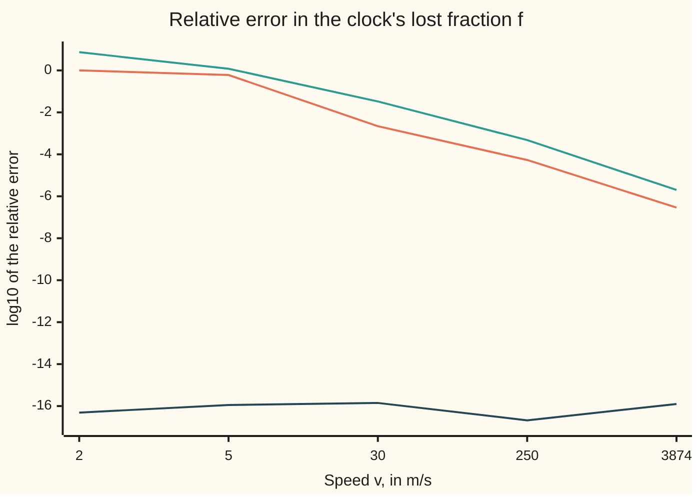

# Machine epsilon and cancellation: the gap next to one, and digits subtraction destroys

[Syllabus](../../../SYLLABUS.md) → [Numerical analysis](../README.md) → [Floating Point and Error](../README.md#s01) → Machine epsilon and cancellation

---

## General Overview

A fitness tracker rides on a runner's wrist at 5 m/s. Special relativity says a moving clock runs slow. The fraction of each second it loses is $f = 1 - \sqrt{1 - (v/c)^2}$, where $v$ is the speed and $c$ is the speed of light, 299792458 m/s. Satellite navigation corrects its clocks for this effect, using the close approximation $f \approx (v/c)^2/2$.

For the runner, $f$ is 1.391e-16. Over a one-hour run the watch falls 5.007e-13 seconds behind. That is a tiny number, but it is a definite one.

This $f$ is the smaller root of the quadratic $f^2 - 2f + (v/c)^2 = 0$, so the formula above is the quadratic formula's minus root, the one taught at school. Under its square root, $b^2 = 4$ dwarfs the $4 \times (v/c)^2$ subtracted from it: the classic case where that formula loses its small root.

Type the formula as written, the school formula, into any language that uses standard 64-bit numbers. It returns 2.220446049250313e-16, which is 59.65% too big. At a 2 m/s walk it returns exactly 0. Nothing warns.

Rewrite it as $f = (v/c)^2 / \big(1 + \sqrt{1 - (v/c)^2}\big)$. In exact arithmetic this is the same number. On the machine it returns 1.390812570067023e-16, right to about one unit in the 16th digit.

Both results come from one number: **machine epsilon**, the gap between 1 and the next number the machine can store. This card turns that gap into a rule for one rounding, then uses the rule to prove which formula can fail.

**Each machine operation is off by at most half the gap next to one, relative to its own result; subtracting nearly equal numbers shrinks the result but keeps the errors made before it, so the cure is a rewrite with no such subtraction.**

**What kind of fact this is:** the rounding rule (the standard model) is a theorem about the IEEE 754 standard's round-to-nearest mode, proved in Why it works, Step 2. The two error bounds are theorems to first order in $u$, proved in Steps 4 and 6. The clock formula is physics, taken as given from the sources.

### The picture: error of each formula as the speed changes

The height is log10 of the relative error (the error divided by the true value, as in [Absolute and relative error](01-absolute-and-relative-error.md)) at each speed. A height of 0 means 100% wrong; −16 means right to about 16 digits.



Orange: the school formula. Green: the bound this card proves for it, always above the orange line. Dark blue: the rewrite, flat near −16 at every speed. The five speeds are a walk, a run, a car, an airliner and a navigation satellite. The first four are illustrative; the satellite's 3874 m/s is from the Ashby source.

---

## The formula

Two constants come first. A **double** is the standard 64-bit computer number. [IEEE 754](02-ieee-floating-point.md) lays out its bits; here only the spacing matters.

$$\varepsilon_{\text{mach}} = 2^{-52} \approx 2.220 \times 10^{-16}, \qquad u = \tfrac12\,\varepsilon_{\text{mach}} = 2^{-53} \approx 1.110 \times 10^{-16}$$

**Read it aloud:** machine epsilon is the gap between 1 and the next double, and the unit roundoff u is half of that gap.

Then the **standard model** of one rounding. Write $\mathrm{fl}(\cdot)$, read "float of", for what the machine returns:

$$\mathrm{fl}(x \circ y) = (x \circ y)(1 + \delta), \qquad |\delta| \le u$$

**Read it aloud:** the machine's answer to one operation is the exact answer times one plus a tiny relative error delta, and delta is never bigger than u.

The runner's two formulas, with $z = (v/c)^2$ and $s = \sqrt{1 - z}$:

$$f = 1 - s = \frac{z}{1 + s}$$

Their error bounds, proved below, to first order in $u$:

$$\text{school formula: } \frac{|\hat f - f|}{f} \le \frac{1.5\,u}{f} + 2u, \qquad \text{rewrite: } \frac{|\hat f - f|}{f} \le 4.75\,u$$

**Read it aloud:** the school formula's relative error can be as big as one and a half u divided by the answer itself, while the rewrite's never passes four and three-quarter u.

| Symbol | Plain meaning | In our example | Push it up and the answer… |
| --- | --- | --- | --- |
| $\varepsilon_{\text{mach}}$ | machine epsilon: the gap between 1 and the next double, $2^{-52}$ | 2.220446049250313e-16 | — (fixed by the format) |
| $u$ | unit roundoff: half that gap, the most one rounding costs, relative | 1.110223024625157e-16 | — (fixed by the format) |
| $\mathrm{fl}(\cdot)$, $\circ$ | the double the machine returns for an exact value; $\circ$ is one of +, −, ×, ÷ | fl(1 − z) = 1 − 3u | — |
| $\delta$, $\delta_i$; $r$ | the relative error of one rounding ($\delta_i$: the $i$-th, in Step 6's fold); in that fold, $r$ is the relative error of $\hat s$ | −0.4945u for fl(1 − z) | never past $u$ in size |
| $\hat f$ | "f hat": the computed $f$, as opposed to the true one | 2.220446049250313e-16 (school), 1.390812570067023e-16 (rewrite) | — |
| $v$ | the runner's speed | 5 m/s | $f$ grows as $v^2$ and the school formula improves |
| $c$ | the speed of light, exact by definition | 299792458 m/s | — |
| $z$ | $(v/c)^2$, the squared speed as a fraction of light's | 2.781625140134046e-16, which is 2.5055u | the school formula's error shrinks |
| $s$, $\hat s$ | $\sqrt{1 - z}$, the rate of the moving clock, and its computed value | $\hat s$ = 1 − 2u | — |
| $f$ | the fraction of each second the moving clock loses | 1.390812570067023e-16, which is 1.2527u | the school formula's bound $1.5u/f$ falls |
| $x$, $y$, $w$; $E$, $g$, $k$ | any numbers fed to one operation; the power of two $2^E$ at or below a number, the grid gap $g$ there, and a whole number $k$ | $x = 1 - 2u$, $y = 1$ in the last subtraction | a larger $E$ means a larger gap |
| $a$, $b$ | in the quadratic $af^2 + bf + z = 0$, the numbers in front of $f^2$ and $f$ | $a = 1$, $b = -2$ | — |

The quadratic row is there because $f$ is the small root of $f^2 - 2f + z = 0$: square $1 - f = s$ and rearrange. So [The quadratic formula](../../03-Algebra/02-Polynomials/03-quadratic-formula.md) applies, with $b^2 = 4$ dwarfing $4az = 4z$: the classic case where the formula as written fails.

[Cancellation](../../14-Applied%20and%20computational/08-Scientific%20Computing%20Practice/02-catastrophic-cancellation-and-safe-formulas.md) already spots this trap and rewrites the quadratic formula. [Floating point](../../14-Applied%20and%20computational/08-Scientific%20Computing%20Practice/01-floating-point-in-practice.md) already defines machine epsilon and $u$ and proves the one-operation promise. This card rebuilds that promise from the gap next to one, then turns it into error bounds for whole formulas, to prove which formula is accurate.

### When it holds

- **Round to nearest, ties to even.** This is the default mode. If the hardware is set to round up or down instead, the bound doubles to $\varepsilon_{\text{mach}}$.
- **Correctly rounded operations.** IEEE 754 requires +, −, ×, ÷ and square root to return the exact answer, rounded once. Library functions such as exp and sin need not, so their $\delta$ can pass $u$ a little.
- **Ordinary sizes.** Results must lie between about $10^{-308}$ and $10^{308}$. Past the top they become infinity; near the bottom the gaps stop shrinking (the [IEEE 754](02-ieee-floating-point.md) card's subnormals), and relative error grows.
- **First order.** The bounds drop products of two $\delta$s. Each is below $u^2$, about $10^{-32}$, so the dropped part is far smaller than any digit printed here.

---

## Why it works

### Step 0: one grid, one rule

A double is one point of a fixed grid. Every operation computes the exact answer and returns the nearest grid point. So every error statement on this card comes from one question: how far apart are the grid points near the answer?

### Step 1: the gap next to one is $2^{-52}$

Between 1 and 2, a double is $1 + k/2^{52}$ for a whole number $k$ from 0 to $2^{52} - 1$. So the next double after 1 is $1 + 2^{-52}$. That gap is machine epsilon.

The checks find it three ways. They read the bits of 1 and add one to the last bit. They halve a number until adding half of it to 1 changes nothing. And they ask the library, as a cross-check. All three give 2.220446049250313e-16.

The halving loop stops at $2^{-52}$, not $2^{-53}$, because of a tie. The exact $1 + u$ sits exactly halfway between 1 and $1 + 2u$. Ties go to the neighbour whose last bit is 0, the even one, which is 1. So fl(1 + u) − 1 is 0u, and fl(1 + 3u) − 1 is 4u.

Between $2^E$ and $2^{E+1}$ the gap is $2^E \times \varepsilon_{\text{mach}}$. From ½ to 1 it is $u$. Near 1,000,000 it is 1.164e-10.

### Step 2: one rounding costs at most $u$, relative

Take an exact answer $x$ between $2^E$ and $2^{E+1}$. The grid there has gap $2^E \varepsilon_{\text{mach}}$. The nearest point is at most half a gap away, $2^E u$. Since $x \ge 2^E$, the relative error is

$$\frac{|\mathrm{fl}(x) - x|}{|x|} \le \frac{2^E u}{2^E} = u.$$

So $\mathrm{fl}(x) = x(1 + \delta)$ with $|\delta| \le u$. IEEE 754 requires each basic operation to round its exact answer this way. That gives the standard model.

The model measures each error against the result of that one operation. The next step shows why that matters.

### Step 3: the runner, one rounding at a time

Count in units of $u$. The checks print each step.

| Operation | Exact value | Nearest double | Rounding |
| --- | --- | --- | --- |
| $z = 25/c^2$ | 2.5055u | 2.781625140134046e-16 | two roundings, both tiny |
| $1 - z$ | 1 − 2.5055u | 1 − 3u (gap below 1 is $u$) | δ = −0.4945u |
| $\sqrt{1 - 3u}$ | about 1 − 1.5u | 1 − 2u | about −0.5u |
| $1 - (1 - 2u)$ | 2u | 2u, no rounding | 0 |

Every operation kept the model's promise. The answer, 2u, is still 59.65% above the true 1.2527u. Each rounding moved $s$ by about half a gap, and the answer is only 1.2527 gaps wide.

### Step 4: the bound for the school formula

The last subtraction is exact. Two doubles within a factor of 2 of each other subtract with no rounding (the Sterbenz lemma, proved in the fold below). So all the error was made before it, in $s$.

Track the absolute error in $s$:

1. $1 - z$ rounds by at most $u$, since the result is just below 1.
2. The input $z$ already carried a relative error of up to $2u$, from computing $c \times c$ and dividing. That is an absolute error of $2uz$.
3. A square root halves a small relative error, so these become at most $u/2 + uz$ in $s$.
4. The square root's own rounding adds at most $u$.

So $|\hat s - s| \le 1.5u + uz$. Then $\hat f = 1 - \hat s$ exactly, and dividing by $f$, which is close to $z/2$:

$$\frac{|\hat f - f|}{f} \le \frac{1.5\,u}{f} + 2u.$$

For the runner the bound is 119.74%. The measured error is 59.65%, a ratio of 0.498. The bound grows as $f$ shrinks: at 2 m/s it is 7.484e0, and the computed $f$ is 0, an error of 1.000e0.

The warning sign: a subtraction whose result is far smaller than its inputs, where the inputs already carry rounding. The [Cancellation](../../14-Applied%20and%20computational/08-Scientific%20Computing%20Practice/02-catastrophic-cancellation-and-safe-formulas.md) card measures the damage as a condition number. Here the inputs are about 1 and the answer about $10^{-16}$, so up to 16 digits can go.

<details>
<summary>Detailed proof: the Sterbenz lemma, a close subtraction is exact</summary>

Let $x$ and $y$ be positive doubles with $y/2 \le x \le y$. Let $2^E$ be the power of two at or below $x$, so the grid gap at $x$ is $g = 2^{E-52}$.

Every double at least as large as $x$ is a whole multiple of $g$, because gaps only grow with size, each by a factor of 2. So $y - x = kg$ for a whole number $k$.

Also $0 \le y - x \le y/2 \le x < 2^{E+1}$, so $k < 2^{53}$. A whole number below $2^{53}$ times a power of two is a double. The exact difference is already on the grid, so rounding leaves it alone.

For the runner, $x = 1 - 2u$ and $y = 1$. They are within a factor of 2, so $1 - \hat s$ is computed exactly.

</details>

### Step 5: the rewrite

Multiply top and bottom by $1 + s$. Since $(1 - s)(1 + s) = 1 - s^2 = z$,

$$1 - s = \frac{z}{1 + s}.$$

The quadratic gives the same rewrite. Its two roots multiply to $z/a = z$. The big root is $1 + s$, an addition of two positive numbers, which cannot cancel. So the small root is $z$ divided by the big one.

The new formula has one subtraction, $1 - z$. Its inputs are 1 and a number about $10^{-16}$, nowhere near each other, so it loses nothing.

### Step 6: proving the rewrite accurate

To first order, relative errors combine by four plain rules:

- **Multiply or divide:** the relative errors add.
- **Square root:** the input's relative error halves.
- **Add two positive numbers:** each input's relative error counts in proportion to its share of the sum, so the result's is never more than the larger input's.
- **Every operation:** add $u$ for its own rounding.

Apply them to $z / (1 + s)$, one operation at a time:

| Piece | Relative error, at most | Why |
| --- | --- | --- |
| $z$ | $2u$ | two roundings: $c \times c$, then the division |
| $1 - z$ | $u$ | one rounding; $z$'s own error moves $1 - z$ by about $2u \times 10^{-16}$, negligible |
| $s = \sqrt{1 - z}$ | $u/2 + u = 1.5u$ | input error halved, plus its own rounding |
| $1 + s$ | $1.5u \times \tfrac12 + u = 1.75u$ | $s$ is half the sum, so half its error counts; plus one rounding |
| $z/(1 + s)$ | $2u + 1.75u + u = 4.75u$ | errors of top and bottom add, plus one rounding |

No step divides by a small difference, so nothing magnifies the errors. The run's error is 1.0079u, a ratio of 0.212 to the bound. At all five speeds it stays between −0.190u and 1.259u.

<details>
<summary>Detailed proof: the second-order terms are negligible</summary>

Write each rounding as a factor $(1 + \delta_i)$ with $|\delta_i| \le u$. Two steps are not plain rounding factors, and each takes one line.

- **The computed $z$ inside $1 - z$.** Its error, at most about $2uz$ (twice $u$ times $z$), changes $1 - z$ by a relative amount of about $2uz$. That is tiny even beside $u$, and the square root halves it.
- **The sum $1 + \hat s$.** Write $\hat s = s(1 + r)$. Then $1 + \hat s = (1 + s)\big(1 + r\,s/(1 + s)\big)$, and $s/(1 + s) \le \tfrac12$, so this factor's size is at most $|r|/2$, exactly. That is the halving the table uses.

So $\hat f$ is the true $f$ times five factors, each one plus something small, or its inverse: four roundings ($c \times c$, the division giving $z$, the add and the last division), each of size at most $u$, and the $1 + \hat s$ factor, of size at most $|r|/2$. By the table's row for $s$, $|r|$ is at most $1.5u$ plus parts of size $u^2$ and $uz$. So the five sizes add to 4.75u plus such parts.

If the sizes of such factors add to a total below 1, their product lies within total ÷ (1 − total) of 1. So the error is at most 4.75u plus less than $40u^2 + uz$: about $5 \times 10^{-31}$ at the runner's speed, far beneath any digit printed. Counting every rounding at its full size $u$ instead gives the looser $6u$ the same way.

</details>

---

## Worked numbers, by hand

The runner at $v$ = 5 m/s, counting in $u$ = 1.110223024625157e-16.

| Step | Arithmetic | Value |
| --- | --- | --- |
| squared speed fraction | $z = 25 / 299792458^2$ | 2.781625140134046e-16 = 2.5055u |
| school: $1 - z$ | nearest double to 1 − 2.5055u | 1 − 3u |
| school: square root | nearest double to about 1 − 1.5u | 1 − 2u |
| school: $1 - s$ | exact subtraction | 2u = 2.220446049250313e-16 |
| school: error | (2u − 1.2527u) / 1.2527u | 59.65%, bound 119.74% |
| rewrite: $1 + s$ | 1 + (1 − 2u), exact here | 2 − 2u |
| rewrite: $z/(1 + s)$ | 2.5055u ÷ (2 − 2u) | **1.390812570067023e-16** |
| check: series | $z/2 + z^2/8$ | 1.390812570067023e-16 |
| rewrite: error | against the exact $f$ | 1.0079u, bound 4.75u |

The watch loses 1.390812570067023e-16 of every second, 5.007e-13 seconds over an hour, and the computed value is right to one rounding. The rewrite costs one operation more: after $z$, the school formula takes 3 (subtract, square root, subtract) and the rewrite 4 (subtract, square root, add, divide), for an error of 1.0079u instead of 59.65%.

### What breaks if you drop a piece

| Mistake | Comes out at | What went wrong |
| --- | --- | --- |
| School formula at 5 m/s | 2.220446049250313e-16, error 59.65% | the rounding of $1 - z$ and of the root survived an exact subtraction that removed everything else |
| School formula at 2 m/s | 0, error 1.000e0 | $z$ is under half the gap below 1, so $1 - z$ rounds back to exactly 1 |
| Rewrite with the sign flipped, $z/(1 - s)$ | 1.2527e0, should be 2.0000e0 | this is the big root, divided by the cancelled difference |
| Keep only the first series term $z/2$, at 3874 m/s | error 4.175e-11, which is 376016u | a dropped term, not a rounding: a truncation error |

---

## Code, from first principles, and it actually runs

The scripts find machine epsilon three ways. Then they compute the runner's $f$ by three roads: the school formula, the rewrite and a two-term series. The series must meet the rewrite at all five speeds: at the walk and the run its second term is below half a gap and vanishes, but from 30 m/s up it counts. Errors are measured against the exact $f$, worked in whole numbers from the double's bits. Python adds a fourth road, an exact 400-bit square root, which must agree. The library's epsilon is only a labelled cross-check.

### Python

```python
# Machine epsilon and cancellation -- the check behind the card.  Standard library only.
# A runner's watch loses the fraction f = 1 - sqrt(1 - z) of each second, z = (v/c)^2.
# That is the small root of f^2 - 2f + z = 0.  The school formula loses its digits;
# the rewrite z / (1 + sqrt(1 - z)) keeps them, and the standard model bounds both.
import struct
from fractions import Fraction
from math import sqrt, log10, isqrt, ulp

def sci(x, p):                          # 2.220446049250313e-16, the same in Rust
    m, e = f"{x:.{p}e}".split("e")
    return f"{m}e{int(e)}"
C = 299792458.0                         # speed of light, m/s (exact by definition)
CC = 299792458 ** 2                     # c^2 as a whole number
U = 2.0 ** -53                          # unit roundoff: half the gap next to one

# ---- machine epsilon, three ways ----
one_bits = struct.unpack("<q", struct.pack("<d", 1.0))[0]
eps_bits = struct.unpack("<d", struct.pack("<q", one_bits + 1))[0] - 1.0
e = 1.0
while 1.0 + e / 2 > 1.0:                # stop when adding half of e changes nothing
    e /= 2
print(f"eps_mach from the bits of 1,{sci(eps_bits, 15)}")
print(f"eps_mach by halving,{sci(e, 15)}")
print(f"eps_mach library cross-check,{sci(ulp(1.0), 15)}")
print(f"unit roundoff u,{sci(U, 15)}")
print(f"fl(1 + u) - 1 in u,{(1.0 + U - 1.0) / U:.0f}")
print(f"fl(1 + 3u) - 1 in u,{(1.0 + 3 * U - 1.0) / U:.0f}")
gap = 2.0 ** -52
while gap * 2 ** 52 * 2 <= 1e6:         # the power of two at or below 1,000,000
    gap *= 2
print(f"gap near 1000000,{sci(gap, 3)},largest rounding,{sci(gap / 2, 3)}")
assert eps_bits == e == 2.0 ** -52 == ulp(1.0)
assert 1.0 + U == 1.0 and 1.0 + 3 * U == 1.0 + 4 * U      # ties go to the even neighbour

# ---- the runner, three roads to f ----
def naive(z): return 1.0 - sqrt(1.0 - z)            # the school formula's small root
def safe(z): return z / (1.0 + sqrt(1.0 - z))       # product of roots: small = z / big
def series(z): return z / 2 + z * z / 8             # 1 - sqrt(1 - z) = z/2 + z^2/8 + ...
def rel_err(fhat, v):                   # (fhat - f)/f against the exact f for speed v,
    num, den = fhat.as_integer_ratio()  # fhat = num/den exactly; f = z/2 (1 + w)
    r = (num * 2 * CC - v * v * den) / (v * v * den)
    zt = (v * v) / (C * C)
    w = zt / 4 + zt * zt / 8            # next terms are below 1e-30 here
    return (r - w) / (1 + w)
def exact_rel_err(fhat, v):             # Python-only road: whole-number square root
    S = 2 ** 400                        # sqrt(1 - z) to 400 bits, rounded down
    root = Fraction(isqrt((CC - v * v) * S * S // CC), S)
    return float(Fraction(fhat) / (Fraction(v * v, CC) / (1 + root)) - 1)

v = 5
z = (v * v) / (C * C)
x = 1.0 - z
s = sqrt(x)
fn, fs, fr = naive(z), safe(z), series(z)
en, es, er = rel_err(fn, v), rel_err(fs, v), rel_err(fr, v)
fu = fs / U
bound_n = 1.5 / fu + 2 * U              # 1.5u of absolute error, over f; plus z's 2u
print(f"runner speed,{v} m/s,speed of light,{C:.0f} m/s")
print(f"z = (v/c)^2,{sci(z, 15)},in u,{z / U:.4f}")
print(f"fl(1 - z),1 - {(1.0 - x) / U:.0f}u,rounding error in u,{(z - 3 * U) / U / (1 - z):.4f}")
print(f"fl(sqrt(1 - z)),1 - {(1.0 - s) / U:.0f}u,fl(1 + s),2 - {(2.0 - (1.0 + s)) / U:.0f}u")
print(f"f naive,{sci(fn, 15)}")
print(f"f safe,{sci(fs, 15)}")
print(f"f series,{sci(fr, 15)}")
print(f"f in u,{fu:.4f}")
print(f"naive error,{en * 100:.2f}%,bound,{bound_n * 100:.2f}%,ratio,{en / bound_n:.3f}")
print(f"safe error in u,{es / U:.4f},bound 4.75u,ratio,{es / U / 4.75:.3f}")
print(f"series error in u,{er / U:.4f}")
print(f"lag over a 1-hour run,{sci(fs * 3600, 3)} s")
assert abs(fs - fr) <= 4.75 * U * fr                # safe meets the series
assert abs(en - exact_rel_err(fn, v)) < 1e-14       # the error road meets exact roots
assert abs(es - exact_rel_err(fs, v)) < 1e-25
assert 0.5 < en < bound_n                           # naive: 60% off, inside its bound
assert abs(es) <= 4.75 * U                          # safe: inside its bound

# ---- five speeds: the naive error grows as f shrinks; the safe one does not ----
for v, name in [(2, "walk"), (5, "run"), (30, "car"), (250, "airliner"), (3874, "GPS satellite")]:
    z = (v * v) / (C * C)
    fs = safe(z)
    en, es = rel_err(naive(z), v), rel_err(fs, v)
    bound_n = 1.5 * U / fs + 2 * U
    assert abs(en) <= bound_n and abs(es) <= 4.75 * U
    assert abs(es - exact_rel_err(fs, v)) < 1e-25
    assert abs(fs - series(z)) <= 4.75 * U * fs     # the series meets the rewrite
    print(f"speed,{v},{name},f,{sci(fs, 3)},naive error,{sci(abs(en), 3)},bound,"
          f"{sci(bound_n, 3)},safe error in u,{es / U:.3f}")
    print(f"chart,{v},log10 naive,{log10(abs(en)):.2f},log10 bound,{log10(bound_n):.2f},"
          f"log10 safe,{log10(abs(es)):.2f}")

# ---- what breaks ----
z = 25 / (C * C)
print(f"flipped rewrite z/(1 - s),{sci(z / (1.0 - sqrt(1.0 - z)), 4)},should be,{sci(1.0 + sqrt(1.0 - z), 4)}")
z = 3874 * 3874 / (C * C)
t = rel_err(z / 2, 3874)
print(f"first term z/2 only at 3874 m/s,error,{sci(abs(t), 3)},in u,{abs(t) / U:.0f}")
assert abs(t) > 1e5 * U
print("ALL CHECKS PASS")
```

**Ran 2026-11-11 on macOS, Python 3.14.10, standard library only. All checks passed. Output, pasted from the run:**

```
eps_mach from the bits of 1,2.220446049250313e-16
eps_mach by halving,2.220446049250313e-16
eps_mach library cross-check,2.220446049250313e-16
unit roundoff u,1.110223024625157e-16
fl(1 + u) - 1 in u,0
fl(1 + 3u) - 1 in u,4
gap near 1000000,1.164e-10,largest rounding,5.821e-11
runner speed,5 m/s,speed of light,299792458 m/s
z = (v/c)^2,2.781625140134046e-16,in u,2.5055
fl(1 - z),1 - 3u,rounding error in u,-0.4945
fl(sqrt(1 - z)),1 - 2u,fl(1 + s),2 - 2u
f naive,2.220446049250313e-16
f safe,1.390812570067023e-16
f series,1.390812570067023e-16
f in u,1.2527
naive error,59.65%,bound,119.74%,ratio,0.498
safe error in u,1.0079,bound 4.75u,ratio,0.212
series error in u,-0.5886
lag over a 1-hour run,5.007e-13 s
speed,2,walk,f,2.225e-17,naive error,1.000e0,bound,7.484e0,safe error in u,0.436
chart,2,log10 naive,0.00,log10 bound,0.87,log10 safe,-16.31
speed,5,run,f,1.391e-16,naive error,5.965e-1,bound,1.197e0,safe error in u,1.008
chart,5,log10 naive,-0.22,log10 bound,0.08,log10 safe,-15.95
speed,30,car,f,5.007e-15,naive error,2.181e-3,bound,3.326e-2,safe error in u,1.259
chart,30,log10 naive,-2.66,log10 bound,-1.48,log10 safe,-15.85
speed,250,airliner,f,3.477e-13,naive error,5.381e-5,bound,4.790e-4,safe error in u,-0.190
chart,250,log10 naive,-4.27,log10 bound,-3.32,log10 safe,-16.68
speed,3874,GPS satellite,f,8.349e-11,naive error,2.893e-7,bound,1.995e-6,safe error in u,1.134
chart,3874,log10 naive,-6.54,log10 bound,-5.70,log10 safe,-15.90
flipped rewrite z/(1 - s),1.2527e0,should be,2.0000e0
first term z/2 only at 3874 m/s,error,4.175e-11,in u,376016
ALL CHECKS PASS
```

### Rust

```rust
// Machine epsilon and cancellation -- the check behind the card.  std only.
// A runner's watch loses the fraction f = 1 - sqrt(1 - z) of each second, z = (v/c)^2.
// That is the small root of f^2 - 2f + z = 0.  The school formula loses its digits;
// the rewrite z / (1 + sqrt(1 - z)) keeps them, and the standard model bounds both.
const C: f64 = 299792458.0; // speed of light, m/s (exact by definition)
const CC: i128 = 299792458 * 299792458; // c^2 as a whole number
const U: f64 = 1.0 / 9007199254740992.0; // unit roundoff 2^-53: half the gap next to one

fn sci(x: f64, p: usize) -> String {
    format!("{:.*e}", p, x) // 2.220446049250313e-16, the same as Python
}
fn naive(z: f64) -> f64 { 1.0 - (1.0 - z).sqrt() } // the school formula's small root
fn safe(z: f64) -> f64 { z / (1.0 + (1.0 - z).sqrt()) } // product of roots: small = z / big
fn series(z: f64) -> f64 { z / 2.0 + z * z / 8.0 } // 1 - sqrt(1 - z) = z/2 + z^2/8 + ...
// (fhat - f)/f against the exact f for speed v, with fhat = m / 2^k read from its bits
fn rel_err(fhat: f64, v: i128) -> f64 {
    if fhat == 0.0 { return -1.0; }
    let bits = fhat.to_bits();
    let m = ((bits & ((1u64 << 52) - 1)) | (1u64 << 52)) as i128;
    let k = 1075 - ((bits >> 52) & 0x7ff) as i32;
    let den = v * v * (1i128 << k);
    let r = (m * 2 * CC - den) as f64 / den as f64;
    let vf = v as f64;
    let zt = (vf * vf) / (C * C);
    let w = zt / 4.0 + zt * zt / 8.0; // next terms are below 1e-30 here
    (r - w) / (1.0 + w)
}

fn main() {
    // ---- machine epsilon, three ways ----
    let eps_bits = f64::from_bits(1.0f64.to_bits() + 1) - 1.0;
    let mut e = 1.0f64;
    while 1.0 + e / 2.0 > 1.0 { e /= 2.0; } // stop when adding half of e changes nothing
    println!("eps_mach from the bits of 1,{}", sci(eps_bits, 15));
    println!("eps_mach by halving,{}", sci(e, 15));
    println!("eps_mach library cross-check,{}", sci(f64::EPSILON, 15));
    println!("unit roundoff u,{}", sci(U, 15));
    println!("fl(1 + u) - 1 in u,{:.0}", (1.0 + U - 1.0) / U);
    println!("fl(1 + 3u) - 1 in u,{:.0}", (1.0 + 3.0 * U - 1.0) / U);
    let mut gap = 2.0f64.powi(-52);
    while gap * 2.0f64.powi(52) * 2.0 <= 1e6 { gap *= 2.0; } // power of two at or below 1e6
    println!("gap near 1000000,{},largest rounding,{}", sci(gap, 3), sci(gap / 2.0, 3));
    assert!(eps_bits == e && e == 2.0f64.powi(-52) && e == f64::EPSILON);
    assert!(1.0 + U == 1.0 && 1.0 + 3.0 * U == 1.0 + 4.0 * U); // ties go to the even neighbour

    // ---- the runner, three roads to f ----
    let v: i128 = 5;
    let z = (v * v) as f64 / (C * C);
    let x = 1.0 - z;
    let s = x.sqrt();
    let (fn_, fs, fr) = (naive(z), safe(z), series(z));
    let (en, es, er) = (rel_err(fn_, v), rel_err(fs, v), rel_err(fr, v));
    let fu = fs / U;
    let bound_n = 1.5 / fu + 2.0 * U; // 1.5u of absolute error, over f; plus z's 2u
    println!("runner speed,{} m/s,speed of light,{:.0} m/s", v, C);
    println!("z = (v/c)^2,{},in u,{:.4}", sci(z, 15), z / U);
    println!("fl(1 - z),1 - {:.0}u,rounding error in u,{:.4}", (1.0 - x) / U, (z - 3.0 * U) / U / (1.0 - z));
    println!("fl(sqrt(1 - z)),1 - {:.0}u,fl(1 + s),2 - {:.0}u", (1.0 - s) / U, (2.0 - (1.0 + s)) / U);
    println!("f naive,{}", sci(fn_, 15));
    println!("f safe,{}", sci(fs, 15));
    println!("f series,{}", sci(fr, 15));
    println!("f in u,{:.4}", fu);
    println!("naive error,{:.2}%,bound,{:.2}%,ratio,{:.3}", en * 100.0, bound_n * 100.0, en / bound_n);
    println!("safe error in u,{:.4},bound 4.75u,ratio,{:.3}", es / U, es / U / 4.75);
    println!("series error in u,{:.4}", er / U);
    println!("lag over a 1-hour run,{} s", sci(fs * 3600.0, 3));
    assert!((fs - fr).abs() <= 4.75 * U * fr); // safe meets the series
    assert!(0.5 < en && en < bound_n); // naive: 60% off, inside its bound
    assert!(es.abs() <= 4.75 * U); // safe: inside its bound

    // ---- five speeds: the naive error grows as f shrinks; the safe one does not ----
    for (v, name) in [(2i128, "walk"), (5, "run"), (30, "car"), (250, "airliner"), (3874, "GPS satellite")] {
        let vf = v as f64;
        let z = (vf * vf) / (C * C);
        let fs = safe(z);
        let (en, es) = (rel_err(naive(z), v), rel_err(fs, v));
        let bound_n = 1.5 * U / fs + 2.0 * U;
        assert!(en.abs() <= bound_n && es.abs() <= 4.75 * U);
        assert!((fs - series(z)).abs() <= 4.75 * U * fs); // the series meets the rewrite
        println!("speed,{},{},f,{},naive error,{},bound,{},safe error in u,{:.3}",
            v, name, sci(fs, 3), sci(en.abs(), 3), sci(bound_n, 3), es / U);
        println!("chart,{},log10 naive,{:.2},log10 bound,{:.2},log10 safe,{:.2}",
            v, en.abs().log10(), bound_n.log10(), es.abs().log10());
    }

    // ---- what breaks ----
    let z = 25.0 / (C * C);
    println!("flipped rewrite z/(1 - s),{},should be,{}", sci(z / (1.0 - (1.0 - z).sqrt()), 4), sci(1.0 + (1.0 - z).sqrt(), 4));
    let z = 3874.0 * 3874.0 / (C * C);
    let t = rel_err(z / 2.0, 3874);
    println!("first term z/2 only at 3874 m/s,error,{},in u,{:.0}", sci(t.abs(), 3), t.abs() / U);
    assert!(t.abs() > 1e5 * U);
    println!("ALL CHECKS PASS");
}
```

**Ran 2026-11-11 on macOS, rustc 1.98.1, no crates. All checks passed. Output, pasted from the run:**

```
eps_mach from the bits of 1,2.220446049250313e-16
eps_mach by halving,2.220446049250313e-16
eps_mach library cross-check,2.220446049250313e-16
unit roundoff u,1.110223024625157e-16
fl(1 + u) - 1 in u,0
fl(1 + 3u) - 1 in u,4
gap near 1000000,1.164e-10,largest rounding,5.821e-11
runner speed,5 m/s,speed of light,299792458 m/s
z = (v/c)^2,2.781625140134046e-16,in u,2.5055
fl(1 - z),1 - 3u,rounding error in u,-0.4945
fl(sqrt(1 - z)),1 - 2u,fl(1 + s),2 - 2u
f naive,2.220446049250313e-16
f safe,1.390812570067023e-16
f series,1.390812570067023e-16
f in u,1.2527
naive error,59.65%,bound,119.74%,ratio,0.498
safe error in u,1.0079,bound 4.75u,ratio,0.212
series error in u,-0.5886
lag over a 1-hour run,5.007e-13 s
speed,2,walk,f,2.225e-17,naive error,1.000e0,bound,7.484e0,safe error in u,0.436
chart,2,log10 naive,0.00,log10 bound,0.87,log10 safe,-16.31
speed,5,run,f,1.391e-16,naive error,5.965e-1,bound,1.197e0,safe error in u,1.008
chart,5,log10 naive,-0.22,log10 bound,0.08,log10 safe,-15.95
speed,30,car,f,5.007e-15,naive error,2.181e-3,bound,3.326e-2,safe error in u,1.259
chart,30,log10 naive,-2.66,log10 bound,-1.48,log10 safe,-15.85
speed,250,airliner,f,3.477e-13,naive error,5.381e-5,bound,4.790e-4,safe error in u,-0.190
chart,250,log10 naive,-4.27,log10 bound,-3.32,log10 safe,-16.68
speed,3874,GPS satellite,f,8.349e-11,naive error,2.893e-7,bound,1.995e-6,safe error in u,1.134
chart,3874,log10 naive,-6.54,log10 bound,-5.70,log10 safe,-15.90
flipped rewrite z/(1 - s),1.2527e0,should be,2.0000e0
first term z/2 only at 3874 m/s,error,4.175e-11,in u,376016
ALL CHECKS PASS
```

### Lean

Lean proves the gap next to one, the one-rounding rule and the Sterbenz lemma, and checks the card's whole-number examples.

- $1 + \varepsilon_{\text{mach}}$ is a double, and no double lies strictly between 1 and it.
- For any operation whose exact result has an ordinary size, as in When it holds, a nearest double is $(x \circ y)(1 + \delta)$ with $|\delta| \le u$. Either choice at a tie keeps this bound.
- If $x$ and $y$ are positive doubles with $y/2 \le x \le y$, then $y - x$ is a double, so the subtraction is exact.
- The hand arithmetic holds exactly: $c^2$, $u = \varepsilon_{\text{mach}}/2$, the power of two at or below 1,000,000, and $1 + 3u$ halfway between the doubles $1 + 2u$ and $1 + 4u$.
- For the runner, $1 - 3u$ and $1 - 2u$ are doubles, rounding $1 - z$ to $1 - 3u$ costs under $u$, and $1 - \hat s$ is exact.

The first-order bounds of Steps 4 and 6, the decimals, the five speeds and Try changing are left to the Python and Rust checks.

```lean
-- Machine epsilon and cancellation: the gap from 1 to the next double is 2^-52, rounding a result in the normal range to a nearest double gives fl(x ∘ y) = (x ∘ y)(1 + δ) with |δ| ≤ u = 2^-53, and two positive doubles within a factor of 2 subtract exactly.
import Mathlib.Basic.Real.Basic
import Mathlib.Algebra.Order.Field.Power
import Mathlib.Tactic.NormNum
import Mathlib.Tactic.Ring
import Mathlib.Data.Int.Log
import Mathlib.Algebra.Order.Round
import Mathlib.Tactic.Linarith
import Mathlib.Tactic.FieldSimp
import Mathlib.Tactic.IntervalCases
import Mathlib.Tactic.Positivity
import Mathlib.Algebra.Order.Archimedean.Real.Basic
import Mathlib.Tactic.LinearCombination

namespace MachineEpsilonCancellation

/-- The value of the bit pattern with sign bit `s`, exponent field `e` and fraction field `f`:
`(-1)^s × (1 + f/2^52) × 2^(e - 1023)` for a normal pattern (`1 ≤ e ≤ 2046`), and
`(-1)^s × (f/2^52) × 2^(-1022)` when `e = 0` (zero or subnormal). -/
noncomputable def doubleValue (s e f : ℕ) : ℝ :=
  if e = 0 then (-1 : ℝ) ^ s * ((f : ℝ) / 2 ^ 52) * (2 : ℝ) ^ (-1022 : ℤ)
  else (-1 : ℝ) ^ s * (1 + (f : ℝ) / 2 ^ 52) * (2 : ℝ) ^ ((e : ℤ) - 1023)

/-- `y` is a finite double: the value of some sign bit, an exponent field from 0 to 2046 and a
52-bit fraction field. -/
def IsFiniteDouble (y : ℝ) : Prop :=
  ∃ s e f : ℕ, s ≤ 1 ∧ e ≤ 2046 ∧ f < 2 ^ 52 ∧ y = doubleValue s e f

/-- The largest double, `(2^53 - 1) × 2^971`, about 1.8e308. -/
noncomputable def largestDouble : ℝ := (2 ^ 53 - 1) * (2 : ℝ) ^ (971 : ℤ)

/-- Machine epsilon, `ε_mach = 2^-52`. -/
noncomputable def epsMach : ℝ := (2 : ℝ) ^ (-52 : ℤ)

/-- The unit roundoff, `u = 2^-53`, half of machine epsilon. -/
noncomputable def u : ℝ := (2 : ℝ) ^ (-53 : ℤ)

/-- `r` is a nearest double to the exact value `t`: a finite double no further from `t` than any
other finite double. Round to nearest, ties to even, returns one of these; the tie rule only
chooses which one when two are equally near. -/
def IsNearestDouble (r t : ℝ) : Prop :=
  IsFiniteDouble r ∧ ∀ d : ℝ, IsFiniteDouble d → |r - t| ≤ |d - t|

/-- A normal pattern with sign bit 0 is the whole number `2^52 + f` times `2^(e - 1075)`. -/
lemma doubleValue_normal_eq (e f : ℕ) (he : e ≠ 0) :
    doubleValue 0 e f = ((2 ^ 52 + f : ℕ) : ℝ) * (2 : ℝ) ^ ((e : ℤ) - 1075) := by
  simp only [doubleValue, he, ↓reduceIte]
  have h : ((e : ℤ) - 1023) = ((e : ℤ) - 1075) + ((52 : ℕ) : ℤ) := by push_cast; ring
  rw [h, zpow_add₀ two_ne_zero, zpow_natCast]
  push_cast
  field_simp
  ring

#print axioms doubleValue_normal_eq

/-- A pattern with exponent field 0 and sign bit 0 is `f` times `2^-1074`. -/
lemma doubleValue_sub_eq (f : ℕ) : doubleValue 0 0 f = (f : ℝ) * (2 : ℝ) ^ (-1074 : ℤ) := by
  simp only [doubleValue, ↓reduceIte]
  have h : (-1022 : ℤ) = -1074 + ((52 : ℕ) : ℤ) := by norm_num
  rw [h, zpow_add₀ two_ne_zero, zpow_natCast]
  field_simp

#print axioms doubleValue_sub_eq

/-- `M × 2^Q` with `2^52 ≤ M < 2^53` and `-1074 ≤ Q ≤ 971` is a finite double (a normal one). -/
lemma double_of_normal (M : ℕ) (Q : ℤ) (h1 : 2 ^ 52 ≤ M) (h2 : M < 2 ^ 53) (hQ1 : -1074 ≤ Q)
    (hQ2 : Q ≤ 971) : IsFiniteDouble ((M : ℝ) * (2 : ℝ) ^ Q) := by
  have he : (((Q + 1075).toNat : ℕ) : ℤ) = Q + 1075 := Int.toNat_of_nonneg (by omega)
  refine ⟨0, (Q + 1075).toNat, M - 2 ^ 52, by norm_num, by omega, by omega, ?_⟩
  rw [doubleValue_normal_eq _ _ (by omega), Nat.add_sub_cancel' h1, he]
  congr 2
  ring

#print axioms double_of_normal

/-- `M × 2^Q` with `M < 2^53` and `-1074 ≤ Q ≤ 971` is a finite double, by induction on
`Q + 1074`. -/
lemma double_of_rep_aux : ∀ n : ℕ, ∀ (M : ℕ) (Q : ℤ), Q = (n : ℤ) - 1074 → M < 2 ^ 53 →
    Q ≤ 971 → IsFiniteDouble ((M : ℝ) * (2 : ℝ) ^ Q)
  | 0 => by
    intro M Q hQ hM hQ2
    by_cases h : 2 ^ 52 ≤ M
    · exact double_of_normal M Q h hM (by omega) hQ2
    · refine ⟨0, 0, M, by norm_num, by norm_num, by omega, ?_⟩
      rw [doubleValue_sub_eq, hQ]
      norm_num
  | n + 1 => by
    intro M Q hQ hM hQ2
    by_cases h : 2 ^ 52 ≤ M
    · exact double_of_normal M Q h hM (by omega) hQ2
    · have ih := double_of_rep_aux n (2 * M) (Q - 1) (by omega) (by omega) (by omega)
      convert ih using 1
      rw [zpow_sub₀ two_ne_zero]
      push_cast
      field_simp

#print axioms double_of_rep_aux

/-- `M × 2^Q` with `M < 2^53` and `-1074 ≤ Q ≤ 971` is a finite double. -/
lemma double_of_rep (M : ℕ) (Q : ℤ) (hM : M < 2 ^ 53) (hQ1 : -1074 ≤ Q) (hQ2 : Q ≤ 971) :
    IsFiniteDouble ((M : ℝ) * (2 : ℝ) ^ Q) :=
  double_of_rep_aux (Q + 1074).toNat M Q (by omega) hM hQ2

#print axioms double_of_rep

/-- A positive finite double is `M × 2^Q` with `M < 2^53` and `-1074 ≤ Q ≤ 971`. -/
lemma rep_of_double {z : ℝ} (h : IsFiniteDouble z) (hz : 0 < z) :
    ∃ M : ℕ, ∃ Q : ℤ, M < 2 ^ 53 ∧ -1074 ≤ Q ∧ Q ≤ 971 ∧ z = (M : ℝ) * (2 : ℝ) ^ Q := by
  obtain ⟨s, e, f, hs, he, hf, rfl⟩ := h
  interval_cases s
  · by_cases he0 : e = 0
    · subst he0
      exact ⟨f, -1074, by omega, by norm_num, by norm_num, doubleValue_sub_eq f⟩
    · exact ⟨2 ^ 52 + f, (e : ℤ) - 1075, by omega, by omega, by omega,
        doubleValue_normal_eq e f he0⟩
  · exfalso
    have hn : doubleValue 1 e f ≤ 0 := by
      unfold doubleValue
      split_ifs
      · have : 0 ≤ (f : ℝ) / 2 ^ 52 * (2 : ℝ) ^ (-1022 : ℤ) := by positivity
        rw [pow_one]
        linarith
      · have : 0 ≤ (1 + (f : ℝ) / 2 ^ 52) * (2 : ℝ) ^ ((e : ℤ) - 1023) := by positivity
        rw [pow_one]
        linarith
    linarith

#print axioms rep_of_double

/-- The negative of a finite double is a finite double: flip the sign bit. -/
lemma double_neg {d : ℝ} (h : IsFiniteDouble d) : IsFiniteDouble (-d) := by
  obtain ⟨s, e, f, hs, he, hf, rfl⟩ := h
  refine ⟨1 - s, e, f, by omega, he, hf, ?_⟩
  interval_cases s <;> (unfold doubleValue; split_ifs <;> ring)

#print axioms double_neg

/-- A finite double `d` close to a number `t` in the positive normal range: `|d - t| ≤ u t`. -/
lemma exists_double_near_pos (t : ℝ) (hlo : (2 : ℝ) ^ (-1022 : ℤ) ≤ t) (hhi : t ≤ largestDouble) :
    ∃ d : ℝ, IsFiniteDouble d ∧ |d - t| ≤ u * t := by
  have ht : 0 < t := lt_of_lt_of_le (by positivity) hlo
  set E : ℤ := Int.log 2 t with hEdef
  have h1 : (2 : ℝ) ^ E ≤ t := by
    have := Int.zpow_log_le_self (b := 2) (by norm_num) ht
    simpa using this
  have h2 : t < (2 : ℝ) ^ (E + 1) := by
    have := Int.lt_zpow_succ_log_self (b := 2) (by norm_num) t
    simpa using this
  have hE1 : -1022 ≤ E :=
    (Int.zpow_le_iff_le_log (b := 2) (by norm_num) ht).1 (by simpa using hlo)
  have hE2 : E ≤ 1023 := by
    by_contra hc
    have : (2 : ℝ) ^ (1024 : ℤ) ≤ 2 ^ E := zpow_le_zpow_right₀ (by norm_num) (by omega)
    have hl : largestDouble < (2 : ℝ) ^ (1024 : ℤ) := by
      rw [largestDouble, show (971 : ℤ) = ((971 : ℕ) : ℤ) from rfl,
        show (1024 : ℤ) = ((1024 : ℕ) : ℤ) from rfl, zpow_natCast, zpow_natCast]
      have h53 : (2 : ℝ) ^ (1024 : ℕ) = 2 ^ 53 * 2 ^ (971 : ℕ) := by rw [← pow_add]
      rw [h53]
      gcongr
      norm_num
    linarith
  set s : ℝ := (2 : ℝ) ^ (E - 52) with hsdef
  have hs : 0 < s := by positivity
  have hEs : (2 : ℝ) ^ E = 2 ^ 52 * s := by
    rw [hsdef, ← zpow_natCast, ← zpow_add₀ two_ne_zero]; congr 1; push_cast; ring
  have hEs1 : (2 : ℝ) ^ (E + 1) = 2 ^ 53 * s := by
    rw [hsdef, ← zpow_natCast, ← zpow_add₀ two_ne_zero]; congr 1; push_cast; ring
  set a : ℝ := t / s with hadef
  have hat : t = a * s := by rw [hadef]; field_simp
  have ha1 : (2 : ℝ) ^ 52 ≤ a := by
    rw [hadef, le_div_iff₀ hs]; linarith
  have ha2 : a < 2 ^ 53 := by
    rw [hadef, div_lt_iff₀ hs]; linarith
  set N : ℤ := round a with hNdef
  have hN : |a - N| ≤ 1 / 2 := abs_sub_round a
  have hN' := abs_le.1 hN
  have hN1 : (2 ^ 52 : ℤ) ≤ N := by
    have : ((2 ^ 52 - 1 : ℤ) : ℝ) < N := by push_cast; linarith
    have := Int.cast_lt.1 this
    omega
  have hN2 : N ≤ 2 ^ 53 := by
    have : (N : ℝ) < ((2 ^ 53 + 1 : ℤ) : ℝ) := by push_cast; linarith
    have := Int.cast_lt.1 this
    omega
  refine ⟨(N : ℝ) * s, ?_, ?_⟩
  · rcases lt_or_eq_of_le hN2 with hlt | heq
    · have hc : ((N.toNat : ℕ) : ℝ) = (N : ℝ) := by
        have : ((N.toNat : ℕ) : ℤ) = N := Int.toNat_of_nonneg (by omega)
        exact_mod_cast this
      rw [← hc]
      exact double_of_rep N.toNat (E - 52) (by omega) (by omega) (by omega)
    · have hE3 : E ≤ 1022 := by
        by_contra hc
        have hE : E = 1023 := by omega
        have hs971 : s = (2 : ℝ) ^ (971 : ℤ) := by rw [hsdef, hE]; norm_num
        have : a ≤ 2 ^ 53 - 1 := by
          rw [hadef, div_le_iff₀ hs, hs971]
          simpa [largestDouble] using hhi
        have : (N : ℝ) = 2 ^ 53 := by rw [heq]; norm_num
        linarith
      have : (N : ℝ) * s = ((2 ^ 52 : ℕ) : ℝ) * (2 : ℝ) ^ (E - 51) := by
        rw [heq, hsdef]
        have h' : E - 51 = (E - 52) + ((1 : ℕ) : ℤ) := by push_cast; ring
        rw [h', zpow_add₀ two_ne_zero, zpow_natCast]
        push_cast
        ring
      rw [this]
      exact double_of_rep _ _ (by norm_num) (by omega) (by omega)
  · have hd : (N : ℝ) * s - t = (N - a) * s := by rw [hat]; ring
    rw [hd, abs_mul, abs_of_pos hs, abs_sub_comm]
    have hu : u * (2 : ℝ) ^ E = s / 2 := by
      rw [u, hEs]
      have : (2 : ℝ) ^ (-53 : ℤ) * 2 ^ 52 = 1 / 2 := by norm_num
      linear_combination s * this
    have hu0 : 0 < u := by rw [u]; positivity
    have : u * (2 : ℝ) ^ E ≤ u * t := mul_le_mul_of_nonneg_left h1 hu0.le
    nlinarith

#print axioms exists_double_near_pos

/-- Machine epsilon is the gap next to one: `1 + 2^-52` is a double, and no double lies
strictly between 1 and it. -/
theorem machine_epsilon_is_gap_next_to_one :
    IsFiniteDouble (1 + epsMach) ∧
      ∀ y : ℝ, IsFiniteDouble y → 1 < y → 1 + epsMach ≤ y := by
  constructor
  · exact ⟨0, 1023, 1, by norm_num, by norm_num, by norm_num, by norm_num [doubleValue, epsMach]⟩
  · rintro y ⟨s, e, f, hs, he, hf, rfl⟩ hy
    have hf' : (f : ℝ) < 2 ^ 52 := by exact_mod_cast hf
    interval_cases s
    · by_cases he0 : e = 0
      · subst he0
        exfalso
        rw [doubleValue_sub_eq] at hy
        have hp : (0 : ℝ) < 2 ^ (-1074 : ℤ) := by positivity
        have h1 : (2 : ℝ) ^ 52 * 2 ^ (-1074 : ℤ) < 1 := by
          rw [← zpow_natCast, ← zpow_add₀ two_ne_zero]
          exact zpow_lt_one_of_neg₀ (by norm_num) (by norm_num)
        have h2 := mul_lt_mul_of_pos_right hf' hp
        linarith
      · rw [doubleValue_normal_eq _ _ he0] at hy ⊢
        have hM : ((2 ^ 52 + f : ℕ) : ℝ) < 2 ^ 53 := by push_cast; linarith
        have hM0 : (2 : ℝ) ^ 52 ≤ ((2 ^ 52 + f : ℕ) : ℝ) := by push_cast; linarith [f.cast_nonneg (α := ℝ)]
        have heps : (0 : ℝ) < epsMach := by rw [epsMach]; positivity
        rcases lt_trichotomy e 1023 with hlt | heq | hgt
        · exfalso
          have hp : (2 : ℝ) ^ ((e : ℤ) - 1075) ≤ 2 ^ (-53 : ℤ) :=
            zpow_le_zpow_right₀ (by norm_num) (by omega)
          have hp0 : (0 : ℝ) < 2 ^ ((e : ℤ) - 1075) := by positivity
          have h1 : (2 : ℝ) ^ 53 * 2 ^ (-53 : ℤ) = 1 := by norm_num
          have h2 := mul_lt_mul_of_pos_right hM hp0
          have h3 : (2 : ℝ) ^ 53 * 2 ^ ((e : ℤ) - 1075) ≤ 2 ^ 53 * 2 ^ (-53 : ℤ) :=
            mul_le_mul_of_nonneg_left hp (by positivity)
          linarith
        · subst heq
          have hf1 : 1 ≤ f := by
            by_contra hc
            have : f = 0 := by omega
            subst this
            norm_num at hy
          have hf1' : (1 : ℝ) ≤ f := by exact_mod_cast hf1
          rw [epsMach]
          have h1 : (2 : ℝ) ^ 52 * 2 ^ (-52 : ℤ) = 1 := by norm_num
          have hp : (0 : ℝ) < 2 ^ (-52 : ℤ) := by positivity
          push_cast
          norm_num
          nlinarith
        · have hp : (2 : ℝ) ^ (-51 : ℤ) ≤ 2 ^ ((e : ℤ) - 1075) :=
            zpow_le_zpow_right₀ (by norm_num) (by omega)
          have h1 : (2 : ℝ) ^ 52 * 2 ^ (-51 : ℤ) = 2 := by norm_num
          have h2 : epsMach ≤ 1 := by rw [epsMach]; norm_num
          have h3 : (2 : ℝ) ^ 52 * 2 ^ (-51 : ℤ) ≤ ((2 ^ 52 + f : ℕ) : ℝ) * 2 ^ ((e : ℤ) - 1075) :=
            mul_le_mul hM0 hp (by positivity) (by positivity)
          linarith
    · exfalso
      have hn : doubleValue 1 e f ≤ 0 := by
        unfold doubleValue
        split_ifs
        · have : 0 ≤ (f : ℝ) / 2 ^ 52 * (2 : ℝ) ^ (-1022 : ℤ) := by positivity
          rw [pow_one]
          linarith
        · have : 0 ≤ (1 + (f : ℝ) / 2 ^ 52) * (2 : ℝ) ^ ((e : ℤ) - 1023) := by positivity
          rw [pow_one]
          linarith
      linarith

/-- The standard model of one rounding. Let `∘` be any operation (+, −, ×, ÷, or square root
taking one input), computed exactly and then rounded once to a nearest double, and let the exact
result lie in the ordinary (normal) range `2^-1022 ≤ |x ∘ y| ≤` the largest double. Then the
machine's answer is `fl(x ∘ y) = (x ∘ y)(1 + δ)` with `|δ| ≤ u = 2^-53`. -/
theorem standard_model_one_rounding (op : ℝ → ℝ → ℝ) (x y fl : ℝ)
    (hlo : (2 : ℝ) ^ (-1022 : ℤ) ≤ |op x y|) (hhi : |op x y| ≤ largestDouble)
    (hfl : IsNearestDouble fl (op x y)) :
    ∃ δ : ℝ, |δ| ≤ u ∧ fl = op x y * (1 + δ) := by
  have key : ∃ d : ℝ, IsFiniteDouble d ∧ |d - op x y| ≤ u * |op x y| := by
    rcases le_or_gt 0 (op x y) with h | h
    · rw [abs_of_nonneg h] at hlo hhi ⊢
      exact exists_double_near_pos _ hlo hhi
    · rw [abs_of_neg h] at hlo hhi ⊢
      obtain ⟨d, hd, hdt⟩ := exists_double_near_pos _ hlo hhi
      refine ⟨-d, double_neg hd, ?_⟩
      rw [show -d - op x y = -(d - -op x y) by ring, abs_neg]
      exact hdt
  obtain ⟨d, hd, hdt⟩ := key
  have hclose := hfl.2 d hd
  have ht0 : op x y ≠ 0 := by
    intro h0
    rw [h0, abs_zero] at hlo
    have : (0 : ℝ) < 2 ^ (-1022 : ℤ) := by positivity
    linarith
  refine ⟨(fl - op x y) / op x y, ?_, ?_⟩
  · rw [abs_div, div_le_iff₀ (abs_pos.2 ht0)]
    linarith
  · field_simp
    ring

/-- The Sterbenz lemma, a close subtraction is exact: if `x` and `y` are positive doubles with
`y/2 ≤ x ≤ y`, then `y - x` is itself a double, so rounding leaves it unchanged. -/
theorem sterbenz_close_subtraction_exact (x y : ℝ) (hx : IsFiniteDouble x)
    (hy : IsFiniteDouble y) (hx0 : 0 < x) (hy0 : 0 < y) (hle : y / 2 ≤ x) (hxy : x ≤ y) :
    IsFiniteDouble (y - x) := by
  obtain ⟨Mx, Qx, hMx, hQx1, hQx2, rfl⟩ := rep_of_double hx hx0
  obtain ⟨My, Qy, hMy, hQy1, hQy2, rfl⟩ := rep_of_double hy hy0
  rcases le_total Qx Qy with hq | hq
  · -- write y on x's scale: y = (My × 2^k) × 2^Qx
    set k := (Qy - Qx).toNat with hk
    have hk' : ((k : ℕ) : ℤ) = Qy - Qx := Int.toNat_of_nonneg (by omega)
    have hyx : (2 : ℝ) ^ Qy = 2 ^ k * 2 ^ Qx := by
      rw [← zpow_natCast, ← zpow_add₀ two_ne_zero, hk']
      ring_nf
    have hp : (0 : ℝ) < 2 ^ Qx := by positivity
    rw [hyx] at hle hxy ⊢
    have hA : (Mx : ℝ) ≤ My * 2 ^ k := by
      have : (Mx : ℝ) * 2 ^ Qx ≤ (My * 2 ^ k) * 2 ^ Qx := by linarith
      exact le_of_mul_le_mul_right this hp
    have hB : (My : ℝ) * 2 ^ k ≤ 2 * Mx := by
      have : ((My : ℝ) * 2 ^ k) * 2 ^ Qx ≤ (2 * (Mx : ℝ)) * 2 ^ Qx := by linarith
      exact le_of_mul_le_mul_right this hp
    have hA' : Mx ≤ My * 2 ^ k := by exact_mod_cast hA
    have hB' : My * 2 ^ k ≤ 2 * Mx := by exact_mod_cast hB
    have hc : ((My * 2 ^ k - Mx : ℕ) : ℝ) = My * 2 ^ k - Mx := by
      rw [Nat.cast_sub hA']
      push_cast
      ring
    have := double_of_rep (My * 2 ^ k - Mx) Qx (by omega) hQx1 hQx2
    rw [hc] at this
    convert this using 1
    ring
  · -- write x on y's scale: x = (Mx × 2^k) × 2^Qy
    set k := (Qx - Qy).toNat with hk
    have hk' : ((k : ℕ) : ℤ) = Qx - Qy := Int.toNat_of_nonneg (by omega)
    have hxy' : (2 : ℝ) ^ Qx = 2 ^ k * 2 ^ Qy := by
      rw [← zpow_natCast, ← zpow_add₀ two_ne_zero, hk']
      ring_nf
    have hp : (0 : ℝ) < 2 ^ Qy := by positivity
    rw [hxy'] at hle hxy ⊢
    have hA : (Mx : ℝ) * 2 ^ k ≤ My := by
      have : (Mx * 2 ^ k) * 2 ^ Qy ≤ (My : ℝ) * 2 ^ Qy := by linarith
      exact le_of_mul_le_mul_right this hp
    have hA' : Mx * 2 ^ k ≤ My := by exact_mod_cast hA
    have hc : ((My - Mx * 2 ^ k : ℕ) : ℝ) = My - Mx * 2 ^ k := by
      rw [Nat.cast_sub hA']
      push_cast
      ring
    have := double_of_rep (My - Mx * 2 ^ k) Qy (by omega) hQy1 hQy2
    rw [hc] at this
    convert this using 1
    ring

-- The card's whole-number worked examples.

-- c^2 as a whole number: 299792458^2 = 89875517873681764.
example : (299792458 : ℕ) ^ 2 = 89875517873681764 := by norm_num
-- The next double after 1 has exponent field 1023 and fraction field 1: it is 1 + ε_mach.
example : doubleValue 0 1023 1 = 1 + epsMach := by norm_num [doubleValue, epsMach]
-- u is half of machine epsilon.
example : u = epsMach / 2 := by
  rw [u, epsMach, show (-53 : ℤ) = -52 - 1 by norm_num, zpow_sub₀ (by norm_num : (2 : ℝ) ≠ 0)]
  norm_num
-- Ties: 1 + 3u is halfway between 1 + 2u (fraction field 1, odd) and 1 + 4u (fraction field 2,
-- even), so ties to even gives 1 + 4u.
example : doubleValue 0 1023 1 = 1 + 2 * u ∧ doubleValue 0 1023 2 = 1 + 4 * u ∧
    (1 + 3 * u) - (1 + 2 * u) = (1 + 4 * u) - (1 + 3 * u) ∧ 1 % 2 = 1 ∧ 2 % 2 = 0 := by
  refine ⟨?_, ?_, by ring, by norm_num, by norm_num⟩ <;> norm_num [doubleValue, u]
-- Near 1,000,000 the power of two at or below is 2^19, so the gap there is 2^(19 - 52).
example : (2 : ℕ) ^ 19 ≤ 1000000 ∧ 1000000 < (2 : ℕ) ^ 20 := by norm_num
-- The runner: 1 - 3u and 1 - 2u are doubles (exponent field 1022, fraction fields 2^52 - 3
-- and 2^52 - 2).
example : doubleValue 0 1022 (2 ^ 52 - 3) = 1 - 3 * u ∧
    doubleValue 0 1022 (2 ^ 52 - 2) = 1 - 2 * u := by
  constructor <;> norm_num [doubleValue, u]
-- Rounding 1 - z, with z = 25/c^2, to 1 - 3u costs under u relative (about 0.4945u).
example : |(1 - 3 * u) - (1 - 25 / 299792458 ^ 2)| ≤ u * (1 - 25 / 299792458 ^ 2) := by
  norm_num [u, abs_le]
-- Sterbenz for the runner: x = 1 - 2u and y = 1 are within a factor of 2, and the exact
-- difference 2u is the double with exponent field 971 and fraction field 0.
example : (1 : ℝ) / 2 ≤ 1 - 2 * u ∧ 1 - 2 * u ≤ 1 ∧ 1 - (1 - 2 * u) = doubleValue 0 971 0 := by
  norm_num [doubleValue, u]

#print axioms machine_epsilon_is_gap_next_to_one
#print axioms standard_model_one_rounding
#print axioms sterbenz_close_subtraction_exact

end MachineEpsilonCancellation
```

**Checked 2026-11-11 on macOS, Lean 4.36.0-rc2, Mathlib v4.36.0-rc2. Every proof is complete and uses only Lean's standard axioms. Output, pasted from the run:**

```
'MachineEpsilonCancellation.doubleValue_normal_eq' depends on axioms: [propext, Classical.choice, Quot.sound]
'MachineEpsilonCancellation.doubleValue_sub_eq' depends on axioms: [propext, Classical.choice, Quot.sound]
'MachineEpsilonCancellation.double_of_normal' depends on axioms: [propext, Classical.choice, Quot.sound]
'MachineEpsilonCancellation.double_of_rep_aux' depends on axioms: [propext, Classical.choice, Quot.sound]
'MachineEpsilonCancellation.double_of_rep' depends on axioms: [propext, Classical.choice, Quot.sound]
'MachineEpsilonCancellation.rep_of_double' depends on axioms: [propext, Classical.choice, Quot.sound]
'MachineEpsilonCancellation.double_neg' depends on axioms: [propext, Classical.choice, Quot.sound]
'MachineEpsilonCancellation.exists_double_near_pos' depends on axioms: [propext, Classical.choice, Quot.sound]
'MachineEpsilonCancellation.machine_epsilon_is_gap_next_to_one' depends on axioms: [propext, Classical.choice, Quot.sound]
'MachineEpsilonCancellation.standard_model_one_rounding' depends on axioms: [propext, Classical.choice, Quot.sound]
'MachineEpsilonCancellation.sterbenz_close_subtraction_exact' depends on axioms: [propext, Classical.choice, Quot.sound]
```

> [!TIP]
> **Try changing**
> Guess first, then run it. An assert is a line that stops the program when a claim is false.
> - **Slow the runner to a walk.** Set `v = 5` to `v = 2`. Guess first: what does the school formula return? It prints `0.000000000000000e0`, an error of −100.00% against a bound of 748.36%, and the assert expecting the 60% loss stops the run.
> - **Drop the square root from the rewrite.** Make `safe` return `z / 2`. Guess first: where does it fail? The walk and the run pass, but at the car's 30 m/s the dropped term is bigger than 4.75u and the loop's assert stops it.
> - **Halve from 1024 instead of 1.** Change the loop test to `1024.0 + e / 2 > 1024.0`. Guess first: what does the loop find? 2.273736754432321e-13, which is 1024 times machine epsilon: the gap grows with the number. The assert that expects $2^{-52}$ then stops the run.

---

## The usual mistake

> [!warning]
> **"Every operation is accurate to u, so the answer is accurate to about u."** The school formula used three operations, each within u, and the answer is 59.65% wrong. The model bounds each step against that step's own result. A subtraction that shrinks the result turns old, small absolute errors into a large relative one.
>
> - **Calling machine epsilon the smallest number.** It is a gap next to 1. The double $z$ = 2.781625140134046e-16 is stored to full accuracy on its own; only 1 + z or 1 − z loses it.
> - **Mixing up $\varepsilon_{\text{mach}}$ and $u$.** Some books and languages call $2^{-53}$ "machine epsilon". Using $\varepsilon_{\text{mach}}$ in the standard model doubles every bound, here 4.75u becomes 9.5u.
> - **Blaming the subtraction.** $1 - \hat s$ was exact. More digits at that step change nothing; the fix is a formula with no close subtraction.
> - **A fixed tolerance.** An absolute test such as "within 1e-12" would accept the 59.65%-wrong 2.220446049250313e-16 as correct. A tolerance must scale with the answer: here 4.75u times $|f|$.

---

## Where you meet it in real life

- **Satellite navigation.** Navigation satellites move at about 3874 m/s, so their clocks lose $f$ = 8.349e-11 of each second to speed. The school formula keeps about six digits there (error 2.893e-7); the same code at walking speed returns 0.
- **Running totals on a tracker.** A fitness tracker that adds 0.1 to a total ten million times works near 1,000,000, where the gap is 1.164e-10. Each addition can lose up to 5.821e-11. Ten million of those losses are the subject of [Adding a million numbers without losing the small ones](07-summation-kahan-and-welford.md).
- **Library functions built for this.** Most languages offer `expm1(x)` for $e^x - 1$ and `log1p(x)` for $\log(1 + x)$. Each avoids a close subtraction when $x$ is small, such as one day's interest at a low rate.
- **Compilers and FMA.** A fused multiply-add (FMA) computes $x \times y + w$ with one rounding instead of two, so it obeys the model with one $\delta$. A compiler that fuses operations changes the last bits, which is why checks of a computed answer compare against a bound, never with `==`.

> **Say it back**
> Machine epsilon is the gap between 1 and the next double, $2^{-52}$. Rounding to the nearest double costs at most half a gap relative to the result, $u = 2^{-53}$; that is the standard model. A subtraction of nearly equal numbers is often exact, but it keeps the absolute errors made earlier and shrinks the answer, so the relative error can grow to $u$ divided by the answer. The runner's clock formula loses 59.65% that way. Rewriting it as $z/(1 + s)$ removes the close subtraction, and counting roundings proves its error stays under 4.75u.

---

## What this builds on

- [IEEE 754](02-ieee-floating-point.md): the bit layout of a double, the gap ulp(x) at every size, and subnormals, which this card's spacing argument relies on.
- [The quadratic formula](../../03-Algebra/02-Polynomials/03-quadratic-formula.md): the formula itself, and the fact that the two roots multiply to the constant term over $a$ (here $z$), which gives the rewrite.
- [Cancellation](../../14-Applied%20and%20computational/08-Scientific%20Computing%20Practice/02-catastrophic-cancellation-and-safe-formulas.md): spotting a close subtraction and the safe quadratic in practice, with the condition number of a subtraction.
- [Floating point](../../14-Applied%20and%20computational/08-Scientific%20Computing%20Practice/01-floating-point-in-practice.md): machine epsilon and the rounding promise as everyday tools, and the error bound for a long sum.

## Where this goes next

- [Two different errors](04-truncation-versus-rounding-error.md): the series row above dropped a term instead of rounding; that card sets truncation error against rounding error.
- [Adding a million numbers without losing the small ones](07-summation-kahan-and-welford.md): the tracker's ten million additions, each costing up to half a gap, and how to carry the lost part forward.
- [Interval arithmetic](09-interval-arithmetic-in-outline.md): instead of proving a bound by hand, let the machine carry an upper and a lower value through every rounding.

The runner's input $z$ already carried two roundings, and both formulas passed them on. When does the problem itself magnify input error, whichever formula computes it? [Conditioning and stability](05-conditioning-and-stability.md) answers that.

---

## Sources

Verified 2026-11-11: every link below resolves to the publisher's page.

- Goldberg, D. "What Every Computer Scientist Should Know About Floating-Point Arithmetic." *ACM Computing Surveys* 23, no. 1 (1991). [doi:10.1145/103162.103163](https://doi.org/10.1145/103162.103163). Machine epsilon, the relative-error model, cancellation and the safe quadratic, with proofs.
- Higham, N. J. *Accuracy and Stability of Numerical Algorithms*, 2nd ed. SIAM, 2002. [doi:10.1137/1.9780898718027](https://doi.org/10.1137/1.9780898718027). The standard model, the Sterbenz lemma and the bound on a product of rounding factors (chapters 2 and 3).
- *IEEE Standard for Floating-Point Arithmetic*, IEEE Std 754-2019. [doi:10.1109/IEEESTD.2019.8766229](https://doi.org/10.1109/IEEESTD.2019.8766229). The requirement that basic operations and square root are correctly rounded, and ties to even.
- Einstein, A. "Zur Elektrodynamik bewegter Körper." *Annalen der Physik* 322, no. 10 (1905). [doi:10.1002/andp.19053221004](https://doi.org/10.1002/andp.19053221004). The slowing of a moving clock by the factor $\sqrt{1 - v^2/c^2}$.
- Ashby, N. "Relativity in the Global Positioning System." *Living Reviews in Relativity* 6 (2003). [doi:10.12942/lrr-2003-1](https://doi.org/10.12942/lrr-2003-1). The satellite speed of about 3.874 km/s and how navigation clocks correct for relativity.
