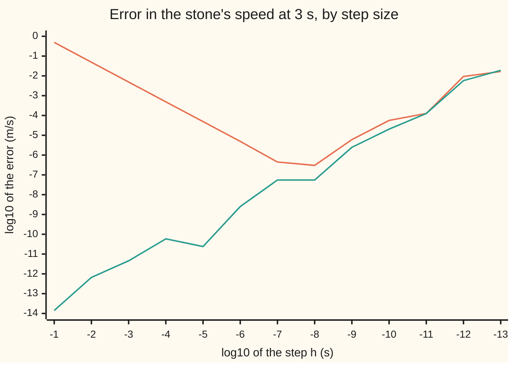

# Two different errors: the formula's truncation and the machine's rounding

[Syllabus](../../../SYLLABUS.md) → [Numerical analysis](../README.md) → [Floating Point and Error](../README.md#s01) → Two different errors

---

## General Overview

A stone dropped from a bridge falls $s(t) = 4.9t^2$ metres in $t$ seconds, if air is ignored. At 3 seconds its true speed is 29.4 metres per second. A program that only knows positions estimates that speed as a slope: the distance gained over a short step $h$, divided by $h$.

With a step of a hundredth of a second (1e-2 s), the estimate is 29.449 m/s, off by 4.90e-2. All of that error comes from the recipe: a chord across 0.01 s is not the tangent. Cut the step to a trillionth of a second (1e-12 s) and the recipe's part of the error falls ten billion times, to 4.90e-12. The run returns 29.409363833111 instead, off by 9.36e-3. At 1e-8 s it was off by only 3.01e-7.

Two different errors are at work.

- **Truncation error** is what the recipe leaves out: a finite step, a cut-off series or a finite number of strips standing in for a limit. It would be there on a perfect machine.
- **Rounding error** is what the machine adds: every stored number and every operation is rounded to 53 binary digits. It would be there with a perfect recipe.

Shrinking the step cuts the first and feeds the second. This card separates the two in four places: the stone's slope, a cut-off series, a quadrature rule (an area found by adding up strips) and a time-stepping method. It then shows how to tell, from a run, which error is in charge.

**Every computed answer's error splits exactly into truncation, which the recipe makes and a finer step shrinks, and rounding, which the arithmetic makes and which grows with smaller differences and more operations; past the step where the two are equal, refining makes the answer worse.**

**What kind of fact this is:** the split is an identity, true by definition; the four truncation laws are theorems, proved on this card in Why it works; the rounding sizes are estimates and bounds from the standard model of floating-point arithmetic.

### The picture: two error curves for the stone's speed

The vertical axis is the base-10 logarithm of the error: −6 means an error of one millionth of a metre per second. The horizontal axis is the base-10 logarithm of the step: −8 means a step of $10^{-8}$ seconds.



Orange: the forward slope, one step ahead. It falls one decade per decade of step while truncation rules, bottoms out at 1e-8, then climbs as rounding takes over. Green: the central slope, one step each way. For a quadratic like $4.9t^2$ it has no truncation error at all, so the green line is rounding alone, rising with small wobbles as the step shrinks.

---

## The formula

Every computation on this card has three versions of one answer:

- $A^\ast$, the exact answer, such as the true speed 29.4 m/s;
- $A(h)$, what the recipe gives with step $h$ in exact arithmetic;
- $\hat A(h)$, read "A-hat of h", what the machine actually returns. The hat means "the computed value", as on [Absolute and relative error](01-absolute-and-relative-error.md).

$$\hat A(h) - A^\ast \;=\; \underbrace{\big(A(h) - A^\ast\big)}_{\text{truncation}} \;+\; \underbrace{\big(\hat A(h) - A(h)\big)}_{\text{rounding}}$$

**Read it aloud:** the total error is the recipe's own error plus the arithmetic's error, with nothing left over.

The two parts have typical sizes

$$\big|A(h) - A^\ast\big| \approx C\,h^{p}, \qquad \big|\hat A(h) - A(h)\big| \approx u\,R(h).$$

**Read it aloud:** truncation is a constant times the step raised to the recipe's order; rounding is the unit roundoff times a magnifier that grows as the step shrinks.

| Symbol | Plain meaning | In our example | Push it up and the answer… |
| --- | --- | --- | --- |
| $s(t)$ | metres the stone has fallen after $t$ seconds | $4.9t^2$; 44.1 m at 3 s | rounding grows with its size |
| $t$ | the time where the speed is wanted, in seconds | 3 s | larger positions, more rounding |
| $h$ | the step: seconds per chord, or width of a strip or time step | 1e-2 s, then 1e-12 s | truncation grows, rounding shrinks |
| $A^\ast$ | the exact answer | 29.4 m/s | — |
| $A(h)$ | the recipe's answer in exact arithmetic | $29.4 + 4.9h$ m/s | — |
| $\hat A(h)$ | the answer the machine returns | 29.449000000000 at 1e-2 | — |
| $C$ | the truncation constant, set by the problem's derivatives | 4.9 m/s² for the stone | more truncation at every step |
| $p$ | the order: how many decades truncation falls per decade of step | 1 (forward), 2 (trapezoid) | truncation falls faster |
| $u$, $\delta$ | $u$ is the unit roundoff, $2^{-53}$: the largest relative error of one rounding in double precision; $\delta$ is the relative error of one rounded operation, at most $u$ in size | 1.11e-16 | more rounding everywhere |
| $R(h)$ | the rounding magnifier: how much the recipe amplifies one rounding | about $2s(t)/h$ for the slope | more rounding |
| $n$, $N$ | counts: $n$ series terms or trapezoid strips, $N$ Euler steps or rounded additions | 10 million additions for the tracker | truncation falls, rounding grows |
| $f$, $y$; $a$, $g$, $w$, $\eta$ | Step 2's other recipes: $f(x)$ is the curve the trapezoid rule integrates, $y$ is Euler's unknown with $y' = y$; in the proof, $[a, a+h]$ is one strip, $g$ is $f$ on it, $w$ is a weight that is zero at both ends, and $\eta$ is a point inside the strip | $f(x) = 4/(1+x^2)$; $y(0) = 1$ | — |

### When it holds

- **The problem is smooth.** The law $Ch^p$ needs enough derivatives across the step. At a corner, such as the value of an option on its expiry day, there is no slope to find and the error stops shrinking with $h$ ([Numerical derivatives](../../06-Calculus%20and%20analysis/03-What%20Derivatives%20Tell%20You/08-numerical-derivatives-and-sensitivity.md) shows it).
- **The step is small enough for the leading term.** $Ch^p$ is the first term of a longer expansion. With only 10 Euler steps the error is 0.916309 of its law, not 1.
- **Rounding is treated as a size, not a value.** $uR(h)$ is an estimate of how large rounding gets. The actual rounding part has a random-looking sign and can be far smaller; with a million trapezoid strips the two errors cancelled so well that the answer equals the stored double for $\pi$, an error of 0.00e0 against it.
- **The inputs are exact.** The split ignores error already in the data, such as a measured position. That is a third error, magnified by the problem itself, the subject of [Conditioning and stability](05-conditioning-and-stability.md).
- **The arithmetic is fixed.** Everything here is double precision with round-to-nearest. Switch to single precision and $u$ becomes $2^{-24}$; only the rounding part changes.

---

## Why it works

### Step 0: add and subtract the exact-arithmetic answer

The split is true for any computation: add $A(h)$ and subtract it again. It is worth making because the two parts answer to different knobs.

| Knob | Truncation | Rounding |
| --- | --- | --- |
| Finer step or more terms | falls, by a known law | grows: smaller differences, more operations |
| More binary digits | does not change | falls in proportion to $u$ |

That table is also the test for which one dominates (Step 5).

### Step 1: the stone's truncation is plain algebra

Expand the forward slope:

$$\frac{s(t+h) - s(t)}{h} = \frac{4.9\,(2th + h^2)}{h} = 9.8t + 4.9h.$$

At $t = 3$ that is $29.4 + 4.9h$ exactly. So $C = 4.9$ and $p = 1$, at every time $t$.

The central slope, $\big(s(t+h) - s(t-h)\big)/(2h)$, gives $9.8t$ exactly: the $h^2$ terms cancel. For any quadratic its truncation is zero, which is why the green line in the picture is pure rounding. For a general smooth function, [Taylor's theorem](../../06-Calculus%20and%20analysis/03-What%20Derivatives%20Tell%20You/05-taylors-theorem.md) gives the forward error as $\tfrac{h}{2}$ times a second derivative, as [Numerical derivatives](../../06-Calculus%20and%20analysis/03-What%20Derivatives%20Tell%20You/08-numerical-derivatives-and-sensitivity.md) proves on an option price.

### Step 2: truncation in three other recipes

**A cut-off series.** The number $e$ is $1 + 1/1! + 1/2! + 1/3! + \dots$, where $n!$ ("n factorial") is $1 \times 2 \times \dots \times n$. Stop after $1/n!$ and the truncation error is the dropped tail. The tail is at least its first term, $1/(n+1)!$, and at most that term times $(n+2)/(n+1)$, because each later term is at most $1/(n+2)$ times the one before, a geometric series. After $1/10!$ the error is −2.73e-8 against a next term of 2.51e-8.

**A quadrature rule.** The area under $f(x) = 4/(1+x^2)$ from 0 to 1 is exactly $\pi$. The trapezoid rule cuts $[0, 1]$ into $n$ strips of width $h = 1/n$ and replaces the curve on each strip by a straight line. Its error is close to

$$\frac{h^2}{12}\big(f'(1) - f'(0)\big) = \frac{h^2}{12}(-2 - 0) = -\frac{h^2}{6},$$

so $p = 2$: ten times more strips, a hundred times less error.

<details>
<summary>Detailed proof: the trapezoid rule's error is close to −h²/6 here</summary>

Take one strip $[a, a+h]$ and write $g(x) = f(a + x)$. Let $w(x) = x(h-x)/2$, which is zero at both ends and positive between. Integrate by parts twice:

$$\int_0^h w\,g''\,dx = \Big[w\,g'\Big]_0^h - \int_0^h \Big(\tfrac{h}{2} - x\Big) g'\,dx = \tfrac{h}{2}\big(g(0) + g(h)\big) - \int_0^h g\,dx.$$

The right side is exactly the strip's trapezoid area minus its true area. Because $w \ge 0$, the mean value theorem for integrals gives a point $\eta$ in the strip with $\int_0^h w\,g'' = g''(\eta)\int_0^h w = \tfrac{h^3}{12} g''(\eta)$.

Add the $n$ strips. The total error is $\tfrac{h^2}{12}\sum h\,f''(\eta_i)$. The sum is a Riemann sum for $\int_0^1 f''\,dx = f'(1) - f'(0) = -2$, so the error is $-\tfrac{h^2}{6}$ times a factor that tends to 1 as $h \to 0$. The full expansion, with further terms in $h^4$, $h^6$ and so on, is the Euler–Maclaurin formula.

</details>

**A time step.** Euler's method solves $y' = y$, $y(0) = 1$, up to $t = 1$ in $N$ steps of size $h = 1/N$. Each step multiplies $y$ by $1 + 1/N$, so the result is $(1 + 1/N)^N$. Its logarithm is

$$N \log\!\Big(1 + \frac1N\Big) = 1 - \frac{1}{2N} + \frac{1}{3N^2} - \dots,$$

so the result is close to $e\,(1 - \tfrac{1}{2N})$ and the error is close to $-e/(2N)$. That is $p = 1$, with $C = e/2$.

### Step 3: rounding, one operation at a time

The standard model from [Machine epsilon and cancellation](03-rounding-cancellation-and-machine-epsilon.md) says each operation returns the exact result times $(1 + \delta)$, with $|\delta| \le u$ = 1.11e-16. Two things then make rounding grow.

**Small differences.** The stored positions 44.1 and $s(3 + h)$ each carry an error up to about $u \times 44.1$ metres. Subtracting two nearly equal numbers keeps those errors while the difference itself shrinks to about $29.4h$: this is cancellation. Dividing by $h$ then magnifies them, so the rounding part is about $2u\,s(t)/h$. At 1e-12 s that estimate is 9.79e-3; the actual rounding part is 9.36e-3. The step itself is rounded too: $3 + 10^{-12}$ is stored as the nearest double, so the step actually taken is 1.000089e-12 s.

**Many operations.** A loop of $N$ additions rounds $N$ times, each time by up to $u$ times the running total. The bound is about $N u$ times the total. A fitness tracker that adds 0.1 ten million times should reach 1,000,000. It reaches 999999.9998389754, off by 1.61e-4, against a bound of 1.11e-3 (ratio 0.145). Here there is no truncation at all: "add them up" is an exact recipe. The error is pure rounding, including the fact that 0.1 has no exact binary form ([IEEE 754](02-ieee-floating-point.md)). [Adding a million numbers without losing the small ones](07-summation-kahan-and-welford.md) removes most of it.

Quadrature and time stepping are loops too. A finer step means more strips or more steps, so their rounding grows like $N$ as truncation falls.

### Step 4: the crossover

Total error is roughly $Ch^p + uR(h)$. The first term falls as $h$ shrinks; the second rises. Near the step where they are equal, the total is smallest: the bottom of the V in the picture.

For the stone's forward slope the bottom is at 1e-8 s, with error 3.01e-7. Below it every finer step gives a worse answer. Where the bottom sits in general, and how to aim for it, is the subject of Choosing the step.

A higher order $p$ lets truncation fall faster, so it reaches the rounding floor at a larger step and a lower error. That is why central differences beat forward ones on smooth functions.

### Step 5: telling them apart from a run

Three tests read the split off a run, even without the exact answer.

1. **Halving test.** Compute $A$ at $h$, $h/2$ and $h/4$, and divide the first change by the second. If truncation $Ch^p$ dominates, the changes are $Ch^p(1 - 2^{-p})$ and $C(h/2)^p(1 - 2^{-p})$, so the ratio is $2^p$. For the stone, $p = 1$: the ratio is 2.000000 at 1e-2 and −0.500000 at 1e-12. A ratio far from $2^p$ means rounding, or a bug.
2. **Precision test.** Rerun in single precision, where $u = 2^{-24}$. Truncation does not move; rounding grows about $2^{29}$ times. At 1e-2 the answer shifts by 8.14e-5, tiny beside the error of 4.90e-2: truncation rules. At 1e-3 it shifts by −5.03e-3, as large as the truncation 4.90e-3: in single precision this step is already at the crossover. At 1e-12 the single-precision answer is 0.000000, because $3 + 10^{-12}$ rounds to 3.
3. **Law test.** When the exact answer is known, divide the error by the truncation law. A ratio near 1 means truncation dominates; a ratio that wanders means rounding has arrived.

The law test on the other three recipes. The series and trapezoid errors are measured against the stored doubles for $e$ and $\pi$, which are themselves rounded, so an error the size of one rounding unit is not the true error.

| Recipe | Knob | Truncation law | Ratio of error to law | Where rounding shows |
| --- | --- | --- | --- | --- |
| Series for $e$ | terms up to $1/n!$ | next term $1/(n+1)!$ | error −2.73e-8 against 2.51e-8 at $n = 10$ | from $1/17!$ on, the error against the stored $e$ sticks at 4.44e-16 |
| Trapezoid for $\pi$ | strips $n$ | $-h^2/6$ | 1.0000 up to $n$ = 1e4; 0.9984 at 1e5 | 0.00e0 against the stored $\pi$ at 1e6, by luck; −116.4402 at 1e7 |
| Euler for $e$ | steps $N$ | $-e/(2N)$ | 0.999084, 0.999908, 0.999991, 0.999999 for $N$ = 1e3 to 1e6 | 1.000007 at 1e7: the ratio overshoots 1 |

The Euler ratio climbs towards 1 from below as the next term in the expansion fades. At 10 million steps it passes 1: rounding has started to show, in the sixth digit.

---

## Worked numbers, by hand

| Step | Arithmetic | Value |
| --- | --- | --- |
| position at 3 s | 4.9 × 3 × 3 | 44.100000000000 m |
| position at 3.01 s | 4.9 × 3.01 × 3.01 | 44.394490000000 m |
| slope, step 1e-2 | (44.394490000000 − 44.100000000000) ÷ 0.01 | 29.449000000000 m/s |
| its truncation | 4.9 × 0.01 | 4.90e-2 |
| its rounding | error 4.90e-2 minus truncation 4.90e-2 | −3.84e-13 |
| slope, step 1e-12 | the same recipe, as run | 29.409363833111 m/s |
| its truncation | 4.9 × 1e-12 | 4.90e-12 |
| rounding, estimated | 2 × 1.11e-16 × 44.1 ÷ 1e-12 | 9.79e-3 |
| rounding, actual | error minus truncation | **9.36e-3 m/s** |

At the coarse step, the error is all truncation and the rounding part is invisible. At the fine step the opposite holds: the error is all rounding, and the estimate $2u\,s(t)/h$ predicts its size.

### What breaks if you drop a piece

| Mistake | Comes out at | What went wrong |
| --- | --- | --- |
| A trillionth-of-a-second step | 29.409363833111, error 9.36e-3 | Rounding divided by a tiny step; 1e-8 gave 3.01e-7 |
| The same step in single precision | 0.000000 | $3 + 10^{-12}$ rounds to 3, so both positions are equal |
| 10 million trapezoid strips | error 1.94e-13 against a law of −1.67e-15 | Rounding from 10 million additions; the sign flipped |
| Series terms past $1/17!$ | error 4.44e-16 against the stored $e$, even at $1/20!$ | The terms fall below one rounding unit of $e$ |
| Trusting the halving test without reading it | ratio −0.500000 at 1e-12 | Rounding noise, not convergence |

The code prints all five.

---

## Code, from first principles, and it actually runs

The script runs four recipes. Road one is the closed forms: the stone's exact speed 29.4 m/s and exact truncation $4.9h$, with $\pi$ and $e$ as stored constants. Road two runs each recipe at many steps and divides its error by its truncation law. Road three reruns the slope in single precision, by rounding each result to 24 binary digits, so only the rounding part changes. The asserts check that the truncation laws hold, that rounding grows where the card says, that the halving and precision tests tell the two apart, and that the tracker's error stays under its bound.

### Python

```python
# Truncation versus rounding -- the check behind the card.  Python standard
# library only; struct is used only to round a double to single precision.
# Road one: closed forms (the stone's speed 29.4 m/s and its truncation 4.9h;
# pi; e).  Road two: each method run at many steps, error against its law.
# Road three: the same slope in single precision, where only rounding changes.
import math, struct
U = 2.0 ** -53                                  # unit roundoff of a double
def r32(x): return struct.unpack("f", struct.pack("f", x))[0]   # round to single
def sci(x, d=2):                                # 1.23e-5, the same in Rust
    m, e = f"{x:.{d}e}".split("e")
    return f"{m}e{int(e)}"
def s(t): return 4.9 * t * t                    # metres fallen after t seconds
def s32(t): return r32(r32(r32(4.9) * t) * t)   # the same, in single precision
def fwd(h, t=3.0): return (s(t + h) - s(t)) / h
def ctr(h, t=3.0): return (s(t + h) - s(t - h)) / (2 * h)
def fwd32(h):
    h = r32(h)
    return r32(r32(s32(r32(3.0 + h)) - s32(3.0)) / h)
def lg(x): return math.log10(abs(x))
V = 29.4                                        # exact speed at t = 3 s
print(f"stone: s(3) = {s(3.0):.12f} m, s(3.01) = {s(3.01):.12f} m, exact speed 29.4 m/s; u = {sci(U)}")
fl, cl = [], []
for k in range(1, 14):
    h = 10.0 ** -k
    f, c = fwd(h), ctr(h)
    fl.append(f"{lg(f - V):.2f}"); cl.append(f"{lg(c - V):.2f}")
    print(f"h=1e-{k}: forward {f:.12f} err {sci(f - V)} = trunc {sci(4.9 * h)} + round {sci(f - V - 4.9 * h)}"
          f" (estimate {sci(2 * U * s(3.0) / h)}); central err {sci(c - V)}")
print("chart forward log10 err: " + ", ".join(fl))
print("chart central log10 err: " + ", ".join(cl))
print(f"step actually taken at h=1e-12: (3 + h) - 3 = {sci((3.0 + 1e-12) - 3.0, 6)}")
def halve(h): return (fwd(h) - fwd(h / 2)) / (fwd(h / 2) - fwd(h / 4))
q2, q12 = halve(1e-2), halve(1e-12)
print(f"halving test (change over next change, 2 if truncation rules): h=1e-2 {q2:.6f}; h=1e-12 {q12:.6f}")
for h in (1e-2, 1e-3, 1e-12):
    print(f"precision test h={sci(h, 0)}: double {fwd(h):.6f}, single {fwd32(h):.6f}, shift {sci(fwd32(h) - fwd(h))}")
print(f"stone at t=30 s, h=1e-12: forward err {sci(fwd(1e-12, 30.0) - 294.0)}, truncation still {sci(4.9e-12)}")
# cut-off series for e = 1 + 1/1! + 1/2! + ...
term, tot, ser = 1.0, 1.0, {}
for n in range(1, 21):
    term /= n; tot += term; ser[n] = tot - math.e
for n in (5, 10, 15, 16, 17, 20):
    nxt = 1.0
    for j in range(1, n + 2):
        nxt /= j
    print(f"series to 1/{n}!: err {sci(ser[n])}, next term {sci(nxt)}")
# trapezoid rule for pi = integral of 4/(1+x^2) from 0 to 1; law -h^2/6
tr = {}
for k in range(1, 8):
    n = 10 ** k
    acc = 3.0
    for i in range(1, n):
        x = i / n
        acc += 4.0 / (1.0 + x * x)
    tr[k] = acc / n - math.pi
    law = -1.0 / (6.0 * n * n)
    print(f"trapezoid n=1e{k}: err {sci(tr[k])}, law {sci(law)}, ratio {tr[k] / law + 0.0:.4f}")
# Euler steps for y' = y, y(0) = 1, to y(1) = e; law -e/(2N)
eu = {}
for k in range(1, 8):
    N = 10 ** k
    y = 1.0
    for _ in range(N):
        y += y / N
    eu[k] = y - math.e
    print(f"Euler N=1e{k}: err {sci(eu[k])}, law {sci(-math.e / (2 * N))}, ratio {eu[k] / (-math.e / (2 * N)):.6f}")
# the house example: 0.1 added ten million times (no truncation at all)
tot = 0.0
for _ in range(10 ** 7):
    tot += 0.1
bound = 10 ** 7 * U * 1e6
print(f"tracker: 0.1 added 1e7 times = {tot:.10f}, err {sci(tot - 1e6)}, bound n u total {sci(bound)}, ratio {(1e6 - tot) / bound:.3f}")
t8, y = 0.0, 1.0                                # two "Try changing" experiments
for _ in range(10 ** 7):
    t8 += 0.125; y *= 1 + 1 / 10 ** 7
print(f"try: 0.125 added 1e7 times err {sci(t8 - 1.25e6)}; Euler as y *= 1 + 1/N at N=1e7: ratio {(y - math.e) / (-math.e / 2e7):.6f}")
assert abs(fwd(1e-2) - V - 4.9e-2) < 1e-11                 # truncation is exactly 4.9h
assert abs(ctr(1e-12) - V) > 1e7 * abs(ctr(1e-2) - V)       # central: pure rounding grows
assert abs(fwd(1e-8) - V) * 1000 < abs(fwd(1e-12) - V)     # a smaller step got worse
assert abs(q2 - 2) < 1e-6 and abs(q12 - 2) > 1                # halving test tells them apart
assert fwd32(1e-12) == 0.0 and abs(fwd32(1e-2) - fwd(1e-2)) < 1e-3
assert 1.0 < -ser[10] * math.factorial(11) < 1.1 and abs(ser[20]) <= 2 * U * math.e   # tail, then floor
assert all(abs(tr[k] * 6 * 100 ** k - (-1)) < 1e-3 for k in range(1, 5)) and tr[7] > 0   # law, then flip
assert all(abs(eu[k] / (-math.e / (2 * 10 ** k)) - 1) < 2e-3 for k in range(3, 8))
assert 0 < 1e6 - tot < bound
print("ALL CHECKS PASS")
```

**Ran 2026-11-11 on macOS, Python 3.14.10, standard library only. All checks passed. Output, pasted from the run:**

```
stone: s(3) = 44.100000000000 m, s(3.01) = 44.394490000000 m, exact speed 29.4 m/s; u = 1.11e-16
h=1e-1: forward 29.890000000000 err 4.90e-1 = trunc 4.90e-1 + round 4.46e-14 (estimate 9.79e-14); central err 1.42e-14
h=1e-2: forward 29.449000000000 err 4.90e-2 = trunc 4.90e-2 + round -3.84e-13 (estimate 9.79e-13); central err -6.61e-13
h=1e-3: forward 29.404899999996 err 4.90e-3 = trunc 4.90e-3 + round -4.15e-12 (estimate 9.79e-12); central err -4.57e-12
h=1e-4: forward 29.400490000100 err 4.90e-4 = trunc 4.90e-4 + round 9.99e-11 (estimate 9.79e-11); central err 5.94e-11
h=1e-5: forward 29.400049000117 err 4.90e-5 = trunc 4.90e-5 + round 1.17e-10 (estimate 9.79e-10); central err 2.38e-11
h=1e-6: forward 29.400004905256 err 4.91e-6 = trunc 4.90e-6 + round 5.26e-9 (estimate 9.79e-9); central err 2.51e-9
h=1e-7: forward 29.400000443047 err 4.43e-7 = trunc 4.90e-7 + round -4.70e-8 (estimate 9.79e-8); central err -5.43e-8
h=1e-8: forward 29.400000300939 err 3.01e-7 = trunc 4.90e-8 + round 2.52e-7 (estimate 9.79e-7); central err -5.43e-8
h=1e-9: forward 29.400005985281 err 5.99e-6 = trunc 4.90e-9 + round 5.98e-6 (estimate 9.79e-6); central err 2.43e-6
h=1e-10: forward 29.400055723272 err 5.57e-5 = trunc 4.90e-10 + round 5.57e-5 (estimate 9.79e-5); central err 2.02e-5
h=1e-11: forward 29.400126777546 err 1.27e-4 = trunc 4.90e-11 + round 1.27e-4 (estimate 9.79e-4); central err 1.27e-4
h=1e-12: forward 29.409363833111 err 9.36e-3 = trunc 4.90e-12 + round 9.36e-3 (estimate 9.79e-3); central err 5.81e-3
h=1e-13: forward 29.416469260468 err 1.65e-2 = trunc 4.90e-13 + round 1.65e-2 (estimate 9.79e-2); central err -1.91e-2
chart forward log10 err: -0.31, -1.31, -2.31, -3.31, -4.31, -5.31, -6.35, -6.52, -5.22, -4.25, -3.90, -2.03, -1.78
chart central log10 err: -13.85, -12.18, -11.34, -10.23, -10.62, -8.60, -7.26, -7.26, -5.61, -4.69, -3.90, -2.24, -1.72
step actually taken at h=1e-12: (3 + h) - 3 = 1.000089e-12
halving test (change over next change, 2 if truncation rules): h=1e-2 2.000000; h=1e-12 -0.500000
precision test h=1e-2: double 29.449000, single 29.449081, shift 8.14e-5
precision test h=1e-3: double 29.404900, single 29.399870, shift -5.03e-3
precision test h=1e-12: double 29.409364, single 0.000000, shift -2.94e1
stone at t=30 s, h=1e-12: forward err -2.33e-1, truncation still 4.90e-12
series to 1/5!: err -1.62e-3, next term 1.39e-3
series to 1/10!: err -2.73e-8, next term 2.51e-8
series to 1/15!: err -5.02e-14, next term 4.78e-14
series to 1/16!: err -2.22e-15, next term 2.81e-15
series to 1/17!: err 4.44e-16, next term 1.56e-16
series to 1/20!: err 4.44e-16, next term 1.96e-20
trapezoid n=1e1: err -1.67e-3, law -1.67e-3, ratio 1.0000
trapezoid n=1e2: err -1.67e-5, law -1.67e-5, ratio 1.0000
trapezoid n=1e3: err -1.67e-7, law -1.67e-7, ratio 1.0000
trapezoid n=1e4: err -1.67e-9, law -1.67e-9, ratio 1.0000
trapezoid n=1e5: err -1.66e-11, law -1.67e-11, ratio 0.9984
trapezoid n=1e6: err 0.00e0, law -1.67e-13, ratio 0.0000
trapezoid n=1e7: err 1.94e-13, law -1.67e-15, ratio -116.4402
Euler N=1e1: err -1.25e-1, law -1.36e-1, ratio 0.916309
Euler N=1e2: err -1.35e-2, law -1.36e-2, ratio 0.990920
Euler N=1e3: err -1.36e-3, law -1.36e-3, ratio 0.999084
Euler N=1e4: err -1.36e-4, law -1.36e-4, ratio 0.999908
Euler N=1e5: err -1.36e-5, law -1.36e-5, ratio 0.999991
Euler N=1e6: err -1.36e-6, law -1.36e-6, ratio 0.999999
Euler N=1e7: err -1.36e-7, law -1.36e-7, ratio 1.000007
tracker: 0.1 added 1e7 times = 999999.9998389754, err -1.61e-4, bound n u total 1.11e-3, ratio 0.145
try: 0.125 added 1e7 times err 0.00e0; Euler as y *= 1 + 1/N at N=1e7: ratio 0.988323
ALL CHECKS PASS
```

### Rust

```rust
// Truncation versus rounding -- the check behind the card.  Rust std only.
// Road one: closed forms (the stone's speed 29.4 m/s and its truncation 4.9h;
// pi; e).  Road two: each method run at many steps, error against its law.
// Road three: the same slope in single precision, where only rounding changes.
const U: f64 = 1.0 / 9007199254740992.0; // 2^-53, unit roundoff of a double
const V: f64 = 29.4; // exact speed at t = 3 s
fn sci(x: f64, d: usize) -> String { format!("{:.*e}", d, x) }
fn s(t: f64) -> f64 { 4.9 * t * t } // metres fallen after t seconds
fn s32(t: f32) -> f32 { 4.9f32 * t * t } // the same, in single precision
fn fwd_at(h: f64, t: f64) -> f64 { (s(t + h) - s(t)) / h }
fn fwd(h: f64) -> f64 { fwd_at(h, 3.0) }
fn ctr(h: f64) -> f64 { (s(3.0 + h) - s(3.0 - h)) / (2.0 * h) }
fn fwd32(h: f64) -> f64 {
    let h = h as f32;
    ((s32(3.0f32 + h) - s32(3.0)) / h) as f64
}
fn lg(x: f64) -> f64 { x.abs().log10() }
fn halve(h: f64) -> f64 { (fwd(h) - fwd(h / 2.0)) / (fwd(h / 2.0) - fwd(h / 4.0)) }
fn main() {
    let e = std::f64::consts::E;
    let pi = std::f64::consts::PI;
    println!("stone: s(3) = {:.12} m, s(3.01) = {:.12} m, exact speed 29.4 m/s; u = {}", s(3.0), s(3.01), sci(U, 2));
    let (mut fl, mut cl) = (Vec::new(), Vec::new());
    for k in 1..14 {
        let h = 10f64.powi(-k);
        let (f, c) = (fwd(h), ctr(h));
        fl.push(format!("{:.2}", lg(f - V)));
        cl.push(format!("{:.2}", lg(c - V)));
        println!("h=1e-{}: forward {:.12} err {} = trunc {} + round {} (estimate {}); central err {}",
            k, f, sci(f - V, 2), sci(4.9 * h, 2), sci(f - V - 4.9 * h, 2), sci(2.0 * U * s(3.0) / h, 2), sci(c - V, 2));
    }
    println!("chart forward log10 err: {}", fl.join(", "));
    println!("chart central log10 err: {}", cl.join(", "));
    println!("step actually taken at h=1e-12: (3 + h) - 3 = {}", sci((3.0 + 1e-12) - 3.0, 6));
    let (q2, q12) = (halve(1e-2), halve(1e-12));
    println!("halving test (change over next change, 2 if truncation rules): h=1e-2 {:.6}; h=1e-12 {:.6}", q2, q12);
    for h in [1e-2, 1e-3, 1e-12] {
        println!("precision test h={}: double {:.6}, single {:.6}, shift {}", sci(h, 0), fwd(h), fwd32(h), sci(fwd32(h) - fwd(h), 2));
    }
    println!("stone at t=30 s, h=1e-12: forward err {}, truncation still {}", sci(fwd_at(1e-12, 30.0) - 294.0, 2), sci(4.9e-12, 2));
    // cut-off series for e = 1 + 1/1! + 1/2! + ...
    let (mut term, mut tot) = (1.0f64, 1.0f64);
    let mut ser = [0.0f64; 21];
    for n in 1..21 {
        term /= n as f64;
        tot += term;
        ser[n] = tot - e;
    }
    for n in [5usize, 10, 15, 16, 17, 20] {
        let mut nxt = 1.0f64;
        for j in 1..n + 2 {
            nxt /= j as f64;
        }
        println!("series to 1/{}!: err {}, next term {}", n, sci(ser[n], 2), sci(nxt, 2));
    }
    // trapezoid rule for pi = integral of 4/(1+x^2) from 0 to 1; law -h^2/6
    let mut tr = [0.0f64; 8];
    for k in 1..8 {
        let n = 10u64.pow(k as u32);
        let mut acc = 3.0f64;
        for i in 1..n {
            let x = i as f64 / n as f64;
            acc += 4.0 / (1.0 + x * x);
        }
        tr[k] = acc / n as f64 - pi;
        let law = -1.0 / (6.0 * n as f64 * n as f64);
        println!("trapezoid n=1e{}: err {}, law {}, ratio {:.4}", k, sci(tr[k], 2), sci(law, 2), tr[k] / law + 0.0);
    }
    // Euler steps for y' = y, y(0) = 1, to y(1) = e; law -e/(2N)
    let mut eu = [0.0f64; 8];
    for k in 1..8 {
        let n = 10u64.pow(k as u32);
        let nf = n as f64;
        let mut y = 1.0f64;
        for _ in 0..n {
            y += y / nf;
        }
        eu[k] = y - e;
        println!("Euler N=1e{}: err {}, law {}, ratio {:.6}", k, sci(eu[k], 2), sci(-e / (2.0 * nf), 2), eu[k] / (-e / (2.0 * nf)));
    }
    // the house example: 0.1 added ten million times (no truncation at all)
    let mut tot = 0.0f64;
    for _ in 0..10_000_000 {
        tot += 0.1;
    }
    let bound = 1e7 * U * 1e6;
    println!("tracker: 0.1 added 1e7 times = {:.10}, err {}, bound n u total {}, ratio {:.3}", tot, sci(tot - 1e6, 2), sci(bound, 2), (1e6 - tot) / bound);
    let (mut t8, mut y) = (0.0f64, 1.0f64); // two "Try changing" experiments
    for _ in 0..10_000_000 {
        t8 += 0.125;
        y *= 1.0 + 1.0 / 1e7;
    }
    println!("try: 0.125 added 1e7 times err {}; Euler as y *= 1 + 1/N at N=1e7: ratio {:.6}", sci(t8 - 1.25e6, 2), (y - e) / (-e / 2e7));
    let fact11: f64 = (1..12).map(|j| j as f64).product();
    assert!((fwd(1e-2) - V - 4.9e-2).abs() < 1e-11); // truncation is exactly 4.9h
    assert!((ctr(1e-12) - V).abs() > 1e7 * (ctr(1e-2) - V).abs()); // central: pure rounding grows
    assert!((fwd(1e-8) - V).abs() * 1000.0 < (fwd(1e-12) - V).abs()); // a smaller step got worse
    assert!((q2 - 2.0).abs() < 1e-6 && (q12 - 2.0).abs() > 1.0); // halving test tells them apart
    assert!(fwd32(1e-12) == 0.0 && (fwd32(1e-2) - fwd(1e-2)).abs() < 1e-3);
    assert!(1.0 < -ser[10] * fact11 && -ser[10] * fact11 < 1.1 && ser[20].abs() <= 2.0 * U * e); // tail, then floor
    assert!((1..5).all(|k| (tr[k] * 6.0 * 100f64.powi(k as i32) + 1.0).abs() < 1e-3) && tr[7] > 0.0); // law, then flip
    assert!((3..8).all(|k| (eu[k] / (-e / (2.0 * 10f64.powi(k as i32))) - 1.0).abs() < 2e-3));
    assert!(0.0 < 1e6 - tot && 1e6 - tot < bound);
    println!("ALL CHECKS PASS");
}
```

**Ran 2026-11-11 on macOS, rustc 1.98.1, no crates. All checks passed. Output, pasted from the run:**

```
stone: s(3) = 44.100000000000 m, s(3.01) = 44.394490000000 m, exact speed 29.4 m/s; u = 1.11e-16
h=1e-1: forward 29.890000000000 err 4.90e-1 = trunc 4.90e-1 + round 4.46e-14 (estimate 9.79e-14); central err 1.42e-14
h=1e-2: forward 29.449000000000 err 4.90e-2 = trunc 4.90e-2 + round -3.84e-13 (estimate 9.79e-13); central err -6.61e-13
h=1e-3: forward 29.404899999996 err 4.90e-3 = trunc 4.90e-3 + round -4.15e-12 (estimate 9.79e-12); central err -4.57e-12
h=1e-4: forward 29.400490000100 err 4.90e-4 = trunc 4.90e-4 + round 9.99e-11 (estimate 9.79e-11); central err 5.94e-11
h=1e-5: forward 29.400049000117 err 4.90e-5 = trunc 4.90e-5 + round 1.17e-10 (estimate 9.79e-10); central err 2.38e-11
h=1e-6: forward 29.400004905256 err 4.91e-6 = trunc 4.90e-6 + round 5.26e-9 (estimate 9.79e-9); central err 2.51e-9
h=1e-7: forward 29.400000443047 err 4.43e-7 = trunc 4.90e-7 + round -4.70e-8 (estimate 9.79e-8); central err -5.43e-8
h=1e-8: forward 29.400000300939 err 3.01e-7 = trunc 4.90e-8 + round 2.52e-7 (estimate 9.79e-7); central err -5.43e-8
h=1e-9: forward 29.400005985281 err 5.99e-6 = trunc 4.90e-9 + round 5.98e-6 (estimate 9.79e-6); central err 2.43e-6
h=1e-10: forward 29.400055723272 err 5.57e-5 = trunc 4.90e-10 + round 5.57e-5 (estimate 9.79e-5); central err 2.02e-5
h=1e-11: forward 29.400126777546 err 1.27e-4 = trunc 4.90e-11 + round 1.27e-4 (estimate 9.79e-4); central err 1.27e-4
h=1e-12: forward 29.409363833111 err 9.36e-3 = trunc 4.90e-12 + round 9.36e-3 (estimate 9.79e-3); central err 5.81e-3
h=1e-13: forward 29.416469260468 err 1.65e-2 = trunc 4.90e-13 + round 1.65e-2 (estimate 9.79e-2); central err -1.91e-2
chart forward log10 err: -0.31, -1.31, -2.31, -3.31, -4.31, -5.31, -6.35, -6.52, -5.22, -4.25, -3.90, -2.03, -1.78
chart central log10 err: -13.85, -12.18, -11.34, -10.23, -10.62, -8.60, -7.26, -7.26, -5.61, -4.69, -3.90, -2.24, -1.72
step actually taken at h=1e-12: (3 + h) - 3 = 1.000089e-12
halving test (change over next change, 2 if truncation rules): h=1e-2 2.000000; h=1e-12 -0.500000
precision test h=1e-2: double 29.449000, single 29.449081, shift 8.14e-5
precision test h=1e-3: double 29.404900, single 29.399870, shift -5.03e-3
precision test h=1e-12: double 29.409364, single 0.000000, shift -2.94e1
stone at t=30 s, h=1e-12: forward err -2.33e-1, truncation still 4.90e-12
series to 1/5!: err -1.62e-3, next term 1.39e-3
series to 1/10!: err -2.73e-8, next term 2.51e-8
series to 1/15!: err -5.02e-14, next term 4.78e-14
series to 1/16!: err -2.22e-15, next term 2.81e-15
series to 1/17!: err 4.44e-16, next term 1.56e-16
series to 1/20!: err 4.44e-16, next term 1.96e-20
trapezoid n=1e1: err -1.67e-3, law -1.67e-3, ratio 1.0000
trapezoid n=1e2: err -1.67e-5, law -1.67e-5, ratio 1.0000
trapezoid n=1e3: err -1.67e-7, law -1.67e-7, ratio 1.0000
trapezoid n=1e4: err -1.67e-9, law -1.67e-9, ratio 1.0000
trapezoid n=1e5: err -1.66e-11, law -1.67e-11, ratio 0.9984
trapezoid n=1e6: err 0.00e0, law -1.67e-13, ratio 0.0000
trapezoid n=1e7: err 1.94e-13, law -1.67e-15, ratio -116.4402
Euler N=1e1: err -1.25e-1, law -1.36e-1, ratio 0.916309
Euler N=1e2: err -1.35e-2, law -1.36e-2, ratio 0.990920
Euler N=1e3: err -1.36e-3, law -1.36e-3, ratio 0.999084
Euler N=1e4: err -1.36e-4, law -1.36e-4, ratio 0.999908
Euler N=1e5: err -1.36e-5, law -1.36e-5, ratio 0.999991
Euler N=1e6: err -1.36e-6, law -1.36e-6, ratio 0.999999
Euler N=1e7: err -1.36e-7, law -1.36e-7, ratio 1.000007
tracker: 0.1 added 1e7 times = 999999.9998389754, err -1.61e-4, bound n u total 1.11e-3, ratio 0.145
try: 0.125 added 1e7 times err 0.00e0; Euler as y *= 1 + 1/N at N=1e7: ratio 0.988323
ALL CHECKS PASS
```

### Lean

Lean proves the exact algebra behind the stone's slopes, the series for $e$ and the halving test, for every step and term count.

- For any quadratic position, like the stone's $4.9t^2$, the forward slope's truncation is exactly $Ch$, with $C$ the number in front of $t^2$. This holds for every step except zero.
- For any quadratic position, the central slope has no truncation error at all.
- Stop the series for $e$ after $1/n!$, for any $n$. The dropped tail is at least $1/(n+1)!$ and at most that term times $(n+2)/(n+1)$.
- If an answer is exactly $A^\ast + Ch^p$, with $C$ not zero and order $p$ at least 1, the halving test's ratio is exactly $2^p$. This holds for every step except zero.
- The hand arithmetic holds exactly: the positions 44.1 m and 44.39449 m, the 29.449 m/s slope and its 0.049 error, the central 29.4 m/s, $11! = 39916800$ and the tracker's exact 1,000,000.

The trapezoid and Euler laws, all rounding sizes, and the three tests on actual runs are left to the Python and Rust checks.

```lean
-- Two different errors: the truncation laws behind the card hold exactly: a quadratic's forward slope is off by a times h and its central slope by nothing, the series for e cut after 1/n! falls short by between 1/(n+1)! and (n+2)/(n+1) times that, and when the error is exactly C h^p the halving ratio is 2^p.
import Mathlib.Analysis.Calculus.Deriv.Pow
import Mathlib.Analysis.Calculus.Deriv.Add
import Mathlib.Analysis.Calculus.Deriv.Mul
import Mathlib.Analysis.Complex.Exponential
import Mathlib.Data.Nat.Factorial.Basic

open Finset

/-- The stone's truncation is plain algebra. For a quadratic position
`s(x) = a x^2 + b x + c` and any step `h ≠ 0`, the forward slope
`(s(t+h) - s(t)) / h` misses the true slope `s'(t)` by exactly `a h`
(truncation of order 1 with constant `a`; for the stone `a = 4.9`), while the
central slope `(s(t+h) - s(t-h)) / (2h)` has no truncation error at all. -/
theorem quadratic_slope_truncation (a b c t h : ℝ) (s : ℝ → ℝ)
    (hs : ∀ x, s x = a * x ^ 2 + b * x + c) (hh : h ≠ 0) :
    (s (t + h) - s t) / h - deriv s t = a * h ∧
      (s (t + h) - s (t - h)) / (2 * h) - deriv s t = 0 := by
  have hfun : s = fun x => a * x ^ 2 + b * x + c := funext hs
  have hd : deriv s t = 2 * a * t + b := by
    subst hfun
    have h1 : HasDerivAt (fun x : ℝ => a * x ^ 2 + b * x + c) (a * (2 * t) + b) t := by
      have hx2 : HasDerivAt (fun x : ℝ => x ^ 2) (2 * t) t := by
        simpa using hasDerivAt_pow 2 t
      have := HasDerivAt.add_const c (HasDerivAt.add (HasDerivAt.const_mul a hx2) (HasDerivAt.const_mul b (hasDerivAt_id t)))
      simpa using this
    rw [h1.deriv]; ring
  rw [hd, hs, hs, hs]
  constructor
  · field_simp
    ring
  · field_simp
    ring

/-- A cut-off series. Stopping the series `e = 1 + 1/1! + 1/2! + ...` after the
term `1/n!` leaves a truncation error (the dropped tail) that is at least the
next term `1/(n+1)!` and at most that term times `(n+2)/(n+1)`. -/
theorem exp_one_series_tail_bounds (n : ℕ) :
    1 / ((n + 1).factorial : ℝ) ≤
        Real.exp 1 - ∑ k ∈ range (n + 1), 1 / (k.factorial : ℝ) ∧
      Real.exp 1 - ∑ k ∈ range (n + 1), 1 / (k.factorial : ℝ) ≤
        1 / ((n + 1).factorial : ℝ) * ((n + 2) / (n + 1)) := by
  have hs : ∀ m : ℕ, ∑ k ∈ range m, 1 / (k.factorial : ℝ) =
      ∑ k ∈ range m, (1 : ℝ) ^ k / (k.factorial : ℝ) := by
    intro m; simp
  constructor
  · have h := Real.sum_le_exp_of_nonneg (x := 1) zero_le_one (n + 2)
    rw [← hs, sum_range_succ] at h
    linarith
  · have h := Real.exp_bound (x := 1) (by simp) (n := n + 1) (Nat.succ_pos n)
    rw [← hs] at h
    have h2 := (abs_le.mp h).2
    refine le_trans h2 (le_of_eq ?_)
    have hf : ((n + 1).factorial : ℝ) ≠ 0 := by positivity
    have hn : ((n : ℝ) + 1) ≠ 0 := by positivity
    push_cast
    field_simp
    ring

/-- The halving test. If a recipe's answer is its exact value plus a pure
truncation term, `A(x) = A* + C x^p` with `C ≠ 0` and order `p ≥ 1`, then for
any step `h ≠ 0` the change from `h` to `h/2`, divided by the change from `h/2`
to `h/4`, is exactly `2^p`. -/
theorem halving_ratio_eq_two_pow (A : ℝ → ℝ) (Astar C h : ℝ) (p : ℕ)
    (hA : ∀ x, A x = Astar + C * x ^ p) (hC : C ≠ 0) (hp : 1 ≤ p) (hh : h ≠ 0) :
    (A h - A (h / 2)) / (A (h / 2) - A (h / 4)) = 2 ^ p := by
  rw [hA, hA, hA]
  have h2 : (2 : ℝ) ^ p ≠ 0 := by positivity
  have hp1 : (2 : ℝ) ^ p ≠ 1 := by
    have : (1 : ℝ) < 2 ^ p := one_lt_pow₀ (by norm_num) (by omega)
    exact ne_of_gt this
  have hhp : h ^ p ≠ 0 := pow_ne_zero p hh
  have e1 : (h / 2) ^ p = h ^ p / 2 ^ p := div_pow h 2 p
  have e2 : (h / 4) ^ p = h ^ p / (2 ^ p * 2 ^ p) := by
    rw [div_pow, ← mul_pow]; norm_num
  have hsub : (2 : ℝ) ^ p - 1 ≠ 0 := sub_ne_zero.mpr hp1
  rw [e1, e2]
  generalize (2 : ℝ) ^ p = q at *
  generalize h ^ p = H at *
  have hden : Astar + C * (H / q) - (Astar + C * (H / (q * q))) = C * H * (q - 1) / (q * q) := by
    field_simp
    ring
  have hden0 : C * H * (q - 1) / (q * q) ≠ 0 :=
    div_ne_zero (mul_ne_zero (mul_ne_zero hC hhp) hsub) (mul_ne_zero h2 h2)
  rw [hden, div_eq_iff hden0]
  field_simp
  ring

-- Worked numbers, in exact rationals: the stone s(t) = 49/10 t^2 at t = 3 s.
-- Position at 3 s is 44.1 m and at 3.01 s is 44.39449 m.
example : (49 / 10 : ℚ) * 3 * 3 = 441 / 10 := by norm_num
example : (49 / 10 : ℚ) * (301 / 100) * (301 / 100) = 4439449 / 100000 := by norm_num
-- The forward slope with step 1/100 s is 29.449 m/s, so its error is 0.049 = 4.9 × 0.01.
example : ((49 / 10 : ℚ) * (3 + 1 / 100) ^ 2 - 49 / 10 * 3 ^ 2) / (1 / 100) = 29449 / 1000 := by
  norm_num
example : (29449 / 1000 : ℚ) - 294 / 10 = 49 / 10 * (1 / 100) := by norm_num
-- The central slope with the same step is exactly 29.4 m/s.
example : ((49 / 10 : ℚ) * (3 + 1 / 100) ^ 2 - 49 / 10 * (3 - 1 / 100) ^ 2) / (2 * (1 / 100)) =
    294 / 10 := by norm_num
-- The next term after 1/10! is 1/11!, and 11! = 39916800.
example : Nat.factorial 11 = 39916800 := by decide
-- The tracker's exact recipe: 0.1 added ten million times is 1,000,000.
example : (10 ^ 7 : ℚ) * (1 / 10) = 10 ^ 6 := by norm_num

#print axioms quadratic_slope_truncation
#print axioms exp_one_series_tail_bounds
#print axioms halving_ratio_eq_two_pow
```

**Checked 2026-11-11 on macOS, Lean 4.36.0-rc2, Mathlib v4.36.0-rc2. Every proof is complete and uses only Lean's standard axioms. Output, pasted from the run:**

```
'quadratic_slope_truncation' depends on axioms: [propext, Classical.choice, Quot.sound]
'exp_one_series_tail_bounds' depends on axioms: [propext, Classical.choice, Quot.sound]
'halving_ratio_eq_two_pow' depends on axioms: [propext, Classical.choice, Quot.sound]
```

> [!TIP]
> **Try changing**
> - **Time the stone at 30 s instead of 3 s** (`fwd(1e-12, 30.0)`, exact speed 294). Guess first: does the truncation change? No: it is still 4.90e-12, since $C = 4.9$ at every time. The positions are 100 times larger, so rounding grows: the error is −2.33e-1.
> - **Add 0.125 instead of 0.1 in the tracker loop** (and expect 1,250,000). Guess first: how big is the error? Zero (0.00e0): 0.125 is $2^{-3}$, and every running total is stored exactly.
> - **Write Euler's step as `y *= 1 + 1/N`.** Guess first: same truncation, same rounding? Same truncation. But $1 + 1/N$ is rounded once and that error is multiplied in $N$ times, so at $N$ = 1e7 the ratio to the law falls from 1.000007 to 0.988323.

---

## The usual mistake

> [!warning]
> **Treating a smaller step as always safer.** Truncation falls with the step, but rounding rises, and below the crossover every refinement makes the answer worse. The trillionth-of-a-second step gives 29.409363833111, an error of 9.36e-3; the 1e-8 step's error was only 3.01e-7.
>
> - **Calling every error "rounding".** At 1e-2 the error 4.90e-2 is all truncation; more digits would change it by only 8.14e-5.
> - **Adding more terms, strips or steps past the floor.** The series for $e$ sticks 4.44e-16 above the stored $e$ from $1/17!$ on; the extra work buys nothing.
> - **Reading a lucky zero as accuracy.** A million trapezoid strips landed exactly on the stored double for $\pi$: an error of 0.00e0 against it. Ten million gave 1.94e-13. The zero was truncation and rounding cancelling by chance.
> - **Forgetting the loop that has no truncation.** The tracker's 999999.9998389754 is wrong by 1.61e-4 with an exact recipe. Rounding alone did it.

---

## Where you meet it in real life

- **Risk systems.** Banks bump a price to estimate its sensitivities. A bump too small returns rounding noise; [Numerical derivatives](../../06-Calculus%20and%20analysis/03-What%20Derivatives%20Tell%20You/08-numerical-derivatives-and-sensitivity.md) works the option-price case.
- **Maths libraries.** Routines for functions such as $e^x$ stop their series or polynomial once truncation falls below about one rounding unit. Beyond that, as with the series for $e$ here, extra terms cost time and add nothing.
- **Simulation codes.** Engineers halve the time step or the mesh and check that the answer changes by the expected factor. This is the halving test, run as a convergence study.
- **Fitness trackers and utility meters.** A running total of many small readings has no truncation at all, only rounding that piles up; compensated summation fixes it.
- **Graphics chips and machine learning.** Single and half precision make $u$ much larger, so the crossover moves to larger steps. Checks of a coded gradient against a difference quotient are usually run in double precision for that reason.

> **Say it back**
> Every computed answer's error is truncation plus rounding, exactly. Truncation is the recipe's: a step, a cut-off series or a strip width, and it falls by a known law as the step shrinks. Rounding is the machine's: each operation is off by up to $u$, and small differences and long loops magnify it. The two cross at a best step, and refining past it makes things worse. A halving test, a precision test or a law test on the run says which error is in charge.

---

## What this builds on

- [Machine epsilon and cancellation](03-rounding-cancellation-and-machine-epsilon.md): the unit roundoff $u$, the standard model of one rounded operation, and cancellation.
- [Taylor's theorem](../../06-Calculus%20and%20analysis/03-What%20Derivatives%20Tell%20You/05-taylors-theorem.md): the remainder term that turns a recipe's truncation into a law with a constant and an order.
- [Numerical derivatives](../../06-Calculus%20and%20analysis/03-What%20Derivatives%20Tell%20You/08-numerical-derivatives-and-sensitivity.md): the first meeting of the two errors, on a bumped option price; this card extends it to series, quadrature and time steps.

## Where this goes next

- [Conditioning and stability](05-conditioning-and-stability.md): the third error source, input error magnified by the problem, and whether an algorithm keeps its own rounding small.
- [Choosing the step](../08-Derivatives%20by%20Machine/04-choosing-the-step-truncation-against-rounding.md): where the bottom of the V sits, and the square-root and cube-root rules for finding it.

This card shows how to recognise the crossover after a run; it leaves open how to predict the best step before one.

---

## Sources

Verified 2026-11-11: every link below resolves to the publisher's page or, for Driscoll and Braun, to the authors' online book.

- Higham, Nicholas J. *Accuracy and Stability of Numerical Algorithms*, 2nd ed. SIAM, 2002. [doi:10.1137/1.9780898718027](https://doi.org/10.1137/1.9780898718027). Chapter 2: the standard model of rounding; chapter 4: rounding error in long sums.
- Goldberg, David. "What every computer scientist should know about floating-point arithmetic." *ACM Computing Surveys* 23(1), 1991. [doi:10.1145/103162.103163](https://doi.org/10.1145/103162.103163). Rounding error, units in the last place and cancellation.
- Driscoll, Tobin A., and Richard J. Braun. *Fundamentals of Numerical Computation*, chapter 5, "Convergence of finite differences". [Authors' online book](https://fncbook.com/fd-converge/). Truncation against roundoff for a difference quotient.
- Driscoll and Braun, chapter 5, "Numerical integration". [Authors' online book](https://fncbook.com/integration/). The trapezoid rule's error and the Euler–Maclaurin formula.
- Driscoll and Braun, chapter 6, "Euler's method". [Authors' online book](https://fncbook.com/euler/). Truncation error of a one-step method and its first-order convergence.
