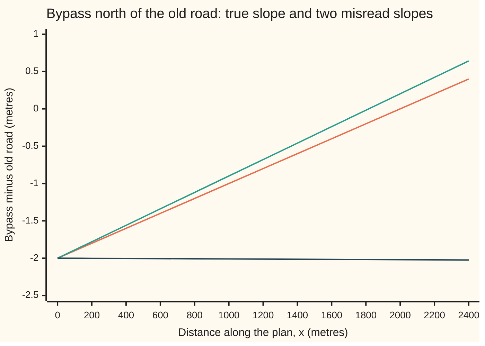
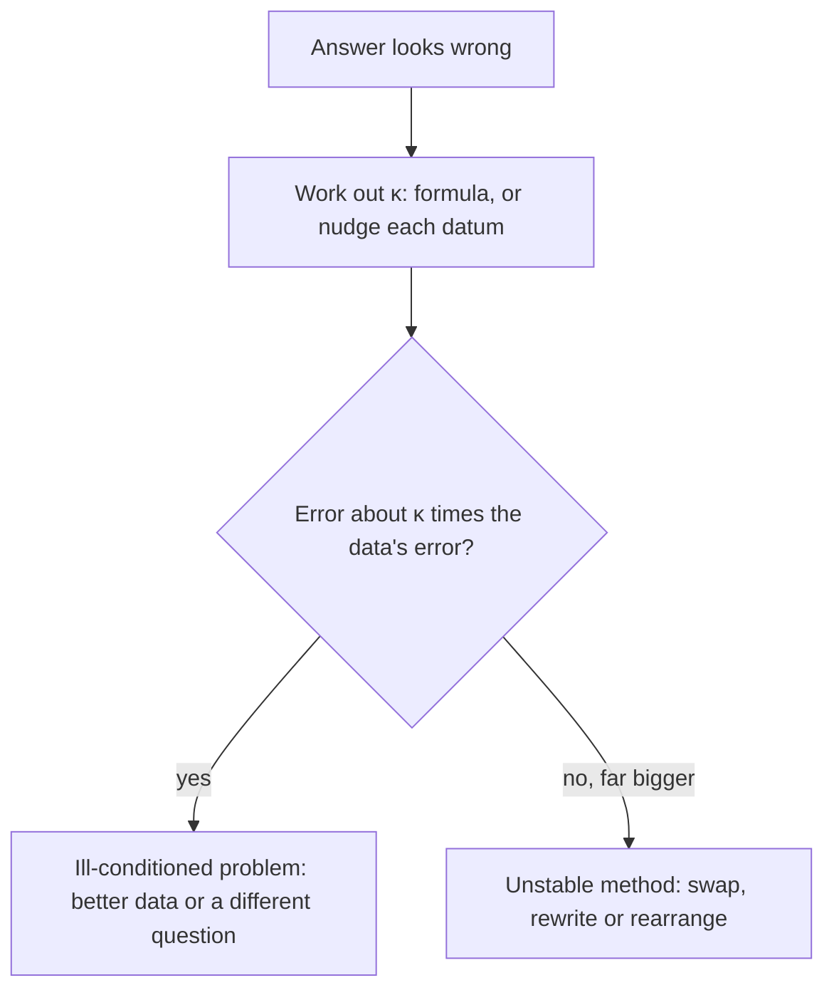

# Conditioning and stability: a fragile problem is not the same thing as a sloppy method

[Syllabus](../../../SYLLABUS.md) → [Numerical analysis](../README.md) → [Floating Point and Error](../README.md#s01) → Conditioning and stability

---

## General Overview

A new bypass leaves an old country road at a very shallow angle. On the surveyor's plan, the old road is the line y = 0.1x and the bypass is y = 0.101x − 2, in metres. At the start of the plan the bypass is 2 m south of the old road. It closes in by 1 m every kilometre, so the two roads cross 2,000 m along.

Now suppose the bypass's slope was read 0.1% too high: 0.101101 instead of 0.101. The crossing moves to 1,816.53 m. A one-in-a-thousand slip in one number has moved the answer 183.47 m, or 9.17%. Read the slope 1% too low and the roads cross 200 km behind the start.

No computer did anything wrong there. The same numbers come out in exact arithmetic. The trouble is the **problem**: two nearly parallel lines meet at a point that is very sensitive to their directions. That sensitivity is measured by one number, the **condition number**, written κ (the Greek letter kappa). Here it is 202.

A different trouble looks the same from outside. Two roads that cross at a healthy 45 degrees have κ = 4, yet one textbook way of solving their equations returns a crossing 100% wrong. That trouble is the **method**. Swap the order of two steps and the answer is right to the last digit.

**The condition number says how much the problem itself magnifies a small relative error in its data; a stable method adds no more error than a few roundings in the data would, so a large error with a small κ blames the method, and a large error that matches κ times the data's error blames the problem.**

**What kind of fact this is:** a definition (the condition number) and a theorem, proved on this card in Why it works: to first order, a backward-stable method's relative error is at most κ times the size of its relative error in the data.

### The picture: how far the bypass is from the old road



The roads cross where a line passes 0. The orange line is the true bypass: it reaches 0 at 2,000 m. The green line is the slope read 0.1% high: it reaches 0 near 1,816 m. The dark line is the slope read 1% low: it drifts away and never reaches 0 ahead; the roads meet 200 km behind. The two roads are only 0.0567 degrees apart, so a tiny change in a slope swings the meeting point a long way.

---

## The formula

A road written y = mx + c has slope m (metres north per metre east) and intercept c (where it crosses x = 0). Set the two roads equal and solve for x:

$$x = \frac{c_2 - c_1}{m_1 - m_2}$$

**Read it aloud:** the crossing is the gap at the start divided by how fast the gap closes.

The **relative condition number** κ of a problem is the worst ratio of relative change in the answer to relative change in the data, for small changes. A **relative change** is a change divided by the value's own size, so a 0.1% misreading is a relative change of 0.001. For the crossing, with all four data off by the same small fraction, Step 2 below works out

$$\kappa = \frac{|m_1| + |m_2|}{|m_1 - m_2|} + \frac{|c_1| + |c_2|}{|c_2 - c_1|}$$

**Read it aloud:** κ is the size of the slopes over their difference, plus the size of the intercepts over their difference.

An **absolute** condition number, the change in the answer per unit change in the data, also exists. It carries units, so it cannot count digits; [Forward and backward error](06-forward-and-backward-error.md) uses one for a root and writes it $\kappa_{\text{abs}}$. On this card κ always means the relative one.

The rule it gives, when the data are off by a relative amount δ (delta) and the method is stable:

$$\frac{|\hat x - x|}{|x|} \lesssim \kappa\,\delta$$

**Read it aloud:** the relative error in the computed crossing is at most about κ times the relative error in the data. The sign ≲ means "at most about": it holds to first order, for small δ.

| Symbol | Plain meaning | In our example | Push it up and the answer… |
| --- | --- | --- | --- |
| $x$, $y$ | east and north coordinates on the plan; $x$ alone means the exact east coordinate of the crossing | 2,000 m | — |
| $\hat x$ | "x-hat": the computed x, what the machine returns | 2,000 m, off by 9.09e-16 relative | — |
| $m_1$, $c_1$ | the old road's slope and intercept | 0.1 and 0 m | moving $m_1$ toward $m_2$ sends x far away |
| $m_2$, $c_2$ | the bypass's slope and intercept | 0.101 and −2 m | a steeper bypass crosses sooner |
| $\kappa$ | condition number: how much the problem magnifies relative data error | 202 (fork), 4 (45-degree crossing) | more digits are at risk, about $\log_{10}\kappa$ of them |
| $\delta$, $\delta_i$ | relative error in the data; $\delta_i$ is the relative rounding error of one operation in Step 3, at most u | 0.001 for a 0.1% misreading | the error in x grows about κ times as fast |
| $d$, $\kappa_d$ | one datum, and its own share of κ (Step 1) | $m_2 = 0.101$ gives $\kappa_{m_2} = 101$ | that datum's errors matter more |
| $\Delta x$ | the change in the crossing caused by a change in the data (Step 1) | −183.47 m for the slope read 0.1% high | — |
| $\tilde m_i$, $\tilde c_i$ | "m-tilde", "c-tilde": slopes and intercepts moved just enough to absorb the roundings (Step 3) | within about 3u of the true data | — |
| $u$ | unit roundoff, $2^{-53}$: the largest relative error of one rounding in a double | 1.11e-16 | — |
| $a$ | the tiny x-coefficient of a stored road, $ax + y = 1$ | 6.123e-17 | larger $a$ makes the unswapped method less wrong |

The unit roundoff and the rounding model come from [Machine epsilon and cancellation](03-rounding-cancellation-and-machine-epsilon.md): every stored number and every result of +, −, ×, ÷ is off by a relative amount of at most u.

### When it holds

- **The data error is small compared with 1/κ.** κδ is a first-order estimate. At δ = 0.001 and κ = 202 it predicts a crossing between 1,596.00 m and 2,404.00 m; the true worst case runs from 1,663.61 m to 2,505.63 m. At δ = 0.01 on the bypass slope it predicts the crossing at 4,020.00 m; the roads actually cross at −200,000.00 m, 200 km behind.
- **The answer is not zero and the data are not at a breakdown.** If the slopes are equal, the roads never cross and κ is infinite. Near that point every bound is useless.
- **Errors are measured relative to the data's own size.** A different choice of data (bearings instead of slopes, a different origin) gives a different κ. κ belongs to a problem together with the way its data are written and measured.
- **The method is stable.** κ bounds what the problem does to data error. An unstable method can add error that κ never sees, as case 2 shows.

---

## Why it works

### Step 0: a difference of nearly equal numbers keeps their errors and loses their size

The crossing depends on $m_1 - m_2 = -0.001$. The slopes are about 0.1, but their difference is a hundred times smaller. A 0.1% error in 0.101 is 0.000101, which is a 10.1% error in the difference. Division by the difference passes that 10.1% to x, to first order. The exact move is 9.17%.

This is cancellation, met for subtractions in [Cancellation](../../14-Applied%20and%20computational/08-Scientific%20Computing%20Practice/02-catastrophic-cancellation-and-safe-formulas.md). Here it is built into the problem, not into a formula. Any method that answers this question must, in effect, take that difference. That is why exact arithmetic gives the same 1,816.53 m.

### Step 1: for one datum, κ is slope times size over answer

Let the answer x depend on one datum d. Change d by a small relative amount δ, so d becomes d(1 + δ). A first-order Taylor step gives the new answer as about $x + x'(d)\,d\,\delta$. Divide that change, Δx, by x:

$$\frac{\Delta x}{x} \approx \frac{d\,x'(d)}{x}\,\delta, \qquad \kappa_d = \left|\frac{d\,x'(d)}{x}\right|$$

So the relative condition number for one datum is its slope, rescaled to percentages. [Error propagation](../../13-Engineering%20mathematics/01-Units%20and%20Modelling/07-error-propagation-and-sensitivity.md) used the same slopes as sensitivity coefficients for measured inputs. Here they are in relative form: a pure number that counts digits at risk.

### Step 2: κ for the crossing

Differentiate $x = (c_2 - c_1)/(m_1 - m_2)$ once for each datum and multiply by datum over answer:

| Datum | Slope of x | κ for that datum | Fork |
| --- | --- | --- | --- |
| $m_1$ | $-x/(m_1 - m_2)$ | $\lvert m_1\rvert/\lvert m_1 - m_2\rvert$ | 100 |
| $m_2$ | $x/(m_1 - m_2)$ | $\lvert m_2\rvert/\lvert m_1 - m_2\rvert$ | 101 |
| $c_1$ | $-1/(m_1 - m_2)$ | $\lvert c_1\rvert/\lvert c_2 - c_1\rvert$ | 0 |
| $c_2$ | $1/(m_1 - m_2)$ | $\lvert c_2\rvert/\lvert c_2 - c_1\rvert$ | 1 |

If every datum may be off by up to δ, the worst case lines up all four signs, so the four κ's add: 100 + 101 + 0 + 1 = **202**. The error-propagation card adds independent random errors in squares; numerical analysis quotes the worst case, because rounding errors are not random enough to rely on cancelling.

The code checks 202 a second way: it nudges each datum up and down by one part in a million and measures how far x moves. It gets 202.0000.

### Step 3: a stable method behaves as if only the data were rounded

A method is **backward stable** if its computed answer $\hat x$ is the exact answer for data changed by a relative amount of only a few u. The method's errors are then no worse than the errors already made by storing the data.

The formula itself is backward stable. It does three operations: two subtractions and one division. Each is off by a factor $(1 + \delta_i)$ with $|\delta_i| \le u$. Push the subtraction errors and the division error back onto the data, and $\hat x$ is the exact crossing for slopes off by at most u and intercepts off by at most about 2u. Storing the data adds at most u more. So the total relative data change is at most about 3u.

<details>
<summary>Detailed proof: the formula is backward stable, and its error is at most κ times 3u</summary>

Write the rounded operations with the standard model fl(p op q) = (p op q)(1 + δ), |δ| ≤ u:

$$\hat x = \frac{(c_2 - c_1)(1 + \delta_1)}{(m_1 - m_2)(1 + \delta_2)}(1 + \delta_3)$$

Set $\tilde c_i = c_i(1 + \delta_1)(1 + \delta_3)$ and $\tilde m_i = m_i(1 + \delta_2)$. Then $\hat x = (\tilde c_2 - \tilde c_1)/(\tilde m_1 - \tilde m_2)$ exactly. Each intercept moved by a relative amount at most $2u + u^2$, each slope by at most $u$.

The stored data were already rounded once, each by at most u. Combined, every datum is off by at most about 3u from the true data.

$\hat x$ is the exact answer for that nearby data. By Step 1 and Step 2, an exact answer moves by at most about κ times the relative data change. So $|\hat x - x|/|x| \lesssim 3\kappa u$, to first order in u.

</details>

For the fork, the bound is 202 × 3u = 6.73e-14. The true error of the computed crossing is 9.09e-16, so the bound is 74.0 times the true error. The arithmetic is innocent: the 183.47 m came entirely from the survey.

### Step 4: an unstable method, on a problem with κ = 4

Take two roads that cross at 45 degrees, a healthy angle. Road A runs due east–west at y = 1. A drawing program rotated it, and stores it as $ax + y = 1$ with $a = 6.123\text{e-}17$: the leftover that cos 90° returns in double precision. Road B is $x + y = 2$. They cross at x = 1, y = 1.

In slope form the roads are $y = -ax + 1$ and $y = -x + 2$. The formula for κ gives **4**. A stable method should be right to about 4 × 3u = 1.33e-15. Elimination works on the six stored coefficients instead; with those as the data, nudging each one gives κ = 6.0000, still small, so nothing below changes.

The textbook elimination does this:

1. Take 1/a = 1.633e16 copies of road A away from road B, so x drops out of road B.
2. Road B becomes −16,331,239,353,195,368 y = −16,331,239,353,195,368. In exact arithmetic the left number is one smaller. Doubles this size are spaced 2 apart, so that difference rounds away. So y = 1 exactly.
3. Get x from road A: x = (1 − y)/a = 0.

The answer x̂ = 0 is 100% wrong. The last step shows why: x was read off road A, a road almost flat in x, whose x-coefficient is 6.123e-17. Asking that road for x divides a tiny rounding leftover by a tiny number.

The computed pair (0, 1) is the exact crossing if road B's right side were 1 instead of 2. Any data that make (0, 1) exact need road B's numbers moved by a large share of their size, not a few u. So this method is not backward stable.

The fix is the swap: eliminate using the road with the larger x-coefficient. Then x comes from road B, x = 2 − y, and the computed x̂ is 1, with true relative error 6.12e-17. The slope formula also gets it right: 1.61e-16. The stable bound 1.33e-15 is 21.8 and 8.3 times those errors. The swap is called pivoting; it is developed in full on [LU with partial pivoting](../03-Numerical%20Linear%20Algebra/02-lu-decomposition-and-pivoting.md).

### Step 5: say which one your trouble is



1. Work out κ, by a formula or by nudging each datum by a tiny fraction and watching the answer.
2. Multiply κ by the data's relative error: survey error for measured data, 3u or so for exact data stored in doubles.
3. If the error you see is about that size, the problem is the trouble. No method can do better. Get better data or ask a better-posed question.
4. If the error is far bigger, the method is the trouble. Change the method.

---

## Worked numbers, by hand

Case 1, the fork: $m_1 = 0.1$, $c_1 = 0$, $m_2 = 0.101$, $c_2 = -2$.

| Step | Arithmetic | Value |
| --- | --- | --- |
| gap at the start | $c_2 - c_1 = -2 - 0$ | −2 m |
| closing rate | $m_1 - m_2 = 0.1 - 0.101$ | −0.001 |
| crossing | $-2 / -0.001$ | 2,000 m |
| κ from the slopes | $(0.1 + 0.101)/0.001$ | 201 |
| κ from the intercepts | $(0 + 2)/2$ | 1 |
| κ | $201 + 1$ | 202 |
| digits at risk | $\log_{10} 202$ | 2.31 |
| bypass slope read 0.1% high | $-2/(0.1 - 0.101101) = 2/0.001101$ | 1,816.53 m |
| first-order prediction | $101 \times 0.1\% = 10.10\%$ of 2,000 m | 202.00 m |
| actual move | $1{,}816.53 - 2{,}000$ | **−183.47 m, or −9.17%** |

A 0.1% misreading of one slope moves the crossing by 183.47 m. The first-order rule κδ predicted 202 m: right size, a little high, because the effect bends as the slope changes.

### What breaks if you drop a piece

| Mistake | Comes out at | What went wrong |
| --- | --- | --- |
| Read the absolute slope $\lvert dx/dm_2\rvert$ as κ | 2,000,000 m per unit slope | That is an absolute condition number: it carries units and the data's size, so it cannot count digits. The relative κ for $m_2$ is 101. |
| Trust κδ when κδ is not small: bypass slope 1% low | predicted 4,020.00 m; actual −200,000.00 m | κ is first order. At κδ = 1.01 the roads swap sides. |
| Blame the arithmetic in case 1 | exact fractions give 1,816.53 m too | The problem is ill-conditioned. Floating point added only 9.09e-16. |
| Blame the problem in case 2 | κ = 4 allows 1.33e-15; the unswapped method is off by 1.00e0 | The method is unstable. The swap gives 6.12e-17. |

---

## Code, from first principles, and it actually runs

The scripts compute κ by its formula and again by nudging each datum one part in a million, which is the definition used directly: **two independent roads** to κ. A third road gives every true error: the exact crossing from exact fractions in Python, and from integers and algebra in Rust. The scripts then run the stable formula, the unswapped and swapped elimination, every number in the tables and chart, and the tracker sum from the shelf's house example. `math.cos` appears once, labelled library, only to confirm the size of a.

### Python

```python
# Conditioning and stability -- the check behind the card.  Standard library only.
# Two straight roads, y = m1*x + c1 and y = m2*x + c2, cross where x = (c2 - c1)/(m1 - m2).
# Road 1: the condition number kappa from its formula.  Road 2: kappa measured by
# nudging each datum, in exact fractions.  Road 3: exact answers in fractions against
# the floating-point methods, so every error printed is a true error.
import math
from fractions import Fraction as F

U = 2.0 ** -53  # unit roundoff: the largest relative error of one rounding

def e(v, p=2):  # e-notation as Rust prints it: 1.11e-16, never 1.11e-016 or e+02
    m, x = f"{v:.{p}e}".split("e")
    return m + "e" + str(int(x))

def cross(m1, c1, m2, c2):  # where the roads cross; works on floats and on fractions
    return (c2 - c1) / (m1 - m2)

def kappa(m1, c1, m2, c2):  # worst case when every datum is off by the same small fraction
    return (abs(m1) + abs(m2)) / abs(m1 - m2) + (abs(c1) + abs(c2)) / abs(c2 - c1)

def kappa_nudged(d, fn=cross, h=F(1, 10**6)):  # each datum nudged up and down by h, in exact fractions
    x0, total = fn(*d), F(0)
    for i in range(len(d)):
        up, dn = list(d), list(d)
        up[i] *= 1 + h
        dn[i] *= 1 - h
        total += abs(fn(*up) - fn(*dn)) / (2 * h * abs(x0))
    return total

def cramer(a1, b1, s1, a2, b2, s2):  # x from the six stored coefficients of two rows
    return (s1 * b2 - s2 * b1) / (a1 * b2 - a2 * b1)

def solve(r1, r2, swap):  # rows (a, b, r) of a*x + b*y = r; eliminate x, then back-substitute
    if swap and abs(r2[0]) > abs(r1[0]):
        r1, r2 = r2, r1
    (a1, b1, s1), (a2, b2, s2) = r1, r2
    l = a2 / a1  # the multiplier: how many copies of row 1 to take from row 2
    y = (s2 - l * s1) / (b2 - l * b1)
    return (s1 - b1 * y) / a1, y

# ---- case 1: a fork.  Road A: y = 0.1x.  Road B: y = 0.101x - 2.  Metres. ----
D1 = (0.100, 0.0, 0.101, -2.0)
E1 = (F("0.100"), F(0), F("0.101"), F(-2))
x1 = cross(*E1)
k1, k1n = kappa(*D1), kappa_nudged(E1)
k_m1, k_m2 = (abs(m) / abs(D1[0] - D1[2]) for m in (D1[0], D1[2]))
k_c1, k_c2 = (abs(c) / abs(D1[3] - D1[1]) for c in (D1[1], D1[3]))
x1h = cross(*D1)
err1 = abs(F(x1h) - x1) / x1
print("case 1, fork: roads y = 0.1x and y = 0.101x - 2, metres")
print(f"exact crossing x                  {float(x1):.2f} m")
print(f"kappa by formula                  {k1:.4f}   (m1 {k_m1:.4f}, m2 {k_m2:.4f}, c1 {k_c1:.4f}, c2 {k_c2:.4f})")
print(f"kappa by nudging each datum      {float(k1n):.4f}")
print(f"angle between roads {math.degrees(math.atan(0.101) - math.atan(0.1)):.4f} degrees, digits at risk log10 kappa {math.log10(k1):.2f}")
print(f"unit roundoff u {e(U)}, 3u {e(3 * U)}")
print(f"float formula: true rel error     {e(float(err1))}   bound kappa*3u {e(k1 * 3 * U)}, ratio {k1 * 3 * U / float(err1):.1f}")
d = F(1, 1000)
xs = cross(E1[0], E1[1], E1[2] * (1 + d), E1[3])
lo = cross(E1[0] * (1 - d), E1[1], E1[2] * (1 + d), E1[3] * (1 - d))
hi = cross(E1[0] * (1 + d), E1[1], E1[2] * (1 - d), E1[3] * (1 + d))
x1pc = cross(E1[0], E1[1], E1[2] * F(99, 100), E1[3])
print(f"m2 read 0.1% high: crossing       {float(xs):.2f} m, moved {float(xs - x1):.2f} m = {float(100 * (xs - x1) / x1):.2f} %")
print(f"  first-order: kappa_m2 x 0.1%    {100 * k_m2 * 0.001:.2f} % = {2000 * k_m2 * 0.001:.2f} m")
print(f"all data 0.1% off, worst case     {float(lo):.2f} m to {float(hi):.2f} m")
print(f"  first-order: x(1 -+ kappa*0.1%) {2000 * (1 - k1 * 0.001):.2f} m to {2000 * (1 + k1 * 0.001):.2f} m")
print(f"m2 read 1% low: crossing          {float(x1pc):.2f} m")
print(f"  first-order predicts            {2000 * (1 + k_m2 * 0.01):.2f} m")
dxdm2 = abs(D1[3] - D1[1]) / (D1[0] - D1[2]) ** 2
print(f"absolute slope |dx/dm2|           {dxdm2:.0f} m per unit slope")
for k in range(13):  # chart: road B's offset north of road A, gap = (m2 - m1) x + c2
    xg = 200 * k
    print(f"chart, x {xg}, B {0.001 * xg - 2:.3f}, B 0.1% steep {0.001101 * xg - 2:.3f}, B 1% shallow {-0.00001 * xg - 2:.3f}")

# ---- case 2: a 45-degree crossing stored as a*x + y = 1 and x + y = 2 ----
a = 6.123233995736766e-17  # leftover of a rotation: what cos(90 degrees) returns in doubles
D2 = (-a, 1.0, -1.0, 2.0)  # the same roads in slope form: y = -a x + 1, y = -x + 2
x2 = 1 / (1 - F(a))  # exact
k2 = kappa(*D2)
k6 = kappa_nudged(tuple(F(v) for v in (a, 1.0, 1.0, 1.0, 1.0, 2.0)), cramer)  # stored form
xn, yn = solve((a, 1.0, 1.0), (1.0, 1.0, 2.0), swap=False)
xp, yp = solve((a, 1.0, 1.0), (1.0, 1.0, 2.0), swap=True)
xf = cross(*D2)
en, ep, ef = (abs(F(v) - x2) / x2 for v in (xn, xp, xf))
print("case 2, 45-degree crossing: a*x + y = 1 and x + y = 2")
print(f"a {e(a, 3)}   cos(pi/2) library {e(math.cos(math.pi / 2), 3)}")
print(f"angle between roads {math.degrees(math.atan(-a) - math.atan(-1.0)):.4f} degrees")
print(f"kappa by formula                  {k2:.4f}   kappa by nudging {float(kappa_nudged(tuple(F(v) for v in D2))):.4f}")
print(f"kappa on the six stored coefficients, by nudging {float(k6):.4f}")
print(f"no swap: x-hat {xn:.4f}  y-hat {yn:.4f}   true rel error {e(float(en))}")
print(f"  multiplier 1/a {e(1.0 / a, 3)}; road B becomes {1 - 1 / a:.0f} y = {2 - 1 / a:.0f}")
print(f"  road B's 2 would have to be {xn + yn:.4f}")
print(f"swap:    x-hat {xp:.4f}  y-hat {yp:.4f}   true rel error {e(float(ep))}")
print(f"formula: x-hat {xf:.4f}               true rel error {e(float(ef))}")
print(f"bound for a stable method, kappa*3u {e(k2 * 3 * U)}, ratio to swap {k2 * 3 * U / float(ep):.1f}, to formula {k2 * 3 * U / float(ef):.1f}")

# ---- house example: a tracker adds 0.1 ten million times ----
s = 0.0
for _ in range(10_000_000):
    s += 0.1
st = 10_000_000 * F(0.1)  # exact sum of the stored 0.1s
print(f"tracker: total {s:.5f}, true {float(st):.5f}, error {float(st - F(s)):.5f}, kappa of a sum of positives 1")

# ---- try changing ----
xw, xw2 = cross(0.1, 0.0, 0.2, -2.0), cross(0.1, 0.0, 0.2 * 1.001, -2.0)
print(f"try: m2 0.2: kappa {kappa(0.1, 0.0, 0.2, -2.0):.4f}, x {xw:.2f} m, 0.1% steeper {xw2:.2f} m")
print(f"try: m2 0.1001: kappa {kappa(0.1, 0.0, 0.1001, -2.0):.4f}, x {cross(0.1, 0.0, 0.1001, -2.0):.2f} m")
print(f"try: m2 0.01% high: x {float(cross(E1[0], E1[1], E1[2] * F(10001, 10000), E1[3])):.2f} m")
for t in (1e-3, 1e-8):
    tn, _ = solve((t, 1.0, 1.0), (1.0, 1.0, 2.0), swap=False)
    print(f"try: a {e(t, 0)}: no-swap rel error {e(float(abs(F(tn) - 1 / (1 - F(t))) * (1 - F(t))))}")

# ---- asserts: each compares against an independently computed value ----
assert x1 == 2000, "exact crossing is 2 m closed at 1 m per 1000 m"
assert abs(k1 - float(k1n)) < 1e-4, "formula and nudged kappa must agree"
assert float(err1) <= k1 * 3 * U, "a backward-stable formula stays inside kappa*3u"
assert abs(float((xs - x1) / x1) + k_m2 * 0.001) < 0.1 * k_m2 * 0.001, "first order within 10 % at 0.1 %"
assert float(x1pc) < 0, "a 1 % slope error sends the crossing behind the start"
assert abs(k2 - float(kappa_nudged(tuple(F(v) for v in D2)))) < 1e-4, "case 2 kappa, two roads"
assert float(en) > 1e10 * k2 * 3 * U, "well-conditioned problem, unstable method"
assert float(ep) <= k2 * 3 * U and float(ef) <= k2 * 3 * U, "swap and formula are stable"
assert abs(float(st - F(s)) - 1.6e-4) < 1e-5, "tracker total is off by about 0.00016"
print("ALL CHECKS PASS")
```

**Ran 2026-11-11 on macOS, Python 3.14.10, standard library only. All checks passed. Output, pasted from the run:**

```
case 1, fork: roads y = 0.1x and y = 0.101x - 2, metres
exact crossing x                  2000.00 m
kappa by formula                  202.0000   (m1 100.0000, m2 101.0000, c1 0.0000, c2 1.0000)
kappa by nudging each datum      202.0000
angle between roads 0.0567 degrees, digits at risk log10 kappa 2.31
unit roundoff u 1.11e-16, 3u 3.33e-16
float formula: true rel error     9.09e-16   bound kappa*3u 6.73e-14, ratio 74.0
m2 read 0.1% high: crossing       1816.53 m, moved -183.47 m = -9.17 %
  first-order: kappa_m2 x 0.1%    10.10 % = 202.00 m
all data 0.1% off, worst case     1663.61 m to 2505.63 m
  first-order: x(1 -+ kappa*0.1%) 1596.00 m to 2404.00 m
m2 read 1% low: crossing          -200000.00 m
  first-order predicts            4020.00 m
absolute slope |dx/dm2|           2000000 m per unit slope
chart, x 0, B -2.000, B 0.1% steep -2.000, B 1% shallow -2.000
chart, x 200, B -1.800, B 0.1% steep -1.780, B 1% shallow -2.002
chart, x 400, B -1.600, B 0.1% steep -1.560, B 1% shallow -2.004
chart, x 600, B -1.400, B 0.1% steep -1.339, B 1% shallow -2.006
chart, x 800, B -1.200, B 0.1% steep -1.119, B 1% shallow -2.008
chart, x 1000, B -1.000, B 0.1% steep -0.899, B 1% shallow -2.010
chart, x 1200, B -0.800, B 0.1% steep -0.679, B 1% shallow -2.012
chart, x 1400, B -0.600, B 0.1% steep -0.459, B 1% shallow -2.014
chart, x 1600, B -0.400, B 0.1% steep -0.238, B 1% shallow -2.016
chart, x 1800, B -0.200, B 0.1% steep -0.018, B 1% shallow -2.018
chart, x 2000, B 0.000, B 0.1% steep 0.202, B 1% shallow -2.020
chart, x 2200, B 0.200, B 0.1% steep 0.422, B 1% shallow -2.022
chart, x 2400, B 0.400, B 0.1% steep 0.642, B 1% shallow -2.024
case 2, 45-degree crossing: a*x + y = 1 and x + y = 2
a 6.123e-17   cos(pi/2) library 6.123e-17
angle between roads 45.0000 degrees
kappa by formula                  4.0000   kappa by nudging 4.0000
kappa on the six stored coefficients, by nudging 6.0000
no swap: x-hat 0.0000  y-hat 1.0000   true rel error 1.00e0
  multiplier 1/a 1.633e16; road B becomes -16331239353195368 y = -16331239353195368
  road B's 2 would have to be 1.0000
swap:    x-hat 1.0000  y-hat 1.0000   true rel error 6.12e-17
formula: x-hat 1.0000               true rel error 1.61e-16
bound for a stable method, kappa*3u 1.33e-15, ratio to swap 21.8, to formula 8.3
tracker: total 999999.99984, true 1000000.00000, error 0.00016, kappa of a sum of positives 1
try: m2 0.2: kappa 4.0000, x 20.00 m, 0.1% steeper 19.96 m
try: m2 0.1001: kappa 2002.0000, x 20000.00 m
try: m2 0.01% high: x 1980.00 m
try: a 1e-3: no-swap rel error 2.25e-14
try: a 1e-8: no-swap rel error 4.98e-9
ALL CHECKS PASS
```

### Rust

```rust
// Conditioning and stability -- the check behind the card.  std only, no crates.
// Two straight roads, y = m1*x + c1 and y = m2*x + c2, cross where x = (c2 - c1)/(m1 - m2).
// Road 1: the condition number kappa from its formula.  Road 2: kappa measured by
// nudging each datum.  Road 3: exact answers (integers, algebra) against the
// floating-point methods, so every error printed is a true error.
const U: f64 = 1.0 / 9007199254740992.0; // 2^-53, the unit roundoff

fn cross(d: &[f64]) -> f64 { (d[3] - d[1]) / (d[0] - d[2]) }

fn cramer(r: &[f64]) -> f64 { (r[2] * r[4] - r[5] * r[1]) / (r[0] * r[4] - r[3] * r[1]) } // x from six stored coefficients

fn kappa(d: &[f64; 4]) -> f64 {
    (d[0].abs() + d[2].abs()) / (d[0] - d[2]).abs() + (d[1].abs() + d[3].abs()) / (d[3] - d[1]).abs()
}

fn kappa_nudged(d: &[f64], f: fn(&[f64]) -> f64) -> f64 { // each datum nudged up and down by one part in a million
    let (h, x0) = (1e-6, f(d));
    let mut total = 0.0;
    for i in 0..d.len() {
        let (mut up, mut dn) = (d.to_vec(), d.to_vec());
        up[i] *= 1.0 + h;
        dn[i] *= 1.0 - h;
        total += (f(&up) - f(&dn)).abs() / (2.0 * h * x0.abs());
    }
    total
}

fn solve(r1: [f64; 3], r2: [f64; 3], swap: bool) -> (f64, f64) { // rows (a, b, r) of a*x + b*y = r
    let (p, q) = if swap && r2[0].abs() > r1[0].abs() { (r2, r1) } else { (r1, r2) };
    let l = q[0] / p[0]; // the multiplier: how many copies of the pivot row to take away
    let y = (q[2] - l * p[2]) / (q[1] - l * p[1]);
    ((p[2] - p[1] * y) / p[0], y)
}

fn rel_err_case2(xh: f64, a: f64) -> f64 { ((xh - 1.0) - a * xh).abs() } // |xh(1 - a) - 1|, true x = 1/(1 - a)

fn main() {
    // ---- case 1: a fork.  Road A: y = 0.1x.  Road B: y = 0.101x - 2.  Metres. ----
    let d1 = [0.100, 0.0, 0.101, -2.0];
    let x1 = 2.0 * 1000.0 / (101.0 - 100.0); // exact: 2 m closed at 1 m per 1000 m, in integers
    let (k1, k1n) = (kappa(&d1), kappa_nudged(&d1, cross));
    let (k_m1, k_m2) = (d1[0].abs() / (d1[0] - d1[2]).abs(), d1[2].abs() / (d1[0] - d1[2]).abs());
    let (k_c1, k_c2) = (d1[1].abs() / (d1[3] - d1[1]).abs(), d1[3].abs() / (d1[3] - d1[1]).abs());
    let x1h = cross(&d1);
    let err1 = (x1h - x1).abs() / x1;
    println!("case 1, fork: roads y = 0.1x and y = 0.101x - 2, metres");
    println!("exact crossing x                  {:.2} m", x1);
    println!("kappa by formula                  {:.4}   (m1 {:.4}, m2 {:.4}, c1 {:.4}, c2 {:.4})", k1, k_m1, k_m2, k_c1, k_c2);
    println!("kappa by nudging each datum      {:.4}", k1n);
    println!("angle between roads {:.4} degrees, digits at risk log10 kappa {:.2}", (0.101f64.atan() - 0.1f64.atan()).to_degrees(), k1.log10());
    println!("unit roundoff u {:.2e}, 3u {:.2e}", U, 3.0 * U);
    println!("float formula: true rel error     {:.2e}   bound kappa*3u {:.2e}, ratio {:.1}", err1, k1 * 3.0 * U, k1 * 3.0 * U / err1);
    let dl = 0.001;
    let xs = cross(&[0.1, 0.0, 0.101 * (1.0 + dl), -2.0]);
    let lo = cross(&[0.1 * (1.0 - dl), 0.0, 0.101 * (1.0 + dl), -2.0 * (1.0 - dl)]);
    let hi = cross(&[0.1 * (1.0 + dl), 0.0, 0.101 * (1.0 - dl), -2.0 * (1.0 + dl)]);
    let x1pc = cross(&[0.1, 0.0, 0.101 * 0.99, -2.0]);
    println!("m2 read 0.1% high: crossing       {:.2} m, moved {:.2} m = {:.2} %", xs, xs - x1, 100.0 * (xs - x1) / x1);
    println!("  first-order: kappa_m2 x 0.1%    {:.2} % = {:.2} m", 100.0 * k_m2 * 0.001, 2000.0 * k_m2 * 0.001);
    println!("all data 0.1% off, worst case     {:.2} m to {:.2} m", lo, hi);
    println!("  first-order: x(1 -+ kappa*0.1%) {:.2} m to {:.2} m", 2000.0 * (1.0 - k1 * 0.001), 2000.0 * (1.0 + k1 * 0.001));
    println!("m2 read 1% low: crossing          {:.2} m", x1pc);
    println!("  first-order predicts            {:.2} m", 2000.0 * (1.0 + k_m2 * 0.01));
    let dxdm2 = (d1[3] - d1[1]).abs() / (d1[0] - d1[2]).powi(2);
    println!("absolute slope |dx/dm2|           {:.0} m per unit slope", dxdm2);
    for k in 0..13 { // chart: road B's offset north of road A, gap = (m2 - m1) x + c2
        let xg = 200.0 * k as f64;
        println!("chart, x {}, B {:.3}, B 0.1% steep {:.3}, B 1% shallow {:.3}", 200 * k, 0.001 * xg - 2.0, 0.001101 * xg - 2.0, -0.00001 * xg - 2.0);
    }

    // ---- case 2: a 45-degree crossing stored as a*x + y = 1 and x + y = 2 ----
    let a = 6.123233995736766e-17; // leftover of a rotation: what cos(90 degrees) returns in doubles
    let d2 = [-a, 1.0, -1.0, 2.0]; // the same roads in slope form: y = -a x + 1, y = -x + 2
    let k2 = kappa(&d2);
    let k6 = kappa_nudged(&[a, 1.0, 1.0, 1.0, 1.0, 2.0], cramer); // stored form
    let (xn, yn) = solve([a, 1.0, 1.0], [1.0, 1.0, 2.0], false);
    let (xp, yp) = solve([a, 1.0, 1.0], [1.0, 1.0, 2.0], true);
    let xf = cross(&d2);
    let (en, ep, ef) = (rel_err_case2(xn, a), rel_err_case2(xp, a), rel_err_case2(xf, a));
    println!("case 2, 45-degree crossing: a*x + y = 1 and x + y = 2");
    println!("a {:.3e}   cos(pi/2) library {:.3e}", a, (std::f64::consts::PI / 2.0).cos());
    println!("angle between roads {:.4} degrees", ((-a).atan() - (-1.0f64).atan()).to_degrees());
    println!("kappa by formula                  {:.4}   kappa by nudging {:.4}", k2, kappa_nudged(&d2, cross));
    println!("kappa on the six stored coefficients, by nudging {:.4}", k6);
    println!("no swap: x-hat {:.4}  y-hat {:.4}   true rel error {:.2e}", xn, yn, en);
    println!("  multiplier 1/a {:.3e}; road B becomes {:.0} y = {:.0}", 1.0 / a, 1.0 - 1.0 / a, 2.0 - 1.0 / a);
    println!("  road B's 2 would have to be {:.4}", xn + yn);
    println!("swap:    x-hat {:.4}  y-hat {:.4}   true rel error {:.2e}", xp, yp, ep);
    println!("formula: x-hat {:.4}               true rel error {:.2e}", xf, ef);
    println!("bound for a stable method, kappa*3u {:.2e}, ratio to swap {:.1}, to formula {:.1}", k2 * 3.0 * U, k2 * 3.0 * U / ep, k2 * 3.0 * U / ef);

    // ---- house example: a tracker adds 0.1 ten million times ----
    let mut s = 0.0f64;
    for _ in 0..10_000_000 { s += 0.1; }
    let two55 = 36028797018963968.0f64; // 2^55: the stored 0.1 is an integer over 2^55
    let t_exact = (0.1f64 * two55) as u128 * 10_000_000; // exact sum, in units of 2^-55
    let s_exact = (s * 8589934592.0) as u128 * (1u128 << 22); // s is a whole number of 2^-33
    let err_t = (t_exact - s_exact) as f64 / two55;
    println!("tracker: total {:.5}, true {:.5}, error {:.5}, kappa of a sum of positives 1", s, t_exact as f64 / two55, err_t);

    // ---- try changing ----
    let (xw, xw2) = (cross(&[0.1, 0.0, 0.2, -2.0]), cross(&[0.1, 0.0, 0.2 * 1.001, -2.0]));
    println!("try: m2 0.2: kappa {:.4}, x {:.2} m, 0.1% steeper {:.2} m", kappa(&[0.1, 0.0, 0.2, -2.0]), xw, xw2);
    println!("try: m2 0.1001: kappa {:.4}, x {:.2} m", kappa(&[0.1, 0.0, 0.1001, -2.0]), cross(&[0.1, 0.0, 0.1001, -2.0]));
    println!("try: m2 0.01% high: x {:.2} m", cross(&[0.1, 0.0, 0.101 * 1.0001, -2.0]));
    for t in [1e-3, 1e-8] {
        let (tn, _) = solve([t, 1.0, 1.0], [1.0, 1.0, 2.0], false);
        println!("try: a {:.0e}: no-swap rel error {:.2e}", t, rel_err_case2(tn, t));
    }

    // ---- asserts: each compares against an independently computed value ----
    assert!((x1h - x1).abs() < 1e-9, "float formula must land on the integer answer");
    assert!((k1 - k1n).abs() < 1e-4, "formula and nudged kappa must agree");
    assert!(err1 <= k1 * 3.0 * U, "a backward-stable formula stays inside kappa*3u");
    assert!(((xs - x1) / x1 + k_m2 * 0.001).abs() < 0.1 * k_m2 * 0.001, "first order within 10 % at 0.1 %");
    assert!(x1pc < 0.0, "a 1 % slope error sends the crossing behind the start");
    assert!((k2 - kappa_nudged(&d2, cross)).abs() < 1e-4, "case 2 kappa, two roads");
    assert!(en > 1e10 * k2 * 3.0 * U, "well-conditioned problem, unstable method");
    assert!(ep <= k2 * 3.0 * U && ef <= k2 * 3.0 * U, "swap and formula are stable");
    assert!((err_t - 1.6e-4).abs() < 1e-5, "tracker total is off by about 0.00016");
    println!("ALL CHECKS PASS");
}
```

**Ran 2026-11-11 on macOS, rustc 1.98.1, no crates. All checks passed. Output, pasted from the run:**

```
case 1, fork: roads y = 0.1x and y = 0.101x - 2, metres
exact crossing x                  2000.00 m
kappa by formula                  202.0000   (m1 100.0000, m2 101.0000, c1 0.0000, c2 1.0000)
kappa by nudging each datum      202.0000
angle between roads 0.0567 degrees, digits at risk log10 kappa 2.31
unit roundoff u 1.11e-16, 3u 3.33e-16
float formula: true rel error     9.09e-16   bound kappa*3u 6.73e-14, ratio 74.0
m2 read 0.1% high: crossing       1816.53 m, moved -183.47 m = -9.17 %
  first-order: kappa_m2 x 0.1%    10.10 % = 202.00 m
all data 0.1% off, worst case     1663.61 m to 2505.63 m
  first-order: x(1 -+ kappa*0.1%) 1596.00 m to 2404.00 m
m2 read 1% low: crossing          -200000.00 m
  first-order predicts            4020.00 m
absolute slope |dx/dm2|           2000000 m per unit slope
chart, x 0, B -2.000, B 0.1% steep -2.000, B 1% shallow -2.000
chart, x 200, B -1.800, B 0.1% steep -1.780, B 1% shallow -2.002
chart, x 400, B -1.600, B 0.1% steep -1.560, B 1% shallow -2.004
chart, x 600, B -1.400, B 0.1% steep -1.339, B 1% shallow -2.006
chart, x 800, B -1.200, B 0.1% steep -1.119, B 1% shallow -2.008
chart, x 1000, B -1.000, B 0.1% steep -0.899, B 1% shallow -2.010
chart, x 1200, B -0.800, B 0.1% steep -0.679, B 1% shallow -2.012
chart, x 1400, B -0.600, B 0.1% steep -0.459, B 1% shallow -2.014
chart, x 1600, B -0.400, B 0.1% steep -0.238, B 1% shallow -2.016
chart, x 1800, B -0.200, B 0.1% steep -0.018, B 1% shallow -2.018
chart, x 2000, B 0.000, B 0.1% steep 0.202, B 1% shallow -2.020
chart, x 2200, B 0.200, B 0.1% steep 0.422, B 1% shallow -2.022
chart, x 2400, B 0.400, B 0.1% steep 0.642, B 1% shallow -2.024
case 2, 45-degree crossing: a*x + y = 1 and x + y = 2
a 6.123e-17   cos(pi/2) library 6.123e-17
angle between roads 45.0000 degrees
kappa by formula                  4.0000   kappa by nudging 4.0000
kappa on the six stored coefficients, by nudging 6.0000
no swap: x-hat 0.0000  y-hat 1.0000   true rel error 1.00e0
  multiplier 1/a 1.633e16; road B becomes -16331239353195368 y = -16331239353195368
  road B's 2 would have to be 1.0000
swap:    x-hat 1.0000  y-hat 1.0000   true rel error 6.12e-17
formula: x-hat 1.0000               true rel error 1.61e-16
bound for a stable method, kappa*3u 1.33e-15, ratio to swap 21.8, to formula 8.3
tracker: total 999999.99984, true 1000000.00000, error 0.00016, kappa of a sum of positives 1
try: m2 0.2: kappa 4.0000, x 20.00 m, 0.1% steeper 19.96 m
try: m2 0.1001: kappa 2002.0000, x 20000.00 m
try: m2 0.01% high: x 1980.00 m
try: a 1e-3: no-swap rel error 2.25e-14
try: a 1e-8: no-swap rel error 4.98e-9
ALL CHECKS PASS
```

The two outputs are identical line for line. Python's nudges use exact fractions; Rust's use doubles. They agree to four decimals.

### Lean

Lean proves the card's three facts for any two roads whose slopes differ and whose intercepts differ, and checks the worked numbers exactly.

- A stable method gives the exact crossing for data off by a relative amount at most δ. Its relative error is then at most about κδ. Precisely: add any margin to κ, and the bound holds with κ plus that margin once δ is small enough.
- κ is the worst ratio, so the bound cannot be lowered. With the signs of the four data errors lined up, the crossing's relative change is exactly κ times the data's, to first order.
- The crossing formula is backward stable. Let each of its three operations be off by a factor $(1 + \delta_i)$, with $|\delta_i| \le u$. The computed answer is the exact crossing for slopes off by at most u and intercepts off by at most $2u + u^2$.
- The fork crosses at 2,000 m with κ = 202, made of 100, 101, 0 and 1. The absolute slope $|dx/dm_2|$ is 2,000,000 m per unit slope.
- The misreadings come out as exact fractions that round to the card's 1,816.53 m, 1,663.61 m to 2,505.63 m, and −200,000 m. Their first-order predictions, 202 m, 1,596 m to 2,404 m, and 4,020 m, also hold.
- The 45-degree crossing has κ = 4 and crosses at x = 1. The tries give κ = 4 at x = 20 m and κ = 2,002 at x = 20,000 m.

The floating-point runs are left to the Python and Rust checks: κ by nudging, the true errors, case 2's two eliminations and the tracker.

```lean
-- Conditioning and stability: for two roads that cross, a method whose answer is exact for data off by a small relative amount δ is off by at most about κδ in relative terms, κ is the worst such ratio, the crossing formula is backward stable, and the card's fork numbers check out.
import Mathlib.Analysis.Calculus.Deriv.Basic
import Mathlib.Tactic.NormNum
import Mathlib.Tactic.Ring
import Mathlib.Analysis.Calculus.Deriv.Mul
import Mathlib.Analysis.Calculus.Deriv.Add
import Mathlib.Analysis.Calculus.Deriv.Inv
import Mathlib.Tactic.FieldSimp
import Mathlib.Tactic.LinearCombination
import Mathlib.Tactic.Positivity
import Mathlib.Tactic.GCongr

/-! Road 1 is `y = m₁ x + c₁` and road 2 is `y = m₂ x + c₂`, with slopes `m₁, m₂` and
intercepts `c₁, c₂`. A datum `d` "off by a relative amount `e`" is `d * (1 + e)`. -/

/-- The east coordinate where the two roads cross: `x = (c₂ − c₁) / (m₁ − m₂)`, the gap at the
start divided by how fast the gap closes. -/
noncomputable def crossing (m₁ c₁ m₂ c₂ : ℝ) : ℝ := (c₂ - c₁) / (m₁ - m₂)

/-- The card's relative condition number of the crossing:
`κ = (|m₁| + |m₂|) / |m₁ − m₂| + (|c₁| + |c₂|) / |c₂ − c₁|`. -/
noncomputable def kappa (m₁ c₁ m₂ c₂ : ℝ) : ℝ :=
  (|m₁| + |m₂|) / |m₁ - m₂| + (|c₁| + |c₂|) / |c₂ - c₁|

/-- Helper. -/
theorem abs_mul_sub_mul_le (a b e f δ : ℝ) (he : |e| ≤ δ) (hf : |f| ≤ δ) :
    |a * e - b * f| ≤ (|a| + |b|) * δ := by
  calc |a * e - b * f| ≤ |a * e| + |b * f| := abs_sub _ _
    _ = |a| * |e| + |b| * |f| := by rw [abs_mul, abs_mul]
    _ ≤ |a| * δ + |b| * δ := by gcongr
    _ = (|a| + |b|) * δ := by ring

#print axioms abs_mul_sub_mul_le

/-- Helper. -/
theorem exists_unit_mul_eq_abs (c : ℝ) : ∃ s : ℝ, (s = 1 ∨ s = -1) ∧ c * s = |c| := by
  rcases le_or_gt 0 c with h | h
  · exact ⟨1, Or.inl rfl, by rw [abs_of_nonneg h]; ring⟩
  · exact ⟨-1, Or.inr rfl, by rw [abs_of_neg h]; ring⟩

#print axioms exists_unit_mul_eq_abs

/-- Helper. -/
theorem unit_abs_le_one {s : ℝ} (h : s = 1 ∨ s = -1) : |s| ≤ 1 := by
  rcases h with rfl | rfl <;> norm_num

#print axioms unit_abs_le_one

/-- Helper. -/
theorem unit_mul_unit {s r : ℝ} (hs : s = 1 ∨ s = -1) (hr : r = 1 ∨ r = -1) :
    s * r = 1 ∨ s * r = -1 := by
  rcases hs with rfl | rfl <;> rcases hr with rfl | rfl <;> norm_num

#print axioms unit_mul_unit

/-- Helper. -/
theorem crossing_hasDerivAt_line (m₁ c₁ m₂ c₂ s₁ s₂ s₃ s₄ : ℝ) (hm : m₁ ≠ m₂) :
    HasDerivAt
      (fun t : ℝ => crossing (m₁ * (1 + t * s₁)) (c₁ * (1 + t * s₂))
        (m₂ * (1 + t * s₃)) (c₂ * (1 + t * s₄)))
      (((c₂ * s₄ - c₁ * s₂) * (m₁ - m₂) - (c₂ - c₁) * (m₁ * s₁ - m₂ * s₃)) / (m₁ - m₂) ^ 2) 0 := by
  have hD : m₁ - m₂ ≠ 0 := sub_ne_zero.mpr hm
  have hn : HasDerivAt (fun t : ℝ => c₂ * (1 + t * s₄) - c₁ * (1 + t * s₂))
      (c₂ * s₄ - c₁ * s₂) 0 := by
    have := (((hasDerivAt_id' (0:ℝ)).mul_const s₄).const_add 1).const_mul c₂ |>.sub
      ((((hasDerivAt_id' (0:ℝ)).mul_const s₂).const_add 1).const_mul c₁)
    convert this using 1; ring
  have hd : HasDerivAt (fun t : ℝ => m₁ * (1 + t * s₁) - m₂ * (1 + t * s₃))
      (m₁ * s₁ - m₂ * s₃) 0 := by
    have := (((hasDerivAt_id' (0:ℝ)).mul_const s₁).const_add 1).const_mul m₁ |>.sub
      ((((hasDerivAt_id' (0:ℝ)).mul_const s₃).const_add 1).const_mul m₂)
    convert this using 1; ring
  have := hn.div hd (by simpa using hD)
  unfold crossing
  convert this using 1
  simp

#print axioms crossing_hasDerivAt_line

/-- **A stable method's relative error is at most about κ times its data error.** Take two roads
that really cross (the slopes differ, so the data are not at a breakdown) at a crossing that is not
zero (the intercepts differ). Suppose a method is stable: its answer `x̂` (`xhat`) is the exact crossing for
data each off by a relative amount at most `δ`. Then, to first order in `δ`, the relative error of
`x̂` is at most `κ δ`: for every margin `ε > 0` there is a size `δ₀ > 0` of data error below which
`|x̂ − x| ≤ (κ + ε) δ |x|`. -/
theorem stable_crossing_rel_error_le_kappa_mul_delta
    (m₁ c₁ m₂ c₂ : ℝ) (hm : m₁ ≠ m₂) (hc : c₁ ≠ c₂) :
    ∀ ε > 0, ∃ δ₀ > 0, ∀ δ : ℝ, 0 ≤ δ → δ < δ₀ → ∀ xhat : ℝ,
      (∃ e₁ e₂ e₃ e₄ : ℝ, |e₁| ≤ δ ∧ |e₂| ≤ δ ∧ |e₃| ≤ δ ∧ |e₄| ≤ δ ∧
        xhat = crossing (m₁ * (1 + e₁)) (c₁ * (1 + e₂)) (m₂ * (1 + e₃)) (c₂ * (1 + e₄))) →
      |xhat - crossing m₁ c₁ m₂ c₂| ≤
        (kappa m₁ c₁ m₂ c₂ + ε) * δ * |crossing m₁ c₁ m₂ c₂| := by
  intro ε hε
  have hD0 : m₁ - m₂ ≠ 0 := sub_ne_zero.mpr hm
  have hN0 : c₂ - c₁ ≠ 0 := sub_ne_zero.mpr (Ne.symm hc)
  have hD : 0 < |m₁ - m₂| := abs_pos.mpr hD0
  have hN : 0 < |c₂ - c₁| := abs_pos.mpr hN0
  obtain ⟨A, hAdef⟩ : ∃ A, A = |c₁| + |c₂| := ⟨_, rfl⟩
  obtain ⟨B, hBdef⟩ : ∃ B, B = |m₁| + |m₂| := ⟨_, rfl⟩
  have hA : 0 ≤ A := by rw [hAdef]; positivity
  have hB : 0 ≤ B := by rw [hBdef]; positivity
  obtain ⟨S, hSdef⟩ : ∃ S, S = A * |m₁ - m₂| + B * |c₂ - c₁| := ⟨_, rfl⟩
  obtain ⟨T, hTdef⟩ : ∃ T, T = ε * |c₂ - c₁| * |m₁ - m₂| := ⟨_, rfl⟩
  have hS : 0 ≤ S := by rw [hSdef]; positivity
  have hT : 0 < T := by rw [hTdef]; positivity
  refine ⟨|m₁ - m₂| * T / ((S + T) * (B + 1)), by positivity, ?_⟩
  rintro δ hδ0 hδ xhat ⟨e₁, e₂, e₃, e₄, h1, h2, h3, h4, rfl⟩
  -- the perturbed numerator and denominator
  have hDd : |(m₁ * (1 + e₁) - m₂ * (1 + e₃)) - (m₁ - m₂)| ≤ B * δ := by
    have := abs_mul_sub_mul_le m₁ m₂ e₁ e₃ δ h1 h3
    rw [hBdef]; convert this using 2; ring
  have hNd : |(c₂ * (1 + e₄) - c₁ * (1 + e₂)) - (c₂ - c₁)| ≤ A * δ := by
    have := abs_mul_sub_mul_le c₂ c₁ e₄ e₂ δ h4 h2
    rw [hAdef]; convert this using 2 <;> ring
  have hBδ : B * δ < |m₁ - m₂| * T / (S + T) := by
    have hST : 0 < S + T := by linarith
    have : δ * (B + 1) < |m₁ - m₂| * T / (S + T) := by
      rw [lt_div_iff₀ (by positivity)] at hδ
      rw [lt_div_iff₀ hST]
      calc δ * (B + 1) * (S + T) = δ * ((S + T) * (B + 1)) := by ring
        _ < |m₁ - m₂| * T := hδ
    nlinarith
  have hTle : |m₁ - m₂| * T / (S + T) ≤ |m₁ - m₂| := by
    rw [div_le_iff₀ (by linarith)]; nlinarith
  -- lower bound on the perturbed denominator
  set D' := m₁ * (1 + e₁) - m₂ * (1 + e₃) with hD'def
  set N' := c₂ * (1 + e₄) - c₁ * (1 + e₂) with hN'def
  have hD'low : |m₁ - m₂| * S / (S + T) ≤ |D'| := by
    have h := abs_sub_abs_le_abs_sub (m₁ - m₂) D'
    rw [abs_sub_comm (m₁ - m₂) D'] at h
    have : |m₁ - m₂| * S / (S + T) = |m₁ - m₂| - |m₁ - m₂| * T / (S + T) := by
      field_simp; ring
    rw [this]; linarith
  have hST : 0 < S + T := by linarith
  have hD'pos : 0 < |D'| := by
    have h := abs_sub_abs_le_abs_sub (m₁ - m₂) D'
    rw [abs_sub_comm (m₁ - m₂) D'] at h
    linarith
  have hD'0 : D' ≠ 0 := abs_pos.mp hD'pos
  have key : |m₁ - m₂| * S ≤ |D'| * (S + T) := by
    rwa [div_le_iff₀ hST] at hD'low
  have hdiff : N' / D' - (c₂ - c₁) / (m₁ - m₂)
      = ((N' - (c₂ - c₁)) * (m₁ - m₂) - (c₂ - c₁) * (D' - (m₁ - m₂))) / ((m₁ - m₂) * D') := by
    field_simp; ring
  have hnum : |(N' - (c₂ - c₁)) * (m₁ - m₂) - (c₂ - c₁) * (D' - (m₁ - m₂))| ≤ δ * S := by
    calc _ ≤ |(N' - (c₂ - c₁)) * (m₁ - m₂)| + |(c₂ - c₁) * (D' - (m₁ - m₂))| := abs_sub _ _
      _ = |N' - (c₂ - c₁)| * |m₁ - m₂| + |c₂ - c₁| * |D' - (m₁ - m₂)| := by
          rw [abs_mul, abs_mul]
      _ ≤ (A * δ) * |m₁ - m₂| + |c₂ - c₁| * (B * δ) := by gcongr
      _ = δ * S := by rw [hSdef]; ring
  have hrhs : (kappa m₁ c₁ m₂ c₂ + ε) * δ * |crossing m₁ c₁ m₂ c₂|
      = δ * (S + T) / |m₁ - m₂| ^ 2 := by
    unfold kappa crossing
    rw [abs_div, ← hAdef, ← hBdef, hSdef, hTdef]
    field_simp
    ring
  show |N' / D' - (c₂ - c₁) / (m₁ - m₂)| ≤ _
  rw [hrhs, hdiff, abs_div, abs_mul]
  calc _ ≤ δ * S / (|m₁ - m₂| * |D'|) := by gcongr
    _ ≤ δ * (S + T) / |m₁ - m₂| ^ 2 := by
      rw [div_le_div_iff₀ (by positivity) (by positivity)]
      nlinarith [mul_le_mul_of_nonneg_left key (mul_nonneg hδ0 hD.le)]

/-- **κ is the worst ratio, so the bound cannot be lowered.** For the same two roads there is a way
to put relative errors of size at most `t` on the four data (each datum moved by `t` times a fixed
amount between −1 and 1) along which the crossing changes at rate exactly `κ x` at `t = 0`: the
relative change in the answer is `κ` times the relative change in the data, to first order. -/
theorem kappa_is_attained_to_first_order
    (m₁ c₁ m₂ c₂ : ℝ) (hm : m₁ ≠ m₂) (hc : c₁ ≠ c₂) :
    ∃ s₁ s₂ s₃ s₄ : ℝ, |s₁| ≤ 1 ∧ |s₂| ≤ 1 ∧ |s₃| ≤ 1 ∧ |s₄| ≤ 1 ∧
      HasDerivAt
        (fun t : ℝ => crossing (m₁ * (1 + t * s₁)) (c₁ * (1 + t * s₂))
          (m₂ * (1 + t * s₃)) (c₂ * (1 + t * s₄)))
        (kappa m₁ c₁ m₂ c₂ * crossing m₁ c₁ m₂ c₂) 0 := by
  have hD : m₁ - m₂ ≠ 0 := sub_ne_zero.mpr hm
  have hN : c₂ - c₁ ≠ 0 := sub_ne_zero.mpr (Ne.symm hc)
  obtain ⟨σ₁, hσ₁, e₁⟩ := exists_unit_mul_eq_abs c₁
  obtain ⟨σ₂, hσ₂, e₂⟩ := exists_unit_mul_eq_abs c₂
  obtain ⟨μ₁, hμ₁, f₁⟩ := exists_unit_mul_eq_abs m₁
  obtain ⟨μ₂, hμ₂, f₂⟩ := exists_unit_mul_eq_abs m₂
  obtain ⟨σN, hσN, eN⟩ := exists_unit_mul_eq_abs (c₂ - c₁)
  obtain ⟨σD, hσD, eD⟩ := exists_unit_mul_eq_abs (m₁ - m₂)
  have hneg : ∀ {s : ℝ}, (s = 1 ∨ s = -1) → (-s = 1 ∨ -s = -1) := by
    intro s hs; rcases hs with rfl | rfl <;> norm_num
  refine ⟨-(μ₁ * σD), -(σ₁ * σN), μ₂ * σD, σ₂ * σN,
    unit_abs_le_one (hneg (unit_mul_unit hμ₁ hσD)),
    unit_abs_le_one (hneg (unit_mul_unit hσ₁ hσN)),
    unit_abs_le_one (unit_mul_unit hμ₂ hσD),
    unit_abs_le_one (unit_mul_unit hσ₂ hσN), ?_⟩
  convert crossing_hasDerivAt_line m₁ c₁ m₂ c₂ _ _ _ _ hm using 1
  have sN : σN * σN = 1 := by rcases hσN with rfl | rfl <;> norm_num
  have sD : σD * σD = 1 := by rcases hσD with rfl | rfl <;> norm_num
  unfold kappa crossing
  rw [← e₁, ← e₂, ← f₁, ← f₂, ← eN, ← eD]
  have hσN0 : σN ≠ 0 := by rcases hσN with rfl | rfl <;> norm_num
  have hσD0 : σD ≠ 0 := by rcases hσD with rfl | rfl <;> norm_num
  field_simp
  linear_combination (-σD * (m₁ - m₂) * (c₂ * σ₂ + c₁ * σ₁)) * sN + (-σN * (c₂ - c₁) * (m₁ * μ₁ + m₂ * μ₂)) * sD

/-- **The crossing formula is backward stable.** Computed in floating point, the formula does two
subtractions and a division, each off by a factor `1 + δᵢ` with `|δᵢ| ≤ u`. The computed answer is
then the exact crossing for slopes moved by the factor `1 + δ₂` (relative change at most `u`) and
intercepts moved by the factor `(1 + δ₁)(1 + δ₃)` (relative change at most `2u + u²`). -/
theorem crossing_formula_backward_stable
    (m₁ c₁ m₂ c₂ u δ₁ δ₂ δ₃ : ℝ) (h₁ : |δ₁| ≤ u) (h₂ : |δ₂| ≤ u) (h₃ : |δ₃| ≤ u) :
    (c₂ - c₁) * (1 + δ₁) / ((m₁ - m₂) * (1 + δ₂)) * (1 + δ₃) =
        crossing (m₁ * (1 + δ₂)) (c₁ * ((1 + δ₁) * (1 + δ₃)))
          (m₂ * (1 + δ₂)) (c₂ * ((1 + δ₁) * (1 + δ₃))) ∧
      |(1 + δ₂) - 1| ≤ u ∧ |(1 + δ₁) * (1 + δ₃) - 1| ≤ 2 * u + u ^ 2 := by
  refine ⟨?_, by simpa using h₂, ?_⟩
  · unfold crossing
    rw [show c₂ * ((1 + δ₁) * (1 + δ₃)) - c₁ * ((1 + δ₁) * (1 + δ₃))
          = (c₂ - c₁) * (1 + δ₁) * (1 + δ₃) by ring,
        show m₁ * (1 + δ₂) - m₂ * (1 + δ₂) = (m₁ - m₂) * (1 + δ₂) by ring]
    rw [div_mul_eq_mul_div]
  · have hu : 0 ≤ u := (abs_nonneg _).trans h₁
    calc |(1 + δ₁) * (1 + δ₃) - 1| = |δ₁ + δ₃ + δ₁ * δ₃| := by ring_nf
      _ ≤ |δ₁ + δ₃| + |δ₁ * δ₃| := abs_add_le _ _
      _ ≤ |δ₁| + |δ₃| + |δ₁| * |δ₃| := by
          rw [abs_mul]; gcongr; exact abs_add_le _ _
      _ ≤ u + u + u * u := by gcongr
      _ = 2 * u + u ^ 2 := by ring

/-! ### The card's worked numbers -/

-- The fork: old road y = 0.1x, bypass y = 0.101x − 2. They cross at 2,000 m, and
-- κ = 201 + 1 = 202, made of 100 (m₁), 101 (m₂), 0 (c₁) and 1 (c₂).
example : crossing (1 / 10) 0 (101 / 1000) (-2) = 2000 ∧ kappa (1 / 10) 0 (101 / 1000) (-2) = 202 := by
  norm_num [crossing, kappa, abs_of_pos, abs_of_neg]

example : |(1 / 10 : ℝ)| / |1 / 10 - 101 / 1000| = 100 ∧ |(101 / 1000 : ℝ)| / |1 / 10 - 101 / 1000| = 101 ∧
    |(0 : ℝ)| / |(-2) - 0| = 0 ∧ |(-2 : ℝ)| / |(-2) - 0| = 1 := by
  norm_num [crossing, kappa, abs_of_pos, abs_of_neg]

-- Bypass slope read 0.1% high (0.101101): the crossing is 2,000,000/1,101 m (1,816.53 m), a move of
-- −202,000/1,101 m (−183.47 m); the first-order rule predicted 101 × 0.1% × 2,000 = 202 m.
example : crossing (1 / 10) 0 (101101 / 1000000) (-2) = 2000000 / 1101 ∧
    (2000000 / 1101 : ℝ) - 2000 = -202000 / 1101 ∧ (101 : ℝ) * (1 / 1000) * 2000 = 202 := by
  norm_num [crossing, kappa, abs_of_pos, abs_of_neg]

-- All four data 0.1% off, worst case: from 1,998,000/1,201 m (1,663.61 m) to 2,002,000/799 m
-- (2,505.63 m), against the first-order 2,000(1 ∓ 202 × 0.001) = 1,596 m to 2,404 m.
example : crossing (1 / 10 * (1 - 1 / 1000)) 0 (101 / 1000 * (1 + 1 / 1000)) (-2 * (1 - 1 / 1000)) =
      1998000 / 1201 ∧
    crossing (1 / 10 * (1 + 1 / 1000)) 0 (101 / 1000 * (1 - 1 / 1000)) (-2 * (1 + 1 / 1000)) =
      2002000 / 799 ∧
    (2000 : ℝ) * (1 - 202 / 1000) = 1596 ∧ (2000 : ℝ) * (1 + 202 / 1000) = 2404 := by
  norm_num [crossing, kappa, abs_of_pos, abs_of_neg]

-- Bypass slope read 1% low (0.09999): the roads cross 200 km behind, at −200,000 m, where first
-- order predicted 2,000 × (1 + 101 × 0.01) = 4,020 m.
example : crossing (1 / 10) 0 (101 / 1000 * (1 - 1 / 100)) (-2) = -200000 ∧
    (2000 : ℝ) * (1 + 101 * (1 / 100)) = 4020 := by
  norm_num [crossing, kappa, abs_of_pos, abs_of_neg]

-- The absolute slope |dx/dm₂| = |x / (m₁ − m₂)| is 2,000,000 m per unit slope, not κ.
example : |(2000 : ℝ) / (1 / 10 - 101 / 1000)| = 2000000 := by
  norm_num [crossing, kappa, abs_of_pos, abs_of_neg]

-- The 45-degree crossing of y = 1 and x + y = 2 (slopes 0 and −1, intercepts 1 and 2): κ = 1 + 3 = 4,
-- and the roads cross at x = 1.
example : kappa 0 1 (-1) 2 = 4 ∧ crossing 0 1 (-1) 2 = 1 := by
  norm_num [crossing, kappa, abs_of_pos, abs_of_neg]

-- Tries: a bypass of slope 0.2 gives κ = 4 and x = 20 m; slope 0.1001 gives κ = 2,002 and x = 20,000 m.
example : kappa (1 / 10) 0 (1 / 5) (-2) = 4 ∧ crossing (1 / 10) 0 (1 / 5) (-2) = 20 ∧
    kappa (1 / 10) 0 (1001 / 10000) (-2) = 2002 ∧ crossing (1 / 10) 0 (1001 / 10000) (-2) = 20000 := by
  norm_num [crossing, kappa, abs_of_pos, abs_of_neg]

#print axioms stable_crossing_rel_error_le_kappa_mul_delta
#print axioms kappa_is_attained_to_first_order
#print axioms crossing_formula_backward_stable
```

**Checked 2026-11-11 on macOS, Lean 4.36.0-rc2, Mathlib v4.36.0-rc2. Every proof is complete and uses only Lean's standard axioms. Output, pasted from the run:**

```
'abs_mul_sub_mul_le' depends on axioms: [propext, Classical.choice, Quot.sound]
'exists_unit_mul_eq_abs' depends on axioms: [propext, Classical.choice, Quot.sound]
'unit_abs_le_one' depends on axioms: [propext, Classical.choice, Quot.sound]
'unit_mul_unit' depends on axioms: [propext, Classical.choice, Quot.sound]
'crossing_hasDerivAt_line' depends on axioms: [propext, Classical.choice, Quot.sound]
'stable_crossing_rel_error_le_kappa_mul_delta' depends on axioms: [propext, Classical.choice, Quot.sound]
'kappa_is_attained_to_first_order' depends on axioms: [propext, Classical.choice, Quot.sound]
'crossing_formula_backward_stable' depends on axioms: [propext, Classical.choice, Quot.sound]
```

> [!TIP]
> **Try changing**
> - Guess first: what happens to κ if the bypass is much steeper? Set its slope to 0.2. κ falls to 4.0000, the roads cross at 20.00 m, and a 0.1% steeper slope moves that only to 19.96 m.
> - Guess first: what if the roads are even closer to parallel? Set the bypass slope to 0.1001. κ rises to 2002.0000 and the crossing is 20,000.00 m away.
> - Guess first: how good must the survey be? Read the slope only 0.01% high instead of 0.1%. The crossing moves to 1,980.00 m, 20 m off.
> - Guess first: is the unswapped method always useless? Set a to 1e-3: its error is 2.25e-14. At a = 1e-8 it is 4.98e-9. The error grows as a shrinks, while κ stays near 4.

---

## The usual mistake

> [!warning]
> **Blaming floating point for an ill-conditioned problem.** Running the fork in more digits, or in exact arithmetic, still gives 1,816.53 m for a slope read 0.1% high. The error is in the survey, magnified 202 times by the geometry. Only better data or a different question helps.
>
> - **Blaming the problem for an unstable method.** The 45-degree crossing has κ = 4, so an answer 100% wrong (x̂ = 0 instead of 1) is the method's fault. The swap fixes it.
> - **Reading κ as an error.** κ = 202 is a magnifier, not an error. With data off by 3u it allows only 6.73e-14; with all data off by 0.1% it allows a crossing anywhere from 1,596.00 m to 2,404.00 m.
> - **Treating κ as exact far from small errors.** For the bypass slope read 1% low, κδ predicts 4,020.00 m; the true crossing is −200,000.00 m.
> - **Quoting an absolute sensitivity as κ.** $|dx/dm_2|$ = 2,000,000 m per unit slope sounds alarming but carries units. It is an absolute condition number; only the relative κ is a pure number that counts digits.

---

## Where you meet it in real life

- **Surveying and navigation.** A position fixed from two bearings that nearly agree is ill-conditioned. Navigators choose landmarks well apart, so the lines of position cross near a right angle.
- **The fitness tracker on this shelf.** Adding 0.1 ten million times gives 999,999.99984, off by 0.00016. A sum of positive numbers has κ = 1, so the whole error is the method's: plain adding lets roundings pile up, about one per step. It does return the exact sum of slightly changed readings, but a reading may be changed by one u for every addition it passes through, up to ten million u, not a few u. So it is not backward stable in this card's sense, and it loses digits even with κ = 1. The fix is a better method, in [Adding a million numbers without losing the small ones](07-summation-kahan-and-welford.md).
- **Solving linear systems.** Equation solvers swap rows (pivot) for the same reason as case 2. The matrix version of κ measures how much a system magnifies data error; it is the subject of [Matrix norms and the condition number](../03-Numerical%20Linear%20Algebra/01-matrix-norms-and-the-condition-number.md).
- **Checking any computed result.** Before trusting or rejecting a number, estimate κ by nudging the inputs. It tells you whether to fix the method or the data.

> **Say it back**
> The condition number κ measures how much a problem magnifies a small relative error in its data. Nearly parallel roads have κ = 202, so a 0.1% slope error moves their crossing 183.47 m, in any arithmetic. A stable method gives the exact answer to data changed by a few roundings, so its error is at most about κ times u. A method that loses everything on a problem with κ = 4 is unstable, and swapping two steps fixes it. Compare the error with κ times the data's error to say which trouble you have.

---

## What this builds on

- [Two different errors](04-truncation-versus-rounding-error.md): separates the error a formula makes from the error the machine's rounding makes; this card adds the third source, the data, and the magnifier that acts on all of them.
- [Error propagation](../../13-Engineering%20mathematics/01-Units%20and%20Modelling/07-error-propagation-and-sensitivity.md): follows measurement errors through a formula by its slopes; this card turns those slopes into a relative condition number and separates a fragile problem from an unstable algorithm.

## Where this goes next

- [Forward and backward error](06-forward-and-backward-error.md): names the error in the answer (forward) and the change in the data that explains it (backward), measures the backward error by the residual, and ties the two by κ for any problem.

This card separates the problem from the method; the open question is how to measure a method's backward error for a computed answer when the exact answer is unknown.

---

## Sources

Verified 2026-11-11: every link below resolves to the publisher's page.

- Higham, Nicholas J. *Accuracy and Stability of Numerical Algorithms*, 2nd ed. SIAM, 2002. [doi:10.1137/1.9780898718027](https://doi.org/10.1137/1.9780898718027). Condition numbers, backward stability, and the standard model of rounding used in the proof.
- Trefethen, Lloyd N., and David Bau III. *Numerical Linear Algebra*. SIAM, 1997. [doi:10.1137/1.9780898719574](https://doi.org/10.1137/1.9780898719574). Conditioning and stability as separate ideas, and elimination without a row swap failing on a tiny pivot.
- Rice, John R. "A Theory of Condition." *SIAM Journal on Numerical Analysis* 3, no. 2 (1966): 287–310. [doi:10.1137/0703023](https://doi.org/10.1137/0703023). The general definition of the condition number of a problem.
- Turing, A. M. "Rounding-off Errors in Matrix Processes." *Quarterly Journal of Mechanics and Applied Mathematics* 1, no. 1 (1948): 287–308. [doi:10.1093/qjmam/1.1.287](https://doi.org/10.1093/qjmam/1.1.287). The paper that introduced the term condition number.
- Wilkinson, J. H. "Error Analysis of Direct Methods of Matrix Inversion." *Journal of the ACM* 8, no. 3 (1961): 281–330. [doi:10.1145/321075.321076](https://doi.org/10.1145/321075.321076). Backward error analysis: treating a method's roundings as changes in its data.
