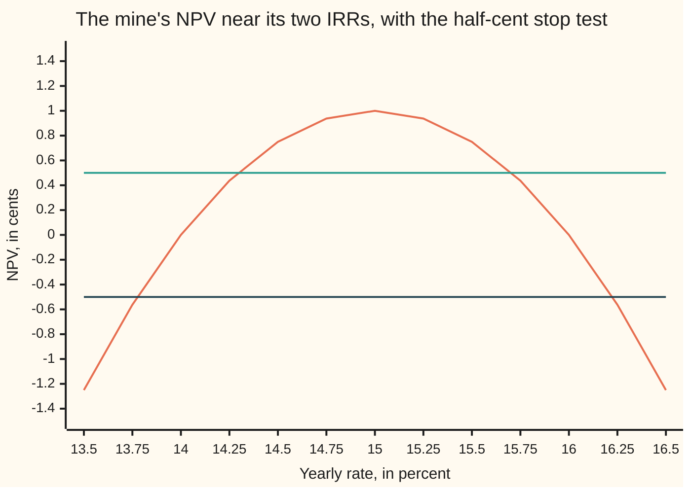

# Forward and backward error: a wrong answer, or the exact answer to a wrong question

[Syllabus](../../../SYLLABUS.md) → [Numerical analysis](../README.md) → [Floating Point and Error](../README.md#s01) → Forward and backward error

---

## General Overview

A small mine costs $100 to open today. It earns $230 next year. The year after, the owner must pay $132.24 to clean up the land. These numbers are illustrative. The question is the project's internal rate of return (IRR): the yearly rate at which the three cash flows, taken together, are worth exactly zero.

A rate solver halves a range of rates and stops when the net present value (NPV: the three cash flows, carried at that rate to one date and added) is under half a cent. It stops at **15.94%**. At that rate the NPV is 0.1211 cents, so the test is passed with room to spare. The true IRR is **16.00%**. Three of the four printed digits differ, though the carry up to 16.00 exaggerates that. Measured by its relative error, 3.906e-3, the computed rate is right to only about 2.41 significant digits.

Both statements are true at once. The answer is wrong by 0.0625 percentage points: that is its **forward error**. But 15.94% is the *exact* IRR of a slightly different mine, one whose cleanup bill is $132.2412109375 instead of $132.24. The bill moved by about a tenth of a cent: that is the **backward error**.

Which number matters? Both, and one rule joins them. The problem itself multiplies the backward error by a fixed factor, the absolute condition number, to give the forward error. Here the factor is 0.5, and 0.5 × 0.0012109375 predicts 0.0006055, against a true error of 0.000625. Both are in rates written as fractions, so 0.000625 is the 0.0625 points.

**The backward error says how far the question must move for the computed answer to be exact; the condition number says how far that moves the answer; their product is a good estimate of the forward error.**

**What kind of fact this is:** the two errors are definitions. The rule "forward error ≈ condition number × backward error" is a first-order theorem, proved for roots in Why it works, and it becomes a guaranteed bound when the smallest slope replaces the slope at the root.

### The picture: a flat NPV curve lets many rates pass



The first line is the NPV in cents. It crosses zero at 14% and 16% and never rises above 1 cent. The two flat lines are the stop test: any rate whose NPV lies between them passes. Near 16% the curve is shallow, so a wide band of rates passes. The band's width has two causes: how loose the test is (the backward error it allows) and how shallow the curve is (the condition number). Step 4 weighs the two.

---

## The formula

Write $x = 1 + \text{rate}$, the growth factor for one year, so 16% is $x = 1.16$. Carry every cash flow to the end of year two, which clears the fractions. The mine's NPV, in dollars at year two, is

$$f(x) = -100x^2 + 230x - c, \qquad c = 132.24$$

Measured at year two rather than today, the NPV is $x^2$ times larger, and it is zero at the same rates. The IRR is a root of $f$. Write $x^*$ for the true root and $\hat x$, read "x hat", for the computed one. The **residual** is $f(\hat x)$: how far the computed answer misses the equation, in dollars.

The two errors and the rule that joins them:

$$\underbrace{|\hat x - x^*|}_{\text{forward error}} \;\approx\; \kappa_{\text{abs}} \times \underbrace{|\Delta c|}_{\text{backward error}}, \qquad |\Delta c| = |f(\hat x)|, \qquad \kappa_{\text{abs}} = \frac{1}{|f'(x^*)|}$$

**Read it aloud:** the distance from the true answer is about the absolute condition number times the smallest change to the data that makes the computed answer exact; for a root, that change is the residual and the absolute condition number is one over the slope.

The same rule in relative terms, the form that works for any problem:

$$\frac{|\hat x - x^*|}{|x^*|} \;\approx\; \kappa_{\text{rel}} \times \frac{|\Delta c|}{|c|}, \qquad \kappa_{\text{rel}} = \kappa_{\text{abs}} \, \frac{|c|}{|x^*|}$$

The relative one, $\kappa_{\text{rel}}$, is the condition number κ of [Conditioning and stability](05-conditioning-and-stability.md). The absolute one carries units, here $x$ per dollar.

| Symbol | Plain meaning | In our example | Push it up and the answer… |
| --- | --- | --- | --- |
| $x$ | growth factor: 1 plus the yearly rate | 1.16 for 16% | — |
| $f(x)$ | NPV at growth factor $x$, in dollars at year two | $-100x^2 + 230x - 132.24$ | — |
| $c$ | the cleanup bill: the data that may move | \$132.24 | the two roots close in |
| $x^*$ | the true root: the true IRR | 1.16 (also 1.14) | — |
| $\hat x$ | the computed root | 1.159375, rate 15.9375% | — |
| $\Delta c$ | change to the bill that makes $\hat x$ exact; its size is the backward error | \$0.0012109375 | forward error grows with it |
| $f'(x^*)$ | slope of the NPV curve at the root, dollars per unit of $x$ | $-2$ | a larger size gives a smaller condition number |
| $\kappa_{\text{abs}}$ | absolute condition number: answer's change per unit change of data, in $x$ per dollar | 0.5 | each cent of residual costs more |
| $\kappa_{\text{rel}}$ | relative condition number: relative change out per relative change in; the κ of Conditioning and stability | 57.00 | more digits lost |
| $m$ | smallest slope size between $\hat x$ and $x^*$ | 1.875 | a tighter guaranteed bound |
| $\xi$ | a point between $\hat x$ and $x^*$ that a theorem says exists | inside 1.159375 to 1.16 | — |
| $u$ | unit roundoff: the largest relative rounding of one double operation | $2^{-53}$ | a coarser floor |

### When it holds

- **The slope at the root is not zero.** With a bill of \$132.25 the two roots merge at 15% and $\kappa_{\text{abs}} = 1/0$. A backward error of 1.211e-3 then gives a forward error of 3.480e-3: proportional to the square root of the backward error, not a multiple of it.
- **The backward error is small compared with the curve's bend.** The rule is first order. Far from the root the slope changes, and the estimate drifts; the bound with the smallest slope $m$ still holds.
- **The data that moves is named.** Here only the bill moves. Let all three cash flows move and the same $\hat x$ has a smaller backward error, so state which data the backward error refers to.
- **The residual is computed honestly.** In doubles the computed NPV is itself rounded. Below about 5.92e-14 dollars it is noise, and a computed residual of 0 does not mean an exact root.

---

## Why it works

### Step 0: there are two places to measure a mistake

A problem takes data in and gives an answer out. A mistake can be measured on the answer side: how far is $\hat x$ from $x^*$? That is the forward error. It can also be measured on the data side: how little must the data change so that $\hat x$ becomes the exact answer? That is the backward error.

The backward error is often easy to compute, because it needs no true answer. The forward error needs $x^*$, which is the thing being sought. The condition number is the exchange rate between the two sides.

### Step 1: for a root, the backward error is the residual

The bill enters $f$ with a plain minus sign. Raise the bill by $\Delta c$ and the whole curve drops by $\Delta c$. So $\hat x$ is an exact root of the changed problem when

$$-100\hat x^2 + 230\hat x - (c + \Delta c) = 0, \qquad \text{that is,} \qquad \Delta c = f(\hat x)$$

No smaller change works, since every dollar of bill moves the NPV by exactly one dollar. At $\hat x = 1.159375$ the residual is \$0.0012109375. So 15.9375% is the exact IRR of a mine with a bill of \$132.2412109375.

The code checks this a second way. It solves the changed problem afresh with the quadratic formula and gets 1.159375 exactly.

### Step 2: the answer moves by the data change divided by the slope

Drop a curve by $\Delta c$ near a root. The crossing slides sideways by about $\Delta c$ divided by the slope there. A steep curve barely moves its crossing; a shallow one moves it far.

The mean value theorem makes this exact. It gives a point $\xi$ between $\hat x$ and $x^*$ with $f(\hat x) - f(x^*) = f'(\xi)(\hat x - x^*)$. Since $f(x^*) = 0$,

$$|\hat x - x^*| = \frac{|f(\hat x)|}{|f'(\xi)|}$$

Two readings follow. Replace $f'(\xi)$ by the slope at the root, and the forward error is about $\kappa_{\text{abs}} \times |f(\hat x)|$: the rule of thumb. Replace it by the smallest slope size $m$ on the way, and the forward error is *at most* $|f(\hat x)|/m$: a guarantee.

For the mine, the slope at the root is $-2$, so $\kappa_{\text{abs}} = 0.5$. The estimate is 6.055e-4, the guarantee 6.458e-4, and the true error 6.250e-4 sits between. The guarantee is 1.0333 times the true error. [Newton's method](../../06-Calculus%20and%20analysis/03-What%20Derivatives%20Tell%20You/06-newtons-method.md) already used the guarantee as a stopping bound: this card names its two pieces.

<details>
<summary>Detailed proof: the bound, and why the estimate is first-order accurate</summary>

Let $f$ have a continuous derivative on the interval between $\hat x$ and $x^*$, with $f(x^*) = 0$ and $|f'| \ge m > 0$ there.

**The bound.** The mean value theorem gives $\xi$ in the interval with $f(\hat x) = f'(\xi)(\hat x - x^*)$. Then $|\hat x - x^*| = |f(\hat x)|/|f'(\xi)| \le |f(\hat x)|/m$.

**The estimate.** Write $e = \hat x - x^*$. If $f$ also has a second derivative with $|f''| \le M$ near $x^*$, then $|f'(\xi) - f'(x^*)| \le M|e|$. So

$$\frac{|e|}{\kappa_{\text{abs}}\,|f(\hat x)|} = \frac{|f'(x^*)|}{|f'(\xi)|} = 1 + O(|e|) \quad\text{as } e \to 0$$

The ratio of true error to estimate tends to 1. For the mine, $f'' = -200$ and the ratio is 1.0323.

**Any problem.** Let an answer $y = G(d)$ depend smoothly on data $d$. Taylor's theorem gives $G(d + \Delta d) - G(d) = G'(d)\,\Delta d + O(|\Delta d|^2)$. If $\hat y = G(d + \Delta d)$ exactly, its forward error is $|G'(d)|\,|\Delta d|$ to first order. That is the condition number times the backward error. Divide by $|y|$ and multiply and divide by $|d|$ for the relative form, with $\kappa_{\text{rel}} = |G'(d)|\,|d|/|y|$.

</details>

### Step 3: the rule holds for any problem, in relative terms

[Conditioning and stability](05-conditioning-and-stability.md) defines the condition number $\kappa$ of a problem: how much a small relative change in the data can change the answer, relatively. That is $\kappa_{\text{rel}}$ here. With it the rule reads the same for a root, a sum, a linear system or an integral:

relative forward error ≈ $\kappa_{\text{rel}}$ × relative backward error.

For the mine, $\kappa_{\text{rel}} = 0.5 \times 132.24 / 1.16 = 57.00$. The bill moved by 9.157e-6 of itself. The rule predicts a relative error of 5.220e-4 in $x$; the true one is 5.388e-4. Relative errors are defined on [Absolute and relative error](01-absolute-and-relative-error.md).

A relative error near $10^{-k}$ means about $k$ correct digits. So a problem with $\kappa_{\text{rel}} \approx 10^{j}$ costs about $j$ digits: here 57 costs between one and two.

### Step 4: the split tells you whom to blame

The backward error belongs to the **algorithm**. An algorithm is **backward stable** when its answer is always the exact answer for data moved by a few units of $u$, the unit roundoff from [Machine epsilon and cancellation](03-rounding-cancellation-and-machine-epsilon.md). The condition number belongs to the **problem**. No algorithm can change it.

So a backward stable method has forward error about $\kappa_{\text{abs}} \times u \times$ (data size). A large forward error then means one or both of two things. Either the backward error is large (the method or its stop test is sloppy), or $\kappa_{\text{rel}}$ is large (the question is fragile).

The mine shows both, in different amounts. The stop test allowed a relative backward error of 9.157e-6, and the problem magnified it about $\kappa_{\text{rel}}$ = 57.00 times, into a relative forward error of 5.388e-4: $x$ is right to about 3.27 digits. The condition number costs under two digits, and no method can avoid that cost. The bisection itself is fine; its loose half-cent stop test costs the rest, and a better method recovers them. Run Newton in doubles to the end instead:

| Newton step | $x$ | computed NPV | true error |
| --- | --- | --- | --- |
| 0 | 1.2000000000000000 | −2.40e-1 | 4.00e-2 |
| 3 | 1.1608120539254565 | −1.69e-3 | 8.12e-4 |
| 6 | 1.1600000000001089 | −2.27e-13 | 1.09e-13 |
| 7 | 1.1599999999999953 | 0.00e0 | −4.74e-15 |

Each step obeys the rule: at step 6, $0.5 \times 2.27\text{e-}13$ is about the error 1.09e-13. At step 7 the computed NPV is exactly 0, yet the root is 21 steps of $2^{-52}$ away.

The true NPV of that double, computed in exact fractions, is 9.49e-15 dollars. Rounding in each NPV evaluation is about 5.92e-14 dollars, so no double can show a residual reliably below that. The best possible forward error is $\kappa_{\text{abs}}$ times that floor: a bound of 2.96e-14, and the true 4.74e-15 is under it. The bound is 6.25 times the true error.

### Step 5: where the rule breaks

At a double root the slope is zero and $\kappa_{\text{abs}} = 1/0$. The first-order rule says nothing useful. The next term takes over: near a double root $f(x) \approx \tfrac12 f''(x^*)(x - x^*)^2$, so the forward error grows like the *square root* of the backward error.

For a bill of \$132.25, $f(x) = -(10x - 11.5)^2$. A backward error of 1.211e-3 now gives a forward error of 3.480e-3, nearly three times the backward error. Half the digits of the data's accuracy are lost.

---

## Worked numbers, by hand

| Step | Arithmetic | Value |
| --- | --- | --- |
| true roots | $(230 \pm \sqrt{230^2 - 400 \times 132.24})/200 = (230 \pm \sqrt{4})/200$ | 1.14 and 1.16 |
| bisection stops | NPV at 1.159375 is under half a cent | 0.1211 cents |
| forward error | 1.16 − 1.159375 | 0.000625 |
| backward error | $f(1.159375) = 0.01 - (11.59375 - 11.5)^2$ | 0.0012109375 dollars |
| changed bill | 132.24 + 0.0012109375 | 132.2412109375 |
| slope at root | $-200 \times 1.16 + 230$ | −2 |
| absolute condition number | 1 / 2 | 0.5 |
| estimate | 0.5 × 0.0012109375 | 0.0006055 |
| guarantee | 0.0012109375 / 1.875 | 0.0006458 |
| ratio | 0.000625 / 0.0006055 | **1.0323** |

The rule of thumb predicts the true error to within about 3%, and the guarantee sits just above it, at 1.0333 times the true error. The computed IRR of 15.94% is the exact answer for a bill a tenth of a cent higher, and the shallow curve turns that tenth of a cent into 0.0625 percentage points.

### What breaks if you drop a piece

| Mistake | Comes out at | What went wrong |
| --- | --- | --- |
| Read the relative backward error 9.157e-6 as the answer's accuracy | true relative error 5.388e-4, 58.8 times worse | the condition number $\kappa_{\text{rel}} = 57.00$ was left out |
| Apply the rule at a double root (bill \$132.25) | backward error 1.211e-3 gives forward error 3.480e-3; $\kappa_{\text{abs}} = 1/0$ | zero slope: the error grows as a square root, not a multiple |
| Take a computed NPV of 0 as an exact root | $x$ = 1.1599999999999953, still 4.74e-15 off | the computed residual is rounded; its noise is about 5.92e-14 |

---

## Code, from first principles, and it actually runs

The code finds the mine's IRR by bisection in exact fractions, stopping at half a cent, then measures both errors. It takes five roads. The quadratic formula with a whole-number square root gives the true roots. Bisection gives the computed root. The changed bill, solved afresh, gives back the computed root exactly. Nudging the bill and re-solving measures $\kappa_{\text{abs}}$ against $1/|f'(x^*)|$. Newton in doubles runs to the rounding floor, and exact fractions give the true residual of its last double. The three failures and the chart points close the run.

### Python

```python
# Forward and backward error, the check behind the card.  Standard library only.
# A mine: pay $100 now, earn $230 in a year, pay a $132.24 cleanup bill a year later.
# NPV(x) = -100 x^2 + 230 x - c, where x = 1 + the yearly rate.  The IRR is a root.
import math
def sci(v, k=3):                              # 6.055e-4, the form Rust prints
    m, e = f"{v:.{k}e}".split("e")
    return f"{m}e{int(e)}"
def isqrt(n):                                 # whole-number square root, by halving
    lo, hi = 0, n + 1
    while hi - lo > 1:
        mid = (lo + hi) // 2
        lo, hi = (mid, hi) if mid * mid <= n else (lo, mid)
    return lo
C = 13224                                     # the cleanup bill in cents: $132.24
def npv100(n, d, C=C):                        # 100 d^2 NPV(n/d): exact, in whole numbers
    return -10000 * n * n + 23000 * n * d - C * d * d

# road 1: the true roots, exactly, from the quadratic formula
D = 52900 - 4 * C                             # 230^2 - 4 * 100 * c
s = isqrt(D)
assert s * s == D
print(f"true IRRs, quadratic formula: x = {(230 - s) / 200:.4f} and {(230 + s) / 200:.4f}, rates "
      f"{(30 - s) / 2:.2f}% and {(30 + s) / 2:.2f}%")
print(f"NPV at the peak, rate 15%: {npv100(23, 20) / 400:+.4f} cents")
# road 2: bisection on [1.15, 1.25] in exact fractions m/d, stopping when |NPV| < half a cent
print(f"cash flows -100, +230, -{C / 100:.2f} dollars; bisection on x in [1.15, 1.25], stop when |NPV| < 0.5 cents")
a, b, d, k = 23, 25, 20, 0
while True:
    a, b, d = 2 * a, 2 * b, 2 * d             # same bracket, finer denominator
    m, k = (a + b) // 2, k + 1
    N = npv100(m, d)
    print(f"bisection {k}: x = {m / d:.6f}, rate {100 * (m - d) / d:.4f}%, NPV {N / d / d:+.4f} cents")
    if 2 * abs(N) < d * d: break              # the stop test: |NPV| under half a cent
    a, b = (m, b) if N > 0 else (a, m)        # NPV > 0 means the root lies above m
xs = (230 + s) / 200
fe = abs(200 * m - (230 + s) * d) / (200 * d) # forward error: distance to the true root
be = abs(N) / (100 * d * d)                   # backward error: the residual, in dollars
print(f"computed rate {100 * (m - d) / d:.2f}% against true {(30 + s) / 2:.2f}%: forward error {fe:.6f} in x, {100 * fe:.4f} points")
rr = fe / ((30 + s) / 200)                     # relative error of the rate itself
print(f"rate relative error {sci(rr)}, about {-math.log10(rr):.2f} correct digits; x about {-math.log10(fe / xs):.2f}")
print(f"backward error: NPV {be:.10f} dollars, so the bill changes to {(C * d * d + N) / (100 * d * d):.10f}")
D2 = D * d * d - 4 * N                        # road 3: solve the changed problem afresh
s2 = isqrt(D2)
assert s2 * s2 == D2 and 230 * d + s2 == 200 * m
print(f"quadratic formula on the changed bill: x = {(230 * d + s2) / (200 * d):.6f}, exactly the computed root")
kap = 1 / s                                   # 1 / |slope at the root|; the slope is -s
h = 1e-6                                      # road 4: nudge the bill, re-solve, measure
xr = lambda c: (230 + (52900 - 400 * c) ** 0.5) / 200
kfd = (xr(C / 100) - xr(C / 100 + h)) / h
print(f"slope at the root {-s:.1f}, absolute condition number kappa_abs = 1/|slope| = {kap:.4f}; nudged bill gives {kfd:.6f}")
est = kap * be
print(f"rule of thumb: kappa_abs x backward = {sci(est)}; true forward {sci(fe)}; ratio {fe / est:.4f}")
smin = min(abs(200 * m - 230 * d) / d, s)     # smallest slope between computed and true root
print(f"guaranteed bound backward/smallest slope = {be:.10f}/{smin:.4f} = {sci(be / smin)}, ratio to true {be / smin / fe:.4f}")
assert abs(kfd - kap) < 1e-4 and 0.9 < fe / est < 1.1 and fe <= be / smin
assert abs((200 * m - (230 + s) * d) * (200 * m - (230 - s) * d)) == 4 * abs(N)  # mean value step, exact
rb, rf, kr = be / (C / 100), fe / xs, kap * (C / 100) / xs
print(f"relative: backward {sci(rb)}, forward {sci(rf)}, kappa_rel {kr:.2f}, estimate {sci(kr * rb)}")
# road 5: Newton in doubles, to the floor set by rounding
c = C / 100
f, df = (lambda x: (-100 * x + 230) * x - c), (lambda x: -200 * x + 230)
def exact(x):                                 # a double in [1, 2) is n52 / 2^52 exactly
    n, q = x.as_integer_ratio()
    return n * (2 ** 52 // q)
err = lambda x: (200 * exact(x) - (230 + s) * 2 ** 52) / (200 * 2 ** 52)  # true error, exact
x, k = 1.2, 0
while True:
    print(f"Newton {k}: x = {x:.16f}, computed NPV {sci(f(x), 2)}, error {sci(err(x), 2)}")
    if f(x) == 0 or k == 9: break
    x, k = x - f(x) / df(x), k + 1
tr = npv100(exact(x), 2 ** 52) / (100 * 2 ** 104)  # the true residual of that double
ex = abs(err(x))
noise = 2 ** -53 * (100 * x * x + 230 * x + c)
print(f"floor: rounding noise in NPV about {sci(noise, 2)} dollars; kappa_abs x noise = {sci(kap * noise, 2)} bound")
print(f"computed NPV 0, true NPV {sci(tr, 2)}; true error {sci(ex, 2)}, {round(ex / 2 ** -52)} steps of 2^-52, bound/true {kap * noise / ex:.2f}")
assert 0 < ex <= kap * noise and abs(ex - kap * abs(tr)) < 1e-6 * ex
# what breaks
print(f"break 1, read relative backward error as accuracy: claims {sci(rb)}, truth {sci(rf)}, {rf / rb:.1f} times worse")
e2 = (be ** 0.5) / 10                         # bill $132.25: NPV = -(10x - 11.5)^2, slope 0 at the root
x2 = (230 + (52900 - 4 * 13225 + 400 * be) ** 0.5) / 200  # the root of that problem with the bill cut by be
assert abs(x2 - 1.15 - e2) < 1e-12 and e2 > 2 * be
print(f"break 2, bill $132.25, slope 0 at x = 1.15, kappa_abs = 1/0: backward error {sci(be)} gives error {sci(e2)}")
print(f"break 3, computed NPV 0 taken as exact: x = {x:.16f} still {sci(ex, 2)} off")
pts = [npv100(4540 + 10 * j, 4000) / 16e6 for j in range(13)]  # x = 1.135 + 0.0025 j
print("chart, NPV in cents at rates 13.50% to 16.50% in steps of 0.25:", " ".join(f"{v:.4f}" for v in pts))
assert abs(pts[0] + 1.25) < 1e-12 and abs(pts[6] - 1) < 1e-12
print("ALL CHECKS PASS")
```

**Ran 2026-11-11 on macOS, Python 3.14.10, standard library only. All checks passed. Output, pasted from the run:**

```
true IRRs, quadratic formula: x = 1.1400 and 1.1600, rates 14.00% and 16.00%
NPV at the peak, rate 15%: +1.0000 cents
cash flows -100, +230, -132.24 dollars; bisection on x in [1.15, 1.25], stop when |NPV| < 0.5 cents
bisection 1: x = 1.200000, rate 20.0000%, NPV -24.0000 cents
bisection 2: x = 1.175000, rate 17.5000%, NPV -5.2500 cents
bisection 3: x = 1.162500, rate 16.2500%, NPV -0.5625 cents
bisection 4: x = 1.156250, rate 15.6250%, NPV +0.6094 cents
bisection 5: x = 1.159375, rate 15.9375%, NPV +0.1211 cents
computed rate 15.94% against true 16.00%: forward error 0.000625 in x, 0.0625 points
rate relative error 3.906e-3, about 2.41 correct digits; x about 3.27
backward error: NPV 0.0012109375 dollars, so the bill changes to 132.2412109375
quadratic formula on the changed bill: x = 1.159375, exactly the computed root
slope at the root -2.0, absolute condition number kappa_abs = 1/|slope| = 0.5000; nudged bill gives 0.500013
rule of thumb: kappa_abs x backward = 6.055e-4; true forward 6.250e-4; ratio 1.0323
guaranteed bound backward/smallest slope = 0.0012109375/1.8750 = 6.458e-4, ratio to true 1.0333
relative: backward 9.157e-6, forward 5.388e-4, kappa_rel 57.00, estimate 5.220e-4
Newton 0: x = 1.2000000000000000, computed NPV -2.40e-1, error 4.00e-2
Newton 1: x = 1.1759999999999990, computed NPV -5.76e-2, error 1.60e-2
Newton 2: x = 1.1649230769230741, computed NPV -1.23e-2, error 4.92e-3
Newton 3: x = 1.1608120539254565, computed NPV -1.69e-3, error 8.12e-4
Newton 4: x = 1.1600304952038785, computed NPV -6.11e-5, error 3.05e-5
Newton 5: x = 1.1600000463564979, computed NPV -9.27e-8, error 4.64e-8
Newton 6: x = 1.1600000000001089, computed NPV -2.27e-13, error 1.09e-13
Newton 7: x = 1.1599999999999953, computed NPV 0.00e0, error -4.74e-15
floor: rounding noise in NPV about 5.92e-14 dollars; kappa_abs x noise = 2.96e-14 bound
computed NPV 0, true NPV 9.49e-15; true error 4.74e-15, 21 steps of 2^-52, bound/true 6.25
break 1, read relative backward error as accuracy: claims 9.157e-6, truth 5.388e-4, 58.8 times worse
break 2, bill $132.25, slope 0 at x = 1.15, kappa_abs = 1/0: backward error 1.211e-3 gives error 3.480e-3
break 3, computed NPV 0 taken as exact: x = 1.1599999999999953 still 4.74e-15 off
chart, NPV in cents at rates 13.50% to 16.50% in steps of 0.25: -1.2500 -0.5625 0.0000 0.4375 0.7500 0.9375 1.0000 0.9375 0.7500 0.4375 0.0000 -0.5625 -1.2500
ALL CHECKS PASS
```

### Rust

Same numbers, same labels, built with `rustc --edition 2021 -O`.

```rust
// Forward and backward error, the same check as the Python, in Rust.  No crates.
// A mine: pay $100 now, earn $230 in a year, pay a $132.24 cleanup bill a year later.
// NPV(x) = -100 x^2 + 230 x - c, where x = 1 + the yearly rate.  The IRR is a root.
fn sci(v: f64, k: usize) -> String { format!("{:.*e}", k, v) }   // 6.055e-4
fn isqrt(n: i128) -> i128 {                      // whole-number square root, by halving
    let (mut lo, mut hi) = (0i128, n + 1);
    while hi - lo > 1 {
        let mid = (lo + hi) / 2;
        if mid * mid <= n { lo = mid } else { hi = mid }
    }
    lo
}
const C: i128 = 13224;                           // the cleanup bill in cents: $132.24
fn npv100(n: i128, d: i128) -> i128 {            // 100 d^2 NPV(n/d): exact, in whole numbers
    -10000 * n * n + 23000 * n * d - C * d * d
}
fn exact(x: f64) -> i128 {                       // a double in [1, 2) is n52 / 2^52 exactly
    ((x.to_bits() & ((1u64 << 52) - 1)) | (1u64 << 52)) as i128
}

fn main() {
    // road 1: the true roots, exactly, from the quadratic formula
    let dd = 52900 - 4 * C;                      // 230^2 - 4 * 100 * c
    let s = isqrt(dd);
    assert!(s * s == dd);
    println!("true IRRs, quadratic formula: x = {:.4} and {:.4}, rates {:.2}% and {:.2}%",
             (230 - s) as f64 / 200.0, (230 + s) as f64 / 200.0, (30 - s) as f64 / 2.0, (30 + s) as f64 / 2.0);
    println!("NPV at the peak, rate 15%: {:+.4} cents", npv100(23, 20) as f64 / 400.0);
    // road 2: bisection on [1.15, 1.25] in exact fractions m/d, stopping when |NPV| < half a cent
    println!("cash flows -100, +230, -{:.2} dollars; bisection on x in [1.15, 1.25], stop when |NPV| < 0.5 cents",
             C as f64 / 100.0);
    let (mut a, mut b, mut d, mut k) = (23i128, 25i128, 20i128, 0);
    let (m, n) = loop {
        a *= 2; b *= 2; d *= 2;                  // same bracket, finer denominator
        let m = (a + b) / 2;
        k += 1;
        let n = npv100(m, d);
        println!("bisection {}: x = {:.6}, rate {:.4}%, NPV {:+.4} cents", k, m as f64 / d as f64,
                 (100 * (m - d)) as f64 / d as f64, n as f64 / d as f64 / d as f64);
        if 2 * n.abs() < d * d { break (m, n) }  // the stop test: |NPV| under half a cent
        if n > 0 { a = m } else { b = m }        // NPV > 0 means the root lies above m
    };
    let xs = (230 + s) as f64 / 200.0;
    let fe = (200 * m - (230 + s) * d).abs() as f64 / (200 * d) as f64;   // forward error
    let be = n.abs() as f64 / (100 * d * d) as f64;                      // backward error, dollars
    println!("computed rate {:.2}% against true {:.2}%: forward error {:.6} in x, {:.4} points",
             (100 * (m - d)) as f64 / d as f64, (30 + s) as f64 / 2.0, fe, 100.0 * fe);
    let rr = fe / ((30 + s) as f64 / 200.0);     // relative error of the rate itself
    println!("rate relative error {}, about {:.2} correct digits; x about {:.2}", sci(rr, 3), -rr.log10(), -(fe / xs).log10());
    println!("backward error: NPV {:.10} dollars, so the bill changes to {:.10}",
             be, (C * d * d + n) as f64 / (100 * d * d) as f64);
    let d2 = dd * d * d - 4 * n;                 // road 3: solve the changed problem afresh
    let s2 = isqrt(d2);
    assert!(s2 * s2 == d2 && 230 * d + s2 == 200 * m);
    println!("quadratic formula on the changed bill: x = {:.6}, exactly the computed root",
             (230 * d + s2) as f64 / (200 * d) as f64);
    let kap = 1.0 / s as f64;                    // 1 / |slope at the root|; the slope is -s
    let h = 1e-6;                                // road 4: nudge the bill, re-solve, measure
    let xr = |c: f64| (230.0 + (52900.0 - 400.0 * c).sqrt()) / 200.0;
    let kfd = (xr(C as f64 / 100.0) - xr(C as f64 / 100.0 + h)) / h;
    println!("slope at the root {:.1}, absolute condition number kappa_abs = 1/|slope| = {:.4}; nudged bill gives {:.6}",
             -s as f64, kap, kfd);
    let est = kap * be;
    println!("rule of thumb: kappa_abs x backward = {}; true forward {}; ratio {:.4}", sci(est, 3), sci(fe, 3), fe / est);
    let smin = ((200 * m - 230 * d).abs() as f64 / d as f64).min(s as f64);  // smallest slope between
    println!("guaranteed bound backward/smallest slope = {:.10}/{:.4} = {}, ratio to true {:.4}", be, smin, sci(be / smin, 3), be / smin / fe);
    assert!((kfd - kap).abs() < 1e-4 && 0.9 < fe / est && fe / est < 1.1 && fe <= be / smin);
    assert!(((200 * m - (230 + s) * d) * (200 * m - (230 - s) * d)).abs() == 4 * n.abs());
    let (rb, rf, kr) = (be / (C as f64 / 100.0), fe / xs, kap * (C as f64 / 100.0) / xs);
    println!("relative: backward {}, forward {}, kappa_rel {:.2}, estimate {}", sci(rb, 3), sci(rf, 3), kr, sci(kr * rb, 3));
    // road 5: Newton in doubles, to the floor set by rounding
    let c = C as f64 / 100.0;
    let f = |x: f64| (-100.0 * x + 230.0) * x - c;
    let df = |x: f64| -200.0 * x + 230.0;
    let p52 = 1i128 << 52;
    let err = |x: f64| (200 * exact(x) - (230 + s) * p52) as f64 / (200 * p52) as f64;  // true error
    let (mut x, mut k) = (1.2f64, 0);
    loop {
        println!("Newton {}: x = {:.16}, computed NPV {}, error {}", k, x, sci(f(x), 2), sci(err(x), 2));
        if f(x) == 0.0 || k == 9 { break }
        x -= f(x) / df(x);
        k += 1;
    }
    let tr = npv100(exact(x), p52) as f64 / (100 * p52 * p52) as f64;   // true residual of that double
    let ex = err(x).abs();
    let noise = 2f64.powi(-53) * (100.0 * x * x + 230.0 * x + c);
    println!("floor: rounding noise in NPV about {} dollars; kappa_abs x noise = {} bound", sci(noise, 2), sci(kap * noise, 2));
    println!("computed NPV 0, true NPV {}; true error {}, {} steps of 2^-52, bound/true {:.2}", sci(tr, 2), sci(ex, 2),
             (ex / 2f64.powi(-52)).round(), kap * noise / ex);
    assert!(0.0 < ex && ex <= kap * noise && (ex - kap * tr.abs()).abs() < 1e-6 * ex);
    // what breaks
    println!("break 1, read relative backward error as accuracy: claims {}, truth {}, {:.1} times worse",
             sci(rb, 3), sci(rf, 3), rf / rb);
    let e2 = be.sqrt() / 10.0;                   // bill $132.25: NPV = -(10x - 11.5)^2, slope 0 at the root
    let x2 = (230.0 + (52900.0 - 4.0 * 13225.0 + 400.0 * be).sqrt()) / 200.0;
    assert!((x2 - 1.15 - e2).abs() < 1e-12 && e2 > 2.0 * be);
    println!("break 2, bill $132.25, slope 0 at x = 1.15, kappa_abs = 1/0: backward error {} gives error {}",
             sci(be, 3), sci(e2, 3));
    println!("break 3, computed NPV 0 taken as exact: x = {:.16} still {} off", x, sci(ex, 2));
    let pts: Vec<f64> = (0..13).map(|j| npv100(4540 + 10 * j, 4000) as f64 / 16e6).collect();
    let ps: Vec<String> = pts.iter().map(|v| format!("{:.4}", v)).collect();
    println!("chart, NPV in cents at rates 13.50% to 16.50% in steps of 0.25: {}", ps.join(" "));
    assert!((pts[0] + 1.25).abs() < 1e-12 && (pts[6] - 1.0).abs() < 1e-12);
    println!("ALL CHECKS PASS");
}
```

**Ran 2026-11-11 on macOS, rustc 1.98.1, no crates. All checks passed. Output, pasted from the run:**

```
true IRRs, quadratic formula: x = 1.1400 and 1.1600, rates 14.00% and 16.00%
NPV at the peak, rate 15%: +1.0000 cents
cash flows -100, +230, -132.24 dollars; bisection on x in [1.15, 1.25], stop when |NPV| < 0.5 cents
bisection 1: x = 1.200000, rate 20.0000%, NPV -24.0000 cents
bisection 2: x = 1.175000, rate 17.5000%, NPV -5.2500 cents
bisection 3: x = 1.162500, rate 16.2500%, NPV -0.5625 cents
bisection 4: x = 1.156250, rate 15.6250%, NPV +0.6094 cents
bisection 5: x = 1.159375, rate 15.9375%, NPV +0.1211 cents
computed rate 15.94% against true 16.00%: forward error 0.000625 in x, 0.0625 points
rate relative error 3.906e-3, about 2.41 correct digits; x about 3.27
backward error: NPV 0.0012109375 dollars, so the bill changes to 132.2412109375
quadratic formula on the changed bill: x = 1.159375, exactly the computed root
slope at the root -2.0, absolute condition number kappa_abs = 1/|slope| = 0.5000; nudged bill gives 0.500013
rule of thumb: kappa_abs x backward = 6.055e-4; true forward 6.250e-4; ratio 1.0323
guaranteed bound backward/smallest slope = 0.0012109375/1.8750 = 6.458e-4, ratio to true 1.0333
relative: backward 9.157e-6, forward 5.388e-4, kappa_rel 57.00, estimate 5.220e-4
Newton 0: x = 1.2000000000000000, computed NPV -2.40e-1, error 4.00e-2
Newton 1: x = 1.1759999999999990, computed NPV -5.76e-2, error 1.60e-2
Newton 2: x = 1.1649230769230741, computed NPV -1.23e-2, error 4.92e-3
Newton 3: x = 1.1608120539254565, computed NPV -1.69e-3, error 8.12e-4
Newton 4: x = 1.1600304952038785, computed NPV -6.11e-5, error 3.05e-5
Newton 5: x = 1.1600000463564979, computed NPV -9.27e-8, error 4.64e-8
Newton 6: x = 1.1600000000001089, computed NPV -2.27e-13, error 1.09e-13
Newton 7: x = 1.1599999999999953, computed NPV 0.00e0, error -4.74e-15
floor: rounding noise in NPV about 5.92e-14 dollars; kappa_abs x noise = 2.96e-14 bound
computed NPV 0, true NPV 9.49e-15; true error 4.74e-15, 21 steps of 2^-52, bound/true 6.25
break 1, read relative backward error as accuracy: claims 9.157e-6, truth 5.388e-4, 58.8 times worse
break 2, bill $132.25, slope 0 at x = 1.15, kappa_abs = 1/0: backward error 1.211e-3 gives error 3.480e-3
break 3, computed NPV 0 taken as exact: x = 1.1599999999999953 still 4.74e-15 off
chart, NPV in cents at rates 13.50% to 16.50% in steps of 0.25: -1.2500 -0.5625 0.0000 0.4375 0.7500 0.9375 1.0000 0.9375 0.7500 0.4375 0.0000 -0.5625 -1.2500
ALL CHECKS PASS
```

The two outputs match line for line.

### Lean

Lean proves the rule of thumb, the guaranteed bound and the residual fact for every root, and checks the mine's hand arithmetic exactly.

- Take a root $x^*$ of $f$ where the slope $f'(x^*)$ is not zero. As $\hat x$ nears $x^*$, the true error divided by the estimate $\kappa_{\text{abs}} \times |f(\hat x)|$ tends to 1. Lean needs only the slope at the root, not a bound on $f''$, so it gives no $O(|e|)$ rate.
- Let $f$ have a continuous derivative between $\hat x$ and $x^*$, with $f(x^*) = 0$ and every slope size at least $m > 0$ there. Then $|\hat x - x^*| \le |f(\hat x)|/m$.
- Raise the bill by $\Delta c$. Then $\hat x$ is an exact root of the changed problem exactly when $\Delta c = f(\hat x)$, so no other change works.
- The mine's hand numbers hold exactly in fractions: roots 1.14 and 1.16, residual 0.0012109375, changed bill 132.2412109375, slopes −2 and −1.875.
- The estimate 6.055e-4 sits below the true error 0.000625, which sits below the guarantee 6.458e-4. Also $\kappa_{\text{rel}} = 57$.
- At a bill of \$132.25, $f(x) = -(10x - 11.5)^2$ for every $x$, and the slope at 1.15 is 0.

Bisection, the nudged bill, Newton in doubles, the rounding floor, the double-root error and the chart are left to the Python and Rust checks.

```lean
-- Forward and backward error: near a simple root, the forward error equals the absolute condition number 1/|f'(x*)| times the backward error |f(x̂)| to first order, and is at most |f(x̂)|/m when every slope on the way has size at least m.
import Mathlib.Analysis.Calculus.Deriv.MeanValue
import Mathlib.Tactic.NormNum
import Mathlib.Tactic.Ring

open Filter Topology Set

/-- Helper: on `[a, b]` with every slope of size at least `m`, the change in `f` over the
interval is at least `m (b - a)`. -/
theorem forward_backward_helper_mvt
    {f f' : ℝ → ℝ} {a b m : ℝ} (hab : a < b)
    (hderiv : ∀ x ∈ Icc a b, HasDerivAt f (f' x) x)
    (hslope : ∀ x ∈ Icc a b, m ≤ |f' x|) :
    m * (b - a) ≤ |f b - f a| := by
  have hcont : ContinuousOn f (Icc a b) := fun x hx => (hderiv x hx).continuousAt.continuousWithinAt
  obtain ⟨c, hc, hfc⟩ := exists_hasDerivAt_eq_slope f f' hab hcont
    (fun x hx => hderiv x (Ioo_subset_Icc_self hx))
  have hba : 0 < b - a := sub_pos.mpr hab
  have hm := hslope c (Ioo_subset_Icc_self hc)
  have heq : f b - f a = f' c * (b - a) := by
    rw [hfc]; field_simp
  rw [heq, abs_mul, abs_of_pos hba]
  exact mul_le_mul_of_nonneg_right hm hba.le

/-- The rule of thumb, for a root: forward error ≈ condition number × backward error.
Let `x*` be a root of `f` (`f x* = 0`) where the slope `f'(x*)` is not zero. For a
computed root `x̂`, the forward error is `|x̂ - x*|`, the backward error (the change to
the constant term that makes `x̂` exact) is the residual `|f x̂|`, and the absolute
condition number is `κ_abs = 1 / |f'(x*)|`. Then the ratio
`forward error / (κ_abs × backward error)` tends to 1 as `x̂` tends to `x*`:
the rule is a first-order theorem. -/
theorem forward_error_approx_condition_number_mul_backward_error
    {f : ℝ → ℝ} {f'xstar xstar : ℝ}
    (hroot : f xstar = 0) (hderiv : HasDerivAt f f'xstar xstar) (hslope : f'xstar ≠ 0) :
    Tendsto (fun xhat => |xhat - xstar| / ((1 / |f'xstar|) * |f xhat|))
      (𝓝[≠] xstar) (𝓝 1) := by
  have hT := hasDerivAt_iff_tendsto_slope.mp hderiv
  have hlim : Tendsto (fun xhat => |f'xstar| / |slope f xstar xhat|) (𝓝[≠] xstar)
      (𝓝 (|f'xstar| / |f'xstar|)) :=
    tendsto_const_nhds.div hT.abs (abs_ne_zero.mpr hslope)
  rw [div_self (abs_ne_zero.mpr hslope)] at hlim
  refine hlim.congr' ?_
  filter_upwards [self_mem_nhdsWithin] with xhat hx
  have hx' : xhat - xstar ≠ 0 := sub_ne_zero.mpr hx
  simp only [slope_def_field, hroot, sub_zero, abs_div, one_div]
  rw [div_div_eq_mul_div, div_mul_eq_div_div, div_inv_eq_mul]
  ring

/-- The guarantee: forward error ≤ backward error / smallest slope.
Let `f` have a continuous derivative `f'` on the interval between the computed root `x̂`
and the true root `x*`, with `f x* = 0` and `|f'| ≥ m > 0` there. Then
`|x̂ - x*| ≤ |f x̂| / m`. -/
theorem forward_error_le_backward_error_div_min_slope
    {f f' : ℝ → ℝ} {xhat xstar m : ℝ}
    (hderiv : ∀ x ∈ uIcc xhat xstar, HasDerivAt f (f' x) x)
    (hcont : ContinuousOn f' (uIcc xhat xstar))
    (hroot : f xstar = 0) (hm : 0 < m)
    (hslope : ∀ x ∈ uIcc xhat xstar, m ≤ |f' x|) :
    |xhat - xstar| ≤ |f xhat| / m := by
  rcases lt_trichotomy xhat xstar with h | h | h
  · rw [uIcc_of_le h.le] at hderiv hslope
    have := forward_backward_helper_mvt h hderiv hslope
    rw [hroot, zero_sub, abs_neg] at this
    rw [le_div_iff₀ hm, abs_sub_comm, abs_of_pos (sub_pos.mpr h), mul_comm]
    exact this
  · subst h
    simp only [sub_self, abs_zero]
    exact div_nonneg (abs_nonneg _) hm.le
  · rw [uIcc_of_ge h.le] at hderiv hslope
    have := forward_backward_helper_mvt h hderiv hslope
    rw [hroot, sub_zero] at this
    rw [le_div_iff₀ hm, abs_of_pos (sub_pos.mpr h), mul_comm]
    exact this

/-- For a root, the backward error is the residual: when the data `c` enters as
`f x = g x - c`, the computed `x̂` is an exact root of the changed problem
`g x - (c + Δc)` exactly when `Δc = f x̂ = g x̂ - c`. So that change is the only one that
works, and its size `|f x̂|` is the backward error. -/
theorem backward_error_eq_residual (g : ℝ → ℝ) (c xhat Δc : ℝ) :
    g xhat - (c + Δc) = 0 ↔ Δc = g xhat - c := by
  constructor <;> intro h <;> linarith

/-! ## The card's mine, in exact fractions

The NPV at year two is `f(x) = -100 x² + 230 x - c` with bill `c = 132.24 = 13224/100`.
The bisection's computed root is `x̂ = 1.159375 = 371/320`. -/

-- The true roots are 1.14 and 1.16 (rates 14% and 16%).
example : -100 * (114 / 100 : ℚ) ^ 2 + 230 * (114 / 100) - 13224 / 100 = 0 := by norm_num
example : -100 * (116 / 100 : ℚ) ^ 2 + 230 * (116 / 100) - 13224 / 100 = 0 := by norm_num

-- NPV at the peak, rate 15%, is one cent.
example : -100 * (115 / 100 : ℚ) ^ 2 + 230 * (115 / 100) - 13224 / 100 = 1 / 100 := by norm_num

-- The computed root 1.159375 has residual (backward error) 0.0012109375 dollars = 31/25600,
-- which is under half a cent, so the stop test passes.
example : -100 * (371 / 320 : ℚ) ^ 2 + 230 * (371 / 320) - 13224 / 100 = 31 / 25600 := by
  norm_num
example : (31 / 25600 : ℚ) < 1 / 200 := by norm_num

-- 1.159375 is the exact root for the changed bill 132.2412109375 = 132.24 + 31/25600.
example : -100 * (371 / 320 : ℚ) ^ 2 + 230 * (371 / 320) - (13224 / 100 + 31 / 25600) = 0 := by
  norm_num
example : (13224 / 100 + 31 / 25600 : ℚ) = 1322412109375 / 10000000000 := by norm_num

-- Forward error: 1.16 - 1.159375 = 0.000625.
example : (116 / 100 : ℚ) - 371 / 320 = 625 / 1000000 := by norm_num

-- Slope at the root: -200 × 1.16 + 230 = -2, so κ_abs = 1/2.
example : -200 * (116 / 100 : ℚ) + 230 = -2 := by norm_num

-- Slope at the computed root: size 1.875, the smallest on the way.
example : -200 * (371 / 320 : ℚ) + 230 = -(15 / 8) := by norm_num

-- Estimate 0.5 × 0.0012109375, guarantee 0.0012109375 / 1.875, true error 0.000625 between.
example : (1 / 2 : ℚ) * (31 / 25600) ≤ 625 / 1000000 ∧
    (625 / 1000000 : ℚ) ≤ (31 / 25600) / (15 / 8) := by norm_num

-- κ_rel = 0.5 × 132.24 / 1.16 = 57.
example : (1 / 2 : ℚ) * (13224 / 100) / (116 / 100) = 57 := by norm_num

-- With bill 132.25 the two roots merge at 1.15: f(x) = -(10x - 11.5)², slope 0 there.
example (x : ℚ) : -100 * x ^ 2 + 230 * x - 13225 / 100 = -(10 * x - 23 / 2) ^ 2 := by ring
example : -200 * (115 / 100 : ℚ) + 230 = 0 := by norm_num

#print axioms forward_backward_helper_mvt
#print axioms forward_error_approx_condition_number_mul_backward_error
#print axioms forward_error_le_backward_error_div_min_slope
#print axioms backward_error_eq_residual
```

**Checked 2026-11-11 on macOS, Lean 4.36.0-rc2, Mathlib v4.36.0-rc2. Every proof is complete and uses only Lean's standard axioms. Output, pasted from the run:**

```
'forward_backward_helper_mvt' depends on axioms: [propext, Classical.choice, Quot.sound]
'forward_error_approx_condition_number_mul_backward_error' depends on axioms: [propext, Classical.choice, Quot.sound]
'forward_error_le_backward_error_div_min_slope' depends on axioms: [propext, Classical.choice, Quot.sound]
'backward_error_eq_residual' depends on axioms: [propext, Classical.choice, Quot.sound]
```

> [!TIP]
> **Try changing**
> Guess first, then run it.
> - **Tighten the stop.** Change `2 * abs(N)` to `20 * abs(N)`, a twentieth of a cent. Guess the new error first. Answer: two more halvings, $\hat x$ = 1.160156 (16.02%), forward error 1.563e-4, backward error 0.0003149414, ratio 0.9922. A quarter of the error, for a quarter of the residual.
> - **Spread the roots.** Set `C = 13216`, a bill of \$132.16. Answer: the roots move to 12% and 18%, the slope is −6.0, $\kappa_{\text{abs}}$ = 0.1667, and $\kappa_{\text{rel}}$ falls to 18.67. Bisection stops at 17.97% with forward error 3.125e-4. The chart assert then stops the run, because the curve changed.
> - **Start Newton further out.** Change `1.2` to `1.3`. Answer: one more step, and the last double is 1.1599999999999968, 14 steps of $2^{-52}$ off. It is still under the 2.96e-14 bound.

---

## The usual mistake

> [!warning]
> **Taking a small residual as a small error.** The residual is a backward error: it says the computed answer solves a nearby problem. It says nothing about the answer itself until it is multiplied by the condition number. The mine's NPV of 0.1211 cents looks like success, yet the IRR is right to only about 2.41 significant digits.
>
> - **Reading relative backward error as accuracy.** The bill moved by 9.157e-6 of itself, but the IRR is off by 5.388e-4 of itself, 58.8 times worse.
> - **Forgetting the double root.** At a bill of $132.25 the condition number is infinite. The rule fails, and a backward error of 1.211e-3 becomes a forward error of 3.480e-3.
> - **Trusting a computed residual of 0.** Newton's last double gives a computed NPV of exactly 0, yet it is 4.74e-15 from the root. Below about 5.92e-14 dollars the computed NPV is rounding noise.
> - **Blaming the problem for the method.** The mine's root has $\kappa_{\text{rel}} = 57.00$, which costs under two digits. The other digits were lost to the half-cent stop test, which a tighter test or Newton recovers.

---

## Where you meet it in real life

- **Rate-of-return solvers.** A spreadsheet or calculator finds an IRR by iteration and stops on a test like this card's. Cash flows that change sign twice, as the mine's do, give two IRRs and a flat NPV curve between them, where a passed test still leaves digits wrong.
- **Linear systems.** For $Ax = b$ (a matrix $A$ of known numbers times a list $x$ of unknowns gives the known list $b$), the residual $b - A\hat x$ is a backward error, and the matrix condition number turns it into a forward error. Elimination with row swaps is backward stable in practice, so its accuracy is set by the matrix.
- **The fitness tracker.** A running total that adds 0.1 ten million times is the exact sum of slightly changed readings. Adding positive numbers is well conditioned, so the forward error is about that backward error; [Adding a million numbers without losing the small ones](07-summation-kahan-and-welford.md) shrinks it.
- **Polynomial roots.** Software finds the roots of a polynomial as the exact roots of a nearby polynomial. Well-separated roots come out accurate; a near-double root loses about half its digits, as at the $132.25 bill.
- **Checking anyone's answer.** Plugging an answer back into the equation measures its backward error only. To claim digits, also estimate the condition number.

> **Say it back**
> The forward error is how far the computed answer is from the true one. The backward error is how little the data must change for the computed answer to be exact; for a root it is the residual. The absolute condition number, one over the slope for a root, converts the second into the first. A small-looking residual still leaves wrong digits once the condition number multiplies it, as the mine's 15.94% against 16.00% shows. Backward error judges the method; the condition number judges the problem.

---

## What this builds on

- [Conditioning and stability](05-conditioning-and-stability.md): the condition number $\kappa$ of a problem and the idea of a backward stable method, which this card turns into a working rule.
- [Newton's method](../../06-Calculus%20and%20analysis/03-What%20Derivatives%20Tell%20You/06-newtons-method.md): the bound "error at most residual over the smallest slope", and a flattened equation that stops at once while 0.414 from the root. This card calls the residual the backward error and one over the slope the condition number.

## Where this goes next

- [Adding a million numbers without losing the small ones](07-summation-kahan-and-welford.md): backward error analysis of a sum, and methods that shrink it.
- [Interval arithmetic](09-interval-arithmetic-in-outline.md): a guaranteed range for the answer instead of an estimate of its error.
- [When to stop](../02-Root%20Finding%20and%20Fixed%20Points/03-stopping-criteria-and-error-estimates.md): the root-finding shelf's stopping tests, built on residual, step size and this card's rule.
- [Newton's bad days](../02-Root%20Finding%20and%20Fixed%20Points/04-when-newton-fails.md): double roots, where the condition number is infinite and convergence slows.
- [Matrix norms and the condition number](../03-Numerical%20Linear%20Algebra/01-matrix-norms-and-the-condition-number.md): the same rule for a linear system, with $\kappa(A)$.

How large can the backward error of a whole algorithm be, step by step, before it reaches the answer? That question is carried by the later shelves, one method at a time.

---

## Sources

Verified 2026-11-11: every link below resolves to the publisher's page.

- Higham, Nicholas J. *Accuracy and Stability of Numerical Algorithms*, 2nd ed. SIAM, 2002. [doi:10.1137/1.9780898718027](https://doi.org/10.1137/1.9780898718027). Chapter 1 defines forward and backward error and states the rule of thumb.
- Wilkinson, J. H. *Rounding Errors in Algebraic Processes*. SIAM Classics edition, 2023. [doi:10.1137/1.9781611977523](https://doi.org/10.1137/1.9781611977523). The origin of backward error analysis, including polynomial roots.
- Trefethen, Lloyd N., and David Bau III. *Numerical Linear Algebra*. SIAM, 1997. [doi:10.1137/1.9780898719574](https://doi.org/10.1137/1.9780898719574). Lectures 12 to 15: conditioning, stability and backward stability.
- Rigal, J. L., and J. Gaches. "On the Compatibility of a Given Solution With the Data of a Linear System." *Journal of the ACM* 14, no. 3 (1967): 543–548. [doi:10.1145/321406.321416](https://doi.org/10.1145/321406.321416). The backward error of a computed solution, from its residual.
- Lorie, James H., and Leonard J. Savage. "Three Problems in Rationing Capital." *Journal of Business* 28, no. 4 (1955): 229–239. [doi:10.1086/294081](https://doi.org/10.1086/294081). The pump problem: cash flows with two sign changes and two rates of return, the shape of this card's mine.
