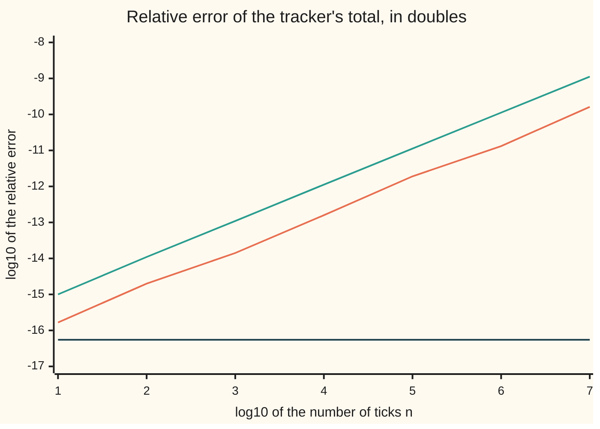

# Adding a million numbers without losing the small ones: Kahan, pairwise and Welford

[Syllabus](../../../SYLLABUS.md) → [Numerical analysis](../README.md) → [Floating Point and Error](../README.md#s01) → Adding a million numbers without losing the small ones

---

## General Overview

A fitness tracker adds 0.1 metres to its distance total at every tick. After ten million ticks the wearer has covered 1,000 km, so the total should read 1,000,000 m. The 0.1 m tick is illustrative; the arithmetic is real.

Add the ticks one at a time in standard 64-bit numbers (doubles), and the total reads **999999.9998389754**. It is off by 1.610e-4 m. Use 32-bit numbers (singles, laid out on [IEEE 754](02-ieee-floating-point.md)), common on small chips, and it reads **1087937.0**: 8.79% too far. Nothing is wrong with the readings. Every error comes from rounding the running total.

Two repairs fix both totals. **Pairwise summation** adds the ticks in a tree: neighbours first, then sums of neighbours. **Kahan summation** keeps a second number that holds the part of each tick that rounding threw away, and feeds it back in. Both read 1000000.0000000000 in doubles and 1000000.0 in singles: the nearest stored number to the exact total. Kahan costs 4 flops (floating-point operations) a tick instead of 1.

The tracker also wants the spread of its barometer readings, near 101,325 Pa (pascals, the unit of air pressure). The textbook one-pass formula returns a variance of 3.604521600000 Pa² instead of 3.25. **Welford's update** also uses one pass and returns 3.250000000001.

**Every addition rounds the running total, so a plain sum's error grows with the count; pairwise and Kahan sums stop that growth, and Welford's update finds the spread in one pass.**

**What kind of fact this is:** theorems. The bounds for plain and pairwise sums and the exactness of Kahan's correction are proved on this card. Kahan's full bound and Welford's error bound are stated, with key steps, from the named sources. The tick size and the barometer readings are illustrative.

### The picture: error against the number of ticks



Orange: the plain total. It climbs about one step (a factor of ten) for every tenfold growth in ticks. Green: the bound $(n-1)u$, the first-order form of the $\gamma_{n-1}$ bound proved below, always above orange. Dark blue: Kahan's total, flat at −16.26. Pairwise lands on exactly the same values as Kahan here. The relative error is the error divided by the exact total.

---

## The formula

Two tools come from [Machine epsilon and cancellation](03-rounding-cancellation-and-machine-epsilon.md). The unit roundoff $u = 2^{-53}$ is the most one rounding can cost, relative to its result. The standard model says one machine addition returns $\mathrm{fl}(a + b) = (a + b)(1 + \delta)$ with $|\delta| \le u$. Write $\gamma_k = ku/(1 - ku)$, which is about $ku$.

For $n$ numbers $x_1, \dots, x_n$ with exact total $S$, the computed total $\hat S$ ("S hat") obeys these bounds:

$$\text{plain: } |\hat S - S| \le u\sum_{k=2}^{n} |\hat T_k| \le \gamma_{n-1}\sum_{i=1}^{n} |x_i|$$

$$\text{pairwise: } |\hat S - S| \le \gamma_{L}\sum_{i=1}^{n} |x_i|, \quad L = \lceil \log_2 n \rceil \qquad \text{Kahan: } |\hat S - S| \le \big(2u + O(nu^2)\big)\sum_{i=1}^{n} |x_i|$$

**Read it aloud:** the plain sum can lose up to u of every partial total, which adds up to about n times u of the whole; the pairwise sum loses about one u per level of the tree; Kahan's sum loses about two u in all, whatever n is (the $O(nu^2)$ part is far smaller, for n below about $1/u$).

Welford's update keeps a running mean $\mu_k$ and a running sum of squared distances $M_k$:

$$\mu_k = \mu_{k-1} + \frac{x_k - \mu_{k-1}}{k}, \qquad M_k = M_{k-1} + (x_k - \mu_{k-1})(x_k - \mu_k), \qquad \sigma^2 = \frac{M_n}{n}$$

**Read it aloud:** nudge the mean a k-th of the way toward each new reading, add the reading's distance from the old mean times its distance from the new mean, and divide the final total by the count.

| Symbol | Plain meaning | In our example | Push it up and the answer… |
| --- | --- | --- | --- |
| $x_i$, $n$ | the $i$-th number added, and how many there are | every $x_i$ is the stored 0.1; $n$ = 10,000,000 | more ticks, more roundings |
| $S$, $\hat S$ | the exact total of the stored numbers, and the computed total | $S$ = 1,000,000 + 5.551e-11; plain $\hat S$ = 999999.9998389754 | — |
| $T_k$, $\hat T_k$ | the exact and the computed partial total after $k$ numbers | both about $0.1k$ m after $k$ ticks | larger totals, larger roundings |
| $u$, $\mathrm{fl}$ | unit roundoff: the most one rounding costs, relative; $\mathrm{fl}(\cdot)$ is the machine's rounded result | 1.110e-16 in doubles; 5.960e-8 in singles | every bound grows |
| $\delta_k$, $\eta_i$ | the relative error of the $k$-th addition; the total relative change it makes to term $i$ | at most $u$; each late tick loses 2.328e-11 m | — |
| $\gamma_k$ | $ku/(1 - ku)$: the bound after $k$ roundings in a row | $\gamma_{24} \times 10^6$ = 2.665e-9 | grows with $k$ |
| $L$ | levels in the pairwise tree, $\lceil \log_2 n \rceil$ | 24 | grows only with the log of $n$ |
| $t$, $y$, $s$, $c$, $r$ | Kahan's running total, the corrected next term, the new total, the correction, and the part rounding lost | $c$ holds minus the part of $y$ that rounding dropped | — |
| $E$ | the power of two at the bottom of a range $[2^E, 2^{E+1})$ | $E$ = 19: totals from 524,288 to 1,048,576 | the gap $2^{E-52}$ doubles |
| $\mu_k$, $M_k$ | Welford's running mean and running sum of squared distances | $\mu$ ends 1.358e-7 Pa below 101,325 | — |
| $\sigma^2$ | the variance: the mean squared distance from the mean | 3.25 Pa² | — |
| $\kappa$ | the condition number of the variance: how much it magnifies relative errors in the readings | 56205 | the textbook formula's error grows as $\kappa^2$ |

The [Cancellation](../../14-Applied%20and%20computational/08-Scientific%20Computing%20Practice/02-catastrophic-cancellation-and-safe-formulas.md) card already runs Kahan's sum on a million 0.1s and proves that Welford's update gives the right $M_n$. This card proves the bounds, adds pairwise summation, and measures each method against its bound.

### When it holds

- **Round to nearest.** The standard model needs the default rounding mode. With rounding always up or always down, every $u$ doubles.
- **The order of operations is kept.** In exact arithmetic Kahan's correction $(s - t) - y$ is zero. A compiler allowed to rearrange sums (a "fast maths" switch) deletes it. What is left is a plain sum, which the compiler may also reorder; kept in order, it reads the plain 999999.9998389754.
- **The bounds are relative to $\sum |x_i|$, not to $|S|$.** When large terms of both signs cancel, even Kahan fails: on 1, 1e100, 1, −1e100 it returns 0.0, not 2. Its bound there is 4.441e84, so the bound still holds.
- **$nu$ well below 1.** The plain bound needs $(n-1)u < 1$. In singles, $(n-1)u$ is more than a half at ten million ticks, so that bound promises almost nothing.
- **Exact readings.** Welford fixes the formula, not the data. A reading rounded on the way in stays rounded.

---

## Why it works

### Step 0: each addition rounds to the grid at the total

A double is a point on a grid, and the grid's gap doubles at every power of two. Near 1,000,000 the gap is 1.164e-10, so each addition can lose up to 5.821e-11. A small term added to a large total loses its last digits. The final error is the sum of all those losses. Two cures follow: keep the totals small, so each loss is small (pairwise), or catch each loss and add it back (Kahan).

### Step 1: the plain sum's bound

Write $\hat T_k$ for the computed partial total. Each step obeys the standard model:

$$\hat T_k = (\hat T_{k-1} + x_k)(1 + \delta_k), \qquad |\delta_k| \le u.$$

So step $k$ adds an error of exactly $\delta_k(\hat T_{k-1} + x_k)$, and these errors add up with nothing lost:

$$\hat S - S = \sum_{k=2}^{n} \delta_k(\hat T_{k-1} + x_k).$$

Each term is the rounding error of one addition. With round to nearest it is at most half a gap at the result, so at most $u|\hat T_k|$. So $|\hat S - S| \le u \sum |\hat T_k|$. Each $|\hat T_k|$ is, to first order, at most $\sum |x_i|$, and there are $n - 1$ of them. That gives $(n-1)u\sum|x_i|$; the exact form with $\gamma_{n-1}$ comes from the product of the $(1 + \delta_k)$ factors.

For the tracker, $\sum |T_k| = 0.1 \times (2 + 3 + \dots + n)$:

| Quantity | Value | True error ÷ bound |
| --- | --- | --- |
| true error | −1.610e-4 | — |
| $u \sum T_k$, using exact partial totals (each within 1.110e-3 of $\hat T_k$) | 5.551e-4 | 0.290 |
| $\gamma_{n-1} \sum x_i$ | 1.110e-3 | 0.145 |

The first bound shows that order matters. Every partial total is charged once, so small partial totals help: for terms of one sign, add the small ones first.

The same algebra says $\hat S$ is the exact total of slightly changed terms $x_i(1 + \eta_i)$, with $|\eta_i| \le \gamma_{n-1}$. That is a small backward error: a tiny change to the inputs explains the output exactly ([Forward and backward error](06-forward-and-backward-error.md)). A sum of positive numbers has condition number 1 ([Conditioning and stability](05-conditioning-and-stability.md)), so here the whole error is the method's fault.

### Step 2: why the true error is smaller, range by range

Inside one range $[2^E, 2^{E+1})$ the gap is fixed at $2^{E-52}$, and every total is a whole number of gaps. So every tick adds the same amount: 0.1 rounded to a whole number of gaps. From 524,288 on, each tick adds 0.1 minus 2.328e-11. That is under half the worst case, 5.821e-11, and every tick loses the same amount.

This gives a second road to the plain total. Walk the ranges one at a time: in each, find the rounded step, and count how many steps reach the next power of two. The one step that crosses a power of two lands on the next range's coarser grid, so the walk rounds that step on its own. A short loop over the ranges reproduces 999999.9998389754 to the bit, with no ten-million-step loop.

### Step 3: pairwise summation

Add $x_1 + x_2$, $x_3 + x_4$, and so on. Then add those sums in pairs, and repeat. Each number now passes through at most $L = \lceil \log_2 n \rceil$ additions, not $n - 1$. Apply Step 1 to each number's path through the tree:

$$|\hat S - S| \le \gamma_L \sum |x_i|.$$

For ten million ticks $L$ = 24, and the bound is 2.665e-9. The true error is −5.551e-11, a ratio of 0.021. The cost is the same $n - 1$ additions as the plain sum. A streaming version keeps a stack of at most $L$ partial sums.

### Step 4: Kahan's correction catches the lost part exactly

After $s = \mathrm{fl}(t + y)$, the lost part is $r = (t + y) - s$. Kahan computes $c = (s - t) - y$. When $|t| \ge |y|$, both subtractions are exact, so $c = -r$ exactly. The next step adds $y = \mathrm{fl}(x - c)$, about $x + r$: the lost part goes back in.

<details>
<summary>Detailed proof: when |t| ≥ |y|, the correction c equals minus the lost part, with no rounding</summary>

1. **$r$ is a double.** $t + y$ is a whole multiple of the smaller of the two gaps at $t$ and $y$. So is $s$. If $|t + y|$ is small enough to have a finer gap than that, the signs differ and $|y| > |t|/2$, so $t + y$ is exact (item 2's third case) and $s = t + y$. Otherwise $s$ sits on a grid at least that coarse. So $r$ is a whole multiple of that gap too. Also $t$ is itself a double, and $s$ is the double nearest $t + y$, so $|r| \le |(t + y) - t| = |y|$. A whole multiple of $y$'s gap no larger than $|y|$ fits in 53 bits.
2. **$s - t$ is exact.** The Sterbenz lemma ([Machine epsilon and cancellation](03-rounding-cancellation-and-machine-epsilon.md)) says two doubles within a factor of 2 subtract exactly. If $t$ and $y$ have the same sign, $s$ lies between $t$ and $2t$. If their signs differ and $|y| \le |t|/2$, $s$ lies between $t/2$ and $t$. In both cases Sterbenz applies. If their signs differ and $|y| > |t|/2$, then $t$ and $-y$ are within a factor of 2, so $t + y$ is exact, $s = t + y$, and $s - t = y$.
3. **$(s - t) - y$ is exact.** Its exact value is $s - t - y = -r$, a double by item 1. A result that is already a double is returned unrounded.

For the tracker, $|t| \ge |y|$ from the second tick on.

</details>

The corrections are exact, so the error comes from two other places. First, the corrected term $y = \mathrm{fl}(x - c)$ is itself rounded, losing up to about $u|x_k|$ on each term; over all the terms that is the first $u\sum|x_i|$. Second, the lost part of the final addition, at most $u$ times the total, is never added back: the second $u$. The rounding of $y$ also touches the tiny lost part carried inside it, about $u^2$ times the total on each term. That is the $O(nu^2)$ part. The full proof is in Higham's book, section 4.3 (Sources). This card states it and checks the run against it.

For the tracker, $2u\sum|x_i|$ = 2.220e-10 and $nu^2\sum|x_i|$ = 1.2e-19. The true error is −5.551e-11, a ratio of 0.250. That is no more than rounding the exact total once: it is within the half gap, 5.821e-11.

### Step 5: Welford's update avoids the large squares

The variance of the readings is the mean squared distance from their mean ([Variance](../../09-Probability%20and%20statistics/02-Random%20Variables/03-variance-and-standard-deviation.md)). The textbook one-pass formula is $\sigma^2 = \big(\sum x^2 - (\sum x)^2/n\big)/n$. It subtracts two huge, nearly equal sums to find a small difference.

The condition number of the variance is $\kappa = \sqrt{1 + \mu^2/\sigma^2}$, from Chan, Golub and LeVeque (Sources). It measures how much a relative wobble in the readings moves the variance. Here $\kappa$ = 56205. The textbook formula squares it: its error bound is of order $nu\kappa^2$.

Welford's update never squares a raw reading. It squares distances from the mean, a few pascals, so no huge numbers cancel. The [Cancellation](../../14-Applied%20and%20computational/08-Scientific%20Computing%20Practice/02-catastrophic-cancellation-and-safe-formulas.md) card proves it returns the right $M_n$. Its error bound is of order $nu\kappa$: one power of $\kappa$, not two.

| Method | Passes | Variance | Relative error | Bound, of order | Error ÷ bound |
| --- | --- | --- | --- | --- | --- |
| textbook | 1 | 3.604521600000 | 1.091e-1 | $nu\kappa^2$ = 3.507e0 | 3.11e-2 |
| two-pass | 2 | 3.250000000000 | 0.000e0 | $nu + (nu\kappa)^2$ = 5.004e-9 | 0.00e0 |
| Welford | 1 | 3.250000000001 | 4.323e-13 | $nu\kappa$ = 6.240e-5 | 6.93e-9 |

The bounds drop small constant factors, so they show scale, not exact limits. The two-pass result is exact here because every reading, mean and distance is a whole number of quarter pascals. The textbook result is wrong in the first decimal place while looking plausible.

---

## Worked numbers, by hand

The tracker in doubles, then in singles.

| Step | Arithmetic | Value |
| --- | --- | --- |
| stored tick | 0.1 has no exact binary form | 0.1 + 5.551e-18 |
| exact total $S$ | 10,000,000 × stored tick | 1,000,000 + 5.551e-11 |
| gap near 1,000,000 | $2^{19-52}$ | 1.164e-10; half gap 5.821e-11 |
| plain: one late tick | 0.1 rounded to a whole number of gaps | 0.1 − 2.328e-11 |
| plain total | ten million rounded additions | 999999.9998389754, error −1.610e-4 |
| plain bound | $\gamma_{n-1} \times 10^6$ | 1.110e-3, ratio 0.145 |
| Kahan bound | $2u \times 10^6$ | 2.220e-10 |
| single: one late tick | above 524,288 the gap is 0.0625, and 0.1 rounds to 2 gaps | 0.125, +25.00% |
| single plain total | | 1087937.0, error 87936.9851 |
| Kahan total, doubles | | **1000000.0000000000, error −5.551e-11** |

Kahan's total is the nearest double to the exact total of the stored ticks. Its error is set by the final rounding, not by the ten million additions.

### What breaks if you drop a piece

| Mistake | Comes out at | What went wrong |
| --- | --- | --- |
| Kahan with the correction $c$ removed | 999999.9998389754 | this is the plain sum: every lost part stays lost. A compiler that deletes $c$ leaves a plain sum too, perhaps reordered |
| plain sum in singles | 1087937.0, 8.79% too far | from 524,288 on each 0.1 rounds to 0.125 |
| Kahan on 1, 1e100, 1, −1e100 | 0.0, true total 2 | the bound is relative to $\sum|x_i|$, here 2e100; the sum is ill-conditioned (tiny changes in the terms move it hugely) |
| textbook one-pass variance | 3.604521600000 Pa², 10.91% high | $\kappa^2$ = 3.159e9 magnifies the rounding in $\sum x^2$ |

---

## How it moves: the tick that changes size

In doubles the plain total falls short. In singles it overshoots by 8.79%. Why the difference? In each range $[2^E, 2^{E+1})$, a tick adds 0.1 rounded to the gap of that range. Singles have 23 fraction bits ([IEEE 754](02-ieee-floating-point.md)), so $E$ = 19 gives a gap of $2^{19-23}$ = 0.0625. The rounded tick changes size each time the total passes a power of two.

| Range starts at | Gap | One tick adds | Off by |
| --- | --- | --- | --- |
| 32768 | 0.00390625 | 0.1015625 | +1.56% |
| 65536 | 0.0078125 | 0.1015625 | +1.56% |
| 131072 | 0.015625 | 0.09375 | −6.25% |
| 262144 | 0.03125 | 0.09375 | −6.25% |
| 524288 | 0.0625 | 0.125 | +25.00% |
| 1048576 | 0.125 | 0.125 | +25.00% |

The same table as bars, one range at a time (each `#` is about 1%, rounded):

```
from 32768     over    ##                          +1.56%
from 65536     over    ##                          +1.56%
from 131072    under   ######                      -6.25%
from 262144    under   ######                      -6.25%
from 524288    over    #########################  +25.00%
from 1048576   over    #########################  +25.00%
```

The 6.25% shortfall runs from 131,072 to 524,288. Then the 25% overshoot runs from 524,288 to the end and wins. Walking these ranges, with each crossing step rounded to the new gap, gives 1087937.0000: the loop's 1087937.0 to the bit. The overshoot wins by 87936.9851 m. Kahan's correction in singles carries each surplus back out, and lands on 1000000.0, error −0.0149.

---

## Code, from first principles, and it actually runs

The scripts add ten million ticks by the plain, pairwise and Kahan methods, in doubles and in singles. Every error is a true error, measured against the exact total of the stored ticks: in fractions in Python and in whole units of $2^{-60}$ in Rust. The range walk of Step 2 is a second, independent road to each plain total, and the asserts demand the same bits. Each bound is printed beside its true error with their ratio. The variance part runs the textbook, two-pass and Welford methods on ten million barometer readings. Their exact variance is found two ways, from the 25 distinct readings in exact arithmetic and from a closed form. Python rounds to singles by packing into 32 bits; Rust converts with `as f32`.

### Python

```python
# Adding a million numbers without losing the small ones -- the check behind the card.
# Standard library only.  A tracker adds 0.1 m per tick, ten million ticks.  Plain, pairwise
# and Kahan sums meet the exact total of the stored 0.1 (fractions) and a range-by-range walk.
# Then a barometer stream: textbook one-pass variance against two-pass and Welford.
import struct
from fractions import Fraction as F
from math import log10, ceil, log2, frexp, sqrt

def sci(x, p):                          # 1.610e-4, the same digits in Rust
    m, e = f"{x:.{p}e}".split("e")
    return f"{m}e{int(e)}"
P32 = struct.Struct("<f")
def f32(x):                             # round a double to the nearest single (32-bit) number;
    return P32.unpack(P32.pack(x))[0]   # a + or - of two singles, done in double, rounds right
U = 2.0 ** -53                          # unit roundoff of a double
U32 = 2.0 ** -24                        # unit roundoff of a single
N = 10 ** 7

def plain(xs, r):                       # left to right, one rounding per addition
    t = 0.0
    for x in xs:
        t = r(t + x)
    return t
def kahan(xs, r):                       # carry c, minus the part of each term that fell off
    t, c = 0.0, 0.0
    for x in xs:
        y = r(x - c)
        s = r(t + y)
        c = r(r(s - t) - y)             # (s - t) is what got in; minus y leaves minus the loss
        t = s
    return t
def pairwise(xs, r):                    # add neighbours, then neighbours of those, and so on
    a = list(xs)
    while len(a) > 1:
        b = [r(a[i] + a[i + 1]) for i in range(0, len(a) - 1, 2)]
        if len(a) % 2:
            b.append(a[-1])
        a = b
    return a[0]
def walk(x, n, p, r):                   # second road to the plain total, no long loop: inside
    k, t, E = 1, x, frexp(x)[1] - 1     # [2^E, 2^(E+1)) the gap is 2^(E-p), and every step
    while True:                         # adds x rounded to a whole number of gaps
        a = round(x / 2.0 ** (E - p)) * 2.0 ** (E - p)
        steps = ceil((2.0 ** (E + 1) - t) / a)
        if k + steps > n:
            return t + (n - k) * a
        k, t, E = k + steps, r(t + (steps - 1) * a + x), E + 1   # the step into the next range rounds there
def err(t, x, n):                       # true error: computed total minus the exact n * x
    return float(F(t) - n * F(x))

# ---- the tracker in double precision: ten million steps of 0.1 ----
x = 0.1
xs = [x] * N
tp, tk, tw = plain(xs, float), kahan(xs, float), pairwise(xs, float)
ep, ek, ew = err(tp, x, N), err(tk, x, N), err(tw, x, N)
total = N * x                           # sum of |x_i|: 1e6 to 3 digits
L = ceil(log2(N))
b_partial = U * x * (N * (N + 1) / 2 - 1)            # u times the sum of partial totals
b_plain = (N - 1) * U / (1 - (N - 1) * U) * total    # gamma_(n-1) times sum |x_i|
b_pair = L * U / (1 - L * U) * total                 # gamma_L times sum |x_i|
b_kahan = 2 * U * total                              # 2u sum |x_i|, plus a part of order n u^2
gap = 2.0 ** -33                                     # gap between doubles from 2^19 to 2^20
print(f"stored 0.1 minus 0.1,{sci(float(F(x) - F(1, 10)), 3)}")
print(f"exact total of stored values minus 1e6,{sci(float(N * F(x) - 1000000), 3)}")
print(f"plain,{tp:.10f},error,{sci(ep, 3)},range walk,{walk(x, N, 52, float):.10f}")
print(f"  bound u x sum of partial totals,{sci(b_partial, 3)},ratio,{abs(ep) / b_partial:.3f}")
print(f"  bound gamma_(n-1) x sum|x|,{sci(b_plain, 3)},ratio,{abs(ep) / b_plain:.3f}")
print(f"  each step from 524288 on adds 0.1 minus,{sci(x - ((2.0 ** 19 + x) - 2.0 ** 19), 3)}")
print(f"pairwise,{tw:.10f},error,{sci(ew, 3)},levels,{L}")
print(f"  bound gamma_{L} x sum|x|,{sci(b_pair, 3)},ratio,{abs(ew) / b_pair:.3f}")
print(f"kahan,{tk:.10f},error,{sci(ek, 3)}")
print(f"  bound 2u x sum|x|,{sci(b_kahan, 3)},ratio,{abs(ek) / b_kahan:.3f},n u^2 x sum|x|,{sci(N * U * U * total, 1)}")
print(f"gap near 1e6,{sci(gap, 3)},half gap,{sci(gap / 2, 3)},u,{sci(U, 3)},u single,{sci(U32, 3)}")
assert walk(x, N, 52, float) == tp                   # two roads to the plain total, same bits
assert abs(F(tk) - N * F(x)) <= F(gap) / 2           # Kahan = exact total, rounded once
assert abs(ep) < b_partial and abs(ew) < b_pair and abs(ek) < b_kahan
assert abs(ep) > 1e5 * abs(ek)                       # plain is far worse than Kahan

# ---- error against the number of ticks: the chart ----
for k in range(1, 8):
    n = 10 ** k
    ys = xs[:n]
    rel = [abs(err(f(ys, float), x, n)) / float(n * F(x)) for f in (plain, pairwise, kahan)]
    print(f"chart,log10 n,{k},log10 rel error plain,{log10(rel[0]):.2f},pairwise,"
          f"{log10(rel[1]):.2f},kahan,{log10(rel[2]):.2f},log10 (n-1)u,{log10((n - 1) * U):.2f}")
    assert rel[2] <= U and rel[1] <= L * U and rel[0] <= (n - 1) * U / (1 - (n - 1) * U)

# ---- the same tracker on a chip with 32-bit numbers ----
x32 = f32(0.1)
xs32 = [x32] * N
sp, sk, sw = plain(xs32, f32), kahan(xs32, f32), pairwise(xs32, f32)
e32 = err(sp, x32, N)
print(f"single 0.1,{x32:.12f},exact total,{float(N * F(x32)):.4f}")
print(f"single plain,{sp:.1f},error,{e32:.4f},percent,{100 * e32 / 1e6:.2f},range walk,{walk(x32, N, 23, f32):.4f}")
print(f"single pairwise,{sw:.1f},error,{err(sw, x32, N):.4f}")
print(f"single kahan,{sk:.1f},error,{err(sk, x32, N):.4f}")
for E in range(15, 21):                 # inside [2^E, 2^(E+1)) each step adds the same amount
    a = f32(2.0 ** E + x32) - 2.0 ** E
    print(f"range,2^{E},{2 ** E},gap,{2.0 ** (E - 23)},step adds,{a},off by,{100 * (a - x32) / x32:+.2f}%")
assert walk(x32, N, 23, f32) == sp and abs(err(sk, x32, N)) <= 0.0625 / 2
assert abs(err(sw, x32, N)) <= L * U32 * 1e6 and 80000 < e32 < (N - 1) * U32 * 1.1e6

# ---- what breaks ----
bad = [1.0, 1e100, 1.0, -1e100]
print(f"kahan on 1 1e100 1 -1e100,{kahan(bad, float):.1f},true sum,2,bound 2u x sum|x|,{sci(2 * U * 2e100, 3)}")
print("flops per term,plain,1,pairwise,1,kahan,4,textbook,3,two-pass,4,welford,6")
assert kahan(bad, float) == 0.0                     # Kahan's bound is relative to sum |x|

# ---- a mean and variance in one pass: barometer readings, 101325 Pa plus quarter steps ----
def reading(k):                         # cycles 101322, 101322.25, ..., 101328 Pa: all exact
    return 101325.0 + ((k % 25) - 12) * 0.25
s1 = s2 = 0.0                           # textbook: sum x and sum x^2 in one pass
mu = M = 0.0                            # Welford: running mean, running squared distances
for k in range(N):
    v = reading(k)
    s1 += v; s2 += v * v
    d = v - mu
    mu += d / (k + 1)
    M += d * (v - mu)
m2, q = s1 / N, 0.0                     # two-pass: the mean first, then squared distances
for k in range(N):
    d = reading(k) - m2
    q += d * d
exact_mean = sum(F(reading(k)) for k in range(25)) / 25          # one full cycle, exactly
exact_var = sum((F(reading(k)) - exact_mean) ** 2 for k in range(25)) / 25
closed = F(2 * sum(j * j for j in range(1, 13)), 25 * 16)        # (1/16) x mean of j^2
kappa = sqrt(1 + float(exact_mean) ** 2 / float(exact_var))   # condition number of the variance
var_tb = (s2 - s1 * s1 / N) / N
print(f"exact mean,{float(exact_mean):.4f},exact variance,{float(exact_var):.4f},closed form,{float(closed):.4f}")
print(f"kappa,{kappa:.0f},kappa^2,{sci(kappa ** 2, 3)}")
for name, val, b in (("textbook", var_tb, N * U * kappa ** 2), ("two-pass", q / N, N * U + (N * U * kappa) ** 2),
                     ("welford", M / N, N * U * kappa)):
    e = float((F(val) - exact_var) / exact_var)       # true relative error, from exact fractions
    print(f"{name},{val:.12f},rel error,{sci(e, 3)},bound of order,{sci(b, 3)},ratio,{sci(abs(e) / b, 2)}")
print(f"welford mean error,{sci(float(F(mu) - exact_mean), 3)},sample variance n-1,{M / (N - 1):.10f}")
assert exact_var == closed == F(13, 4)
assert abs(var_tb - 3.25) > 0.1                     # textbook: wrong in the first digit
assert abs(M / N - 3.25) < 3.25 * N * U * kappa     # Welford: inside its bound
assert abs(q / N - 3.25) < 1e-9 and abs(M / N - q / N) < 1e-9
print("ALL CHECKS PASS")
```

**Ran 2026-11-11 on macOS, Python 3.14.10, standard library only. All checks passed. Output, pasted from the run:**

```
stored 0.1 minus 0.1,5.551e-18
exact total of stored values minus 1e6,5.551e-11
plain,999999.9998389754,error,-1.610e-4,range walk,999999.9998389754
  bound u x sum of partial totals,5.551e-4,ratio,0.290
  bound gamma_(n-1) x sum|x|,1.110e-3,ratio,0.145
  each step from 524288 on adds 0.1 minus,2.328e-11
pairwise,1000000.0000000000,error,-5.551e-11,levels,24
  bound gamma_24 x sum|x|,2.665e-9,ratio,0.021
kahan,1000000.0000000000,error,-5.551e-11
  bound 2u x sum|x|,2.220e-10,ratio,0.250,n u^2 x sum|x|,1.2e-19
gap near 1e6,1.164e-10,half gap,5.821e-11,u,1.110e-16,u single,5.960e-8
chart,log10 n,1,log10 rel error plain,-15.78,pairwise,-16.26,kahan,-16.26,log10 (n-1)u,-15.00
chart,log10 n,2,log10 rel error plain,-14.70,pairwise,-16.26,kahan,-16.26,log10 (n-1)u,-13.96
chart,log10 n,3,log10 rel error plain,-13.85,pairwise,-16.26,kahan,-16.26,log10 (n-1)u,-12.96
chart,log10 n,4,log10 rel error plain,-12.80,pairwise,-16.26,kahan,-16.26,log10 (n-1)u,-11.95
chart,log10 n,5,log10 rel error plain,-11.72,pairwise,-16.26,kahan,-16.26,log10 (n-1)u,-10.95
chart,log10 n,6,log10 rel error plain,-10.88,pairwise,-16.26,kahan,-16.26,log10 (n-1)u,-9.95
chart,log10 n,7,log10 rel error plain,-9.79,pairwise,-16.26,kahan,-16.26,log10 (n-1)u,-8.95
single 0.1,0.100000001490,exact total,1000000.0149
single plain,1087937.0,error,87936.9851,percent,8.79,range walk,1087937.0000
single pairwise,1000000.0,error,-0.0149
single kahan,1000000.0,error,-0.0149
range,2^15,32768,gap,0.00390625,step adds,0.1015625,off by,+1.56%
range,2^16,65536,gap,0.0078125,step adds,0.1015625,off by,+1.56%
range,2^17,131072,gap,0.015625,step adds,0.09375,off by,-6.25%
range,2^18,262144,gap,0.03125,step adds,0.09375,off by,-6.25%
range,2^19,524288,gap,0.0625,step adds,0.125,off by,+25.00%
range,2^20,1048576,gap,0.125,step adds,0.125,off by,+25.00%
kahan on 1 1e100 1 -1e100,0.0,true sum,2,bound 2u x sum|x|,4.441e84
flops per term,plain,1,pairwise,1,kahan,4,textbook,3,two-pass,4,welford,6
exact mean,101325.0000,exact variance,3.2500,closed form,3.2500
kappa,56205,kappa^2,3.159e9
textbook,3.604521600000,rel error,1.091e-1,bound of order,3.507e0,ratio,3.11e-2
two-pass,3.250000000000,rel error,0.000e0,bound of order,5.004e-9,ratio,0.00e0
welford,3.250000000001,rel error,4.323e-13,bound of order,6.240e-5,ratio,6.93e-9
welford mean error,-1.358e-7,sample variance n-1,3.2500003250
ALL CHECKS PASS
```

### Rust

```rust
// Adding a million numbers without losing the small ones -- the check behind the card.  std only.
// A tracker adds 0.1 m per tick, ten million ticks.  Plain, pairwise and Kahan sums meet the
// exact total of the stored 0.1 (whole numbers) and a range-by-range walk.
// Then a barometer stream: textbook one-pass variance against two-pass and Welford.
const U: f64 = 1.0 / 9007199254740992.0; // unit roundoff of a double, 2^-53
const U32: f64 = 1.0 / 16777216.0; // unit roundoff of a single, 2^-24
const N: usize = 10_000_000;

fn sci(x: f64, p: usize) -> String {
    format!("{:.*e}", p, x) // 1.610e-4, the same digits as Python
}
fn r64(v: f64) -> f64 { v }
fn r32(v: f64) -> f64 { v as f32 as f64 } // nearest single; a + or - of two singles rounds right
fn plain(xs: &[f64], r: fn(f64) -> f64) -> f64 { // left to right, one rounding per addition
    let mut t = 0.0;
    for &x in xs { t = r(t + x); }
    t
}
fn kahan(xs: &[f64], r: fn(f64) -> f64) -> f64 { // carry c, minus the part that fell off
    let (mut t, mut c) = (0.0f64, 0.0f64);
    for &x in xs {
        let y = r(x - c);
        let s = r(t + y);
        c = r(r(s - t) - y); // (s - t) is what got in; minus y leaves minus the loss
        t = s;
    }
    t
}
fn pairwise(xs: &[f64], r: fn(f64) -> f64) -> f64 { // add neighbours, then their sums, ...
    let mut a = xs.to_vec();
    while a.len() > 1 {
        let mut b: Vec<f64> = a.chunks_exact(2).map(|p| r(p[0] + p[1])).collect();
        if a.len() % 2 == 1 { b.push(a[a.len() - 1]); }
        a = b;
    }
    a[0]
}
fn walk(x: f64, n: usize, p: i32, r: fn(f64) -> f64) -> f64 { // second road to the plain total: inside
    let (mut k, mut t) = (1usize, x); // [2^E, 2^(E+1)) every step adds x rounded to the gap
    let mut e = ((x.to_bits() >> 52) & 0x7ff) as i32 - 1023;
    loop {
        let g = 2f64.powi(e - p);
        let a = (x / g).round_ties_even() * g;
        let steps = ((2f64.powi(e + 1) - t) / a).ceil() as usize;
        if k + steps > n { return t + (n - k) as f64 * a; }
        k += steps; t = r(t + (steps - 1) as f64 * a + x); e += 1; // the step into the next range rounds there
    }
}
fn err(t: f64, x: f64, n: usize) -> f64 { // true error, in whole units of 2^-60
    let s = 2f64.powi(60);
    ((t * s) as i128 - n as i128 * (x * s) as i128) as f64 / s
}
fn exact(x: f64, n: usize) -> f64 { (n as i128 * (x * 2f64.powi(60)) as i128) as f64 / 2f64.powi(60) }

fn main() {
    // ---- the tracker in double precision: ten million steps of 0.1 ----
    let x = 0.1f64;
    let xs = vec![x; N];
    let (tp, tk, tw) = (plain(&xs, r64), kahan(&xs, r64), pairwise(&xs, r64));
    let (ep, ek, ew) = (err(tp, x, N), err(tk, x, N), err(tw, x, N));
    let nf = N as f64;
    let total = nf * x;
    let l = (nf.log2()).ceil() as i32;
    let b_partial = U * x * (nf * (nf + 1.0) / 2.0 - 1.0);
    let b_plain = (nf - 1.0) * U / (1.0 - (nf - 1.0) * U) * total;
    let b_pair = l as f64 * U / (1.0 - l as f64 * U) * total;
    let b_kahan = 2.0 * U * total;
    let gap = 2f64.powi(-33);
    let s = 2f64.powi(60);
    println!("stored 0.1 minus 0.1,{}", sci(((x * s) as i128 * 10 - (1i128 << 60)) as f64 / s / 10.0, 3));
    println!("exact total of stored values minus 1e6,{}", sci(err(1e6, x, N) * -1.0, 3));
    println!("plain,{:.10},error,{},range walk,{:.10}", tp, sci(ep, 3), walk(x, N, 52, r64));
    println!("  bound u x sum of partial totals,{},ratio,{:.3}", sci(b_partial, 3), ep.abs() / b_partial);
    println!("  bound gamma_(n-1) x sum|x|,{},ratio,{:.3}", sci(b_plain, 3), ep.abs() / b_plain);
    println!("  each step from 524288 on adds 0.1 minus,{}", sci(x - ((2f64.powi(19) + x) - 2f64.powi(19)), 3));
    println!("pairwise,{:.10},error,{},levels,{}", tw, sci(ew, 3), l);
    println!("  bound gamma_{} x sum|x|,{},ratio,{:.3}", l, sci(b_pair, 3), ew.abs() / b_pair);
    println!("kahan,{:.10},error,{}", tk, sci(ek, 3));
    println!("  bound 2u x sum|x|,{},ratio,{:.3},n u^2 x sum|x|,{}", sci(b_kahan, 3), ek.abs() / b_kahan, sci(nf * U * U * total, 1));
    println!("gap near 1e6,{},half gap,{},u,{},u single,{}", sci(gap, 3), sci(gap / 2.0, 3), sci(U, 3), sci(U32, 3));
    assert!(walk(x, N, 52, r64) == tp); // two roads to the plain total, same bits
    assert!(ek.abs() <= gap / 2.0); // Kahan = exact total, rounded once
    assert!(ep.abs() < b_partial && ew.abs() < b_pair && ek.abs() < b_kahan);
    assert!(ep.abs() > 1e5 * ek.abs()); // plain is far worse than Kahan

    // ---- error against the number of ticks: the chart ----
    for k in 1..8 {
        let n = 10usize.pow(k);
        let ys = &xs[..n];
        let rel: Vec<f64> = [plain, pairwise, kahan].iter().map(|f| err(f(ys, r64), x, n).abs() / exact(x, n)).collect();
        let nn = n as f64;
        println!("chart,log10 n,{},log10 rel error plain,{:.2},pairwise,{:.2},kahan,{:.2},log10 (n-1)u,{:.2}",
            k, rel[0].log10(), rel[1].log10(), rel[2].log10(), ((nn - 1.0) * U).log10());
        assert!(rel[2] <= U && rel[1] <= l as f64 * U && rel[0] <= (nn - 1.0) * U / (1.0 - (nn - 1.0) * U));
    }

    // ---- the same tracker on a chip with 32-bit numbers ----
    let x32 = r32(0.1);
    let xs32 = vec![x32; N];
    let (sp, sk, sw) = (plain(&xs32, r32), kahan(&xs32, r32), pairwise(&xs32, r32));
    let e32 = err(sp, x32, N);
    println!("single 0.1,{:.12},exact total,{:.4}", x32, exact(x32, N));
    println!("single plain,{:.1},error,{:.4},percent,{:.2},range walk,{:.4}", sp, e32, 100.0 * e32 / 1e6, walk(x32, N, 23, r32));
    println!("single pairwise,{:.1},error,{:.4}", sw, err(sw, x32, N));
    println!("single kahan,{:.1},error,{:.4}", sk, err(sk, x32, N));
    for e in 15..21 {
        let p = 2f64.powi(e);
        let a = r32(p + x32) - p;
        println!("range,2^{},{},gap,{},step adds,{},off by,{:+.2}%", e, 1u64 << e, 2f64.powi(e - 23), a, 100.0 * (a - x32) / x32);
    }
    assert!(walk(x32, N, 23, r32) == sp && err(sk, x32, N).abs() <= 0.0625 / 2.0);
    assert!(err(sw, x32, N).abs() <= l as f64 * U32 * 1e6 && 80000.0 < e32 && e32 < (nf - 1.0) * U32 * 1.1e6);

    // ---- what breaks ----
    let bad = [1.0, 1e100, 1.0, -1e100];
    println!("kahan on 1 1e100 1 -1e100,{:.1},true sum,2,bound 2u x sum|x|,{}", kahan(&bad, r64), sci(2.0 * U * 2e100, 3));
    println!("flops per term,plain,1,pairwise,1,kahan,4,textbook,3,two-pass,4,welford,6");
    assert!(kahan(&bad, r64) == 0.0); // Kahan's bound is relative to sum |x|

    // ---- a mean and variance in one pass: barometer readings, 101325 Pa plus quarter steps ----
    let reading = |k: usize| 101325.0 + ((k % 25) as f64 - 12.0) * 0.25; // all exact
    let (mut s1, mut s2, mut mu, mut m) = (0.0f64, 0.0f64, 0.0f64, 0.0f64);
    for k in 0..N {
        let v = reading(k);
        s1 += v; s2 += v * v;
        let d = v - mu;
        mu += d / (k + 1) as f64;
        m += d * (v - mu);
    }
    let m2 = s1 / nf; // two-pass: the mean first, then squared distances
    let mut q = 0.0f64;
    for k in 0..N { let d = reading(k) - m2; q += d * d; }
    let quarters: Vec<i64> = (0..25).map(|k| 405300 + (k % 25) - 12).collect(); // readings x 4
    let qsum: i64 = quarters.iter().sum();
    assert!(qsum % 25 == 0);
    let qdev: i64 = quarters.iter().map(|v| (v - qsum / 25) * (v - qsum / 25)).sum();
    let exact_mean = (qsum / 25) as f64 / 4.0;
    let exact_var = qdev as f64 / 25.0 / 16.0;
    let closed = (2 * (1..13).map(|j: i64| j * j).sum::<i64>()) as f64 / (25.0 * 16.0);
    let kappa = (1.0 + exact_mean * exact_mean / exact_var).sqrt();
    let var_tb = (s2 - s1 * s1 / nf) / nf;
    println!("exact mean,{:.4},exact variance,{:.4},closed form,{:.4}", exact_mean, exact_var, closed);
    println!("kappa,{:.0},kappa^2,{}", kappa, sci(kappa * kappa, 3));
    for (name, val, b) in [("textbook", var_tb, nf * U * kappa * kappa), ("two-pass", q / nf, nf * U + (nf * U * kappa).powi(2)),
                           ("welford", m / nf, nf * U * kappa)] {
        let e = (val - exact_var) / exact_var; // true relative error; val - 3.25 is exact
        println!("{},{:.12},rel error,{},bound of order,{},ratio,{}", name, val, sci(e, 3), sci(b, 3), sci(e.abs() / b, 2));
    }
    println!("welford mean error,{},sample variance n-1,{:.10}", sci(mu - exact_mean, 3), m / (nf - 1.0));
    assert!(exact_var == closed && exact_var == 3.25);
    assert!((var_tb - 3.25).abs() > 0.1); // textbook: wrong in the first digit
    assert!((m / nf - 3.25).abs() < 3.25 * nf * U * kappa); // Welford: inside its bound
    assert!((q / nf - 3.25).abs() < 1e-9 && (m / nf - q / nf).abs() < 1e-9);
    println!("ALL CHECKS PASS");
}
```

**Ran 2026-11-11 on macOS, rustc 1.98.1, no crates. All checks passed. Output, pasted from the run:**

```
stored 0.1 minus 0.1,5.551e-18
exact total of stored values minus 1e6,5.551e-11
plain,999999.9998389754,error,-1.610e-4,range walk,999999.9998389754
  bound u x sum of partial totals,5.551e-4,ratio,0.290
  bound gamma_(n-1) x sum|x|,1.110e-3,ratio,0.145
  each step from 524288 on adds 0.1 minus,2.328e-11
pairwise,1000000.0000000000,error,-5.551e-11,levels,24
  bound gamma_24 x sum|x|,2.665e-9,ratio,0.021
kahan,1000000.0000000000,error,-5.551e-11
  bound 2u x sum|x|,2.220e-10,ratio,0.250,n u^2 x sum|x|,1.2e-19
gap near 1e6,1.164e-10,half gap,5.821e-11,u,1.110e-16,u single,5.960e-8
chart,log10 n,1,log10 rel error plain,-15.78,pairwise,-16.26,kahan,-16.26,log10 (n-1)u,-15.00
chart,log10 n,2,log10 rel error plain,-14.70,pairwise,-16.26,kahan,-16.26,log10 (n-1)u,-13.96
chart,log10 n,3,log10 rel error plain,-13.85,pairwise,-16.26,kahan,-16.26,log10 (n-1)u,-12.96
chart,log10 n,4,log10 rel error plain,-12.80,pairwise,-16.26,kahan,-16.26,log10 (n-1)u,-11.95
chart,log10 n,5,log10 rel error plain,-11.72,pairwise,-16.26,kahan,-16.26,log10 (n-1)u,-10.95
chart,log10 n,6,log10 rel error plain,-10.88,pairwise,-16.26,kahan,-16.26,log10 (n-1)u,-9.95
chart,log10 n,7,log10 rel error plain,-9.79,pairwise,-16.26,kahan,-16.26,log10 (n-1)u,-8.95
single 0.1,0.100000001490,exact total,1000000.0149
single plain,1087937.0,error,87936.9851,percent,8.79,range walk,1087937.0000
single pairwise,1000000.0,error,-0.0149
single kahan,1000000.0,error,-0.0149
range,2^15,32768,gap,0.00390625,step adds,0.1015625,off by,+1.56%
range,2^16,65536,gap,0.0078125,step adds,0.1015625,off by,+1.56%
range,2^17,131072,gap,0.015625,step adds,0.09375,off by,-6.25%
range,2^18,262144,gap,0.03125,step adds,0.09375,off by,-6.25%
range,2^19,524288,gap,0.0625,step adds,0.125,off by,+25.00%
range,2^20,1048576,gap,0.125,step adds,0.125,off by,+25.00%
kahan on 1 1e100 1 -1e100,0.0,true sum,2,bound 2u x sum|x|,4.441e84
flops per term,plain,1,pairwise,1,kahan,4,textbook,3,two-pass,4,welford,6
exact mean,101325.0000,exact variance,3.2500,closed form,3.2500
kappa,56205,kappa^2,3.159e9
textbook,3.604521600000,rel error,1.091e-1,bound of order,3.507e0,ratio,3.11e-2
two-pass,3.250000000000,rel error,0.000e0,bound of order,5.004e-9,ratio,0.00e0
welford,3.250000000001,rel error,4.323e-13,bound of order,6.240e-5,ratio,6.93e-9
welford mean error,-1.358e-7,sample variance n-1,3.2500003250
ALL CHECKS PASS
```

### Lean

Lean proves the plain and pairwise bounds of Steps 1 and 3, and that Welford's update is exact without rounding.

- If every addition obeys the standard model and $(n-1)u < 1$, the plain left-to-right total of any $n$ numbers obeys $|\hat S - S| \le \gamma_{n-1}\sum|x_i|$.
- If every addition obeys the standard model and $Lu < 1$, the pairwise total of $2^L$ numbers obeys $|\hat S - S| \le \gamma_L\sum|x_i|$. Fewer numbers are padded with zeros, which change neither sum.
- After $n \ge 1$ readings, Welford's $\mu_n$ is the mean of the readings, and $M_n$ is the sum of squared distances from it, so $\sigma^2 = M_n/n$.
- The barometer cycle has mean exactly 101,325 Pa and variance exactly 3.25 Pa², matching the closed form.
- Ten million ticks need $L$ = 24 levels, and in singles above 524,288 a tick of 0.1 rounds to 0.125, 25% too much.

Kahan's correction, the rounding bounds for Kahan and Welford, and every measured total and error are left to the Python and Rust checks.

```lean
-- Adding a million numbers without losing the small ones: in the standard rounding model the plain left-to-right sum is off by at most γ_(n-1) times the sum of |x_i|, the pairwise sum by at most γ_L times it, and Welford's one-pass update gives the exact mean and variance in exact arithmetic.
import Mathlib.Algebra.Order.BigOperators.Group.Finset
import Mathlib.Algebra.BigOperators.Intervals
import Mathlib.Algebra.BigOperators.Ring.Finset
import Mathlib.Data.Real.Basic
import Mathlib.Tactic.NormNum
import Mathlib.Tactic.Ring
import Mathlib.Tactic.Linarith
import Mathlib.Tactic.FieldSimp
import Mathlib.Tactic.Positivity

open Finset

/-! A machine addition is a function `fl : ℝ → ℝ → ℝ`. It obeys the standard model with unit
roundoff `u` (for doubles `u = 2^-53`, rounding to nearest) when every result is the exact sum
times `1 + δ` for some `|δ| ≤ u`:

  `∀ a b, ∃ δ, |δ| ≤ u ∧ fl a b = (a + b) * (1 + δ)`.

Each addition is free to choose its own `δ`; nothing else about `fl` is assumed.
`γ_k = k u / (1 - k u)` is the bound after `k` roundings in a row. -/

/-- `γ_k = k u / (1 - k u)`. -/
noncomputable def gamma (u : ℝ) (k : ℕ) : ℝ := k * u / (1 - k * u)

/-- The plain sum, left to right, in the order given: `T̂_1 = x_1`, `T̂_k = fl(T̂_(k-1), x_k)`.
The empty list sums to 0. -/
def plainSum (fl : ℝ → ℝ → ℝ) : List ℝ → ℝ
  | [] => 0
  | a :: l => l.foldl fl a

/-- The pairwise sum of the `2^L` numbers `x s, x (s+1), ..., x (s + 2^L - 1)`: one number is
itself; otherwise add the pairwise sum of the first half to that of the second half.
Each number passes through exactly `L` additions. A list of `n` numbers is padded with zeros to
`2^L` numbers, `L = ⌈log2 n⌉`; the padding changes neither the sum nor the sum of `|x_i|`. -/
def pairwiseSum (fl : ℝ → ℝ → ℝ) : ℕ → (ℕ → ℝ) → ℕ → ℝ
  | 0, x, s => x s
  | L + 1, x, s => fl (pairwiseSum fl L x s) (pairwiseSum fl L x (s + 2 ^ L))

/-- Welford's running mean: `μ_0 = 0`, `μ_k = μ_(k-1) + (x_k - μ_(k-1)) / k`
(readings indexed from 0, so the `k`-th reading is `x (k-1)`). -/
noncomputable def welfordMean (x : ℕ → ℝ) : ℕ → ℝ
  | 0 => 0
  | k + 1 => welfordMean x k + (x k - welfordMean x k) / (k + 1)

/-- Welford's running sum of squared distances:
`M_0 = 0`, `M_k = M_(k-1) + (x_k - μ_(k-1)) (x_k - μ_k)`. -/
noncomputable def welfordM (x : ℕ → ℝ) : ℕ → ℝ
  | 0 => 0
  | k + 1 => welfordM x k + (x k - welfordMean x k) * (x k - welfordMean x (k + 1))

/-- `(1 + u)^m (1 - m u) ≤ 1` whenever `u ≥ 0`. -/
theorem one_add_pow_mul_one_sub_le (u : ℝ) (hu : 0 ≤ u) (m : ℕ) :
    (1 + u) ^ m * (1 - m * u) ≤ 1 := by
  induction m with
  | zero => simp
  | succ m ih =>
    have h1 : (1 + u) * (1 - ((m + 1 : ℕ) : ℝ) * u) ≤ 1 - m * u := by
      push_cast; nlinarith [sq_nonneg u, mul_nonneg (Nat.cast_nonneg (α := ℝ) m) (sq_nonneg u)]
    have h2 : 0 ≤ (1 + u) ^ m := by positivity
    calc (1 + u) ^ (m + 1) * (1 - ((m + 1 : ℕ) : ℝ) * u)
        = (1 + u) ^ m * ((1 + u) * (1 - ((m + 1 : ℕ) : ℝ) * u)) := by ring
      _ ≤ (1 + u) ^ m * (1 - m * u) := mul_le_mul_of_nonneg_left h1 h2
      _ ≤ 1 := ih

/-- `(1 + u)^m - 1 ≤ γ_m` whenever `u ≥ 0` and `m u < 1`. -/
theorem one_add_pow_sub_one_le_gamma (u : ℝ) (hu : 0 ≤ u) (m : ℕ) (hmu : (m : ℝ) * u < 1) :
    (1 + u) ^ m - 1 ≤ gamma u m := by
  unfold gamma
  have hpos : 0 < 1 - (m : ℝ) * u := by linarith
  rw [le_div_iff₀ hpos]
  have := one_add_pow_mul_one_sub_le u hu m
  linarith

/-- One step of a rounded addition: the error grows by at most the factor `1 + u`, plus `u`
times the new exact value. -/
theorem fl_step_err (fl : ℝ → ℝ → ℝ) (u : ℝ)
    (hfl : ∀ a b : ℝ, ∃ δ : ℝ, |δ| ≤ u ∧ fl a b = (a + b) * (1 + δ))
    (a b s t : ℝ) :
    |fl a b - (s + t)| ≤ (|a - s| + |b - t|) * (1 + u) + u * (|s| + |t|) := by
  obtain ⟨δ, hδ, h⟩ := hfl a b
  have hu : 0 ≤ u := le_trans (abs_nonneg δ) hδ
  rw [h]
  have e : (a + b) * (1 + δ) - (s + t) = ((a - s) + (b - t)) * (1 + δ) + δ * (s + t) := by ring
  rw [e]
  have h1 : |1 + δ| ≤ 1 + u := by
    calc |1 + δ| ≤ |(1 : ℝ)| + |δ| := abs_add_le _ _
      _ ≤ 1 + u := by rw [abs_one]; linarith
  calc |((a - s) + (b - t)) * (1 + δ) + δ * (s + t)|
      ≤ |((a - s) + (b - t)) * (1 + δ)| + |δ * (s + t)| := abs_add_le _ _
    _ = |(a - s) + (b - t)| * |1 + δ| + |δ| * |s + t| := by rw [abs_mul, abs_mul]
    _ ≤ (|a - s| + |b - t|) * (1 + u) + u * (|s| + |t|) := by
        apply add_le_add
        · exact mul_le_mul (abs_add_le _ _) h1 (abs_nonneg _) (by positivity)
        · exact mul_le_mul hδ (abs_add_le _ _) (abs_nonneg _) hu

/-- The left-to-right fold keeps its error below `((1 + u)^j - 1)` times the running sum of
absolute values. -/
theorem foldl_err (fl : ℝ → ℝ → ℝ) (u : ℝ)
    (hfl : ∀ a b : ℝ, ∃ δ : ℝ, |δ| ≤ u ∧ fl a b = (a + b) * (1 + δ)) (hu : 0 ≤ u)
    (l : List ℝ) : ∀ (a s A : ℝ) (j : ℕ), |s| ≤ A → |a - s| ≤ ((1 + u) ^ j - 1) * A →
      |l.foldl fl a - (s + l.sum)| ≤ ((1 + u) ^ (j + l.length) - 1) * (A + (l.map (fun x => |x|)).sum) := by
  induction l with
  | nil => intro a s A j _ h; simpa using h
  | cons y l ih =>
    intro a s A j hs h
    simp only [List.foldl_cons, List.sum_cons, List.map_cons, List.length_cons]
    have hA : 0 ≤ A := le_trans (abs_nonneg s) hs
    have hpow : 1 + u ≤ (1 + u) ^ (j + 1) := by
      rw [pow_succ]
      have : 1 ≤ (1 + u) ^ j := one_le_pow₀ (by linarith)
      nlinarith
    have hstep := fl_step_err fl u hfl a y s y
    simp only [sub_self, abs_zero, add_zero] at hstep
    have key : |fl a y - (s + y)| ≤ ((1 + u) ^ (j + 1) - 1) * (A + |y|) := by
      calc |fl a y - (s + y)| ≤ |a - s| * (1 + u) + u * (|s| + |y|) := hstep
        _ ≤ ((1 + u) ^ j - 1) * A * (1 + u) + u * (A + |y|) := by
            apply add_le_add
            · exact mul_le_mul_of_nonneg_right h (by linarith)
            · exact mul_le_mul_of_nonneg_left (by linarith) hu
        _ = ((1 + u) ^ (j + 1) - 1 - u) * A + u * (A + |y|) := by ring
        _ ≤ ((1 + u) ^ (j + 1) - 1 - u) * (A + |y|) + u * (A + |y|) := by
            exact add_le_add (mul_le_mul_of_nonneg_left (by linarith [abs_nonneg y]) (by linarith)) le_rfl
        _ = ((1 + u) ^ (j + 1) - 1) * (A + |y|) := by ring
    have hs' : |s + y| ≤ A + |y| := le_trans (abs_add_le _ _) (by linarith)
    have := ih (fl a y) (s + y) (A + |y|) (j + 1) hs' key
    rw [show j + (l.length + 1) = j + 1 + l.length by ring]
    rw [show s + (y + l.sum) = s + y + l.sum by ring,
      show A + (|y| + (l.map (fun x => |x|)).sum) = A + |y| + (l.map (fun x => |x|)).sum by ring]
    exact this

/-- The pairwise tree of depth `L` starting at `s` is off by at most `((1 + u)^L - 1)` times
the sum of absolute values of its `2^L` leaves. -/
theorem pairwise_err (fl : ℝ → ℝ → ℝ) (u : ℝ)
    (hfl : ∀ a b : ℝ, ∃ δ : ℝ, |δ| ≤ u ∧ fl a b = (a + b) * (1 + δ)) (hu : 0 ≤ u)
    (x : ℕ → ℝ) (L : ℕ) : ∀ s : ℕ,
    |pairwiseSum fl L x s - ∑ i ∈ range (2 ^ L), x (s + i)| ≤
      ((1 + u) ^ L - 1) * ∑ i ∈ range (2 ^ L), |x (s + i)| := by
  induction L with
  | zero => intro s; simp [pairwiseSum]
  | succ L ih =>
    intro s
    have hsplit : ∀ f : ℕ → ℝ, ∑ i ∈ range (2 ^ (L + 1)), f (s + i) =
        ∑ i ∈ range (2 ^ L), f (s + i) + ∑ i ∈ range (2 ^ L), f (s + 2 ^ L + i) := by
      intro f
      rw [pow_succ, mul_two, sum_range_add]
      simp only [add_assoc]
    rw [hsplit x, hsplit (fun i => |x i|)]
    simp only [pairwiseSum]
    have h1 := ih s
    have h2 := ih (s + 2 ^ L)
    have hstep := fl_step_err fl u hfl (pairwiseSum fl L x s) (pairwiseSum fl L x (s + 2 ^ L))
      (∑ i ∈ range (2 ^ L), x (s + i)) (∑ i ∈ range (2 ^ L), x (s + 2 ^ L + i))
    set A1 := ∑ i ∈ range (2 ^ L), |x (s + i)|
    set A2 := ∑ i ∈ range (2 ^ L), |x (s + 2 ^ L + i)|
    have hA1 : |∑ i ∈ range (2 ^ L), x (s + i)| ≤ A1 := abs_sum_le_sum_abs _ _
    have hA2 : |∑ i ∈ range (2 ^ L), x (s + 2 ^ L + i)| ≤ A2 := abs_sum_le_sum_abs _ _
    calc _ ≤ _ := hstep
      _ ≤ (((1 + u) ^ L - 1) * A1 + ((1 + u) ^ L - 1) * A2) * (1 + u) + u * (A1 + A2) := by
          apply add_le_add
          · exact mul_le_mul_of_nonneg_right (add_le_add h1 h2) (by linarith)
          · exact mul_le_mul_of_nonneg_left (add_le_add hA1 hA2) hu
      _ = ((1 + u) ^ (L + 1) - 1) * (A1 + A2) := by ring

/-- Welford's running mean is the plain mean, for every `n` (with `0 / 0 = 0` at `n = 0`). -/
theorem welfordMean_eq (x : ℕ → ℝ) (n : ℕ) :
    welfordMean x n = (∑ i ∈ range n, x i) / n := by
  induction n with
  | zero => simp [welfordMean]
  | succ k ih =>
    rw [welfordMean, ih, sum_range_succ]
    rcases Nat.eq_zero_or_pos k with rfl | hk
    · simp
    · have hk' : (k : ℝ) ≠ 0 := by positivity
      push_cast
      field_simp
      ring

/-- Welford's running sum `M_n` equals `∑ x_i² - (∑ x_i)² / n`. -/
theorem welfordM_eq (x : ℕ → ℝ) (n : ℕ) :
    welfordM x n = ∑ i ∈ range n, x i ^ 2 - (∑ i ∈ range n, x i) ^ 2 / n := by
  induction n with
  | zero => simp [welfordM]
  | succ k ih =>
    rw [welfordM, ih, welfordMean_eq, welfordMean_eq, sum_range_succ, sum_range_succ]
    rcases Nat.eq_zero_or_pos k with rfl | hk
    · simp
    · have hk' : (k : ℝ) ≠ 0 := by positivity
      push_cast
      field_simp
      ring

#print axioms one_add_pow_mul_one_sub_le
#print axioms one_add_pow_sub_one_le_gamma
#print axioms fl_step_err
#print axioms foldl_err
#print axioms pairwise_err
#print axioms welfordMean_eq
#print axioms welfordM_eq

/-- The plain sum's error bound. If every machine addition obeys the standard model
`fl(a + b) = (a + b)(1 + δ)`, `|δ| ≤ u`, the additions are done left to right in the order given,
and `(n - 1) u < 1`, then the computed total `Ŝ` of `n` numbers `x_1, ..., x_n` with exact
total `S` obeys `|Ŝ - S| ≤ γ_(n-1) (|x_1| + ... + |x_n|)`. -/
theorem plain_sum_error_le_gamma_mul_sum_abs (fl : ℝ → ℝ → ℝ) (u : ℝ)
    (hfl : ∀ a b : ℝ, ∃ δ : ℝ, |δ| ≤ u ∧ fl a b = (a + b) * (1 + δ))
    (xs : List ℝ) (hnu : ((xs.length : ℝ) - 1) * u < 1) :
    |plainSum fl xs - xs.sum| ≤ gamma u (xs.length - 1) * (xs.map (fun x => |x|)).sum := by
  obtain ⟨δ, hδ, _⟩ := hfl 0 0
  have hu : 0 ≤ u := le_trans (abs_nonneg δ) hδ
  cases xs with
  | nil => simp [plainSum, gamma]
  | cons a l =>
    have h := foldl_err fl u hfl hu l a a |a| 0 le_rfl (by simp)
    simp only [zero_add] at h
    simp only [plainSum, List.sum_cons, List.map_cons, List.length_cons, Nat.add_sub_cancel]
    simp only [List.length_cons, Nat.cast_add, Nat.cast_one, add_sub_cancel_right] at hnu
    have hg := one_add_pow_sub_one_le_gamma u hu l.length hnu
    have hS : 0 ≤ |a| + (l.map (fun x => |x|)).sum := by
      apply add_nonneg (abs_nonneg a)
      apply List.sum_nonneg
      intro z hz
      simp only [List.mem_map] at hz
      obtain ⟨w, _, rfl⟩ := hz
      exact abs_nonneg w
    exact le_trans h (mul_le_mul_of_nonneg_right hg hS)

/-- The pairwise sum's error bound. If every machine addition obeys the standard model with
unit roundoff `u` and `L u < 1`, the pairwise sum of `2^L` numbers is off by at most
`γ_L (|x_1| + ... + |x_(2^L)|)`: one `u` per level of the tree, not one per number. -/
theorem pairwise_sum_error_le_gamma_mul_sum_abs (fl : ℝ → ℝ → ℝ) (u : ℝ)
    (hfl : ∀ a b : ℝ, ∃ δ : ℝ, |δ| ≤ u ∧ fl a b = (a + b) * (1 + δ))
    (L : ℕ) (hLu : (L : ℝ) * u < 1) (x : ℕ → ℝ) :
    |pairwiseSum fl L x 0 - ∑ i ∈ range (2 ^ L), x i| ≤
      gamma u L * ∑ i ∈ range (2 ^ L), |x i| := by
  obtain ⟨δ, hδ, _⟩ := hfl 0 0
  have hu : 0 ≤ u := le_trans (abs_nonneg δ) hδ
  have h := pairwise_err fl u hfl hu x L 0
  simp only [zero_add] at h
  have hg := one_add_pow_sub_one_le_gamma u hu L hLu
  have hS : 0 ≤ ∑ i ∈ range (2 ^ L), |x i| := sum_nonneg (fun i _ => abs_nonneg (x i))
  exact le_trans h (mul_le_mul_of_nonneg_right hg hS)

/-- Welford's update is exact in exact arithmetic: after `n ≥ 1` readings its running mean is
the mean of the readings, and its running sum `M_n` is the sum of squared distances from that
mean, so `σ² = M_n / n` is the variance, found in one pass. -/
theorem welford_mean_and_variance (x : ℕ → ℝ) (n : ℕ) (hn : 1 ≤ n) :
    welfordMean x n = (∑ i ∈ range n, x i) / n ∧
    welfordM x n = ∑ i ∈ range n, (x i - (∑ j ∈ range n, x j) / n) ^ 2 := by
  refine ⟨welfordMean_eq x n, ?_⟩
  rw [welfordM_eq]
  have hn' : (n : ℝ) ≠ 0 := by positivity
  set S := ∑ j ∈ range n, x j
  have e : ∀ i, (x i - S / n) ^ 2 = x i ^ 2 - 2 * (S / n) * x i + (S / n) ^ 2 := by
    intro i; ring
  simp_rw [e, sum_add_distrib, sum_sub_distrib, ← mul_sum, sum_const, card_range, nsmul_eq_mul]
  field_simp
  ring

-- The card's exact worked numbers.

-- The barometer cycle 101325 + (k - 12)/4 Pa, k = 0, ..., 24: its mean is exactly 101325 Pa.
example : (∑ k ∈ range 25, ((101325 : ℚ) + ((k : ℚ) - 12) / 4)) / 25 = 101325 := by
  simp only [sum_range_succ, sum_range_zero]; norm_num

-- Its variance is exactly 13/4 = 3.25 Pa², and the closed form (1/16) × 2(1² + ... + 12²)/25 agrees.
example : (∑ k ∈ range 25, (((k : ℚ) - 12) / 4) ^ 2) / 25 = 13 / 4 := by
  simp only [sum_range_succ, sum_range_zero]; norm_num
example : (2 * ∑ j ∈ range 13, (j : ℚ) ^ 2) / (25 * 16) = 13 / 4 := by
  simp only [sum_range_succ, sum_range_zero]; norm_num

-- Ten million ticks need L = ⌈log2 10^7⌉ = 24 levels: 2^23 < 10^7 ≤ 2^24.
example : 2 ^ 23 < 10 ^ 7 ∧ 10 ^ 7 ≤ 2 ^ 24 := by norm_num

-- In singles above 524288 = 2^19 the gap is 2^(19-23) = 1/16, and 0.1 rounds to 2 gaps,
-- 1/8 = 0.125, which is 25% too much: 2/16 is nearer 1/10 than 1/16 or 3/16.
example : |(2 : ℚ) / 16 - 1 / 10| < |(1 : ℚ) / 16 - 1 / 10| ∧
    |(2 : ℚ) / 16 - 1 / 10| < |(3 : ℚ) / 16 - 1 / 10| ∧ ((1 : ℚ) / 8 - 1 / 10) / (1 / 10) = 1 / 4 := by
  norm_num [abs_of_pos, abs_of_neg]

#print axioms plain_sum_error_le_gamma_mul_sum_abs
#print axioms pairwise_sum_error_le_gamma_mul_sum_abs
#print axioms welford_mean_and_variance
```

**Checked 2026-11-11 on macOS, Lean 4.36.0-rc2, Mathlib v4.36.0-rc2. Every proof is complete and uses only Lean's standard axioms. Output, pasted from the run:**

```
'one_add_pow_mul_one_sub_le' depends on axioms: [propext, Classical.choice, Quot.sound]
'one_add_pow_sub_one_le_gamma' depends on axioms: [propext, Classical.choice, Quot.sound]
'fl_step_err' depends on axioms: [propext, Classical.choice, Quot.sound]
'foldl_err' depends on axioms: [propext, Classical.choice, Quot.sound]
'pairwise_err' depends on axioms: [propext, Classical.choice, Quot.sound]
'welfordMean_eq' depends on axioms: [propext, Classical.choice, Quot.sound]
'welfordM_eq' depends on axioms: [propext, Classical.choice, Quot.sound]
'plain_sum_error_le_gamma_mul_sum_abs' depends on axioms: [propext, Classical.choice, Quot.sound]
'pairwise_sum_error_le_gamma_mul_sum_abs' depends on axioms: [propext, Classical.choice, Quot.sound]
'welford_mean_and_variance' depends on axioms: [propext, Classical.choice, Quot.sound]
```

> [!TIP]
> **Try changing**
> Guess first, then run it. An assert is a line that stops the program when a claim is false.
> - **Remove Kahan's correction.** Change `c = r(r(s - t) - y)` to `c = 0.0`. Guess first: what does Kahan's total become? 999999.9998389754, the plain total, and the assert that Kahan is the exact total rounded once stops the run.
> - **Tick 0.125 m instead of 0.1 m.** Set `x = 0.125`. Guess first: how big is the plain error? Zero: 0.125 is $2^{-3}$, every partial total is stored exactly, and all three totals read 1250000.0000000000. The assert that plain is far worse than Kahan stops the run.
> - **Reorder the cancelling list.** Make `bad` read `[1e100, -1e100, 1.0, 1.0]`. Guess first: what does Kahan return? 2.0, the right answer, and the assert expecting 0.0 stops the run. With mixed signs, order decides.
> - **Measure pressure from zero.** Change `101325.0` in `reading` to `0.0`. Guess first: how wrong is the textbook variance now? Not at all: it reads 3.250000000000, since $\kappa$ = 1. The assert expecting it to fail stops the run.

---

## The usual mistake

> [!warning]
> **"Each addition is accurate to u, so the total is accurate to about u."** Each addition is accurate to $u$ of its own result. Ten million of those losses add up. The tracker's plain total is off by 1.610e-4 m, while one rounding near 1,000,000 costs at most 5.821e-11: over a million times less. The bound $(n-1)u$ grows with every tick.
>
> - **Trusting fast-maths compiler settings with Kahan.** The compiler sees $(s - t) - y$ as zero and deletes it. The total falls back to a plain sum, perhaps reordered: 999999.9998389754 if the order is kept.
> - **Using Kahan on cancelling data.** On 1, 1e100, 1, −1e100 it returns 0.0. Its promise is relative to $\sum|x_i|$; when the terms cancel, the problem itself is ill-conditioned.
> - **Saving memory with the textbook variance.** One pass of $\sum x$ and $\sum x^2$ gives 3.604521600000 Pa². Welford's update is also one pass and gives 3.250000000001.
> - **A single-precision running total.** On a small chip the tracker reads 1087937.0 m. Holding the total in a double cuts the drift from 8.79% to 1.610e-4 m; Kahan's correction, even in singles, reads 1000000.0.

---

## Where you meet it in real life

- **Fitness trackers and utility meters.** A lifetime odometer adds a small reading to a large total millions of times. The plain total drifts. Holding it in a double cuts the drift from 8.79% to 1.610e-4 m; Kahan's correction, in doubles or in singles, holds it to one rounding.
- **Python's built-in `sum`.** Since Python 3.12, `sum` of floats carries a compensation term in the style of Kahan, so it no longer shows the plain total's drift. `math.fsum` goes further and returns the correctly rounded total.
- **Graphics cards and parallel machines.** Many processors add a long array in a tree, each pair at once. That is pairwise summation, so the error grows with $\log_2 n$, not $n$.
- **Monitoring dashboards.** A server that reports the mean and spread of response times keeps three numbers per metric: count, $\mu$ and $M$. Each new reading updates them by Welford's rule, and the raw readings are never stored.
- **Scientific instruments.** Pressure, temperature and voltage readings sit far from zero with a small spread, so $\kappa$ is large. Welford's update, or subtracting a typical value first, keeps the spread accurate.

> **Say it back**
> Every addition rounds the running total to the grid at that total, and loses up to u of it. Ten million additions can lose up to ten million times u; the tracker's plain total is off by 1.610e-4. Pairwise addition puts each number through only 24 roundings. Kahan's correction catches each lost part exactly and adds it back. Both land on the nearest double to the true total. Welford's update finds a mean and variance in one pass by squaring only distances from the mean, so its error grows with κ, not κ².

---

## What this builds on

- [Machine epsilon and cancellation](03-rounding-cancellation-and-machine-epsilon.md): the unit roundoff $u$, the standard model and the Sterbenz lemma, which together give every bound and the exactness of Kahan's correction.
- [Variance](../../09-Probability%20and%20statistics/02-Random%20Variables/03-variance-and-standard-deviation.md): what a variance is, and the shortcut formula that becomes the unstable textbook method here.
- [Cancellation](../../14-Applied%20and%20computational/08-Scientific%20Computing%20Practice/02-catastrophic-cancellation-and-safe-formulas.md): Kahan's sum and Welford's update in practice, with the proof that Welford's update gives the right sum of squares.

## Where this goes next

- [Counting the work](08-operation-counts-and-cost.md): Kahan's 4 flops a tick against the plain sum's 1, and why fetching the numbers costs more than adding them.
- [Interval arithmetic](09-interval-arithmetic-in-outline.md): instead of proving a bound by hand, the machine carries a guaranteed lower and upper value through every rounding.

Kahan's sum is as accurate as the problem allows when the terms share a sign. When large terms cancel, how much can any method do?

---

## Sources

Verified 2026-11-11: every link below resolves to the publisher's page.

- Kahan, W. "Further remarks on reducing truncation errors." *Communications of the ACM* 8, no. 1 (1965): 40. [doi:10.1145/363707.363723](https://doi.org/10.1145/363707.363723). The compensated summation loop.
- Higham, N. J. "The Accuracy of Floating Point Summation." *SIAM Journal on Scientific Computing* 14, no. 4 (1993): 783–799. [doi:10.1137/0914050](https://doi.org/10.1137/0914050). The bounds for plain, pairwise and compensated summation, compared side by side.
- Higham, N. J. *Accuracy and Stability of Numerical Algorithms*, 2nd ed. SIAM, 2002. [doi:10.1137/1.9780898718027](https://doi.org/10.1137/1.9780898718027). Chapter 4 proves the summation bounds, including Kahan's $2u + O(nu^2)$ in section 4.3.
- Welford, B. P. "Note on a Method for Calculating Corrected Sums of Squares and Products." *Technometrics* 4, no. 3 (1962): 419–420. [doi:10.1080/00401706.1962.10490022](https://doi.org/10.1080/00401706.1962.10490022). The one-pass update for the mean and the sum of squared distances.
- Chan, T. F., Golub, G. H., and LeVeque, R. J. "Algorithms for Computing the Sample Variance: Analysis and Recommendations." *The American Statistician* 37, no. 3 (1983): 242–247. [doi:10.1080/00031305.1983.10483115](https://doi.org/10.1080/00031305.1983.10483115). The condition number $\kappa$ of the variance and the error bounds of order $nu\kappa^2$, $nu\kappa$ and $nu + (nu\kappa)^2$.
