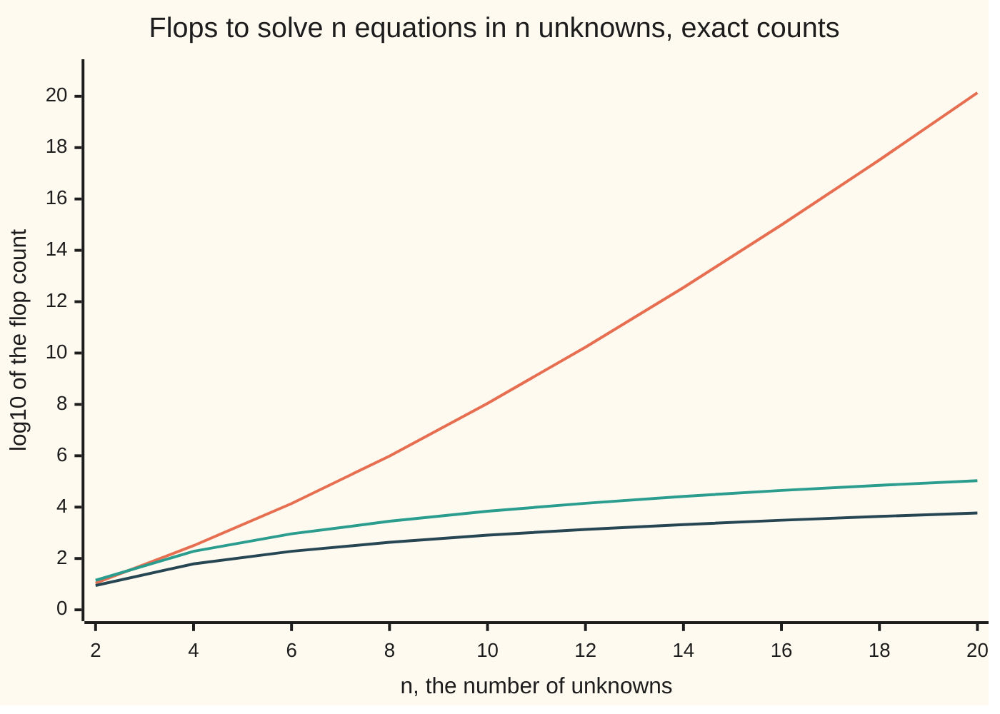

# Counting the work: flops, growth rates, and why a tuned library beats your loop

[Syllabus](../../../SYLLABUS.md) → [Numerical analysis](../README.md) → [Floating Point and Error](../README.md#s01) → Counting the work

---

## General Overview

An economic planner splits a country's economy into 20 industries. To make one dollar of output, each industry buys set amounts from the others: steel buys power, power buys coal, and so on. Given what households want to buy, how much must each industry produce? That is an **input–output model**, and it is 20 linear equations in 20 unknowns. The table of amounts on this card is illustrative.

Two textbook methods solve it. **Cramer's rule** writes each unknown as a ratio of two determinants ([Determinants](../../03-Algebra/05-Solving%20Systems/04-determinants.md)). **Elimination** clears the system into a staircase and reads the answer from the bottom ([Gaussian elimination](../../03-Algebra/05-Solving%20Systems/02-gaussian-elimination.md)). On this system both return the right outputs, 11 to 30 billion dollars, with true errors of 4.74e-16 and 8.29e-16 of the largest output.

The difference is the work. Elimination needs 5,910 **flops**: a flop is one floating-point add, subtract, multiply or divide on two numbers. Cramer's rule, with each determinant found by cofactor expansion, needs 138,879,579,704,209,679,999 flops, about 1.39e20. At an illustrative 1e11 flops a second, elimination finishes in 5.91e-8 seconds. Cramer's rule takes 44.0 years.

Counting flops is half the story. Multiplying two 48 by 48 matrices takes 221,184 flops whichever way the loops run. With a small fast memory that holds 1,280 numbers, a plain triple loop fetches 115,200 numbers from main memory (the large, slow store that holds the data). A loop that works in 16 by 16 tiles (square blocks) fetches 16,128. Same arithmetic, far less memory traffic: that is why a tuned library beats a hand-written loop.

**Count a method's flops as a formula in the size n, compare the formulas at the size you really have, and then count the numbers it moves from memory: when each number fetched feeds only a flop or two, memory traffic decides the cost, not arithmetic.**

**What kind of fact this is:** the flop counts are theorems, exact for every n, proved in Why it works and counted one flop at a time by the code. The memory part is a model: a cache that keeps the most recently used numbers, and machine speeds marked illustrative. This card measures no times.

### The picture: three ways to solve n equations



The steep orange line is Cramer's rule with cofactor determinants: it climbs faster than any power of n. The middle teal line is Cramer's rule with each determinant found by elimination. The low dark line is elimination itself. The y-axis is log10 of the count, so each step up is ten times more work. Both checks print every point.

---

## The formula

The system is $Mx = b$. One flop count per method, exact for every n:

$$E(n) = \tfrac{2}{3}n^3 + \tfrac{3}{2}n^2 - \tfrac{7}{6}n, \qquad D(n) = \tfrac{2}{3}n^3 - \tfrac{1}{2}n^2 + \tfrac{5}{6}n - 1, \qquad K(n) = (n+1)\,D(n) + n$$

**Read it aloud:** elimination costs about two thirds of n cubed flops; one determinant by elimination costs about the same; Cramer's rule needs n + 1 determinants plus n divisions, so it costs about n times more.

$$C(1) = 0, \qquad C(n) = n\,C(n-1) + 2n - 1, \qquad C(n)/n! \to e \text{ as } n \to \infty$$

**Read it aloud:** a cofactor determinant of size n costs n determinants of size n − 1, plus n multiplies and n − 1 adds; that adds up to about e times n factorial.

The memory side has one number per method, its **arithmetic intensity** q: flops done per number fetched from main memory.

$$\text{flops per second} \le \min(P,\ q\,W)$$

**Read it aloud:** a method runs no faster than the machine's peak, and no faster than the rate memory can feed it numbers times the flops each number feeds.

| Symbol | Plain meaning | In our example | Push it up and the answer… |
| --- | --- | --- | --- |
| $n$ | the number of unknowns, and the matrix's side | 20 | every count grows; Cramer's grows fastest |
| $M$, $M_i$ | the system's matrix, $200(I - A)$: $A$ holds what each industry buys from each other per dollar of output, $I$ is the identity; $M_i$ is $M$ with column i replaced by $b$ | 20 by 20, 200 on the diagonal | — |
| $x$ | the unknowns: each industry's output, in billions of dollars | 11 to 30 | — |
| $b$ | the right side: 200 times household demand | first entry 346 | — |
| $E(n)$ | flops to solve by elimination and back substitution | 5,910 | grows like $n^3$ |
| $D(n)$, $K(n)$ | flops for one determinant by elimination; for Cramer's rule with such determinants | 5,149; 108,149 | D grows like $n^3$, K like $n^4$ |
| $k$, $m$, $i$ | in Why it works: the column being cleared; the rows below it, $n - k$; a row in back substitution | first column: m = n − 1 | — |
| $C(n)$ | flops for one determinant by cofactor expansion; $n! = 1 \times 2 \times \dots \times n$, $e = 2.718281828459$ | 6,613,313,319,248,079,999 | grows faster than any power of n |
| $q$ | arithmetic intensity: flops per number fetched | plain loop 1.92, tiled 13.71 | the method gets closer to the peak $P$ |
| $t$, $S$; $A$, $B$, $C$ in Step 4 | tile side: the loop works on $t$ by $t$ blocks; S is the cache size in numbers; in Step 4 only, $C = AB$ is the product of two new n by n matrices | 16; 1,280; 48 by 48 | fewer fetches, while the tiles fit in the cache |
| $P$ | the machine's peak flops per second, illustrative | 100 Gflop/s | a higher ceiling, only for methods with high $q$ |
| $W$ | numbers per second main memory can deliver, illustrative | 2.50e9 (20 GB/s) | memory-bound methods speed up |

### When it holds

- **The matrix is dense: every entry may be nonzero.** For a tridiagonal matrix (nonzeros only on and beside the diagonal) elimination needs a fixed handful of flops per row, so its count grows like n, not like $2n^3/3$; counting as if dense overstates the work.
- **Every flop costs the same.** A division takes longer than an add on most chips, and comparisons and row swaps for pivoting are not counted. The count ranks methods; it is not a stopwatch.
- **The leading term needs a large n.** At n = 5, $2n^3/3$ gives 83.3 against the exact 115.
- **Flops decide only when q is high.** If q is below the machine balance $P/W$, here 40 flops per number, memory decides. A matrix times a vector has q = 1.77 at n = 20, so its flop count says little about its speed.
- **The data outgrows the cache.** The 20 by 20 matrix is 400 numbers, 3,200 bytes, and sits in the fastest memory a chip has. Memory traffic starts to decide only for large n.

---

## Why it works

### Step 0: a method is nested loops, and loops can be counted

Every method here is a set of nested loops with a few flops in the innermost body. The flop count is the sum of that body's flops over every pass. Sums of 1, of k and of $k^2$ give polynomials in n, so the count of a loop method is a polynomial. A method that calls itself on smaller pieces, like cofactor expansion, gives a recurrence instead.

Big-O ([Big-O](../../14-Applied%20and%20computational/01-Algorithms%20and%20Growth/01-big-o-and-growth-rates.md)) keeps only the fastest-growing term: elimination is $O(n^3)$ as $n \to \infty$. This card keeps every term, because at n = 20 the small terms still matter. The computing wing already counts the operations in a loop and shows arrays and compiled loops beating plain code ([Cost in practice](../../14-Applied%20and%20computational/08-Scientific%20Computing%20Practice/04-computational-cost-and-vectorisation.md)); this card counts linear-algebra methods and memory traffic.

### Step 1: elimination costs about $2n^3/3$ flops

Clearing column k leaves $m = n - k$ rows below the pivot (the entry used to clear the column). Each of those rows costs one division for its multiplier, then a multiply and a subtract for each of the m entries to its right and one more pair for the right side.

Back substitution then finds the unknowns from the bottom up. Row i needs $n - i$ multiply-subtract pairs and one division.

| Part | Flops | At n = 20 |
| --- | --- | --- |
| multipliers | $\sum m = n(n-1)/2$ | 190 |
| row updates | $2\sum m^2 = (n-1)n(2n-1)/3$ | 4,940 |
| right side | $2\sum m = n(n-1)$ | 380 |
| back substitution | $\sum (2(n-i)+1) = n^2$ | 400 |
| **total** | $E(n)$ | **5,910** |

<details>
<summary>Detailed proof: the four parts add to E(n)</summary>

Use $\sum_{m=1}^{n-1} m = n(n-1)/2$ and $\sum_{m=1}^{n-1} m^2 = (n-1)n(2n-1)/6$, both proved by induction on n.

Put everything over 6:

$3(n^2 - n) + 2(2n^3 - 3n^2 + n) + 6(n^2 - n) + 6n^2 = 4n^3 + 9n^2 - 7n.$

Divide by 6: $E(n) = \tfrac{2}{3}n^3 + \tfrac{3}{2}n^2 - \tfrac{7}{6}n$. Row swaps for pivoting move numbers but do no arithmetic, so they add no flops.

</details>

### Step 2: Cramer's rule repeats the solve n + 1 times

Cramer's rule says $x_i = \det(M_i) / \det(M)$, where $M_i$ is $M$ with column i replaced by $b$. That is n + 1 determinants and n divisions.

A determinant by elimination drops the right side and back substitution and multiplies the n diagonal entries instead, n − 1 flops: 190 + 4,940 + 19 = 5,149. Then $K(20) = 21 \times 5{,}149 + 20 = 108{,}149$.

Each determinant costs about as much as a whole solve, so Cramer's rule costs about n times more: 18.3 times at n = 20, 998.0 times at n = 1,000. Its count grows like $2n^4/3$.

### Step 3: cofactor expansion grows like e times n factorial

Cofactor expansion along the top row multiplies each of the n top entries by the determinant of its **minor**: the matrix left after deleting that entry's row and column. That gives n determinants of size n − 1, then n multiplies and n − 1 adds or subtracts:

$C(n) = n\,C(n-1) + 2n - 1$, with $C(1) = 0$ and $C(2) = 3$, the familiar $ad - bc$.

Divide by $n!$ and the recurrence becomes a sum, which tends to e.

<details>
<summary>Detailed proof: C(n) / n! tends to e</summary>

Dividing the recurrence by $n!$ gives $\dfrac{C(n)}{n!} = \dfrac{C(n-1)}{(n-1)!} + \dfrac{2n-1}{n!}$. Unroll it from $C(1) = 0$:

$$\frac{C(n)}{n!} = \sum_{k=2}^{n} \frac{2k-1}{k!} = 2\sum_{k=2}^{n} \frac{1}{(k-1)!} - \sum_{k=2}^{n} \frac{1}{k!}.$$

As $n \to \infty$ the first sum tends to $2(e - 1)$ and the second to $e - 2$, since $e = \sum_{k \ge 0} 1/k!$. The difference is $2e - 2 - e + 2 = e$. Every term is positive, so $C(n) < e \cdot n!$ for every n.

</details>

At n = 20: $C(20) = 6{,}613{,}313{,}319{,}248{,}079{,}999$, and $C(20)/20! = 2.718281828459$, equal to e to every printed digit. Cramer's rule needs 21 of these plus 20 divisions: 1.39e20 flops. A factorial beats every power of n ([Linear versus exponential growth](../../01-Foundations/03-Powers%2C%20Roots%20and%20Logarithms/02-linear-vs-exponential-growth.md) shows the same race between adding and multiplying), so no machine rescues this method.

### Step 4: memory traffic, counted with arithmetic intensity

A chip does arithmetic only on numbers held close to it, in a small fast memory called the **cache**. Fetching a number from main memory is far slower than a flop. So a method has two counts: flops, and numbers fetched. Their ratio is the intensity q.

- **Matrix times vector:** each of the $n^2$ matrix entries is used once, for one multiply and one add. At n = 20 that is 780 flops on 440 numbers, q = 1.77. No loop order can raise it.
- **Matrix times matrix:** $3n^2$ numbers feed about $2n^3$ flops (exactly $n^2(2n-1)$: each entry of the product takes n multiplies and n − 1 adds), so q could reach about 2n/3: 15,600 flops on 1,200 numbers at n = 20, q = 13.00. Whether a loop reaches it depends on reuse.

Here $A$ and $B$ are any two n by n matrices and $C = AB$ is their product; they are not the industry table or the cofactor count. The plain triple loop walks down a column of B for every entry of C. Once B is larger than the cache, each of its numbers is gone before it is used again: about $n^3$ fetches for $2n^3$ flops, q close to 2.

A **tiled** loop works on $t$ by $t$ blocks. It keeps one tile of A, one of B and one of C in the cache and does all $2t^3$ flops those tiles allow, so each fetched number feeds about t flops. Fetches fall to about $2n^3/t + n^2$.

Both loops start each entry of C at zero and add all n products into it, so they count one add more per entry than $n^2(2n-1)$: $2n^3$ flops, 221,184 at n = 48.

| Loop, n = 48, cache of 1,280 numbers | Flops | Numbers fetched | Model | q |
| --- | ---: | ---: | ---: | ---: |
| plain triple loop | 221,184 | 115,200 | $n^3 + 2n^2$ = 115,200 | 1.92 |
| tiled, t = 16 | 221,184 | 16,128 | $2n^3/t + n^2$ = 16,128 | 13.71 |

A 1981 theorem limits how far tiling can go (Sources). With a cache of S numbers, any order of the standard $2n^3$ flops fetches at least a fixed multiple of $n^3/\sqrt{S}$ numbers. It is stated here without proof. Tiling with $t$ about $\sqrt{S/3}$ reaches that rate, up to a constant.

### Step 5: the roofline, and why a tuned library wins

The **roofline** is the bound $\min(P, qW)$ drawn against q: a sloping roof where memory limits the rate, then a flat roof at the peak. Put the intensity into the formula $\min(P, qW)$. On an illustrative machine with P = 100 Gflop/s and W = 2.50e9 numbers per second (20 GB/s, 8 bytes a number), the **balance** $P/W$ is 40 flops per number. Below it, memory decides.

```
Best possible rate, Gflop/s, illustrative machine (peak 100)
plain loop, q = 1.92          ██                                         4.80
tiled, t = 16, q = 13.71      ██████████████                            34.29
tiled, t = 64, n = 1000       ████████████████████████████████████████ 100.00
```

All three bars do about $2n^3$ flops. The third assumes a larger cache, one that holds three 64 by 64 tiles. A tuned library, such as a BLAS (Basic Linear Algebra Subprograms) built for one chip, tiles for each level of cache and adds vector instructions (one instruction doing several flops at once) and several cores, which this model leaves out. LAPACK, the standard dense solver library, rewrites elimination so most of its flops happen inside matrix-times-matrix steps, where q is high. The flop count is the same as your loop's; the fetches are not.

---

## Worked numbers, by hand

| Step | Arithmetic | Value |
| --- | --- | --- |
| elimination, n = 20 | 190 + 4,940 + 380 + 400 | 5,910 |
| one determinant by elimination | 190 + 4,940 + 19 | 5,149 |
| Cramer, determinants by elimination | 21 × 5,149 + 20 | 108,149 |
| ratio to elimination | 108,149 / 5,910 | 18.3 |
| one cofactor determinant | $C(20)$, about e × 20! | 6,613,313,319,248,079,999 |
| Cramer, determinants by cofactors | 21 × C(20) + 20 | 1.39e20 |
| illustrative time at 1e11 flops/s | 1.39e20 / 1e11 seconds, in years | 44.0 years |
| elimination at the same rate | 5,910 / 1e11 | 5.91e-8 s |
| matrix multiply, n = 48 | plain: 221,184 / 115,200 | q = 1.92 |
| same, tiled with t = 16 | 221,184 / 16,128 | q = 13.71 |
| **cost of the planner's solve** | **elimination, all in cache** | **5,910 flops** |

The planner's 20-industry model costs 5,910 flops by elimination, fewer than the 10,000,000 adds a fitness tracker makes summing 0.1 ten million times; Cramer's rule by cofactors would outlast the planner.

The counts grow at different rates, so the gap depends on n:

| n | Elimination | Cramer, elimination | Ratio | Cramer, cofactors |
| ---: | ---: | ---: | ---: | ---: |
| 5 | 1.15e2 | 4.49e2 | 3.9 | 1.95e3 |
| 10 | 8.05e2 | 6.87e3 | 8.5 | 1.09e8 |
| 20 | 5.91e3 | 1.08e5 | 18.3 | 1.39e20 |
| 30 | 1.93e4 | 5.45e5 | 28.2 | 2.24e34 |
| 1,000 | 6.68e8 | 6.67e11 | 998.0 | — |
| 10,000 | 6.67e11 | 6.67e15 | 9998.0 | — |

### What breaks if you drop a piece

| Mistake | Comes out at | What went wrong |
| --- | --- | --- |
| Count only multiplies and divides | 3,060 flops at n = 20, not 5,910 | The adds and subtracts are nearly half the work. Older books count a multiply-add pair as one operation, hence "$n^3/3$" |
| Keep only the leading term at n = 5 | 83.3, not 115 | Lower terms are large when n is small |
| Treat Cramer's rule as cheap once determinants are cheap | 108,149, 18.3 times elimination | It still needs n + 1 determinants, each as costly as a whole solve |
| Equal flops means equal cost | 115,200 numbers fetched against 16,128, both for 221,184 flops | The plain loop's q of 1.92 is far below the balance of 40, so memory decides |

The code prints every row.

---

## Code, from first principles, and it actually runs

The code solves the 20 by 20 system twice, by elimination and by Cramer's rule, against a known answer: the outputs were chosen first and the right side computed from them. Every flop is counted where it happens and compared with the formulas, so the count has two independent roads. The cofactor count is checked three ways for n = 1 to 8: counted in a real expansion, by the recurrence and by the factorial sum. A small cache that drops the least recently used number counts the fetches of the two matrix-multiply loops, against the model.

### Python

```python
# Counting the work: Cramer's rule against elimination on a 20 by 20 system.
# Standard library only. Every number on the card is printed here. Each flop
# (one + - * or / on two numbers) is counted where it happens, then compared
# with the formulas proved on the card.
import math

N, TILE, CACHE, NM = 20, 16, 1280, 48     # unknowns; tile, cache size and n for the memory model

def comma(k): return f"{k:,}"
def sci(x): m, e = f"{x:.2e}".split("e"); return f"{m}e{int(e)}"

def table(n):                            # M = 200(I - A): 200 on the diagonal, -a_ij * 200 off it
    return [[200.0 if i == j else -float((3 * i + 7 * j + 10) % 11) for j in range(n)] for i in range(n)]

def det_elim(M):                         # elimination to a staircase, then multiply the diagonal
    A, n, f, sign = [r[:] for r in M], len(M), 0, 1.0
    for k in range(n):
        p = max(range(k, n), key=lambda r: abs(A[r][k]))
        if p != k: A[k], A[p], sign = A[p], A[k], -sign
        for i in range(k + 1, n):
            m = A[i][k] / A[k][k]; f += 1
            for j in range(k + 1, n): A[i][j] -= m * A[k][j]; f += 2
    d = A[0][0]
    for k in range(1, n): d *= A[k][k]; f += 1
    return sign * d, f

def solve(M, b):                         # elimination with the right side, then back substitution
    A, n, f = [r[:] + [b[i]] for i, r in enumerate(M)], len(M), 0
    for k in range(n):
        p = max(range(k, n), key=lambda r: abs(A[r][k]))
        A[k], A[p] = A[p], A[k]
        for i in range(k + 1, n):
            m = A[i][k] / A[k][k]; f += 1
            for j in range(k + 1, n + 1): A[i][j] -= m * A[k][j]; f += 2
    x = [0.0] * n
    for i in reversed(range(n)):
        s = A[i][n]
        for j in range(i + 1, n): s -= A[i][j] * x[j]; f += 2
        x[i] = s / A[i][i]; f += 1
    return x, f

def cramer(M, b):                        # x_i = det(M with column i replaced by b) / det(M)
    D, f = det_elim(M); x = []
    for i in range(len(M)):
        Di, g = det_elim([r[:i] + [b[k]] + r[i + 1:] for k, r in enumerate(M)])
        x.append(Di / D); f += g + 1
    return x, f

def cofactor(M):                         # expansion along the top row, counted
    if len(M) == 1: return M[0][0], 0
    total, f = 0.0, 0
    for j in range(len(M)):
        sub, g = cofactor([r[:j] + r[j + 1:] for r in M[1:]])
        term = M[0][j] * sub; f += g + 1
        if j == 0: total = term
        else: total = total - term if j % 2 else total + term; f += 1
    return total, f

E = lambda n: (4 * n**3 + 9 * n**2 - 7 * n) // 6      # solve by elimination
D = lambda n: (4 * n**3 - 3 * n**2 + 5 * n - 6) // 6  # one determinant by elimination
K = lambda n: (n + 1) * D(n) + n                     # Cramer, determinants by elimination
def C(n): return 0 if n == 1 else n * C(n - 1) + 2 * n - 1   # one cofactor determinant
def C_series(n): return sum((2 * k - 1) * (math.factorial(n) // math.factorial(k)) for k in range(2, n + 1))
Q = lambda n: (n + 1) * C(n) + n                     # Cramer, determinants by cofactors

M = table(N); xt = [10.0 + i for i in range(1, N + 1)]   # known output, $ billion (illustrative)
b = [sum(M[i][j] * xt[j] for j in range(N)) for i in range(N)]
xe, fe = solve(M, b); xc, fc = cramer(M, b)
rel = lambda x: max(abs(x[i] - xt[i]) for i in range(N)) / max(xt)
print(f"system: n = {N}, M = 200(I - A), known x_1..x_20 = 11..30, b_1 = {b[0]:.0f}; M is {N * N} numbers, {8 * N * N:,} bytes")
print(f"elimination: x_1 = {xe[0]:.9f}, x_20 = {xe[-1]:.9f}, true error {sci(rel(xe))}")
print(f"Cramer:      x_1 = {xc[0]:.9f}, x_20 = {xc[-1]:.9f}, true error {sci(rel(xc))}")
print(f"det M = {sci(det_elim(M)[0])}")
print(f"counted, n = {N}: solve {comma(fe)}; Cramer by elimination {comma(fc)}; one det {comma(det_elim(M)[1])}")
print(f"formula, n = {N}: solve {comma(E(N))}; Cramer by elimination {comma(K(N))}; one det {comma(D(N))}; solve = {N * (N - 1) // 2} + {comma((N - 1) * N * (2 * N - 1) // 3)} + {N * (N - 1)} + {N * N}")
assert fe == E(N) and fc == K(N) and det_elim(M)[1] == D(N)
assert rel(xe) < 1e-13 and rel(xc) < 1e-13
cf = [cofactor([r[:n] for r in M[:n]]) for n in range(1, 9)]
print("cofactor flops counted, n = 1..8:", " ".join(str(f) for _, f in cf))
print("by recurrence:                   ", " ".join(str(C(n)) for n in range(1, 9)))
assert [f for _, f in cf] == [C(n) for n in range(1, 9)] == [C_series(n) for n in range(1, 9)]
d8 = det_elim([r[:8] for r in M[:8]])[0]
print(f"8 by 8 det: cofactors {sci(cf[7][0])}, elimination {sci(d8)}, relative gap {sci(abs(cf[7][0] - d8) / abs(d8))}")
assert abs(cf[7][0] - d8) < 1e-12 * abs(d8)
r20 = C(20) / math.factorial(20)
print(f"C(20) = {comma(C(20))}; C(20)/20! = {r20:.12f}; e = {math.e:.12f}")
assert C(20) == C_series(20) and abs(r20 - math.e) < 1e-12
print(f"Cramer by cofactors, n = {N}: {comma(Q(N))} = {sci(Q(N))} flops")
for n in (5, 10, 20, 30, 100, 1000, 10000):
    q = sci(Q(n)) if n <= 30 else "-"
    print(f"growth n = {n:>5}: solve {sci(E(n)):>8}  Cramer-elim {sci(K(n)):>8}  ratio {K(n) / E(n):7.1f}  Cramer-cofactor {q}")
yr = 1e11 * 365.25 * 86400
print(f"at an illustrative 1e11 flops/s: solve {sci(E(N) / 1e11)} s; Cramer-cofactor {Q(N) / yr:.1f} years")
for name, F in (("solve", E), ("Cramer-elim", K), ("Cramer-cofactor", Q)):
    print(f"chart, log10 {name}:", ", ".join(f"{math.log10(F(n)):.2f}" for n in range(2, 21, 2)))

def traffic(n, t, cache, blocked):       # numbers fetched by a cache that drops the least recent
    lru, miss, f = {}, 0, 0
    def touch(a):
        nonlocal miss
        if a in lru: del lru[a]
        else:
            miss += 1
            if len(lru) == cache: del lru[next(iter(lru))]
        lru[a] = 1
    step = t if blocked else n
    for ii in range(0, n, step):
        for jj in range(0, n, step):
            for kk in range(0, n, step):
                for i in range(ii, ii + step):
                    for j in range(jj, jj + step):
                        touch(2 * n * n + i * n + j)
                        for k in range(kk, kk + step):
                            touch(i * n + k); touch(n * n + k * n + j); f += 2
                        touch(2 * n * n + i * n + j)
    return f, miss

fn, mn = traffic(NM, TILE, CACHE, False); fb, mb = traffic(NM, TILE, CACHE, True)
pn, pb = NM**3 + 2 * NM**2, 2 * NM**3 // TILE + NM**2
print(f"memory: C = AB, n = {NM}, tile {TILE}, cache holds {CACHE} numbers")
print(f"plain loop: flops {comma(fn)}, numbers fetched {comma(mn)} (model {comma(pn)}), flops per number {fn / mn:.2f}")
print(f"tiled loop: flops {comma(fb)}, numbers fetched {comma(mb)} (model {comma(pb)}), flops per number {fb / mb:.2f}")
assert fn == fb == 2 * NM**3 and abs(mn - pn) < 0.02 * pn and abs(mb - pb) < 0.02 * pb
print(f"intensity, n = 20: matrix times vector {N * (2 * N - 1)}/{N * N + 2 * N} = {N * (2 * N - 1) / (N * N + 2 * N):.2f}; "
      f"matrix times matrix {N * N * (2 * N - 1)}/{3 * N * N} = {(2 * N - 1) / 3:.2f}")
peak, feed = 1e11, 2.5e9                 # illustrative: flops/s, and numbers/s from memory (20 GB/s)
big = 2e9 / (2e9 / 64 + 1e6)
print(f"illustrative machine: {peak / 1e9:.0f} Gflop/s, {8 * feed / 1e9:.0f} GB/s = {sci(feed)} numbers/s, balance {peak / feed:.0f} flops per number")
for name, I in (("plain loop", fn / mn), ("tile 16", fb / mb), ("tile 64, n = 1000", big)):
    print(f"  {name:<18} {I:6.2f} flops per number -> {min(peak, I * feed) / 1e9:6.2f} Gflop/s")
print(f"what breaks: multiplies and divides only, n = 20: {N * (N - 1) // 2 + (N - 1) * N * (2 * N - 1) // 6 + N * (N - 1) // 2 + N * (N + 1) // 2}")
print(f"what breaks: leading term 2n^3/3 at n = 5: {2 * 125 / 3:.1f}, exact {E(5)}")
print(f"what breaks: Cramer by elimination over solve, n = 20: {K(N) / E(N):.1f} times")
print(f"tracker: 10,000,000 plain adds = {comma(10**7)} flops; Kahan, 4 flops a step = {comma(4 * 10**7)}")
print(f"try: n = 10, Cramer-cofactor {comma(Q(10))}; tile 8 fetched {comma(traffic(NM, 8, CACHE, True)[1])}; "
      f"cache 8192, plain loop fetched {comma(traffic(NM, TILE, 8192, False)[1])}")
print("ALL CHECKS PASS")
```

**Ran 2026-11-11 on macOS, Python 3.14.10, standard library only. All checks passed. Output, pasted from the run:**

```
system: n = 20, M = 200(I - A), known x_1..x_20 = 11..30, b_1 = 346; M is 400 numbers, 3,200 bytes
elimination: x_1 = 11.000000000, x_20 = 30.000000000, true error 4.74e-16
Cramer:      x_1 = 11.000000000, x_20 = 30.000000000, true error 8.29e-16
det M = 8.87e45
counted, n = 20: solve 5,910; Cramer by elimination 108,149; one det 5,149
formula, n = 20: solve 5,910; Cramer by elimination 108,149; one det 5,149; solve = 190 + 4,940 + 380 + 400
cofactor flops counted, n = 1..8: 0 3 14 63 324 1955 13698 109599
by recurrence:                    0 3 14 63 324 1955 13698 109599
8 by 8 det: cofactors 2.52e18, elimination 2.52e18, relative gap 4.06e-16
C(20) = 6,613,313,319,248,079,999; C(20)/20! = 2.718281828459; e = 2.718281828459
Cramer by cofactors, n = 20: 138,879,579,704,209,679,999 = 1.39e20 flops
growth n =     5: solve   1.15e2  Cramer-elim   4.49e2  ratio     3.9  Cramer-cofactor 1.95e3
growth n =    10: solve   8.05e2  Cramer-elim   6.87e3  ratio     8.5  Cramer-cofactor 1.09e8
growth n =    20: solve   5.91e3  Cramer-elim   1.08e5  ratio    18.3  Cramer-cofactor 1.39e20
growth n =    30: solve   1.93e4  Cramer-elim   5.45e5  ratio    28.2  Cramer-cofactor 2.24e34
growth n =   100: solve   6.82e5  Cramer-elim   6.68e7  ratio    98.1  Cramer-cofactor -
growth n =  1000: solve   6.68e8  Cramer-elim  6.67e11  ratio   998.0  Cramer-cofactor -
growth n = 10000: solve  6.67e11  Cramer-elim  6.67e15  ratio  9998.0  Cramer-cofactor -
at an illustrative 1e11 flops/s: solve 5.91e-8 s; Cramer-cofactor 44.0 years
chart, log10 solve: 0.95, 1.79, 2.28, 2.63, 2.91, 3.13, 3.32, 3.49, 3.64, 3.77
chart, log10 Cramer-elim: 1.15, 2.28, 2.96, 3.45, 3.84, 4.15, 4.42, 4.65, 4.85, 5.03
chart, log10 Cramer-cofactor: 1.04, 2.50, 4.14, 5.99, 8.04, 10.23, 12.55, 14.99, 17.52, 20.14
memory: C = AB, n = 48, tile 16, cache holds 1280 numbers
plain loop: flops 221,184, numbers fetched 115,200 (model 115,200), flops per number 1.92
tiled loop: flops 221,184, numbers fetched 16,128 (model 16,128), flops per number 13.71
intensity, n = 20: matrix times vector 780/440 = 1.77; matrix times matrix 15600/1200 = 13.00
illustrative machine: 100 Gflop/s, 20 GB/s = 2.50e9 numbers/s, balance 40 flops per number
  plain loop           1.92 flops per number ->   4.80 Gflop/s
  tile 16             13.71 flops per number ->  34.29 Gflop/s
  tile 64, n = 1000   62.02 flops per number -> 100.00 Gflop/s
what breaks: multiplies and divides only, n = 20: 3060
what breaks: leading term 2n^3/3 at n = 5: 83.3, exact 115
what breaks: Cramer by elimination over solve, n = 20: 18.3 times
tracker: 10,000,000 plain adds = 10,000,000 flops; Kahan, 4 flops a step = 40,000,000
try: n = 10, Cramer-cofactor 108,505,099; tile 8 fetched 18,432; cache 8192, plain loop fetched 6,912
ALL CHECKS PASS
```

### Rust

```rust
// Counting the work: Cramer's rule against elimination on a 20 by 20 system.
// std only, no crates. Every number on the card is printed here. Each flop
// (one + - * or / on two numbers) is counted where it happens, then compared
// with the formulas proved on the card.
use std::collections::BTreeMap; type Mat = Vec<Vec<f64>>;
const N: usize = 20; // unknowns; then tile, cache size and n for the memory model
const TILE: usize = 16; const CACHE: usize = 1280; const NM: usize = 48;

fn comma(k: u128) -> String {
    let s = k.to_string();
    s.chars().enumerate().map(|(i, c)| if i > 0 && (s.len() - i) % 3 == 0 { format!(",{}", c) } else { c.to_string() }).collect()
}
fn sci(x: f64) -> String { format!("{:.2e}", x) }

fn table(n: usize) -> Mat {              // M = 200(I - A): 200 on the diagonal, -a_ij * 200 off it
    (0..n).map(|i| (0..n).map(|j| if i == j { 200.0 } else { -(((3 * i + 7 * j + 10) % 11) as f64) }).collect()).collect()
}

fn pivot(a: &Mat, k: usize) -> usize {   // first row holding the largest entry in column k
    (k..a.len()).fold(k, |p, r| if a[r][k].abs() > a[p][k].abs() { r } else { p })
}

fn det_elim(m: &Mat) -> (f64, u128) {    // elimination to a staircase, then multiply the diagonal
    let (mut a, n, mut f, mut sign) = (m.clone(), m.len(), 0u128, 1.0f64);
    for k in 0..n {
        let p = pivot(&a, k);
        if p != k { a.swap(k, p); sign = -sign; }
        for i in k + 1..n {
            let mu = a[i][k] / a[k][k]; f += 1;
            for j in k + 1..n { a[i][j] -= mu * a[k][j]; f += 2; }
        }
    }
    let d = (1..n).fold(a[0][0], |d, k| { f += 1; d * a[k][k] });
    (sign * d, f)
}

fn solve(m: &Mat, b: &[f64]) -> (Vec<f64>, u128) { // elimination with the right side, then back substitution
    let (n, mut f) = (m.len(), 0u128);
    let mut a: Mat = (0..n).map(|i| { let mut r = m[i].clone(); r.push(b[i]); r }).collect();
    for k in 0..n {
        let p = pivot(&a, k); a.swap(k, p);
        for i in k + 1..n {
            let mu = a[i][k] / a[k][k]; f += 1;
            for j in k + 1..n + 1 { a[i][j] -= mu * a[k][j]; f += 2; }
        }
    }
    let mut x = vec![0.0; n];
    for i in (0..n).rev() {
        let mut s = a[i][n];
        for j in i + 1..n { s -= a[i][j] * x[j]; f += 2; }
        x[i] = s / a[i][i]; f += 1;
    }
    (x, f)
}

fn cramer(m: &Mat, b: &[f64]) -> (Vec<f64>, u128) { // x_i = det(M with column i replaced by b) / det(M)
    let ((d, mut f), mut x) = (det_elim(m), Vec::new());
    for i in 0..m.len() {
        let mi: Mat = m.iter().enumerate().map(|(k, r)| { let mut r = r.clone(); r[i] = b[k]; r }).collect();
        let (di, g) = det_elim(&mi);
        x.push(di / d); f += g + 1;
    }
    (x, f)
}

fn cofactor(m: &Mat) -> (f64, u128) {    // expansion along the top row, counted
    if m.len() == 1 { return (m[0][0], 0); }
    let (mut total, mut f) = (0.0, 0u128);
    for j in 0..m.len() {
        let minor: Mat = m[1..].iter().map(|r| { let mut r = r.clone(); r.remove(j); r }).collect();
        let (sub, g) = cofactor(&minor);
        let term = m[0][j] * sub; f += g + 1;
        if j == 0 { total = term; } else { total = if j % 2 == 1 { total - term } else { total + term }; f += 1; }
    }
    (total, f)
}

fn e_(n: u128) -> u128 { (4 * n * n * n + 9 * n * n - 7 * n) / 6 }     // solve by elimination
fn d_(n: u128) -> u128 { (4 * n * n * n - 3 * n * n + 5 * n - 6) / 6 } // one determinant by elimination
fn k_(n: u128) -> u128 { (n + 1) * d_(n) + n }                         // Cramer, determinants by elimination
fn c_(n: u128) -> u128 { if n == 1 { 0 } else { n * c_(n - 1) + 2 * n - 1 } } // one cofactor determinant
fn fact(n: u128) -> u128 { (1..=n).product() }
fn c_series(n: u128) -> u128 { (2..=n).map(|k| (2 * k - 1) * (fact(n) / fact(k))).sum() }
fn q_(n: u128) -> u128 { (n + 1) * c_(n) + n }                         // Cramer, determinants by cofactors

fn traffic(n: usize, t: usize, cache: usize, blocked: bool) -> (u128, u128) { // fetched by an LRU cache
    let (mut lru, mut last, mut now) = (BTreeMap::new(), vec![0u64; 3 * n * n], 1u64);
    let (mut miss, mut f) = (0u128, 0u128);
    let mut touch = |a: usize| {
        if last[a] > 0 { lru.remove(&last[a]); } else {
            miss += 1;
            if lru.len() == cache { let (_, old) = lru.pop_first().unwrap(); last[old] = 0; }
        }
        lru.insert(now, a); last[a] = now; now += 1;
    };
    let step = if blocked { t } else { n };
    for ii in (0..n).step_by(step) { for jj in (0..n).step_by(step) { for kk in (0..n).step_by(step) {
        for i in ii..ii + step { for j in jj..jj + step {
            touch(2 * n * n + i * n + j);
            for k in kk..kk + step { touch(i * n + k); touch(n * n + k * n + j); f += 2; }
            touch(2 * n * n + i * n + j);
        } }
    } } }
    (f, miss)
}

fn main() {
    let (m, nn) = (table(N), N as u128);
    let xt: Vec<f64> = (1..=N).map(|i| 10.0 + i as f64).collect();     // known output, $ billion (illustrative)
    let b: Vec<f64> = (0..N).map(|i| (0..N).fold(0.0, |s, j| s + m[i][j] * xt[j])).collect();
    let ((xe, fe), (xc, fc)) = (solve(&m, &b), cramer(&m, &b));
    let rel = |x: &[f64]| (0..N).map(|i| (x[i] - xt[i]).abs()).fold(0.0, f64::max) / xt[N - 1];
    let (dm, fd) = det_elim(&m);
    println!("system: n = {}, M = 200(I - A), known x_1..x_20 = 11..30, b_1 = {:.0}; M is {} numbers, {} bytes", N, b[0], N * N, comma((8 * N * N) as u128));
    println!("elimination: x_1 = {:.9}, x_20 = {:.9}, true error {}", xe[0], xe[N - 1], sci(rel(&xe)));
    println!("Cramer:      x_1 = {:.9}, x_20 = {:.9}, true error {}", xc[0], xc[N - 1], sci(rel(&xc)));
    println!("det M = {}", sci(dm));
    println!("counted, n = {}: solve {}; Cramer by elimination {}; one det {}", N, comma(fe), comma(fc), comma(fd));
    println!("formula, n = {}: solve {}; Cramer by elimination {}; one det {}; solve = {} + {} + {} + {}", N, comma(e_(nn)), comma(k_(nn)), comma(d_(nn)), N * (N - 1) / 2, comma(((N - 1) * N * (2 * N - 1) / 3) as u128), N * (N - 1), N * N);
    assert!(fe == e_(nn) && fc == k_(nn) && fd == d_(nn));
    assert!(rel(&xe) < 1e-13 && rel(&xc) < 1e-13);
    let cf: Vec<(f64, u128)> = (1..=8).map(|n| cofactor(&m[..n].iter().map(|r| r[..n].to_vec()).collect())).collect();
    let rec: Vec<u128> = (1..=8).map(c_).collect(); // the recurrence, n = 1..8
    println!("cofactor flops counted, n = 1..8: {}", cf.iter().map(|c| c.1.to_string()).collect::<Vec<_>>().join(" "));
    println!("by recurrence:                    {}", rec.iter().map(|c| c.to_string()).collect::<Vec<_>>().join(" "));
    assert!((1..=8).all(|n| cf[n - 1].1 == rec[n - 1] && rec[n - 1] == c_series(n as u128)));
    let d8 = det_elim(&m[..8].iter().map(|r| r[..8].to_vec()).collect()).0;
    println!("8 by 8 det: cofactors {}, elimination {}, relative gap {}", sci(cf[7].0), sci(d8), sci((cf[7].0 - d8).abs() / d8.abs()));
    assert!((cf[7].0 - d8).abs() < 1e-12 * d8.abs());
    let r20 = c_(20) as f64 / fact(20) as f64;
    println!("C(20) = {}; C(20)/20! = {:.12}; e = {:.12}", comma(c_(20)), r20, std::f64::consts::E);
    assert!(c_(20) == c_series(20) && (r20 - std::f64::consts::E).abs() < 1e-12);
    println!("Cramer by cofactors, n = {}: {} = {} flops", N, comma(q_(nn)), sci(q_(nn) as f64));
    for n in [5u128, 10, 20, 30, 100, 1000, 10000] {
        let q = if n <= 30 { sci(q_(n) as f64) } else { "-".to_string() };
        println!("growth n = {:>5}: solve {:>8}  Cramer-elim {:>8}  ratio {:7.1}  Cramer-cofactor {}",
                 n, sci(e_(n) as f64), sci(k_(n) as f64), k_(n) as f64 / e_(n) as f64, q);
    }
    println!("at an illustrative 1e11 flops/s: solve {} s; Cramer-cofactor {:.1} years",
             sci(e_(nn) as f64 / 1e11), q_(nn) as f64 / (1e11 * 365.25 * 86400.0));
    let lines: [(&str, fn(u128) -> u128); 3] = [("solve", e_), ("Cramer-elim", k_), ("Cramer-cofactor", q_)];
    for (name, fun) in lines {
        let pts: Vec<String> = (2..=20).step_by(2).map(|n| format!("{:.2}", (fun(n) as f64).log10())).collect();
        println!("chart, log10 {}: {}", name, pts.join(", "));
    }
    let ((fnn, mn), (fb, mb)) = (traffic(NM, TILE, CACHE, false), traffic(NM, TILE, CACHE, true));
    let (n3, n2) = ((NM * NM * NM) as u128, (NM * NM) as u128);
    let (pn, pb) = (n3 + 2 * n2, 2 * n3 / TILE as u128 + n2);
    println!("memory: C = AB, n = {}, tile {}, cache holds {} numbers", NM, TILE, CACHE);
    println!("plain loop: flops {}, numbers fetched {} (model {}), flops per number {:.2}", comma(fnn), comma(mn), comma(pn), fnn as f64 / mn as f64);
    println!("tiled loop: flops {}, numbers fetched {} (model {}), flops per number {:.2}", comma(fb), comma(mb), comma(pb), fb as f64 / mb as f64);
    let tol = |a: u128, p: u128| (a as f64 - p as f64).abs() < 0.02 * p as f64;
    assert!(fnn == fb && fb == 2 * n3 && tol(mn, pn) && tol(mb, pb));
    let nf = N as f64;
    println!("intensity, n = 20: matrix times vector {}/{} = {:.2}; matrix times matrix {}/{} = {:.2}",
             N * (2 * N - 1), N * N + 2 * N, nf * (2.0 * nf - 1.0) / (nf * nf + 2.0 * nf),
             N * N * (2 * N - 1), 3 * N * N, (2.0 * nf - 1.0) / 3.0);
    let (peak, feed, big) = (1e11f64, 2.5e9f64, 2e9 / (2e9 / 64.0 + 1e6)); // illustrative: flops/s, numbers/s (20 GB/s)
    println!("illustrative machine: {:.0} Gflop/s, {:.0} GB/s = {} numbers/s, balance {:.0} flops per number", peak / 1e9, 8.0 * feed / 1e9, sci(feed), peak / feed);
    for (name, i) in [("plain loop", fnn as f64 / mn as f64), ("tile 16", fb as f64 / mb as f64), ("tile 64, n = 1000", big)] {
        println!("  {:<18} {:6.2} flops per number -> {:6.2} Gflop/s", name, i, peak.min(i * feed) / 1e9);
    }
    println!("what breaks: multiplies and divides only, n = 20: {}", N * (N - 1) / 2 + (N - 1) * N * (2 * N - 1) / 6 + N * (N - 1) / 2 + N * (N + 1) / 2);
    println!("what breaks: leading term 2n^3/3 at n = 5: {:.1}, exact {}", 2.0 * 125.0 / 3.0, e_(5));
    println!("what breaks: Cramer by elimination over solve, n = 20: {:.1} times", k_(nn) as f64 / e_(nn) as f64);
    println!("tracker: 10,000,000 plain adds = {} flops; Kahan, 4 flops a step = {}", comma(10_000_000), comma(40_000_000));
    println!("try: n = 10, Cramer-cofactor {}; tile 8 fetched {}; cache 8192, plain loop fetched {}",
             comma(q_(10)), comma(traffic(NM, 8, CACHE, true).1), comma(traffic(NM, TILE, 8192, false).1));
    println!("ALL CHECKS PASS");
}
```

**Ran 2026-11-11 on macOS, rustc 1.98.1, no crates. All checks passed. Output, pasted from the run:**

```
system: n = 20, M = 200(I - A), known x_1..x_20 = 11..30, b_1 = 346; M is 400 numbers, 3,200 bytes
elimination: x_1 = 11.000000000, x_20 = 30.000000000, true error 4.74e-16
Cramer:      x_1 = 11.000000000, x_20 = 30.000000000, true error 8.29e-16
det M = 8.87e45
counted, n = 20: solve 5,910; Cramer by elimination 108,149; one det 5,149
formula, n = 20: solve 5,910; Cramer by elimination 108,149; one det 5,149; solve = 190 + 4,940 + 380 + 400
cofactor flops counted, n = 1..8: 0 3 14 63 324 1955 13698 109599
by recurrence:                    0 3 14 63 324 1955 13698 109599
8 by 8 det: cofactors 2.52e18, elimination 2.52e18, relative gap 4.06e-16
C(20) = 6,613,313,319,248,079,999; C(20)/20! = 2.718281828459; e = 2.718281828459
Cramer by cofactors, n = 20: 138,879,579,704,209,679,999 = 1.39e20 flops
growth n =     5: solve   1.15e2  Cramer-elim   4.49e2  ratio     3.9  Cramer-cofactor 1.95e3
growth n =    10: solve   8.05e2  Cramer-elim   6.87e3  ratio     8.5  Cramer-cofactor 1.09e8
growth n =    20: solve   5.91e3  Cramer-elim   1.08e5  ratio    18.3  Cramer-cofactor 1.39e20
growth n =    30: solve   1.93e4  Cramer-elim   5.45e5  ratio    28.2  Cramer-cofactor 2.24e34
growth n =   100: solve   6.82e5  Cramer-elim   6.68e7  ratio    98.1  Cramer-cofactor -
growth n =  1000: solve   6.68e8  Cramer-elim  6.67e11  ratio   998.0  Cramer-cofactor -
growth n = 10000: solve  6.67e11  Cramer-elim  6.67e15  ratio  9998.0  Cramer-cofactor -
at an illustrative 1e11 flops/s: solve 5.91e-8 s; Cramer-cofactor 44.0 years
chart, log10 solve: 0.95, 1.79, 2.28, 2.63, 2.91, 3.13, 3.32, 3.49, 3.64, 3.77
chart, log10 Cramer-elim: 1.15, 2.28, 2.96, 3.45, 3.84, 4.15, 4.42, 4.65, 4.85, 5.03
chart, log10 Cramer-cofactor: 1.04, 2.50, 4.14, 5.99, 8.04, 10.23, 12.55, 14.99, 17.52, 20.14
memory: C = AB, n = 48, tile 16, cache holds 1280 numbers
plain loop: flops 221,184, numbers fetched 115,200 (model 115,200), flops per number 1.92
tiled loop: flops 221,184, numbers fetched 16,128 (model 16,128), flops per number 13.71
intensity, n = 20: matrix times vector 780/440 = 1.77; matrix times matrix 15600/1200 = 13.00
illustrative machine: 100 Gflop/s, 20 GB/s = 2.50e9 numbers/s, balance 40 flops per number
  plain loop           1.92 flops per number ->   4.80 Gflop/s
  tile 16             13.71 flops per number ->  34.29 Gflop/s
  tile 64, n = 1000   62.02 flops per number -> 100.00 Gflop/s
what breaks: multiplies and divides only, n = 20: 3060
what breaks: leading term 2n^3/3 at n = 5: 83.3, exact 115
what breaks: Cramer by elimination over solve, n = 20: 18.3 times
tracker: 10,000,000 plain adds = 10,000,000 flops; Kahan, 4 flops a step = 40,000,000
try: n = 10, Cramer-cofactor 108,505,099; tile 8 fetched 18,432; cache 8192, plain loop fetched 6,912
ALL CHECKS PASS
```

The two outputs are identical line for line. The solves use only +, −, × and ÷, which agree to the bit between the two languages.

### Lean

Lean proves the flop formulas exactly for every size n, and that the cofactor count approaches e times $n!$.

- Elimination with back substitution costs exactly $E(n) = \tfrac{2}{3}n^3 + \tfrac{3}{2}n^2 - \tfrac{7}{6}n$ flops, for every n.
- For every n of at least 1, one determinant by elimination costs exactly $D(n)$ flops, and Cramer's rule with such determinants costs $K(n) = (n+1)\,D(n) + n$.
- The cofactor count $C(n)$ divided by $n!$ tends to e as n grows, and $C(n) < e \cdot n!$ for every n.
- The hand arithmetic at n = 20 holds exactly: 5,910, 5,149 and 108,149 flops, $C(20)$, and 138,879,579,704,209,679,999 flops for Cramer's rule by cofactors.
- So do the cofactor counts for n = 1 to 8 and the 3,060 count of multiplies and divides.
- So do the memory numbers: 221,184 flops, the models' 115,200 and 16,128 fetches, and the intensity counts 780, 440, 15,600 and 1,200.

The flops the loops really do, the solves' true errors and the simulated cache's fetches are left to the Python and Rust checks.

```lean
-- Counting the work: the flop counts for elimination, a determinant by elimination and Cramer's rule are exact polynomials in n, and the cofactor count divided by n factorial tends to e.
import Mathlib.Algebra.BigOperators.Intervals
import Mathlib.Data.Nat.Factorial.Basic
import Mathlib.Analysis.SpecialFunctions.Exponential
import Mathlib.Tactic.NormNum
import Mathlib.Tactic.Ring
import Mathlib.Topology.Algebra.Order.Floor

open Finset Filter Topology

/-! A flop is one add, subtract, multiply or divide on two numbers. Each count below is the
card's nested loop written as a sum of the flops in its body, for a dense n by n matrix.

* Clearing column `k` (for `k = 1, …, n`) leaves `m = n - k` rows below the pivot. Each of
  those rows costs 1 division for its multiplier, a multiply and a subtract for each of the
  `m` entries to its right, and one more pair for the right side: `m * (1 + 2 * m + 2)` flops.
* Back substitution: row `i` needs `n - i` multiply-subtract pairs and one division.
* A determinant by elimination drops the right side and back substitution and multiplies the
  `n` diagonal entries instead: `n - 1` flops.
* Cramer's rule with such determinants: `n + 1` determinants and `n` divisions.
* A cofactor determinant of size `n` costs `n` determinants of size `n - 1`, then `n`
  multiplies and `n - 1` adds or subtracts, with `C(1) = 0`. -/

/-- Flops to solve `n` equations by elimination and back substitution. -/
def elimFlops (n : ℕ) : ℕ :=
  (∑ k ∈ Icc 1 n, (n - k) * (1 + 2 * (n - k) + 2)) + ∑ i ∈ Icc 1 n, (2 * (n - i) + 1)

/-- Flops for one determinant of size `n` by elimination: `D(n)`. -/
def detElimFlops (n : ℕ) : ℕ :=
  (∑ k ∈ Icc 1 n, (n - k) * (1 + 2 * (n - k))) + (n - 1)

/-- Flops for Cramer's rule with each determinant by elimination: `K(n) = (n + 1) D(n) + n`. -/
def cramerElimFlops (n : ℕ) : ℕ := (n + 1) * detElimFlops n + n

/-- Flops for one determinant of size `n` by cofactor expansion along the top row:
`C(1) = 0` and `C(n) = n C(n - 1) + 2n - 1` (`C 0` is set to 0 and is not used). -/
def cofactorFlops : ℕ → ℕ
  | 0 => 0
  | 1 => 0
  | n + 2 => (n + 2) * cofactorFlops (n + 1) + (2 * (n + 2) - 1)

theorem sum_Icc_sub_eq_sum_range {M : Type*} [AddCommMonoid M] (g : ℕ → M) (n : ℕ) :
    ∑ k ∈ Icc 1 n, g (n - k) = ∑ m ∈ range n, g m := by
  refine Finset.sum_nbij' (fun k => n - k) (fun m => n - m) ?_ ?_ ?_ ?_ ?_
  · intro k hk; simp only [mem_Icc, mem_range] at hk ⊢; omega
  · intro m hm; simp only [mem_Icc, mem_range] at hm ⊢; omega
  · intro k hk; simp only [mem_Icc] at hk; omega
  · intro m hm; simp only [mem_range] at hm; omega
  · intro k _; rfl

theorem sum_range_elim_rows (n : ℕ) :
    ((∑ m ∈ range n, m * (1 + 2 * m + 2) : ℕ) : ℚ) = 2 / 3 * n ^ 3 + 1 / 2 * n ^ 2 - 7 / 6 * n := by
  induction n with
  | zero => simp
  | succ n ih => rw [sum_range_succ, Nat.cast_add, ih]; push_cast; ring

theorem sum_range_back_sub (n : ℕ) :
    ((∑ m ∈ range n, (2 * m + 1) : ℕ) : ℚ) = (n : ℚ) ^ 2 := by
  induction n with
  | zero => simp
  | succ n ih => rw [sum_range_succ, Nat.cast_add, ih]; push_cast; ring

theorem sum_range_det_rows (n : ℕ) :
    ((∑ m ∈ range n, m * (1 + 2 * m) : ℕ) : ℚ) = 2 / 3 * n ^ 3 - 1 / 2 * n ^ 2 - 1 / 6 * n := by
  induction n with
  | zero => simp
  | succ n ih => rw [sum_range_succ, Nat.cast_add, ih]; push_cast; ring

theorem cofactorFlops_succ (n : ℕ) (hn : 1 ≤ n) :
    cofactorFlops (n + 1) = (n + 1) * cofactorFlops n + (2 * (n + 1) - 1) := by
  obtain ⟨k, rfl⟩ : ∃ k, n = k + 1 := ⟨n - 1, by omega⟩
  rfl

theorem cofactorFlops_eq (n : ℕ) (hn : 1 ≤ n) :
    (cofactorFlops n : ℝ) =
      (n.factorial : ℝ) * ∑ j ∈ range n, 1 / (j.factorial : ℝ) - 1 := by
  induction n, hn using Nat.le_induction with
  | base => simp [cofactorFlops]
  | succ n hn ih =>
    rw [cofactorFlops_succ n hn, sum_range_succ, Nat.factorial_succ]
    have h2 : (((2 * (n + 1) - 1 : ℕ)) : ℝ) = 2 * n + 1 := by
      rw [Nat.cast_sub (by omega)]; push_cast; ring
    have hf : (n.factorial : ℝ) ≠ 0 := by positivity
    rw [Nat.cast_add, Nat.cast_mul, h2, ih]
    push_cast
    field_simp
    ring

theorem sum_range_inv_factorial_le_exp_one (n : ℕ) :
    ∑ j ∈ range n, 1 / (j.factorial : ℝ) ≤ Real.exp 1 := by
  have := Real.sum_le_exp_of_nonneg (x := 1) zero_le_one n
  simpa using this

theorem tendsto_sum_range_inv_factorial :
    Tendsto (fun n : ℕ => ∑ j ∈ range n, 1 / (j.factorial : ℝ)) atTop (𝓝 (Real.exp 1)) := by
  have h := NormedSpace.expSeries_div_hasSum_exp (1 : ℝ)
  rw [← Real.exp_eq_exp_ℝ] at h
  simpa using h.tendsto_sum_nat

#print axioms sum_Icc_sub_eq_sum_range
#print axioms sum_range_elim_rows
#print axioms sum_range_back_sub
#print axioms sum_range_det_rows
#print axioms cofactorFlops_succ
#print axioms cofactorFlops_eq
#print axioms sum_range_inv_factorial_le_exp_one
#print axioms tendsto_sum_range_inv_factorial

/-- Elimination costs exactly `E(n) = 2/3 n^3 + 3/2 n^2 - 7/6 n` flops, for every `n`:
the multipliers, the row updates, the right side and back substitution add to this. -/
theorem elimination_flop_count (n : ℕ) :
    (elimFlops n : ℚ) = 2 / 3 * n ^ 3 + 3 / 2 * n ^ 2 - 7 / 6 * n := by
  unfold elimFlops
  rw [sum_Icc_sub_eq_sum_range (fun m => m * (1 + 2 * m + 2)) n,
    sum_Icc_sub_eq_sum_range (fun m => 2 * m + 1) n, Nat.cast_add, sum_range_elim_rows,
    sum_range_back_sub]
  ring

/-- One determinant by elimination costs exactly `D(n) = 2/3 n^3 - 1/2 n^2 + 5/6 n - 1`
flops, and Cramer's rule with such determinants costs `K(n) = (n + 1) D(n) + n`,
for every size `n ≥ 1`. -/
theorem cramer_by_elimination_flop_count (n : ℕ) (hn : 1 ≤ n) :
    (detElimFlops n : ℚ) = 2 / 3 * n ^ 3 - 1 / 2 * n ^ 2 + 5 / 6 * n - 1 ∧
    (cramerElimFlops n : ℚ) =
      (n + 1) * (2 / 3 * n ^ 3 - 1 / 2 * n ^ 2 + 5 / 6 * n - 1) + n := by
  have hD : (detElimFlops n : ℚ) = 2 / 3 * n ^ 3 - 1 / 2 * n ^ 2 + 5 / 6 * n - 1 := by
    unfold detElimFlops
    rw [sum_Icc_sub_eq_sum_range (fun m => m * (1 + 2 * m)) n, Nat.cast_add,
      sum_range_det_rows, Nat.cast_sub hn]
    push_cast
    ring
  refine ⟨hD, ?_⟩
  unfold cramerElimFlops
  push_cast
  rw [hD]

/-- A cofactor determinant of size `n` costs about `e` times `n!` flops: `C(n) / n!` tends to
`e` as `n → ∞`, and `C(n) < e · n!` for every `n`. -/
theorem cofactor_flops_div_factorial_tendsto_e :
    Tendsto (fun n : ℕ => (cofactorFlops n : ℝ) / (n.factorial : ℝ)) atTop
      (𝓝 (Real.exp 1)) ∧
    ∀ n : ℕ, (cofactorFlops n : ℝ) < Real.exp 1 * (n.factorial : ℝ) := by
  refine ⟨?_, ?_⟩
  · have hlim : Tendsto (fun n : ℕ => ∑ j ∈ range n, 1 / (j.factorial : ℝ) -
        1 / (n.factorial : ℝ)) atTop (𝓝 (Real.exp 1)) := by
      have h0 := FloorSemiring.tendsto_pow_div_factorial_atTop (1 : ℝ)
      simp only [one_pow] at h0
      simpa using tendsto_sum_range_inv_factorial.sub h0
    refine hlim.congr' ?_
    filter_upwards [eventually_ge_atTop 1] with n hn
    have hf : (n.factorial : ℝ) ≠ 0 := by positivity
    rw [cofactorFlops_eq n hn]
    field_simp
  · intro n
    rcases Nat.eq_zero_or_pos n with rfl | hn
    · simp [cofactorFlops, Real.exp_pos]
    · rw [cofactorFlops_eq n hn]
      have hS := sum_range_inv_factorial_le_exp_one n
      have hf : (0 : ℝ) < n.factorial := by positivity
      nlinarith

/-! The card's whole-number worked examples. -/

-- Elimination at n = 20: 190 + 4,940 + 380 + 400 = 5,910 flops.
example : elimFlops 20 = 5910 := by decide
example : 20 * 19 / 2 + 19 * 20 * 39 / 3 + 20 * 19 + 20 ^ 2 = 5910 := by norm_num
-- One determinant by elimination at n = 20: 190 + 4,940 + 19 = 5,149 flops.
example : detElimFlops 20 = 5149 := by decide
-- Cramer's rule with determinants by elimination at n = 20: 21 × 5,149 + 20 = 108,149.
example : cramerElimFlops 20 = 108149 := by decide
-- Cofactor counts for n = 1 to 8: 0 3 14 63 324 1955 13698 109599.
example : (List.range 8).map (fun k => cofactorFlops (k + 1)) =
    [0, 3, 14, 63, 324, 1955, 13698, 109599] := by decide
-- C(20) = 6,613,313,319,248,079,999.
example : cofactorFlops 20 = 6613313319248079999 := by decide
-- Cramer's rule by cofactors at n = 20: 21 × C(20) + 20 = 138,879,579,704,209,679,999 flops.
example : 21 * cofactorFlops 20 + 20 = 138879579704209679999 := by decide
-- Counting only multiplies and divides at n = 20 gives 3,060.
example : 20 * 19 / 2 + 19 * 20 * 39 / 6 + 20 * 19 / 2 + 20 * 21 / 2 = 3060 := by norm_num
-- Matrix times matrix, n = 48: 2n^3 = 221,184 flops; plain-loop model n^3 + 2n^2 = 115,200
-- fetches; tiled model with t = 16, 2n^3/t + n^2 = 16,128 fetches.
example : 2 * 48 ^ 3 = 221184 ∧ 48 ^ 3 + 2 * 48 ^ 2 = 115200 ∧
    2 * 48 ^ 3 / 16 + 48 ^ 2 = 16128 := by norm_num
-- Intensity at n = 20: matrix times vector 780 flops on 440 numbers; matrix times matrix
-- n^2(2n - 1) = 15,600 flops on 3n^2 = 1,200 numbers.
example : 20 * (2 * 20 - 1) = 780 ∧ 20 ^ 2 + 2 * 20 = 440 ∧
    20 ^ 2 * (2 * 20 - 1) = 15600 ∧ 3 * 20 ^ 2 = 1200 := by norm_num

#print axioms elimination_flop_count
#print axioms cramer_by_elimination_flop_count
#print axioms cofactor_flops_div_factorial_tendsto_e
```

**Checked 2026-11-11 on macOS, Lean 4.36.0-rc2, Mathlib v4.36.0-rc2. Every proof is complete and uses only Lean's standard axioms. Output, pasted from the run:**

```
'sum_Icc_sub_eq_sum_range' depends on axioms: [propext, Classical.choice, Quot.sound]
'sum_range_elim_rows' depends on axioms: [propext, Classical.choice, Quot.sound]
'sum_range_back_sub' depends on axioms: [propext, Classical.choice, Quot.sound]
'sum_range_det_rows' depends on axioms: [propext, Classical.choice, Quot.sound]
'cofactorFlops_succ' depends on axioms: [propext, Quot.sound]
'cofactorFlops_eq' depends on axioms: [propext, Classical.choice, Quot.sound]
'sum_range_inv_factorial_le_exp_one' depends on axioms: [propext, Classical.choice, Quot.sound]
'tendsto_sum_range_inv_factorial' depends on axioms: [propext, Classical.choice, Quot.sound]
'elimination_flop_count' depends on axioms: [propext, Classical.choice, Quot.sound]
'cramer_by_elimination_flop_count' depends on axioms: [propext, Classical.choice, Quot.sound]
'cofactor_flops_div_factorial_tendsto_e' depends on axioms: [propext, Classical.choice, Quot.sound]
```

> [!TIP]
> **Try changing**
> - Guess first: how much does halving n save Cramer's rule by cofactors? Set `N = 10`. The Cramer-by-cofactors line reads 108,505,099 flops, about 1.09e8, against 1.39e20 at n = 20.
> - Guess first: do smaller tiles fetch more? Set `TILE = 8`. The tiled loop fetches 18,432 numbers, and the model assert stops the run: with small tiles a whole strip of A stays in the cache, a reuse the model ignores.
> - Guess first: what if the cache holds all three matrices? Set `CACHE = 8192`. The plain loop fetches 6,912 numbers, each of the 3 × 48² numbers once, and the model assert stops the run: memory no longer decides.

---

## The usual mistake

> [!warning]
> **Treating a formula as a method.** Cramer's rule is a true formula for the answer and a fine tool for proofs. As a way to compute it, it costs 1.39e20 flops at n = 20 with cofactor determinants, and 18.3 times elimination even with good ones. The formula says what the answer is; the flop count says whether you can afford it.
>
> - **Counting multiplies only.** It gives 3,060 at n = 20, not 5,910; check which convention a book uses before comparing counts.
> - **Trusting the leading term at small n.** $2n^3/3$ gives 83.3 at n = 5, against 115.
> - **Equal flops, equal time.** Two loops with 221,184 flops each fetch 115,200 and 16,128 numbers. Count the fetches too.
> - **Timing a toy size.** A 20 by 20 matrix is 3,200 bytes and never leaves the cache, so it hides the memory traffic that decides at n = 1,000.

---

## Where you meet it in real life

- **Scientific and engineering software.** Solvers for structures, weather and circuits call LAPACK, which spends most of its flops in tiled matrix products.
- **The fitness tracker.** Adding 0.1 ten million times is 10,000,000 flops; the compensated sum of [Adding a million numbers without losing the small ones](07-summation-kahan-and-welford.md) costs 4 flops a step, 40,000,000. If the readings stream from memory, each is fetched once, so q is just the flops a step, at most 4: far below a balance of 40, so the extra flops cost little next to the fetching.
- **Machine-learning hardware.** Chips for neural networks are judged by peak flops and by memory bandwidth together, because a matrix product reaches its peak only when tiled for high intensity.

> **Say it back**
> A flop is one add, subtract, multiply or divide, and a method's flop count is a formula in the size n. Elimination costs about $2n^3/3$ flops, 5,910 at n = 20; Cramer's rule costs about n times more with good determinants and about e times n factorial with cofactor ones, 1.39e20. Compare counts at the size you really have, not by their leading terms alone. Then count the numbers fetched from memory: a method doing only a flop or two per fetch runs at memory speed. A tuned library does the same flops as your loop but tiles them so each fetched number is used many times.

---

## What this builds on

- [Linear versus exponential growth](../../01-Foundations/03-Powers%2C%20Roots%20and%20Logarithms/02-linear-vs-exponential-growth.md): why a count that multiplies at each step, like $n!$, leaves every polynomial behind.
- [Cost in practice](../../14-Applied%20and%20computational/08-Scientific%20Computing%20Practice/04-computational-cost-and-vectorisation.md): counting the operations in a loop, and why array and compiled code beat plain interpreted loops.
- [Big-O](../../14-Applied%20and%20computational/01-Algorithms%20and%20Growth/01-big-o-and-growth-rates.md): the growth-rate language, $O(n^3)$ against $O(n!)$, that this card uses with every term kept.
- [Gaussian elimination](../../03-Algebra/05-Solving%20Systems/02-gaussian-elimination.md): the row moves whose flops Step 1 counts.
- [Determinants](../../03-Algebra/05-Solving%20Systems/04-determinants.md): cofactor expansion and the staircase determinant, the two roads Cramer's rule can take.

## Where this goes next

- [The fast Fourier transform](../07-PDE%20Solvers/09-the-fast-fourier-transform.md): the same counting turns a transform's flops from growing like $n^2$ to growing like $n \log_2 n$, by splitting the sum in half.
- [LU with partial pivoting](../03-Numerical%20Linear%20Algebra/02-lu-decomposition-and-pivoting.md): elimination stored as factors, so each new right side costs about $2n^2$ flops instead of $2n^3/3$.

This card counts flops and fetches but not accuracy: when do two methods with the same count give answers of different quality?

---

## Sources

Verified 2026-11-11: every link below resolves to the publisher's page. Each DOI's title and first author were checked against Crossref.

- Higham, Nicholas J. *Accuracy and Stability of Numerical Algorithms*, 2nd ed. SIAM, 2002. [doi:10.1137/1.9780898718027](https://doi.org/10.1137/1.9780898718027). Flop counts for elimination and the stability of Cramer's rule.
- Anderson, E., Z. Bai, C. Bischof, et al. *LAPACK Users' Guide*, 3rd ed. SIAM, 1999. [doi:10.1137/1.9780898719604](https://doi.org/10.1137/1.9780898719604). How the standard dense solvers are blocked to spend their flops in matrix products.
- Dongarra, Jack J., Jeremy Du Croz, Sven Hammarling, and Iain S. Duff. "A Set of Level 3 Basic Linear Algebra Subprograms." *ACM Transactions on Mathematical Software* 16, no. 1 (1990): 1–17. [doi:10.1145/77626.79170](https://doi.org/10.1145/77626.79170). The matrix-times-matrix routines and why their high intensity matters.
- Hong, Jia-Wei, and H. T. Kung. "I/O Complexity: The Red-Blue Pebble Game." *Proceedings of the 13th Annual ACM Symposium on Theory of Computing* (1981): 326–333. [doi:10.1145/800076.802486](https://doi.org/10.1145/800076.802486). The lower bound on memory traffic for matrix multiplication stated in Step 4.
- Williams, Samuel, Andrew Waterman, and David Patterson. "Roofline: An Insightful Visual Performance Model for Multicore Architectures." *Communications of the ACM* 52, no. 4 (2009): 65–76. [doi:10.1145/1498765.1498785](https://doi.org/10.1145/1498765.1498785). The bound $\min(P, qW)$ and the machine balance.
