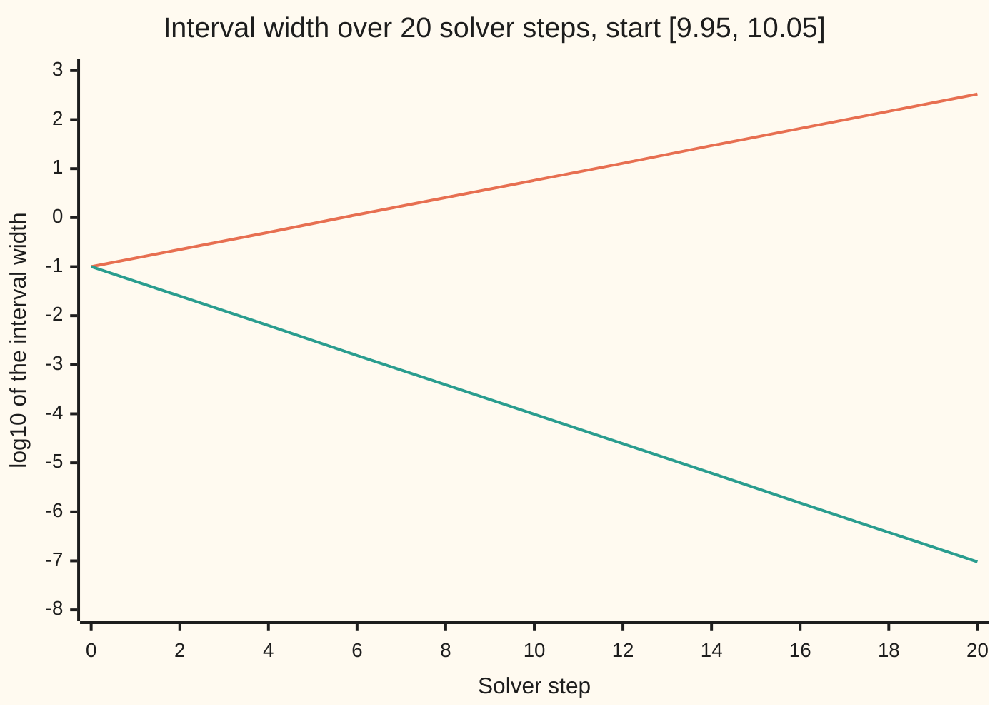

# Interval arithmetic: carry a guaranteed range instead of a single number

[Syllabus](../../../SYLLABUS.md) → [Numerical analysis](../README.md) → [Floating Point and Error](../README.md#s01) → Interval arithmetic

---

## General Overview

A footbridge spans 20 m between two supports, A and B. A maintenance cart with its cargo stops on the deck 8 m from support A. The engineer wants the force that support A must carry: the **reaction** at A. With exact inputs it is 30 kN (kilonewtons, the unit of force).

The inputs are not exact. Each one comes with a stated tolerance: the cart weighs 30 ± 1 kN, the cargo 20 ± 1 kN, the span is 20.00 ± 0.05 m and the stopping point is 8.00 ± 0.10 m. These numbers are illustrative. The question is not "what is the reaction?" but "what is the largest and smallest it can be?"

**Interval arithmetic** answers that question mechanically. Every input is stored as a pair of numbers, a lowest and a highest value, called an **interval**. Each addition or multiplication then produces a new interval that is certain to contain every possible result.

Run on the reaction formula written one way, the method returns 28.511 kN to 31.511 kN, and that range is exact. Run on the same formula written another way, it returns 28.369 kN to 31.669 kN. That range is still safe, but 1.1001 times too wide. Over a long computation such extra width compounds step by step, and that is the method's weakness.

**Replace every number by a range [lowest, highest], apply a rule to the ends at each step, and the final range is guaranteed to contain the true answer, though it may be wider than it needs to be.**

**What kind of fact this is:** a theorem, proved on this card in Why it works: the enclosure is guaranteed, and it is exact when each input appears once in the formula.

### The picture: four answers for the reaction at A

Each row is one answer, drawn on a scale from 28 kN to 32 kN. A `#` covers the range that answer allows.

```
nominal      30.000 |.........................#.........................| 30.000
exact range  28.511 |......#######################################......| 31.511
rewritten    28.511 |......#######################################......| 31.511
as written   28.369 |.....##########################################....| 31.669
```

The nominal answer is one point. The rewritten formula hits the exact range. The formula as written encloses it with room to spare.

---

## The formula

An interval $X = [x_{\text{lo}}, x_{\text{hi}}]$ is every number from its lower end $x_{\text{lo}}$ to its upper end $x_{\text{hi}}$. Its **width** $w(X) = x_{\text{hi}} - x_{\text{lo}}$ measures how unsure the value is. The four operations act only on the ends:

$$X + Y = [\,x_{\text{lo}} + y_{\text{lo}},\ x_{\text{hi}} + y_{\text{hi}}\,] \qquad X - Y = [\,x_{\text{lo}} - y_{\text{hi}},\ x_{\text{hi}} - y_{\text{lo}}\,]$$

$$X \times Y = [\,\min(x_{\text{lo}}y_{\text{lo}},\ x_{\text{lo}}y_{\text{hi}},\ x_{\text{hi}}y_{\text{lo}},\ x_{\text{hi}}y_{\text{hi}}),\ \max(\text{the same four})\,] \qquad X \div Y = X \times [\,1/y_{\text{hi}},\ 1/y_{\text{lo}}\,] \text{ if } 0 \notin Y$$

**Read it aloud:** to add, add the low ends and add the high ends; to subtract, take the low end minus the other high end; to multiply, try all four end products and keep the smallest and largest.

On a computer each end is also **rounded outward**. This card does it the simple, portable way: compute each end to nearest, then step the low end down to the next double below and the high end up to the next double above. A double is the 64-bit number format a computer uses ([IEEE 754](02-ieee-floating-point.md)).

The bridge reaction at A is

$$R = \frac{P\,(L - a)}{L} = P\left(1 - \frac{a}{L}\right)$$

The two forms are equal for every single set of inputs. They are not equal as interval computations, and the card shows why.

| Symbol | Plain meaning | In our example | Push it up and the answer… |
| --- | --- | --- | --- |
| $X$, $Y$ | intervals: every value between two ends | any two inputs below | — |
| $x$, $y$ | single values inside $X$ and $Y$ | a span of exactly 20 m | — |
| $x_{\text{lo}}$, $x_{\text{hi}}$ | the lower and upper end of $X$ | 19.95 and 20.05 for the span | — |
| $w(X)$ | width: upper end minus lower end | 0.1 m for the span | the result's width grows with it |
| $\circ$ | any one of $+$, $-$, $\times$, $\div$ | $-$ in $L - a$ | — |
| $z_k$, $Z_k$ | step $k$ of a formula: its value, and its interval | $L - a$ and [11.85, 12.15] | — |
| $P$ | load on the deck: cart plus cargo, kN | [48, 52] | $R$ rises in proportion |
| $L$ | span between supports, m | [19.95, 20.05] | $R$ rises: the load sits relatively nearer A |
| $a$ | distance of the load from A, m | [7.90, 8.10] | $R$ falls: the load moves toward B |
| $R$ | reaction: the force support A carries, kN | [28.511, 31.511] exactly | — |
| $c$ | sideways offset of the load, m | [−0.02, 0.03] | the twisting moment $P \times c$ grows |
| $u$ | unit roundoff: the largest relative error of one rounding | $2^{-53}$ | — |

### When it holds

- **Each operation is continuous on the input box** (every combination of input values inside their intervals). Division by an interval that contains zero has no finite enclosure. The code stops rather than return a wrong range.
- **Every rounding is outward.** Round the ends to nearest instead and the tracker total below has an upper end of 999,999.999839, which is below the true 1,000,000. The guarantee is lost.
- **The input intervals really contain the true inputs.** A tolerance that is a guess gives a range that is a guess. The method guarantees the arithmetic, not the measurement.
- **Exactness needs each input once.** When an input appears twice, the result still encloses the truth but can be wider. On the bridge the as-written form is 1.1001 times too wide.

---

## Why it works

### Step 0: the extremes sit at the corners

Each of $+$, $-$, $\times$ and $\div$ moves in one direction as one input slides with the other held fixed. So over a box of inputs, the smallest and largest results sit at its corners. The rules list the corners that can matter.

### Step 1: addition and subtraction

$x + y$ grows when either input grows. So the smallest sum is low plus low, and the largest is high plus high. Widths add: $w(X + Y) = w(X) + w(Y)$.

$x - y$ grows when $x$ grows but shrinks when $y$ grows. So the smallest difference is $x_{\text{lo}} - y_{\text{hi}}$. Widths add here too: subtracting never cancels uncertainty. On the bridge, $L - a = [19.95 - 8.10,\ 20.05 - 7.90] = [11.85, 12.15]$, width 0.3 = 0.1 + 0.2.

### Step 2: multiplication tries four corners

$x \times y$ is a straight line in $x$ when $y$ is fixed, and in $y$ when $x$ is fixed. A straight line on a segment is largest and smallest at the segment's ends. So the extremes are among the four end products. Which one wins depends on signs, so all four are tried.

Take a load $P = [48, 52]$ kN that sits off-centre by $c = [-0.02, 0.03]$ m. The twisting moment $P \times c$ has four corner products: −0.96, 1.44, −1.04 and 1.56. The range is [−1.0400, 1.5600] kN m (kilonewton-metres, force times distance). The lowest value pairs the *heaviest* load with the negative offset.

### Step 3: a chain of steps keeps the guarantee

A formula is a chain of single operations. Each step's output interval contains every value the step can produce from its inputs. So, link by link along the chain, the final interval contains every value the whole formula can produce. This is the **inclusion property**, and it is the whole guarantee.

<details>
<summary>Detailed proof: inclusion, and exactness when each input appears once</summary>

Write the formula as a sequence of operations $z_k = z_i \circ z_j$, where $\circ$ is one of $+, -, \times, \div$ and each $z_i$ is an input or an earlier result. Let $Z_k$ be the interval computed for $z_k$.

**Inclusion.** Claim: for any choice of inputs inside their intervals, every $z_k$ lies in $Z_k$. It holds for the inputs by assumption. If $z_i \in Z_i$ and $z_j \in Z_j$, then $z_i \circ z_j$ lies between the smallest and largest corner value of $Z_i \times Z_j$ (Steps 1 and 2), and $Z_k$ is exactly that range. Rounding outward only enlarges $Z_k$. Induction over $k$ finishes it.

**Exactness when each input appears once.** Then the expression is a tree whose branches share no input. Claim: in exact arithmetic, every point of $Z_k$ is reached by some choice of the inputs feeding $z_k$. For an input it is trivial. For $z_k = z_i \circ z_j$, the two branches use disjoint inputs, so $z_i$ and $z_j$ can be chosen independently, each anywhere in $Z_i$ and $Z_j$. The operation is continuous on the box, so it reaches every value between its corner extremes. That range is $Z_k$.

</details>

### Step 4: a repeated input loosens the range

In $P(L - a)/L$, the span $L$ appears twice. The low end of the answer is computed as the low end of $P(L - a)$, which uses $L = 19.95$, divided by the high end of $L$, which is 20.05. No real bridge has both spans at once. This is the **dependency problem**: intervals do not remember that two copies are the same number.

Rewritten as $P(1 - a/L)$, each input appears once, and Step 3's fold shows the range is then exact. The as-written range is 3.300096 kN wide. The exact range is 2.999944 kN wide.

### Step 5: outward rounding keeps the guarantee on a real machine

A computed end lies within half a gap of the true end, where the gap is the distance to the neighbouring double ([Machine epsilon and cancellation](03-rounding-cancellation-and-machine-epsilon.md)). So one step down for the low end and one step up for the high end always covers the true end. The cost is about two gaps of extra width per operation. Hardware directed rounding, which IEEE 754 provides and interval libraries use, rounds the low end straight down and the high end straight up instead, for about one gap per operation.

### Step 6: why long computations blow up

Widths never cancel. Step 1 shows that subtraction *adds* widths. Now run a typical solver update, which moves a guess halfway toward the balanced value 10:

$$x \leftarrow x - 0.5\,(x - 10)$$

In exact arithmetic this halves the distance from 10 each step, so a spread of starting values halves too. As intervals, $0.5(x - 10)$ has half the width of $x$, and subtracting it from $x$ *adds* that width: the width grows 1.5 times each step. The two copies of $x$ should cancel, but intervals cannot see that.



The rising line is the update as written, $x - 0.5(x - 10)$: its width grows 1.5 times per step. The falling line is the same update rewritten as $0.5x + 5$, with $x$ once: its width halves per step, which is the true spread. After 20 steps the as-written answer is [−156.263, 176.263] for a quantity that truly lies in [9.999999952, 10.000000048]. Its width is 3.4868 billion times too large, because each step multiplies the ratio of the two widths by 1.5 ÷ 0.5 = 3.

---

## Worked numbers, by hand

The reaction at A, both ways. Every input is positive, so each product and quotient takes its ends from the matching corners.

| Step | Arithmetic | Value |
| --- | --- | --- |
| load $P$ | [29 + 19, 31 + 21] | [48, 52] kN |
| $L - a$ | [19.95 − 8.10, 20.05 − 7.90] | [11.85, 12.15] m |
| $P(L - a)$ | [48 × 11.85, 52 × 12.15] | [568.8, 631.8] kN m |
| as written, ÷ $L$ | [568.8 ÷ 20.05, 631.8 ÷ 19.95] | [28.369077, 31.669173] kN |
| $a/L$ | [7.90 ÷ 20.05, 8.10 ÷ 19.95] | [0.394015, 0.406015] |
| $1 - a/L$ | [1 − 0.406015, 1 − 0.394015] | [0.593985, 0.605985] |
| rewritten, × $P$ | [48 × 0.593985, 52 × 0.605985] | **[28.511278, 31.511222] kN** |
| exact check | 48 × 1185 ÷ 1995 and 52 × 1215 ÷ 2005 | [28.511278, 31.511222] kN |

Support A must be sized for up to 31.511 kN, against a nominal 30 kN, and that upper figure is a guarantee, not an estimate.

### What breaks if you drop a piece

| Mistake | Comes out at | What went wrong |
| --- | --- | --- |
| Subtracting low from low and high from high | $L - a$ = [12.05, 11.95] | The "interval" is upside down: the low end of $x - y$ needs the high end of $y$ |
| Multiplying only low × low and high × high | $P \times c$ = [−0.9600, 1.5600] | Misses −1.04: with a negative end, the heaviest load gives the lowest product |
| Rounding the ends to nearest | tracker total tops out at 999,999.999839 | Below the true 1,000,000: the range no longer contains the answer |
| Using an input twice | [28.369077, 31.669173] kN | Safe but 1.1001 times too wide: the dependency problem |

The code prints all four.

---

## Code, from first principles, and it actually runs

The code builds intervals from scratch: a pair of doubles, the four rules, and outward rounding by stepping to the neighbouring double through its bit pattern. It takes three roads to the bridge reaction: the interval rules, exact whole-number fractions at the corners (lengths in centimetres), and a brute-force sweep over 605 input points. An assert checks by whole-number cross-multiplication, with no rounding, that the computed range contains the exact one. It then runs the fitness tracker's ten million additions of 0.1 through the same interval addition, so the tracker tests the outward rounding, and the solver update both ways.

### Python

```python
# Interval arithmetic -- the check behind the card.  Standard library only.
# A footbridge support reaction from toleranced inputs, carried as intervals
# [lo, hi] with every endpoint rounded outward; then two long computations: the
# tracker's ten-million-step total and a solver update whose interval explodes.
import math, struct
F, I = struct.Struct('<d'), struct.Struct('<q')

def step(x, d):                          # the neighbouring double: d = +1 up, -1 down
    if x == 0.0: return d * 5e-324
    b = I.unpack(F.pack(x))[0]
    return F.unpack(I.pack(b + (d if x > 0 else -d)))[0]

def out(lo, hi): return (step(lo, -1), step(hi, 1))   # round outward, one double each way
def add(x, y): return out(x[0] + y[0], x[1] + y[1])
def sub(x, y): return out(x[0] - y[1], x[1] - y[0])
def mul(x, y):
    p = [x[0] * y[0], x[0] * y[1], x[1] * y[0], x[1] * y[1]]
    return out(min(p), max(p))
def div(x, y):
    assert y[0] > 0 or y[1] < 0, "divisor interval contains zero"
    p = [x[0] / y[0], x[0] / y[1], x[1] / y[0], x[1] / y[1]]
    return out(min(p), max(p))
def iv(mid, tol): return out(mid - tol, mid + tol)
def show(name, x, d=6): print(f"{name:<36}[{x[0]:.{d}f}, {x[1]:.{d}f}]  width {x[1] - x[0]:.{d}f}")
def dec6(num, den): q = (2 * num * 10**6 + den) // (2 * den); return f"{q // 10**6}.{q % 10**6:06d}"

# ---- the footbridge: reaction at support A, R = P (L - a) / L ----
cart, cargo = iv(30.0, 1.0), iv(20.0, 1.0)              # kN
P = add(cart, cargo)                                    # load on the deck, kN
L, a = iv(20.0, 0.05), iv(8.0, 0.10)                    # span and load position, m
naive = div(mul(P, sub(L, a)), L)                       # as written: L appears twice
tight = mul(P, sub((1.0, 1.0), div(a, L)))              # rewritten: each input once
show("load P = cart + cargo, kN", P)
show("span L, m", L)
show("position a, m", a)
show("L - a, m", sub(L, a))
show("P (L - a), kN m", mul(P, sub(L, a)))
show("a / L", div(a, L))
show("1 - a / L", sub((1.0, 1.0), div(a, L)))
print(f"{'nominal reaction 50 x 12 / 20, kN':<36}{50.0 * (20.0 - 8.0) / 20.0:.6f}")
show("as written, P (L - a) / L", naive)
show("rewritten, P (1 - a / L)", tight)
lo_n, lo_d, hi_n, hi_d = 48 * 1185, 1995, 52 * 1215, 2005   # exact corners, a and L in cm
print(f"{'exact range, whole numbers':<36}[{dec6(lo_n, lo_d)}, {dec6(hi_n, hi_d)}]  width {dec6(hi_n * lo_d - lo_n * hi_d, lo_d * hi_d)}")
grid = [p * (l - x) / l for p in (48.0, 49.0, 50.0, 51.0, 52.0)
        for x in [7.9 + 0.02 * k for k in range(11)] for l in [19.95 + 0.01 * k for k in range(11)]]
print(f"{'brute force, 605 input points':<36}[{min(grid):.6f}, {max(grid):.6f}]")
print(f"over-width of the as-written form: {(naive[1] - naive[0]) / (tight[1] - tight[0]):.4f} times")
for name, x in [("nominal", (30.0, 30.0)), ("exact range", (lo_n / lo_d, hi_n / hi_d)),
                ("rewritten", tight), ("as written", naive)]:
    s, e = int((x[0] - 28.0) / 0.08 + 0.5), int((x[1] - 28.0) / 0.08 + 0.5)
    print(f"{name:<12}{x[0]:7.3f} |" + "." * s + "#" * (e - s + 1) + "." * (50 - e) + f"| {x[1]:.3f}")
ex_lo, ex_hi = lo_n / lo_d, hi_n / hi_d
(tn, td), (un, ud) = tight[0].as_integer_ratio(), tight[1].as_integer_ratio()   # the ends, exactly
assert tn * lo_d <= lo_n * td and hi_n * ud <= un * hi_d        # encloses the exact range, no rounding
assert ex_lo <= tight[0] + 1e-9 and tight[1] - 1e-9 <= ex_hi    # and hugs it
assert naive[0] < ex_lo - 0.1 and naive[1] > ex_hi + 0.1          # still encloses, but loose
assert tight[0] <= min(grid) and max(grid) <= tight[1] and abs(min(grid) - ex_lo) < 1e-12

# ---- multiplying across zero: an off-centre load, moment = P x c ----
c = out(-0.02, 0.03)                                    # offset of the load, m
M = mul(P, c)
show("moment P x c, four products, kN m", M, 4)
print(f"{'moment, lo x lo and hi x hi only':<36}[{P[0] * c[0]:.4f}, {P[1] * c[1]:.4f}]")
corners = [p * x for p in (48.0, 52.0) for x in (-0.02, 0.03)]
print("four corner products: " + ", ".join(f"{v:.4f}" for v in corners))
assert abs(M[0] - min(corners)) < 1e-12 and abs(M[0] - (-1.04)) < 1e-12 and P[0] * c[0] > M[0] + 0.05
print(f"wrong subtraction [L_lo - a_lo, L_hi - a_hi]: [{L[0] - a[0]:.2f}, {L[1] - a[1]:.2f}]")

# ---- the tracker: 0.1 added ten million times, as an interval ----
n, rat = 10_000_000, (0.1).as_integer_ratio()
tenth = (step(0.1, -1), 0.1)
lo_r = tenth[0].as_integer_ratio()
assert 10 * lo_r[0] < lo_r[1] and 10 * rat[0] > rat[1]  # the pair really brackets 1/10
total, plain = (0.0, 0.0), 0.0
for _ in range(n):
    total = add(total, tenth)                           # the interval rule, rounded outward
    plain += 0.1
s_lo, s_hi = total
print(f"{'tracker total, interval':<36}[{s_lo:.6f}, {s_hi:.6f}]  width {s_hi - s_lo:.6f}")
print(f"{'tracker total, plain sum':<36}{plain:.6f}  true error {1e6 - plain:.6f}")
print(f"bound over true error: {(s_hi - s_lo) / (1e6 - plain):.2f}")
assert s_lo < 1e6 < s_hi and s_lo <= plain <= s_hi and plain < 1e6 and s_hi - s_lo < 0.002

# ---- a solver update, x <- x - 0.5 (x - 10), twenty times ----
X0 = out(9.95, 10.05)
xa, xb, rows = X0, X0, []
for k in range(21):
    if k % 2 == 0: rows.append((k, math.log10(xa[1] - xa[0]), math.log10(xb[1] - xb[0])))
    xa = sub(xa, mul((0.5, 0.5), sub(xa, (10.0, 10.0))))   # as written: x twice
    xb = add(mul((0.5, 0.5), xb), (5.0, 5.0))             # rewritten: 0.5 x + 5
    if k == 19: wa, wb, A20, B20 = xa[1] - xa[0], xb[1] - xb[0], xa, xb
print("step                    " + "".join(f"{r[0]:>7}" for r in rows))
print("log10 width, as written " + "".join(f"{r[1]:>7.2f}" for r in rows))
print("log10 width, rewritten  " + "".join(f"{r[2]:>7.2f}" for r in rows))
show("after 20 steps, as written", A20, 3)
show("after 20 steps, rewritten", B20, 9)
assert abs(wa / (0.1 * 1.5**20) - 1) < 1e-9 and abs(wb / (0.1 * 0.5**20) - 1) < 1e-5
print(f"widths after 20 steps, as written over true: {wa / (0.1 * 0.5**20) / 1e9:.4f} billion")
print("ALL CHECKS PASS")
```

**Ran 2026-11-11 on macOS, Python 3.14.10, standard library only. All checks passed. Output, pasted from the run:**

```
load P = cart + cargo, kN           [48.000000, 52.000000]  width 4.000000
span L, m                           [19.950000, 20.050000]  width 0.100000
position a, m                       [7.900000, 8.100000]  width 0.200000
L - a, m                            [11.850000, 12.150000]  width 0.300000
P (L - a), kN m                     [568.800000, 631.800000]  width 63.000000
a / L                               [0.394015, 0.406015]  width 0.012000
1 - a / L                           [0.593985, 0.605985]  width 0.012000
nominal reaction 50 x 12 / 20, kN   30.000000
as written, P (L - a) / L           [28.369077, 31.669173]  width 3.300096
rewritten, P (1 - a / L)            [28.511278, 31.511222]  width 2.999944
exact range, whole numbers          [28.511278, 31.511222]  width 2.999944
brute force, 605 input points       [28.511278, 31.511222]
over-width of the as-written form: 1.1001 times
nominal      30.000 |.........................#.........................| 30.000
exact range  28.511 |......#######################################......| 31.511
rewritten    28.511 |......#######################################......| 31.511
as written   28.369 |.....##########################################....| 31.669
moment P x c, four products, kN m   [-1.0400, 1.5600]  width 2.6000
moment, lo x lo and hi x hi only    [-0.9600, 1.5600]
four corner products: -0.9600, 1.4400, -1.0400, 1.5600
wrong subtraction [L_lo - a_lo, L_hi - a_hi]: [12.05, 11.95]
tracker total, interval             [999999.999082, 1000000.000596]  width 0.001515
tracker total, plain sum            999999.999839  true error 0.000161
bound over true error: 9.41
step                          0      2      4      6      8     10     12     14     16     18     20
log10 width, as written   -1.00  -0.65  -0.30   0.06   0.41   0.76   1.11   1.47   1.82   2.17   2.52
log10 width, rewritten    -1.00  -1.60  -2.20  -2.81  -3.41  -4.01  -4.61  -5.21  -5.82  -6.42  -7.02
after 20 steps, as written          [-156.263, 176.263]  width 332.526
after 20 steps, rewritten           [9.999999952, 10.000000048]  width 0.000000095
widths after 20 steps, as written over true: 3.4868 billion
ALL CHECKS PASS
```

### Rust

Same numbers, same labels, built with `rustc --edition 2021 -O`.

```rust
// Interval arithmetic -- the same check as the Python, in Rust.  No crates.
// A footbridge support reaction from toleranced inputs, carried as intervals
// [lo, hi] with every endpoint rounded outward; then two long computations: the
// tracker's ten-million-step total and a solver update whose interval explodes.
type Iv = (f64, f64);
fn step(x: f64, d: i64) -> f64 {              // the neighbouring double: d = +1 up, -1 down
    if x == 0.0 { return d as f64 * 5e-324; }
    let b = x.to_bits() as i64;
    f64::from_bits((b + if x > 0.0 { d } else { -d }) as u64)
}
fn out(lo: f64, hi: f64) -> Iv { (step(lo, -1), step(hi, 1)) }   // round outward
fn add(x: Iv, y: Iv) -> Iv { out(x.0 + y.0, x.1 + y.1) }
fn sub(x: Iv, y: Iv) -> Iv { out(x.0 - y.1, x.1 - y.0) }
fn ends(p: [f64; 4]) -> Iv {
    out(p.iter().cloned().fold(f64::INFINITY, f64::min), p.iter().cloned().fold(f64::NEG_INFINITY, f64::max))
}
fn mul(x: Iv, y: Iv) -> Iv { ends([x.0 * y.0, x.0 * y.1, x.1 * y.0, x.1 * y.1]) }
fn div(x: Iv, y: Iv) -> Iv {
    assert!(y.0 > 0.0 || y.1 < 0.0, "divisor interval contains zero");
    ends([x.0 / y.0, x.0 / y.1, x.1 / y.0, x.1 / y.1])
}
fn iv(mid: f64, tol: f64) -> Iv { out(mid - tol, mid + tol) }
fn show(name: &str, x: Iv, d: usize) {
    println!("{:<36}[{:.d$}, {:.d$}]  width {:.d$}", name, x.0, x.1, x.1 - x.0, d = d);
}
fn dec6(num: i128, den: i128) -> String {
    let q = (2 * num * 1_000_000 + den) / (2 * den);
    format!("{}.{:06}", q / 1_000_000, q % 1_000_000)
}
fn ratio(x: f64) -> (u128, u32) {              // x = m / 2^k, for a normal 0 < x < 2^52
    let b = x.to_bits();
    ((b & ((1u64 << 52) - 1) | (1u64 << 52)) as u128, (1075 - ((b >> 52) & 0x7ff)) as u32)
}
fn main() {
    // ---- the footbridge: reaction at support A, R = P (L - a) / L ----
    let (cart, cargo) = (iv(30.0, 1.0), iv(20.0, 1.0));          // kN
    let p = add(cart, cargo);                                     // load on the deck, kN
    let (l, a) = (iv(20.0, 0.05), iv(8.0, 0.10));                 // span and position, m
    let naive = div(mul(p, sub(l, a)), l);                        // as written: L twice
    let tight = mul(p, sub((1.0, 1.0), div(a, l)));               // rewritten: each once
    show("load P = cart + cargo, kN", p, 6);
    show("span L, m", l, 6);
    show("position a, m", a, 6);
    show("L - a, m", sub(l, a), 6);
    show("P (L - a), kN m", mul(p, sub(l, a)), 6);
    show("a / L", div(a, l), 6);
    show("1 - a / L", sub((1.0, 1.0), div(a, l)), 6);
    println!("{:<36}{:.6}", "nominal reaction 50 x 12 / 20, kN", 50.0 * (20.0 - 8.0) / 20.0);
    show("as written, P (L - a) / L", naive, 6);
    show("rewritten, P (1 - a / L)", tight, 6);
    let (lo_n, lo_d, hi_n, hi_d): (i128, i128, i128, i128) = (48 * 1185, 1995, 52 * 1215, 2005);
    println!("{:<36}[{}, {}]  width {}", "exact range, whole numbers", dec6(lo_n, lo_d), dec6(hi_n, hi_d),
             dec6(hi_n * lo_d - lo_n * hi_d, lo_d * hi_d));
    let mut grid = Vec::new();
    for pp in [48.0, 49.0, 50.0, 51.0, 52.0] { for k in 0..11 { for j in 0..11 {
        let (x, ll) = (7.9 + 0.02 * k as f64, 19.95 + 0.01 * j as f64);
        grid.push(pp * (ll - x) / ll);
    } } }
    let gmin = grid.iter().cloned().fold(f64::INFINITY, f64::min);
    let gmax = grid.iter().cloned().fold(f64::NEG_INFINITY, f64::max);
    println!("{:<36}[{:.6}, {:.6}]", "brute force, 605 input points", gmin, gmax);
    println!("over-width of the as-written form: {:.4} times", (naive.1 - naive.0) / (tight.1 - tight.0));
    let (ex_lo, ex_hi) = (lo_n as f64 / lo_d as f64, hi_n as f64 / hi_d as f64);
    for (name, x) in [("nominal", (30.0, 30.0)), ("exact range", (ex_lo, ex_hi)), ("rewritten", tight), ("as written", naive)] {
        let s = ((x.0 - 28.0) / 0.08 + 0.5) as usize;
        let e = ((x.1 - 28.0) / 0.08 + 0.5) as usize;
        println!("{:<12}{:7.3} |{}{}{}| {:.3}", name, x.0, ".".repeat(s), "#".repeat(e - s + 1), ".".repeat(50 - e), x.1);
    }
    let ((tn, tk), (un, uk)) = (ratio(tight.0), ratio(tight.1));  // the ends as m / 2^k, exactly
    assert!(tn * (lo_d as u128) <= (lo_n as u128) << tk && (hi_n as u128) << uk <= un * (hi_d as u128)); // encloses, no rounding
    assert!(ex_lo <= tight.0 + 1e-9 && tight.1 - 1e-9 <= ex_hi);   // and hugs it
    assert!(naive.0 < ex_lo - 0.1 && naive.1 > ex_hi + 0.1);       // still encloses, but loose
    assert!(tight.0 <= gmin && gmax <= tight.1 && (gmin - ex_lo).abs() < 1e-12);

    // ---- multiplying across zero: an off-centre load, moment = P x c ----
    let c = out(-0.02, 0.03);                                     // offset of the load, m
    let m = mul(p, c);
    show("moment P x c, four products, kN m", m, 4);
    println!("{:<36}[{:.4}, {:.4}]", "moment, lo x lo and hi x hi only", p.0 * c.0, p.1 * c.1);
    let corners = [48.0 * -0.02, 48.0 * 0.03, 52.0 * -0.02, 52.0 * 0.03];
    println!("four corner products: {}", corners.iter().map(|v| format!("{:.4}", v)).collect::<Vec<_>>().join(", "));
    let cmin = corners.iter().cloned().fold(f64::INFINITY, f64::min);
    assert!((m.0 - cmin).abs() < 1e-12 && (m.0 - (-1.04)).abs() < 1e-12 && p.0 * c.0 > m.0 + 0.05);
    println!("wrong subtraction [L_lo - a_lo, L_hi - a_hi]: [{:.2}, {:.2}]", l.0 - a.0, l.1 - a.1);

    // ---- the tracker: 0.1 added ten million times, as an interval ----
    let tenth = (step(0.1, -1), 0.1);
    let ((ml, kl), (mh, kh)) = (ratio(tenth.0), ratio(tenth.1));
    assert!(10 * ml < (1u128 << kl) && 10 * mh > (1u128 << kh));  // the pair really brackets 1/10
    let (mut total, mut plain) = ((0.0f64, 0.0f64), 0.0f64);
    for _ in 0..10_000_000 {
        total = add(total, tenth);                                // the interval rule, rounded outward
        plain += 0.1;
    }
    let (s_lo, s_hi) = total;
    println!("{:<36}[{:.6}, {:.6}]  width {:.6}", "tracker total, interval", s_lo, s_hi, s_hi - s_lo);
    println!("{:<36}{:.6}  true error {:.6}", "tracker total, plain sum", plain, 1e6 - plain);
    println!("bound over true error: {:.2}", (s_hi - s_lo) / (1e6 - plain));
    assert!(s_lo < 1e6 && 1e6 < s_hi && s_lo <= plain && plain <= s_hi && plain < 1e6 && s_hi - s_lo < 0.002);

    // ---- a solver update, x <- x - 0.5 (x - 10), twenty times ----
    let x0 = out(9.95, 10.05);
    let (mut xa, mut xb) = (x0, x0);
    let mut rows = Vec::new();
    let (mut a20, mut b20) = (x0, x0);
    for k in 0..21 {
        if k % 2 == 0 { rows.push((k, (xa.1 - xa.0).log10(), (xb.1 - xb.0).log10())); }
        xa = sub(xa, mul((0.5, 0.5), sub(xa, (10.0, 10.0))));    // as written: x twice
        xb = add(mul((0.5, 0.5), xb), (5.0, 5.0));                // rewritten: 0.5 x + 5
        if k == 19 { a20 = xa; b20 = xb; }
    }
    let (wa, wb) = (a20.1 - a20.0, b20.1 - b20.0);
    println!("step                    {}", rows.iter().map(|r| format!("{:>7}", r.0)).collect::<String>());
    println!("log10 width, as written {}", rows.iter().map(|r| format!("{:>7.2}", r.1)).collect::<String>());
    println!("log10 width, rewritten  {}", rows.iter().map(|r| format!("{:>7.2}", r.2)).collect::<String>());
    show("after 20 steps, as written", a20, 3);
    show("after 20 steps, rewritten", b20, 9);
    assert!((wa / (0.1 * 1.5f64.powi(20)) - 1.0).abs() < 1e-9 && (wb / (0.1 * 0.5f64.powi(20)) - 1.0).abs() < 1e-5);
    println!("widths after 20 steps, as written over true: {:.4} billion", wa / (0.1 * 0.5f64.powi(20)) / 1e9);
    println!("ALL CHECKS PASS");
}
```

**Ran 2026-11-11 on macOS, rustc 1.98.1, no crates. All checks passed. Output, pasted from the run:**

```
load P = cart + cargo, kN           [48.000000, 52.000000]  width 4.000000
span L, m                           [19.950000, 20.050000]  width 0.100000
position a, m                       [7.900000, 8.100000]  width 0.200000
L - a, m                            [11.850000, 12.150000]  width 0.300000
P (L - a), kN m                     [568.800000, 631.800000]  width 63.000000
a / L                               [0.394015, 0.406015]  width 0.012000
1 - a / L                           [0.593985, 0.605985]  width 0.012000
nominal reaction 50 x 12 / 20, kN   30.000000
as written, P (L - a) / L           [28.369077, 31.669173]  width 3.300096
rewritten, P (1 - a / L)            [28.511278, 31.511222]  width 2.999944
exact range, whole numbers          [28.511278, 31.511222]  width 2.999944
brute force, 605 input points       [28.511278, 31.511222]
over-width of the as-written form: 1.1001 times
nominal      30.000 |.........................#.........................| 30.000
exact range  28.511 |......#######################################......| 31.511
rewritten    28.511 |......#######################################......| 31.511
as written   28.369 |.....##########################################....| 31.669
moment P x c, four products, kN m   [-1.0400, 1.5600]  width 2.6000
moment, lo x lo and hi x hi only    [-0.9600, 1.5600]
four corner products: -0.9600, 1.4400, -1.0400, 1.5600
wrong subtraction [L_lo - a_lo, L_hi - a_hi]: [12.05, 11.95]
tracker total, interval             [999999.999082, 1000000.000596]  width 0.001515
tracker total, plain sum            999999.999839  true error 0.000161
bound over true error: 9.41
step                          0      2      4      6      8     10     12     14     16     18     20
log10 width, as written   -1.00  -0.65  -0.30   0.06   0.41   0.76   1.11   1.47   1.82   2.17   2.52
log10 width, rewritten    -1.00  -1.60  -2.20  -2.81  -3.41  -4.01  -4.61  -5.21  -5.82  -6.42  -7.02
after 20 steps, as written          [-156.263, 176.263]  width 332.526
after 20 steps, rewritten           [9.999999952, 10.000000048]  width 0.000000095
widths after 20 steps, as written over true: 3.4868 billion
ALL CHECKS PASS
```

The two outputs match line for line.

The tracker run is the shelf's running example: 0.1 added ten million times. The double 0.1 is slightly above one tenth, so the code encloses one tenth in [next double below 0.1, 0.1]. The interval total is [999999.999082, 1000000.000596], width 0.001515. The plain total is 999999.999839, with true error 0.000161. The guaranteed bound is 9.41 times the true error: usable, because each addition adds only a gap or two of width.

### Lean

Lean proves the card's three main facts in exact real numbers, for every formula of +, −, × and ÷ and every starting interval.

- Run any formula of +, −, × and ÷ through the four rules, rounding each end outward by any amount. Suppose no division is by an interval containing zero, and the true inputs lie in their intervals. Then the final interval contains the true value.
- With no rounding, suppose each input appears once and no division is by an interval containing zero. Each input interval must have its low end at most its high end. Then the final interval is exactly the set of values the formula can take: every point in it is reached.
- Run as written on intervals, the solver update $x \leftarrow x - 0.5\,(x - 10)$ multiplies the width by exactly 1.5 each step.
- Run on single values, $k$ steps carry $[x_{\text{lo}}, x_{\text{hi}}]$ onto exactly $[10 + (x_{\text{lo}} - 10)/2^k,\ 10 + (x_{\text{hi}} - 10)/2^k]$. So the true spread halves each step.
- The hand numbers hold exactly, lengths in centimetres: the load [48, 52], $L - a$, the four corners of $P \times c$ and both wrong rules.
- The reaction as written runs from 48 × 1185 ÷ 2005 to 52 × 1215 ÷ 1995. Rewritten, it runs from 48 × 1185 ÷ 1995 to 52 × 1215 ÷ 2005, the exact range.
- The pair [next double below 0.1, 0.1] really encloses one tenth. After 20 solver steps the two widths differ by a factor of exactly 3^20 = 3,486,784,401.

Left to the Python and Rust checks: that stepping one double out rounds outward, the tracker's total, the brute-force sweep and the printed decimals.

```lean
-- Interval arithmetic: applying the card's end-point rules, with outward rounding, to every step of a formula gives an interval that contains the true value, the interval is exact when each input appears once, and the as-written solver update widens its interval 1.5 times a step while the true spread halves.
import Mathlib.Basic.Real.Basic
import Mathlib.Data.Fin.VecNotation
import Mathlib.Order.Interval.Set.Basic
import Mathlib.Data.Set.Prod
import Mathlib.Logic.Function.Iterate
import Mathlib.Tactic.NormNum
import Mathlib.Tactic.Linarith
import Mathlib.Topology.Order.IntermediateValue
import Mathlib.Topology.Instances.Real.Lemmas
import Mathlib.Topology.Algebra.Order.Field
import Mathlib.Tactic.FieldSimp
import Mathlib.Tactic.Positivity
import Mathlib.Tactic.GCongr
import Mathlib.Tactic.Ring

/-! An interval `X = [x_lo, x_hi]` is stored as the pair `(x_lo, x_hi) : ℝ × ℝ` and stands for
the set `Set.Icc x_lo x_hi`. The card's four rules act only on the ends:

* `X + Y = [x_lo + y_lo, x_hi + y_hi]`
* `X - Y = [x_lo - y_hi, x_hi - y_lo]`
* `X × Y = [min of the four end products, max of the four end products]`
* `X ÷ Y = X × [1/y_hi, 1/y_lo]`, used only when `0 ∉ Y`. -/

/-- Interval addition: add the low ends and add the high ends. -/
def ivAdd (X Y : ℝ × ℝ) : ℝ × ℝ := (X.1 + Y.1, X.2 + Y.2)

/-- Interval subtraction: low end minus the other high end, high end minus the other low end. -/
def ivSub (X Y : ℝ × ℝ) : ℝ × ℝ := (X.1 - Y.2, X.2 - Y.1)

/-- Interval multiplication: try all four end products, keep the smallest and the largest. -/
noncomputable def ivMul (X Y : ℝ × ℝ) : ℝ × ℝ :=
  (min (min (X.1 * Y.1) (X.1 * Y.2)) (min (X.2 * Y.1) (X.2 * Y.2)),
   max (max (X.1 * Y.1) (X.1 * Y.2)) (max (X.2 * Y.1) (X.2 * Y.2)))

/-- Interval division `X ÷ Y = X × [1/y_hi, 1/y_lo]` (meant only for `0 ∉ Y`). -/
noncomputable def ivDiv (X Y : ℝ × ℝ) : ℝ × ℝ := ivMul X (1 / Y.2, 1 / Y.1)

/-- A formula in `n` inputs: a chain of `+`, `-`, `×`, `÷` built from inputs and constants. -/
inductive Formula (n : ℕ) : Type
  | input : Fin n → Formula n
  | const : ℝ → Formula n
  | add : Formula n → Formula n → Formula n
  | sub : Formula n → Formula n → Formula n
  | mul : Formula n → Formula n → Formula n
  | div : Formula n → Formula n → Formula n

namespace Formula

variable {n : ℕ}

/-- The formula's value at single input values `v`. -/
noncomputable def eval (v : Fin n → ℝ) : Formula n → ℝ
  | input i => v i
  | const c => c
  | add f g => f.eval v + g.eval v
  | sub f g => f.eval v - g.eval v
  | mul f g => f.eval v * g.eval v
  | div f g => f.eval v / g.eval v

/-- The formula run in interval arithmetic: input `i` is the interval `box i`, a constant `c` is
`[c, c]`, and each operation applies the card's rule to the ends and then `round`s the result.
When a divisor interval contains zero the run stops (`none`), as the card's code does. -/
noncomputable def ieval (round : ℝ × ℝ → ℝ × ℝ) (box : Fin n → ℝ × ℝ) :
    Formula n → Option (ℝ × ℝ)
  | input i => some (box i)
  | const c => some (c, c)
  | add f g => do
      let X ← f.ieval round box
      let Y ← g.ieval round box
      pure (round (ivAdd X Y))
  | sub f g => do
      let X ← f.ieval round box
      let Y ← g.ieval round box
      pure (round (ivSub X Y))
  | mul f g => do
      let X ← f.ieval round box
      let Y ← g.ieval round box
      pure (round (ivMul X Y))
  | div f g => do
      let X ← f.ieval round box
      let Y ← g.ieval round box
      if Y.1 ≤ 0 ∧ 0 ≤ Y.2 then none else pure (round (ivDiv X Y))

/-- The inputs the formula uses, with repeats: an input used twice is listed twice. -/
def inputs : Formula n → List (Fin n)
  | input i => [i]
  | const _ => []
  | add f g => f.inputs ++ g.inputs
  | sub f g => f.inputs ++ g.inputs
  | mul f g => f.inputs ++ g.inputs
  | div f g => f.inputs ++ g.inputs

end Formula

/-- Moving `x` inside `[a, b]` keeps `x * y` between the two end products. -/
lemma iv_mul_between {a b x y : ℝ} (hax : a ≤ x) (hxb : x ≤ b) :
    min (a * y) (b * y) ≤ x * y ∧ x * y ≤ max (a * y) (b * y) := by
  rcases le_total 0 y with h | h
  · exact ⟨(min_le_left _ _).trans (mul_le_mul_of_nonneg_right hax h),
      (mul_le_mul_of_nonneg_right hxb h).trans (le_max_right _ _)⟩
  · exact ⟨(min_le_right _ _).trans (mul_le_mul_of_nonpos_right hxb h),
      (mul_le_mul_of_nonpos_right hax h).trans (le_max_left _ _)⟩

/-- The multiplication rule encloses every product of points of the two intervals. -/
lemma iv_mul_mem {a b c d x y : ℝ} (hx : x ∈ Set.Icc a b) (hy : y ∈ Set.Icc c d) :
    x * y ∈ Set.Icc (ivMul (a, b) (c, d)).1 (ivMul (a, b) (c, d)).2 := by
  obtain ⟨hax, hxb⟩ := hx
  obtain ⟨hcy, hyd⟩ := hy
  have h1 := iv_mul_between (y := y) hax hxb
  have h2 : min (a * c) (a * d) ≤ a * y ∧ a * y ≤ max (a * c) (a * d) := by
    rw [mul_comm a c, mul_comm a d, mul_comm a y]; exact iv_mul_between hcy hyd
  have h3 : min (b * c) (b * d) ≤ b * y ∧ b * y ≤ max (b * c) (b * d) := by
    rw [mul_comm b c, mul_comm b d, mul_comm b y]; exact iv_mul_between hcy hyd
  simp only [ivMul, Set.mem_Icc]
  exact ⟨le_trans (le_min (le_trans (min_le_left _ _) h2.1) (le_trans (min_le_right _ _) h3.1)) h1.1,
    h1.2.trans (max_le (h2.2.trans (le_max_left _ _)) (h3.2.trans (le_max_right _ _)))⟩

/-- If `0 ∉ [c, d]` and `y ∈ [c, d]` then `y ≠ 0` and `1 / y ∈ [1 / d, 1 / c]`. -/
lemma iv_inv_mem {c d y : ℝ} (hy : y ∈ Set.Icc c d) (h0 : ¬(c ≤ 0 ∧ 0 ≤ d)) :
    y ≠ 0 ∧ 1 / y ∈ Set.Icc (1 / d) (1 / c) := by
  obtain ⟨hcy, hyd⟩ := hy
  by_cases hc : c ≤ 0
  · have hd : d < 0 := by
      by_contra hd; exact h0 ⟨hc, le_of_not_gt hd⟩
    have hy0 : y < 0 := lt_of_le_of_lt hyd hd
    exact ⟨hy0.ne, one_div_le_one_div_of_neg_of_le hd hyd, one_div_le_one_div_of_neg_of_le hy0 hcy⟩
  · have hc' : 0 < c := lt_of_not_ge hc
    have hy0 : 0 < y := lt_of_lt_of_le hc' hcy
    exact ⟨hy0.ne', one_div_le_one_div_of_le hy0 hyd, one_div_le_one_div_of_le hc' hcy⟩

/-- The division rule encloses every quotient of points of the two intervals, when `0 ∉ [c, d]`. -/
lemma iv_div_mem {a b c d x y : ℝ} (hx : x ∈ Set.Icc a b) (hy : y ∈ Set.Icc c d)
    (h0 : ¬(c ≤ 0 ∧ 0 ≤ d)) :
    x / y ∈ Set.Icc (ivDiv (a, b) (c, d)).1 (ivDiv (a, b) (c, d)).2 := by
  rw [div_eq_mul_one_div]
  exact iv_mul_mem hx (iv_inv_mem hy h0).2

/-- The smallest of four numbers is one of them. -/
lemma min4_choice (p q r s : ℝ) :
    min (min p q) (min r s) = p ∨ min (min p q) (min r s) = q ∨
      min (min p q) (min r s) = r ∨ min (min p q) (min r s) = s := by
  simp only [min_def]; split_ifs <;> simp

/-- The largest of four numbers is one of them. -/
lemma max4_choice (p q r s : ℝ) :
    max (max p q) (max r s) = p ∨ max (max p q) (max r s) = q ∨
      max (max p q) (max r s) = r ∨ max (max p q) (max r s) = s := by
  simp only [max_def]; split_ifs <;> simp

/-- A formula's value depends only on the inputs it uses. -/
lemma Formula.eval_congr {n : ℕ} (f : Formula n) (v w : Fin n → ℝ)
    (h : ∀ i ∈ f.inputs, v i = w i) : f.eval v = f.eval w := by
  induction f with
  | input i => exact h i (by simp [Formula.inputs])
  | const c => rfl
  | add f g ihf ihg =>
      simp only [Formula.eval]
      rw [ihf fun i hi => h i (by simp [Formula.inputs, hi]),
        ihg fun i hi => h i (by simp [Formula.inputs, hi])]
  | sub f g ihf ihg =>
      simp only [Formula.eval]
      rw [ihf fun i hi => h i (by simp [Formula.inputs, hi]),
        ihg fun i hi => h i (by simp [Formula.inputs, hi])]
  | mul f g ihf ihg =>
      simp only [Formula.eval]
      rw [ihf fun i hi => h i (by simp [Formula.inputs, hi]),
        ihg fun i hi => h i (by simp [Formula.inputs, hi])]
  | div f g ihf ihg =>
      simp only [Formula.eval]
      rw [ihf fun i hi => h i (by simp [Formula.inputs, hi]),
        ihg fun i hi => h i (by simp [Formula.inputs, hi])]

/-- Two formulas with no input in common take their values independently: over a box, the pairs
of values they reach are all pairs of a value of each. -/
lemma Formula.image_pair {n : ℕ} (f g : Formula n) (B : Fin n → Set ℝ)
    (hdisj : ∀ i ∈ f.inputs, i ∉ g.inputs) (op : ℝ → ℝ → ℝ) :
    (fun v => op (f.eval v) (g.eval v)) '' (Set.univ.pi B) =
      (fun p : ℝ × ℝ => op p.1 p.2) '' (((fun v => f.eval v) '' Set.univ.pi B) ×ˢ
        ((fun v => g.eval v) '' Set.univ.pi B)) := by
  ext z
  constructor
  · rintro ⟨v, hv, rfl⟩
    exact ⟨(f.eval v, g.eval v), ⟨⟨v, hv, rfl⟩, ⟨v, hv, rfl⟩⟩, rfl⟩
  · rintro ⟨⟨x, y⟩, ⟨⟨v1, hv1, rfl⟩, ⟨v2, hv2, rfl⟩⟩, rfl⟩
    classical
    refine ⟨fun i => if i ∈ f.inputs then v1 i else v2 i, ?_, ?_⟩
    · intro i _
      by_cases hi : i ∈ f.inputs
      · simp only [hi, ↓reduceIte]; exact hv1 i (Set.mem_univ _)
      · simp only [hi, ↓reduceIte]; exact hv2 i (Set.mem_univ _)
    · simp only
      rw [f.eval_congr _ v1 (fun i hi => by simp [hi]),
        g.eval_congr _ v2 (fun i hi => by simp [show i ∉ f.inputs from fun hif => hdisj i hif hi])]

lemma iv_add_mem {a b c d x y : ℝ} (hx : x ∈ Set.Icc a b) (hy : y ∈ Set.Icc c d) :
    x + y ∈ Set.Icc (ivAdd (a, b) (c, d)).1 (ivAdd (a, b) (c, d)).2 :=
  ⟨add_le_add hx.1 hy.1, add_le_add hx.2 hy.2⟩

lemma iv_sub_mem {a b c d x y : ℝ} (hx : x ∈ Set.Icc a b) (hy : y ∈ Set.Icc c d) :
    x - y ∈ Set.Icc (ivSub (a, b) (c, d)).1 (ivSub (a, b) (c, d)).2 :=
  ⟨sub_le_sub hx.1 hy.2, sub_le_sub hx.2 hy.1⟩

/-- A continuous two-input operation maps a rectangle onto `[lo, hi]` when it stays in `[lo, hi]`
and reaches both ends. -/
lemma image_rect_eq (op : ℝ → ℝ → ℝ) {a b c d lo hi : ℝ}
    (hcont : ContinuousOn (fun p : ℝ × ℝ => op p.1 p.2) (Set.Icc a b ×ˢ Set.Icc c d))
    (hsub : ∀ x ∈ Set.Icc a b, ∀ y ∈ Set.Icc c d, op x y ∈ Set.Icc lo hi)
    (hlo : ∃ x ∈ Set.Icc a b, ∃ y ∈ Set.Icc c d, op x y = lo)
    (hhi : ∃ x ∈ Set.Icc a b, ∃ y ∈ Set.Icc c d, op x y = hi) :
    (fun p : ℝ × ℝ => op p.1 p.2) '' (Set.Icc a b ×ˢ Set.Icc c d) = Set.Icc lo hi := by
  apply Set.Subset.antisymm
  · rintro _ ⟨⟨x, y⟩, ⟨hx, hy⟩, rfl⟩
    exact hsub x hx y hy
  · have hpc := (isPreconnected_Icc.prod isPreconnected_Icc).image _ hcont
    obtain ⟨x1, hx1, y1, hy1, h1⟩ := hlo
    obtain ⟨x2, hx2, y2, hy2, h2⟩ := hhi
    exact hpc.Icc_subset ⟨(x1, y1), ⟨hx1, hy1⟩, h1⟩ ⟨(x2, y2), ⟨hx2, hy2⟩, h2⟩

/-- The multiplication rule's two ends are products of corners. -/
lemma iv_mul_corners {a b c d : ℝ} (hab : a ≤ b) (hcd : c ≤ d) :
    (∃ x ∈ Set.Icc a b, ∃ y ∈ Set.Icc c d, x * y = (ivMul (a, b) (c, d)).1) ∧
    (∃ x ∈ Set.Icc a b, ∃ y ∈ Set.Icc c d, x * y = (ivMul (a, b) (c, d)).2) := by
  have ha : a ∈ Set.Icc a b := ⟨le_rfl, hab⟩
  have hb : b ∈ Set.Icc a b := ⟨hab, le_rfl⟩
  have hc : c ∈ Set.Icc c d := ⟨le_rfl, hcd⟩
  have hd : d ∈ Set.Icc c d := ⟨hcd, le_rfl⟩
  simp only [ivMul]
  constructor
  · rcases min4_choice (a * c) (a * d) (b * c) (b * d) with h | h | h | h <;> rw [h]
    exacts [⟨a, ha, c, hc, rfl⟩, ⟨a, ha, d, hd, rfl⟩, ⟨b, hb, c, hc, rfl⟩, ⟨b, hb, d, hd, rfl⟩]
  · rcases max4_choice (a * c) (a * d) (b * c) (b * d) with h | h | h | h <;> rw [h]
    exacts [⟨a, ha, c, hc, rfl⟩, ⟨a, ha, d, hd, rfl⟩, ⟨b, hb, c, hc, rfl⟩, ⟨b, hb, d, hd, rfl⟩]

/-- The division rule's two ends are quotients of corners. -/
lemma iv_div_corners {a b c d : ℝ} (hab : a ≤ b) (hcd : c ≤ d) :
    (∃ x ∈ Set.Icc a b, ∃ y ∈ Set.Icc c d, x / y = (ivDiv (a, b) (c, d)).1) ∧
    (∃ x ∈ Set.Icc a b, ∃ y ∈ Set.Icc c d, x / y = (ivDiv (a, b) (c, d)).2) := by
  have ha : a ∈ Set.Icc a b := ⟨le_rfl, hab⟩
  have hb : b ∈ Set.Icc a b := ⟨hab, le_rfl⟩
  have hc : c ∈ Set.Icc c d := ⟨le_rfl, hcd⟩
  have hd : d ∈ Set.Icc c d := ⟨hcd, le_rfl⟩
  simp only [ivDiv, ivMul]
  constructor
  · rcases min4_choice (a * (1 / d)) (a * (1 / c)) (b * (1 / d)) (b * (1 / c)) with h | h | h | h <;>
      rw [h]
    exacts [⟨a, ha, d, hd, div_eq_mul_one_div a d⟩, ⟨a, ha, c, hc, div_eq_mul_one_div a c⟩,
      ⟨b, hb, d, hd, div_eq_mul_one_div b d⟩, ⟨b, hb, c, hc, div_eq_mul_one_div b c⟩]
  · rcases max4_choice (a * (1 / d)) (a * (1 / c)) (b * (1 / d)) (b * (1 / c)) with h | h | h | h <;>
      rw [h]
    exacts [⟨a, ha, d, hd, div_eq_mul_one_div a d⟩, ⟨a, ha, c, hc, div_eq_mul_one_div a c⟩,
      ⟨b, hb, d, hd, div_eq_mul_one_div b d⟩, ⟨b, hb, c, hc, div_eq_mul_one_div b c⟩]

/-- The inclusion property. Run a formula in interval arithmetic: every step applies the card's
rule to the ends and then rounds outward (the low end down, the high end up, by any amount).
If no divisor interval contains zero, so the run returns an interval `[lo, hi]`, and the true
inputs lie in their input intervals, then the formula's true value lies in `[lo, hi]`. -/
theorem interval_evaluation_encloses_true_value {n : ℕ} (round : ℝ × ℝ → ℝ × ℝ)
    (hround : ∀ X : ℝ × ℝ, (round X).1 ≤ X.1 ∧ X.2 ≤ (round X).2)
    (box : Fin n → ℝ × ℝ) (v : Fin n → ℝ)
    (hv : v ∈ Set.univ.pi fun i => Set.Icc (box i).1 (box i).2)
    (f : Formula n) (lo hi : ℝ) (hf : f.ieval round box = some (lo, hi)) :
    f.eval v ∈ Set.Icc lo hi := by
  induction f generalizing lo hi with
  | input i =>
      simp only [Formula.ieval, Option.some.injEq] at hf
      simpa [Formula.eval, hf] using hv i (Set.mem_univ _)
  | const c =>
      simp only [Formula.ieval, Option.some.injEq, Prod.mk.injEq] at hf
      obtain ⟨rfl, rfl⟩ := hf
      exact ⟨le_rfl, le_rfl⟩
  | add f g ihf ihg =>
      cases hX : f.ieval round box with
      | none => simp [Formula.ieval, hX] at hf
      | some X =>
        cases hY : g.ieval round box with
        | none => simp [Formula.ieval, hX, hY] at hf
        | some Y =>
          obtain ⟨a, b⟩ := X
          obtain ⟨c, d⟩ := Y
          simp only [Formula.ieval, hX, hY, Option.bind_eq_bind, Option.bind_some, Option.pure_def,
            Option.some.injEq] at hf
          have hm := iv_add_mem (ihf a b hX) (ihg c d hY)
          have hr := hround (ivAdd (a, b) (c, d))
          rw [hf] at hr
          exact ⟨hr.1.trans hm.1, hm.2.trans hr.2⟩
  | sub f g ihf ihg =>
      cases hX : f.ieval round box with
      | none => simp [Formula.ieval, hX] at hf
      | some X =>
        cases hY : g.ieval round box with
        | none => simp [Formula.ieval, hX, hY] at hf
        | some Y =>
          obtain ⟨a, b⟩ := X
          obtain ⟨c, d⟩ := Y
          simp only [Formula.ieval, hX, hY, Option.bind_eq_bind, Option.bind_some, Option.pure_def,
            Option.some.injEq] at hf
          have hm := iv_sub_mem (ihf a b hX) (ihg c d hY)
          have hr := hround (ivSub (a, b) (c, d))
          rw [hf] at hr
          exact ⟨hr.1.trans hm.1, hm.2.trans hr.2⟩
  | mul f g ihf ihg =>
      cases hX : f.ieval round box with
      | none => simp [Formula.ieval, hX] at hf
      | some X =>
        cases hY : g.ieval round box with
        | none => simp [Formula.ieval, hX, hY] at hf
        | some Y =>
          obtain ⟨a, b⟩ := X
          obtain ⟨c, d⟩ := Y
          simp only [Formula.ieval, hX, hY, Option.bind_eq_bind, Option.bind_some, Option.pure_def,
            Option.some.injEq] at hf
          have hm := iv_mul_mem (ihf a b hX) (ihg c d hY)
          have hr := hround (ivMul (a, b) (c, d))
          rw [hf] at hr
          exact ⟨hr.1.trans hm.1, hm.2.trans hr.2⟩
  | div f g ihf ihg =>
      cases hX : f.ieval round box with
      | none => simp [Formula.ieval, hX] at hf
      | some X =>
        cases hY : g.ieval round box with
        | none => simp [Formula.ieval, hX, hY] at hf
        | some Y =>
          obtain ⟨a, b⟩ := X
          obtain ⟨c, d⟩ := Y
          simp only [Formula.ieval, hX, hY, Option.bind_eq_bind, Option.bind_some] at hf
          split_ifs at hf with h0
          simp only [Option.pure_def, Option.some.injEq] at hf
          have hm := iv_div_mem (ihf a b hX) (ihg c d hY) h0
          have hr := hround (ivDiv (a, b) (c, d))
          rw [hf] at hr
          exact ⟨hr.1.trans hm.1, hm.2.trans hr.2⟩

/-- Exactness when each input appears once. In exact arithmetic (no rounding), if every input
interval is a genuine interval, no divisor interval contains zero, and no input appears twice in
the formula, then the interval the rules return is exactly the set of values the formula takes
as the inputs range over their intervals: every point of `[lo, hi]` is reached. -/
theorem interval_evaluation_exact_of_each_input_once {n : ℕ} (box : Fin n → ℝ × ℝ)
    (hbox : ∀ i, (box i).1 ≤ (box i).2) (f : Formula n) (honce : f.inputs.Nodup)
    (lo hi : ℝ) (hf : f.ieval id box = some (lo, hi)) :
    (fun v => f.eval v) '' (Set.univ.pi fun i => Set.Icc (box i).1 (box i).2) = Set.Icc lo hi := by
  classical
  have hne : (Set.univ.pi fun i => Set.Icc (box i).1 (box i).2).Nonempty :=
    ⟨fun i => (box i).1, fun i _ => ⟨le_rfl, hbox i⟩⟩
  -- the ends of a nonempty image are in order
  have hord : ∀ (g : Formula n) (a b : ℝ),
      (fun v => g.eval v) '' (Set.univ.pi fun i => Set.Icc (box i).1 (box i).2) = Set.Icc a b →
      a ≤ b := by
    intro g a b h
    have := hne.image (fun v => g.eval v)
    rw [h] at this
    exact Set.nonempty_Icc.mp this
  induction f generalizing lo hi with
  | input i =>
      simp only [Formula.ieval, Option.some.injEq] at hf
      simp only [Formula.eval]
      rw [Set.eval_image_univ_pi hne, hf]
  | const c =>
      simp only [Formula.ieval, Option.some.injEq, Prod.mk.injEq] at hf
      obtain ⟨rfl, rfl⟩ := hf
      simp only [Formula.eval]
      rw [hne.image_const, Set.Icc_self]
  | add f g ihf ihg =>
      rw [Formula.inputs, List.nodup_append] at honce
      obtain ⟨hf1, hg1, hdisj⟩ := honce
      cases hX : f.ieval id box with
      | none => simp [Formula.ieval, hX] at hf
      | some X =>
        cases hY : g.ieval id box with
        | none => simp [Formula.ieval, hX, hY] at hf
        | some Y =>
          obtain ⟨a, b⟩ := X
          obtain ⟨c, d⟩ := Y
          simp only [Formula.ieval, hX, hY, Option.bind_eq_bind, Option.bind_some, Option.pure_def,
            Option.some.injEq, id] at hf
          have e1 : lo = (ivAdd (a, b) (c, d)).1 := by rw [hf]
          have e2 : hi = (ivAdd (a, b) (c, d)).2 := by rw [hf]
          subst e1 e2
          have hfa := ihf hf1 a b hX
          have hgc := ihg hg1 c d hY
          simp only [Formula.eval]
          rw [Formula.image_pair f g _ (fun i hi hig => hdisj i hi i hig rfl) HAdd.hAdd, hfa, hgc]
          have hab := hord f a b hfa
          have hcd := hord g c d hgc
          exact image_rect_eq HAdd.hAdd (continuous_fst.add continuous_snd).continuousOn
            (fun x hx y hy => iv_add_mem hx hy) ⟨a, ⟨le_rfl, hab⟩, c, ⟨le_rfl, hcd⟩, rfl⟩
            ⟨b, ⟨hab, le_rfl⟩, d, ⟨hcd, le_rfl⟩, rfl⟩
  | sub f g ihf ihg =>
      rw [Formula.inputs, List.nodup_append] at honce
      obtain ⟨hf1, hg1, hdisj⟩ := honce
      cases hX : f.ieval id box with
      | none => simp [Formula.ieval, hX] at hf
      | some X =>
        cases hY : g.ieval id box with
        | none => simp [Formula.ieval, hX, hY] at hf
        | some Y =>
          obtain ⟨a, b⟩ := X
          obtain ⟨c, d⟩ := Y
          simp only [Formula.ieval, hX, hY, Option.bind_eq_bind, Option.bind_some, Option.pure_def,
            Option.some.injEq, id] at hf
          have e1 : lo = (ivSub (a, b) (c, d)).1 := by rw [hf]
          have e2 : hi = (ivSub (a, b) (c, d)).2 := by rw [hf]
          subst e1 e2
          have hfa := ihf hf1 a b hX
          have hgc := ihg hg1 c d hY
          simp only [Formula.eval]
          rw [Formula.image_pair f g _ (fun i hi hig => hdisj i hi i hig rfl) HSub.hSub, hfa, hgc]
          have hab := hord f a b hfa
          have hcd := hord g c d hgc
          exact image_rect_eq HSub.hSub (continuous_fst.sub continuous_snd).continuousOn
            (fun x hx y hy => iv_sub_mem hx hy) ⟨a, ⟨le_rfl, hab⟩, d, ⟨hcd, le_rfl⟩, rfl⟩
            ⟨b, ⟨hab, le_rfl⟩, c, ⟨le_rfl, hcd⟩, rfl⟩
  | mul f g ihf ihg =>
      rw [Formula.inputs, List.nodup_append] at honce
      obtain ⟨hf1, hg1, hdisj⟩ := honce
      cases hX : f.ieval id box with
      | none => simp [Formula.ieval, hX] at hf
      | some X =>
        cases hY : g.ieval id box with
        | none => simp [Formula.ieval, hX, hY] at hf
        | some Y =>
          obtain ⟨a, b⟩ := X
          obtain ⟨c, d⟩ := Y
          simp only [Formula.ieval, hX, hY, Option.bind_eq_bind, Option.bind_some, Option.pure_def,
            Option.some.injEq, id] at hf
          have e1 : lo = (ivMul (a, b) (c, d)).1 := by rw [hf]
          have e2 : hi = (ivMul (a, b) (c, d)).2 := by rw [hf]
          subst e1 e2
          have hfa := ihf hf1 a b hX
          have hgc := ihg hg1 c d hY
          simp only [Formula.eval]
          rw [Formula.image_pair f g _ (fun i hi hig => hdisj i hi i hig rfl) HMul.hMul, hfa, hgc]
          have hab := hord f a b hfa
          have hcd := hord g c d hgc
          exact image_rect_eq HMul.hMul (continuous_fst.mul continuous_snd).continuousOn
            (fun x hx y hy => iv_mul_mem hx hy) (iv_mul_corners hab hcd).1 (iv_mul_corners hab hcd).2
  | div f g ihf ihg =>
      rw [Formula.inputs, List.nodup_append] at honce
      obtain ⟨hf1, hg1, hdisj⟩ := honce
      cases hX : f.ieval id box with
      | none => simp [Formula.ieval, hX] at hf
      | some X =>
        cases hY : g.ieval id box with
        | none => simp [Formula.ieval, hX, hY] at hf
        | some Y =>
          obtain ⟨a, b⟩ := X
          obtain ⟨c, d⟩ := Y
          simp only [Formula.ieval, hX, hY, Option.bind_eq_bind, Option.bind_some] at hf
          split_ifs at hf with h0
          simp only [Option.pure_def, Option.some.injEq, id] at hf
          have e1 : lo = (ivDiv (a, b) (c, d)).1 := by rw [hf]
          have e2 : hi = (ivDiv (a, b) (c, d)).2 := by rw [hf]
          subst e1 e2
          have hfa := ihf hf1 a b hX
          have hgc := ihg hg1 c d hY
          simp only [Formula.eval]
          rw [Formula.image_pair f g _ (fun i hi hig => hdisj i hi i hig rfl) HDiv.hDiv, hfa, hgc]
          have hab := hord f a b hfa
          have hcd := hord g c d hgc
          exact image_rect_eq HDiv.hDiv
            (continuousOn_fst.div continuousOn_snd fun p hp => (iv_inv_mem hp.2 h0).1)
            (fun x hx y hy => iv_div_mem hx hy h0) (iv_div_corners hab hcd).1
            (iv_div_corners hab hcd).2

/-- One solver update `x ← x - 0.5 (x - 10)` run on an interval by the card's rules, as written,
with `x` used twice. -/
noncomputable def asWrittenUpdate (X : ℝ × ℝ) : ℝ × ℝ :=
  ivSub X (ivMul (1 / 2, 1 / 2) (ivSub X (10, 10)))

/-- Why long computations blow up. Start from `[lo, hi]` with `lo ≤ hi` and repeat the update
`x ← x - 0.5 (x - 10)` `k` times. As written, in interval arithmetic, the width grows 1.5 times
a step, to `1.5^k (hi - lo)`; yet the true values from `[lo, hi]` fill exactly
`[10 + (lo - 10)/2^k, 10 + (hi - 10)/2^k]`, whose width `(hi - lo)/2^k` halves a step. -/
theorem solver_update_interval_widens_while_truth_halves (lo hi : ℝ) (h : lo ≤ hi) (k : ℕ) :
    (asWrittenUpdate^[k] (lo, hi)).2 - (asWrittenUpdate^[k] (lo, hi)).1 = (3 / 2) ^ k * (hi - lo) ∧
    (fun x : ℝ => x - 1 / 2 * (x - 10))^[k] '' Set.Icc lo hi =
      Set.Icc (10 + (lo - 10) / 2 ^ k) (10 + (hi - 10) / 2 ^ k) := by
  constructor
  · have key : ∀ k : ℕ, ∀ l u : ℝ, l ≤ u →
        (asWrittenUpdate^[k] (l, u)).1 ≤ (asWrittenUpdate^[k] (l, u)).2 ∧
        (asWrittenUpdate^[k] (l, u)).2 - (asWrittenUpdate^[k] (l, u)).1 = (3 / 2) ^ k * (u - l) := by
      intro k
      induction k with
      | zero => intro l u hlu; simp [hlu]
      | succ k ih =>
        intro l u hlu
        have step : asWrittenUpdate (l, u) = (l - (u - 10) / 2, u - (l - 10) / 2) := by
          simp only [asWrittenUpdate, ivSub, ivMul, min_self, max_self]
          rw [min_eq_left (by linarith), max_eq_right (by linarith)]
          ext <;> simp only <;> ring
        rw [Function.iterate_succ_apply, step]
        obtain ⟨h1, h2⟩ := ih (l - (u - 10) / 2) (u - (l - 10) / 2) (by linarith)
        exact ⟨h1, by rw [h2, pow_succ]; ring⟩
    exact (key k lo hi h).2
  · have hg : ∀ k : ℕ, (fun x : ℝ => x - 1 / 2 * (x - 10))^[k] = fun x => 10 + (x - 10) / 2 ^ k := by
      intro k
      induction k with
      | zero => funext x; simp
      | succ k ih =>
        funext x
        rw [Function.iterate_succ_apply', ih]
        field_simp
        ring
    rw [hg k]
    have hp : (0 : ℝ) < 2 ^ k := by positivity
    ext z
    simp only [Set.mem_image, Set.mem_Icc]
    constructor
    · rintro ⟨x, ⟨h1, h2⟩, rfl⟩
      exact ⟨by gcongr, by gcongr⟩
    · rintro ⟨h1, h2⟩
      have h1' := (div_le_iff₀ hp).mp (by linarith : (lo - 10) / 2 ^ k ≤ z - 10)
      have h2' := (le_div_iff₀ hp).mp (by linarith : z - 10 ≤ (hi - 10) / 2 ^ k)
      refine ⟨10 + (z - 10) * 2 ^ k, ⟨by linarith, by linarith⟩, ?_⟩
      field_simp
      ring

-- The card's exact worked numbers, with lengths in centimetres so every input is a whole number.

-- Load P = cart + cargo = [29, 31] + [19, 21] = [48, 52] kN.
example : ivAdd (29, 31) (19, 21) = (48, 52) := by norm_num [ivAdd]

-- L - a = [1995, 2005] - [790, 810] = [1185, 1215] cm: width 30 = 10 + 20, widths add.
example : ivSub (1995, 2005) (790, 810) = (1185, 1215) := by norm_num [ivSub]

-- The wrong subtraction, low minus low and high minus high, is upside down: [1205, 1195].
example : ((1995 : ℝ) - 790, (2005 : ℝ) - 810) = (1205, 1195) := by norm_num

-- Moment P × c with c = [-2, 3] cm: four corners -96, 144, -104, 156 give [-104, 156] kN cm,
-- and low × low, high × high alone gives [-96, 156], missing -104.
example : ivMul (48, 52) (-2, 3) = (-104, 156) := by norm_num [ivMul]
example : ((48 : ℝ) * -2, (52 : ℝ) * 3) = (-96, 156) := by norm_num

-- The reaction at A with inputs P (input 0), L (input 1), a (input 2), lengths in cm.
-- Nominal: 50 × (2000 - 800) / 2000 = 30 kN.
example : (50 : ℝ) * (2000 - 800) / 2000 = 30 := by norm_num

-- As written, P (L - a) / L, with L twice: [48 × 1185 / 2005, 52 × 1215 / 1995].
example : (Formula.div (.mul (.input 0) (.sub (.input 1) (.input 2))) (.input 1)).ieval id
    (![(48, 52), (1995, 2005), (790, 810)] : Fin 3 → ℝ × ℝ) =
      some (48 * 1185 / 2005, 52 * 1215 / 1995) := by
  simp only [Formula.ieval, ivMul, ivDiv, ivSub, Matrix.cons_val, id]
  norm_num [min_def, max_def]

-- Rewritten, P (1 - a / L), each input once: [48 × 1185 / 1995, 52 × 1215 / 2005], the exact range.
example : (Formula.mul (.input 0) (.sub (.const 1) (.div (.input 2) (.input 1)))).ieval id
    (![(48, 52), (1995, 2005), (790, 810)] : Fin 3 → ℝ × ℝ) =
      some (48 * 1185 / 1995, 52 * 1215 / 2005) := by
  simp only [Formula.ieval, ivMul, ivDiv, ivSub, Matrix.cons_val, id]
  norm_num [min_def, max_def]

-- The double nearest 0.1 is 3602879701896397 / 2^55, just above 1/10, and the double below it is
-- just below 1/10, so the pair [next double below 0.1, 0.1] really encloses one tenth.
example : 10 * 3602879701896396 < 2 ^ 55 ∧ 2 ^ 55 < 10 * 3602879701896397 := by norm_num

-- After 20 solver steps the as-written width over the true width is 3^20 = 3486784401,
-- the card's "3.4868 billion times too large".
example : ((3 : ℚ) / 2) ^ 20 / (1 / 2) ^ 20 = 3486784401 := by norm_num

#print axioms iv_mul_between
#print axioms iv_mul_mem
#print axioms iv_inv_mem
#print axioms iv_div_mem
#print axioms min4_choice
#print axioms max4_choice
#print axioms Formula.eval_congr
#print axioms Formula.image_pair
#print axioms iv_add_mem
#print axioms iv_sub_mem
#print axioms image_rect_eq
#print axioms iv_mul_corners
#print axioms iv_div_corners
#print axioms interval_evaluation_encloses_true_value
#print axioms interval_evaluation_exact_of_each_input_once
#print axioms solver_update_interval_widens_while_truth_halves
```

**Checked 2026-11-11 on macOS, Lean 4.36.0-rc2, Mathlib v4.36.0-rc2. Every proof is complete and uses only Lean's standard axioms. Output, pasted from the run:**

```
'iv_mul_between' depends on axioms: [propext, Classical.choice, Quot.sound]
'iv_mul_mem' depends on axioms: [propext, Classical.choice, Quot.sound]
'iv_inv_mem' depends on axioms: [propext, Classical.choice, Quot.sound]
'iv_div_mem' depends on axioms: [propext, Classical.choice, Quot.sound]
'min4_choice' depends on axioms: [propext, Classical.choice, Quot.sound]
'max4_choice' depends on axioms: [propext, Classical.choice, Quot.sound]
'Formula.eval_congr' depends on axioms: [propext, Classical.choice, Quot.sound]
'Formula.image_pair' depends on axioms: [propext, Classical.choice, Quot.sound]
'iv_add_mem' depends on axioms: [propext, Classical.choice, Quot.sound]
'iv_sub_mem' depends on axioms: [propext, Classical.choice, Quot.sound]
'image_rect_eq' depends on axioms: [propext, Classical.choice, Quot.sound]
'iv_mul_corners' depends on axioms: [propext, Classical.choice, Quot.sound]
'iv_div_corners' depends on axioms: [propext, Classical.choice, Quot.sound]
'interval_evaluation_encloses_true_value' depends on axioms: [propext, Classical.choice, Quot.sound]
'interval_evaluation_exact_of_each_input_once' depends on axioms: [propext, Classical.choice, Quot.sound]
'solver_update_interval_widens_while_truth_halves' depends on axioms: [propext, Classical.choice, Quot.sound]
```

> [!TIP]
> **Try changing**
> The asserts are pinned to the card's numbers, so expect one to stop each run.
> - **Guess first:** does a better-known span shrink the over-width? Set the span to `iv(20.0, 0.01)`. It drops from 1.1001 to 1.0206.
> - **Guess first:** when is low × low and high × high enough? Set the offset to `out(0.01, 0.03)`. Both rules give [0.4800, 1.5600]: with every end positive they agree.
> - **Guess first:** what does outward rounding buy? Replace `total = add(total, tenth)` by `total = (total[0] + tenth[0], total[1] + tenth[1])`, which adds to nearest. The upper end falls to 999,999.999839, below one million.
> - **Guess first:** a bolder solver step. Use 0.9 in place of 0.5 as written, and `0.1 x + 9` rewritten. As written, the width reaches 37,589.973 after 20 steps. Rewritten, it shrinks tenfold a step down to a floor near $10^{-14.45}$, a few gaps between doubles near 10.

---

## The usual mistake

> [!warning]
> **Reading the width as the true spread.** An interval answer is a guarantee that the truth is inside, not a measure of how far it can really move. The as-written reaction claims 3.300096 kN of spread; the real spread is 2.999944 kN. After 20 solver steps the claim is 332.526 for a true spread of 0.000000095.
>
> - **Upside-down subtraction.** Low minus low gives $L - a$ = [12.05, 11.95].
> - **Two corners instead of four.** Across zero, low × low and high × high gives [−0.9600, 1.5600] and misses −1.04.
> - **Rounding to nearest.** The tracker's upper end falls to 999,999.999839, below the true total.
> - **Trusting a guessed tolerance.** A tolerance that is too tight gives a range that is too tight, with no warning.

---

## Where you meet it in real life

- **Tolerance checks in engineering.** Worst-case stacking of part tolerances is interval addition, used when the worst case must be covered.
- **Computer-checked proofs.** Interval arithmetic turns floating-point runs into statements true without exception. The 2002 proof that the Lorenz weather model has a strange attractor used it (Sources).
- **Verified linear algebra.** Some libraries return a box that must contain the exact solution of a linear system.
- **Global optimisation.** A search can discard a box of inputs once its interval range is worse than a known solution, so the minimum it returns is guaranteed.

> **Say it back**
> Interval arithmetic stores each value as a lowest and highest number and applies a rule to the ends at every step. Adding adds the ends; subtracting pairs each low end with the other high end; multiplying tries all four corners. Rounding the ends outward keeps the result certain to contain the truth on a real machine. When an input appears more than once, the range stays safe but grows wider than the truth, because intervals cannot see that two copies are one number. Over long computations that extra width compounds, so the formula's shape matters as much as its value.

---

## What this builds on

- [Absolute and relative error](01-absolute-and-relative-error.md): a tolerance such as ± 0.05 m is an absolute error bound, and an interval is that bound carried through the arithmetic.
- [Machine epsilon and cancellation](03-rounding-cancellation-and-machine-epsilon.md): the standard model, in which one rounding changes a result by a relative error of at most $u$, which is why one step outward per operation is enough.
- [IEEE 754](02-ieee-floating-point.md): the gaps between neighbouring doubles, which the code steps across through the bit pattern.

## Where this goes next

- [Bisection](../02-Root%20Finding%20and%20Fixed%20Points/01-bisection-and-bracketing.md): a bracket that shrinks instead of growing. Near the root its computed signs are set by rounding noise; an interval value of the function shows when a sign is truly unknown.

Compare with three earlier cards on this shelf:

- [Conditioning and stability](05-conditioning-and-stability.md): how much a problem itself magnifies an input wobble. An exact interval range is that magnification measured for whole boxes of inputs.
- [Forward and backward error](06-forward-and-backward-error.md): the error estimates that replace intervals when a guaranteed range is too wide to use.
- [Adding a million numbers without losing the small ones](07-summation-kahan-and-welford.md): the same tracker total, made accurate rather than bracketed.

Left open: since rewriting a formula so each input appears once is not always possible, how can a long computation keep its interval range close to the true spread?

---

## Sources

Verified 2026-11-11: every link below resolves to the publisher's page.

- Moore, Ramon E., R. Baker Kearfott, and Michael J. Cloud. *Introduction to Interval Analysis*. SIAM, 2009. [doi:10.1137/1.9780898717716](https://doi.org/10.1137/1.9780898717716). The standard textbook: the four rules, the inclusion property and the dependency problem.
- Hickey, T., Q. Ju, and M. H. van Emden. "Interval Arithmetic: From Principles to Implementation." *Journal of the ACM* 48, no. 5 (2001): 1038–1068. [doi:10.1145/502102.502106](https://doi.org/10.1145/502102.502106). How to implement the rules with outward rounding, including division by intervals that touch zero.
- Rump, Siegfried M. "Verification Methods: Rigorous Results Using Floating-Point Arithmetic." *Acta Numerica* 19 (2010): 287–449. [doi:10.1017/S096249291000005X](https://doi.org/10.1017/S096249291000005X). Where intervals are used in practice, and how to avoid overestimation in long computations.
- Tucker, Warwick. "A Rigorous ODE Solver and Smale's 14th Problem." *Foundations of Computational Mathematics* 2, no. 1 (2002): 53–117. [doi:10.1007/s002080010018](https://doi.org/10.1007/s002080010018). The computer-assisted proof, run in interval arithmetic, that the Lorenz equations have a strange attractor.
- *IEEE Standard for Interval Arithmetic*, IEEE Std 1788-2015. IEEE. [doi:10.1109/IEEESTD.2015.7140721](https://doi.org/10.1109/IEEESTD.2015.7140721). The agreed definitions that interval libraries follow.
