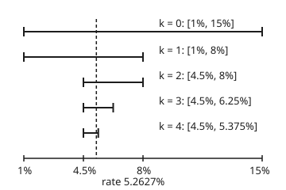
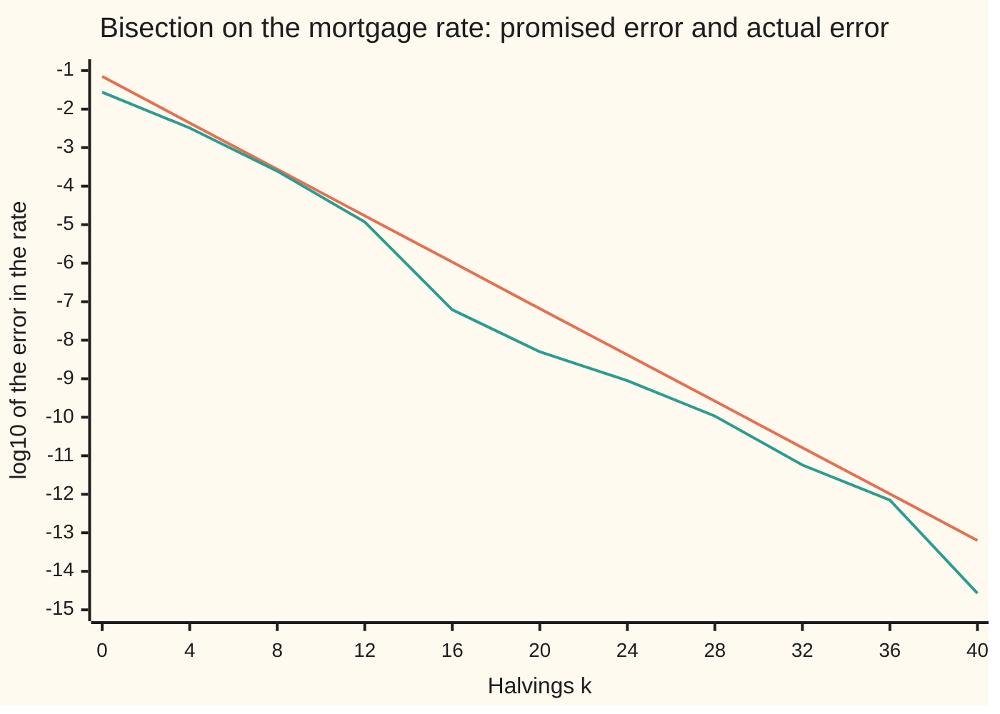

# Bisection: halve a bracket that has to contain a crossing

[Syllabus](../../../SYLLABUS.md) → [Numerical analysis](../README.md) → [Root Finding and Fixed Points](../README.md#s02) → Bisection

---

## General Overview

A lender offers a $300,000 loan, repaid by 300 monthly payments of $1,800 over 25 years. The figures are illustrative. The question is the interest rate hidden in that offer.

No formula gives the rate directly. What is easy is the other direction: pick a rate, value the 300 payments at that rate, and compare the total with the loan. At 1% a year the payments are worth $177,615.17 more than the loan. At 15% they are worth $159,466.19 less. So the rate sits somewhere between 1% and 15%.

That pair of rates is a **bracket**: two inputs where the answer changes sign between them. Bisection tests the middle rate, 8%, sees the sign there, and keeps the half where the sign still changes. Every test halves the bracket.

The method has one property that most root finders lack. Before the first test, it says how many tests a given accuracy will cost. Here the tolerance is a millionth plus a hundred-thousandth of the rate itself, both as fractions, not percent. The count is 16, and the run takes exactly 16. The answer is 5.262741%, guaranteed within 1.068e-06 of the true rate: about a ten-thousandth of a percentage point.

**Bisection keeps two inputs where a continuous function has opposite signs, halves the gap between them at every step, and so reaches any tolerance in a number of steps that is known before it starts.**

**What kind of fact this is:** a method with a theorem attached. The error bound and the step count are proved on this card in Why it works. The floor where halving stops is a property of double-precision numbers, measured by the checks.

### The picture: the first four halvings, to scale

<p align="center"></p>

Each bar is the bracket after k halvings. The dashed line is the rate, 5.2627%. It sits inside every bar, and every bar is half as long as the one above it.

---

## The formula

Four pieces, in words first.

- The **gap** $g(r)$ is the value today of the payments at yearly rate $r$, minus the loan. The rate is wanted where the gap is zero.
- A **bracket** $[a, b]$ is two rates with gaps of opposite sign.
- One **halving** tests the midpoint $m$ and keeps the half that is still a bracket.
- The **stopping test** mixes an absolute and a relative tolerance.

$$g(r) = M \sum_{n=1}^{N} \frac{1}{(1+i)^{n}} - L, \qquad i = \frac{r}{12}$$

**Read it aloud:** the gap is each payment shrunk by the monthly rate once for every month it waits, added up, minus the loan.

$$m = \frac{a+b}{2}, \qquad [a, b] \leftarrow \begin{cases} [a, m] & \text{if } g(a) \text{ and } g(m) \text{ differ in sign} \\ [m, b] & \text{otherwise} \end{cases}$$

**Read it aloud:** test the middle, and keep the half whose ends still disagree in sign.

$$\text{stop when } \frac{b-a}{2} \le t_{\text{abs}} + t_{\text{rel}}\,\lvert m\rvert, \qquad K = \left\lceil \log_2 \frac{b_0 - a_0}{2\,(t_{\text{abs}} + t_{\text{rel}} \min(\lvert a_0\rvert, \lvert b_0\rvert))} \right\rceil$$

**Read it aloud:** stop when half the bracket is inside the tolerance; the number of halvings this costs is the starting width over twice the smallest tolerance, counted in powers of two and rounded up.

Here $a_0$ and $b_0$ are the starting ends, and the ceiling brackets ⌈ ⌉ mean "round up to a whole number". The formula for $K$ holds when the bracket does not contain zero. When it does, drop the relative part.

| Symbol | Plain meaning | In our example | Push it up and the answer… |
| --- | --- | --- | --- |
| $g(r)$ | the gap: payments valued at rate $r$, minus the loan | $177,615.17 at 1%, −$159,466.19 at 15% | — |
| $r$, $r^{*}$ | the yearly rate, compounded monthly; $r^{*}$ is the true root | 5.2627472583% at the root | the gap falls |
| $i$ | the monthly rate, $r/12$; on this card a rate, not $\sqrt{-1}$ | one twelfth of the yearly rate | the gap falls |
| $M$, $L$, $N$, $n$ | the payment, the loan, the number of months, and which month | $1,800, $300,000, 300, 1 to 300 | a bigger payment raises the rate |
| $a$, $b$ | the ends of the bracket, gaps of opposite sign; $a_0$, $b_0$ at the start, $a_k$, $b_k$ after k halvings | 1% and 15% at the start | a wider bracket costs more halvings |
| $m$, $m_k$ | the midpoint, tested next; $m_k$ after k halvings is the answer returned | 8% first; 5.262741% at the end | — |
| $k$ | halvings done so far | 0 to 16 | the bracket halves each time |
| $K$ | halvings promised before the start | 16 | — |
| $T$ | the least the tolerance can be inside the bracket, $t_{\text{abs}} + t_{\text{rel}} \min(\lvert a_0\rvert, \lvert b_0\rvert)$ | 1.100e-06 | fewer halvings |
| $t_{\text{abs}}$ | absolute tolerance: error allowed in rate units | 1e-06, a millionth | fewer halvings |
| $t_{\text{rel}}$ | relative tolerance: error allowed per unit of the answer | 1e-05 | fewer halvings |
| ulp | unit in the last place: the gap from a double to the next one | 6.939e-18 near 5.26% | sets the floor |

### When it holds

- **The function is continuous on the bracket.** Drop it and the sign can change across a jump with no root there. Bisection then closes on the jump: at 7% for the function 1/(r − 0.07).
- **The ends have opposite signs.** Drop it and the halving keeps one end forever. On a $900 payment the gap is negative at both 1% and 15%, and blind halving returns 14.9998%. Searching outward for a sign change first, bisection gives −0.8257%.
- **The tolerance is above the floor.** Ask for 1e-20 on a rate near 5% and the test can never pass. The run stops only when the bracket ends are neighbouring doubles, after 54 halvings.
- **The stopping test has an absolute part when the root may be zero.** A purely relative test asks for an error smaller than a fraction of a number that is itself shrinking to zero.
- **One root, or any root will do.** A bracket with three crossings returns one of them, with no word about the others.

---

## Why it works

### Step 0: the sign change is never lost

A continuous function that is positive at one end and negative at the other is zero somewhere between. The [Intermediate value theorem](../../06-Calculus%20and%20analysis/01-Limits%20and%20Continuity/06-intermediate-value-theorem.md) proves this by halving the bracket, and counts its width after n halvings.

What matters here is the invariant. After every halving, the kept half still has opposite signs at its ends. So it still holds a root. Nothing else about the function is used: no slope, no curvature, no good first guess.

### Step 1: finding a bracket in the first place

A bracket is often known from the problem: no lender charges below 1% or above 15%. When it is not, search outward.

1. Start from a guess interval, here [1%, 2%].
2. If the signs at the ends differ, stop: that is a bracket.
3. Otherwise step past the end with the smaller gap, by twice the current width, keeping the old end as the inner end.
4. Repeat.

From [1%, 2%], both gaps are positive. The search steps up to [2%, 4%], then to [4%, 8%], where the signs differ: a bracket after 2 widenings. Doubling the width means a bracket a long way off is reached in a few steps.

The search can also find a bracket that a fixed range misses. For the $900 payment, the gaps at 1% and 15% are −$61,192.42 and −$229,733.10. The gap at 1% is smaller, so the search steps down: [−27%, 1%] after 1 widening. Bisection then gives −0.8257%. A negative rate means the 300 payments add up to less than the loan.

The search has limits. Two roots close together, or a root where the gap touches zero without crossing, give no sign change at all. The search then widens until its cap and fails. A sign change proves a root; no sign change proves nothing.

### Step 2: the error bound, and the step count in advance

Each halving cuts the width exactly in two. After k halvings the bracket is $(b_0 - a_0)/2^k$ wide. The root is inside it, and the midpoint is at most half the width from any point inside. So

$$\lvert m_k - r^{*}\rvert \le \frac{b_0 - a_0}{2^{k+1}},$$

where $m_k$ is the midpoint after k halvings and $r^{*}$ is the true rate. This bound does not depend on the function at all.

The stopping test asks for that half-width to be at most $t_{\text{abs}} + t_{\text{rel}}\lvert m\rvert$. Why mix the two?

- **Absolute alone** fails when the tolerance is below the spacing of doubles at the answer, and that spacing grows with the answer. Near 5.26% the doubles are 6.939e-18 apart, so a tolerance of 1e-20 can never be met.
- **Relative alone** fails at a zero answer. The allowed error shrinks with the answer, so the test never passes.
- **Mixed** behaves like relative for large answers and like absolute near zero.

To count in advance, use the smallest the tolerance can be. Inside [1%, 15%], $\lvert m\rvert$ is at least 1%. So the tolerance is at least $T = 10^{-6} + 10^{-5} \times 0.01 = 1.100 \times 10^{-6}$. Solving the bound for k gives the formula for $K$: log2 of 63636.4 is 15.958, which rounds up to **16**. The run stops after 16 halvings, as promised.

<details>
<summary>Detailed proof: the bound, and why K halvings are always enough</summary>

Let $g$ be continuous on $[a_0, b_0]$ with $g(a_0)$ and $g(b_0)$ of opposite sign. Halving keeps a sub-interval with ends of opposite sign, so by induction every bracket $[a_k, b_k]$ has that property. By the intermediate value theorem, each contains a root. The brackets are nested, so one root $r^{*}$ lies in all of them (the nested-interval argument on the Intermediate value theorem card).

The width is exactly $(b_0 - a_0)/2^k$, since each step keeps one half. The midpoint $m_k$ is within half the width of every point of $[a_k, b_k]$, including $r^{*}$. That gives the bound.

Now suppose $0 < a_0$, so every midpoint is at least $a_0$. Then $t_{\text{abs}} + t_{\text{rel}}\lvert m_k\rvert \ge t_{\text{abs}} + t_{\text{rel}}\,a_0 = T$. If $k \ge K = \lceil \log_2((b_0 - a_0)/(2T)) \rceil$, then $2^{k+1} \ge (b_0 - a_0)/T$, so the half-width $(b_0 - a_0)/2^{k+1} \le T$, and the test passes. The case $b_0 < 0$ is the mirror image with $\lvert b_0\rvert$. If the bracket contains zero, $\lvert m_k\rvert$ can be tiny, so only $T = t_{\text{abs}}$ is safe. The test may pass earlier than $K$, never later. $\blacksquare$

This is exact arithmetic. In floating point the midpoint $(a + b)/2$ is computed with one rounding, which keeps it inside $[a, b]$ for doubles of the same sign, so the computed signs at the two ends stay opposite. That is not the same as holding the root: Step 3 shows where the computed signs stop being right, and where the halving must stop.

</details>

### Step 3: the floor, where the bracket runs out of numbers

A double is a computer number with 53 significant bits. Near 5.26% the doubles are evenly spaced, 6.939e-18 apart. That spacing is the ulp (unit in the last place) of the rate.

Keep halving with no tolerance at all, and the bracket shrinks until its two ends are neighbouring doubles. The computed midpoint then rounds to one of the ends, and nothing is left to test. From [1%, 15%] that happens after 54 halvings. The count matches log2(0.14 / width) = 54.16: the number of halvings that turn a width of 0.14 into one ulp.

The checks confirm that the two final ends are neighbours, by adding one to the bit pattern of the lower end. So a bisection loop always ends, if it also stops when the midpoint equals an end.

The floor in the answer is not the floor in the rate. The gap $g$ itself is computed with rounding error in 300 additions. Near the root its sign is decided by that noise. A halving that reads a wrong sign keeps the wrong half, so at the floor the final bracket need not hold the true rate at all: the invariant of Step 0 holds in exact arithmetic, not for computed signs. Here the final bracket is one ulp wide, yet the 54-step answer differs from the secant answer by −3.192e-16, far more than one ulp. The last few halvings sort rounding noise, not the rate. This is a conditioning question, taken up on [When to stop](03-stopping-criteria-and-error-estimates.md).

### Step 4: what each halving buys

Each halving costs one evaluation of $g$, here 300 terms. The whole run costs 2 end values plus 16 midpoints: 18 evaluations. Each halving halves the guaranteed error, one bit of the bound, whatever the function looks like. The true error is not promised to fall every step.

That is slow beside a step that uses the slope, as on [Newton and secant](02-newton-and-secant-with-convergence-orders.md). Near a simple root, Newton's step roughly doubles the correct digits each time, and the secant step comes close. Yet bisection's guarantee is the best possible. Among methods that see only function values, no method has a better worst case on every continuous function with a sign change; Sikorski proved this in 1982 (Sources). Bisection trades speed for a promise.

### The picture: the bound against the true error



The straight line is the bound, half the bracket width: it falls by the same amount every halving. The second line is the true error of the midpoint, measured against the secant answer. It always sits below the bound but falls unevenly. Between the plotted points, every fourth halving, the midpoint can land close to the root by luck and then move away again at the next halving.

---

## Worked numbers, by hand

Loan $300,000, payment $1,800, 300 months, bracket [1%, 15%], $t_{\text{abs}} = 10^{-6}$, $t_{\text{rel}} = 10^{-5}$.

| Step | Arithmetic | Value |
| --- | --- | --- |
| ends | g(1%) and g(15%) | $177,615.17 and −$159,466.19: a bracket |
| promise | T = 1.100e-06; ⌈log2 (0.14 / 2T)⌉ = ⌈log2 63636.4⌉ = ⌈15.958⌉ | 16 halvings |
| halving 1 | g(8%) = −$66,783.86, negative | keep [1%, 8%] |
| halving 2 | g(4.5%) = $23,838.58, positive | keep [4.5%, 8%] |
| halving 3 | g(6.25%) = −$27,136.04, negative | keep [4.5%, 6.25%] |
| halving 4 | g(5.375%) = −$3,286.12, negative | keep [4.5%, 5.375%] |
| halvings 5 to 16 | the same rule, twelve more times | bracket 0.14 / 2^16 wide |
| bound | 0.14 / 2^17 | 1.068e-06 |
| answer | the midpoint | **5.262741%, within 1.068e-06 of the true rate** |

The true rate, from the secant road, is 5.2627472583%. The true error is 6.169e-08, so the bound is 17.3 times the true error: honest and not wildly loose. Turned back into a payment by the closed annuity formula, 5.262741% gives $1,799.9989 a month. The rate is good to a fraction of a cent on the payment.

### What breaks if you drop a piece

| Mistake | Comes out at | What went wrong |
| --- | --- | --- |
| No sign change: $900 payment, bracket [1%, 15%] | 14.9998%; searching outward first, bisection gives −0.8257% | both gaps negative, so the halving kept moving one end |
| A jump, not a root: 1/(r − 0.07) on [1%, 15%] | 6.999924%, where the function is −1.3107e+06 | the sign changes across a jump, not through zero |
| Absolute tolerance below the floor: 1e-20 | 54 halvings, stopped by the floor, never by the test | doubles near 5.26% are 6.939e-18 apart |
| Relative test alone, true rate 0 ($1,000 a month) | 42 halvings, stopped only because the gap rounded to exactly 0 at 1.136e-15 | the allowed error shrank with the answer; the mixed test stops in 17 halvings, at 3.433e-07 |

---

## Code, from first principles, and it actually runs

The code values the payments by a loop of 300 multiplies, then finds the rate three ways. Road 1 is bisection with the mixed test, checked against the promised count. Road 2 is the secant step, which keeps no bracket. Road 3 turns each rate back into a payment by the closed annuity formula. It then halves to the floor, checks the final ends are neighbouring doubles from their bits, searches outward for brackets, and prints every break in the table above.

### Python

```python
# Bisection and bracketing -- the check behind the card.  Standard library only.
# A $300,000 loan is repaid by 300 monthly payments of $1,800 (illustrative).
# Which yearly rate r, compounded monthly, makes the payments worth the loan?
# Road 1 halves a bracket.  Road 2 is the secant step, which keeps no bracket.
# Road 3 turns each rate back into a payment by the closed annuity formula.
# Then the floor of neighbouring doubles, the outward search, and four breaks.
import math, struct

LOAN, MONTHS = 300000.0, 300

def gap(r, pay=1800.0):                 # value today of the payments, minus the loan
    v, d, s = 1 / (1 + r / 12), 1.0, 0.0
    for _ in range(MONTHS):
        d *= v
        s += d
    return pay * s - LOAN

def payment(r):                         # road 3: closed form, L i (1+i)^N / ((1+i)^N - 1)
    i, p = r / 12, 1.0
    for _ in range(MONTHS): p *= 1 + i
    return LOAN * i * p / (p - 1)

def bisect(g, a, b, t_abs, t_rel, show=False):
    ga, k, seen = g(a), 0, [(a + b) / 2]
    while True:
        m = (a + b) / 2
        if (b - a) / 2 <= t_abs + t_rel * abs(m): return m, k, "test", seen, a, b
        if m == a or m == b: return m, k, "floor", seen, a, b
        gm = g(m)
        if gm == 0: return m, k, "zero", seen, a, b
        if (gm > 0) == (ga > 0): a, ga = m, gm
        else: b = m
        k += 1
        seen.append((a + b) / 2)
        if show and k <= 4: print(f"halving {k}: m = {100 * m:.4f}%, gap {gm:.2f}, keep [{100 * a:.4f}%, {100 * b:.4f}%]")
        if k == 3000: return m, k, "cap", seen, a, b

def steps_needed(a, b, tol):            # smallest k with (b - a) / 2^(k+1) <= tol
    k = 0
    while (b - a) / 2 ** (k + 1) > tol: k += 1
    return k

def find_bracket(g, a, b):              # step outward, doubling the width, until signs differ
    ga, gb, n = g(a), g(b), 0
    while (ga > 0) == (gb > 0) and n < 40:
        w = b - a
        if abs(ga) < abs(gb): a, b, gb = a - 2 * w, a, ga; ga = g(a)
        else: a, b, ga = b, b + 2 * w, gb; gb = g(b)
        n += 1
    return a, b, n

def secant(g, x0, x1):                  # road 2: the chord through the last two points
    g0, g1 = g(x0), g(x1)
    for _ in range(50):
        if g1 == g0: break
        x0, x1, g0 = x1, x1 - g1 * (x1 - x0) / (g1 - g0), g1
        g1 = g(x1)
    return x1

def next_double(x):                     # the double just above x > 0, from its bits
    return struct.unpack("<d", struct.pack("<q", struct.unpack("<q", struct.pack("<d", x))[0] + 1))[0]

A, B, T_ABS, T_REL = 0.01, 0.15, 1e-6, 1e-5
print(f"ends: gap(1%) = {gap(A):.2f}, gap(15%) = {gap(B):.2f}")
tol_floor = T_ABS + T_REL * A           # |m| >= 1% inside this bracket, so this tol is the least
k_pred = steps_needed(A, B, tol_floor)
print(f"promised: {k_pred} halvings, least tolerance {tol_floor:.3e}, log2 of {(B - A) / (2 * tol_floor):.1f} = {math.log2((B - A) / (2 * tol_floor)):.3f}")
r1, k1, why1, seen, a1, b1 = bisect(gap, A, B, T_ABS, T_REL, True)
bound = (b1 - a1) / 2
print(f"road 1: {k1} halvings, stopped by {why1}, rate {100 * r1:.6f}%, bound {bound:.3e}")
r2 = secant(gap, 0.05, 0.06)
print(f"road 2, secant from 5% and 6%: rate {100 * r2:.10f}%")
true1 = abs(r1 - r2)
print(f"true error {true1:.3e}, bound / true = {bound / true1:.1f}")
print(f"road 3, payment at road 1: {payment(r1):.4f}, at road 2: {payment(r2):.4f}")
print(f"cost: 2 end values + {k1} midpoints = {2 + k1} evaluations of 300 terms")
fa, fb, nb = find_bracket(gap, 0.01, 0.02)
print(f"outward from [1%, 2%]: [{100 * fa:.0f}%, {100 * fb:.0f}%] after {nb} widenings")
rf, kf, whyf, seenf, af, bf = bisect(gap, A, B, 0.0, 0.0)
print(f"floor: {kf} halvings, stopped by {whyf}, width {bf - af:.3e}, log2(0.14 / width) = {math.log2((B - A) / (bf - af)):.2f}")
print(f"floor ends are neighbours: {'yes' if next_double(af) == bf else 'no'}; floor minus road 2 = {rf - r2:.3e}")
ks = list(range(0, 41, 4))
print("chart, k:", " ".join(str(k) for k in ks))
print("chart, log10 bound:", " ".join(f"{math.log10((B - A) / 2 ** (k + 1)):.2f}" for k in ks))
print("chart, log10 true error:", " ".join(f"{math.log10(abs(seenf[k] - r2)):.2f}" for k in ks))
px = lambda r: 30 + (r - 0.01) / 0.14 * 300
br = [(0.01, 0.15)]
for m in seenf[:4]:
    lo, hi = br[-1]
    br.append((m, hi) if gap(m) > 0 else (lo, m))
print("figure, brackets in %:", " ".join(f"[{100 * lo:.4f},{100 * hi:.4f}]" for lo, hi in br))
print("figure, x pixels:", " ".join(f"{px(lo):.1f}-{px(hi):.1f}" for lo, hi in br), f"root {px(r2):.1f}")
# ---- what breaks ----
lo9 = lambda r: gap(r, 900.0)
r9 = bisect(lo9, A, B, T_ABS, T_REL)[0]
a9, b9, n9 = find_bracket(lo9, A, B)
s9 = bisect(lo9, a9, b9, T_ABS, T_REL)[0]
print(f"$900 a month: gap(1%) {lo9(A):.2f}, gap(15%) {lo9(B):.2f}; blind halving says {100 * r9:.4f}%")
print(f"  outward search: [{100 * a9:.0f}%, {100 * b9:.0f}%] after {n9}; rate {100 * s9:.4f}%")
pole = lambda r: 1 / (r - 0.07)
rp = bisect(pole, A, B, T_ABS, T_REL)[0]
print(f"jump at 7%: closes on {100 * rp:.6f}%, where the function is {pole(rp):.4e}")
ra, ka, whya = bisect(gap, A, B, 1e-20, 0.0)[:3]
print(f"t_abs = 1e-20 alone: {ka} halvings, stopped by {whya}, never by the test")
free = lambda r: gap(r, 1000.0)
rz, kz, whyz = bisect(free, -0.02, B, 0.0, T_REL)[:3]
rm, km, whym = bisect(free, -0.02, B, T_ABS, T_REL)[:3]
print(f"$1000 a month, true rate 0: t_rel alone {kz} halvings, stopped by {whyz} at {rz:.3e}")
print(f"  mixed test: {km} halvings, stopped by {whym} at {rm:.3e}")
# ---- try changing ----
print(f"try: t_abs 1e-8 and t_rel 1e-7 need {steps_needed(A, B, 1e-8 + 1e-7 * A)} halvings")
print(f"try: bracket [0%, 100%] needs {steps_needed(0.0, 1.0, T_ABS)} halvings")
r20 = bisect(lambda r: gap(r, 2000.0), A, B, T_ABS, T_REL)
print(f"try: $2,000 a month gives {100 * r20[0]:.4f}% in {r20[1]} halvings")
assert k1 == k_pred and why1 == "test"                  # the promise, kept to the step
assert true1 <= bound                                   # bisection meets secant within its bound
assert abs(payment(r2) - 1800.0) < 1e-6                 # closed form turns the rate back into $1,800
assert next_double(af) == bf and abs(rf - r2) < 1e-13   # floor: neighbouring doubles, near road 2
assert gap(fa) > 0 > gap(fb) and lo9(a9) > 0 > lo9(b9)  # the outward search really brackets
assert abs(s9 - secant(lo9, -0.01, -0.005)) < bound     # the negative rate, by secant too
assert whya == "floor" and whyz != "test" and whym == "test"
print("ALL CHECKS PASS")
```

**Ran 2026-11-11 on macOS, Python 3.14.10, standard library only. All checks passed. Output, pasted from the run:**

```
ends: gap(1%) = 177615.17, gap(15%) = -159466.19
promised: 16 halvings, least tolerance 1.100e-06, log2 of 63636.4 = 15.958
halving 1: m = 8.0000%, gap -66783.86, keep [1.0000%, 8.0000%]
halving 2: m = 4.5000%, gap 23838.58, keep [4.5000%, 8.0000%]
halving 3: m = 6.2500%, gap -27136.04, keep [4.5000%, 6.2500%]
halving 4: m = 5.3750%, gap -3286.12, keep [4.5000%, 5.3750%]
road 1: 16 halvings, stopped by test, rate 5.262741%, bound 1.068e-06
road 2, secant from 5% and 6%: rate 5.2627472583%
true error 6.169e-08, bound / true = 17.3
road 3, payment at road 1: 1799.9989, at road 2: 1800.0000
cost: 2 end values + 16 midpoints = 18 evaluations of 300 terms
outward from [1%, 2%]: [4%, 8%] after 2 widenings
floor: 54 halvings, stopped by floor, width 6.939e-18, log2(0.14 / width) = 54.16
floor ends are neighbours: yes; floor minus road 2 = -3.192e-16
chart, k: 0 4 8 12 16 20 24 28 32 36 40
chart, log10 bound: -1.15 -2.36 -3.56 -4.77 -5.97 -7.18 -8.38 -9.58 -10.79 -11.99 -13.20
chart, log10 true error: -1.56 -2.49 -3.61 -4.93 -7.21 -8.30 -9.05 -9.97 -11.24 -12.15 -14.57
figure, brackets in %: [1.0000,15.0000] [1.0000,8.0000] [4.5000,8.0000] [4.5000,6.2500] [4.5000,5.3750]
figure, x pixels: 30.0-330.0 30.0-180.0 105.0-180.0 105.0-142.5 105.0-123.7 root 121.3
$900 a month: gap(1%) -61192.42, gap(15%) -229733.10; blind halving says 14.9998%
  outward search: [-27%, 1%] after 1; rate -0.8257%
jump at 7%: closes on 6.999924%, where the function is -1.3107e+06
t_abs = 1e-20 alone: 54 halvings, stopped by floor, never by the test
$1000 a month, true rate 0: t_rel alone 42 halvings, stopped by zero at 1.136e-15
  mixed test: 17 halvings, stopped by test at 3.433e-07
try: t_abs 1e-8 and t_rel 1e-7 need 23 halvings
try: bracket [0%, 100%] needs 19 halvings
try: $2,000 a month gives 6.3629% in 16 halvings
ALL CHECKS PASS
```

### Rust

```rust
// Bisection and bracketing -- the check behind the card.  std only, no crates.
// A $300,000 loan is repaid by 300 monthly payments of $1,800 (illustrative).
// Which yearly rate r, compounded monthly, makes the payments worth the loan?
// Road 1 halves a bracket.  Road 2 is the secant step, which keeps no bracket.
// Road 3 turns each rate back into a payment by the closed annuity formula.
// Then the floor of neighbouring doubles, the outward search, and four breaks.
const LOAN: f64 = 300000.0;
const MONTHS: usize = 300;

fn gap_at(r: f64, pay: f64) -> f64 { // value today of the payments, minus the loan
    let (v, mut d, mut s) = (1.0 / (1.0 + r / 12.0), 1.0, 0.0);
    for _ in 0..MONTHS {
        d *= v;
        s += d;
    }
    pay * s - LOAN
}
fn gap(r: f64) -> f64 { gap_at(r, 1800.0) }

fn payment(r: f64) -> f64 { // road 3: closed form, L i (1+i)^N / ((1+i)^N - 1)
    let (i, mut p) = (r / 12.0, 1.0);
    for _ in 0..MONTHS { p *= 1.0 + i; }
    LOAN * i * p / (p - 1.0)
}

struct Run { m: f64, k: i32, why: &'static str, seen: Vec<f64>, a: f64, b: f64 }

fn bisect(g: &dyn Fn(f64) -> f64, mut a: f64, mut b: f64, t_abs: f64, t_rel: f64, show: bool) -> Run {
    let (mut ga, mut k, mut seen) = (g(a), 0, vec![(a + b) / 2.0]);
    loop {
        let m = (a + b) / 2.0;
        if (b - a) / 2.0 <= t_abs + t_rel * m.abs() { return Run { m, k, why: "test", seen, a, b }; }
        if m == a || m == b { return Run { m, k, why: "floor", seen, a, b }; }
        let gm = g(m);
        if gm == 0.0 { return Run { m, k, why: "zero", seen, a, b }; }
        if (gm > 0.0) == (ga > 0.0) { a = m; ga = gm; } else { b = m; }
        k += 1;
        seen.push((a + b) / 2.0);
        if show && k <= 4 {
            println!("halving {}: m = {:.4}%, gap {:.2}, keep [{:.4}%, {:.4}%]", k, 100.0 * m, gm, 100.0 * a, 100.0 * b);
        }
        if k == 3000 { return Run { m, k, why: "cap", seen, a, b }; }
    }
}

fn steps_needed(a: f64, b: f64, tol: f64) -> i32 { // smallest k with (b - a) / 2^(k+1) <= tol
    let mut k = 0;
    while (b - a) / 2f64.powi(k + 1) > tol { k += 1; }
    k
}

fn find_bracket(g: &dyn Fn(f64) -> f64, mut a: f64, mut b: f64) -> (f64, f64, i32) {
    let (mut ga, mut gb, mut n) = (g(a), g(b), 0); // step outward, doubling the width
    while (ga > 0.0) == (gb > 0.0) && n < 40 {
        let w = b - a;
        if ga.abs() < gb.abs() { b = a; gb = ga; a -= 2.0 * w; ga = g(a); }
        else { a = b; ga = gb; b += 2.0 * w; gb = g(b); }
        n += 1;
    }
    (a, b, n)
}

fn secant(g: &dyn Fn(f64) -> f64, mut x0: f64, mut x1: f64) -> f64 { // road 2: the chord
    let (mut g0, mut g1) = (g(x0), g(x1));
    for _ in 0..50 {
        if g1 == g0 { break; }
        let x2 = x1 - g1 * (x1 - x0) / (g1 - g0);
        x0 = x1; x1 = x2; g0 = g1;
        g1 = g(x1);
    }
    x1
}

fn next_double(x: f64) -> f64 { f64::from_bits(x.to_bits() + 1) } // x > 0, from its bits

fn e(x: f64, p: usize) -> String { // Python's e-notation: two-digit exponent with a sign
    let s = format!("{:.*e}", p, x);
    let (m, ex) = s.split_once('e').unwrap();
    let n: i32 = ex.parse().unwrap();
    format!("{}e{}{:02}", m, if n < 0 { '-' } else { '+' }, n.abs())
}

fn main() {
    let (a0, b0, t_abs, t_rel) = (0.01, 0.15, 1e-6, 1e-5);
    println!("ends: gap(1%) = {:.2}, gap(15%) = {:.2}", gap(a0), gap(b0));
    let tol_floor = t_abs + t_rel * a0; // |m| >= 1% inside this bracket, so this tol is the least
    let k_pred = steps_needed(a0, b0, tol_floor);
    let q = (b0 - a0) / (2.0 * tol_floor);
    println!("promised: {} halvings, least tolerance {}, log2 of {:.1} = {:.3}", k_pred, e(tol_floor, 3), q, q.log2());
    let r1 = bisect(&gap, a0, b0, t_abs, t_rel, true);
    let bound = (r1.b - r1.a) / 2.0;
    println!("road 1: {} halvings, stopped by {}, rate {:.6}%, bound {}", r1.k, r1.why, 100.0 * r1.m, e(bound, 3));
    let r2 = secant(&gap, 0.05, 0.06);
    println!("road 2, secant from 5% and 6%: rate {:.10}%", 100.0 * r2);
    let true1 = (r1.m - r2).abs();
    println!("true error {}, bound / true = {:.1}", e(true1, 3), bound / true1);
    println!("road 3, payment at road 1: {:.4}, at road 2: {:.4}", payment(r1.m), payment(r2));
    println!("cost: 2 end values + {} midpoints = {} evaluations of 300 terms", r1.k, 2 + r1.k);
    let (fa, fb, nb) = find_bracket(&gap, 0.01, 0.02);
    println!("outward from [1%, 2%]: [{:.0}%, {:.0}%] after {} widenings", 100.0 * fa, 100.0 * fb, nb);
    let fl = bisect(&gap, a0, b0, 0.0, 0.0, false);
    println!("floor: {} halvings, stopped by {}, width {}, log2(0.14 / width) = {:.2}", fl.k, fl.why, e(fl.b - fl.a, 3), ((b0 - a0) / (fl.b - fl.a)).log2());
    let nbr = next_double(fl.a) == fl.b;
    println!("floor ends are neighbours: {}; floor minus road 2 = {}", if nbr { "yes" } else { "no" }, e(fl.m - r2, 3));
    let ks: Vec<i32> = (0..41).step_by(4).collect();
    println!("chart, k: {}", ks.iter().map(|k| k.to_string()).collect::<Vec<_>>().join(" "));
    println!("chart, log10 bound: {}", ks.iter().map(|&k| format!("{:.2}", ((b0 - a0) / 2f64.powi(k + 1)).log10())).collect::<Vec<_>>().join(" "));
    println!("chart, log10 true error: {}", ks.iter().map(|&k| format!("{:.2}", (fl.seen[k as usize] - r2).abs().log10())).collect::<Vec<_>>().join(" "));
    let px = |r: f64| 30.0 + (r - 0.01) / 0.14 * 300.0;
    let mut br = vec![(0.01, 0.15)];
    for &m in &fl.seen[..4] {
        let (lo, hi) = *br.last().unwrap();
        br.push(if gap(m) > 0.0 { (m, hi) } else { (lo, m) });
    }
    println!("figure, brackets in %: {}", br.iter().map(|(lo, hi)| format!("[{:.4},{:.4}]", 100.0 * lo, 100.0 * hi)).collect::<Vec<_>>().join(" "));
    println!("figure, x pixels: {} root {:.1}", br.iter().map(|&(lo, hi)| format!("{:.1}-{:.1}", px(lo), px(hi))).collect::<Vec<_>>().join(" "), px(r2));
    // ---- what breaks ----
    let lo9 = |r: f64| gap_at(r, 900.0);
    let r9 = bisect(&lo9, a0, b0, t_abs, t_rel, false).m;
    let (a9, b9, n9) = find_bracket(&lo9, a0, b0);
    let s9 = bisect(&lo9, a9, b9, t_abs, t_rel, false).m;
    println!("$900 a month: gap(1%) {:.2}, gap(15%) {:.2}; blind halving says {:.4}%", lo9(a0), lo9(b0), 100.0 * r9);
    println!("  outward search: [{:.0}%, {:.0}%] after {}; rate {:.4}%", 100.0 * a9, 100.0 * b9, n9, 100.0 * s9);
    let pole = |r: f64| 1.0 / (r - 0.07);
    let rp = bisect(&pole, a0, b0, t_abs, t_rel, false).m;
    println!("jump at 7%: closes on {:.6}%, where the function is {}", 100.0 * rp, e(pole(rp), 4));
    let ra = bisect(&gap, a0, b0, 1e-20, 0.0, false);
    println!("t_abs = 1e-20 alone: {} halvings, stopped by {}, never by the test", ra.k, ra.why);
    let free = |r: f64| gap_at(r, 1000.0);
    let rz = bisect(&free, -0.02, b0, 0.0, t_rel, false);
    let rm = bisect(&free, -0.02, b0, t_abs, t_rel, false);
    println!("$1000 a month, true rate 0: t_rel alone {} halvings, stopped by {} at {}", rz.k, rz.why, e(rz.m, 3));
    println!("  mixed test: {} halvings, stopped by {} at {}", rm.k, rm.why, e(rm.m, 3));
    // ---- try changing ----
    println!("try: t_abs 1e-8 and t_rel 1e-7 need {} halvings", steps_needed(a0, b0, 1e-8 + 1e-7 * a0));
    println!("try: bracket [0%, 100%] needs {} halvings", steps_needed(0.0, 1.0, t_abs));
    let r20 = bisect(&|r: f64| gap_at(r, 2000.0), a0, b0, t_abs, t_rel, false);
    println!("try: $2,000 a month gives {:.4}% in {} halvings", 100.0 * r20.m, r20.k);
    assert!(r1.k == k_pred && r1.why == "test"); // the promise, kept to the step
    assert!(true1 <= bound); // bisection meets secant within its bound
    assert!((payment(r2) - 1800.0).abs() < 1e-6); // closed form turns the rate back into $1,800
    assert!(nbr && (fl.m - r2).abs() < 1e-13); // floor: neighbouring doubles, near road 2
    assert!(gap(fa) > 0.0 && 0.0 > gap(fb) && lo9(a9) > 0.0 && 0.0 > lo9(b9)); // a real bracket
    assert!((s9 - secant(&lo9, -0.01, -0.005)).abs() < bound); // the negative rate, by secant too
    assert!(ra.why == "floor" && rz.why != "test" && rm.why == "test");
    println!("ALL CHECKS PASS");
}
```

**Ran 2026-11-11 on macOS, rustc 1.98.1, no crates. All checks passed. Output, pasted from the run:**

```
ends: gap(1%) = 177615.17, gap(15%) = -159466.19
promised: 16 halvings, least tolerance 1.100e-06, log2 of 63636.4 = 15.958
halving 1: m = 8.0000%, gap -66783.86, keep [1.0000%, 8.0000%]
halving 2: m = 4.5000%, gap 23838.58, keep [4.5000%, 8.0000%]
halving 3: m = 6.2500%, gap -27136.04, keep [4.5000%, 6.2500%]
halving 4: m = 5.3750%, gap -3286.12, keep [4.5000%, 5.3750%]
road 1: 16 halvings, stopped by test, rate 5.262741%, bound 1.068e-06
road 2, secant from 5% and 6%: rate 5.2627472583%
true error 6.169e-08, bound / true = 17.3
road 3, payment at road 1: 1799.9989, at road 2: 1800.0000
cost: 2 end values + 16 midpoints = 18 evaluations of 300 terms
outward from [1%, 2%]: [4%, 8%] after 2 widenings
floor: 54 halvings, stopped by floor, width 6.939e-18, log2(0.14 / width) = 54.16
floor ends are neighbours: yes; floor minus road 2 = -3.192e-16
chart, k: 0 4 8 12 16 20 24 28 32 36 40
chart, log10 bound: -1.15 -2.36 -3.56 -4.77 -5.97 -7.18 -8.38 -9.58 -10.79 -11.99 -13.20
chart, log10 true error: -1.56 -2.49 -3.61 -4.93 -7.21 -8.30 -9.05 -9.97 -11.24 -12.15 -14.57
figure, brackets in %: [1.0000,15.0000] [1.0000,8.0000] [4.5000,8.0000] [4.5000,6.2500] [4.5000,5.3750]
figure, x pixels: 30.0-330.0 30.0-180.0 105.0-180.0 105.0-142.5 105.0-123.7 root 121.3
$900 a month: gap(1%) -61192.42, gap(15%) -229733.10; blind halving says 14.9998%
  outward search: [-27%, 1%] after 1; rate -0.8257%
jump at 7%: closes on 6.999924%, where the function is -1.3107e+06
t_abs = 1e-20 alone: 54 halvings, stopped by floor, never by the test
$1000 a month, true rate 0: t_rel alone 42 halvings, stopped by zero at 1.136e-15
  mixed test: 17 halvings, stopped by test at 3.433e-07
try: t_abs 1e-8 and t_rel 1e-7 need 23 halvings
try: bracket [0%, 100%] needs 19 halvings
try: $2,000 a month gives 6.3629% in 16 halvings
ALL CHECKS PASS
```

### Lean

Lean proves the error bound and the step count in exact arithmetic, for every continuous function and every bracket with a sign change.

- If the function is continuous on the bracket and the ends have opposite signs, one root lies inside every bracket the halving keeps.
- After k halvings the bracket is exactly $(b_0 - a_0)/2^k$ wide.
- The midpoint after k halvings is within $(b_0 - a_0)/2^{k+1}$ of that root, whatever the function looks like.
- For a bracket that does not contain zero, with $T$ above zero, every k of at least $K$ passes the mixed stopping test.
- For a bracket that may contain zero, the count with the absolute tolerance alone is enough, whatever the relative tolerance.
- The hand arithmetic holds exactly: $T$ = 1.100e-06, $K$ = 16, the first four midpoints and widths, the outward search steps, and the 18 evaluations.

The gap values, the outward search's signs, the floor of neighbouring doubles and the breaks are left to the Python and Rust checks.

```lean
-- Bisection: halving a bracket where a continuous function changes sign keeps a root inside every bracket, puts the k-th midpoint within (b₀ - a₀)/2^(k+1) of it, and passes the mixed stopping test after a number of halvings known in advance.
import Mathlib.Topology.Order.IntermediateValue
import Mathlib.Topology.Instances.Real.Lemmas
import Mathlib.Analysis.SpecialFunctions.Log.Base
import Mathlib.Analysis.SpecialFunctions.Pow.Real
import Mathlib.Tactic

open Set

namespace Bisection

/-- One halving of the bracket `[a, b]`: test the midpoint `m = (a + b)/2` and keep `[a, m]`
when `f a` and `f m` differ in sign, otherwise `[m, b]`. A midpoint where `f` is exactly zero
counts as a sign change (it is a root), so it is kept as the right end. -/
noncomputable def halve (f : ℝ → ℝ) (p : ℝ × ℝ) : ℝ × ℝ :=
  if f p.1 * f ((p.1 + p.2) / 2) ≤ 0 then (p.1, (p.1 + p.2) / 2) else ((p.1 + p.2) / 2, p.2)

/-- The bracket `[a_k, b_k]` after `k` halvings, starting from `[a₀, b₀]`. -/
noncomputable def bracket (f : ℝ → ℝ) (a₀ b₀ : ℝ) (k : ℕ) : ℝ × ℝ :=
  (halve f)^[k] (a₀, b₀)

/-- The midpoint `m_k` of the bracket after `k` halvings: the answer returned. -/
noncomputable def mid (f : ℝ → ℝ) (a₀ b₀ : ℝ) (k : ℕ) : ℝ :=
  ((bracket f a₀ b₀ k).1 + (bracket f a₀ b₀ k).2) / 2

lemma bracket_succ (f : ℝ → ℝ) (a₀ b₀ : ℝ) (k : ℕ) :
    bracket f a₀ b₀ (k + 1) = halve f (bracket f a₀ b₀ k) := by
  unfold bracket; rw [Function.iterate_succ_apply']

lemma bracket_width (f : ℝ → ℝ) (a₀ b₀ : ℝ) (k : ℕ) :
    (bracket f a₀ b₀ k).2 - (bracket f a₀ b₀ k).1 = (b₀ - a₀) / 2 ^ k := by
  induction k with
  | zero => simp [bracket]
  | succ k ih =>
    rw [bracket_succ, pow_succ, ← div_div, ← ih]
    generalize bracket f a₀ b₀ k = p
    unfold halve
    split_ifs <;> simp only [] <;> ring

lemma bracket_le (f : ℝ → ℝ) (a₀ b₀ : ℝ) (hab : a₀ ≤ b₀) (k : ℕ) :
    (bracket f a₀ b₀ k).1 ≤ (bracket f a₀ b₀ k).2 := by
  have h := bracket_width f a₀ b₀ k
  have : 0 ≤ (b₀ - a₀) / 2 ^ k := by
    have : 0 ≤ b₀ - a₀ := by linarith
    positivity
  linarith

lemma bracket_fst_mono (f : ℝ → ℝ) (a₀ b₀ : ℝ) (hab : a₀ ≤ b₀) :
    Monotone (fun k => (bracket f a₀ b₀ k).1) := by
  refine monotone_nat_of_le_succ fun k => ?_
  have h := bracket_le f a₀ b₀ hab k
  rw [bracket_succ]
  generalize bracket f a₀ b₀ k = p at h ⊢
  unfold halve
  split_ifs <;> simp only [] <;> linarith

lemma bracket_snd_anti (f : ℝ → ℝ) (a₀ b₀ : ℝ) (hab : a₀ ≤ b₀) :
    Antitone (fun k => (bracket f a₀ b₀ k).2) := by
  refine antitone_nat_of_succ_le fun k => ?_
  have h := bracket_le f a₀ b₀ hab k
  rw [bracket_succ]
  generalize bracket f a₀ b₀ k = p at h ⊢
  unfold halve
  split_ifs <;> simp only [] <;> linarith

lemma bracket_sign (f : ℝ → ℝ) (a₀ b₀ : ℝ) (hs : f a₀ * f b₀ ≤ 0) (k : ℕ) :
    f (bracket f a₀ b₀ k).1 * f (bracket f a₀ b₀ k).2 ≤ 0 := by
  induction k with
  | zero => simpa [bracket] using hs
  | succ k ih =>
    rw [bracket_succ]
    generalize bracket f a₀ b₀ k = p at ih ⊢
    unfold halve
    split_ifs with h
    · simpa using h
    · push Not at h
      simp only []
      by_contra hc
      push Not at hc
      nlinarith [mul_pos h hc, mul_nonpos_of_nonpos_of_nonneg ih (sq_nonneg (f ((p.1 + p.2) / 2)))]

lemma half_width_le (D T : ℝ) (hD : 0 ≤ D) (hT : 0 < T) (k : ℕ)
    (hk : ⌈Real.logb 2 (D / (2 * T))⌉ ≤ (k : ℤ)) : D / 2 ^ (k + 1) ≤ T := by
  have h1 : Real.logb 2 (D / (2 * T)) ≤ k := by
    have h0 := Int.le_ceil (Real.logb 2 (D / (2 * T)))
    have h3 : ((⌈Real.logb 2 (D / (2 * T))⌉ : ℤ) : ℝ) ≤ ((k : ℤ) : ℝ) := by exact_mod_cast hk
    simp only [Int.cast_natCast] at h3
    linarith
  rcases hD.eq_or_lt with h | h
  · rw [← h]; simp; exact hT.le
  · have hX : 0 < D / (2 * T) := by positivity
    rw [Real.logb_le_iff_le_rpow (by norm_num) hX, Real.rpow_natCast] at h1
    rw [div_le_iff₀ (by positivity)] at h1
    rw [div_le_iff₀ (by positivity), pow_succ]
    nlinarith

lemma mid_mem (f : ℝ → ℝ) (a₀ b₀ : ℝ) (hab : a₀ ≤ b₀) (k : ℕ) :
    a₀ ≤ mid f a₀ b₀ k ∧ mid f a₀ b₀ k ≤ b₀ := by
  have h1 : a₀ ≤ (bracket f a₀ b₀ k).1 := bracket_fst_mono f a₀ b₀ hab (Nat.zero_le k)
  have h2 : (bracket f a₀ b₀ k).2 ≤ b₀ := bracket_snd_anti f a₀ b₀ hab (Nat.zero_le k)
  have h3 := bracket_le f a₀ b₀ hab k
  unfold mid
  constructor <;> linarith

#print axioms bracket_succ
#print axioms bracket_width
#print axioms bracket_le
#print axioms bracket_fst_mono
#print axioms bracket_snd_anti
#print axioms bracket_sign
#print axioms half_width_le
#print axioms mid_mem

/-- Bisection's guarantee. Let `f` be continuous on the bracket `[a₀, b₀]` with `f a₀` and
`f b₀` of opposite sign. Then one root `r*` of `f` lies in every bracket `[a_k, b_k]`,
each bracket is exactly `(b₀ - a₀)/2^k` wide, and the midpoint after `k` halvings is within
`(b₀ - a₀)/2^(k+1)` of that root, whatever the function looks like. -/
theorem bisection_midpoint_within_half_width_of_root (f : ℝ → ℝ) (a₀ b₀ : ℝ)
    (hab : a₀ ≤ b₀) (hf : ContinuousOn f (Icc a₀ b₀)) (hsign : f a₀ * f b₀ < 0) :
    ∃ r ∈ Icc a₀ b₀, f r = 0 ∧ ∀ k : ℕ,
      r ∈ Icc (bracket f a₀ b₀ k).1 (bracket f a₀ b₀ k).2 ∧
      (bracket f a₀ b₀ k).2 - (bracket f a₀ b₀ k).1 = (b₀ - a₀) / 2 ^ k ∧
      |mid f a₀ b₀ k - r| ≤ (b₀ - a₀) / 2 ^ (k + 1) := by
  have hmono := bracket_fst_mono f a₀ b₀ hab
  have hanti := bracket_snd_anti f a₀ b₀ hab
  have hle := bracket_le f a₀ b₀ hab
  have hbdd : BddAbove (Set.range fun k => (bracket f a₀ b₀ k).1) :=
    ⟨b₀, by
      rintro _ ⟨k, rfl⟩
      exact (hle k).trans (hanti (Nat.zero_le k))⟩
  set r := ⨆ k, (bracket f a₀ b₀ k).1 with hr
  have hA : ∀ k, (bracket f a₀ b₀ k).1 ≤ r := fun k => le_ciSup hbdd k
  have hB : ∀ k, r ≤ (bracket f a₀ b₀ k).2 := fun k =>
    ciSup_le fun j => (hmono (le_max_left j k)).trans
      ((hle (max j k)).trans (hanti (le_max_right j k)))
  have hrI : r ∈ Icc a₀ b₀ := ⟨hA 0, hB 0⟩
  have hAt : Filter.Tendsto (fun k => (bracket f a₀ b₀ k).1) Filter.atTop (nhds r) :=
    tendsto_atTop_ciSup hmono hbdd
  have hgeo : Filter.Tendsto (fun k : ℕ => (b₀ - a₀) * (1 / 2) ^ k) Filter.atTop
      (nhds ((b₀ - a₀) * 0)) :=
    (tendsto_pow_atTop_nhds_zero_of_lt_one (by norm_num) (by norm_num)).const_mul _
  have hBt : Filter.Tendsto (fun k => (bracket f a₀ b₀ k).2) Filter.atTop (nhds r) := by
    have := hAt.add hgeo
    rw [mul_zero, add_zero] at this
    refine this.congr fun k => ?_
    have := bracket_width f a₀ b₀ k
    rw [one_div, inv_pow, ← div_eq_mul_inv]
    linarith
  have hmemA : ∀ k, (bracket f a₀ b₀ k).1 ∈ Icc a₀ b₀ := fun k =>
    ⟨hmono (Nat.zero_le k), (hle k).trans (hanti (Nat.zero_le k))⟩
  have hmemB : ∀ k, (bracket f a₀ b₀ k).2 ∈ Icc a₀ b₀ := fun k =>
    ⟨(hmono (Nat.zero_le k)).trans (hle k), hanti (Nat.zero_le k)⟩
  have hfA : Filter.Tendsto (fun k => f (bracket f a₀ b₀ k).1) Filter.atTop (nhds (f r)) :=
    (hf r hrI).tendsto.comp
      (tendsto_nhdsWithin_iff.2 ⟨hAt, Filter.Eventually.of_forall hmemA⟩)
  have hfB : Filter.Tendsto (fun k => f (bracket f a₀ b₀ k).2) Filter.atTop (nhds (f r)) :=
    (hf r hrI).tendsto.comp
      (tendsto_nhdsWithin_iff.2 ⟨hBt, Filter.Eventually.of_forall hmemB⟩)
  have hprod : f r * f r ≤ 0 :=
    le_of_tendsto' (hfA.mul hfB) fun k => bracket_sign f a₀ b₀ hsign.le k
  have hfr : f r = 0 := mul_self_eq_zero.mp (le_antisymm hprod (mul_self_nonneg _))
  refine ⟨r, hrI, hfr, fun k => ⟨⟨hA k, hB k⟩, bracket_width f a₀ b₀ k, ?_⟩⟩
  have hw := bracket_width f a₀ b₀ k
  have h2 : (b₀ - a₀) / 2 ^ (k + 1) = (b₀ - a₀) / 2 ^ k / 2 := by rw [pow_succ, div_div]
  rw [h2, abs_le]
  have := hA k
  have := hB k
  unfold mid
  constructor <;> linarith

/-- The step count in advance, for a bracket that does not contain zero. With tolerances
`t_abs, t_rel ≥ 0` and `T = t_abs + t_rel · min(|a₀|, |b₀|) > 0`, every
`k ≥ K = ⌈log₂((b₀ - a₀)/(2T))⌉` passes the mixed stopping test
`(b_k - a_k)/2 ≤ t_abs + t_rel · |m_k|`. -/
theorem halvings_promised_pass_mixed_test (f : ℝ → ℝ) (a₀ b₀ t_abs t_rel : ℝ)
    (hab : a₀ ≤ b₀) (hzero : (0 : ℝ) ∉ Icc a₀ b₀) (habs : 0 ≤ t_abs) (hrel : 0 ≤ t_rel)
    (hT : 0 < t_abs + t_rel * min |a₀| |b₀|) (k : ℕ)
    (hk : ⌈Real.logb 2 ((b₀ - a₀) / (2 * (t_abs + t_rel * min |a₀| |b₀|)))⌉ ≤ (k : ℤ)) :
    ((bracket f a₀ b₀ k).2 - (bracket f a₀ b₀ k).1) / 2
      ≤ t_abs + t_rel * |mid f a₀ b₀ k| := by
  have hm := mid_mem f a₀ b₀ hab k
  have hmin : min |a₀| |b₀| ≤ |mid f a₀ b₀ k| := by
    simp only [mem_Icc, not_and, not_le] at hzero
    by_cases ha : 0 < a₀
    · rw [abs_of_pos ha, abs_of_pos (show 0 < mid f a₀ b₀ k by linarith)]
      exact (min_le_left _ _).trans hm.1
    · have hb := hzero (by linarith)
      rw [abs_of_neg hb, abs_of_neg (show mid f a₀ b₀ k < 0 by linarith)]
      exact (min_le_right _ _).trans (by linarith)
  have hw := bracket_width f a₀ b₀ k
  have h := half_width_le (b₀ - a₀) _ (by linarith) hT k hk
  have h2 : (b₀ - a₀) / 2 ^ (k + 1) = (b₀ - a₀) / 2 ^ k / 2 := by rw [pow_succ, div_div]
  rw [hw, ← h2]
  have := mul_le_mul_of_nonneg_left hmin hrel
  linarith

/-- When the bracket may contain zero, drop the relative part: with `t_abs > 0`, every
`k ≥ ⌈log₂((b₀ - a₀)/(2 t_abs))⌉` passes the mixed stopping test. -/
theorem halvings_promised_pass_test_bracket_with_zero (f : ℝ → ℝ) (a₀ b₀ t_abs t_rel : ℝ)
    (hab : a₀ ≤ b₀) (habs : 0 < t_abs) (hrel : 0 ≤ t_rel) (k : ℕ)
    (hk : ⌈Real.logb 2 ((b₀ - a₀) / (2 * t_abs))⌉ ≤ (k : ℤ)) :
    ((bracket f a₀ b₀ k).2 - (bracket f a₀ b₀ k).1) / 2
      ≤ t_abs + t_rel * |mid f a₀ b₀ k| := by
  have hw := bracket_width f a₀ b₀ k
  have h := half_width_le (b₀ - a₀) _ (by linarith) habs k hk
  have h2 : (b₀ - a₀) / 2 ^ (k + 1) = (b₀ - a₀) / 2 ^ k / 2 := by rw [pow_succ, div_div]
  rw [hw, ← h2]
  have := mul_nonneg hrel (abs_nonneg (mid f a₀ b₀ k))
  linarith

-- The card's worked numbers, with rates in percent and tolerances as exact fractions.

-- The least tolerance: T = 10^-6 + 10^-5 × 1/100 = 11/10^7 (the card's 1.100e-06).
example : (1 : ℚ) / 10 ^ 6 + 1 / 10 ^ 5 * (1 / 100) = 11 / 10 ^ 7 := by norm_num
-- The promise: (b₀ - a₀)/(2T) = (14/100)/(22/10^7) = 700000/11, between 2^15 and 2^16, so K = 16.
example : (14 / 100 : ℚ) / (2 * (11 / 10 ^ 7)) = 700000 / 11 := by norm_num
example : (2 : ℚ) ^ 15 < 700000 / 11 ∧ (700000 / 11 : ℚ) ≤ 2 ^ 16 := by norm_num
-- After 16 halvings the bound (14/100)/2^17 is inside T; after 15 it is not yet.
example : (14 / 100 : ℚ) / 2 ^ 17 ≤ 11 / 10 ^ 7 ∧ ¬ ((14 / 100 : ℚ) / 2 ^ 16 ≤ 11 / 10 ^ 7) := by
  norm_num
-- The first four midpoints from [1%, 15%]: 8%, 4.5%, 6.25%, 5.375%.
example : ((1 : ℚ) + 15) / 2 = 8 ∧ ((1 : ℚ) + 8) / 2 = 9 / 2 ∧ ((9 / 2 : ℚ) + 8) / 2 = 25 / 4 ∧
    ((9 / 2 : ℚ) + 25 / 4) / 2 = 43 / 8 := by norm_num
-- Each kept bracket is half as wide: 14, 7, 7/2, 7/4, 7/8 percentage points.
example : (8 : ℚ) - 1 = 14 / 2 ∧ (8 : ℚ) - 9 / 2 = 14 / 2 ^ 2 ∧ (25 / 4 : ℚ) - 9 / 2 = 14 / 2 ^ 3 ∧
    (43 / 8 : ℚ) - 9 / 2 = 14 / 2 ^ 4 := by norm_num
-- Outward search from [1%, 2%]: step past the upper end by twice the width, to [2%, 4%], then [4%, 8%].
example : (2 : ℤ) + 2 * (2 - 1) = 4 ∧ (4 : ℤ) + 2 * (4 - 2) = 8 := by decide
-- The $900 payment: from [1%, 15%] step below the lower end by twice the width, to [-27%, 1%].
example : (1 : ℤ) - 2 * (15 - 1) = -27 := by decide
-- Cost: 2 end values plus 16 midpoints is 18 evaluations.
example : 2 + 16 = 18 := by decide

#print axioms bisection_midpoint_within_half_width_of_root
#print axioms halvings_promised_pass_mixed_test
#print axioms halvings_promised_pass_test_bracket_with_zero

end Bisection
```

**Checked 2026-11-11 on macOS, Lean 4.36.0-rc2, Mathlib v4.36.0-rc2. Every proof is complete and uses only Lean's standard axioms. Output, pasted from the run:**

```
'Bisection.bracket_succ' depends on axioms: [propext, Classical.choice, Quot.sound]
'Bisection.bracket_width' depends on axioms: [propext, Classical.choice, Quot.sound]
'Bisection.bracket_le' depends on axioms: [propext, Classical.choice, Quot.sound]
'Bisection.bracket_fst_mono' depends on axioms: [propext, Classical.choice, Quot.sound]
'Bisection.bracket_snd_anti' depends on axioms: [propext, Classical.choice, Quot.sound]
'Bisection.bracket_sign' depends on axioms: [propext, Classical.choice, Quot.sound]
'Bisection.half_width_le' depends on axioms: [propext, Classical.choice, Quot.sound]
'Bisection.mid_mem' depends on axioms: [propext, Classical.choice, Quot.sound]
'Bisection.bisection_midpoint_within_half_width_of_root' depends on axioms: [propext, Classical.choice, Quot.sound]
'Bisection.halvings_promised_pass_mixed_test' depends on axioms: [propext, Classical.choice, Quot.sound]
'Bisection.halvings_promised_pass_test_bracket_with_zero' depends on axioms: [propext, Classical.choice, Quot.sound]
```

> [!TIP]
> **Try changing**
> - Guess first: tighten the absolute tolerance to 1e-8 and the relative one to 1e-7, a hundred times stricter. The count rises to 23 halvings, not to a hundred times 16: each factor of two costs one step.
> - Guess first: widen the bracket to [0%, 100%], several times wider. It needs 19 halvings with the absolute tolerance alone: three more.
> - Guess first: raise the payment to $2,000. The rate becomes 6.3629%, still in 16 halvings, because the count depends on the bracket and tolerance, not on the loan.
> - Guess first: ask for an absolute tolerance of 1e-20 and no relative one. The run stops at the floor after 54 halvings. Remove the `m == a or m == b` line and it runs on to the 3,000-step cap.

---

## The usual mistake

> [!warning]
> **Asking for more accuracy than doubles hold, with no floor test.** A tolerance of 1e-20 on a rate near 5% can never be met, because neighbouring doubles there are 6.939e-18 apart. Without a test for the midpoint equalling an end, the loop runs forever. With it, the run stops after 54 halvings.
>
> - **Bisecting without checking the signs first.** On the $900 loan, blind halving returns 14.9998%, a rate with no meaning. Check that the ends differ in sign, or search outward.
> - **Trusting a sign change across a jump.** On 1/(r − 0.07), bisection returns 6.999924%, where the function is −1.3107e+06, nowhere near zero. Check the value at the answer, not only the bracket.
> - **A relative test alone when the answer may be zero.** On the interest-free loan, the test never passed in 42 halvings.
> - **Reading the last digits as the rate.** The 54-step answer and the secant answer differ by −3.192e-16, because the gap is computed with rounding noise.

---

## Where you meet it in real life

- **Loan and bond rates.** A spreadsheet's rate or yield function solves the same equation by a search. [Yield from price](../../12-Financial%20mathematics/01-Money%2C%20Dates%20and%20Discounting/07-yield-from-price.md) does it for a bond.
- **Implied volatility.** Option desks run the pricing formula backwards for the volatility, keeping a bracket so a bad quote cannot send the search to nonsense.
- **Finding a bad change in software.** Version-control tools test the middle commit of a range and keep the half that still holds the first failure: bisection on a list.
- **Inside faster solvers.** [Brent's method](05-brent-and-safeguarded-methods.md) takes fast steps but falls back on a halving whenever they stall, so it inherits this card's guarantee.

> **Say it back**
> A bracket is two inputs where a continuous function has opposite signs, so a root lies between them. Bisection tests the midpoint and keeps the half that is still a bracket, so the width halves every step. After k halvings the midpoint is within the starting width over 2 to the k + 1 of the root, so the number of steps for a tolerance is known in advance: 16 for the mortgage rate. A mixed absolute and relative stopping test works for large and zero answers alike. The halving ends when the bracket ends are neighbouring doubles.

---

## What this builds on

- [Intermediate value theorem](../../06-Calculus%20and%20analysis/01-Limits%20and%20Continuity/06-intermediate-value-theorem.md): proves that a sign change on a continuous function holds a root, by halving, and counts the width after n halvings.
- [The number line and inequalities](../../01-Foundations/02-The%20Number%20Line/02-number-line-and-inequalities.md): a bracket is an interval, a ≤ r ≤ b, and "which half" is a question of order on the line.
- [Yield from price](../../12-Financial%20mathematics/01-Money%2C%20Dates%20and%20Discounting/07-yield-from-price.md): the first use, halving a bracket on a bond yield with the width promised before the first step.
- [Floating Point and Error](../README.md#s01): the shelf that defines doubles, the ulp and rounding, which set the floor in Step 3.

## Where this goes next

- [Newton and secant](02-newton-and-secant-with-convergence-orders.md): steps that use a tangent or a chord, with far faster convergence near a simple root, but no bracket and no promise.
- [Brent's method](05-brent-and-safeguarded-methods.md): keeps this card's bracket and its guarantee, and takes the fast step whenever it is safe.

Also on this shelf: [When to stop](03-stopping-criteria-and-error-estimates.md) turns the stopping test into an error estimate, and [Newton's bad days](04-when-newton-fails.md) shows why a bracket is worth keeping.

Left open: bisection gains one guaranteed bit per step whatever the function, so can a method keep the bracket's guarantee and still gain many bits per step when the function is smooth?

---

## Sources

Verified 2026-11-11: every link below resolves to the publisher's page.

- Sikorski, K. "Bisection is optimal." *Numerische Mathematik* 40 (1982): 111–117. [doi:10.1007/BF01459080](https://doi.org/10.1007/BF01459080). No method that sees only function values has a better worst case on continuous functions with a sign change.
- Brent, R. P. "An algorithm with guaranteed convergence for finding a zero of a function." *The Computer Journal* 14, no. 4 (1971): 422–425. [doi:10.1093/comjnl/14.4.422](https://doi.org/10.1093/comjnl/14.4.422). Keeping a bracket while taking faster steps, with the bisection guarantee as the fallback.
- Goldberg, David. "What every computer scientist should know about floating-point arithmetic." *ACM Computing Surveys* 23, no. 1 (1991): 5–48. [doi:10.1145/103162.103163](https://doi.org/10.1145/103162.103163). Doubles, their spacing and rounding: the floor in Step 3.
- Higham, Nicholas J. *Accuracy and Stability of Numerical Algorithms*, 2nd ed. SIAM, 2002. [doi:10.1137/1.9780898718027](https://doi.org/10.1137/1.9780898718027). Rounding error in sums such as the 300-term gap, and why its sign near a root is noise.
