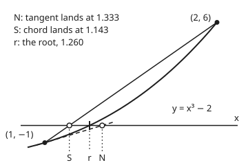

# Newton and secant: a tangent step and a chord step, and how fast each converges

[Syllabus](../../../SYLLABUS.md) → [Numerical analysis](../README.md) → [Root Finding and Fixed Points](../README.md#s02) → Newton and secant

---

## General Overview

A water tank is a cube that must hold exactly 2 cubic metres. Its side is the cube root of 2 metres. In double precision that is 1.2599210498948732 m. A builder needs only millimetres. The target here is far tighter, an error under 10^−9 m, because a cube-root routine is written once and reused by callers who need many more digits, and it may use only addition, subtraction, multiplication and division.

Both methods on this card solve the same equation, $x^3 - 2 = 0$. Both replace the curve $y = x^3 - 2$ by a straight line and take the line's zero as the next guess.

- **Newton's method** uses the tangent line (the line touching the curve with the same slope). It needs the slope, so each step costs one value of the function and one of its derivative. From 1 it needs **4 steps**.
- **The secant method** uses the chord (the straight line through the last two points on the curve). It needs no slope, so each step costs one new function value. From 1 and 2 it needs **6 steps**.

Count work, not steps, and the order flips. Newton used 8 evaluations: 4 of the function and 4 of its slope. The secant used 7. Bisection, which only reads signs, needs 31: 2 end values and 29 halvings.

The reason is how fast each error shrinks. Newton's correct digits double each step. The secant's digits grow like Fibonacci numbers, by the golden ratio 1.618 each step. The secant does less per step, but each step is cheaper.

**Near a simple root, Newton's next error is a constant times the current error squared, so its order is 2; the secant's next error is the same constant times the last two errors multiplied, so its order is the golden ratio, 1.618; per function evaluation, the secant gains more whenever a derivative costs more than 0.4404 of a function value.**

**What kind of fact this is:** two theorems, proved on this card in Why it works: the secant method has order equal to the golden ratio, and Newton's method has order 2 (its full proof is on the Newton's method card, and its short form is here). The step and evaluation counts are measurements, printed by the code.

### The picture: one tangent, one chord, from the same point

<p align="center"></p>

Drawn to scale from the coordinates on the checks' `figure,` line, with the x direction stretched against y so the three marks on the axis separate. The dashed tangent lands at N = 1.333, past the root r = 1.260. The chord lands at S = 1.143, short of it. The curve bends upward, so the tangent sits under the curve and the chord sits over it.

---

## The formula

Notation first, in words. This card introduces it for the wing. The **root** $x^*$ is the number that solves $f(x) = 0$; the code calls it `r`. The **iterates** $x_k$ are the guesses, with $k$ counting steps from $x_0$. The **error** $e_k = x_k - x^*$ is how far guess $k$ is from the root. A method has **order** $p$ when, near the root,

$$|e_{k+1}| \approx C\,|e_k|^{p}$$

**Read it aloud:** the next error is about a fixed constant times the current error raised to the power $p$.

Order 1 with $C < 1$ is linear, and order 2 is quadratic, as on the [Convergence rates](../../15-Optimization/02-Unconstrained%20Methods/03-rates-of-convergence-and-conditioning.md) card. In correct digits, $d_k = -\log_{10}|e_k|$, order $p$ means each step multiplies the digit count by about $p$.

The two steps, for a function $f$ with slope $f'$:

$$\text{Newton:}\quad x_{k+1} = x_k - \frac{f(x_k)}{f'(x_k)} \qquad\qquad \text{secant:}\quad x_{k+1} = x_k - f(x_k)\,\frac{x_k - x_{k-1}}{f(x_k) - f(x_{k-1})}$$

**Read it aloud:** Newton divides the miss by the slope of the tangent; the secant divides it by the slope of the chord through the last two guesses.

Their error laws, near a simple root (one where $f'(x^*) \neq 0$), share one constant:

$$|e_{k+1}| \approx C\,|e_k|^2 \;\;\text{(Newton)}, \qquad |e_{k+1}| \approx C\,|e_k|\,|e_{k-1}| \;\;\text{(secant)}, \qquad C = \frac{|f''(x^*)|}{2\,|f'(x^*)|}$$

**Read it aloud:** Newton's next error is the constant times the current error squared; the secant's is the constant times the current error and the one before it.

From the secant's law follows its order, the golden ratio $\varphi$:

$$|e_{k+1}| \approx C^{\varphi - 1}\,|e_k|^{\varphi}, \qquad \varphi = \frac{1 + \sqrt{5}}{2} = 1.618$$

**Read it aloud:** the secant's next error is about a constant times the current error to the power 1.618.

| Symbol | Plain meaning | In our example | Push it up and the answer… |
| --- | --- | --- | --- |
| $f$, $f'$, $f''$ | the miss, its slope, and the rate that slope changes | $x^3 - 2$ cubic metres; $3x^2$; $6x$ | — |
| $x^*$ | the root, `r` in the code | 1.2599210498948732 m | — |
| $x_k$, $k$ | the guess after $k$ steps | Newton $x_0 = 1$; secant $x_0 = 1$, $x_1 = 2$ | — |
| $e_k$ | the error $x_k - x^*$; $\lvert e_k \rvert$ its size | Newton $\lvert e_4 \rvert$ = 1.23e-10 | — |
| $d_k$, $D_k$ | correct digits, $-\log_{10}\lvert e_k\rvert$; and the same shifted by the constant $-\log_{10} C$ | $d_4$ = 9.91 for Newton | — |
| $C$, $c_k$ | the error constant $\lvert f''\rvert / (2\lvert f'\rvert)$ at the root; $c_k$ the exact factor at step $k$, which tends to it | $1/x^* = 0.7937$ | larger next errors, same order |
| $p$ | the order | 2 for Newton, 1.618 for the secant | digits multiply faster |
| $\varphi$ | the golden ratio, $(1 + \sqrt 5)/2$ | 1.6180 | — |
| $q_k$ | the secant's ratio $\lvert e_{k+1}\rvert / \lvert e_k\rvert^{\varphi}$ | swings toward $C^{\varphi-1} = 0.8669$ | — |
| $g$ | the slope of the line from the root to the curve point, $f(x)/(x - x^*)$ | $x^2 + x x^* + (x^*)^2$ | — |
| $t$ | the cost of one $f'$, in evaluations of $f$ | 1 if a slope costs as much as a value | Newton gains less per evaluation |
| $\xi$, $\eta_k$, $\zeta_k$, $s$, $\delta$, $K$, $y$, $\rho$ | proof helpers: points that Taylor's theorem or the mean value theorem says exist; an averaging variable from 0 to 1; a closeness radius and a bound on $c_k$; the unknown limit of $\log q_k$; a steady error ratio | $\rho$ = 0.6180 on the double root | — |

### When it holds

- **A simple root.** If the slope is zero at the root, both methods slow to linear. On $(x^3 - 2)^2$, which has a double root at the same place, Newton's error ratio is 0.5000 and it needs 28 steps to an error under 10^−9; the secant's is 0.6180 and it needs 42.
- **A smooth $f$ near the root.** The proofs need a continuous second derivative there, so that $C$ exists. Where $f''$ jumps or blows up, no constant $C$ is promised.
- **A start close enough.** The laws describe the end of the run. The secant's second start, 2, is far off (error 7.40e-1), and the orders measured from the first steps (−1.762, 0.459) are meaningless. Far starts and their cures are on [Newton's bad days](04-when-newton-fails.md).
- **The secant uses the two newest points.** Keep one old point for ever, as the false-position rule does, and the order falls to 1. Kept at 2, the error ratio settles at 0.4126 and the run takes 23 steps.
- **Errors well above rounding.** A double carries a fixed number of digits. Newton's $x_5$ and the secant's $x_8$ land on the root to the last bit. Then $x_9 = x_8$, the secant's chord is flat, and the step to $x_{10}$ is 0/0.

---

## Why it works

### Step 0: a line misses a curve by a product of two distances

Near the root, the curve is almost straight. A straight line through known points misses it only by the bend. For a chord through two points, that miss at the root is proportional to the root's distance from each point, multiplied. For a tangent, the two points have merged, so the miss is one distance squared.

The step jumps to the line's zero, so the new error is that miss divided by the slope. That gives the two error laws. Everything else on this card counts what those products do to the digits.

### Step 1: Newton squares its error

The [Newton's method](../../06-Calculus%20and%20analysis/03-What%20Derivatives%20Tell%20You/06-newtons-method.md) card proves, from [Taylor's theorem](../../06-Calculus%20and%20analysis/03-What%20Derivatives%20Tell%20You/05-taylors-theorem.md), that $e_{k+1} = \dfrac{f''(\xi)}{2f'(x_k)}\,e_k^2$ for some point $\xi$ between $x_k$ and the root. As $x_k$ closes in, the factor tends to $C$ (keeping its sign).

For the cube the law is exact. Write $2 = (x^*)^3$ in the Newton step and factor:

$$e_{k+1} = e_k^2\,\frac{2x_k + x^*}{3x_k^2}$$

At the root the factor is $3x^*/(3(x^*)^2) = 1/x^* = 0.7937$. The code's ratio column reads 0.7362, 0.7904, 0.7937 for steps 2 to 4.

In digits: squaring the error doubles $d_k$, apart from the small shift from $C$. Newton's digits run 1.13, 2.40, 4.91, 9.91, each about twice the last.

### Step 2: the secant multiplies its last two errors

Write the secant step in errors. Subtracting $x^*$ from both sides gives

$$e_{k+1} = \frac{e_{k-1}f(x_k) - e_k f(x_{k-1})}{f(x_k) - f(x_{k-1})}$$

Now use $g(x) = f(x)/(x - x^*)$: the slope of the line from the root to the point on the curve. Then $f(x_k) = e_k\,g(x_k)$, and the top becomes $e_k e_{k-1}\,(g(x_k) - g(x_{k-1}))$. Divide top and bottom by $x_k - x_{k-1}$:

$$e_{k+1} = e_k\,e_{k-1}\cdot\frac{\text{slope of } g \text{ between the two guesses}}{\text{slope of } f \text{ between the two guesses}}$$

As both guesses close in, the top slope tends to $g'(x^*) = f''(x^*)/2$ and the bottom to $f'(x^*)$. Their ratio tends to $C$, with its sign.

For the cube, $g(x) = x^2 + x x^* + (x^*)^2$ exactly, and the law is exact:

$$e_{k+1} = e_k\,e_{k-1}\,\frac{x_k + x_{k-1} + x^*}{x_k^2 + x_k x_{k-1} + x_{k-1}^2}$$

At the root the factor is again $3x^*/(3(x^*)^2) = 0.7937$. The code's column reads 0.8130, 0.7916, 0.7938 for $x_5$ to $x_7$. Both exact laws match the measured errors at every step, in floating point, to 1 part in 10,000.

### Step 3: multiplied errors make Fibonacci digits

Take $-\log_{10}$ of the secant's law $|e_{k+1}| = C|e_k||e_{k-1}|$. Write $D_k = -\log_{10}(C\,|e_k|)$, the correct digits shifted by a constant. The law becomes

$$D_{k+1} = D_k + D_{k-1}$$

That is the Fibonacci rule: each term is the sum of the two before. Its terms grow by a factor that tends to the root of $p^2 = p + 1$, which is $\varphi = 1.618$ ([The characteristic equation](../../04-Combinatorics%20and%20graphs/05-Recurrences/04-characteristic-equation-and-binet.md) shows why). So the digits multiply by $\varphi$ each step: order $\varphi$.

The secant's digits run 2.29, 3.68, 6.07, 9.85: each is about the sum of the two before. Run the law alone for 30 more steps in logs, with no rounding to stop it, and the measured order is 1.618034.

The same view for Newton gives $D_{k+1} = 2D_k$: order 2.

<details>
<summary>Detailed proof: near a simple root, the secant's order is exactly the golden ratio</summary>

**Assume** $f$ has a continuous second derivative near $x^*$, with $f(x^*) = 0$, $f'(x^*) \neq 0$ and $f''(x^*) \neq 0$. Assume the iterates are distinct, never equal $x^*$, and tend to $x^*$.

**The error law.** Set $g(x) = f(x)/(x - x^*)$ for $x \neq x^*$ and $g(x^*) = f'(x^*)$. Writing $f(x) = \int_0^1 f'(x^* + s(x - x^*))\,ds\,(x - x^*)$ shows $g(x) = \int_0^1 f'(x^* + s(x - x^*))\,ds$. So $g$ has a continuous derivative, and $g'(x^*) = \int_0^1 s\,f''(x^*)\,ds = f''(x^*)/2$. Step 2's algebra and the mean value theorem (a chord's slope equals the curve's slope at some point between its ends) give points $\eta_k$ and $\zeta_k$ between $x_{k-1}$ and $x_k$ with

$$e_{k+1} = c_k\,e_k\,e_{k-1}, \qquad c_k = \frac{g'(\eta_k)}{f'(\zeta_k)} \to \frac{f''(x^*)}{2f'(x^*)}, \qquad |c_k| \to C.$$

**Convergence from a close start.** By continuity there is a $\delta > 0$ and a $K$ with $|c_k| \le K$ while both guesses lie within $\delta$ of the root. Shrink $\delta$ so that $K\delta \le 1/2$. If $|e_{k-1}|, |e_k| \le \delta$, then $|e_{k+1}| \le K\delta\,|e_k| \le |e_k|/2$. By induction the guesses stay inside and the errors at least halve each step.

**The order.** Let $q_k = |e_{k+1}|/|e_k|^{\varphi}$. Since $\varphi^2 = \varphi + 1$, we have $\varphi(1 - \varphi) = -1$, so $|e_{k-1}| = (|e_k|/|e_{k-1}|^{\varphi})^{1-\varphi}\,|e_k|^{\varphi - 1}$. Substituting into the error law,

$$q_k = |c_k|\,q_{k-1}^{\,1 - \varphi}, \qquad \log q_k = \log|c_k| + (1 - \varphi)\log q_{k-1}.$$

The multiplier $1 - \varphi = -0.618$ has size below 1, and $\log|c_k| \to \log C$. A sequence that obeys such a rule tends to the number that the rule maps to itself: the solution of $y = \log C + (1 - \varphi)y$, which is $y = \log C/\varphi = (\varphi - 1)\log C$. So $q_k \to C^{\varphi - 1}$: the order is exactly $\varphi$. $\blacksquare$

**Newton, in the same terms.** Newton's step gives $e_{k+1} = e_k\,(f'(x_k) - g(x_k))/f'(x_k)$. Taylor's theorem gives $f'(x_k) - g(x_k) = \tfrac{1}{2}f''(x^*)\,e_k$ plus a term that shrinks faster than $e_k$. So $e_{k+1}/e_k^2 \to f''(x^*)/(2f'(x^*))$: order 2.

</details>

### Step 4: the observed order swings, as the proof predicts

The proof's multiplier is negative, $1 - \varphi = -0.618$. So $q_k$ overshoots its limit, then undershoots, by a gap that shrinks by 0.618 each time. The code's column $e_k/e^{\varphi}$ shows it: 0.6468, 1.0642, 0.7618, 0.9392, closing in on 0.8669 from both sides.

The measured order swings too: 2.701, 1.400, 1.723, 1.580 around 1.618. Newton's needs no second error, so it settles without swinging: 2.308, 1.976, 1.999.

### Step 5: the cost per digit decides between them

A Newton step costs one $f$ and one $f'$, which is $1 + t$ evaluations, and multiplies the digits by 2. A secant step costs one $f$ and multiplies them by $\varphi$. Per evaluation, the digits multiply by

$$\text{Newton: } 2^{1/(1+t)}, \qquad \text{secant: } \varphi = 1.6180$$

| Cost of one slope, $t$ | Newton's multiplier per evaluation | Better buy |
| --- | --- | --- |
| 0 (free) | 2.0000 | Newton |
| 0.5 | 1.5874 | secant |
| 1 (as dear as $f$) | 1.4142 | secant |
| 2 | 1.2599 | secant |

The two are equal at $t = \log 2/\log\varphi - 1 = 0.4404$, found by the code both by bisection and by the formula. From 1 correct digit to 16, Newton takes 4.00 steps and the secant 5.76. With $t = 1$, that is 8 evaluations against fewer than 6.

---

## Worked numbers, by hand

The cube root of 2, with $f(x) = x^3 - 2$ and $f'(x) = 3x^2$.

| Step | Arithmetic | Value |
| --- | --- | --- |
| Newton step 1 | $1 - (1 - 2)/(3 \times 1)$ | 1.3333333333333333 |
| Newton step 2 | $4/3 - (64/27 - 2)/(3 \times 16/9)$ | 1.2638888888888888 |
| Newton step 3 error | $1.2599334934499771 - 1.2599210498948732$ | 1.24e-5 |
| Newton step 4 error | $1.2599210500177698 - 1.2599210498948732$ | **1.23e-10** |
| secant $x_2$ | $2 - 6 \times (2 - 1)/(6 - (-1))$ | 1.1428571428571428 |
| secant $x_3$ | $8/7 - f(8/7)\,(8/7 - 2)/(f(8/7) - 6)$ | 1.2096774193548387 |
| secant $x_7$ error, by the law | $0.7938 \times 8.47\text{e-}7 \times 2.09\text{e-}4$ | **1.41e-10** |
| evaluations | Newton $4 + 4$; secant $2 + 5$ | **8 against 7** |

Both errors are true errors, measured against the bisection root; the secant row also checks the error law by hand. Both land under 10^−9 m. The secant gets there with one evaluation fewer, while Newton takes two steps fewer.

### What breaks if you drop a piece

| Mistake | Comes out at | What went wrong |
| --- | --- | --- |
| A double root: solve $(x^3 - 2)^2 = 0$ | Newton 28 steps, ratio 0.5000; secant 42 steps, ratio 0.6180 | The slope at the root is zero, so both drop to order 1 |
| Keep the chord's end fixed at 2 | 23 steps, ratio 0.4126 | One error in the product stops shrinking, so the order is 1 |
| Run the secant with no stop | $x_9 = x_8$, then the step to $x_{10}$ is 0/0 | Once two guesses are equal, the chord has no slope |
| Compare steps, not evaluations | Newton 4 against 6 looks better | In evaluations it is 8 against 7 |

The code prints all four. On the double root, the miss near the root is about a constant times $e_k^2$. Newton then halves the error each step. The secant's errors obey $e_{k+1} = e_k e_{k-1}/(e_k + e_{k-1})$, so a steady ratio $\rho$ solves $\rho = 1/(1 + \rho)$, which gives $\rho = \varphi - 1 = 0.6180$.

---

## Code, from first principles, and it actually runs

The code solves $x^3 = 2$ with Newton from 1 and the secant from 1 and 2. It measures each error against a root found by a different road: bisection by signs only, run to the last bit. Three roads then agree. The exact error laws predict every measured error. The ratio columns settle on $C = 1/x^* = 0.7937$, computed separately as $(x^*)^2/2$. The observed orders approach 2 and 1.618, and the law run alone in logs gives 1.618034. The break-even slope cost is found by bisection and by its formula. Then the three failures run.

### Python

```python
# Newton and secant: the check behind the card.  Standard library only.
# Solve x^3 = 2 (the side of a cube that holds 2 cubic metres) both ways, measure
# each error against a bisection root, and test the error laws and the orders.
from math import log, log10, sqrt
def sci(v, d=2):                              # 1.23e-10, the form Rust prints
    m, e = f"{v:.{d}e}".split("e")
    return f"{m}e{int(e)}"
def bisect(f, a, b):                          # road one: signs only, to the last bit
    n = 0
    while a < (a + b) / 2 < b:
        c = (a + b) / 2
        a, b = (c, b) if (f(c) < 0) == (f(a) < 0) else (a, c)
        n += 1
    return (a if abs(f(a)) <= abs(f(b)) else b), n
def newton(f, df, x, steps):                  # stops if it lands on a zero of f
    xs = [x]
    for _ in range(steps):
        if f(xs[-1]) == 0: break
        xs.append(xs[-1] - f(xs[-1]) / df(xs[-1]))
    return xs
def secant(f, x0, x1, steps):                 # stops if the chord is flat
    xs, fs = [x0, x1], [f(x0), f(x1)]
    for _ in range(steps):
        d = fs[-1] - fs[-2]
        if d == 0: return xs, len(xs) - 1
        xs.append(xs[-1] - fs[-1] * (xs[-1] - xs[-2]) / d); fs.append(f(xs[-1]))
    return xs, None
def order(e, k): return log(e[k + 1] / e[k]) / log(e[k] / e[k - 1])
f, df = (lambda x: x * x * x - 2), (lambda x: 3 * x * x)
r, halvings = bisect(f, 1.0, 2.0)
phi = (1 + sqrt(5)) / 2
C = r * r / 2                                 # f''(r)/(2 f'(r)) = 1/r = r^2/2
print(f"root by bisection on [1, 2]: r = {r:.16f} after {halvings} halvings; r^3 - 2 = {sci(f(r))}")
print(f"constants: C = f''(r)/(2 f'(r)) = 1/r = {C:.4f}; golden ratio phi = {phi:.4f}; C^(phi-1) = {C ** (phi - 1):.4f}")
xn = newton(f, df, 1.0, 5)
en = [abs(x - r) for x in xn]
print("Newton from x0 = 1    k  x_k                 error e_k  digits  e_k/e_(k-1)^2  order")
for k in range(5):
    if k: assert abs(en[k - 1] * en[k - 1] * (2 * xn[k - 1] + r) / (3 * xn[k - 1] * xn[k - 1]) - en[k]) <= 1e-4 * en[k]
    ratio = f"{en[k] / (en[k - 1] * en[k - 1]):.4f}" if k else "-"     # the exact error law, run in floats
    p = f"{order(en, k - 1):.3f}" if k >= 2 else "-"
    print(f"{'':21} {k}  {xn[k]:.16f}  {sci(en[k]):>9}  {-log10(en[k]):6.2f}  {ratio:>13}  {p:>5}")
xs, _ = secant(f, 1.0, 2.0, 6)
es = [abs(x - r) for x in xs]
print("secant from 1 and 2   k  x_k                 error e_k  digits  e_k/(e e)  e_k/e^phi  order")
q = [1.0] * 8
for k in range(8):
    if k >= 2:
        a, b = xs[k - 2], xs[k - 1]
        assert abs(es[k - 2] * es[k - 1] * (a + b + r) / (a * a + a * b + b * b) - es[k]) <= 1e-4 * es[k]
        q[k] = es[k] / es[k - 1] ** phi
    ratio = f"{es[k] / (es[k - 1] * es[k - 2]):.4f}" if k >= 2 else "-"
    qs = f"{q[k]:.4f}" if k >= 2 else "-"
    p = f"{order(es, k - 1):.3f}" if k >= 2 else "-"
    print(f"{'':21} {k}  {xs[k]:.16f}  {sci(es[k]):>9}  {-log10(es[k]):6.2f}  {ratio:>9}  {qs:>9}  {p:>5}")
print(f"Newton step 5: x = {xn[5]:.16f}, error {sci(en[5])}; secant x_8: error {sci(abs(secant(f, 1.0, 2.0, 7)[0][8] - r))}")
print("both exact error laws matched the measured errors at every step, to 1 part in 10,000")
assert abs(en[4] / (en[3] * en[3]) - C) < 0.001 and abs(es[7] / (es[6] * es[5]) - C) < 0.001
assert en[3] > 1e-9 > en[4] and es[6] > 1e-9 > es[7] and en[5] < 2.3e-16
assert abs(order(en, 3) - 2) < 0.02 and abs(order(es, 6) - phi) < 0.05
gap = [abs(log(v / C ** (phi - 1))) for v in q]            # e/e^phi settles, swinging
assert gap[7] < gap[5] < gap[3] and gap[6] < gap[4] and gap[7] < 0.1
d = [-log10(es[5]), -log10(es[6])]            # model: run the law e' = C e e in logs
for _ in range(30): d.append(d[-1] + d[-2] - log10(C))
pm = (d[-1] - d[-2]) / (d[-2] - d[-3])
print(f"the law alone, 30 more steps in logs (no rounding floor): order {pm:.6f}")
assert abs(pm - phi) < 1e-6
ew = 1.0                                      # bisection: halvings until half the width is under 1e-9
nb = 0
while ew / 2 > 1e-9: ew, nb = ew / 2, nb + 1
print(f"evaluations to an error under 1e-9: bisection 2 + {nb} halvings = {2 + nb}; Newton 4 steps = 8 (4 of f, 4 of f'); secant 6 steps = 7")
lo, hi = 0.0, 2.0                             # break-even derivative cost, by bisection
while hi - lo > 1e-12:
    t = (lo + hi) / 2
    lo, hi = (t, hi) if 2 ** (1 / (1 + t)) > phi else (lo, t)
print(f"digits multiply per evaluation: secant {phi:.4f}; Newton 2^(1/(1+t)), f' costing t evaluations of f:")
print("   " + ", ".join(f"t = {s}: {2 ** (1 / (1 + float(s))):.4f}" for s in ("0", "0.5", "1", "2")))
print(f"break-even t: bisection {lo:.4f}, formula log(2)/log(phi) - 1 = {log(2) / log(phi) - 1:.4f}")
assert abs(lo - (log(2) / log(phi) - 1)) < 1e-9
print(f"from 1 correct digit to 16: Newton {log(16) / log(2):.2f} steps, secant {log(16) / log(phi):.2f} steps")
f2, df2 = (lambda x: f(x) * f(x)), (lambda x: 6 * x * x * f(x))   # the double root
gn = newton(f2, df2, 1.0, 60); gs, _ = secant(f2, 1.0, 2.0, 80)
first = lambda xs: next(k for k, x in enumerate(xs) if abs(x - r) < 1e-9)
kn, ks = first(gn), first(gs)
qn = abs(gn[kn] - r) / abs(gn[kn - 1] - r); qs = abs(gs[ks] - r) / abs(gs[ks - 1] - r)
print(f"break 1, double root (x^3-2)^2: Newton {kn} steps, ratio {qn:.4f}; secant {ks - 1} steps, ratio {qs:.4f}")
assert abs(qn - 0.5) < 0.01 and abs(qs - (phi - 1)) < 0.03
fx = [1.0]                                    # chord always drawn from the fixed end 2
for _ in range(60): fx.append(fx[-1] - f(fx[-1]) * (fx[-1] - 2) / (f(fx[-1]) - f(2.0)))
kf = first(fx); qf = abs(fx[kf] - r) / abs(fx[kf - 1] - r)
qth = (2 - r) * (2 + 2 * r) / (4 + 2 * r + r * r)
print(f"break 2, one end frozen at 2: {kf} steps, ratio {qf:.4f}, theory (2-r)(2+2r)/(4+2r+r^2) = {qth:.4f}")
assert abs(qf - qth) < 0.001
xl, stall = secant(f, 1.0, 2.0, 20)
print(f"break 3, secant with no stop: x_{stall} = x_{stall - 1}, so f(x_{stall}) - f(x_{stall - 1}) = "
      f"{f(xl[stall]) - f(xl[stall - 1]):.1f} and the step to x_{stall + 1} is 0/0")
X, Y = (lambda x: 40 + 250 * (x - 0.9)), (lambda y: 182.5 - 25 * y)
print(f"figure, start ({X(1):.1f}, {Y(-1):.1f}), (2, 6) at ({X(2):.1f}, {Y(6):.1f}), tangent lands {xn[1]:.3f} at "
      f"{X(xn[1]):.1f}, chord lands {xs[2]:.3f} at {X(xs[2]):.1f}, root {r:.3f} at {X(r):.1f}, axis y {Y(0):.1f}")
print("ALL CHECKS PASS")
```

**Ran 2026-11-11 on macOS, Python 3.14.10, standard library only. All checks passed. Output, pasted from the run:**

```
root by bisection on [1, 2]: r = 1.2599210498948732 after 52 halvings; r^3 - 2 = 0.00e0
constants: C = f''(r)/(2 f'(r)) = 1/r = 0.7937; golden ratio phi = 1.6180; C^(phi-1) = 0.8669
Newton from x0 = 1    k  x_k                 error e_k  digits  e_k/e_(k-1)^2  order
                      0  1.0000000000000000    2.60e-1    0.59              -      -
                      1  1.3333333333333333    7.34e-2    1.13         1.0866      -
                      2  1.2638888888888888    3.97e-3    2.40         0.7362  2.308
                      3  1.2599334934499771    1.24e-5    4.91         0.7904  1.976
                      4  1.2599210500177698   1.23e-10    9.91         0.7937  1.999
secant from 1 and 2   k  x_k                 error e_k  digits  e_k/(e e)  e_k/e^phi  order
                      0  1.0000000000000000    2.60e-1    0.59          -          -      -
                      1  2.0000000000000000    7.40e-1    0.13          -          -      -
                      2  1.1428571428571428    1.17e-1    0.93     0.6086     0.1905  -1.762
                      3  1.2096774193548387    5.02e-2    1.30     0.5799     1.6159  0.459
                      4  1.2650385337853129    5.12e-3    2.29     0.8701     0.6468  2.701
                      5  1.2597120233350600    2.09e-4    3.68     0.8130     1.0642  1.400
                      6  1.2599202030822991    8.47e-7    6.07     0.7916     0.7618  1.723
                      7  1.2599210500353788   1.41e-10    9.85     0.7938     0.9392  1.580
Newton step 5: x = 1.2599210498948732, error 0.00e0; secant x_8: error 0.00e0
both exact error laws matched the measured errors at every step, to 1 part in 10,000
the law alone, 30 more steps in logs (no rounding floor): order 1.618034
evaluations to an error under 1e-9: bisection 2 + 29 halvings = 31; Newton 4 steps = 8 (4 of f, 4 of f'); secant 6 steps = 7
digits multiply per evaluation: secant 1.6180; Newton 2^(1/(1+t)), f' costing t evaluations of f:
   t = 0: 2.0000, t = 0.5: 1.5874, t = 1: 1.4142, t = 2: 1.2599
break-even t: bisection 0.4404, formula log(2)/log(phi) - 1 = 0.4404
from 1 correct digit to 16: Newton 4.00 steps, secant 5.76 steps
break 1, double root (x^3-2)^2: Newton 28 steps, ratio 0.5000; secant 42 steps, ratio 0.6180
break 2, one end frozen at 2: 23 steps, ratio 0.4126, theory (2-r)(2+2r)/(4+2r+r^2) = 0.4126
break 3, secant with no stop: x_9 = x_8, so f(x_9) - f(x_8) = 0.0 and the step to x_10 is 0/0
figure, start (65.0, 207.5), (2, 6) at (315.0, 32.5), tangent lands 1.333 at 148.3, chord lands 1.143 at 100.7, root 1.260 at 130.0, axis y 182.5
ALL CHECKS PASS
```

### Rust

Same numbers, same labels, built with `rustc --edition 2021 -O`.

```rust
// Newton and secant: the same check as the Python, in Rust.  No crates.
// Solve x^3 = 2 (the side of a cube that holds 2 cubic metres) both ways, measure
// each error against a bisection root, and test the error laws and the orders.
fn sci(v: f64) -> String { format!("{:.2e}", v) }          // 1.23e-10
fn f(x: f64) -> f64 { x * x * x - 2.0 }
fn df(x: f64) -> f64 { 3.0 * x * x }
fn f2(x: f64) -> f64 { f(x) * f(x) }                       // the double root
fn df2(x: f64) -> f64 { 6.0 * x * x * f(x) }
fn bisect(h: fn(f64) -> f64, mut a: f64, mut b: f64) -> (f64, u32) {  // signs only
    let mut n = 0;
    while a < (a + b) / 2.0 && (a + b) / 2.0 < b {
        let c = (a + b) / 2.0;
        if (h(c) < 0.0) == (h(a) < 0.0) { a = c } else { b = c }
        n += 1;
    }
    (if h(a).abs() <= h(b).abs() { a } else { b }, n)
}
fn newton(h: fn(f64) -> f64, dh: fn(f64) -> f64, x: f64, steps: usize) -> Vec<f64> {
    let mut xs = vec![x];                                  // stops if it lands on a zero
    for _ in 0..steps {
        let x = xs[xs.len() - 1];
        if h(x) == 0.0 { break }
        xs.push(x - h(x) / dh(x));
    }
    xs
}
fn secant(h: fn(f64) -> f64, x0: f64, x1: f64, steps: usize) -> (Vec<f64>, Option<usize>) {
    let (mut xs, mut fs) = (vec![x0, x1], vec![h(x0), h(x1)]);   // stops if the chord is flat
    for _ in 0..steps {
        let n = xs.len();
        let d = fs[n - 1] - fs[n - 2];
        if d == 0.0 { return (xs, Some(n - 1)) }
        let x = xs[n - 1] - fs[n - 1] * (xs[n - 1] - xs[n - 2]) / d;
        xs.push(x); fs.push(h(x));
    }
    (xs, None)
}
fn order(e: &[f64], k: usize) -> f64 { (e[k + 1] / e[k]).ln() / (e[k] / e[k - 1]).ln() }
fn first(xs: &[f64], r: f64) -> usize { xs.iter().position(|x| (x - r).abs() < 1e-9).unwrap() }
fn main() {
    let (r, halvings) = bisect(f, 1.0, 2.0);
    let phi = (1.0 + 5f64.sqrt()) / 2.0;
    let c = r * r / 2.0;                                   // f''(r)/(2 f'(r)) = 1/r = r^2/2
    println!("root by bisection on [1, 2]: r = {:.16} after {} halvings; r^3 - 2 = {}", r, halvings, sci(f(r)));
    println!("constants: C = f''(r)/(2 f'(r)) = 1/r = {:.4}; golden ratio phi = {:.4}; C^(phi-1) = {:.4}", c, phi, c.powf(phi - 1.0));
    let xn = newton(f, df, 1.0, 5);
    let en: Vec<f64> = xn.iter().map(|x| (x - r).abs()).collect();
    println!("Newton from x0 = 1    k  x_k                 error e_k  digits  e_k/e_(k-1)^2  order");
    for k in 0..5 {
        if k > 0 {                                         // the exact error law, run in floats
            let pred = en[k - 1] * en[k - 1] * (2.0 * xn[k - 1] + r) / (3.0 * xn[k - 1] * xn[k - 1]);
            assert!((pred - en[k]).abs() <= 1e-4 * en[k]);
        }
        let ratio = if k > 0 { format!("{:.4}", en[k] / (en[k - 1] * en[k - 1])) } else { "-".to_string() };
        let p = if k >= 2 { format!("{:.3}", order(&en, k - 1)) } else { "-".to_string() };
        println!("{:21} {}  {:.16}  {:>9}  {:6.2}  {:>13}  {:>5}", "", k, xn[k], sci(en[k]), -en[k].log10(), ratio, p);
    }
    let (xs, _) = secant(f, 1.0, 2.0, 6);
    let es: Vec<f64> = xs.iter().map(|x| (x - r).abs()).collect();
    println!("secant from 1 and 2   k  x_k                 error e_k  digits  e_k/(e e)  e_k/e^phi  order");
    let mut q = [1.0f64; 8];
    for k in 0..8 {
        let (mut ratio, mut qs, mut p) = ("-".to_string(), "-".to_string(), "-".to_string());
        if k >= 2 {
            let (a, b) = (xs[k - 2], xs[k - 1]);
            let pred = es[k - 2] * es[k - 1] * (a + b + r) / (a * a + a * b + b * b);
            assert!((pred - es[k]).abs() <= 1e-4 * es[k]);
            q[k] = es[k] / es[k - 1].powf(phi);
            ratio = format!("{:.4}", es[k] / (es[k - 1] * es[k - 2]));
            qs = format!("{:.4}", q[k]);
            p = format!("{:.3}", order(&es, k - 1));
        }
        println!("{:21} {}  {:.16}  {:>9}  {:6.2}  {:>9}  {:>9}  {:>5}", "", k, xs[k], sci(es[k]), -es[k].log10(), ratio, qs, p);
    }
    let s8 = secant(f, 1.0, 2.0, 7).0[8];
    println!("Newton step 5: x = {:.16}, error {}; secant x_8: error {}", xn[5], sci(en[5]), sci((s8 - r).abs()));
    println!("both exact error laws matched the measured errors at every step, to 1 part in 10,000");
    assert!((en[4] / (en[3] * en[3]) - c).abs() < 0.001 && (es[7] / (es[6] * es[5]) - c).abs() < 0.001);
    assert!(en[3] > 1e-9 && 1e-9 > en[4] && es[6] > 1e-9 && 1e-9 > es[7] && en[5] < 2.3e-16);
    assert!((order(&en, 3) - 2.0).abs() < 0.02 && (order(&es, 6) - phi).abs() < 0.05);
    let gap: Vec<f64> = q.iter().map(|v| (v / c.powf(phi - 1.0)).ln().abs()).collect();
    assert!(gap[7] < gap[5] && gap[5] < gap[3] && gap[6] < gap[4] && gap[7] < 0.1);
    let mut d = vec![-es[5].log10(), -es[6].log10()];     // model: the law e' = C e e in logs
    for _ in 0..30 { let n = d.len(); d.push(d[n - 1] + d[n - 2] - c.log10()); }
    let n = d.len();
    let pm = (d[n - 1] - d[n - 2]) / (d[n - 2] - d[n - 3]);
    println!("the law alone, 30 more steps in logs (no rounding floor): order {:.6}", pm);
    assert!((pm - phi).abs() < 1e-6);
    let (mut ew, mut nb) = (1.0f64, 0);                    // bisection: half-width under 1e-9
    while ew / 2.0 > 1e-9 { ew /= 2.0; nb += 1; }
    println!("evaluations to an error under 1e-9: bisection 2 + {} halvings = {}; Newton 4 steps = 8 (4 of f, 4 of f'); secant 6 steps = 7", nb, 2 + nb);
    let (mut lo, mut hi) = (0.0f64, 2.0f64);               // break-even derivative cost
    while hi - lo > 1e-12 {
        let t = (lo + hi) / 2.0;
        if 2f64.powf(1.0 / (1.0 + t)) > phi { lo = t } else { hi = t }
    }
    println!("digits multiply per evaluation: secant {:.4}; Newton 2^(1/(1+t)), f' costing t evaluations of f:", phi);
    let ts: Vec<String> = ["0", "0.5", "1", "2"].iter()
        .map(|s| format!("t = {}: {:.4}", s, 2f64.powf(1.0 / (1.0 + s.parse::<f64>().unwrap())))).collect();
    println!("   {}", ts.join(", "));
    let fl = 2f64.ln() / phi.ln() - 1.0;
    println!("break-even t: bisection {:.4}, formula log(2)/log(phi) - 1 = {:.4}", lo, fl);
    assert!((lo - fl).abs() < 1e-9);
    println!("from 1 correct digit to 16: Newton {:.2} steps, secant {:.2} steps", 16f64.ln() / 2f64.ln(), 16f64.ln() / phi.ln());
    let gn = newton(f2, df2, 1.0, 60);
    let (gs, _) = secant(f2, 1.0, 2.0, 80);
    let (kn, ks) = (first(&gn, r), first(&gs, r));
    let qn = (gn[kn] - r).abs() / (gn[kn - 1] - r).abs();
    let qq = (gs[ks] - r).abs() / (gs[ks - 1] - r).abs();
    println!("break 1, double root (x^3-2)^2: Newton {} steps, ratio {:.4}; secant {} steps, ratio {:.4}", kn, qn, ks - 1, qq);
    assert!((qn - 0.5).abs() < 0.01 && (qq - (phi - 1.0)).abs() < 0.03);
    let mut fx = vec![1.0f64];                             // chord always from the fixed end 2
    for _ in 0..60 { let x = fx[fx.len() - 1]; fx.push(x - f(x) * (x - 2.0) / (f(x) - f(2.0))); }
    let kf = first(&fx, r);
    let qf = (fx[kf] - r).abs() / (fx[kf - 1] - r).abs();
    let qth = (2.0 - r) * (2.0 + 2.0 * r) / (4.0 + 2.0 * r + r * r);
    println!("break 2, one end frozen at 2: {} steps, ratio {:.4}, theory (2-r)(2+2r)/(4+2r+r^2) = {:.4}", kf, qf, qth);
    assert!((qf - qth).abs() < 0.001);
    let (xl, stall) = secant(f, 1.0, 2.0, 20);
    let st = stall.unwrap();
    println!("break 3, secant with no stop: x_{} = x_{}, so f(x_{}) - f(x_{}) = {:.1} and the step to x_{} is 0/0",
             st, st - 1, st, st - 1, f(xl[st]) - f(xl[st - 1]), st + 1);
    let xp = |x: f64| 40.0 + 250.0 * (x - 0.9);
    let yp = |y: f64| 182.5 - 25.0 * y;
    println!("figure, start ({:.1}, {:.1}), (2, 6) at ({:.1}, {:.1}), tangent lands {:.3} at {:.1}, chord lands {:.3} at {:.1}, root {:.3} at {:.1}, axis y {:.1}",
             xp(1.0), yp(-1.0), xp(2.0), yp(6.0), xn[1], xp(xn[1]), xs[2], xp(xs[2]), r, xp(r), yp(0.0));
    println!("ALL CHECKS PASS");
}
```

**Ran 2026-11-11 on macOS, rustc 1.98.1, no crates. All checks passed. Output, pasted from the run:**

```
root by bisection on [1, 2]: r = 1.2599210498948732 after 52 halvings; r^3 - 2 = 0.00e0
constants: C = f''(r)/(2 f'(r)) = 1/r = 0.7937; golden ratio phi = 1.6180; C^(phi-1) = 0.8669
Newton from x0 = 1    k  x_k                 error e_k  digits  e_k/e_(k-1)^2  order
                      0  1.0000000000000000    2.60e-1    0.59              -      -
                      1  1.3333333333333333    7.34e-2    1.13         1.0866      -
                      2  1.2638888888888888    3.97e-3    2.40         0.7362  2.308
                      3  1.2599334934499771    1.24e-5    4.91         0.7904  1.976
                      4  1.2599210500177698   1.23e-10    9.91         0.7937  1.999
secant from 1 and 2   k  x_k                 error e_k  digits  e_k/(e e)  e_k/e^phi  order
                      0  1.0000000000000000    2.60e-1    0.59          -          -      -
                      1  2.0000000000000000    7.40e-1    0.13          -          -      -
                      2  1.1428571428571428    1.17e-1    0.93     0.6086     0.1905  -1.762
                      3  1.2096774193548387    5.02e-2    1.30     0.5799     1.6159  0.459
                      4  1.2650385337853129    5.12e-3    2.29     0.8701     0.6468  2.701
                      5  1.2597120233350600    2.09e-4    3.68     0.8130     1.0642  1.400
                      6  1.2599202030822991    8.47e-7    6.07     0.7916     0.7618  1.723
                      7  1.2599210500353788   1.41e-10    9.85     0.7938     0.9392  1.580
Newton step 5: x = 1.2599210498948732, error 0.00e0; secant x_8: error 0.00e0
both exact error laws matched the measured errors at every step, to 1 part in 10,000
the law alone, 30 more steps in logs (no rounding floor): order 1.618034
evaluations to an error under 1e-9: bisection 2 + 29 halvings = 31; Newton 4 steps = 8 (4 of f, 4 of f'); secant 6 steps = 7
digits multiply per evaluation: secant 1.6180; Newton 2^(1/(1+t)), f' costing t evaluations of f:
   t = 0: 2.0000, t = 0.5: 1.5874, t = 1: 1.4142, t = 2: 1.2599
break-even t: bisection 0.4404, formula log(2)/log(phi) - 1 = 0.4404
from 1 correct digit to 16: Newton 4.00 steps, secant 5.76 steps
break 1, double root (x^3-2)^2: Newton 28 steps, ratio 0.5000; secant 42 steps, ratio 0.6180
break 2, one end frozen at 2: 23 steps, ratio 0.4126, theory (2-r)(2+2r)/(4+2r+r^2) = 0.4126
break 3, secant with no stop: x_9 = x_8, so f(x_9) - f(x_8) = 0.0 and the step to x_10 is 0/0
figure, start (65.0, 207.5), (2, 6) at (315.0, 32.5), tangent lands 1.333 at 148.3, chord lands 1.143 at 100.7, root 1.260 at 130.0, axis y 182.5
ALL CHECKS PASS
```

The two outputs match line for line.

### Lean

Lean proves both order theorems near any simple root of a smooth $f$, the break-even slope cost, and the first hand-worked steps.

- The secant's order is the golden ratio. Let $f$ have a continuous second derivative near the root, with $f'(x^*) \neq 0$ and $f''(x^*) \neq 0$. Let the guesses be distinct, never equal the root, and tend to it. Then $|e_{k+1}|/|e_k|^{\varphi}$ tends to $C^{\varphi-1}$.
- Newton's order is 2. With the same smoothness and $f'(x^*) \neq 0$, let the guesses never equal the root and tend to it. Then $e_{k+1}/e_k^2$ tends to $f''(x^*)/(2f'(x^*))$.
- Let one slope cost $t \ge 0$ evaluations of $f$. The secant gains more digits per evaluation exactly when $t > \log 2/\log\varphi - 1$.
- On $x^3 - 2$, Newton from 1 gives 4/3, then 91/72. The secant from 1 and 2 gives 8/7, then 75/62.
- Bisection from width 1 needs 29 halvings to a half-width under $10^{-9}$. The sums 4 + 4 = 8, 2 + 5 = 7 and 2 + 29 = 31 also check.

Both theorems take a close enough start as given. The floating-point runs, error tables, measured orders and the three breaks are left to the Python and Rust checks.

```lean
-- Newton and secant: near a simple root the secant method's error ratio |e_(k+1)|/|e_k|^φ tends to C^(φ-1), Newton's e_(k+1)/e_k^2 tends to f''/(2f'), and the secant gains more digits per evaluation exactly when a slope costs more than log 2/log φ - 1 function values.
import Mathlib.NumberTheory.Real.GoldenRatio
import Mathlib.Analysis.SpecialFunctions.Pow.Real
import Mathlib.Analysis.SpecialFunctions.Log.Basic
import Mathlib.Analysis.Calculus.ContDiff.Basic
import Mathlib.Analysis.Calculus.Deriv.Basic
import Mathlib.Analysis.Calculus.MeanValue
import Mathlib.Analysis.Calculus.ContDiff.Deriv
import Mathlib.Analysis.Calculus.Deriv.Pow
import Mathlib.Analysis.Calculus.Deriv.Inv

open Filter Topology Real
open scoped goldenRatio

/-- From a `C^2` hypothesis at `r`: first and second derivatives exist near `r`, and the
second derivative is continuous at `r`. -/
lemma aux_c2 {f : ℝ → ℝ} {r : ℝ} (hf : ContDiffAt ℝ 2 f r) :
    (∃ δ > 0, ∀ y, |y - r| < δ →
      HasDerivAt f (deriv f y) y ∧ HasDerivAt (deriv f) (deriv (deriv f) y) y) ∧
    ContinuousAt (deriv (deriv f)) r := by
  refine ⟨?_, ?_⟩
  · have h := hf.eventually (by decide)
    rcases Metric.eventually_nhds_iff.1 h with ⟨δ, hδ, hball⟩
    refine ⟨δ, hδ, fun y hy => ?_⟩
    have hy' : ContDiffAt ℝ 2 f y := hball (by rwa [Real.dist_eq])
    refine ⟨(hy'.differentiableAt (by norm_num)).hasDerivAt, ?_⟩
    have h1 : ContDiffAt ℝ 1 (deriv f) y := hy'.derivWithin (by norm_num)
    exact (h1.differentiableAt (by norm_num)).hasDerivAt
  · have h1 : ContDiffAt ℝ 1 (deriv f) r := hf.derivWithin (by norm_num)
    have h0 : ContDiffAt ℝ 0 (deriv (deriv f)) r := h1.derivWithin (by norm_num)
    exact h0.continuousAt

/-- Chord slopes near `r` are close to `f'(r)`. -/
lemma aux_slope {f : ℝ → ℝ} {r : ℝ} (hf : ContDiffAt ℝ 2 f r) {ε : ℝ} (hε : 0 < ε) :
    ∃ η > 0, ∀ a b, |a - r| < η → |b - r| < η →
      |f b - f a - deriv f r * (b - a)| ≤ ε * |b - a| := by
  obtain ⟨⟨δ, hδ, hder⟩, -⟩ := aux_c2 hf
  have hcont : ContinuousAt (deriv f) r := (hder r (by simpa using hδ)).2.continuousAt
  rcases Metric.continuousAt_iff.1 hcont ε hε with ⟨δ', hδ', hc⟩
  refine ⟨min δ δ', lt_min hδ hδ', fun a b ha hb => ?_⟩
  have key := Convex.norm_image_sub_le_of_norm_hasDerivWithin_le
    (f := fun y => f y - deriv f r * y) (f' := fun y => deriv f y - deriv f r)
    (s := Metric.ball r (min δ δ')) (C := ε) (x := a) (y := b)
    (fun y hy => ?_) (fun y hy => ?_) (convex_ball _ _)
    (by rwa [Metric.mem_ball, Real.dist_eq]) (by rwa [Metric.mem_ball, Real.dist_eq])
  · simp only [Real.norm_eq_abs] at key
    have e : f b - deriv f r * b - (f a - deriv f r * a) = f b - f a - deriv f r * (b - a) := by
      ring
    rwa [e] at key
  · have hy' : |y - r| < min δ δ' := by rwa [Metric.mem_ball, Real.dist_eq] at hy
    have h := ((hder y (lt_of_lt_of_le hy' (min_le_left _ _))).1).sub
      ((hasDerivAt_id' y).const_mul (deriv f r))
    exact (h.congr_deriv (by ring)).hasDerivWithinAt
  · have hy' : dist y r < δ' :=
      lt_of_lt_of_le (Metric.mem_ball.1 hy) (min_le_right _ _)
    rw [Real.norm_eq_abs, ← Real.dist_eq]
    exact (hc hy').le

/-- Second-order Taylor bounds (Peano form) near `r`, for `f` and for `f'`. -/
lemma aux_peano {f : ℝ → ℝ} {r : ℝ} (hf : ContDiffAt ℝ 2 f r) {ε : ℝ} (hε : 0 < ε) :
    ∃ η > 0, ∀ y, |y - r| < η →
      |deriv f y - deriv f r - deriv (deriv f) r * (y - r)| ≤ ε * |y - r| ∧
      |f y - f r - deriv f r * (y - r) - deriv (deriv f) r / 2 * (y - r) ^ 2|
        ≤ ε * (y - r) ^ 2 := by
  obtain ⟨⟨δ, hδ, hder⟩, -⟩ := aux_c2 hf
  have h2 : HasDerivAt (deriv f) (deriv (deriv f) r) r := (hder r (by simpa using hδ)).2
  have hlo := (hasDerivAt_iff_isLittleO.1 h2).def hε
  rcases Metric.eventually_nhds_iff.1 hlo with ⟨δ', hδ', hb⟩
  have hb' : ∀ y, |y - r| < δ' →
      |deriv f y - deriv f r - deriv (deriv f) r * (y - r)| ≤ ε * |y - r| := by
    intro y hy
    have h := hb (y := y) (by rwa [Real.dist_eq])
    rw [Real.norm_eq_abs, Real.norm_eq_abs, smul_eq_mul, mul_comm (y - r)] at h
    exact h
  refine ⟨min δ δ', lt_min hδ hδ', fun y hy => ⟨hb' y (lt_of_lt_of_le hy (min_le_right _ _)), ?_⟩⟩
  set ρ := |y - r| with hρ
  have key := Convex.norm_image_sub_le_of_norm_hasDerivWithin_le
    (f := fun z => f z - deriv f r * (z - r) - deriv (deriv f) r / 2 * (z - r) ^ 2)
    (f' := fun z => deriv f z - deriv f r - deriv (deriv f) r * (z - r))
    (s := Metric.closedBall r ρ) (C := ε * ρ) (x := r) (y := y)
    (fun z hz => ?_) (fun z hz => ?_) (convex_closedBall _ _)
    (Metric.mem_closedBall_self (abs_nonneg _))
    (by rw [Metric.mem_closedBall, Real.dist_eq])
  · have e : f y - f r - deriv f r * (y - r) - deriv (deriv f) r / 2 * (y - r) ^ 2 =
        (f y - deriv f r * (y - r) - deriv (deriv f) r / 2 * (y - r) ^ 2) -
          (f r - deriv f r * (r - r) - deriv (deriv f) r / 2 * (r - r) ^ 2) := by ring
    rw [e]
    calc _ ≤ ε * ρ * |y - r| := by simpa only [Real.norm_eq_abs] using key
      _ = ε * (y - r) ^ 2 := by rw [hρ, mul_assoc, abs_mul_abs_self]; ring
  · have hz' : |z - r| < min δ δ' := by
      rw [Metric.mem_closedBall, Real.dist_eq] at hz
      exact lt_of_le_of_lt hz hy
    have h := (((hder z (lt_of_lt_of_le hz' (min_le_left _ _))).1).sub
      (((hasDerivAt_id' z).sub_const r).const_mul (deriv f r))).sub
      ((((hasDerivAt_id' z).sub_const r).pow 2).const_mul (deriv (deriv f) r / 2))
    refine (h.congr_deriv ?_).hasDerivWithinAt
    simp only [Nat.cast_ofNat]
    ring
  · have hz' : |z - r| ≤ ρ := by rwa [Metric.mem_closedBall, Real.dist_eq] at hz
    rw [Real.norm_eq_abs]
    calc _ ≤ ε * |z - r| := hb' z (lt_of_le_of_lt hz' (lt_of_lt_of_le hy (min_le_right _ _)))
      _ ≤ ε * ρ := by gcongr

/-- The Newton quotient `(f'(y)(y-r) - f(y)) / (y-r)^2` tends to `f''(r)/2`. -/
lemma aux_key {f : ℝ → ℝ} {r : ℝ} (hf : ContDiffAt ℝ 2 f r) (hroot : f r = 0) {ε : ℝ}
    (hε : 0 < ε) :
    ∃ η > 0, ∀ y, |y - r| < η → y ≠ r →
      |(deriv f y * (y - r) - f y) / (y - r) ^ 2 - deriv (deriv f) r / 2| ≤ ε := by
  obtain ⟨η, hη, hP⟩ := aux_peano hf (half_pos hε)
  refine ⟨η, hη, fun y hy hyr => ?_⟩
  obtain ⟨hA, hB⟩ := hP y hy
  have he : y - r ≠ 0 := sub_ne_zero.2 hyr
  have hpos : 0 < (y - r) ^ 2 := lt_of_le_of_ne (sq_nonneg _) (Ne.symm (pow_ne_zero 2 he))
  have eq : (deriv f y * (y - r) - f y) / (y - r) ^ 2 - deriv (deriv f) r / 2 =
      ((deriv f y - deriv f r - deriv (deriv f) r * (y - r)) * (y - r) -
        (f y - f r - deriv f r * (y - r) - deriv (deriv f) r / 2 * (y - r) ^ 2)) / (y - r) ^ 2 := by
    rw [hroot]; field_simp; ring
  rw [eq, abs_div, abs_of_pos hpos, div_le_iff₀ hpos]
  calc _ ≤ |(deriv f y - deriv f r - deriv (deriv f) r * (y - r)) * (y - r)| +
        |f y - f r - deriv f r * (y - r) - deriv (deriv f) r / 2 * (y - r) ^ 2| := abs_sub _ _
    _ ≤ ε / 2 * |y - r| * |y - r| + ε / 2 * (y - r) ^ 2 := by
        rw [abs_mul]; exact add_le_add (mul_le_mul_of_nonneg_right hA (abs_nonneg _)) hB
    _ = ε * (y - r) ^ 2 := by rw [mul_assoc, abs_mul_abs_self]; ring

/-- The secant numerator `(a-r) f(b) - (b-r) f(a)` is `f''(r)/2 (a-r)(b-r)(b-a)` up to a
small relative error, for `a`, `b` near `r` and different from `r`. -/
lemma aux_num {f : ℝ → ℝ} {r : ℝ} (hf : ContDiffAt ℝ 2 f r) (hroot : f r = 0) {ε : ℝ}
    (hε : 0 < ε) :
    ∃ η > 0, ∀ a b, |a - r| < η → |b - r| < η → a ≠ r → b ≠ r →
      |(a - r) * f b - (b - r) * f a - deriv (deriv f) r / 2 * (a - r) * (b - r) * (b - a)|
        ≤ ε * (|a - r| * |b - r| * |b - a|) := by
  obtain ⟨⟨δ, hδ, hder⟩, -⟩ := aux_c2 hf
  obtain ⟨η1, hη1, hK⟩ := aux_key hf hroot hε
  obtain ⟨η2, hη2, hP⟩ := aux_peano hf (half_pos hε)
  refine ⟨min δ (min η1 η2), lt_min hδ (lt_min hη1 hη2), fun a b ha hb har hbr => ?_⟩
  have hea : a - r ≠ 0 := sub_ne_zero.2 har
  have heb : b - r ≠ 0 := sub_ne_zero.2 hbr
  have ha' := ha
  have hb' := hb
  rw [lt_min_iff, lt_min_iff] at ha' hb'
  rcases lt_or_ge 0 ((a - r) * (b - r)) with hsame | hopp
  · have hsub : ∀ z ∈ Set.uIcc a b, |z - r| < min δ (min η1 η2) ∧ z ≠ r := by
      intro z hz
      rw [Set.mem_uIcc] at hz
      have ha2 := abs_lt.1 ha
      have hb2 := abs_lt.1 hb
      refine ⟨abs_lt.2 ⟨by rcases hz with h | h <;> linarith [h.1, h.2],
        by rcases hz with h | h <;> linarith [h.1, h.2]⟩, ?_⟩
      rintro rfl
      rcases hz with h | h
      · nlinarith [h.1, h.2]
      · nlinarith [h.1, h.2]
    have key := Convex.norm_image_sub_le_of_norm_hasDerivWithin_le
      (f := fun z => f z / (z - r) - deriv (deriv f) r / 2 * z)
      (f' := fun z => (deriv f z * (z - r) - f z) / (z - r) ^ 2 - deriv (deriv f) r / 2)
      (s := Set.uIcc a b) (C := ε) (x := a) (y := b)
      (fun z hz => ?_) (fun z hz => ?_) (convex_uIcc a b) Set.left_mem_uIcc Set.right_mem_uIcc
    · simp only [Real.norm_eq_abs] at key
      have e1 : (a - r) * f b - (b - r) * f a - deriv (deriv f) r / 2 * (a - r) * (b - r) * (b - a)
          = ((a - r) * (b - r)) * (f b / (b - r) - deriv (deriv f) r / 2 * b -
            (f a / (a - r) - deriv (deriv f) r / 2 * a)) := by
        field_simp; ring
      rw [e1, abs_mul, abs_mul (a - r)]
      calc _ ≤ |a - r| * |b - r| * (ε * |b - a|) :=
            mul_le_mul_of_nonneg_left key (by positivity)
        _ = _ := by ring
    · obtain ⟨hz1, hz2⟩ := hsub z hz
      have hzr : z - r ≠ 0 := sub_ne_zero.2 hz2
      have h := (((hder z (lt_of_lt_of_le hz1 (min_le_left _ _))).1).div
        ((hasDerivAt_id' z).sub_const r) hzr).sub
        ((hasDerivAt_id' z).const_mul (deriv (deriv f) r / 2))
      refine (h.congr_deriv ?_).hasDerivWithinAt
      ring
    · obtain ⟨hz1, hz2⟩ := hsub z hz
      rw [Real.norm_eq_abs]
      exact hK z (lt_of_lt_of_le hz1 (le_trans (min_le_right _ _) (min_le_left _ _))) hz2
  · have hbr2 : |b - r| ≤ |b - a| := sq_le_sq.1 (by nlinarith)
    have har2 : |a - r| ≤ |b - a| := sq_le_sq.1 (by nlinarith)
    have hBa := (hP a ha'.2.2).2
    have hBb := (hP b hb'.2.2).2
    rw [hroot] at hBa hBb
    calc _ = |(a - r) * (f b - 0 - deriv f r * (b - r) - deriv (deriv f) r / 2 * (b - r) ^ 2) -
          (b - r) * (f a - 0 - deriv f r * (a - r) - deriv (deriv f) r / 2 * (a - r) ^ 2)| := by
          congr 1; ring
      _ ≤ |(a - r) * (f b - 0 - deriv f r * (b - r) - deriv (deriv f) r / 2 * (b - r) ^ 2)| +
          |(b - r) * (f a - 0 - deriv f r * (a - r) - deriv (deriv f) r / 2 * (a - r) ^ 2)| :=
          abs_sub _ _
      _ ≤ |a - r| * (ε / 2 * (b - r) ^ 2) + |b - r| * (ε / 2 * (a - r) ^ 2) := by
          rw [abs_mul, abs_mul]
          exact add_le_add (mul_le_mul_of_nonneg_left hBb (abs_nonneg _))
            (mul_le_mul_of_nonneg_left hBa (abs_nonneg _))
      _ = ε / 2 * (|a - r| * |b - r| * |b - r|) + ε / 2 * (|a - r| * |b - r| * |a - r|) := by
          rw [← sq_abs (b - r), ← sq_abs (a - r)]; ring
      _ ≤ ε / 2 * (|a - r| * |b - r| * |b - a|) + ε / 2 * (|a - r| * |b - r| * |b - a|) := by
          gcongr
      _ = ε * (|a - r| * |b - r| * |b - a|) := by ring

/-- A sequence with `v (k+1) = q v k + δ k`, `|q| < 1` and `δ → 0` tends to 0. -/
lemma aux_contract {v δ : ℕ → ℝ} {q : ℝ} (hq : |q| < 1)
    (hrec : ∀ k, v (k + 1) = q * v k + δ k) (hδ : Tendsto δ atTop (𝓝 0)) :
    Tendsto v atTop (𝓝 0) := by
  rw [Metric.tendsto_atTop]
  intro ε hε
  have h1 : 0 < 1 - |q| := by linarith
  obtain ⟨N, hN⟩ := Metric.tendsto_atTop.1 hδ (ε * (1 - |q|) / 2) (by positivity)
  have hbound : ∀ j, |v (N + j)| ≤ |q| ^ j * |v N| + ε / 2 := by
    intro j
    induction j with
    | zero => simp; linarith
    | succ j ih =>
      have hdj : |δ (N + j)| < ε * (1 - |q|) / 2 := by
        simpa [Real.dist_eq] using hN (N + j) (by omega)
      rw [← add_assoc, hrec]
      calc |q * v (N + j) + δ (N + j)| ≤ |q * v (N + j)| + |δ (N + j)| := abs_add_le _ _
        _ = |q| * |v (N + j)| + |δ (N + j)| := by rw [abs_mul]
        _ ≤ |q| * (|q| ^ j * |v N| + ε / 2) + ε * (1 - |q|) / 2 :=
            add_le_add (mul_le_mul_of_nonneg_left ih (abs_nonneg q)) hdj.le
        _ = |q| ^ (j + 1) * |v N| + ε / 2 := by ring
  have hpow : Tendsto (fun j => |q| ^ j * |v N|) atTop (𝓝 0) := by
    simpa using (tendsto_pow_atTop_nhds_zero_of_lt_one (abs_nonneg q) hq).mul_const (|v N|)
  obtain ⟨J, hJ⟩ := Metric.tendsto_atTop.1 hpow (ε / 2) (half_pos hε)
  refine ⟨N + J, fun n hn => ?_⟩
  obtain ⟨j, rfl⟩ : ∃ j, n = N + j := ⟨n - N, by omega⟩
  have := hJ j (by omega)
  rw [Real.dist_eq, sub_zero] at this ⊢
  have h0 : 0 ≤ |q| ^ j * |v N| := by positivity
  rw [abs_of_nonneg h0] at this
  linarith [hbound j]

#print axioms aux_c2
#print axioms aux_slope
#print axioms aux_peano
#print axioms aux_key
#print axioms aux_num
#print axioms aux_contract

/-- The secant method has order the golden ratio. Let `f` have a continuous second
derivative near a root `r` (`f r = 0`), with `f'(r) ≠ 0` (a simple root) and
`f''(r) ≠ 0`. Let the guesses `x k` follow the secant step through the two newest
points, be distinct, never land on `r`, and tend to `r` (a close enough start).
Then `|e_(k+1)| / |e_k|^φ` tends to `C^(φ-1)`, where `e_k = x_k - r` and
`C = |f''(r)| / (2 |f'(r)|)`. -/
theorem secant_order_golden_ratio {f : ℝ → ℝ} {r : ℝ} {x : ℕ → ℝ}
    (hf : ContDiffAt ℝ 2 f r) (hroot : f r = 0)
    (hsimple : deriv f r ≠ 0) (hbend : deriv (deriv f) r ≠ 0)
    (hstep : ∀ k, x (k + 2) =
      x (k + 1) - f (x (k + 1)) * (x (k + 1) - x k) / (f (x (k + 1)) - f (x k)))
    (hdistinct : ∀ k, x (k + 1) ≠ x k) (hne : ∀ k, x k ≠ r)
    (hlim : Tendsto x atTop (𝓝 r)) :
    Tendsto (fun k => |x (k + 1) - r| / |x k - r| ^ φ) atTop
      (𝓝 ((|deriv (deriv f) r| / (2 * |deriv f r|)) ^ (φ - 1))) := by
  have he : ∀ k, x k - r ≠ 0 := fun k => sub_ne_zero.2 (hne k)
  have hba : ∀ k, x (k + 1) - x k ≠ 0 := fun k => sub_ne_zero.2 (hdistinct k)
  have hD0 : ∀ k, f (x (k + 1)) - f (x k) ≠ 0 := by
    intro k h
    apply hdistinct (k + 1)
    show x (k + 2) = x (k + 1)
    rw [hstep k, h, div_zero, sub_zero]
  obtain ⟨P, hPdef⟩ : ∃ P : ℕ → ℝ, ∀ k, P k =
      ((x k - r) * f (x (k + 1)) - (x (k + 1) - r) * f (x k)) /
        ((x k - r) * (x (k + 1) - r) * (x (k + 1) - x k)) := ⟨_, fun k => rfl⟩
  obtain ⟨Q, hQdef⟩ : ∃ Q : ℕ → ℝ, ∀ k, Q k =
      (f (x (k + 1)) - f (x k)) / (x (k + 1) - x k) := ⟨_, fun k => rfl⟩
  have hPt : Tendsto P atTop (𝓝 (deriv (deriv f) r / 2)) := by
    rw [Metric.tendsto_atTop]
    intro ε hε
    obtain ⟨η, hη, hN⟩ := aux_num hf hroot (half_pos hε)
    obtain ⟨K, hK⟩ := Metric.tendsto_atTop.1 hlim η hη
    refine ⟨K, fun k hk => ?_⟩
    have ha : |x k - r| < η := by simpa [Real.dist_eq] using hK k hk
    have hb : |x (k + 1) - r| < η := by simpa [Real.dist_eq] using hK (k + 1) (by omega)
    have hden : (x k - r) * (x (k + 1) - r) * (x (k + 1) - x k) ≠ 0 :=
      mul_ne_zero (mul_ne_zero (he k) (he (k + 1))) (hba k)
    have hpos : 0 < |x k - r| * |x (k + 1) - r| * |x (k + 1) - x k| := by
      have := abs_pos.2 hden
      rwa [abs_mul, abs_mul] at this
    have eq : P k - deriv (deriv f) r / 2 =
        ((x k - r) * f (x (k + 1)) - (x (k + 1) - r) * f (x k) -
          deriv (deriv f) r / 2 * (x k - r) * (x (k + 1) - r) * (x (k + 1) - x k)) /
        ((x k - r) * (x (k + 1) - r) * (x (k + 1) - x k)) := by
      rw [hPdef k, eq_div_iff hden, sub_mul, div_mul_cancel₀ _ hden]
      ring
    rw [Real.dist_eq, eq, abs_div, abs_mul, abs_mul, div_lt_iff₀ hpos]
    calc _ ≤ ε / 2 * (|x k - r| * |x (k + 1) - r| * |x (k + 1) - x k|) :=
          hN (x k) (x (k + 1)) ha hb (hne k) (hne (k + 1))
      _ < ε * (|x k - r| * |x (k + 1) - r| * |x (k + 1) - x k|) := by nlinarith
  have hQt : Tendsto Q atTop (𝓝 (deriv f r)) := by
    rw [Metric.tendsto_atTop]
    intro ε hε
    obtain ⟨η, hη, hN⟩ := aux_slope hf (half_pos hε)
    obtain ⟨K, hK⟩ := Metric.tendsto_atTop.1 hlim η hη
    refine ⟨K, fun k hk => ?_⟩
    have ha : |x k - r| < η := by simpa [Real.dist_eq] using hK k hk
    have hb : |x (k + 1) - r| < η := by simpa [Real.dist_eq] using hK (k + 1) (by omega)
    have hpos : 0 < |x (k + 1) - x k| := abs_pos.2 (hba k)
    have eq : Q k - deriv f r =
        (f (x (k + 1)) - f (x k) - deriv f r * (x (k + 1) - x k)) / (x (k + 1) - x k) := by
      rw [hQdef k, eq_div_iff (hba k), sub_mul, div_mul_cancel₀ _ (hba k)]
    rw [Real.dist_eq, eq, abs_div, div_lt_iff₀ hpos]
    calc _ ≤ ε / 2 * |x (k + 1) - x k| := hN (x k) (x (k + 1)) ha hb
      _ < ε * |x (k + 1) - x k| := by nlinarith
  have hratio : ∀ k, P k / Q k = (x (k + 2) - r) / ((x k - r) * (x (k + 1) - r)) := by
    intro k
    have h1 := he k
    have h2 := he (k + 1)
    have h3 := hba k
    have h4 := hD0 k
    rw [hPdef k, hQdef k, hstep k]
    field_simp
    ring
  obtain ⟨C, hC⟩ : ∃ C : ℝ, C = |deriv (deriv f) r| / (2 * |deriv f r|) := ⟨_, rfl⟩
  have hCpos : 0 < C := by
    rw [hC]
    exact div_pos (abs_pos.2 hbend) (by have := abs_pos.2 hsimple; linarith)
  have hδ : Tendsto (fun k => Real.log |P k / Q k| - Real.log C) atTop (𝓝 0) := by
    have hCeq : |deriv (deriv f) r / 2 / deriv f r| = C := by
      rw [hC, abs_div, abs_div, abs_two, div_div]
    have h1 := ((hPt.div hQt hsimple).abs).log (by rw [hCeq]; exact hCpos.ne')
    rw [hCeq] at h1
    simpa using h1.sub_const (Real.log C)
  have hlogrec : ∀ k, Real.log |P k / Q k| =
      Real.log |x (k + 2) - r| - Real.log |x k - r| - Real.log |x (k + 1) - r| := by
    intro k
    rw [hratio k, abs_div, abs_mul,
      Real.log_div (abs_ne_zero.2 (he _)) (mul_ne_zero (abs_ne_zero.2 (he _)) (abs_ne_zero.2 (he _))),
      Real.log_mul (abs_ne_zero.2 (he _)) (abs_ne_zero.2 (he _))]
    ring
  obtain ⟨v, hv⟩ : ∃ v : ℕ → ℝ, ∀ k, v k = Real.log |x (k + 1) - r| - φ * Real.log |x k - r|
      - (φ - 1) * Real.log C := ⟨_, fun k => rfl⟩
  have hvrec : ∀ k, v (k + 1) = (1 - φ) * v k + (Real.log |P k / Q k| - Real.log C) := by
    intro k
    rw [hv (k + 1), hv k, hlogrec k, show k + 1 + 1 = k + 2 from rfl]
    linear_combination (-(Real.log |x k - r|) - Real.log C) * Real.goldenRatio_sq
  have hq : |1 - φ| < 1 := by
    rw [abs_lt]
    constructor
    · linarith [Real.goldenRatio_lt_two]
    · linarith [Real.one_lt_goldenRatio]
  have hvlim := aux_contract hq hvrec hδ
  have hfin : Tendsto (fun k => Real.exp (v k + (φ - 1) * Real.log C)) atTop
      (𝓝 (Real.exp (0 + (φ - 1) * Real.log C))) :=
    (Real.continuous_exp.tendsto _).comp (hvlim.add_const _)
  have hlimval : Real.exp (0 + (φ - 1) * Real.log C) = C ^ (φ - 1) := by
    rw [Real.rpow_def_of_pos hCpos]
    congr 1
    ring
  rw [hlimval] at hfin
  rw [← hC]
  refine hfin.congr (fun k => ?_)
  rw [Real.rpow_def_of_pos (abs_pos.2 (he k)), hv k, eq_div_iff (Real.exp_pos _).ne',
    ← Real.exp_add]
  conv_rhs => rw [← Real.exp_log (abs_pos.2 (he (k + 1)))]
  congr 1
  ring

/-- Newton's method has order 2. Let `f` have a continuous second derivative near a
root `r` with `f'(r) ≠ 0` (a simple root). Let the guesses `x k` follow Newton's
step, never land on `r`, and tend to `r`. Then `e_(k+1) / e_k^2` tends to
`f''(r) / (2 f'(r))`, where `e_k = x_k - r`. -/
theorem newton_order_two {f : ℝ → ℝ} {r : ℝ} {x : ℕ → ℝ}
    (hf : ContDiffAt ℝ 2 f r) (hroot : f r = 0) (hsimple : deriv f r ≠ 0)
    (hstep : ∀ k, x (k + 1) = x k - f (x k) / deriv f (x k))
    (hne : ∀ k, x k ≠ r) (hlim : Tendsto x atTop (𝓝 r)) :
    Tendsto (fun k => (x (k + 1) - r) / (x k - r) ^ 2) atTop
      (𝓝 (deriv (deriv f) r / (2 * deriv f r))) := by
  obtain ⟨⟨δ, hδ, hder⟩, -⟩ := aux_c2 hf
  have hcont : ContinuousAt (deriv f) r := (hder r (by simpa using hδ)).2.continuousAt
  have hD : Tendsto (fun k => deriv f (x k)) atTop (𝓝 (deriv f r)) := hcont.tendsto.comp hlim
  have hN : Tendsto (fun k => (deriv f (x k) * (x k - r) - f (x k)) / (x k - r) ^ 2) atTop
      (𝓝 (deriv (deriv f) r / 2)) := by
    rw [Metric.tendsto_atTop]
    intro ε hε
    obtain ⟨η, hη, hK⟩ := aux_key hf hroot (half_pos hε)
    obtain ⟨N, hN⟩ := Metric.tendsto_atTop.1 hlim η hη
    refine ⟨N, fun k hk => ?_⟩
    rw [Real.dist_eq]
    exact lt_of_le_of_lt (hK (x k) (by simpa [Real.dist_eq] using hN k hk) (hne k))
      (half_lt_self hε)
  have hev : ∀ᶠ k in atTop,
      (deriv f (x k) * (x k - r) - f (x k)) / (x k - r) ^ 2 / deriv f (x k)
        = (x (k + 1) - r) / (x k - r) ^ 2 := by
    filter_upwards [hD.eventually_ne hsimple] with k hk
    have he : x k - r ≠ 0 := sub_ne_zero.2 (hne k)
    rw [hstep k]
    field_simp
    ring
  have h := (hN.div hD hsimple).congr' hev
  rwa [div_div] at h

/-- The cost per digit. If one slope costs `t ≥ 0` function values, Newton multiplies
the correct digits by `2^(1/(1+t))` per evaluation and the secant by `φ`. The secant
gains more per evaluation exactly when `t > log 2 / log φ - 1` (about 0.4404). -/
theorem secant_beats_newton_iff {t : ℝ} (ht : 0 ≤ t) :
    (2 : ℝ) ^ (1 / (1 + t)) < φ ↔ log 2 / log φ - 1 < t := by
  have hlφ : 0 < Real.log φ := Real.log_pos Real.one_lt_goldenRatio
  have ht1 : 0 < 1 + t := by linarith
  rw [← Real.log_lt_log_iff (Real.rpow_pos_of_pos two_pos _) Real.goldenRatio_pos,
    Real.log_rpow two_pos, sub_lt_iff_lt_add, div_lt_iff₀ hlφ, one_div, inv_mul_eq_div,
    div_lt_iff₀ ht1]
  constructor <;> intro h <;> linarith

-- Newton on x^3 - 2 from 1: steps 1 and 2 are 4/3 and 91/72 (1.3333..., 1.26388...).
example : (1 : ℚ) - (1 ^ 3 - 2) / (3 * 1 ^ 2) = 4 / 3 := by norm_num
example : (4 / 3 : ℚ) - ((4 / 3) ^ 3 - 2) / (3 * (4 / 3) ^ 2) = 91 / 72 := by norm_num
-- Secant on x^3 - 2 from 1 and 2: x_2 = 8/7 and x_3 = 75/62 (1.142857..., 1.2096774...).
example : (2 : ℚ) - (2 ^ 3 - 2) * (2 - 1) / ((2 ^ 3 - 2) - (1 ^ 3 - 2)) = 8 / 7 := by norm_num
example : (8 / 7 : ℚ) - ((8 / 7) ^ 3 - 2) * (8 / 7 - 2) / (((8 / 7) ^ 3 - 2) - (2 ^ 3 - 2))
    = 75 / 62 := by norm_num
-- Bisection from width 1 to a half-width under 1e-9 takes 29 halvings: 2^30 ≥ 10^9 > 2^29.
example : 10 ^ 9 ≤ 2 ^ 30 ∧ 2 ^ 29 < 10 ^ 9 := by decide
-- Evaluations: Newton 4 + 4 = 8, secant 2 + 5 = 7, bisection 2 + 29 = 31.
example : 4 + 4 = 8 ∧ 2 + 5 = 7 ∧ 2 + 29 = 31 := by decide

#print axioms secant_order_golden_ratio
#print axioms newton_order_two
#print axioms secant_beats_newton_iff
```

**Checked 2026-11-11 on macOS, Lean 4.36.0-rc2, Mathlib v4.36.0-rc2. Every proof is complete and uses only Lean's standard axioms. Output, pasted from the run:**

```
'aux_c2' depends on axioms: [propext, Classical.choice, Quot.sound]
'aux_slope' depends on axioms: [propext, Classical.choice, Quot.sound]
'aux_peano' depends on axioms: [propext, Classical.choice, Quot.sound]
'aux_key' depends on axioms: [propext, Classical.choice, Quot.sound]
'aux_num' depends on axioms: [propext, Classical.choice, Quot.sound]
'aux_contract' depends on axioms: [propext, Classical.choice, Quot.sound]
'secant_order_golden_ratio' depends on axioms: [propext, Classical.choice, Quot.sound]
'newton_order_two' depends on axioms: [propext, Classical.choice, Quot.sound]
'secant_beats_newton_iff' depends on axioms: [propext, Classical.choice, Quot.sound]
```

> [!TIP]
> **Try changing**
> Guess first, then run it. The asserts are pinned to this card's numbers, so each change below stops the run at an assert.
> - **Start the secant from 1 and 1.5.** Guess first: more steps or fewer? Change `secant(f, 1.0, 2.0, 6)` to `secant(f, 1.0, 1.5, 6)`. The error is under 10^−9 after 5 steps, at 6.38e-10, so the run stops at an assert. $x_7$ has reached the rounding floor, and the exact error-law assert fails there first.
> - **Start Newton from 2.** Guess first: does a start further away cost one step or several? Change `newton(f, df, 1.0, 5)` to `newton(f, df, 2.0, 5)`. Step 4's error is 8.11e-7, so Newton needs a fifth step, and the step-count assert stops it.
> - **Double Newton's step on the double root.** Guess first: does the order come back? In `df2`, change `6 * x * x` to `3 * x * x`, which doubles each step. Newton now lands in 4 steps instead of 28, and the ratio-0.5 assert stops it.

---

## The usual mistake

> [!warning]
> **Judging a method by its step count.** Newton reaches the cube root in 4 steps and the secant in 6, so Newton looks faster. But a Newton step needs the slope as well as the value. Counted in function evaluations, the secant wins, 7 against 8. The fair measure is digits gained per evaluation: 1.6180 for the secant, 1.4142 for Newton when a slope costs as much as a value.
>
> - **Reading the order off the first steps.** The secant's measured order at its $x_2$ is −1.762, and at $x_4$ it is 2.701. Only the late steps mean anything.
> - **Expecting the observed order to settle smoothly.** For the secant it swings, 1.400, 1.723, 1.580, around 1.618.
> - **Keeping an old point because it brackets the root.** The order drops to 1, with ratio 0.4126 here. [Brent's method](05-brent-and-safeguarded-methods.md) keeps a bracket without that cost.
> - **Iterating past the rounding floor.** Two equal guesses make the chord flat, and the next secant step is 0/0.

---

## Where you meet it in real life

- **Loan and bond rates.** The rate that makes a mortgage's payments match the loan has no closed form, so it is found as a root. The finance wing runs the guarded versions on [Solving backwards](../../12-Financial%20mathematics/07-Greeks%20by%20Numbers%20and%20Calibration/05-root-finding-for-inverses.md) and [NPV and IRR](../../12-Financial%20mathematics/01-Money%2C%20Dates%20and%20Discounting/04-net-present-value-and-irr.md).
- **Library root finders.** General-purpose routines combine secant-type steps with a bracket, because users supply a function but rarely its derivative. That design is [Brent's method](05-brent-and-safeguarded-methods.md).
- **Simulations as functions.** When one value of $f$ is a whole simulation, such as a trajectory's miss distance, a slope costs at least one more run. The secant step then wins, as in the planned card Two-point boundary problems.
- **Many unknowns at once.** In several variables a slope becomes a whole matrix of slopes, and the secant idea becomes Broyden's method ([Newton in several unknowns, and Broyden when a Jacobian is too expensive](07-newton-for-systems-and-broyden.md)).

> **Say it back**
> Newton replaces the curve by its tangent, and the secant by the chord through the last two guesses. Newton's next error is a constant times the current error squared, so its digits double each step. The secant's next error is the same constant times its last two errors, so its digits grow like Fibonacci numbers, by the golden ratio 1.618. A Newton step needs a slope, so when a slope costs more than 0.4404 of a function value, the secant gains more digits per unit of work. For the cube root of 2, Newton took 4 steps and 8 evaluations, and the secant 6 steps and 7 evaluations.

---

## What this builds on

- [Bisection](01-bisection-and-bracketing.md): the slow, sure method, order 1 with ratio one half; here it supplies the reference root and the 31-evaluation baseline.
- [Newton's method](../../06-Calculus%20and%20analysis/03-What%20Derivatives%20Tell%20You/06-newtons-method.md): the tangent step and its proof of quadratic convergence, used here in one line.
- [Taylor's theorem](../../06-Calculus%20and%20analysis/03-What%20Derivatives%20Tell%20You/05-taylors-theorem.md): why a line misses a curve by a constant times a distance squared.
- [Convergence rates](../../15-Optimization/02-Unconstrained%20Methods/03-rates-of-convergence-and-conditioning.md): the definitions of linear, superlinear and quadratic rates, and the order measured from three errors in a row.

## Where this goes next

- [When to stop](03-stopping-criteria-and-error-estimates.md): this card measured errors against a known root; that card stops without one.
- [Newton's bad days](04-when-newton-fails.md): double roots, overshoot, and starts that never settle, where the laws above do not apply.
- [Fixed points](06-fixed-point-iteration-and-contraction.md): Newton and the secant as rules of the form "next guess = rule(current guess)", and the contraction that makes such rules converge.
- [Every root at once](08-polynomial-roots-and-companion-matrices.md): every root of a polynomial together, complex ones included; $x^3 - 2$ has two more roots, both complex.
- [Two-point boundary problems](../06-ODE%20Solvers/07-boundary-value-problems-shooting-and-collocation.md): the secant step on a launch angle, where each function value is a whole simulation.

Left open: neither law says how close the start must be, so how can a method keep this speed without the risk of running away?

---

## Sources

Verified 2026-11-11: every link below resolves to the publisher's page.

- Süli, Endre, and David F. Mayers. *An Introduction to Numerical Analysis*. Cambridge University Press, 2003. [Publisher page](https://www.cambridge.org/core/books/an-introduction-to-numerical-analysis/FD8BCAD7FE68002E2179DFF68B8B7237). Chapter 1, "Solution of equations by iteration", treats Newton's and the secant method's convergence near a simple root.
- Ypma, Tjalling J. "Historical Development of the Newton–Raphson Method." *SIAM Review* 37, no. 4 (1995): 531–551. [doi:10.1137/1037125](https://doi.org/10.1137/1037125). How the tangent step reached its modern form.
- Papakonstantinou, Joanna M., and Richard A. Tapia. "Origin and Evolution of the Secant Method in One Dimension." *The American Mathematical Monthly* 120, no. 6 (2013): 500–518. [doi:10.4169/amer.math.monthly.120.06.500](https://doi.org/10.4169/amer.math.monthly.120.06.500). The chord step's history, from early false-position rules to the modern method.
- Jeeves, T. A. "Secant Modification of Newton's Method." *Communications of the ACM* 1, no. 8 (1958): 9–10. [doi:10.1145/368892.368913](https://doi.org/10.1145/368892.368913). An early statement of the secant step as a derivative-free replacement for Newton's on a computer.
