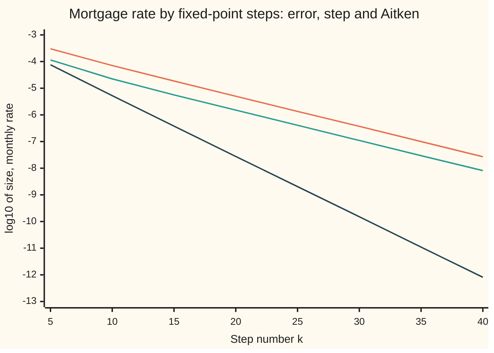

# When to stop: residual, step size, and the test that survives a nearly flat curve

[Syllabus](../../../SYLLABUS.md) → [Numerical analysis](../README.md) → [Root Finding and Fixed Points](../README.md#s02) → When to stop

---

## General Overview

A short government bill pays \$100 in 7 days. Today it is quoted at \$99.923346474. The number a trader wants is its **yield**: the yearly interest rate that turns today's price into \$100 in a week. Here the answer is 4.000000 percent a year. The prices are illustrative.

A solver guesses yields by halving the range 0 to 10 percent, and prices each guess. It stops when the price at its guess is within one cent of the quote.

After three guesses the price is off by less than half a cent, so it stops at 3.75 percent. That is a quarter of a percentage point wrong. On a bond desk, a quarter point is a large error.

The price matched, so why is the yield wrong? A bill that pays in 7 days barely reacts to its yield. Moving the yield one whole percentage point moves the price by under 2 cents. The curve of price against yield is nearly flat, so a small miss in price hides a large miss in yield.

The same one-cent test is excellent on a 25-year mortgage. There one cent of mismatch moves the rate by 2.902e-7 percentage points. The test is the same; the curve is not.

This card is about the question every iteration must answer: **when to stop**. It has three parts:

- Which number to test: the **residual** (how far the equation is from balancing) or the **step** (how far the last guess moved).
- How to set the allowance, with an absolute part and a relative part.
- What to do when a sequence crawls, so that small steps hide a large error, and how to speed it up.

**Stop on an estimate of the error in the answer's own units: the residual divided by the slope, or the last step scaled up by how slowly the steps shrink, never a raw residual or a raw step.**

**What kind of fact this is:** a set of working rules resting on two theorems: the mean value theorem, which turns a residual into an error, and the geometric-sum bound for slow steps. Both are applied in Why it works, and the speed-up from Aitken's method is proved there in a fold.

### The picture: what one cent of mismatch costs

Each bar starts from 1e-8 and grows by four marks for every tenfold step, so equal steps in length mean equal ratios. The values are the error in the yearly rate, in percentage points, left by a price or balance that is off by one cent.

```
7-day bill      ###############################   0.522229 points
25-year loan    ######                            2.902e-7 points
```

The bill's error is 1,799,504 times the loan's. Same tolerance, same cent, two different slopes.

---

## The formula

Some notation from the [Newton and secant](02-newton-and-secant-with-convergence-orders.md) card. The root is $x^*$. The guess after $k$ steps is $x_k$. Its error is $e_k = x_k - x^*$. The **residual** is $f(x_k)$: the equation evaluated at the guess, zero exactly at the root. The **step** is $x_k - x_{k-1}$: how far the last guess moved.

The error is never known, so the stopping test uses an estimate of it. There are two estimates:

$$|e_k| \;\approx\; \frac{|f(x_k)|}{|f'(x_k)|} \qquad\qquad |e_k| \;\approx\; \frac{\hat q}{1-\hat q}\,|x_k - x_{k-1}|, \quad \hat q = \frac{x_k - x_{k-1}}{x_{k-1} - x_{k-2}}$$

The test then compares the estimate with an allowance that has a fixed part and a part that grows with the answer:

$$\text{stop when}\quad \text{estimated } |e_k| \;\le\; \tau_a + \tau_r\,|x_k|$$

A sequence that crawls can be sped up by adding the estimated error back. That is **Aitken's method**:

$$a_k = x_k + \frac{\hat q}{1-\hat q}\,(x_k - x_{k-1})$$

**Read it aloud:** the error is about the residual divided by the slope, or about the last step times q-hat over one minus q-hat. Stop when that estimate is below a fixed floor plus a share of the answer. Add the step estimate back to the guess, and the guess gets better.

| Symbol | Plain meaning | In our example | Push it up and the answer… |
| --- | --- | --- | --- |
| $f(x)$, $f'(x)$, $F(i)$ | the residual, and its slope; $F$ is the mortgage's residual | bill: price at the guess minus the quote; slope −1.915053 dollars per unit of yield | a steeper slope makes the same residual a smaller error |
| $x_k$, $x^*$ | the guess after $k$ steps, and the root | bill: 3.75 percent after 3 steps; root 4.000000 percent | — |
| $e_k$ | the error, $x_k - x^*$ | bill: −0.25 percentage points at the stop | — |
| $\tau_a$ | absolute tolerance: a fixed floor on the allowance. Say "tau a". | 1e-12 | the floor allows more near zero |
| $\tau_r$ | relative tolerance: the allowance as a share of the answer. Say "tau r". | 1e-9 for the bill; 1e-6 for the mortgage | fewer steps, a looser answer |
| $q$, $\hat q$ | how much each error shrinks per step; "q-hat" is its estimate from the last two steps | mortgage: 0.770281; estimate 0.770280 at step 47 | nearer 1 means a slower crawl and a larger factor $\hat q/(1-\hat q)$ |
| $a_k$ | Aitken's improved guess | mortgage, from steps 20 to 22: error 9.765e-9 against 2.981e-6 | — |
| $g$ | the rule pressed again and again in a fixed-point iteration | $g(i) = \frac{M}{L}\left(1 - (1+i)^{-N}\right)$ | — |
| $\kappa$ | condition number: the relative error in the answer per relative error in the data. Say "kappa". | bill 1304.6; mortgage 4.35 | a tiny residual says less about the answer |
| $y$, $t$, $Q$ | the bill's yearly yield, its life in years, the quoted price | 4 percent; 7 ÷ 365 = 0.019178082; \$99.923346474 | — |
| $\xi$, $d_k$, $\delta_k$ | helpers in the proofs: a point between the guess and the root; the step $x_k - x_{k-1}$; how far step $k$'s error ratio is from $q$ | — | — |
| $i$, $i^*$, $L$, $M$, $N$ | the mortgage's monthly rate (on this card a rate, not $\sqrt{-1}$) and its root, loan, monthly payment and number of payments | root 0.001666649458585; \$300,000; \$1,271.56; 300 | — |

The bill's price is $100 / (1 + y\,t)$, so its residual is $f(y) = 100 / (1 + y\,t) - Q$.

The mortgage's residual is the value of the payments minus the loan: $F(i) = M\,(1 - (1+i)^{-N}) / i - L$. Multiply $F(i) = 0$ by $i / L$ and it becomes the fixed-point form $i = g(i)$ in the table.

### When it holds

- **The slope is not near zero at the root.** The residual estimate divides by it. Where the slope is zero, as at a double root, the estimate fails and Newton slows down too ([Newton's bad days](04-when-newton-fails.md)).
- **The method converges faster than linearly for the plain step test.** For Newton, the step is the error to first order. For a linear crawl with $q$ above one half, the raw step understates the error, and the mortgage stops at 2.62 times the error promised.
- **The steps shrink by a steady ratio for the $\hat q$ estimate and for Aitken.** Early on the ratio has not settled, and at step 2 the true error is 1.7 times the step, not 3.35.
- **The steps are bigger than rounding noise.** Once they shrink to rounding noise, $\hat q$ and Aitken's correction are noise too. Aitken applied there is hundreds of times worse than the plain guess, and a few steps later divides by zero.
- **The floor $\tau_a$ is above zero when the root can be zero.** With the relative part alone, a zero-yield quote never stops, because $\tau_r |x_k|$ falls below the rounding noise.

---

## Why it works

### Step 0: three numbers, only one of them wanted

Every iteration has three numbers at each step:

- the residual, in the units of the equation (dollars);
- the step, in the units of the answer (a yield);
- the error, also in the units of the answer, and unknown.

A stopping test wants the error. The residual is in the wrong units. The step is in the right units, but it measures movement, not distance to the root. Each needs a conversion before it can be compared with a tolerance.

### Step 1: residual to error, through the slope

The mean value theorem links them. Between the guess and the root there is a point $\xi$ ("xi") where the slope of $f$ equals the slope of the chord:

$$f(x_k) - f(x^*) = f'(\xi)\,(x_k - x^*)$$

The residual at the root is zero, so $e_k = f(x_k) / f'(\xi)$. Near the root, $f'(\xi)$ is close to $f'(x_k)$, which gives the first estimate.

On the bill the slope is about −1.915 dollars per unit of yield. A residual of 0.004787 dollars therefore means an error of about 0.249988 percentage points. The true error is 0.250000 points.

A safe bound replaces the slope by the flattest slope between guess and root. [Solving backwards](../../12-Financial%20mathematics/07-Greeks%20by%20Numbers%20and%20Calibration/05-root-finding-for-inverses.md) does exactly this on an option and finds one cent of residual costing over two volatility points.

In the wing's language, the residual is a **backward error**: the guess 3.75 percent is the exact yield of a slightly different quote, \$99.928134. The error in the answer, the **forward error**, is about the condition number times that, both counted as relative errors.

For the bill, $\kappa$ = 1304.6: a relative miss in the price is multiplied about 1304.6 times in the yield. The trouble here is conditioning, a property of the problem, not of the solver.

### Step 2: Newton's step already did that division

Newton's step is $-f(x_k) / f'(x_k)$: the residual divided by the slope. So the Newton step is the Step 1 estimate of the error, already in the answer's units.

More precisely, the step from $x_k$ is $x_{k+1} - x_k = e_{k+1} - e_k$. For Newton, $e_{k+1}$ is far smaller than $e_k$ near the root. So the step equals $-e_k$ up to a much smaller term. This is why a step test survives a nearly flat curve: a flat slope makes the step large, and the test keeps going.

On the bill, one Newton step from the false stop at 3.75 percent moves 0.249988 points, to 3.999988 percent. Two more steps reach 4.000000000 percent, with error −1.221e-15, and the step test passes.

### Step 3: when the steps crawl, a step understates the error

A fixed-point iteration presses $x_{k+1} = g(x_k)$ until nothing moves (the calculus card [Fixed points](../../06-Calculus%20and%20analysis/03-What%20Derivatives%20Tell%20You/07-fixed-point-iteration-and-the-contraction-principle.md)). Near the root each error is about $q$ times the one before, with $q = |g'(x^*)|$.

The mortgage's $g$ starts from the payment as a share of the loan, $M/L$, and its slope at the root is $q$ = 0.770281. Each step removes only 23 percent of the error. The payment, \$1,271.56 for a rate near 2 percent, is chosen for this: the lower the rate, the nearer $q$ is to 1, and at 6 percent $q$ is only 0.430752 (Try changing). The steps still to come add up to $q + q^2 + q^3 + \dots = q/(1-q)$ times the last step. Here that is 3.353152 times.

The code shows this. By step 40 the error is 3.3531 times the step in size, as predicted. The calculus Fixed points card proves the same factor as a bound, using the worst $q$ on an interval; here $\hat q$ estimates it from the last two steps.

So a plain step test with $\tau_r$ = 1e-6 promises an error under 1.668e-9 in the monthly rate. It stops at step 47, where the step is 1.301e-9. The true error is 4.363e-9, which is 2.62 times the promise.

Multiply the step by $\hat q/(1-\hat q)$ first, and the test stops at step 51 instead, with relative error 9.217e-7, inside the promise. The estimate at step 47 was 4.363e-9, equal to the true error to four digits.

### Step 4: two tolerances, because size and zero both matter

A double (the standard 64-bit floating-point number) carries about 16 significant digits. So an absolute tolerance below about 1e-16 times the answer's size can never be met, and one far above the answer's size accepts nonsense. A relative tolerance $\tau_r |x_k|$ scales with the answer, which is why it does most of the work.

A relative tolerance fails when the root is zero. Quote the bill at exactly \$100, so the yield is 0. Newton ends up flipping back and forth around zero, with steps of 1.482e-14.

The relative allowance $\tau_r |x_k|$ is 1e-9 times a guess that is itself that small, far below the rounding noise, so the test never passes. The run ends at its cap of 50 steps. Add the floor $\tau_a$ = 1e-12 and it stops after 4 steps.

How to size each part, from the rounding noise and the smallest error that matters, is on the [Tolerances](../../14-Applied%20and%20computational/08-Scientific%20Computing%20Practice/05-tolerances-and-comparing-computed-numbers.md) card. This card adds one thing: the quantity tested must be an error estimate in the answer's units.

### Step 5: Aitken adds back the error it estimated

If the errors shrank by exactly $q$ every step, three guesses would pin down the root. The step from $x_{k-1}$ to $x_k$ is $e_k - e_{k-1}$, and $e_{k-1} = e_k / q$. Solve for $e_k$, subtract it from $x_k$, and the result is $x^*$ exactly. That is the Aitken formula, with $\hat q$ standing in for $q$.

In practice the ratio is only nearly steady, so Aitken's value is not exact, but it is much closer. From the mortgage's steps 20, 21 and 22 it gives an error of 9.765e-9, while step 22 itself is off by 2.981e-6.

Aitken's errors gain about twice as many digits per step as the plain guesses. The chart below shows its line falling about twice as steeply.

<details>
<summary>Detailed proof: Aitken's value beats the guess it came from</summary>

Suppose $e_{k} = (q + \delta_k)\,e_{k-1}$ with $0 < |q| < 1$ and $\delta_k \to 0$. Write $d_k = x_k - x_{k-1} = e_k - e_{k-1}$.

Aitken's value is $a_k = x_k - d_k^2 / (d_k - d_{k-1})$. Subtract $x^*$ and put everything over one denominator:

$$a_k - x^* = \frac{e_k\,(d_k - d_{k-1}) - d_k^2}{d_k - d_{k-1}} = \frac{e_k e_{k-2} - e_{k-1}^2}{e_k - 2e_{k-1} + e_{k-2}}$$

(expand both $d$'s; the $e_k^2$ and cross terms cancel). Now divide top and bottom by $e_{k-2}$ and use the ratios. The numerator becomes $e_{k-1}\big((q+\delta_k) - (q+\delta_{k-1})\big)$, which is $e_{k-1}(\delta_k - \delta_{k-1})$. The denominator becomes $(q+\delta_k)(q+\delta_{k-1}) - 2(q+\delta_{k-1}) + 1$, which tends to $(1-q)^2$, not zero. So

$$\frac{a_k - x^*}{e_{k-1}} = \frac{\delta_k - \delta_{k-1}}{(q+\delta_k)(q+\delta_{k-1}) - 2(q+\delta_{k-1}) + 1} \;\to\; \frac{0}{(1-q)^2} = 0.$$

Aitken's error is a vanishing fraction of the error it started from. If the errors are exactly geometric, all $\delta$'s are zero and $a_k = x^*$ exactly.

</details>

**Steffensen's method** goes one step further. It takes two presses of $g$, forms Aitken's value, and restarts from it. Near a simple root this converges quadratically. On the mortgage it meets the 1e-6 promise after 10 evaluations of $g$, against 51 for the plain crawl, and lands at relative error 5.946e-13.

### Step 6: where every test runs out

All these estimates use differences of nearby guesses. On the mortgage the noise comes early: $g$ computes $1 + i$, which keeps $i$ only to about 1e-16, so the guesses stop improving at about 13 significant digits, not the 16 a double holds. From there the differences are rounding noise. The step test then sees noise, $\hat q$ is meaningless, and Aitken divides noise by noise.

On the mortgage, Aitken from steps 104 to 106 is off by 1.790e-13, while step 106 itself is off by only 5.456e-16. From steps 112 to 114, the two differences are equal and Aitken divides by 0.000e0. So accelerate while the steps are large, and stop before they reach the noise.

---

## Worked numbers, by hand

The bill: 7 days to a \$100 payment, quoted at \$99.923346474.

| Step | Arithmetic | Value |
| --- | --- | --- |
| life in years, $t$ | 7 ÷ 365 | 0.019178082 |
| guess 1: 5 percent | 100 ÷ (1 + 0.05 × 0.019178082) = 99.904201 | residual −0.019145 |
| guess 2: 2.5 percent | 100 ÷ (1 + 0.025 × 0.019178082) = 99.952078 | residual 0.028731 |
| guess 3: 3.75 percent | 100 ÷ (1 + 0.0375 × 0.019178082) = 99.928134 | residual 0.004787, under one cent: stop |
| slope at 3.75 percent | −100 × t ÷ (1 + 0.0375 t)² | −1.915053 |
| error estimate | 0.004787 ÷ 1.915053, in points | 0.249988 |
| one Newton step | 3.75 + 0.249988 | 3.999988 percent |
| **true yield** | (100 − Q) ÷ Q ÷ t | **4.000000 percent** |

A price within half a cent left the yield a quarter of a point wrong. Dividing the residual by the slope saw the error before anything else was computed.

The mortgage: \$300,000 over 300 months at \$1,271.56 a month, tolerance $\tau_r$ = 1e-6. The payment is rounded to the cent, so the exact rate is 1.999979 percent a year, not 2.

| Step | Arithmetic | Value |
| --- | --- | --- |
| slow factor, $q = g'(i^*)$ | $(M/L)\,N\,(1+i^*)^{-N-1}$ | 0.770281 |
| steps still to come, as a multiple of the last | $q / (1 - q)$ | 3.353152 |
| error promised | 1e-12 + 1e-6 × 0.001666649 | 1.668e-9 |
| plain step test stops | step 47, step size 1.301e-9 | true error 4.363e-9 |
| **times the promise** | 4.363e-9 ÷ 1.668e-9 | **2.62** |
| corrected test stops | step 51, $\hat q$ = 0.770281 | relative error 9.217e-7 |

The plain test stopped four steps early and broke its promise by a factor of 2.62. The corrected test cost four more presses and kept it.

### What breaks if you drop a piece

| Mistake | Comes out at | What went wrong |
| --- | --- | --- |
| Stop when the bill's price is within one cent | 3.750000 percent, 0.250000 points off | The residual is in dollars; the slope of 1.915 dollars per unit yield turns half a cent into a quarter point |
| Stop on the raw step for the mortgage | step 47, relative error 2.618e-6: 2.62 times the promise | The steps shrink by 0.770281 each time, so the steps still to come add up to 3.35 times the last |
| Relative tolerance only, on a zero-yield quote | 50 steps, the cap; Newton flips with steps of 1.482e-14 | $\tau_r \lvert x_k\rvert$ shrinks with the root, below rounding noise |
| Aitken applied in the rounding noise | error 1.790e-13 against the plain guess's 5.456e-16; division by 0 at step 112 | The differences it divides are rounding noise: $g$ forms $1 + i$, which keeps $i$ only to about 1e-16 |

The code prints all four.

### The picture: the crawl, its steps, and Aitken



Orange: log10 of the true error. Green: log10 of the step. From step 15 on, the green line runs a steady log10 of 3.35 below the orange one: the step understates the error by a fixed factor, $q/(1-q)$. Dark blue: log10 of Aitken's error from steps $k-2$, $k-1$ and $k$, falling about twice as steeply.

---

## Code, from first principles, and it actually runs

The code solves the bill and the mortgage and prints every number on this card. It takes three roads to each root. For the bill: the closed form $(100 - Q) / (Q\,t)$, Newton, and bisection. For the mortgage: Newton on the dollar residual, 60 halvings of a bracket, and the limit of the fixed-point steps. It then checks $\hat q$ against $q = g'(i^*)$ from its formula, and Aitken and Steffensen against the root. Powers are computed by repeated multiplying, so both languages do the same arithmetic and print the same digits.

### Python

```python
# When to stop -- the check behind the card.  Standard library only.
# Two roots.  The yield of a 7-day bill, where the price curve is nearly flat,
# and the rate of a 25-year mortgage, reached by slow fixed-point steps.  The
# iterations use only + - * /, so Python and Rust print the same digits.
import math
def sci(x, d=3):                              # 1.234e-5, the way Rust prints it
    m, e = f"{x:.{d}e}".split("e"); return f"{m}e{int(e)}"
def pw(b, n):                                 # b to the power n, by repeated multiplying
    r = 1.0
    for _ in range(n): r *= b
    return r
TA, TR = 1e-12, 1e-9                          # absolute floor and relative tolerance
# ---- the flat curve: a bill paying $100 after `days` days, simple yield y a year ----
def bill(y, days): return 100.0 / (1.0 + y * days / 365.0)
def bill_slope(y, days):
    t = days / 365.0; return -100.0 * t / ((1.0 + y * t) * (1.0 + y * t))
def residual_stop(days, quote, cent):        # bisection, stopped on the residual alone
    lo, hi, rows = 0.0, 0.10, []
    while True:
        m = (lo + hi) / 2; r = bill(m, days) - quote; rows.append((m, r))
        if abs(r) <= cent: return m, rows
        lo, hi = (m, hi) if r > 0 else (lo, m)
def newton(days, quote, y, ta, tr, cap=50):  # Newton, stopped on the step
    for k in range(1, cap + 1):
        s = -(bill(y, days) - quote) / bill_slope(y, days); y += s
        if abs(s) <= ta + tr * abs(y): return y, k, s
    return y, cap, s
Q = bill(0.04, 7)
ystar = (100.0 - Q) / Q * 365.0 / 7          # road 1: the closed form
print(f"bill: 7 days, pays 100, quote {Q:.9f} at 4% (illustrative), t = {7/365:.9f} years")
ys, rows = residual_stop(7, Q, 0.01)
for k, (m, r) in enumerate(rows, 1):
    print(f"bisection step {k}: yield {100*m:.6f} %, price {bill(m, 7):.6f}, residual {r:.6f}")
sl = bill_slope(ys, 7); est = abs(rows[-1][1] / sl)
print(f"one-cent residual test stops at {100*ys:.6f} %, true {100*ystar:.6f} %, error {100*(ystar-ys):.6f} points")
print(f"slope at the stop {sl:.6f} $ per unit yield; residual/slope estimates {100*est:.6f} points")
yn, kn, sn = newton(7, Q, ys, TA, TR)        # road 2: Newton, stopped on its step
print(f"Newton from the stop: first step to {100*(ys+est):.6f} %; {kn} steps in all, yield {100*yn:.9f} %, error {sci(yn-ystar)}")
assert abs(ys - 0.0375) < 1e-15 and abs((ystar - ys) - 0.0025) < 1e-12   # the false stop
assert abs(yn - ystar) < 1e-14 and abs(est - (ystar - ys)) < 1e-6
# ---- the house example: a 25-year mortgage, 300 monthly payments ----
L, N = 300000.0, 300
def mortgage(M, tr, show):
    def F(i): return M * (1.0 - 1.0 / pw(1.0 + i, N)) / i - L   # dollars over or short
    def Fp(i):
        v = 1.0 / pw(1.0 + i, N); return M * (N * v / (1.0 + i) / i - (1.0 - v) / (i * i))
    def g(i): return M / L * (1.0 - 1.0 / pw(1.0 + i, N))         # the fixed-point form
    i = 0.002                                 # road 1: Newton on the dollar residual
    for _ in range(8): i -= F(i) / Fp(i)
    lo, hi = 0.001, 0.008                     # road 2: bisection, 60 halvings
    for _ in range(60):
        mid = (lo + hi) / 2; lo, hi = (lo, mid) if F(mid) < 0 else (mid, hi)
    q = M / L * N / pw(1.0 + i, N + 1)        # g'(i*), the slow factor
    x = [M / L]                               # road 3: the fixed-point steps
    for _ in range(160): x.append(g(x[-1]))
    assert abs(lo - i) < 1e-12 * i and abs(x[-1] - i) < 1e-12 * i
    def stop(est):                            # first k whose error estimate passes
        for k in range(2, 161):
            s = x[k] - x[k - 1]; qh = s / (x[k - 1] - x[k - 2])
            if abs(est(s, qh)) <= TA + tr * abs(x[k]): return k, qh
    kp, _ = stop(lambda s, qh: s)
    kc, qc = stop(lambda s, qh: qh / (1 - qh) * s)
    rp, rc = abs(x[kp] - i) / i, abs(x[kc] - i) / i
    over = abs(x[kp] - i) / (TA + tr * i)    # true error over the error promised
    if show: return i, q, x, Fp(i), kp, rp, over, kc, qc, rc, g
    return q, kp, over, kc
M = 1271.56
istar, q, x, slope, kp, rp, over, kc, qc, rc, g = mortgage(M, 1e-6, True)
print(f"mortgage: loan 300000, 300 payments of {M:.2f}; rate {istar:.15f} a month, {1200*istar:.6f} % a year")
print(f"slope {slope:.1f} $ per unit monthly rate; one cent of residual moves the annual rate {sci(0.01/abs(slope)*1200)} points")
print(f"same cent on the bill: {100*0.01/abs(bill_slope(ystar, 7)):.6f} points, {(0.01/abs(bill_slope(ystar, 7)))/(0.01/abs(slope)*12):.0f} times as much")
print(f"q = g'(i*) = {q:.6f}, q/(1-q) = {q/(1-q):.6f}")
print(f"error promised at tau_r 1e-6: {sci(TA + 1e-6 * istar)}; condition number: bill {Q/(ystar*abs(bill_slope(ystar, 7))):.1f}, mortgage {L/(istar*abs(slope)):.2f}")
for k in (1, 2, 3, 10, 20, 30, 40):
    st = x[k] - x[k - 1]
    print(f"k={k}: rate {1200*x[k]:.9f} %, error {sci(x[k]-istar)}, step {sci(st)}, error/step {(x[k]-istar)/st:.4f}")
s = x[kp] - x[kp - 1]; qh = s / (x[kp - 1] - x[kp - 2])
print(f"plain step test, tau_r 1e-6: stops at k={kp}, step {sci(s)}, q-hat {qh:.6f}, estimate {sci(-qh/(1-qh)*s)}, true {sci(x[kp]-istar)}")
print(f"  relative error {sci(rp)}, {over:.2f} times the error promised")
print(f"corrected test: stops at k={kc}, q-hat {qc:.6f}, relative error {sci(rc)}")
assert over > 1 and rp > 1e-6 and rc <= 1e-6 and abs(qc - q) < 1e-4
def aitken(k):                                # from x_k, x_k+1, x_k+2
    d1, d2 = x[k + 1] - x[k], x[k + 2] - x[k + 1]; den = d2 - d1
    return x[k + 2] - d2 * d2 / den if den != 0.0 else float("nan")
for k in (0, 10, 20, 30):
    print(f"Aitken from x{k}, x{k+1}, x{k+2}: error {sci(aitken(k)-istar)}; plain x{k+2}: {sci(x[k+2]-istar)}")
assert abs(aitken(20) - istar) < abs(x[22] - istar) / 100
z, ev = M / L, 0                              # Steffensen: Aitken, then restart from it
while True:
    g1 = g(z); g2 = g(g1); ev += 2
    d1, d2 = g1 - z, g2 - g1; zn = g2 - d2 * d2 / (d2 - d1)
    if abs(zn - z) <= TA + 1e-6 * abs(zn): break
    z = zn
print(f"Steffensen: {ev} evaluations of g, relative error {sci(abs(zn-istar)/istar)}; plain needs {kc}")
assert abs(zn - istar) / istar < 1e-9 and ev < kc / 3
d112 = (x[114] - x[113]) - (x[113] - x[112])
print(f"Aitken in the noise, k=104: error {sci(aitken(104)-istar)}; plain x106: {sci(x[106]-istar)}; k=112 divides by {sci(d112)}")
ks = range(5, 41, 5)
print("chart k:", " ".join(str(k) for k in ks))
print("chart log10 error:", " ".join(f"{math.log10(abs(x[k]-istar)):.2f}" for k in ks))
print("chart log10 step:", " ".join(f"{math.log10(abs(x[k]-x[k-1])):.2f}" for k in ks))
print("chart log10 Aitken:", " ".join(f"{math.log10(abs(aitken(k-2)-istar)):.2f}" for k in ks))
yz, kz, sz = newton(7, 100.0, 0.04, 0.0, TR)
yb, kb, sb = newton(7, 100.0, 0.04, TA, TR)
print(f"zero-yield quote, relative test only: {kz} steps (the cap), last step {sci(sz)}; with the floor: {kb} steps")
assert kz == 50 and kb < 10
y91, _ = residual_stop(91, bill(0.04, 91), 0.01)
print(f"try 91 days: one-cent residual test stops at {100*y91:.6f} %, error {100*(0.04-y91):.6f} points")
q6, kp6, x6, kc6 = mortgage(1932.90, 1e-6, False)
print(f"try 6 %, payment 1932.90: q {q6:.6f}, plain stops k={kp6} at {x6:.2f} times the error promised, corrected k={kc6}")
q9, kp9, x9, kc9 = mortgage(M, 1e-9, False)
print(f"try tau_r 1e-9: plain stops k={kp9} at {x9:.2f} times the error promised, corrected k={kc9}")
print("ALL CHECKS PASS")
```

**Ran 2026-11-11 on macOS, Python 3.14.10, standard library only. All checks passed. Output, pasted from the run:**

```
bill: 7 days, pays 100, quote 99.923346474 at 4% (illustrative), t = 0.019178082 years
bisection step 1: yield 5.000000 %, price 99.904201, residual -0.019145
bisection step 2: yield 2.500000 %, price 99.952078, residual 0.028731
bisection step 3: yield 3.750000 %, price 99.928134, residual 0.004787
one-cent residual test stops at 3.750000 %, true 4.000000 %, error 0.250000 points
slope at the stop -1.915053 $ per unit yield; residual/slope estimates 0.249988 points
Newton from the stop: first step to 3.999988 %; 3 steps in all, yield 4.000000000 %, error -1.221e-15
mortgage: loan 300000, 300 payments of 1271.56; rate 0.001666649458585 a month, 1.999979 % a year
slope -41349779.7 $ per unit monthly rate; one cent of residual moves the annual rate 2.902e-7 points
same cent on the bill: 0.522229 points, 1799504 times as much
q = g'(i*) = 0.770281, q/(1-q) = 3.353152
error promised at tau_r 1e-6: 1.668e-9; condition number: bill 1304.6, mortgage 4.35
k=1: rate 3.656252020 %, error 1.380e-3, step -1.192e-3, error/step -1.1582
k=2: rate 3.044371039 %, error 8.703e-4, step -5.099e-4, error/step -1.7069
k=3: rate 2.707883027 %, error 5.899e-4, step -2.804e-4, error/step -2.1038
k=10: rate 2.085649724 %, error 7.139e-5, step -2.261e-5, error/step -3.1581
k=20: rate 2.006017354 %, error 5.032e-6, step -1.507e-6, error/step -3.3389
k=30: rate 2.000422005 %, error 3.689e-7, step -1.100e-7, error/step -3.3521
k=40: rate 2.000011894 %, error 2.712e-8, step -8.088e-9, error/step -3.3531
plain step test, tau_r 1e-6: stops at k=47, step -1.301e-9, q-hat 0.770280, estimate 4.363e-9, true 4.363e-9
  relative error 2.618e-6, 2.62 times the error promised
corrected test: stops at k=51, q-hat 0.770281, relative error 9.217e-7
Aitken from x0, x1, x2: error 4.890e-4; plain x2: 8.703e-4
Aitken from x10, x11, x12: error 1.818e-6; plain x12: 4.157e-5
Aitken from x20, x21, x22: error 9.765e-9; plain x22: 2.981e-6
Aitken from x30, x31, x32: error 5.278e-11; plain x32: 2.188e-7
Steffensen: 10 evaluations of g, relative error 5.946e-13; plain needs 51
Aitken in the noise, k=104: error -1.790e-13; plain x106: 5.456e-16; k=112 divides by 0.000e0
chart k: 5 10 15 20 25 30 35 40
chart log10 error: -3.52 -4.15 -4.73 -5.30 -5.87 -6.43 -7.00 -7.57
chart log10 step: -3.94 -4.65 -5.25 -5.82 -6.39 -6.96 -7.53 -8.09
chart log10 Aitken: -4.12 -5.28 -6.42 -7.56 -8.69 -9.82 -10.96 -12.09
zero-yield quote, relative test only: 50 steps (the cap), last step -1.482e-14; with the floor: 4 steps
try 91 days: one-cent residual test stops at 3.984375 %, error 0.015625 points
try 6 %, payment 1932.90: q 0.430752, plain stops k=15 at 0.67 times the error promised, corrected k=15
try tau_r 1e-9: plain stops k=71 at 3.11 times the error promised, corrected k=76
ALL CHECKS PASS
```

### Rust

Same numbers, same labels, built with `rustc --edition 2021 -O`.

```rust
// When to stop -- the same check as the Python, in Rust.  No crates.
// Two roots.  The yield of a 7-day bill, where the price curve is nearly flat,
// and the rate of a 25-year mortgage, reached by slow fixed-point steps.  The
// iterations use only + - * /, so Python and Rust print the same digits.
const TA: f64 = 1e-12; // absolute floor
const TR: f64 = 1e-9; // relative tolerance
const L: f64 = 300000.0;
const N: usize = 300;
fn sci(x: f64) -> String { format!("{:.3e}", x) }
fn pw(b: f64, n: usize) -> f64 { let mut r = 1.0; for _ in 0..n { r *= b; } r }
// ---- the flat curve: a bill paying $100 after `days` days, simple yield y a year ----
fn bill(y: f64, days: f64) -> f64 { 100.0 / (1.0 + y * days / 365.0) }
fn bill_slope(y: f64, days: f64) -> f64 {
    let t = days / 365.0; -100.0 * t / ((1.0 + y * t) * (1.0 + y * t))
}
fn residual_stop(days: f64, quote: f64, cent: f64) -> (f64, Vec<(f64, f64)>) {
    let (mut lo, mut hi, mut rows) = (0.0, 0.10, Vec::new()); // bisection, residual test only
    loop {
        let m = (lo + hi) / 2.0; let r = bill(m, days) - quote; rows.push((m, r));
        if r.abs() <= cent { return (m, rows); }
        if r > 0.0 { lo = m; } else { hi = m; }
    }
}
fn newton(days: f64, quote: f64, mut y: f64, ta: f64, tr: f64) -> (f64, usize, f64) {
    let mut s = 0.0; // Newton, stopped on the step
    for k in 1..=50 {
        s = -(bill(y, days) - quote) / bill_slope(y, days); y += s;
        if s.abs() <= ta + tr * y.abs() { return (y, k, s); }
    }
    (y, 50, s)
}
fn g(m: f64, i: f64) -> f64 { m / L * (1.0 - 1.0 / pw(1.0 + i, N)) } // the fixed-point form
struct Run { i: f64, q: f64, x: Vec<f64>, slope: f64, kp: usize, rp: f64, over: f64, kc: usize, qc: f64, rc: f64 }
fn mortgage(m: f64, tr: f64) -> Run {
    let f = |i: f64| m * (1.0 - 1.0 / pw(1.0 + i, N)) / i - L; // dollars over or short
    let fp = |i: f64| { let v = 1.0 / pw(1.0 + i, N); m * (N as f64 * v / (1.0 + i) / i - (1.0 - v) / (i * i)) };
    let mut i = 0.002; // road 1: Newton on the dollar residual
    for _ in 0..8 { i -= f(i) / fp(i); }
    let (mut lo, mut hi) = (0.001, 0.008); // road 2: bisection, 60 halvings
    for _ in 0..60 { let mid = (lo + hi) / 2.0; if f(mid) < 0.0 { hi = mid; } else { lo = mid; } }
    let q = m / L * N as f64 / pw(1.0 + i, N + 1); // g'(i*), the slow factor
    let mut x = vec![m / L]; // road 3: the fixed-point steps
    for _ in 0..160 { let last = x[x.len() - 1]; x.push(g(m, last)); }
    assert!((lo - i).abs() < 1e-12 * i && (x[160] - i).abs() < 1e-12 * i);
    let stop = |corrected: bool| -> (usize, f64) { // first k whose error estimate passes
        for k in 2..161 {
            let s = x[k] - x[k - 1]; let qh = s / (x[k - 1] - x[k - 2]);
            let est = if corrected { qh / (1.0 - qh) * s } else { s };
            if est.abs() <= TA + tr * x[k].abs() { return (k, qh); }
        }
        (0, 0.0)
    };
    let (kp, _) = stop(false);
    let (kc, qc) = stop(true);
    let (rp, rc) = ((x[kp] - i).abs() / i, (x[kc] - i).abs() / i);
    let over = (x[kp] - i).abs() / (TA + tr * i); // true error over the error promised
    Run { i, q, slope: fp(i), kp, rp, over, kc, qc, rc, x }
}
fn main() {
    let q_bill = bill(0.04, 7.0);
    let ystar = (100.0 - q_bill) / q_bill * 365.0 / 7.0; // road 1: the closed form
    println!("bill: 7 days, pays 100, quote {:.9} at 4% (illustrative), t = {:.9} years", q_bill, 7.0 / 365.0);
    let (ys, rows) = residual_stop(7.0, q_bill, 0.01);
    for (k, (m, r)) in rows.iter().enumerate() {
        println!("bisection step {}: yield {:.6} %, price {:.6}, residual {:.6}", k + 1, 100.0 * m, bill(*m, 7.0), r);
    }
    let sl = bill_slope(ys, 7.0); let est = (rows[rows.len() - 1].1 / sl).abs();
    println!("one-cent residual test stops at {:.6} %, true {:.6} %, error {:.6} points", 100.0 * ys, 100.0 * ystar, 100.0 * (ystar - ys));
    println!("slope at the stop {:.6} $ per unit yield; residual/slope estimates {:.6} points", sl, 100.0 * est);
    let (yn, kn, _) = newton(7.0, q_bill, ys, TA, TR); // road 2: Newton, stopped on its step
    println!("Newton from the stop: first step to {:.6} %; {} steps in all, yield {:.9} %, error {}", 100.0 * (ys + est), kn, 100.0 * yn, sci(yn - ystar));
    assert!((ys - 0.0375).abs() < 1e-15 && ((ystar - ys) - 0.0025).abs() < 1e-12); // the false stop
    assert!((yn - ystar).abs() < 1e-14 && (est - (ystar - ys)).abs() < 1e-6);
    // ---- the house example: a 25-year mortgage, 300 monthly payments ----
    let m = 1271.56;
    let r = mortgage(m, 1e-6);
    let (istar, x) = (r.i, &r.x);
    println!("mortgage: loan 300000, 300 payments of {:.2}; rate {:.15} a month, {:.6} % a year", m, istar, 1200.0 * istar);
    println!("slope {:.1} $ per unit monthly rate; one cent of residual moves the annual rate {} points", r.slope, sci(0.01 / r.slope.abs() * 1200.0));
    let bs = bill_slope(ystar, 7.0).abs();
    println!("same cent on the bill: {:.6} points, {:.0} times as much", 100.0 * 0.01 / bs, (0.01 / bs) / (0.01 / r.slope.abs() * 12.0));
    println!("q = g'(i*) = {:.6}, q/(1-q) = {:.6}", r.q, r.q / (1.0 - r.q));
    println!("error promised at tau_r 1e-6: {}; condition number: bill {:.1}, mortgage {:.2}", sci(TA + 1e-6 * istar), q_bill / (ystar * bs), L / (istar * r.slope.abs()));
    for k in [1, 2, 3, 10, 20, 30, 40] {
        let st = x[k] - x[k - 1];
        println!("k={}: rate {:.9} %, error {}, step {}, error/step {:.4}", k, 1200.0 * x[k], sci(x[k] - istar), sci(st), (x[k] - istar) / st);
    }
    let kp = r.kp;
    let s = x[kp] - x[kp - 1]; let qh = s / (x[kp - 1] - x[kp - 2]);
    println!("plain step test, tau_r 1e-6: stops at k={}, step {}, q-hat {:.6}, estimate {}, true {}", kp, sci(s), qh, sci(-qh / (1.0 - qh) * s), sci(x[kp] - istar));
    println!("  relative error {}, {:.2} times the error promised", sci(r.rp), r.over);
    println!("corrected test: stops at k={}, q-hat {:.6}, relative error {}", r.kc, r.qc, sci(r.rc));
    assert!(r.over > 1.0 && r.rp > 1e-6 && r.rc <= 1e-6 && (r.qc - r.q).abs() < 1e-4);
    let aitken = |k: usize| -> f64 { // from x_k, x_k+1, x_k+2
        let (d1, d2) = (x[k + 1] - x[k], x[k + 2] - x[k + 1]); let den = d2 - d1;
        if den != 0.0 { x[k + 2] - d2 * d2 / den } else { f64::NAN }
    };
    for k in [0, 10, 20, 30] {
        println!("Aitken from x{}, x{}, x{}: error {}; plain x{}: {}", k, k + 1, k + 2, sci(aitken(k) - istar), k + 2, sci(x[k + 2] - istar));
    }
    assert!((aitken(20) - istar).abs() < (x[22] - istar).abs() / 100.0);
    let (mut z, mut ev, zn); // Steffensen: Aitken, then restart from it
    z = m / L; ev = 0;
    loop {
        let g1 = g(m, z); let g2 = g(m, g1); ev += 2;
        let (d1, d2) = (g1 - z, g2 - g1); let next = g2 - d2 * d2 / (d2 - d1);
        if (next - z).abs() <= TA + 1e-6 * next.abs() { zn = next; break; }
        z = next;
    }
    println!("Steffensen: {} evaluations of g, relative error {}; plain needs {}", ev, sci((zn - istar).abs() / istar), r.kc);
    assert!((zn - istar).abs() / istar < 1e-9 && (ev as f64) < r.kc as f64 / 3.0);
    let d112 = (x[114] - x[113]) - (x[113] - x[112]);
    println!("Aitken in the noise, k=104: error {}; plain x106: {}; k=112 divides by {}", sci(aitken(104) - istar), sci(x[106] - istar), sci(d112));
    let ks: Vec<usize> = (5..41).step_by(5).collect();
    let join = |v: Vec<String>| v.join(" ");
    println!("chart k: {}", join(ks.iter().map(|k| k.to_string()).collect()));
    println!("chart log10 error: {}", join(ks.iter().map(|&k| format!("{:.2}", (x[k] - istar).abs().log10())).collect()));
    println!("chart log10 step: {}", join(ks.iter().map(|&k| format!("{:.2}", (x[k] - x[k - 1]).abs().log10())).collect()));
    println!("chart log10 Aitken: {}", join(ks.iter().map(|&k| format!("{:.2}", (aitken(k - 2) - istar).abs().log10())).collect()));
    let (_, kz, sz) = newton(7.0, 100.0, 0.04, 0.0, TR);
    let (_, kb, _) = newton(7.0, 100.0, 0.04, TA, TR);
    println!("zero-yield quote, relative test only: {} steps (the cap), last step {}; with the floor: {} steps", kz, sci(sz), kb);
    assert!(kz == 50 && kb < 10);
    let (y91, _) = residual_stop(91.0, bill(0.04, 91.0), 0.01);
    println!("try 91 days: one-cent residual test stops at {:.6} %, error {:.6} points", 100.0 * y91, 100.0 * (0.04 - y91));
    let r6 = mortgage(1932.90, 1e-6);
    println!("try 6 %, payment 1932.90: q {:.6}, plain stops k={} at {:.2} times the error promised, corrected k={}", r6.q, r6.kp, r6.over, r6.kc);
    let r9 = mortgage(m, 1e-9);
    println!("try tau_r 1e-9: plain stops k={} at {:.2} times the error promised, corrected k={}", r9.kp, r9.over, r9.kc);
    println!("ALL CHECKS PASS");
}
```

**Ran 2026-11-11 on macOS, rustc 1.98.1, no crates. All checks passed. Output, pasted from the run:**

```
bill: 7 days, pays 100, quote 99.923346474 at 4% (illustrative), t = 0.019178082 years
bisection step 1: yield 5.000000 %, price 99.904201, residual -0.019145
bisection step 2: yield 2.500000 %, price 99.952078, residual 0.028731
bisection step 3: yield 3.750000 %, price 99.928134, residual 0.004787
one-cent residual test stops at 3.750000 %, true 4.000000 %, error 0.250000 points
slope at the stop -1.915053 $ per unit yield; residual/slope estimates 0.249988 points
Newton from the stop: first step to 3.999988 %; 3 steps in all, yield 4.000000000 %, error -1.221e-15
mortgage: loan 300000, 300 payments of 1271.56; rate 0.001666649458585 a month, 1.999979 % a year
slope -41349779.7 $ per unit monthly rate; one cent of residual moves the annual rate 2.902e-7 points
same cent on the bill: 0.522229 points, 1799504 times as much
q = g'(i*) = 0.770281, q/(1-q) = 3.353152
error promised at tau_r 1e-6: 1.668e-9; condition number: bill 1304.6, mortgage 4.35
k=1: rate 3.656252020 %, error 1.380e-3, step -1.192e-3, error/step -1.1582
k=2: rate 3.044371039 %, error 8.703e-4, step -5.099e-4, error/step -1.7069
k=3: rate 2.707883027 %, error 5.899e-4, step -2.804e-4, error/step -2.1038
k=10: rate 2.085649724 %, error 7.139e-5, step -2.261e-5, error/step -3.1581
k=20: rate 2.006017354 %, error 5.032e-6, step -1.507e-6, error/step -3.3389
k=30: rate 2.000422005 %, error 3.689e-7, step -1.100e-7, error/step -3.3521
k=40: rate 2.000011894 %, error 2.712e-8, step -8.088e-9, error/step -3.3531
plain step test, tau_r 1e-6: stops at k=47, step -1.301e-9, q-hat 0.770280, estimate 4.363e-9, true 4.363e-9
  relative error 2.618e-6, 2.62 times the error promised
corrected test: stops at k=51, q-hat 0.770281, relative error 9.217e-7
Aitken from x0, x1, x2: error 4.890e-4; plain x2: 8.703e-4
Aitken from x10, x11, x12: error 1.818e-6; plain x12: 4.157e-5
Aitken from x20, x21, x22: error 9.765e-9; plain x22: 2.981e-6
Aitken from x30, x31, x32: error 5.278e-11; plain x32: 2.188e-7
Steffensen: 10 evaluations of g, relative error 5.946e-13; plain needs 51
Aitken in the noise, k=104: error -1.790e-13; plain x106: 5.456e-16; k=112 divides by 0.000e0
chart k: 5 10 15 20 25 30 35 40
chart log10 error: -3.52 -4.15 -4.73 -5.30 -5.87 -6.43 -7.00 -7.57
chart log10 step: -3.94 -4.65 -5.25 -5.82 -6.39 -6.96 -7.53 -8.09
chart log10 Aitken: -4.12 -5.28 -6.42 -7.56 -8.69 -9.82 -10.96 -12.09
zero-yield quote, relative test only: 50 steps (the cap), last step -1.482e-14; with the floor: 4 steps
try 91 days: one-cent residual test stops at 3.984375 %, error 0.015625 points
try 6 %, payment 1932.90: q 0.430752, plain stops k=15 at 0.67 times the error promised, corrected k=15
try tau_r 1e-9: plain stops k=71 at 3.11 times the error promised, corrected k=76
ALL CHECKS PASS
```

The two outputs match line for line.

### Lean

Lean proves the residual bound, the step bound and Aitken's speed-up, for every case that meets their conditions.

- Suppose the slope between a guess and the root is never flatter than some $m > 0$. Then the error is at most the residual divided by $m$.
- Suppose $g$ shrinks the gap between any two points of a range to at most $q$ times what it was, with $0 \le q < 1$. The range holds the old guess and the root, and $g$ leaves the root fixed. Then the new guess's error is at most $q/(1-q)$ times the last step.
- Suppose each error is $q + \delta_k$ times the one before, with $0 < |q| < 1$ and $\delta_k$ tending to zero. Then Aitken's error, as a fraction of the error it started from, tends to zero.
- The bill's hand arithmetic holds exactly. Bisection guesses 5, 2.5 and 3.75 percent, and the closed form gives back 4 percent. At 3.75 percent the residual is under one cent, yet the yield is a quarter point off.

Newton's step as an error estimate, Steffensen's speed, the mortgage's numbers and the rounding noise are left to the Python and Rust checks.

```lean
-- When to stop: a residual divided by the flattest slope bounds the error, the last step of a contraction times q/(1 - q) bounds the error, and Aitken's value beats the guess it came from.
import Mathlib.Analysis.Calculus.Deriv.MeanValue
import Mathlib.Analysis.SpecificLimits.Basic
import Mathlib.Tactic.NormNum

open Filter Topology Set

/-! The root is `xstar`, a guess is `x`, its error is `x - xstar`, and the residual is `f x`.
For a fixed-point iteration `x_k = g x_(k-1)`, the step is `x_k - x_(k-1)`.
Aitken's value from three guesses `x_k, x_(k+1), x_(k+2)` with steps
`d₁ = x_(k+1) - x_k` and `d₂ = x_(k+2) - x_(k+1)` is `x_(k+2) - d₂ ^ 2 / (d₂ - d₁)`. -/

/-- Helper: mean value theorem lower bound on an interval. -/
theorem mvt_lower_bound (f : ℝ → ℝ) (a b m : ℝ) (hab : a < b)
    (hd : ∀ ξ ∈ Icc a b, DifferentiableAt ℝ f ξ)
    (hs : ∀ ξ ∈ Icc a b, m ≤ |deriv f ξ|) : m * (b - a) ≤ |f b - f a| := by
  obtain ⟨c, hc, hcd⟩ := exists_deriv_eq_slope f hab
    (fun ξ hξ => (hd ξ hξ).continuousAt.continuousWithinAt)
    (fun ξ hξ => (hd ξ (Ioo_subset_Icc_self hξ)).differentiableWithinAt)
  have hba : 0 < b - a := sub_pos.mpr hab
  have : f b - f a = deriv f c * (b - a) := by rw [hcd]; field_simp
  rw [this, abs_mul, abs_of_pos hba]
  exact mul_le_mul_of_nonneg_right (hs c (Ioo_subset_Icc_self hc)) hba.le

#print axioms mvt_lower_bound

/-- Helper: Aitken's error ratio in terms of the two error ratios. -/
theorem aitken_pointwise (e a b : ℝ) (hD : a * b - 2 * a + 1 ≠ 0) :
    |((b * (a * e)) - ((b * (a * e)) - a * e) ^ 2 /
        (((b * (a * e)) - a * e) - (a * e - e))) / (a * e)| ≤ |(b - a) / (a * b - 2 * a + 1)| := by
  by_cases hae : a * e = 0
  · rw [hae, div_zero, abs_zero]; exact abs_nonneg _
  · have ha : a ≠ 0 := left_ne_zero_of_mul hae
    have he : e ≠ 0 := right_ne_zero_of_mul hae
    have hden : ((b * (a * e)) - a * e) - (a * e - e) = e * (a * b - 2 * a + 1) := by ring
    rw [hden]
    have key : b * (a * e) - (b * (a * e) - a * e) ^ 2 / (e * (a * b - 2 * a + 1)) =
        a * e * ((b - a) / (a * b - 2 * a + 1)) := by
      generalize hG : a * b - 2 * a + 1 = D at hD ⊢
      field_simp
      rw [← hG]
      ring
    rw [key, mul_div_cancel_left₀ _ hae]

#print axioms aitken_pointwise

/-- Residual to error, through the slope (mean value theorem): if the root `xstar` has
`f xstar = 0`, `f` has a slope at every point between the guess `x` and the root, and that
slope is never flatter than `m > 0` there, then the error of the guess is at most the
residual divided by `m`: `|x - xstar| ≤ |f x| / m`. -/
theorem error_le_residual_div_flattest_slope (f : ℝ → ℝ) (x xstar m : ℝ)
    (hroot : f xstar = 0) (hm : 0 < m)
    (hdiff : ∀ ξ ∈ uIcc x xstar, DifferentiableAt ℝ f ξ)
    (hslope : ∀ ξ ∈ uIcc x xstar, m ≤ |deriv f ξ|) :
    |x - xstar| ≤ |f x| / m := by
  rcases lt_trichotomy x xstar with h | h | h
  · rw [uIcc_of_le h.le] at hdiff hslope
    have := mvt_lower_bound f x xstar m h hdiff hslope
    rw [hroot, zero_sub, abs_neg] at this
    rw [le_div_iff₀ hm, abs_sub_comm, abs_of_pos (sub_pos.mpr h)]; linarith
  · subst h; simp only [sub_self, abs_zero]; positivity
  · rw [uIcc_of_ge h.le] at hdiff hslope
    have := mvt_lower_bound f xstar x m h hdiff hslope
    rw [hroot, sub_zero] at this
    rw [le_div_iff₀ hm, abs_of_pos (sub_pos.mpr h)]; linarith

/-- The corrected step test (geometric-sum bound): if `g` shrinks distances by at most
`q < 1` on a set holding the previous guess and the root, and the root is a fixed point,
then the error of the new guess `g x` is at most `q / (1 - q)` times the last step. -/
theorem error_le_q_div_one_sub_q_mul_step (g : ℝ → ℝ) (S : Set ℝ) (q x xstar : ℝ)
    (hq0 : 0 ≤ q) (hq1 : q < 1)
    (hcontr : ∀ a ∈ S, ∀ b ∈ S, |g a - g b| ≤ q * |a - b|)
    (hx : x ∈ S) (hstar : xstar ∈ S) (hfix : g xstar = xstar) :
    |g x - xstar| ≤ q / (1 - q) * |g x - x| := by
  have h1 := hcontr x hx xstar hstar
  rw [hfix] at h1
  have h2 := abs_sub_le x (g x) xstar
  rw [abs_sub_comm x (g x)] at h2
  rw [div_mul_eq_mul_div, le_div_iff₀ (by linarith)]
  nlinarith [mul_le_mul_of_nonneg_left h2 hq0]

/-- Aitken's value beats the guess it came from: if each error is `q + δ_k` times the one
before, with `0 < |q| < 1` and `δ_k → 0`, then Aitken's value from `x_k, x_(k+1), x_(k+2)`
has an error that is a vanishing fraction of the error `x_(k+1) - xstar`. -/
theorem aitken_error_vanishing_fraction (x δ : ℕ → ℝ) (xstar q : ℝ)
    (hq0 : 0 < |q|) (hq1 : |q| < 1)
    (hratio : ∀ k, x (k + 1) - xstar = (q + δ (k + 1)) * (x k - xstar))
    (hδ : Tendsto δ atTop (𝓝 0)) :
    Tendsto (fun k => (x (k + 2) - (x (k + 2) - x (k + 1)) ^ 2 /
        ((x (k + 2) - x (k + 1)) - (x (k + 1) - x k)) - xstar) / (x (k + 1) - xstar))
      atTop (𝓝 0) := by
  have hA : Tendsto (fun k => q + δ (k + 1)) atTop (𝓝 q) := by
    simpa using tendsto_const_nhds.add (hδ.comp (tendsto_add_atTop_nat 1))
  have hB : Tendsto (fun k => q + δ (k + 2)) atTop (𝓝 q) := by
    simpa using tendsto_const_nhds.add (hδ.comp (tendsto_add_atTop_nat 2))
  have hq1' : q < 1 := lt_of_le_of_lt (le_abs_self q) hq1
  have hlimD : (1 - q) ^ 2 ≠ 0 := by
    have : 1 - q ≠ 0 := by linarith
    positivity
  have hD : Tendsto (fun k => (q + δ (k + 1)) * (q + δ (k + 2)) - 2 * (q + δ (k + 1)) + 1)
      atTop (𝓝 ((1 - q) ^ 2)) := by
    have := ((hA.mul hB).sub (hA.const_mul 2)).add_const 1
    convert this using 2; ring
  have hN : Tendsto (fun k => (q + δ (k + 2)) - (q + δ (k + 1))) atTop (𝓝 0) := by
    simpa using hB.sub hA
  have hlim := (hN.div hD hlimD).abs
  rw [zero_div, abs_zero] at hlim
  refine squeeze_zero_norm' ?_ hlim
  filter_upwards [hD.eventually_ne hlimD] with k hk
  rw [Real.norm_eq_abs]
  have h1 := hratio k
  have h2 := hratio (k + 1)
  have e1 : x (k + 1) = xstar + (q + δ (k + 1)) * (x k - xstar) := by linarith
  have e2 : x (k + 2) = xstar + (q + δ (k + 2)) * ((q + δ (k + 1)) * (x k - xstar)) := by
    rw [← h1]; linarith
  have := aitken_pointwise (x k - xstar) (q + δ (k + 1)) (q + δ (k + 2)) hk
  convert this using 3
  have d2 : x (k + 2) - x (k + 1) = (q + δ (k + 2)) * ((q + δ (k + 1)) * (x k - xstar)) -
      (q + δ (k + 1)) * (x k - xstar) := by rw [e2, e1]; ring
  have d1 : x (k + 1) - x k = (q + δ (k + 1)) * (x k - xstar) - (x k - xstar) := by
    rw [e1]; ring
  have t2 : x (k + 2) - xstar = (q + δ (k + 2)) * ((q + δ (k + 1)) * (x k - xstar)) := by
    rw [e2]; ring
  rw [sub_right_comm, d2, d1, t2]

/-! The card's exact worked numbers: the 7-day bill paying 100, with `t = 7/365` years.
Rates are written as fractions: 4 percent is `1/25`, 3.75 percent is `3/80`. -/

-- Bisection on 0 to 10 percent: guesses 5, 2.5 and 3.75 percent.
example : ((0 : ℚ) + 1 / 10) / 2 = 1 / 20 ∧ ((0 : ℚ) + 1 / 20) / 2 = 1 / 40 ∧
    ((1 : ℚ) / 40 + 1 / 20) / 2 = 3 / 80 := by norm_num
-- The closed form (100 - Q) / Q / t gives back the 4 percent yield behind the quote Q.
example : (100 - 100 / (1 + 1 / 25 * (7 / 365 : ℚ))) / (100 / (1 + 1 / 25 * (7 / 365 : ℚ)))
    / (7 / 365) = 1 / 25 := by norm_num
-- At 3.75 percent the price is within one cent of the quote, so the residual test stops.
example : |100 / (1 + 3 / 80 * (7 / 365 : ℚ)) - 100 / (1 + 1 / 25 * (7 / 365 : ℚ))|
    ≤ 1 / 100 := by norm_num [abs_le]
-- Yet the yield is a quarter of a percentage point wrong.
example : (1 : ℚ) / 25 - 3 / 80 = 1 / 400 := by norm_num

#print axioms error_le_residual_div_flattest_slope
#print axioms error_le_q_div_one_sub_q_mul_step
#print axioms aitken_error_vanishing_fraction
```

**Checked 2026-11-11 on macOS, Lean 4.36.0-rc2, Mathlib v4.36.0-rc2. Every proof is complete and uses only Lean's standard axioms. Output, pasted from the run:**

```
'mvt_lower_bound' depends on axioms: [propext, Classical.choice, Quot.sound]
'aitken_pointwise' depends on axioms: [propext, Classical.choice, Quot.sound]
'error_le_residual_div_flattest_slope' depends on axioms: [propext, Classical.choice, Quot.sound]
'error_le_q_div_one_sub_q_mul_step' depends on axioms: [propext, Classical.choice, Quot.sound]
'aitken_error_vanishing_fraction' depends on axioms: [propext, Classical.choice, Quot.sound]
```

> [!TIP]
> **Try changing**
> The last three lines of the output run these three changes, so each answer can be checked without editing the code.
> - **Guess first: does a longer bill make the one-cent test safer?** Change the 7 days to 91. The price curve is about 13 times steeper, and the one-cent test stops at 3.984375 percent, only 0.015625 points off.
> - **Guess first: is the raw step test ever safe on a crawl?** Use a 6 percent mortgage, payment 1932.90. Now $q$ = 0.430752, below one half, so $q/(1-q)$ is below 1. The plain test stops at step 15 at 0.67 times the error promised, the same step as the corrected test.
> - **Guess first: does a tighter tolerance fix the plain test?** Set $\tau_r$ to 1e-9. The plain test stops at step 71, still 3.11 times the error promised; the corrected test stops at step 76. A tighter tolerance only moves the false stop.

---

## The usual mistake

> [!warning]
> **Stopping on a small residual without asking how steep the curve is.** A residual is in the equation's units, not the answer's. On a flat curve it can be tiny while the answer is far off: the bill's price matched to half a cent, and its yield was a quarter point wrong. Divide by the slope, or stop on Newton's step, which already does.
>
> - **Trusting a small step from a slow method.** The mortgage's steps shrink by 0.770281, so the true error is 3.35 times the step. The plain test broke its promise by a factor of 2.62.
> - **A relative tolerance with no floor.** At a zero-yield quote it never passes and runs to the cap of 50 steps.
> - **Accelerating in the noise.** Aitken from steps 104 to 106 is off by 1.790e-13, hundreds of times worse than the plain guess at step 106, 5.456e-16.
> - **No cap on the number of steps.** Every loop above has one. Without it, the zero-yield run never ends.

---

## Where you meet it in real life

- **Spreadsheet rate functions.** The function that finds a loan's rate or an investment's internal rate of return iterates until the change in the rate falls below a fixed tolerance, with a cap on the number of tries. That is the step test on this card.
- **Money-market desks.** Short bills and overnight loans have nearly flat price curves. A yield solver there needs its tolerance on the yield, not on the price.
- **Numerical libraries.** Root finders take both an absolute and a relative tolerance on the step, and a cap on iterations, for the reasons in Step 4.
- **Economic models.** A model solved by repeating a rule with a yearly discount factor near 1 crawls with $q$ equal to that factor. Its stopping rule multiplies the step by $q/(1-q)$, the factor of Step 3.
- **Slowly converging sums.** Aitken's method and its relatives speed up series and iterations in physics and chemistry codes, wherever the error shrinks by a nearly fixed ratio.

> **Say it back**
> A stopping test should compare an estimate of the error, in the answer's units, with a tolerance. A residual becomes an error estimate when divided by the slope, and Newton's step does that division already, so it survives a flat curve. A step from a slow method understates the error by about q/(1 − q), so scale it before testing. The tolerance needs a relative part for size and an absolute floor for a root at zero. Aitken's method adds the estimated error back and speeds up a slow sequence, until the steps reach rounding noise.

---

## What this builds on

- [Newton and secant](02-newton-and-secant-with-convergence-orders.md): the notation $x^*$, $x_k$, $e_k$, and the fact that Newton's error falls faster than linearly, which makes its step a good error estimate.
- [Tolerances](../../14-Applied%20and%20computational/08-Scientific%20Computing%20Practice/05-tolerances-and-comparing-computed-numbers.md): how to size an absolute and a relative tolerance from the rounding noise and the smallest error that matters.
- [Solving backwards](../../12-Financial%20mathematics/07-Greeks%20by%20Numbers%20and%20Calibration/05-root-finding-for-inverses.md): the first use of a residual-to-error bound through the flattest slope, on an option's volatility.
- [Fixed points](../../06-Calculus%20and%20analysis/03-What%20Derivatives%20Tell%20You/07-fixed-point-iteration-and-the-contraction-principle.md): the proof that the last step times $q/(1-q)$ bounds the error of a contraction, used here as the corrected step test.

## Where this goes next

- [Newton's bad days](04-when-newton-fails.md): the next card. Where the slope vanishes at the root and Newton itself slows to a crawl, so the step test needs the correction from Step 3.
- [Brent's method](05-brent-and-safeguarded-methods.md): a solver that keeps a bracket, so its stopping test is the bracket's width, an error bound rather than an estimate.
- [Fixed points](06-fixed-point-iteration-and-contraction.md): this shelf's card on contraction maps, with the cost of a slow $q$ in full.
- [Newton in several unknowns, and Broyden when a Jacobian is too expensive](07-newton-for-systems-and-broyden.md): the same tests with norms in place of absolute values, where the residual and the step can disagree in direction as well as size.

The question left open: how to stop when the slope is unknown and the sequence is not steady enough for $\hat q$ to settle.

---

## Sources

Verified 2026-11-11: every link below resolves to the publisher's page.

- Aitken, A. C. "On Bernoulli's Numerical Solution of Algebraic Equations." *Proceedings of the Royal Society of Edinburgh* 46 (1927): 289–305. [doi:10.1017/S0370164600022070](https://doi.org/10.1017/S0370164600022070). The original of the delta-squared speed-up in Step 5.
- Steffensen, J. F. "Remarks on Iteration." *Scandinavian Actuarial Journal* 1933, no. 1: 64–72. [doi:10.1080/03461238.1933.10419209](https://doi.org/10.1080/03461238.1933.10419209). Aitken's value used as a restart, the quadratic method in Step 5.
- Kelley, C. T. *Solving Nonlinear Equations with Newton's Method*. SIAM, 2003. [doi:10.1137/1.9780898718898](https://doi.org/10.1137/1.9780898718898). Termination tests that combine a relative and an absolute tolerance, and the step as an error estimate.
- Higham, Nicholas J. *Accuracy and Stability of Numerical Algorithms*, 2nd ed. SIAM, 2002. [doi:10.1137/1.9780898718027](https://doi.org/10.1137/1.9780898718027). The residual as a backward error, and the condition number that turns it into a forward error.
