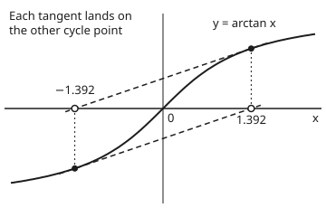
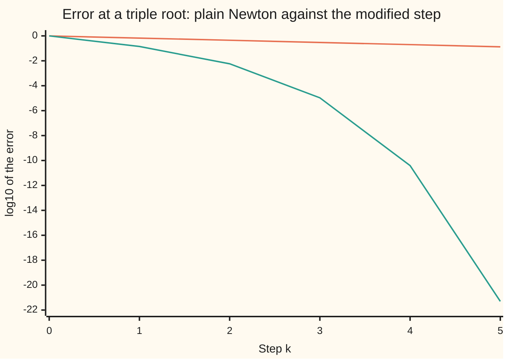

# Newton's bad days: double roots, overshoot, and starting points that never settle

[Syllabus](../../../SYLLABUS.md) → [Numerical analysis](../README.md) → [Root Finding and Fixed Points](../README.md#s02) → Newton's bad days

---

## General Overview

An options desk backs out each option's implied volatility by running Newton's method on the pricing formula. On a one-week option far from the money the price barely moves with volatility, so the tangent is nearly flat, and one Newton step throws the guess to an absurd volatility ([Solving for implied volatility](../../12-Financial%20mathematics/11-Implied%20volatility%20and%20the%20vanilla%20inverses/02-implied-volatility-by-newton-and-bisection.md)). A collision code that asks when a ball just touches a wall solves an equation whose root is repeated, and there Newton crawls. Near an ordinary root Newton doubles its correct digits every step, as [Newton and secant](02-newton-and-secant-with-convergence-orders.md) proves. This card is about the days that promise fails.

Two small functions are clean models of all three failures. $x^3$ has a repeated root. $\arctan x$ is S-shaped, like an option's price against volatility: it flattens far from its root, so tangents there are shallow and aim too far.

**A root where the curve only touches the axis.** Solve $x^3 = 0$ from a start of 1. The answer is plainly 0. Newton needs 52 steps to get within $10^{-9}$ of it, because each step only removes a third of the error. A known factor of 3 in the step cures it in 1 step.

**A tangent that overshoots.** Solve $\arctan x = 0$ (the angle whose tangent is $x$; its root is 0). From 1.39 Newton crosses the root every step and slowly closes in. From 1.5 each step crosses further: 1.500, −1.694, 2.321, −5.114, 32.296. From 10 the fifth step is $-1.50 \times 10^{37}$.

**A start that never settles.** Between those two starts sits $x_c = 1.39174520027$. From exactly there, the tangent lands on $-x_c$, and the tangent there lands back on $x_c$. Newton cycles for ever, in exact arithmetic. In floating point the cycle survives 30 steps.

The cures are cheap. A known **multiplicity** (how many times the root repeats) restores the fast rate. A **line search** (shrink the step until the miss really falls) tames the overshoot: from 10 it reaches the root in 12 steps. And simple tests on the slope and the bend say in advance when a start is safe.

**Newton slows to a fixed error ratio of (m − 1)/m at a root repeated m times, which multiplying the step by m cures; it overshoots wherever the curve bends away from the axis, which halving the step until the miss falls cures; and it is guaranteed to converge from any start where the function and its bend share a sign, the bend keeps that sign, and the slope never vanishes on the way to the root.**

**What kind of fact this is:** three theorems, proved on this card in Why it works: the linear rate at a multiple root and the quadratic rate of its cure, convergence from a start on the convex side, and convergence of damped Newton when the slope stays away from zero. A fourth, the Newton–Kantorovich theorem, is stated with its source and tested on arctan, not proved. The step counts are measurements, printed by the code.

### The picture: the arctan cycle

<p align="center"></p>

Drawn to scale from the coordinates on the checks' `figure,` line: 70 units per unit of $x$ and of $y$. The curve flattens as it climbs, so the tangent at 1.392 is shallow and runs past the root to −1.392. The picture is symmetric, so the next tangent runs straight back.

---

## The formula

Notation from [Newton and secant](02-newton-and-secant-with-convergence-orders.md), in one line: the root is $x^*$, the guesses are $x_k$, and the error is $e_k = x_k - x^*$. Newton's step is $x_{k+1} = x_k - f(x_k)/f'(x_k)$.

A root has **multiplicity** $m$ when $f(x) = (x - x^*)^m g(x)$ with $g(x^*) \neq 0$: the factor $x - x^*$ appears $m$ times. For $x^3$, $m = 3$ and $g = 1$. At such a root, plain Newton and the **modified Newton** step behave like this:

$$\frac{e_{k+1}}{e_k} \to \frac{m-1}{m} \;\;\text{(plain)}, \qquad x_{k+1} = x_k - m\,\frac{f(x_k)}{f'(x_k)}, \quad \frac{e_{k+1}}{e_k^{2}} \to \frac{g'(x^*)}{m\,g(x^*)} \;\;\text{(modified)}$$

**Read it aloud:** plain Newton keeps a fixed share (m − 1)/m of the error each step; stretch the step by m and the next error is again a constant times the current error squared.

The **damped step** keeps Newton's direction $d_k = -f(x_k)/f'(x_k)$ but takes only a fraction $\lambda$ of it. Start at $\lambda = 1$ and halve until

$$|f(x_k + \lambda d_k)| \le (1 - c_1\lambda)\,|f(x_k)|$$

**Read it aloud:** accept the step once the new miss is below the old one by at least the share $c_1\lambda$ of the old miss.

This is the Armijo test from [Line search](../../15-Optimization/02-Unconstrained%20Methods/04-line-search-armijo-and-wolfe.md), applied to the size of the miss instead of a cost.

| Symbol | Plain meaning | In our example | Push it up and the answer… |
| --- | --- | --- | --- |
| $f$, $f'$, $f''$ | the function whose zero is wanted, its slope, and the rate the slope changes (the bend) | $x^3$; $\arctan x$, with slope $1/(1+x^2)$ | — |
| $x^*$, $x_k$, $e_k$ | the root; the guess after $k$ steps; its error $x_k - x^*$ | root 0; $x_0 = 1$ or 10 | — |
| $q$ | the error ratio $e_{k}/e_{k-1}$ | 0.666667 on $x^3$ | slower: $q$ near 1 is a crawl |
| $m$, $g$ | the multiplicity; the factor left after taking out $(x - x^*)^m$ | 3; $g = 1$ for $x^3$, $g = 1 + x$ for $x^3 + x^4$ | plain Newton slows towards ratio 1 |
| $N$, $x_c$ | Newton's step as a map, $N(x) = x - f(x)/f'(x)$; the start where arctan cycles | $x_c$ = 1.39174520027 | a start above $x_c$ runs away |
| $d_k$, $\lambda$, $c_1$ | Newton's full step; the share of it taken; the share of decrease demanded; in the proof, $\bar\lambda$ is the largest share sure to pass and $\lambda_{\min}$ the floor on accepted shares | $c_1 = 10^{-4}$; $\lambda$ = 0.125 at first from 10 | larger $c_1$ halves more often |
| $\mu$, $M$ | a floor on the slope's size and a ceiling on the bend's size, used in the damping proof | $\mu = 1/101$ on $[-10, 10]$; $M$ = 0.649519 | larger $M$ or smaller $\mu$: shorter safe steps |
| $\beta$, $\eta$, $L$, $h$, $t^*$ | Kantorovich's inputs: $1/\lvert f'(x_0)\rvert$, the first step's length, a bend bound, their product $h = \beta L \eta$, and the radius that must hold a root | $h \le 1/2$ for $\lvert x_0\rvert \le$ 0.5184 | $h > 1/2$: no promise |
| $u$, $\delta$ | the unit roundoff, $2^{-53}$: the largest relative rounding error of one operation; $\delta$, the rounding noise in one computed value of $f$ | $u$ = 1.11e-16; $\delta$ about $u$ | larger $\delta$: a wider band that looks like a root |
| $\xi$, $\ell$ | a point between two others that Taylor's theorem says exists; the limit of the guesses, in the proof | — | — |

### When it holds

- **The multiplicity is known.** The modified step needs the true $m$; on a simple root, $m = 3$ triples a good step into an overshoot. The code estimates $m$ from the ratio: $1/(1 - q)$ = 3.0000.
- **The rounding noise is below the curve.** Near a triple root $f$ is about $e^3$, tiny. Multiplied out as $x^3 - 3x^2 + 3x - 1$, the computed value is pure rounding noise within about 4.81e-6 of the root, and Newton stops there with a residual of exactly 0. No step rule fixes this; the problem itself is badly conditioned.
- **The slope stays away from zero on the way.** The damping proof divides by the slope. If the slope can vanish between the start and the root, the damped step can stall at a point where the miss has a local minimum that is not zero.
- **The bend is bounded.** The step-length floor in the proof uses a ceiling $M$ on $|f''|$. Without one, no fixed floor exists.

---

## Why it works

### Step 0: Newton trusts the tangent, and two things break that trust

Newton replaces the curve by its tangent line and jumps to the line's zero. That jump is right when the curve near the guess is nearly straight and steep.

Two things spoil it. At a repeated root the curve is flat, so each tangent lands short. Where the curve bends away from the axis, each tangent is too shallow and lands too far. The first costs speed; the second can cost the answer.

### Step 1: at a multiple root, a fixed share of the error survives

Write $f(x) = e^m g(x)$ with $e = x - x^*$. Its slope is $f'(x) = e^{m-1}\,(m g + e g')$. Put both into Newton's step:

$$e_{k+1} = e_k - \frac{e_k\,g}{m g + e_k g'} = e_k\,\frac{(m-1)\,g + e_k\,g'}{m g + e_k\,g'}$$

As $e_k \to 0$ the fraction tends to $(m-1)/m$. For $x^3$ it is exactly $2/3$ at every step, so $x_k = (2/3)^k$.

Each step then gains only $\log_{10}(3/2)$ = 0.176 digits. Nine digits need $9/0.176$, so 52 steps. The code measures 52, and its iterates match $(2/3)^k$ to a relative gap of 2.00e-15.

The halving error at a double root, shown on [Newton's method](../../06-Calculus%20and%20analysis/03-What%20Derivatives%20Tell%20You/06-newtons-method.md), is the case $m = 2$.

### Step 2: stretching the step by m restores order 2

Multiply the step by $m$. The same algebra gives

$$e_{k+1} = e_k - \frac{m\,e_k\,g}{m g + e_k g'} = e_k^{2}\,\frac{g'}{m g + e_k\,g'}$$

The next error is a constant times the current error squared: order 2 again. For $x^3$, $g' = 0$, so one step lands exactly on 0. For $x^3 + x^4$, $g = 1 + x$ and the law is exactly $e_{k+1} = e_k^2/(3 + 4e_k)$. The code's ratios 0.142857, 0.280000, 0.330813, 0.333329 match that law and close in on 1/3.

When $m$ is unknown, read it off the plain run: a steady ratio $q$ means $m = 1/(1-q)$. A second cure needs no $m$ at all: apply Newton to $f/f'$, which has a simple root at the same place.



Upper line: plain Newton on $x^3$, losing 0.176 of a digit per step, a straight line. Lower line: the modified step on $x^3 + x^4$, whose digit count roughly doubles each step.

### Step 3: the triple root also has a precision floor

The rate is a property of the method; the floor is a property of the problem. Near a root of multiplicity $m$, $f$ is about a constant times $e^m$. If evaluating $f$ carries rounding noise of size $\delta$, every point with $|e|^m$ below $\delta$ looks like a root. So no evaluation-based method can resolve the root better than about $\delta^{1/m}$.

For $(x-1)^3$ multiplied out, the terms near $x = 1$ are of size 1, so $\delta$ is about $u$. The estimate is $u^{1/3}$ = 4.81e-6. Newton stops after 30 steps with a computed residual of exactly 0 and a true error of 4.67e-6. A residual of zero is a small backward error, not a small forward error. In the terms of [Conditioning and stability](../01-Floating%20Point%20and%20Error/05-conditioning-and-stability.md), the trouble is conditioning, not stability: a multiple root's condition number is infinite.

### Step 4: on arctan every step crosses the root

For $x > 0$, $\arctan x > x/(1 + x^2)$: both sides are 0 at 0, and the left side's slope exceeds the right side's by $2x^2/(1+x^2)^2$. So $(1 + x^2)\arctan x > x$, and $N(x) = x - (1+x^2)\arctan x$ is negative. By symmetry, every Newton step on arctan lands on the other side of the root.

So the size $|x_k|$ decides everything. It shrinks when $(1+x^2)\arctan x < 2x$ and grows when it is larger. The boundary is $x_c$, the root of $(1+x^2)\arctan x = 2x$. The code finds it two ways, by bisection and by the secant step, and both give 1.39174520027.

- Below $x_c$, $|x_k|$ falls each step, so the run converges. From 1.39: 1.390, −1.387, 1.380, −1.360, 1.309, −1.184, 0.905.
- Above $x_c$, $|x_k|$ grows each step, and grows faster the further out it is.
- At $x_c$, $N(x_c) = -x_c$ exactly: the 2-cycle in the picture.

The cycle is unstable. The slope of the step map there is $N'(x_c) = -2x_c\arctan x_c$ = −2.6380. A slip from the cycle grows by $2.6380^2$ = 6.9593 per round trip. From a rounding slip of $10^{-16}$ to $10^{-3}$ takes about 30.9 steps, and the code's float run breaks away after 30. The exact count depends on the last bits of the arctan routine.

### Step 5: a condition that guarantees convergence

**Theorem.** Let $x_0 > x^*$, with $f$ twice differentiable on $[x^*, x_0]$, $f' > 0$ on $(x^*, x_0]$ and $f'' \ge 0$ there. Then Newton's guesses fall steadily and converge to $x^*$. The mirror cases hold too. In one line: **$f$ and $f''$ share a sign at the start, $f''$ keeps that sign, and $f'$ does not vanish, all the way to the root.**

The idea: a curve bending towards the axis lies above its tangents. So each tangent lands between the root and the guess. The guesses fall but never pass the root, so they must settle, and they can only settle on a root.

<details>
<summary>Detailed proof: monotone convergence from the convex side</summary>

Suppose $x^* < x_k \le x_0$. Then $f(x_k) > 0$, because $f$ is strictly increasing on $[x^*, x_0]$ and $f(x^*) = 0$. With $f'(x_k) > 0$, the step $-f(x_k)/f'(x_k)$ is negative, so $x_{k+1} < x_k$.

Since $f'' \ge 0$, the curve lies above its tangent at $x_k$ (Taylor's theorem with a remainder $\tfrac12 f''(\xi)(x - x_k)^2 \ge 0$). At $x^*$ this reads $0 = f(x^*) \ge f(x_k) + f'(x_k)(x^* - x_k)$. Divide by $f'(x_k) > 0$ and rearrange: $x_{k+1} = x_k - f(x_k)/f'(x_k) \ge x^*$.

So the guesses fall and stay at or above $x^*$. A falling sequence bounded below has a limit $\ell \ge x^*$. The steps $x_k - x_{k+1} = f(x_k)/f'(x_k)$ tend to 0, and $f'$ is bounded on $[x^*, x_0]$, so $f(x_k) \to 0$ and $f(\ell) = 0$. The only zero of $f$ on $[x^*, x_0]$ is $x^*$, so $\ell = x^*$. $\blacksquare$

</details>

For $x^3$ from any positive start, $f > 0$ and $f'' = 6x > 0$: the theorem applies, and the code confirms the 52 guesses fall steadily. It promises convergence, not speed.

For arctan the test fails at every start. For $x > 0$, $f > 0$ but $f'' = -2x/(1+x^2)^2 < 0$. The curve bends away from the axis, which is exactly why every step overshoots. The [Solving for implied volatility](../../12-Financial%20mathematics/11-Implied%20volatility%20and%20the%20vanilla%20inverses/02-implied-volatility-by-newton-and-bisection.md) card uses this same theorem: its safe start sits where the option price changes bend.

### Step 6: damping guarantees convergence from far away

**Theorem.** Suppose $|f''| \le M$ everywhere, and $|f'| \ge \mu > 0$ on the interval where $|f| \le |f(x_0)|$. Then the damped step always finds an acceptable $\lambda$, never smaller than $\min\!\left(1, (1-c_1)\mu^2 / (M|f(x_0)|)\right)$. The miss shrinks by a fixed factor each step, so the guesses converge to the root. Near the root $\lambda = 1$ is accepted, and plain Newton's order 2 returns.

The idea: along Newton's direction the miss falls at the full rate to first order. Only the bend can spoil that, and the bend's effect shrinks like $\lambda^2$. So a short enough step always wins.

<details>
<summary>Detailed proof: the damped step is accepted, and the miss falls geometrically</summary>

Write $f = f(x_k)$ and $d = -f/f'(x_k)$, so $|d| \le |f|/\mu$. Taylor's theorem gives a point $\xi$ with

$$f(x_k + \lambda d) = f + \lambda f'(x_k)\,d + \tfrac12\lambda^2 f''(\xi)\,d^2 = (1 - \lambda) f + \tfrac12\lambda^2 f''(\xi)\,d^2.$$

For $0 < \lambda \le 1$ this gives $|f(x_k + \lambda d)| \le |f|\,\bigl(1 - \lambda + \tfrac12\lambda^2 M |f| / \mu^2\bigr)$. The Armijo test holds whenever the bracket is at most $1 - c_1\lambda$, which is whenever $\lambda \le \bar\lambda = 2(1 - c_1)\mu^2/(M|f|)$.

Halving from 1 stops at the first $\lambda \le \bar\lambda$ or earlier, so the accepted $\lambda$ is at least $\min(1, \bar\lambda/2)$. Each accepted step keeps $|f|$ below $|f(x_0)|$, so the guesses stay where $\mu$ applies, and $|f|$ only falls, so $\bar\lambda$ only grows. Call the first floor $\lambda_{\min}$. Then $|f(x_{k+1})| \le (1 - c_1\lambda_{\min})\,|f(x_k)|$, so $|f(x_k)| \to 0$ geometrically.

The mean value theorem converts the miss into an error: $|x_k - x^*| \le |f(x_k)|/\mu \to 0$. Once $|f(x_k)| \le 2(1 - c_1)\mu^2/M$, $\bar\lambda \ge 1$ and the full step passes, so the run ends as plain Newton. $\blacksquare$

</details>

For arctan from 10: $\mu = 1/101$ on $[-10, 10]$, and the largest bend is $M = 3\sqrt3/8$ = 0.649519, at $x = 1/\sqrt3$. The code checks $M$ against a fine scan. The theorem's floor is 1.03e-4. The run's smallest step length is 0.125, which is 1219 times the floor: a worst-case bound is safe but pessimistic. The step lengths were 0.125, 0.125, 0.25, 0.25, then eight full steps.

### Step 7: Newton–Kantorovich, a guarantee that also proves a root exists

The theorems above assume a root. The **Newton–Kantorovich theorem** proves one exists, from numbers at the start only. It also works in many unknowns. In one variable, set $\beta = 1/|f'(x_0)|$, $\eta = |f(x_0)/f'(x_0)|$ (the first step's length), and let $L$ bound $|f''|$ on an interval around $x_0$ that reaches at least $t^*$ (below) on each side. If

$$h = \beta\,L\,\eta \le \tfrac12,$$

then $f$ has a root within $t^* = (1 - \sqrt{1 - 2h})/(\beta L)$ of $x_0$, and Newton from $x_0$ converges to it. This card states it without proof. The proof bounds the true run by a simple quadratic's Newton run; the second source gives it in full.

On arctan with $L$ = 0.649519, $h \le 1/2$ holds exactly for $|x_0| \le$ 0.5184. Newton actually converges for $|x_0| <$ 1.3917, so the guarantee covers a region 2.685 times smaller than the truth. At the edge it promises a root within $t^*$ = 1.2135 of $x_0$; the true distance is 0.5184.

---

## Worked numbers, by hand

The two functions, a few steps each.

| Step | Arithmetic | Value |
| --- | --- | --- |
| $x^3$, plain step 1 | $1 - 1^3/(3 \times 1^2) = 1 - 1/3$ | 0.666667 |
| $x^3$, plain step 2 | $\tfrac23 - (\tfrac23)^3 / (3 \times (\tfrac23)^2) = \tfrac23 \times \tfrac23$ | 0.444444 |
| $x^3$, steps to $10^{-9}$ | $9 \div \log_{10} 1.5 = 9 \div 0.176$, rounded up | 52 |
| multiplicity from the ratio | $1/(1 - 0.666667)$ | 3.0000 |
| $x^3$, modified step | $1 - 3 \times 1^3/(3 \times 1^2)$ | 0 |
| $x^3 + x^4$, modified step | $1 - 3 \times 2/7 = 1/7$ | 0.142857 |
| arctan from 1.5 | $1.5 - (1 + 2.25) \times \arctan 1.5$ | −1.694 |
| slip growth per round trip | $(2 \times 1.39174520027 \times \arctan 1.39174520027)^2$ | 6.9593 |
| arctan from 10, damped | 12 steps, step lengths 0.125, 0.125, 0.25, 0.25, then 1 | **error 0 in floats, against $-1.50 \times 10^{37}$ undamped** |

All errors are true errors: the roots here are known exactly. Knowing the multiplicity turns 52 steps into 1. Halving the step turns a run that overflows towards infinity into one that lands on the root.

### What breaks if you drop a piece

| Mistake | Comes out at | What went wrong |
| --- | --- | --- |
| Plain Newton at the triple root of $x^3$ | 52 steps, ratio 0.666667 | The slope is zero at the root, so the order falls to 1 |
| Full steps on arctan from 10 | $-1.50 \times 10^{37}$ after 5 steps | The curve bends away from the axis, so every tangent overshoots |
| Start exactly on the cycle point $x_c$ | the 2-cycle holds for 30 steps, then $x$ = 1.3897 | An unstable cycle: rounding slips grow 6.9593 times per round trip |
| Trust a zero residual on $(x-1)^3$ multiplied out | residual 0.00e0, true error 4.67e-6 | Rounding noise hides the root: bad conditioning, not a bad method |

---

## Code, from first principles, and it actually runs

The code runs six experiments and checks each by a second road. Plain Newton on $x^3$ is checked against the closed form $(2/3)^k$ and the step-count formula. The modified step on $x^3 + x^4$ is checked against its exact error law. The precision floor is checked against the estimate $u^{1/3}$. The cycle point is found by bisection and by the secant step, and its breakup time against the growth estimate. Damped Newton is checked against the theorem's step-length floor, with the bend bound $M$ found by formula and by a scan. Kantorovich's edge is found by bisection on $h = 1/2$, and checked by recomputing $h = \beta L \eta$ from the slope. Two damped runs, at $c_1 = 10^{-4}$ and $c_1 = 0.5$, are checked to cut the miss at every step.

### Python

```python
# Newton's bad days: the check behind the card.  Standard library only.
# A triple root (x^3) slows Newton to a crawl; arctan makes it overshoot, cycle and
# run away.  Diagnose, cure, damp, and test the conditions that guarantee convergence.
from math import atan, log, log10, sqrt, ceil
def sci(v, d=2):                              # 1.23e-10, the form Rust prints
    m, e = f"{v:.{d}e}".split("e")
    return f"{m}e{int(e)}"
def newton(f, df, x, steps, m=1):             # m = 1 plain; m > 1 the modified step
    xs = [x]
    for _ in range(steps):
        if f(xs[-1]) == 0: break
        xs.append(xs[-1] - m * f(xs[-1]) / df(xs[-1]))
    return xs
cube, dcube = (lambda x: x * x * x), (lambda x: 3 * x * x)
xs = newton(cube, dcube, 1.0, 60)
k9 = next(k for k, x in enumerate(xs) if abs(x) < 1e-9)
print("1. Newton on f(x) = x^3 from 1 (root 0, slope 0 there)")
for k in (0, 1, 2, 3, 10, k9 - 1, k9):
    q = f"{xs[k] / xs[k - 1]:.6f}" if k else "-"
    print(f"   k = {k:2}  x_k = error = {sci(xs[k])}  ratio e_k/e_(k-1) = {q}")
cf = [1.0]                                    # road two: (2/3)^k by repeated multiplication
for _ in range(k9): cf.append(cf[-1] * (2 / 3))
gap = max(abs(xs[k] / cf[k] - 1) for k in range(k9 + 1))
print(f"   closed form x_k = (2/3)^k: largest relative gap {sci(gap)}")
print(f"   steps to error < 1e-9: run {k9}, formula ceil(9/log10(1.5)) = {ceil(9 / log10(1.5))}, "
      f"{log10(1.5):.3f} digits a step")
assert k9 == ceil(9 / log10(1.5)) and gap < 1e-14
assert all(0 < xs[k + 1] < xs[k] for k in range(k9))            # monotone, as the theorem says
q = xs[k9] / xs[k9 - 1]
print(f"   multiplicity read off the ratio: m = 1/(1 - q) = {1 / (1 - q):.4f}")
assert abs(1 / (1 - q) - 3) < 1e-9
print(f"   last step {sci(xs[k9 - 1] - xs[k9])}, true error after it {sci(xs[k9])}: error = 2 x step")
mx = newton(cube, dcube, 1.0, 5, m=3)
print(f"2. modified Newton, 3 f/f', on x^3 from 1: x_1 = {sci(mx[1])}, done in {len(mx) - 1} step")
assert mx == [1.0, 0.0]
m2 = newton(cube, dcube, 1.0, 60, m=2)                          # too small an m: still linear
k2 = next(k for k, x in enumerate(m2) if abs(x) < 1e-9)
print(f"   with m = 2 instead: ratio {m2[1] / m2[0]:.6f}, {k2} steps to error < 1e-9")
assert k2 == ceil(9 / log10(3))
g, dg = (lambda x: x ** 3 + x ** 4), (lambda x: 3 * x * x + 4 * x ** 3)
gp, gm = newton(g, dg, 1.0, 80), newton(g, dg, 1.0, 6, m=3)
kp = next(k for k, x in enumerate(gp) if abs(x) < 1e-9)
print(f"   on x^3 + x^4 from 1: plain Newton {kp} steps, last ratio {gp[kp] / gp[kp - 1]:.4f}")
print("   modified:  k  error e_k   e_k/e_(k-1)^2   law 1/(3 + 4 e_(k-1))")
for k in range(1, 5):
    law = 1 / (3 + 4 * gm[k - 1])
    print(f"              {k}  {sci(gm[k]):>9}   {gm[k] / gm[k - 1] ** 2:.6f}        {law:.6f}")
    assert abs(gm[k] / gm[k - 1] ** 2 - law) < 1e-9
assert abs(gm[4] / gm[3] ** 2 - 1 / 3) < 1e-5 and gm[4] < 1e-10 < gm[3]
p, dp = (lambda x: ((x - 3) * x + 3) * x - 1), (lambda x: (3 * x - 6) * x + 3)
pe = newton(p, dp, 2.0, 200)
u = 2.0 ** -53
print(f"3. (x-1)^3 multiplied out, from 2: stops after {len(pe) - 1} steps with p(x) = {sci(p(pe[-1]))}")
print(f"   true error {sci(abs(pe[-1] - 1))}; u = {sci(u)}, estimate cbrt(u) = {sci(u ** (1 / 3))}")
assert p(pe[-1]) == 0 and 1e-6 < abs(pe[-1] - 1) < 2 * u ** (1 / 3)
N = lambda x: x - (1 + x * x) * atan(x)                         # Newton's step on arctan
c = lambda x: (1 + x * x) * atan(x) - 2 * x                     # zero where N(x) = -x
lo, hi = 1.0, 2.0
while lo < (lo + hi) / 2 < hi:
    lo, hi = ((lo + hi) / 2, hi) if c((lo + hi) / 2) < 0 else (lo, (lo + hi) / 2)
a, b = 1.0, 2.0                                                 # road two: secant on c
for _ in range(40):
    if c(b) == c(a): break
    a, b = b, b - c(b) * (b - a) / (c(b) - c(a))
xc = lo
print(f"4. Newton on arctan: cycle point x_c, bisection {xc:.11f}, secant {b:.11f}")
assert abs(xc - b) < 1e-12 and abs(N(xc) + xc) < 1e-12
print(f"   N(x_c) = {N(xc):.11f}; slope of the step map there N'(x_c) = -2 x_c atan(x_c) = {-2 * xc * atan(xc):.4f}")
fx = lambda v: f"{v:.3f}" if abs(v) < 1000 else sci(v)
for lab, x0 in (("1.39", 1.39), ("1.5", 1.5), ("10", 10.0)):
    s = [x0]
    while len(s) < 7 and abs(s[-1]) < 1e30 and abs(s[-1]) > 1e-12: s.append(N(s[-1]))
    print(f"   from {lab:<4}: " + ", ".join(fx(v) for v in s))
assert all(N(x) * x < 0 for x in (0.1, 0.5, 1.0, 2.0, -3.0))    # every step overshoots
s, k = [xc], 0
while abs(abs(s[-1]) - xc) < 1e-3: s.append(N(s[-1]))
print(f"   from x_c in floats: the 2-cycle holds to 1e-3 for {len(s) - 1} steps, then x = {s[-1]:.4f}")
amp = (2 * xc * atan(xc)) ** 2                                  # growth of a slip per round trip
est = 2 * log(1e-3 / 1e-16) / log(amp)
print(f"   a slip grows x{amp:.4f} per round trip; from 1e-16 to 1e-3 takes about {est:.1f} steps")
assert abs(est - (len(s) - 1)) < 3
def damped(x, c1=1e-4):                                         # backtracking on |f|
    path = []
    while abs(atan(x)) > 1e-15 and len(path) < 50:
        d, lam = -(1 + x * x) * atan(x), 1.0
        while abs(atan(x + lam * d)) > (1 - c1 * lam) * abs(atan(x)): lam /= 2
        x += lam * d
        path.append((lam, x))
    return path
dp10 = damped(10.0)
print(f"5. damped Newton from 10: {len(dp10)} steps, end x = {sci(dp10[-1][1])}")
print("   step lengths: " + " ".join(f"{l:g}" for l, _ in dp10))
L = 3 * sqrt(3) / 8                                             # largest |f''| for arctan
Ls = max(2 * x / (1 + x * x) ** 2 for x in (i / 10000 for i in range(30001)))
print(f"   largest |f''| = 2|x|/(1+x^2)^2: scan {Ls:.6f}, formula 3 sqrt(3)/8 = {L:.6f}")
assert abs(Ls - L) < 1e-6
lam_bound = (1 - 1e-4) * (1 / 101) ** 2 / (L * atan(10.0))
print(f"   theorem's floor on the step length {sci(lam_bound)}; smallest taken {min(l for l, _ in dp10):g}, "
      f"{min(l for l, _ in dp10) / lam_bound:.0f} times the floor")
assert abs(dp10[-1][1]) < 1e-15 and min(l for l, _ in dp10) >= lam_bound
assert [l for l, _ in dp10[-3:]] == [1.0, 1.0, 1.0]
for c1 in (1e-4, 0.5):                                          # the miss must fall at every step
    path = [10.0] + [x for _, x in damped(10.0, c1)]
    assert all(abs(atan(b)) < abs(atan(a)) for a, b in zip(path, path[1:]))
h = lambda x: L * atan(x) * (1 + x * x) ** 2                   # Kantorovich h at a start x
lo, hi = 0.0, 1.0
for _ in range(100): lo, hi = ((lo + hi) / 2, hi) if h((lo + hi) / 2) <= 0.5 else (lo, (lo + hi) / 2)
tstar = 1 / ((1 + lo * lo) * L)
print(f"6. Kantorovich on arctan: h <= 1/2 for |x0| <= {lo:.4f}; true basin |x0| < {xc:.4f}, "
      f"ratio {xc / lo:.3f}")
dat = lambda x: 1 / (1 + x * x)                                 # road two: beta and eta from the slope
beta, eta = 1 / dat(lo), abs(atan(lo) / dat(lo))
print(f"   at that edge beta L eta = {beta * L * eta:.6f}; the root is promised within t* = {tstar:.4f} of x0; "
      f"true distance {lo:.4f}")
assert abs(beta * L * eta - 0.5) < 1e-9
assert abs(h(lo) - 0.5) < 1e-9 and tstar > lo and newton(atan, lambda x: 1 / (1 + x * x), lo, 8)[-1] < 1e-15
print("chart, log10 error: plain x^3 " + " ".join(f"{log10(xs[k]):.2f}" for k in range(6))
      + "; modified x^3+x^4 " + " ".join(f"{log10(gm[k]):.2f}" for k in range(6)))
X, Y = (lambda x: 180 + 70 * x), (lambda y: 120 - 70 * y)
print(f"figure, cycle points ({X(xc):.1f}, {Y(atan(xc)):.1f}) and ({X(-xc):.1f}, {Y(-atan(xc)):.1f}), "
      f"tangents land at ({X(-xc):.1f}, {Y(0):.1f}) and ({X(xc):.1f}, {Y(0):.1f}), curve ends "
      f"({X(-2.4):.1f}, {Y(atan(-2.4)):.1f}) ({X(2.4):.1f}, {Y(atan(2.4)):.1f})")
print("ALL CHECKS PASS")
```

**Ran 2026-11-11 on macOS, Python 3.14.10, standard library only. All checks passed. Output, pasted from the run:**

```
1. Newton on f(x) = x^3 from 1 (root 0, slope 0 there)
   k =  0  x_k = error = 1.00e0  ratio e_k/e_(k-1) = -
   k =  1  x_k = error = 6.67e-1  ratio e_k/e_(k-1) = 0.666667
   k =  2  x_k = error = 4.44e-1  ratio e_k/e_(k-1) = 0.666667
   k =  3  x_k = error = 2.96e-1  ratio e_k/e_(k-1) = 0.666667
   k = 10  x_k = error = 1.73e-2  ratio e_k/e_(k-1) = 0.666667
   k = 51  x_k = error = 1.05e-9  ratio e_k/e_(k-1) = 0.666667
   k = 52  x_k = error = 6.97e-10  ratio e_k/e_(k-1) = 0.666667
   closed form x_k = (2/3)^k: largest relative gap 2.00e-15
   steps to error < 1e-9: run 52, formula ceil(9/log10(1.5)) = 52, 0.176 digits a step
   multiplicity read off the ratio: m = 1/(1 - q) = 3.0000
   last step 3.49e-10, true error after it 6.97e-10: error = 2 x step
2. modified Newton, 3 f/f', on x^3 from 1: x_1 = 0.00e0, done in 1 step
   with m = 2 instead: ratio 0.333333, 19 steps to error < 1e-9
   on x^3 + x^4 from 1: plain Newton 52 steps, last ratio 0.6667
   modified:  k  error e_k   e_k/e_(k-1)^2   law 1/(3 + 4 e_(k-1))
              1    1.43e-1   0.142857        0.142857
              2    5.71e-3   0.280000        0.280000
              3    1.08e-5   0.330813        0.330813
              4   3.89e-11   0.333329        0.333329
3. (x-1)^3 multiplied out, from 2: stops after 30 steps with p(x) = 0.00e0
   true error 4.67e-6; u = 1.11e-16, estimate cbrt(u) = 4.81e-6
4. Newton on arctan: cycle point x_c, bisection 1.39174520027, secant 1.39174520027
   N(x_c) = -1.39174520027; slope of the step map there N'(x_c) = -2 x_c atan(x_c) = -2.6380
   from 1.39: 1.390, -1.387, 1.380, -1.360, 1.309, -1.184, 0.905
   from 1.5 : 1.500, -1.694, 2.321, -5.114, 32.296, -1.58e3, 3.89e6
   from 10  : 10.000, -138.584, 2.99e4, -1.40e9, 3.09e18, -1.50e37
   from x_c in floats: the 2-cycle holds to 1e-3 for 30 steps, then x = 1.3897
   a slip grows x6.9593 per round trip; from 1e-16 to 1e-3 takes about 30.9 steps
5. damped Newton from 10: 12 steps, end x = 0.00e0
   step lengths: 0.125 0.125 0.25 0.25 1 1 1 1 1 1 1 1
   largest |f''| = 2|x|/(1+x^2)^2: scan 0.649519, formula 3 sqrt(3)/8 = 0.649519
   theorem's floor on the step length 1.03e-4; smallest taken 0.125, 1219 times the floor
6. Kantorovich on arctan: h <= 1/2 for |x0| <= 0.5184; true basin |x0| < 1.3917, ratio 2.685
   at that edge beta L eta = 0.500000; the root is promised within t* = 1.2135 of x0; true distance 0.5184
chart, log10 error: plain x^3 0.00 -0.18 -0.35 -0.53 -0.70 -0.88; modified x^3+x^4 0.00 -0.85 -2.24 -4.97 -10.41 -21.30
figure, cycle points (277.4, 53.7) and (82.6, 186.3), tangents land at (82.6, 120.0) and (277.4, 120.0), curve ends (12.0, 202.3) (348.0, 37.7)
ALL CHECKS PASS
```

### Rust

Same numbers, same labels, built with `rustc --edition 2021 -O`.

```rust
// Newton's bad days: the same check as the Python, in Rust.  No crates.
// A triple root (x^3) slows Newton to a crawl; arctan makes it overshoot, cycle and
// run away.  Diagnose, cure, damp, and test the conditions that guarantee convergence.
fn sci(v: f64) -> String { format!("{:.2e}", v) }          // 1.23e-10
fn fx(v: f64) -> String { if v.abs() < 1000.0 { format!("{:.3}", v) } else { sci(v) } }
fn newton(f: &dyn Fn(f64) -> f64, df: &dyn Fn(f64) -> f64, x: f64, steps: usize, m: f64) -> Vec<f64> {
    let mut xs = vec![x];                                  // m = 1 plain; m > 1 modified
    for _ in 0..steps {
        let x = xs[xs.len() - 1];
        if f(x) == 0.0 { break }
        xs.push(x - m * f(x) / df(x));
    }
    xs
}
fn nstep(x: f64) -> f64 { x - (1.0 + x * x) * x.atan() }    // Newton's step on arctan
fn cyc(x: f64) -> f64 { (1.0 + x * x) * x.atan() - 2.0 * x } // zero where N(x) = -x
fn damped(mut x: f64, c1: f64) -> Vec<(f64, f64)> {        // backtracking on |f|
    let mut path = vec![];
    while x.atan().abs() > 1e-15 && path.len() < 50 {
        let (d, mut lam) = (-(1.0 + x * x) * x.atan(), 1.0f64);
        while (x + lam * d).atan().abs() > (1.0 - c1 * lam) * x.atan().abs() { lam /= 2.0; }
        x += lam * d;
        path.push((lam, x));
    }
    path
}
fn main() {
    let (cube, dcube) = (|x: f64| x * x * x, |x: f64| 3.0 * x * x);
    let xs = newton(&cube, &dcube, 1.0, 60, 1.0);
    let k9 = xs.iter().position(|x| x.abs() < 1e-9).unwrap();
    println!("1. Newton on f(x) = x^3 from 1 (root 0, slope 0 there)");
    for k in [0, 1, 2, 3, 10, k9 - 1, k9] {
        let q = if k > 0 { format!("{:.6}", xs[k] / xs[k - 1]) } else { "-".to_string() };
        println!("   k = {:2}  x_k = error = {}  ratio e_k/e_(k-1) = {}", k, sci(xs[k]), q);
    }
    let mut cf = vec![1.0f64];                              // road two: (2/3)^k by multiplication
    for _ in 0..k9 { let v = cf[cf.len() - 1] * (2.0 / 3.0); cf.push(v); }
    let gap = (0..=k9).map(|k| (xs[k] / cf[k] - 1.0).abs()).fold(0.0, f64::max);
    let kf = (9.0 / 1.5f64.log10()).ceil() as usize;
    println!("   closed form x_k = (2/3)^k: largest relative gap {}", sci(gap));
    println!("   steps to error < 1e-9: run {}, formula ceil(9/log10(1.5)) = {}, {:.3} digits a step", k9, kf, 1.5f64.log10());
    assert!(k9 == kf && gap < 1e-14);
    assert!((0..k9).all(|k| 0.0 < xs[k + 1] && xs[k + 1] < xs[k]));   // monotone
    let q = xs[k9] / xs[k9 - 1];
    println!("   multiplicity read off the ratio: m = 1/(1 - q) = {:.4}", 1.0 / (1.0 - q));
    assert!((1.0 / (1.0 - q) - 3.0).abs() < 1e-9);
    println!("   last step {}, true error after it {}: error = 2 x step", sci(xs[k9 - 1] - xs[k9]), sci(xs[k9]));
    let mx = newton(&cube, &dcube, 1.0, 5, 3.0);
    println!("2. modified Newton, 3 f/f', on x^3 from 1: x_1 = {}, done in {} step", sci(mx[1]), mx.len() - 1);
    assert!(mx == vec![1.0, 0.0]);
    let m2 = newton(&cube, &dcube, 1.0, 60, 2.0);          // too small an m: still linear
    let k2 = m2.iter().position(|x| x.abs() < 1e-9).unwrap();
    println!("   with m = 2 instead: ratio {:.6}, {} steps to error < 1e-9", m2[1] / m2[0], k2);
    assert!(k2 == (9.0 / 3f64.log10()).ceil() as usize);
    let (g, dg) = (|x: f64| x.powi(3) + x.powi(4), |x: f64| 3.0 * x * x + 4.0 * x.powi(3));
    let (gp, gm) = (newton(&g, &dg, 1.0, 80, 1.0), newton(&g, &dg, 1.0, 6, 3.0));
    let kp = gp.iter().position(|x| x.abs() < 1e-9).unwrap();
    println!("   on x^3 + x^4 from 1: plain Newton {} steps, last ratio {:.4}", kp, gp[kp] / gp[kp - 1]);
    println!("   modified:  k  error e_k   e_k/e_(k-1)^2   law 1/(3 + 4 e_(k-1))");
    for k in 1..5 {
        let law = 1.0 / (3.0 + 4.0 * gm[k - 1]);
        println!("              {}  {:>9}   {:.6}        {:.6}", k, sci(gm[k]), gm[k] / (gm[k - 1] * gm[k - 1]), law);
        assert!((gm[k] / (gm[k - 1] * gm[k - 1]) - law).abs() < 1e-9);
    }
    assert!((gm[4] / (gm[3] * gm[3]) - 1.0 / 3.0).abs() < 1e-5 && gm[4] < 1e-10 && 1e-10 < gm[3]);
    let (p, dp) = (|x: f64| ((x - 3.0) * x + 3.0) * x - 1.0, |x: f64| (3.0 * x - 6.0) * x + 3.0);
    let pe = newton(&p, &dp, 2.0, 200, 1.0);
    let (pl, u) = (pe[pe.len() - 1], 2f64.powi(-53));
    println!("3. (x-1)^3 multiplied out, from 2: stops after {} steps with p(x) = {}", pe.len() - 1, sci(p(pl)));
    println!("   true error {}; u = {}, estimate cbrt(u) = {}", sci((pl - 1.0).abs()), sci(u), sci(u.powf(1.0 / 3.0)));
    assert!(p(pl) == 0.0 && 1e-6 < (pl - 1.0).abs() && (pl - 1.0).abs() < 2.0 * u.powf(1.0 / 3.0));
    let (mut lo, mut hi) = (1.0f64, 2.0f64);
    while lo < (lo + hi) / 2.0 && (lo + hi) / 2.0 < hi {
        let m = (lo + hi) / 2.0;
        if cyc(m) < 0.0 { lo = m } else { hi = m }
    }
    let (mut a, mut b) = (1.0f64, 2.0f64);                 // road two: secant on c
    for _ in 0..40 {
        if cyc(b) == cyc(a) { break }
        let nb = b - cyc(b) * (b - a) / (cyc(b) - cyc(a));
        a = b; b = nb;
    }
    let xc = lo;
    println!("4. Newton on arctan: cycle point x_c, bisection {:.11}, secant {:.11}", xc, b);
    assert!((xc - b).abs() < 1e-12 && (nstep(xc) + xc).abs() < 1e-12);
    println!("   N(x_c) = {:.11}; slope of the step map there N'(x_c) = -2 x_c atan(x_c) = {:.4}", nstep(xc), -2.0 * xc * xc.atan());
    for (lab, x0) in [("1.39", 1.39f64), ("1.5", 1.5), ("10", 10.0)] {
        let mut s = vec![x0];
        while s.len() < 7 && s[s.len() - 1].abs() < 1e30 && s[s.len() - 1].abs() > 1e-12 { let v = nstep(s[s.len() - 1]); s.push(v); }
        let parts: Vec<String> = s.iter().map(|&v| fx(v)).collect();
        println!("   from {:<4}: {}", lab, parts.join(", "));
    }
    assert!([0.1, 0.5, 1.0, 2.0, -3.0].iter().all(|&x| nstep(x) * x < 0.0));   // overshoots
    let mut s = vec![xc];
    while (s[s.len() - 1].abs() - xc).abs() < 1e-3 { let v = nstep(s[s.len() - 1]); s.push(v); }
    println!("   from x_c in floats: the 2-cycle holds to 1e-3 for {} steps, then x = {:.4}", s.len() - 1, s[s.len() - 1]);
    let amp = (2.0 * xc * xc.atan()).powi(2);              // growth of a slip per round trip
    let est = 2.0 * (1e-3f64 / 1e-16).ln() / amp.ln();
    println!("   a slip grows x{:.4} per round trip; from 1e-16 to 1e-3 takes about {:.1} steps", amp, est);
    assert!((est - (s.len() - 1) as f64).abs() < 3.0);
    let dp10 = damped(10.0, 1e-4);
    println!("5. damped Newton from 10: {} steps, end x = {}", dp10.len(), sci(dp10[dp10.len() - 1].1));
    let ls: Vec<String> = dp10.iter().map(|&(l, _)| format!("{}", l)).collect();
    println!("   step lengths: {}", ls.join(" "));
    let ll = 3.0 * 3f64.sqrt() / 8.0;                      // largest |f''| for arctan
    let ls_ = (0..30001).map(|i| { let x = i as f64 / 10000.0; 2.0 * x / ((1.0 + x * x) * (1.0 + x * x)) }).fold(0.0, f64::max);
    println!("   largest |f''| = 2|x|/(1+x^2)^2: scan {:.6}, formula 3 sqrt(3)/8 = {:.6}", ls_, ll);
    assert!((ls_ - ll).abs() < 1e-6);
    let lam_bound = (1.0 - 1e-4) * (1.0f64 / 101.0).powi(2) / (ll * 10f64.atan());
    let lmin = dp10.iter().map(|&(l, _)| l).fold(1.0, f64::min);
    println!("   theorem's floor on the step length {}; smallest taken {}, {:.0} times the floor", sci(lam_bound), lmin, lmin / lam_bound);
    assert!(dp10[dp10.len() - 1].1.abs() < 1e-15 && lmin >= lam_bound);
    assert!(dp10[dp10.len() - 3..].iter().all(|&(l, _)| l == 1.0));
    for c1 in [1e-4, 0.5] {                                // the miss must fall at every step
        let path: Vec<f64> = std::iter::once(10.0).chain(damped(10.0, c1).iter().map(|&(_, x)| x)).collect();
        assert!(path.windows(2).all(|w| w[1].atan().abs() < w[0].atan().abs()));
    }
    let h = |x: f64| ll * x.atan() * (1.0 + x * x).powi(2); // Kantorovich h at a start x
    let (mut lo, mut hi) = (0.0f64, 1.0f64);
    for _ in 0..100 { let m = (lo + hi) / 2.0; if h(m) <= 0.5 { lo = m } else { hi = m } }
    let tstar = 1.0 / ((1.0 + lo * lo) * ll);
    println!("6. Kantorovich on arctan: h <= 1/2 for |x0| <= {:.4}; true basin |x0| < {:.4}, ratio {:.3}", lo, xc, xc / lo);
    let dat = |x: f64| 1.0 / (1.0 + x * x);                // road two: beta and eta from the slope
    let (beta, eta) = (1.0 / dat(lo), (lo.atan() / dat(lo)).abs());
    println!("   at that edge beta L eta = {:.6}; the root is promised within t* = {:.4} of x0; true distance {:.4}", beta * ll * eta, tstar, lo);
    assert!((beta * ll * eta - 0.5).abs() < 1e-9);
    let kn = newton(&|x: f64| x.atan(), &|x: f64| 1.0 / (1.0 + x * x), lo, 8, 1.0);
    assert!((h(lo) - 0.5).abs() < 1e-9 && tstar > lo && kn[kn.len() - 1] < 1e-15);
    let c1: Vec<String> = (0..6).map(|k| format!("{:.2}", xs[k].log10())).collect();
    let c2: Vec<String> = (0..6).map(|k| format!("{:.2}", gm[k].log10())).collect();
    println!("chart, log10 error: plain x^3 {}; modified x^3+x^4 {}", c1.join(" "), c2.join(" "));
    let (xp, yp) = (|x: f64| 180.0 + 70.0 * x, |y: f64| 120.0 - 70.0 * y);
    println!("figure, cycle points ({:.1}, {:.1}) and ({:.1}, {:.1}), tangents land at ({:.1}, {:.1}) and ({:.1}, {:.1}), curve ends ({:.1}, {:.1}) ({:.1}, {:.1})",
             xp(xc), yp(xc.atan()), xp(-xc), yp(-xc.atan()), xp(-xc), yp(0.0), xp(xc), yp(0.0),
             xp(-2.4), yp((-2.4f64).atan()), xp(2.4), yp(2.4f64.atan()));
    println!("ALL CHECKS PASS");
}
```

**Ran 2026-11-11 on macOS, rustc 1.98.1, no crates. All checks passed. Output, pasted from the run:**

```
1. Newton on f(x) = x^3 from 1 (root 0, slope 0 there)
   k =  0  x_k = error = 1.00e0  ratio e_k/e_(k-1) = -
   k =  1  x_k = error = 6.67e-1  ratio e_k/e_(k-1) = 0.666667
   k =  2  x_k = error = 4.44e-1  ratio e_k/e_(k-1) = 0.666667
   k =  3  x_k = error = 2.96e-1  ratio e_k/e_(k-1) = 0.666667
   k = 10  x_k = error = 1.73e-2  ratio e_k/e_(k-1) = 0.666667
   k = 51  x_k = error = 1.05e-9  ratio e_k/e_(k-1) = 0.666667
   k = 52  x_k = error = 6.97e-10  ratio e_k/e_(k-1) = 0.666667
   closed form x_k = (2/3)^k: largest relative gap 2.00e-15
   steps to error < 1e-9: run 52, formula ceil(9/log10(1.5)) = 52, 0.176 digits a step
   multiplicity read off the ratio: m = 1/(1 - q) = 3.0000
   last step 3.49e-10, true error after it 6.97e-10: error = 2 x step
2. modified Newton, 3 f/f', on x^3 from 1: x_1 = 0.00e0, done in 1 step
   with m = 2 instead: ratio 0.333333, 19 steps to error < 1e-9
   on x^3 + x^4 from 1: plain Newton 52 steps, last ratio 0.6667
   modified:  k  error e_k   e_k/e_(k-1)^2   law 1/(3 + 4 e_(k-1))
              1    1.43e-1   0.142857        0.142857
              2    5.71e-3   0.280000        0.280000
              3    1.08e-5   0.330813        0.330813
              4   3.89e-11   0.333329        0.333329
3. (x-1)^3 multiplied out, from 2: stops after 30 steps with p(x) = 0.00e0
   true error 4.67e-6; u = 1.11e-16, estimate cbrt(u) = 4.81e-6
4. Newton on arctan: cycle point x_c, bisection 1.39174520027, secant 1.39174520027
   N(x_c) = -1.39174520027; slope of the step map there N'(x_c) = -2 x_c atan(x_c) = -2.6380
   from 1.39: 1.390, -1.387, 1.380, -1.360, 1.309, -1.184, 0.905
   from 1.5 : 1.500, -1.694, 2.321, -5.114, 32.296, -1.58e3, 3.89e6
   from 10  : 10.000, -138.584, 2.99e4, -1.40e9, 3.09e18, -1.50e37
   from x_c in floats: the 2-cycle holds to 1e-3 for 30 steps, then x = 1.3897
   a slip grows x6.9593 per round trip; from 1e-16 to 1e-3 takes about 30.9 steps
5. damped Newton from 10: 12 steps, end x = 0.00e0
   step lengths: 0.125 0.125 0.25 0.25 1 1 1 1 1 1 1 1
   largest |f''| = 2|x|/(1+x^2)^2: scan 0.649519, formula 3 sqrt(3)/8 = 0.649519
   theorem's floor on the step length 1.03e-4; smallest taken 0.125, 1219 times the floor
6. Kantorovich on arctan: h <= 1/2 for |x0| <= 0.5184; true basin |x0| < 1.3917, ratio 2.685
   at that edge beta L eta = 0.500000; the root is promised within t* = 1.2135 of x0; true distance 0.5184
chart, log10 error: plain x^3 0.00 -0.18 -0.35 -0.53 -0.70 -0.88; modified x^3+x^4 0.00 -0.85 -2.24 -4.97 -10.41 -21.30
figure, cycle points (277.4, 53.7) and (82.6, 186.3), tangents land at (82.6, 120.0) and (277.4, 120.0), curve ends (12.0, 202.3) (348.0, 37.7)
ALL CHECKS PASS
```

The two outputs match line for line.

### Lean

Lean proves the three theorems for every function that meets their conditions, and checks the hand arithmetic exactly, as fractions.

- At a root of multiplicity $m$, with $g'$ continuous, plain Newton's error ratio $e_{k+1}/e_k$ tends to $(m-1)/m$ as the error shrinks.
- The modified step $x - m f(x)/f'(x)$ has $e_{k+1}/e_k^2$ tending to $g'(x^*)/(m\,g(x^*))$: order 2 again.
- Start above the root, with $f$ twice differentiable, $f' > 0$ and $f'' \ge 0$ up to the start. Newton's guesses then fall steadily, never pass the root, and converge to it.
- Damped Newton: let $|f''| \le M$ everywhere and $|f'| \ge \mu > 0$ wherever $|f| \le |f(x_0)|$, with $0 < c_1 < 1$. Halving from $\lambda = 1$ then always finds a share that passes the Armijo test.
- Along the damped run, every accepted share is at least $\min(1, (1-c_1)\mu^2/(M|f(x_0)|))$. So the miss shrinks by a fixed factor each step.
- From some step on, the full step $\lambda = 1$ passes, and the guesses converge to a root.
- The hand arithmetic holds exactly, as fractions: 2/3 and 4/9 on $x^3$, the multiplicity 3, 52 and 19 steps, and 1/7 then 1/175 on $x^3 + x^4$.

The Python and Rust checks cover the rest: order 2 returning under damping, the precision floor, the arctan cycle, Kantorovich's guarantee and every decimal.

```lean
-- Newton's bad days: at a root repeated m times Newton keeps the share (m - 1)/m of the error while the step stretched by m is quadratic, Newton converges from the convex side, and damped Newton with the halving Armijo test converges when the slope stays away from zero and the bend is bounded.
import Mathlib.Analysis.Calculus.ContDiff.Basic
import Mathlib.Analysis.Calculus.Deriv.Basic
import Mathlib.Order.Filter.AtTopBot.Basic
import Mathlib.Tactic.NormNum
import Mathlib.Analysis.Calculus.ContDiff.Deriv
import Mathlib.Analysis.Calculus.Deriv.MeanValue
import Mathlib.Analysis.Calculus.MeanValue
import Mathlib.Analysis.Calculus.Deriv.Mul
import Mathlib.Analysis.Calculus.Deriv.Pow
import Mathlib.Analysis.Calculus.Deriv.Comp
import Mathlib.Analysis.SpecificLimits.Basic
import Mathlib.Topology.Order.MonotoneConvergence

open Filter Topology Set

/-- One-sided Taylor bound from a Lipschitz derivative. -/
lemma taylor_upper_aux (F : ℝ → ℝ) (M : ℝ) (hF : Differentiable ℝ F)
    (hlip : ∀ a b, |deriv F a - deriv F b| ≤ M * |a - b|) (y h : ℝ) :
    F (y + h) - F y - h * deriv F y ≤ M * h ^ 2 / 2 := by
  set φ : ℝ → ℝ := fun s => F (y + s * h) - F y - s * h * deriv F y - M * h ^ 2 * s ^ 2 / 2
    with hφ
  have hφd : ∀ s, HasDerivAt φ (h * deriv F (y + s * h) - h * deriv F y - M * h ^ 2 * s) s := by
    intro s
    have h1 : HasDerivAt (fun s => F (y + s * h)) (deriv F (y + s * h) * h) s := by
      have h0 : HasDerivAt (fun s => y + s * h) h s := by
        simpa using ((hasDerivAt_id s).mul_const h).const_add y
      exact (hF (y + s * h)).hasDerivAt.comp s h0
    have h2 : HasDerivAt (fun s : ℝ => s * h * deriv F y) (h * deriv F y) s := by
      simpa using ((hasDerivAt_id s).mul_const h).mul_const (deriv F y)
    have h3 : HasDerivAt (fun s : ℝ => M * h ^ 2 * s ^ 2 / 2) (M * h ^ 2 * s) s := by
      have := ((hasDerivAt_pow 2 s).const_mul (M * h ^ 2)).div_const 2
      convert this using 1
      push_cast
      ring
    convert ((h1.sub_const (F y)).sub h2).sub h3 using 1
    ring
  have hanti : AntitoneOn φ (Icc 0 1) := by
    apply antitoneOn_of_deriv_nonpos (convex_Icc 0 1)
    · exact fun s _ => (hφd s).continuousAt.continuousWithinAt
    · exact fun s _ => (hφd s).differentiableAt.differentiableWithinAt
    · intro s hs
      rw [interior_Icc] at hs
      rw [(hφd s).deriv]
      have hl := hlip (y + s * h) y
      have e : |y + s * h - y| = s * |h| := by
        rw [add_sub_cancel_left, abs_mul, abs_of_pos hs.1]
      rw [e] at hl
      have h4 : h * (deriv F (y + s * h) - deriv F y) ≤
          |h| * |deriv F (y + s * h) - deriv F y| := by
        rw [← abs_mul]; exact le_abs_self _
      have h5 : |h| * |deriv F (y + s * h) - deriv F y| ≤ |h| * (M * (s * |h|)) :=
        mul_le_mul_of_nonneg_left hl (abs_nonneg h)
      have hh : |h| * (M * (s * |h|)) = M * h ^ 2 * s := by
        rw [show |h| * (M * (s * |h|)) = M * s * (|h| * |h|) by ring, abs_mul_abs_self]; ring
      nlinarith
  have := hanti ⟨le_rfl, zero_le_one⟩ ⟨zero_le_one, le_rfl⟩ zero_le_one
  have e1 : φ 1 = F (y + h) - F y - h * deriv F y - M * h ^ 2 / 2 := by simp [φ]
  have e0 : φ 0 = 0 := by simp [φ]
  linarith

/-- Two-sided Taylor bound: `|F(y+h) - F(y) - h F'(y)| ≤ M h^2 / 2` when `|F''| ≤ M`. -/
lemma taylor_abs_aux (F : ℝ → ℝ) (M : ℝ) (hF : Differentiable ℝ F)
    (hF' : Differentiable ℝ (deriv F)) (hM : ∀ z, |deriv (deriv F) z| ≤ M) (y h : ℝ) :
    |F (y + h) - F y - h * deriv F y| ≤ M * h ^ 2 / 2 := by
  have hlip : ∀ a b, |deriv F a - deriv F b| ≤ M * |a - b| := by
    intro a b
    have := Convex.norm_image_sub_le_of_norm_deriv_le (s := univ) (fun z _ => hF' z)
      (fun z _ => by rw [Real.norm_eq_abs]; exact hM z) convex_univ (mem_univ b) (mem_univ a)
    simpa [Real.norm_eq_abs] using this
  have hneg : deriv (-F) = fun x => -deriv F x := deriv.neg'
  rw [abs_le]
  constructor
  · have := taylor_upper_aux (-F) M hF.neg (by
      intro a b
      rw [hneg]
      rw [show -deriv F a - -deriv F b = -(deriv F a - deriv F b) by ring, abs_neg]
      exact hlip a b) y h
    rw [hneg] at this
    simp only [Pi.neg_apply] at this
    linarith
  · exact taylor_upper_aux F M hF hlip y h

/-- A failed Armijo test at share `lam` forces `2 (1 - c1) μ^2 < M lam |f y|`. -/
lemma armijo_fail_aux (f : ℝ → ℝ) (M μ c1 : ℝ) (hf : Differentiable ℝ f)
    (hf' : Differentiable ℝ (deriv f)) (hM : ∀ z, |deriv (deriv f) z| ≤ M)
    (hc1' : c1 < 1) (y lam : ℝ) (hlam0 : 0 < lam) (hlam1 : lam ≤ 1)
    (hμ : 0 < μ) (hμy : μ ≤ |deriv f y|)
    (hfail : (1 - c1 * lam) * |f y| < |f (y + lam * (-(f y / deriv f y)))|) :
    2 * (1 - c1) * μ ^ 2 < M * lam * |f y| := by
  have hM0 : 0 ≤ M := (abs_nonneg _).trans (hM 0)
  have hb : deriv f y ≠ 0 := by
    intro h; rw [h, abs_zero] at hμy; linarith
  set a := f y with ha
  set b := deriv f y with hbdef
  set t := a / b with ht
  have hat : a = t * b := by rw [ht]; field_simp
  have hT := taylor_abs_aux f M hf hf' hM y (lam * (-t))
  rw [← ha, ← hbdef] at hT
  have hR : |f (y + lam * (-t))| ≤ (1 - lam) * |a| + M * lam ^ 2 * t ^ 2 / 2 := by
    have e : f (y + lam * (-t)) =
        (1 - lam) * a + (f (y + lam * (-t)) - a - lam * (-t) * b) := by
      rw [hat]; ring
    rw [e]
    calc |(1 - lam) * a + (f (y + lam * (-t)) - a - lam * (-t) * b)|
        ≤ |(1 - lam) * a| + |f (y + lam * (-t)) - a - lam * (-t) * b| := abs_add_le _ _
      _ ≤ (1 - lam) * |a| + M * (lam * (-t)) ^ 2 / 2 := by
          rw [abs_mul, abs_of_nonneg (by linarith : (0:ℝ) ≤ 1 - lam)]
          linarith
      _ = (1 - lam) * |a| + M * lam ^ 2 * t ^ 2 / 2 := by ring
  have h1 : (1 - c1) * lam * |a| < M * lam ^ 2 * t ^ 2 / 2 := by linarith
  have h2 : (1 - c1) * |a| < M * lam * t ^ 2 / 2 := by
    have : lam * ((1 - c1) * |a|) < lam * (M * lam * t ^ 2 / 2) := by nlinarith
    exact lt_of_mul_lt_mul_left this hlam0.le
  have hb2 : 0 < b ^ 2 := by positivity
  have h3 : (1 - c1) * |a| * b ^ 2 < M * lam * |a| ^ 2 / 2 := by
    have := mul_lt_mul_of_pos_right h2 hb2
    have e2 : M * lam * |a| ^ 2 / 2 = M * lam * t ^ 2 / 2 * b ^ 2 := by
      rw [sq_abs, hat]; ring
    rw [e2]; exact this
  have hapos : 0 < |a| := by
    rcases (abs_nonneg a).eq_or_lt with h | h
    · rw [← h] at h3; simp at h3
    · exact h
  have h4 : 2 * (1 - c1) * b ^ 2 < M * lam * |a| := by
    have : |a| * (2 * (1 - c1) * b ^ 2) < |a| * (M * lam * |a|) := by nlinarith
    exact lt_of_mul_lt_mul_left this hapos.le
  have h5 : μ ^ 2 ≤ b ^ 2 := by
    rw [← sq_abs b]; exact pow_le_pow_left₀ hμ.le hμy 2
  nlinarith

/-- At a root `xs` of multiplicity `m` (that is, `f x = (x - xs)^m * g x` with `g xs ≠ 0`),
plain Newton's error ratio `e_(k+1)/e_k` tends to `(m - 1)/m`, and the modified step
`x - m f(x)/f'(x)` has `e_(k+1)/e_k^2` tending to `g'(xs)/(m g(xs))`: order 2 again. -/
theorem newton_ratio_at_multiple_root (f g : ℝ → ℝ) (xs : ℝ) (m : ℕ) (hm : 1 ≤ m)
    (hg : ContDiff ℝ 1 g) (hg0 : g xs ≠ 0) (hf : ∀ x, f x = (x - xs) ^ m * g x) :
    Tendsto (fun x => (x - f x / deriv f x - xs) / (x - xs)) (𝓝[≠] xs)
        (𝓝 (((m : ℝ) - 1) / m)) ∧
      Tendsto (fun x => (x - m * (f x / deriv f x) - xs) / (x - xs) ^ 2) (𝓝[≠] xs)
        (𝓝 (deriv g xs / (m * g xs))) := by
  obtain ⟨n, rfl⟩ : ∃ n, m = n + 1 := ⟨m - 1, by omega⟩
  have hgd : Differentiable ℝ g := hg.differentiable one_ne_zero
  have hgc : Continuous (deriv g) := hg.continuous_deriv le_rfl
  have hfe : f = fun x => (x - xs) ^ (n + 1) * g x := funext hf
  set D : ℝ → ℝ := fun x => ((n : ℝ) + 1) * g x + (x - xs) * deriv g x with hD
  have hderiv : ∀ x, deriv f x = (x - xs) ^ n * D x := by
    intro x
    rw [hfe]
    have hp : HasDerivAt (fun y : ℝ => (y - xs) ^ (n + 1)) (((n + 1 : ℕ) : ℝ) * (x - xs) ^ n) x := by
      convert ((hasDerivAt_id x).sub_const xs).pow (n + 1) using 1
      · funext y; simp
      · simp
    have h1 : HasDerivAt (fun y => (y - xs) ^ (n + 1) * g y)
        (((n + 1 : ℕ) : ℝ) * (x - xs) ^ n * g x + (x - xs) ^ (n + 1) * deriv g x) x :=
      hp.mul (hgd x).hasDerivAt
    rw [h1.deriv]
    simp only [D]
    push_cast
    ring
  have hDc : Continuous D := by
    simp only [D]; fun_prop
  have hD0 : D xs = ((n : ℝ) + 1) * g xs := by simp [D]
  have hD0ne : D xs ≠ 0 := by rw [hD0]; exact mul_ne_zero (by positivity) hg0
  have hDev : ∀ᶠ x in 𝓝[≠] xs, D x ≠ 0 :=
    (hDc.continuousAt.eventually_ne hD0ne).filter_mono nhdsWithin_le_nhds
  have hne : ∀ᶠ x in 𝓝[≠] xs, x ≠ xs := self_mem_nhdsWithin
  have hquot : ∀ x, x ≠ xs → f x / deriv f x = (x - xs) * g x / D x := by
    intro x hx
    have he : x - xs ≠ 0 := sub_ne_zero.mpr hx
    rw [hf, hderiv, pow_succ, mul_assoc, mul_div_mul_left _ _ (pow_ne_zero n he)]
  constructor
  · have hlim : Tendsto (fun x => 1 - g x / D x) (𝓝[≠] xs) (𝓝 (1 - g xs / D xs)) :=
      (tendsto_const_nhds.sub (hgd.continuous.continuousAt.div hDc.continuousAt hD0ne)).mono_left
        nhdsWithin_le_nhds
    have hval : 1 - g xs / D xs = (((n + 1 : ℕ) : ℝ) - 1) / ((n + 1 : ℕ) : ℝ) := by
      rw [hD0]; push_cast; field_simp
    rw [← hval]
    refine hlim.congr' ?_
    filter_upwards [hne] with x hx
    have he : x - xs ≠ 0 := sub_ne_zero.mpr hx
    rw [hquot x hx, show x - (x - xs) * g x / D x - xs = (x - xs) * (1 - g x / D x) by ring,
      mul_div_cancel_left₀ _ he]
  · have hlim : Tendsto (fun x => deriv g x / D x) (𝓝[≠] xs) (𝓝 (deriv g xs / D xs)) :=
      (hgc.continuousAt.div hDc.continuousAt hD0ne).mono_left nhdsWithin_le_nhds
    have hval : deriv g xs / D xs = deriv g xs / (((n + 1 : ℕ) : ℝ) * g xs) := by
      rw [hD0]; push_cast; ring
    rw [← hval]
    refine hlim.congr' ?_
    filter_upwards [hne, hDev] with x hx hDx
    have he : x - xs ≠ 0 := sub_ne_zero.mpr hx
    rw [hquot x hx]
    have hDx' : D x = ((n : ℝ) + 1) * g x + (x - xs) * deriv g x := rfl
    field_simp
    rw [hDx']
    push_cast
    ring

/-- Newton converges from the convex side: if `xs < x0`, `f xs = 0`, `f` is twice
differentiable on `[xs, x0]`, and `f' > 0` and `f'' ≥ 0` on `(xs, x0]`, then Newton's guesses
from `x0` fall steadily, never pass the root, and converge to `xs`. -/
theorem newton_converges_from_convex_side (f : ℝ → ℝ) (xs x0 : ℝ) (hx0 : xs < x0)
    (hroot : f xs = 0)
    (hf : ∀ x ∈ Icc xs x0, DifferentiableAt ℝ f x)
    (hf' : ∀ x ∈ Icc xs x0, DifferentiableAt ℝ (deriv f) x)
    (hslope : ∀ x ∈ Ioc xs x0, 0 < deriv f x)
    (hbend : ∀ x ∈ Ioc xs x0, 0 ≤ deriv (deriv f) x)
    (x : ℕ → ℝ) (hstart : x 0 = x0)
    (hstep : ∀ k, x (k + 1) = x k - f (x k) / deriv f (x k)) :
    Antitone x ∧ (∀ k, xs ≤ x k) ∧ Tendsto x atTop (𝓝 xs) := by
  have hfc : ContinuousOn f (Icc xs x0) := fun y hy => (hf y hy).continuousAt.continuousWithinAt
  have hf'c : ContinuousOn (deriv f) (Icc xs x0) :=
    fun y hy => (hf' y hy).continuousAt.continuousWithinAt
  have hint : interior (Icc xs x0) = Ioo xs x0 := interior_Icc
  have hmono : StrictMonoOn f (Icc xs x0) :=
    strictMonoOn_of_deriv_pos (convex_Icc _ _) hfc
      (by rw [hint]; exact fun y hy => hslope y (Ioo_subset_Ioc_self hy))
  have hdmono : MonotoneOn (deriv f) (Icc xs x0) :=
    monotoneOn_of_deriv_nonneg (convex_Icc _ _) hf'c
      (by rw [hint]; exact fun y hy => (hf' y (Ioo_subset_Icc_self hy)).differentiableWithinAt)
      (by rw [hint]; exact fun y hy => hbend y (Ioo_subset_Ioc_self hy))
  have key : ∀ y ∈ Icc xs x0, xs ≤ y - f y / deriv f y ∧ y - f y / deriv f y ≤ y := by
    intro y hy
    rcases eq_or_lt_of_le hy.1 with h | h
    · subst h; simp [hroot]
    · have hpos : 0 < deriv f y := hslope y ⟨h, hy.2⟩
      have hfy : 0 < f y := by
        rw [← hroot]; exact hmono ⟨le_rfl, hx0.le⟩ hy h
      obtain ⟨c, hc, hcd⟩ := exists_deriv_eq_slope f h (hfc.mono (Icc_subset_Icc_right hy.2))
        (fun z hz => (hf z ⟨hz.1.le, hz.2.le.trans hy.2⟩).differentiableWithinAt)
      have hcy : deriv f c ≤ deriv f y := hdmono ⟨hc.1.le, hc.2.le.trans hy.2⟩ hy hc.2.le
      rw [hroot, sub_zero] at hcd
      have hys : 0 < y - xs := sub_pos.mpr h
      have hfy' : f y = deriv f c * (y - xs) := by
        rw [hcd]; field_simp
      constructor
      · have : f y / deriv f y ≤ y - xs := by
          rw [div_le_iff₀ hpos, hfy']
          nlinarith
        linarith
      · have : 0 ≤ f y / deriv f y := div_nonneg hfy.le hpos.le
        linarith
  have hin : ∀ k, x k ∈ Icc xs x0 := by
    intro k
    induction k with
    | zero => rw [hstart]; exact ⟨hx0.le, le_rfl⟩
    | succ k ih =>
      rw [hstep]
      obtain ⟨h1, h2⟩ := key _ ih
      exact ⟨h1, h2.trans ih.2⟩
  have hanti : Antitone x :=
    antitone_nat_of_succ_le (fun k => by rw [hstep]; exact (key _ (hin k)).2)
  refine ⟨hanti, fun k => (hin k).1, ?_⟩
  have hbdd : BddBelow (range x) := ⟨xs, by rintro _ ⟨k, rfl⟩; exact (hin k).1⟩
  have hL := tendsto_atTop_ciInf hanti hbdd
  set L := ⨅ k, x k with hLdef
  have hLmem : L ∈ Icc xs x0 :=
    ⟨le_ciInf (fun k => (hin k).1), (ciInf_le hbdd 0).trans (by rw [hstart])⟩
  rcases eq_or_lt_of_le hLmem.1 with h | h
  · rw [h]; exact hL
  · exfalso
    have hpos : 0 < deriv f L := hslope L ⟨h, hLmem.2⟩
    have h1 : Tendsto (fun k => x (k + 1)) atTop (𝓝 L) := (tendsto_add_atTop_iff_nat 1).mpr hL
    have h2 : Tendsto (fun k => x k - f (x k) / deriv f (x k)) atTop
        (𝓝 (L - f L / deriv f L)) :=
      hL.sub (((hf L hLmem).continuousAt.tendsto.comp hL).div
        ((hf' L hLmem).continuousAt.tendsto.comp hL) hpos.ne')
    have h3 : L = L - f L / deriv f L :=
      tendsto_nhds_unique h1 (h2.congr (fun k => (hstep k).symm))
    have hfL : 0 < f L := by
      rw [← hroot]; exact hmono ⟨le_rfl, hx0.le⟩ hLmem h
    have : 0 < f L / deriv f L := div_pos hfL hpos
    linarith

/-- Damped Newton: if `|f''| ≤ M` everywhere and `|f'| ≥ μ > 0` wherever `|f| ≤ |f x0|`, then
halving the share `λ = (1/2)^j` of Newton's step until `|f(x + λ d)| ≤ (1 - c1 λ)|f(x)|` always
stops, never below `min 1 ((1 - c1) μ^2 / (M |f x0|))`; along the damped run the miss shrinks by
a fixed factor each step, full steps are taken from some step on, and the guesses converge to
a root. -/
theorem damped_newton_converges (f : ℝ → ℝ) (x0 μ M c1 : ℝ)
    (hf : Differentiable ℝ f) (hf' : Differentiable ℝ (deriv f))
    (hM : ∀ y, |deriv (deriv f) y| ≤ M)
    (hμ : 0 < μ) (hslope : ∀ y, |f y| ≤ |f x0| → μ ≤ |deriv f y|)
    (hc1 : 0 < c1) (hc1' : c1 < 1) :
    (∀ y, |f y| ≤ |f x0| → ∃ j : ℕ,
        |f (y + (1 / 2 : ℝ) ^ j * (-(f y / deriv f y)))| ≤ (1 - c1 * (1 / 2 : ℝ) ^ j) * |f y|) ∧
    ∀ (x : ℕ → ℝ) (j : ℕ → ℕ), x 0 = x0 →
      (∀ k, |f (x k + (1 / 2 : ℝ) ^ j k * (-(f (x k) / deriv f (x k))))| ≤
          (1 - c1 * (1 / 2 : ℝ) ^ j k) * |f (x k)|) →
      (∀ k, ∀ i < j k, (1 - c1 * (1 / 2 : ℝ) ^ i) * |f (x k)| <
          |f (x k + (1 / 2 : ℝ) ^ i * (-(f (x k) / deriv f (x k))))|) →
      (∀ k, x (k + 1) = x k + (1 / 2 : ℝ) ^ j k * (-(f (x k) / deriv f (x k)))) →
      (∀ k, min 1 ((1 - c1) * μ ^ 2 / (M * |f x0|)) ≤ (1 / 2 : ℝ) ^ j k) ∧
      (∀ k, |f (x (k + 1))| ≤ (1 - c1 * min 1 ((1 - c1) * μ ^ 2 / (M * |f x0|))) * |f (x k)|) ∧
      (∀ᶠ k in atTop, j k = 0) ∧
      ∃ xs, f xs = 0 ∧ Tendsto x atTop (𝓝 xs) := by
  have hM0 : 0 ≤ M := (abs_nonneg _).trans (hM 0)
  have hc1p : 0 < 1 - c1 := sub_pos.mpr hc1'
  have hgap : 0 < 2 * (1 - c1) * μ ^ 2 := by positivity
  have fail : ∀ y, |f y| ≤ |f x0| → ∀ i : ℕ,
      (1 - c1 * (1 / 2 : ℝ) ^ i) * |f y| < |f (y + (1 / 2 : ℝ) ^ i * (-(f y / deriv f y)))| →
      2 * (1 - c1) * μ ^ 2 < M * (1 / 2 : ℝ) ^ i * |f y| := by
    intro y hy i hi
    exact armijo_fail_aux f M μ c1 hf hf' hM hc1' y _ (by positivity)
      (pow_le_one₀ (by norm_num) (by norm_num)) hμ (hslope y hy) hi
  constructor
  · intro y hy
    have hlim : Tendsto (fun j : ℕ => M * (1 / 2 : ℝ) ^ j * |f y|) atTop (𝓝 0) := by
      have := ((tendsto_pow_atTop_nhds_zero_of_lt_one (by norm_num : (0 : ℝ) ≤ 1 / 2)
        (by norm_num)).const_mul M).mul_const |f y|
      simpa using this
    obtain ⟨j, hj⟩ := (hlim.eventually (gt_mem_nhds hgap)).exists
    refine ⟨j, ?_⟩
    by_contra hcon
    push Not at hcon
    have := fail y hy j hcon
    linarith
  · intro x j hx0 harm hfailk hstepk
    set lmin := min 1 ((1 - c1) * μ ^ 2 / (M * |f x0|)) with hlmin
    have hbound : ∀ k, |f (x k)| ≤ |f x0| := by
      intro k
      induction k with
      | zero => rw [hx0]
      | succ k ih =>
        rw [hstepk k]
        refine (harm k).trans (le_trans ?_ ih)
        have : 0 ≤ c1 * (1 / 2 : ℝ) ^ j k * |f (x k)| := by positivity
        nlinarith
    have hlam : ∀ k, lmin ≤ (1 / 2 : ℝ) ^ j k := by
      intro k
      obtain hj | ⟨i, hi⟩ : j k = 0 ∨ ∃ i, j k = i + 1 :=
        (Nat.eq_zero_or_eq_succ_pred (j k)).imp id (fun h => ⟨_, h⟩)
      · rw [hj, pow_zero]; exact min_le_left _ _
      · have h1 := fail (x k) (hbound k) i (hfailk k i (by omega))
        have h2 : M * (1 / 2 : ℝ) ^ i * |f (x k)| ≤ M * (1 / 2 : ℝ) ^ i * |f x0| :=
          mul_le_mul_of_nonneg_left (hbound k) (by positivity)
        have hpos : 0 < M * |f x0| := by
          rcases (mul_nonneg hM0 (abs_nonneg (f x0))).eq_or_lt with h | h
          · have : M * (1 / 2 : ℝ) ^ i * |f x0| = (1 / 2 : ℝ) ^ i * (M * |f x0|) := by ring
            rw [this, ← h, mul_zero] at h2
            linarith
          · exact h
        refine (min_le_right _ _).trans ?_
        rw [div_le_iff₀ hpos, hi, pow_succ (1 / 2 : ℝ) i]
        nlinarith
    have hdec : ∀ k, |f (x (k + 1))| ≤ (1 - c1 * lmin) * |f (x k)| := by
      intro k
      rw [hstepk k]
      refine (harm k).trans (mul_le_mul_of_nonneg_right ?_ (abs_nonneg _))
      have := mul_le_mul_of_nonneg_left (hlam k) hc1.le
      linarith
    have hev : ∀ᶠ k in atTop, j k = 0 := by
      have hsmall : ∀ᶠ k in atTop, M * |f (x k)| < 2 * (1 - c1) * μ ^ 2 := by
        rcases (mul_nonneg hM0 (abs_nonneg (f x0))).eq_or_lt with h | h
        · refine Eventually.of_forall (fun k => ?_)
          have := mul_le_mul_of_nonneg_left (hbound k) hM0
          linarith
        · have hlpos : 0 < lmin := lt_min one_pos (by positivity)
          have hl1 : lmin ≤ 1 := min_le_left _ _
          set q := 1 - c1 * lmin with hq
          have hq0 : 0 ≤ q := by nlinarith
          have hq1 : q < 1 := by nlinarith
          have hgeo : ∀ k, |f (x k)| ≤ q ^ k * |f x0| := by
            intro k
            induction k with
            | zero => simp [hx0]
            | succ k ih =>
              calc |f (x (k + 1))| ≤ q * |f (x k)| := hdec k
                _ ≤ q * (q ^ k * |f x0|) := mul_le_mul_of_nonneg_left ih hq0
                _ = q ^ (k + 1) * |f x0| := by ring
          have hlim : Tendsto (fun k : ℕ => q ^ k * (M * |f x0|)) atTop (𝓝 0) := by
            simpa using (tendsto_pow_atTop_nhds_zero_of_lt_one hq0 hq1).mul_const (M * |f x0|)
          filter_upwards [hlim.eventually (gt_mem_nhds hgap)] with k hk
          have := mul_le_mul_of_nonneg_left (hgeo k) hM0
          nlinarith
      filter_upwards [hsmall] with k hk
      by_contra hne
      have := fail (x k) (hbound k) 0 (hfailk k 0 (Nat.pos_of_ne_zero hne))
      simp only [pow_zero, mul_one] at this
      linarith
    refine ⟨hlam, hdec, hev, ?_⟩
    obtain ⟨N, hN⟩ := eventually_atTop.mp hev
    set y : ℕ → ℝ := fun n => x (n + N) with hy
    have hystep : ∀ n, y (n + 1) = y n + -(f (y n) / deriv f (y n)) := by
      intro n
      simp only [hy]
      rw [show n + 1 + N = (n + N) + 1 by omega, hstepk, hN (n + N) (by omega), pow_zero, one_mul]
    have hyarm : ∀ n, |f (y (n + 1))| ≤ (1 - c1) * |f (y n)| := by
      intro n
      have := harm (n + N)
      rw [hN (n + N) (by omega), pow_zero, mul_one, one_mul] at this
      rw [hystep n]
      exact this
    have hygeo : ∀ n, |f (y n)| ≤ (1 - c1) ^ n * |f (y 0)| := by
      intro n
      induction n with
      | zero => simp
      | succ n ih =>
        calc |f (y (n + 1))| ≤ (1 - c1) * |f (y n)| := hyarm n
          _ ≤ (1 - c1) * ((1 - c1) ^ n * |f (y 0)|) := mul_le_mul_of_nonneg_left ih hc1p.le
          _ = (1 - c1) ^ (n + 1) * |f (y 0)| := by ring
    have hdist : ∀ n, dist (y n) (y (n + 1)) ≤ |f (y 0)| / μ * (1 - c1) ^ n := by
      intro n
      rw [Real.dist_eq, hystep n, show y n - (y n + -(f (y n) / deriv f (y n))) =
        f (y n) / deriv f (y n) by ring, abs_div]
      have h1 : |f (y n)| / |deriv f (y n)| ≤ |f (y n)| / μ :=
        div_le_div_of_nonneg_left (abs_nonneg _) hμ (hslope _ (hbound _))
      have h2 : |f (y n)| / μ ≤ (1 - c1) ^ n * |f (y 0)| / μ :=
        div_le_div_of_nonneg_right (hygeo n) hμ.le
      calc _ ≤ _ := h1
        _ ≤ _ := h2
        _ = |f (y 0)| / μ * (1 - c1) ^ n := by ring
    have hcauchy : CauchySeq y := cauchySeq_of_le_geometric (1 - c1) (|f (y 0)| / μ)
      (by linarith) hdist
    obtain ⟨xs, hxs⟩ := cauchySeq_tendsto_of_complete hcauchy
    have hfy0 : Tendsto (fun n => f (y n)) atTop (𝓝 0) := by
      have hg : Tendsto (fun n : ℕ => (1 - c1) ^ n * |f (y 0)|) atTop (𝓝 0) := by
        simpa using (tendsto_pow_atTop_nhds_zero_of_lt_one hc1p.le (by linarith)).mul_const |f (y 0)|
      refine squeeze_zero_norm (fun n => ?_) hg
      rw [Real.norm_eq_abs]; exact hygeo n
    refine ⟨xs, ?_, (tendsto_add_atTop_iff_nat N).mp hxs⟩
    exact tendsto_nhds_unique ((hf.continuous.tendsto xs).comp hxs) hfy0

-- x^3 from 1: plain steps give 2/3 then 4/9; the step stretched by 3 lands on 0 at once.
example : (1 : ℚ) - 1 ^ 3 / (3 * 1 ^ 2) = 2 / 3 := by norm_num
example : (2 / 3 : ℚ) - (2 / 3) ^ 3 / (3 * (2 / 3) ^ 2) = 4 / 9 := by norm_num
example : (1 : ℚ) - 3 * (1 ^ 3 / (3 * 1 ^ 2)) = 0 := by norm_num
-- The multiplicity read off the ratio 2/3: 1/(1 - 2/3) = 3.
example : (1 : ℚ) / (1 - 2 / 3) = 3 := by norm_num
-- Plain Newton on x^3 keeps 2/3 of the error: 52 steps to reach 1e-9, not 51.
example : (2 / 3 : ℚ) ^ 52 < 1 / 10 ^ 9 ∧ 1 / 10 ^ 9 ≤ (2 / 3 : ℚ) ^ 51 := by norm_num
-- With m = 2 the share kept is 1/3: 19 steps to reach 1e-9, not 18.
example : (1 / 3 : ℚ) ^ 19 < 1 / 10 ^ 9 ∧ 1 / 10 ^ 9 ≤ (1 / 3 : ℚ) ^ 18 := by norm_num
-- Modified step on x^3 + x^4 from 1 gives 1/7, then 1/175, following e_(k+1) = e_k^2/(3 + 4 e_k).
example : (1 : ℚ) - 3 * ((1 ^ 3 + 1 ^ 4) / (3 * 1 ^ 2 + 4 * 1 ^ 3)) = 1 / 7 := by norm_num
example : let x : ℚ := 1 / 7
    x - 3 * ((x ^ 3 + x ^ 4) / (3 * x ^ 2 + 4 * x ^ 3)) = 1 / 175 ∧
      (1 / 175 : ℚ) = x ^ 2 / (3 + 4 * x) := by norm_num

#print axioms taylor_upper_aux
#print axioms taylor_abs_aux
#print axioms armijo_fail_aux
#print axioms newton_ratio_at_multiple_root
#print axioms newton_converges_from_convex_side
#print axioms damped_newton_converges
```

**Checked 2026-11-11 on macOS, Lean 4.36.0-rc2, Mathlib v4.36.0-rc2. Every proof is complete and uses only Lean's standard axioms. Output, pasted from the run:**

```
'taylor_upper_aux' depends on axioms: [propext, Classical.choice, Quot.sound]
'taylor_abs_aux' depends on axioms: [propext, Classical.choice, Quot.sound]
'armijo_fail_aux' depends on axioms: [propext, Classical.choice, Quot.sound]
'newton_ratio_at_multiple_root' depends on axioms: [propext, Classical.choice, Quot.sound]
'newton_converges_from_convex_side' depends on axioms: [propext, Classical.choice, Quot.sound]
'damped_newton_converges' depends on axioms: [propext, Classical.choice, Quot.sound]
```

> [!TIP]
> **Try changing**
> Guess first, then run it. Some changes stop the run at an assert that is pinned to this card's numbers; the answer is still printed above the assert.
> - **A root repeated five times.** Guess first: how many plain steps to $10^{-9}$? In the line that sets `cube`, change `x * x * x` to `x ** 5` and `3 * x * x` to `5 * x ** 4`, and in the next line change `60` to `100`. The ratio becomes 0.8 and the count 93, and the step-count assert stops it.
> - **The wrong multiplicity.** Guess first: does $m = 2$ on $x^3$ help at all? Change `m=3` to `m=2` in the line that sets `mx`. It prints $x_1$ = 3.33e-1, and the assert on `mx` stops it. Each step now leaves a third of the error: still linear, so 19 steps to $10^{-9}$.
> - **Start the damped run further out.** Guess first: does a start of 100 cost more steps than 10? Change `damped(10.0)` to `damped(100.0)`. It takes 7 steps, not 12. The first two steps are cut, to 1/128 and 1/32; the second lands inside the region where full steps converge, and five full steps finish.
> - **Demand more decrease.** Guess first: with $c_1 = 0.5$ from 10, more halvings or fewer steps? Change `c1=1e-4` to `c1=0.5`. The first step halves four times, to 0.0625, and the run takes 5 steps; the assert on the last three step lengths still passes.

---

## The usual mistake

> [!warning]
> **Reading "it converged" as "it is accurate".** On $(x-1)^3$ multiplied out, Newton stops with a residual of exactly 0, and the answer is still wrong by 4.67e-6. A zero residual says the computed $f$ is zero there. At a multiple root, rounding makes $f$ look zero across a whole band, about 4.81e-6 wide on each side. The trouble is the problem's conditioning, and no cleverer step fixes it.
>
> - **Stopping on the step size at a multiple root.** At $x^3$'s step 52 the last step is 3.49e-10, but the true error is 6.97e-10, twice as large. With ratio $q$, the remaining error is $q/(1-q)$ times the last step; [When to stop](03-stopping-criteria-and-error-estimates.md) derives that correction.
> - **Guessing the multiplicity.** Too small an $m$ leaves the rate linear: $m = 2$ on $x^3$ still keeps a third of the error each step. Estimate $m$ from the ratio first: here $1/(1 - q)$ = 3.0000.
> - **Taking a run that crosses the root as a run that is closing in.** On arctan every step crosses. From 1.39 the sizes fall; from 1.5 they rise, 1.500, 1.694, 2.321, 5.114. Watch $|x_k|$, not the sign.
> - **Damping with no slope floor.** The guarantee needs $|f'| \ge \mu > 0$ on the way. Where the slope can reach zero, a damped run can stall at a low point of $|f|$ that is not a root.

---

## Where you meet it in real life

- **Loan and bond rates.** Solving for the rate that makes a mortgage's payments match the loan uses Newton steps on a curve that bends. A careful solver starts on the safe side or keeps a bracket, for the reason in Step 5.
- **Option markets.** [Solving for implied volatility](../../12-Financial%20mathematics/11-Implied%20volatility%20and%20the%20vanilla%20inverses/02-implied-volatility-by-newton-and-bisection.md) shows Newton dying where vega (the price's slope in volatility) is flat, and bisection catching it: a worked case of this card's overshoot.
- **Circuit and structural simulators.** Large engineering solvers run Newton on thousands of equations at once. They damp or limit each step, because a full step from a poor guess can throw the whole state far from any solution.
- **Touching contact.** A ray that just grazes a curved surface, or a ball that just touches a wall, is a double root of the distance equation. Plain Newton crawls there, which is why such codes treat tangency as a special case.

> **Say it back**
> At a root repeated $m$ times, Newton keeps a fixed share (m − 1)/m of the error each step; on $x^3$ that is 2/3, and 52 steps reach $10^{-9}$. Multiplying the step by $m$ restores order 2, and on $x^3$ it lands in one step. On arctan the curve bends away from the axis, so every step overshoots: from below 1.392 the run converges, at 1.392 it cycles, and above it runs away. Halving each step until the miss really falls converges from any start where the slope stays away from zero: from 10, in 12 steps. Newton is guaranteed to converge from a start where $f$ and its bend share a sign, and Kantorovich's test guarantees it from starting data alone, at the price of caution.

---

## What this builds on

- [Newton and secant](02-newton-and-secant-with-convergence-orders.md): Newton's order 2 and the error law near a simple root, which this card shows breaking.
- [Line search](../../15-Optimization/02-Unconstrained%20Methods/04-line-search-armijo-and-wolfe.md): backtracking with the Armijo test, used here on the size of the miss instead of a cost.
- [Solving for implied volatility](../../12-Financial%20mathematics/11-Implied%20volatility%20and%20the%20vanilla%20inverses/02-implied-volatility-by-newton-and-bisection.md): a worked failure where vega is flat, rescued by bisection, and the convex-side start used in Step 5.
- [Newton's method](../../06-Calculus%20and%20analysis/03-What%20Derivatives%20Tell%20You/06-newtons-method.md): the tangent step, a flat start, the 0, 1, 0, 1 cycle on a cubic, and the halving error at a double root, all shown there and explained here.

## Where this goes next

- [Brent's method](05-brent-and-safeguarded-methods.md): the next card. It keeps a bracket and takes fast steps only while they stay inside, so overshoot can cost a step but never the answer.
- [Fixed points](06-fixed-point-iteration-and-contraction.md): Newton's step as a rule "next guess = $N$(current guess)", and the contraction test that says when such a rule settles; arctan's cycle is a fixed point of $N$ applied twice.
- [Newton in several unknowns, and Broyden when a Jacobian is too expensive](07-newton-for-systems-and-broyden.md): damping and Kantorovich's test in many unknowns, where they matter most.
- [Every root at once](08-polynomial-roots-and-companion-matrices.md): repeated roots of polynomials, where the precision floor of Step 3 returns.

Left open: damping needs a slope that never vanishes, and a bracket needs a sign change; what does a solver do when it has neither?

---

## Sources

Verified 2026-11-11: every link below resolves to the publisher's page.

- Dennis, J. E., and Robert B. Schnabel. *Numerical Methods for Unconstrained Optimization and Nonlinear Equations*. SIAM, 1996. [doi:10.1137/1.9781611971200](https://doi.org/10.1137/1.9781611971200). Damped Newton with backtracking for nonlinear equations, and its global convergence.
- Ortega, J. M. "The Newton–Kantorovich Theorem." *The American Mathematical Monthly* 75, no. 6 (1968): 658–660. [doi:10.2307/2313800](https://doi.org/10.2307/2313800). A short proof of the theorem stated in Step 7.
- Schröder, E. "Ueber unendlich viele Algorithmen zur Auflösung der Gleichungen." *Mathematische Annalen* 2 (1870): 317–365. [doi:10.1007/BF01444024](https://doi.org/10.1007/BF01444024). The original treatment of iteration at multiple roots, including the step multiplied by the multiplicity.
- Deuflhard, Peter. *Newton Methods for Nonlinear Problems*. Springer, 2011. [doi:10.1007/978-3-642-23899-4](https://doi.org/10.1007/978-3-642-23899-4). Damping strategies and convergence theorems for Newton far from the root.
